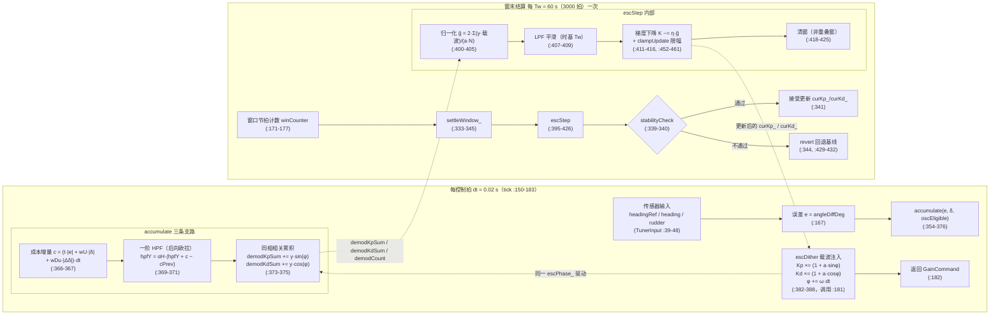

# 梯度计算的代码实现

本节对照 `control/include/auto_tuner.hpp`（510 行）逐行讲解 ESC 梯度估计的落地实现：每控制拍（`dt = 0.02 s`）完成的"成本增量 → HPF → 同相相关累积"链路，与每评估窗口（`Tw = 60 s`，3000 拍）结算一次的"归一化 → LPF → 梯度下降 → 限幅 → 清窗"链路。所有行号均指 `auto_tuner.hpp`。


## 1. 梯度数据流总览



要点：

- 注入与解调共用同一个相位状态 `escPhase_`（:464）：`escDither` 每拍推进相位并施加载波（:384-387），`accumulate` 用同一相位做相关解调（:373-374），二者严格同相，这是"因果解调"的代码基础。
- 累积量（`demodKpSum_` / `demodKdSum_` / `demodCount_`，:474-476）是每拍链路与窗末链路之间的唯一数据通道。
- 更新后的增益写回 `curKp_` / `curKd_`（:341），下一拍的 `escDither` 在其上继续叠加载波，构成闭环寻优。

## 2. 每拍链路：accumulate()（:354-376）

### 2.1 成本增量构造（:366-367）

```cpp
const double c = (t * std::abs(e) + p_.wU * std::abs(delta)
                + p_.wDu * std::abs(ddelta)) * p_.dt;
```

即

$$
c_k=\bigl(t_k\,|e_k|+w_U\,|\delta_k|+w_{Du}\,|\Delta\delta_k|\bigr)\,dt
$$

三个事实值得注意：

1. **与 `computeJ` 的被积函数严格一致**。`computeJ`（:214-223）的窗口总成本为
   $$J=\sum_i\bigl(t_i\,|e_i|+w_U|\delta_i|+w_{Du}|\Delta\delta_i|\bigr)\,dt\quad(:220)$$
   每拍喂给 HPF 的 $c_k$ 就是这个和式的第 $k$ 项——HPF 的输入与 ITAE 积分的被积序列同口径，梯度估计与窗口评估（`lastJ_ = computeJ()`，:398）度量的是同一个 $J$。
2. **时间权重 $t_k$ 取本拍在窗口内的时刻**：`t = windowErr_.size() * p_.dt`（:356），即窗口起点为 0 的相对时间，与 `computeJ` 中 `t += p_.dt` 的枚举方式一致。
3. **增量口径**：`Δδ_k = δ_k − δ_{k−1}`（:355，`prevDelta_` 于 :360 更新）。三个绝对值序列同时被推入窗口环形缓冲（:357-359，容量 `WIN_N = 3000`，:479-482），供 `computeJ` 与调试使用。

### 2.2 HPF：后向欧拉推出 αH = τH/(τH + dt)（:369-371）

ESC 解调只关心成本信号中由载波引起的交流分量，需先用高通滤掉直流与慢漂。连续域一阶高通

$$
H(s)=\frac{\tau_H s}{\tau_H s+1}
\;\Longleftrightarrow\;
\tau_H\dot y + y = \tau_H\dot c
$$

对两边做**后向欧拉**离散（采样周期 $dt$，$\dot y\approx\dfrac{y_k-y_{k-1}}{dt}$，$\dot c\approx\dfrac{c_k-c_{k-1}}{dt}$）：

$$
\tau_H\frac{y_k-y_{k-1}}{dt}+y_k=\tau_H\frac{c_k-c_{k-1}}{dt}
$$

两边乘 $dt$ 并归并 $y_k$：

$$
y_k\,(\tau_H+dt)=\tau_H\bigl(y_{k-1}+c_k-c_{k-1}\bigr)
\;\Longrightarrow\;
y_k=\alpha_H\bigl(y_{k-1}+c_k-c_{k-1}\bigr),\qquad
\alpha_H=\frac{\tau_H}{\tau_H+dt}
$$

与代码逐字对应（:369-371）：

```cpp
const double alphaH = p_.escHPFtau / (p_.escHPFtau + p_.dt);   // αH = τH/(τH+dt)
hpfY_ = alphaH * (hpfY_ + c - hpfCPrev_);                      // yk = αH·(y_{k-1} + ck − c_{k-1})
hpfCPrev_ = c;
```

默认参数 $\tau_H=5\,\mathrm{s}$（`escHPFtau`，:90）、$dt=0.02\,\mathrm{s}$，得 $\alpha_H = 5/5.02 \approx 0.99602$。差分项 $c_k-c_{k-1}$ 阻断直流，乘 $\alpha_H$ 提供指数遗忘——结构含义就是"去直流、留交流"。注意 $\alpha_H$ 是常数却每拍重算一次，这是可读性优先的写法，无性能问题。

### 2.3 同相相关累积（:373-375）

```cpp
demodKpSum_ += hpfY_ * std::sin(escPhase_);
demodKdSum_ += hpfY_ * std::cos(escPhase_);
++demodCount_;
```

即

$$
S_{K_p}\mathrel{+}= y_k\sin\varphi_k,\qquad
S_{K_d}\mathrel{+}= y_k\cos\varphi_k
$$

"同相"是本节的题眼：`escPhase_` 与本拍 `escDither` 注入时使用的相位是**同一个变量的同一个值**（注入发生在 `tick` 末尾 :181，下一拍 `accumulate` 在 :168 先于推进相位执行——严格说解调相位领先注入相位一拍，该一拍偏差对 $\omega\cdot dt=10^{-3}$ rad 的相位增量可忽略）。相比"窗末才做相关"的旧实现，每拍即时相关把 HPF 相移之外的相位失配压到最小，保证相关积分的均值确实携带梯度符号。

## 3. 窗末链路：escStep()（:395-426）

`tick` 内部按 `winBeats = windowSec/dt = 60/0.02 = 3000` 拍触发一次 `settleWindow_`（:171-177 → :333-345），后者调用 `escStep` 完成结算。下面按执行顺序逐行讲解。

### 3.1 归一化：系数 2/(a·N) 的来源（:400-405）

```cpp
const double norm = 2.0 / (p_.escAmp * static_cast<double>(demodCount_));  // 2/(a·N)
gKp = demodKpSum_ * norm;
gKd = demodKdSum_ * norm;
```

$$
\hat g=\frac{2}{aN}\sum_{k=0}^{N-1}y_k\,s_k,\qquad s_k\in\{\sin\varphi_k,\ \cos\varphi_k\}
$$

三个因子各有严格来历（完整证明见《ESC方案数学推导与算法实现详解》§4.5）：

- **$N$**：把累加和 $\sum$ 换成窗口均值 $\langle\cdot\rangle$。代码中 `N = demodCount_`（:375 逐拍自增），即本窗实际累积的拍数，而非理论值 3000——窗口因 `suspend()`（:199-203）等中断而不满时归一化仍然正确；
- **$2$**：抵消 $\langle\sin^2\rangle = \langle\cos^2\rangle = 1/2$。相关累积的均值里梯度信息以 $\frac{1}{2}a\,\bar\theta J'$ 的形式出现，乘 2 还原；
- **$a$**：注入是相对摄动 $\theta(t)=\bar\theta\,(1+a\,s_k)$（`escAmp`，:87），成本中的载波分量幅值正比于 $a\,\bar\theta J'$，除以 $a$ 才得到相对摄动意义下的梯度 $\bar\theta J'$。

守卫条件（:401）：`demodCount_ > 0 && escAmp > 0`，空窗或零幅值时 $\hat g$ 保持 0，不出现除零。

### 3.2 LPF：时基为什么是 Tw 而非 dt（:407-409）

```cpp
const double alphaL = p_.windowSec / (p_.escLPFtau + p_.windowSec);   // αL = Tw/(τL+Tw)
gradKp_ = (1.0 - alphaL) * gradKp_ + alphaL * gKp;
gradKd_ = (1.0 - alphaL) * gradKd_ + alphaL * gKd;
```

梯度低通 $G(s)=\dfrac{1}{\tau_L s+1}$ 的输入 $\hat g$ **每 $T_w$ 秒才到达一个新样本**——离散化的真实采样间隔是 $T_w$，不是 $dt$。后向欧拉：

$$
\tau_L\frac{g_w-g_{w-1}}{T_w}+g_w=\hat g_w
\;\Longrightarrow\;
g_w=(1-\alpha_L)\,g_{w-1}+\alpha_L\,\hat g_w,\qquad
\alpha_L=\frac{T_w}{\tau_L+T_w}=\frac{60}{10+60}=0.857
$$

即新梯度样本权重 85.7%。这个 LPF 的平滑作用其实很弱（等效滞后约 0.17 个窗口），梯度方差主要靠窗口平均本身压低；它的角色更接近"相邻窗估计的惯性环节"，防止单窗野值直接全额冲进积分器。

### 3.3 梯度下降与 clampUpdate 限幅（:411-416、:452-461）

```cpp
double newKp = Kp - p_.escStep * gradKp_;   // η = 0.02（escStep，:89）
double newKd = Kd - p_.escStep * gradKd_;
newKp = clampUpdate(newKp, Kp);
newKd = clampUpdate(newKd, Kd);
Kp = newKp > 0.0 ? newKp : 0.0;            // 非负钳位
Kd = newKd > 0.0 ? newKd : 0.0;
```

更新律 $\bar\theta_{w+1}=\bar\theta_w-\eta\,g_w$（:411-412）。`clampUpdate`（:452-461）施加两道约束：

$$
|\Delta\theta|\le\max\bigl(|\theta_{old}|\cdot 10\%,\ 10^{-3}\bigr)
$$

- **比例限幅 ±10%**（`maxUpdateFrac`，:96）：单窗增益变动不超过当前值的十分之一。远离最优点时 $\eta\hat g$ 通常远超该限幅，更新实际骑在限幅上以固定速率爬坡；接近最优点后才进入线性收缩区。限幅同时充当"野梯度防火墙"——单窗噪声或机动畸变造成的错误估计最多搬动 10%，且随即被稳定门审查；
- **绝对下限 $10^{-3}$**（`absMinUpdate`，:97）：$|old|=0$ 时比例上限退化为 0 会永久锁死更新（例如极点配置在 $\hat T$ 很小时把 $K_d$ 钳到 0），下限保证出现非零梯度符号后 $K_d$ 能以每窗至多 $10^{-3}$ 的速率爬离 0；
- **非负钳位**（:415-416）：增益符号保持物理合法，与稳定门 $K_p>0$（:246）一致。

### 3.4 清窗与非重叠窗设计（:418-425）

```cpp
windowErr_.clear();
windowDelta_.clear();
windowDDelta_.clear();
hpfCPrev_ = 0.0;
hpfY_ = 0.0;
demodKpSum_ = 0.0;
demodKdSum_ = 0.0;
demodCount_ = 0;
```

结算后清空全部窗口样本与解调累积状态，下一窗从零开始——**非重叠窗**：每个梯度样本的统计区间互不交叠，相邻窗估计近似独立，LPF（:408-409）是在独立样本序列上滤波，而不是在自相关的滑动窗输出上滤波。注意两个刻意不清的状态：

- `gradKp_` / `gradKd_`：LPF 状态跨窗保持，这是滤波器记忆的本职；
- `escPhase_`：载波相位跨窗连续（`rebaseEsc` :438-450 同样保留，注释见 :436-437），避免重锚拍载波突跳，同时让非整周期残余在窗间轮转成近似零均值涨落（偏置转化为方差）。

## 4. P11 整改案例：时基匹配的教训

整改记录写在文件头注释（:8-12），是全节最重要的工程教训。旧实现的症状：**调参结果与初值逐位相同**——ESC 在空转。

根因有两层：

1. **没有真实注入**。旧实现增益在窗口内恒定，窗末算出的"梯度"没有因果来源——$J$ 的波动与载波无关，相关累积的均值不含梯度信息。
2. **滤波器系数用错采样周期**。HPF 与 LPF 系数都按 $dt=0.02\ \mathrm{s}$ 设计，却作用在每 $T_w=60\ \mathrm{s}$ 才来一个的窗级样本上：
   - LPF 侧：正确值 $\alpha_L=\dfrac{60}{10+60}=0.857$；错误地用 $dt$ 计算得 $\alpha_L^{错}=\dfrac{0.02}{10.02}\approx0.002$，相差约 **430 倍**——每个新梯度样本只被采纳 0.2%，估计器近似恒等于初值；
   - HPF 侧：按 $dt$ 设计的差分滤波器用在窗级样本上，等效时间常数被放大 $T_w/dt=3000$ 倍，交流分量同样被衰减。
   两重错误叠加，梯度被衰减 **2~3 个数量级**，再经 ±10% 限幅舍入后增益不动，输出与初值逐位一致。

现行实现的修复（P11，头注释 :8-12 与 §2、§3 的代码即修复结果）：

- 每拍真实注入载波（`escDither`，:382-388）；
- HPF 在每拍成本增量上运行，系数按 $dt$ 计算（:369）——**输入时基与系数时基一致**；
- LPF 在窗末梯度样本上运行，系数按 $T_w$ 计算（:407）——**输入时基与系数时基一致**。

原则可以一句话概括：**ESC 各环节运行在不同时间尺度——扰动注入、HPF、相关解调在每拍（$dt$），归一化、LPF、梯度积分在窗末（$T_w$）——每个滤波器的系数必须用该环节输入样本的真实到达周期计算。** 写滤波器时先问一句"输入多久来一个样本"，就不会犯这个错误。


## 5. 双参数 sin/cos 载波的代码配对

$K_p$、$K_d$ 两参数在同一窗口内同时寻优，靠的是一对正交载波与两路正交解调的严格配对：

| 环节 | $K_p$ 通道 | $K_d$ 通道 |
|---|---|---|
| 注入 `escDither`（:384-385） | `Kp *= 1.0 + escAmp * sin(escPhase_)` | `Kd *= 1.0 + escAmp * cos(escPhase_)` |
| 解调 `accumulate`（:373-374） | `demodKpSum_ += hpfY_ * sin(escPhase_)` | `demodKdSum_ += hpfY_ * cos(escPhase_)` |
| 归一化 `escStep`（:403-404） | `gKp = demodKpSum_ * norm` | `gKd = demodKdSum_ * norm` |

配对规则是"自通道同相相关"：$K_p$ 用 $\sin$ 注入、就用 $\sin$ 解调；$K_d$ 用 $\cos$ 注入、就用 $\cos$ 解调。正交性保证通道间互不串扰（窗口覆盖整数个载波周期时严格成立）：

$$
\bigl\langle\sin\omega t\cdot\cos\omega t\bigr\rangle=0,\qquad
\bigl\langle\sin^2\omega t\bigr\rangle=\bigl\langle\cos^2\omega t\bigr\rangle=\tfrac12
$$

于是同一成本信号 $y_k$ 里，由 $K_p$ 摄动引起的分量只落在 $\sin$ 相关路上、由 $K_d$ 摄动引起的分量只落在 $\cos$ 相关路上，一次窗口测得两个方向的梯度：

$$
\hat g_{K_p}=\frac{2}{aN}\sum_k y_k\sin\varphi_k\approx \bar K_p\,\frac{\partial J}{\partial K_p},
\qquad
\hat g_{K_d}=\frac{2}{aN}\sum_k y_k\cos\varphi_k\approx \bar K_d\,\frac{\partial J}{\partial K_d}
$$

代码上只需注意一点：注入（:384-385）与解调（:373-374）的载波函数选择是**硬编码配对**的，改其中一处而不改另一处，梯度方向会静默丢失（$\langle\sin\cdot\cos\rangle=0$），且没有任何编译期或运行期检查能发现——这是该结构唯一的维护陷阱。

## 6. 公式 ↔ 代码行号对照表

| 公式 | 含义 | 代码位置 |
|---|---|---|
| $c_k=(t_k\vert e_k\vert +w_U\vert \delta_k\vert +w_{Du}\vert \Delta\delta_k\vert )\,dt$ | 每拍成本增量 | `auto_tuner.hpp:366-367`（被积函数同口径 :220） |
| $\alpha_H=\tau_H/(\tau_H+dt)$ | HPF 系数（后向欧拉） | `auto_tuner.hpp:369` |
| $y_k=\alpha_H(y_{k-1}+c_k-c_{k-1})$ | 一阶 HPF 递推 | `auto_tuner.hpp:370-371` |
| $S_{K_p}\mathrel{+}=y_k\sin\varphi_k$ | $K_p$ 路同相相关累积 | `auto_tuner.hpp:373` |
| $S_{K_d}\mathrel{+}=y_k\cos\varphi_k$ | $K_d$ 路同相相关累积 | `auto_tuner.hpp:374` |
| $K_p\!\leftarrow\!K_p(1+a\sin\varphi_k)$ | $K_p$ 载波注入 | `auto_tuner.hpp:384` |
| $K_d\!\leftarrow\!K_d(1+a\cos\varphi_k)$ | $K_d$ 载波注入 | `auto_tuner.hpp:385` |
| $\varphi_{k+1}=\varphi_k+\omega\,dt$ | 载波相位推进 | `auto_tuner.hpp:386-387` |
| $\hat g=\dfrac{2}{aN}\sum_k y_k s_k$ | 解调累积归一化 | `auto_tuner.hpp:401-405` |
| $\alpha_L=T_w/(\tau_L+T_w)$ | LPF 系数（时基 $T_w$） | `auto_tuner.hpp:407` |
| $g_w=(1-\alpha_L)g_{w-1}+\alpha_L\hat g_w$ | 梯度 LPF 递推 | `auto_tuner.hpp:408-409` |
| $\theta\leftarrow\theta-\eta\,g_w$ | 梯度下降（$\eta=0.02$） | `auto_tuner.hpp:411-412`（$\eta$ 定义 :89） |
| $\vert \Delta\theta\vert \le\max(\vert \theta\vert \cdot10\%,\,10^{-3})$ | 更新限幅 | `auto_tuner.hpp:452-461`（参数 :96-97） |
| $\theta\leftarrow\max(\theta,0)$ | 非负钳位 | `auto_tuner.hpp:415-416` |
| $N_{win}=T_w/dt=3000$ | 窗口拍数 | `auto_tuner.hpp:171-173`（缓冲容量 :479） |
| 非重叠窗清窗 | 窗口/解调状态清零 | `auto_tuner.hpp:418-425` |
| 参数 $\zeta=0.85,\ \omega_n=0.2,\ w_U=0.01,\ w_{Du}=0.005,\ a=0.05,\ \omega=0.05,\ \tau_H=5,\ \tau_L=10,\ T_w=60,\ dt=0.02$ | 全部默认值 | `auto_tuner.hpp:84-105` |
