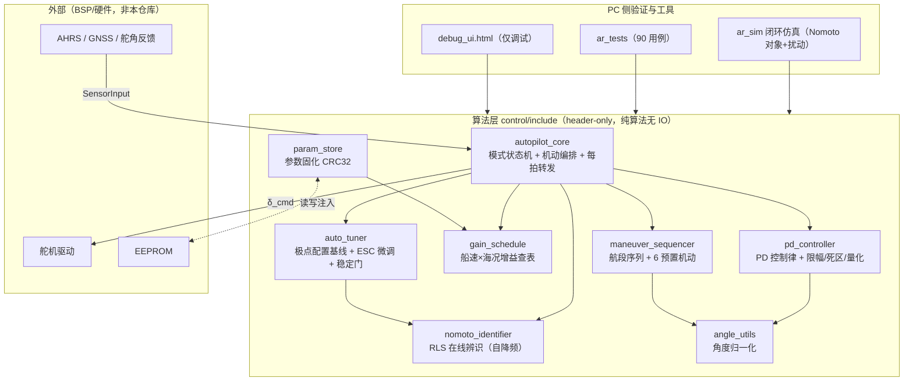

## 方案目标与适用场景

### 方案目标

本方案交付一套船用自动舵软件：**控制闭环在航向层完成，系统唯一输出为舵角指令 `δ_cmd`**。定位（GNSS）仅作为辅助信息（船速、位置参考），不参与控制律本身。

核心设计指标（代码与仿真已验证达成的口径，来源：软件设计文档 §7.3 实测、开发文档 §1.5）：

| 指标 | 目标值 | 备注 |
|------|--------|------|
| 航向控制精度 | ≤ ±1.0°（静水）/ ±2.0°（2 级海况），1σ | 海试验收项 |
| 阶跃超调 | ≤ 10% | 仿真实测 1.31%（30° 阶跃，K=0.2/T=8，10 kn） |
| 5% 调节时间 | ≤ 30 s | 仿真实测 27.44 s |
| 操舵频次 | ≤ 6 次/min | 保护舵机 |
| 控制周期 | 20 ms（50 Hz） | 算法单拍实测峰值 < 5 ms，留 4 倍余量 |
| 舵角分辨率 | 0.1° | 输出量化 `quant=0.1` |

### 适用场景与边界

- **适用对象**：中小型船舶（游艇、渔船、科考船、USV 等），舵机功率 0.5~25 kN·m；设计算例取 25 kn 半滑行/滑行游艇（船长 12~18 m）。
- **功能范围**：航向保持（`AUTO_HEADING`）、6 种预置机动（`AUTO_MANEUVER`：circles / williamson / u-turn / zigzag / cloverleaf / search）、手动透传（`MANUAL`）与冻结保持（`HOLD`）；在线模型辨识与增益自动优化；自动 Z 形辨识试验（P14，`startIdentifyTrial`，机动收官自动建基线）。
- **明确边界**：
  - 航迹跟随（LOS）在可行性文档 §4.6 有方案，但**当前代码库未实装**，GNSS 在算法层只用于提供船速 `speedKn`（待确认航迹闭环归属上层航迹规划还是后续迭代）。
  - 仅航向（无定位）降级工况下，cloverleaf / search 为开环机动，漂移不可消除（设计文档 §4.1 已声明）。
  - 船速 > 15 kn 时自动优化默认去激活（高速下辨识信噪比差），仅调度表增益生效。

---

## 控制思想概述

### 航向层闭环

被控对象按 Nomoto 一阶模型抽象：`T·ṙ + r = K·δ`（K 旋回性指数、T 追随性指数）。控制链为：

```
e = angleDiffDeg(ψ_ref, ψ)            # 航向误差，归一化到 (-180°, 180°]
δ = Kp·e + Kd·ė                        # PD 控制律
```

微分带一阶低通抑制量测噪声：`ė_k = α·(e_k − e_{k−1})/dt + (1−α)·ė_{k−1}`，其中 `α = 1/(1+τ/dt)`，`τ=0.2 s`。输出依次经过舵角限幅（±35°）、舵速限幅（10°/s）、量化（0.1°）后作为 `δ_cmd` 发出。

### 为什么选 PD 而不要积分项

- 低速/长时工况下积分项带来漂移与积分饱和风险；PD 结构简单、参数整定直观、对噪声敏感度低。
- 代价是存在稳态误差（由 Kp 与模型增益 K 决定），设计上由定位层航迹闭环补偿（见上文边界：该闭环当前不在算法层）。
- 注：可行性分析文档 §4.3 曾按增量式 PID（含 Ki）撰写，设计文档与代码已定型为 PD——属方案演进，以代码为准。

### 为什么是"增益调度 + 在线辨识 + 极点配置 + ESC 微调"组合路线

船舶操纵性（Nomoto K/T）随船速、载荷、吃水、海况显著变化，固定增益无法全工况最优。四层机制各管一段时间尺度，组合覆盖"冷启动 → 粗适应 → 精调优"全过程：

| 层 | 机制 | 时间尺度 | 解决什么 |
|----|------|----------|----------|
| 0 | **增益调度**：船速段×海况查表，段中点线性插值 | 每拍（50 Hz） | 无基线时的名义增益，冷启动即可用 |
| 1 | **在线辨识**：带遗忘因子 RLS 估计 K̂/T̂ | 1 s 一拍（自降频 `beatSec`） | 跟踪模型参数慢变，无需人工干预 |
| 2 | **极点配置**：由 ζ\*/ωn\* 反推增益建**基线** | 事件驱动（辨识试验收官/漂移超阈/人工标定） | 一次性把增益锚到理论合理点 |
| 3 | **ESC 极值搜索**：扰动-解调式在线微调 | 60 s 窗口结算 | 在基线附近按实测性能指标 J 持续寻优 |

层 2 的公式（全仓库唯一出处 `AutoTuner::polePlacement`）：

```
Kp = ωn²·T / K
Kd = (2ζ·ωn·T − 1) / K        # 负值 clamp 到 0
```

默认目标 `ζ=0.85`、`ωn=0.20 rad/s`。层 3 的性能指标为窗口内 ITAE + 控制能耗：

```
J = ∫(t·|e| + wU·|δ| + wDu·|dδ|) dt     # wU=0.01, wDu=0.005, 窗口 60 s
```

ESC 对 Kp/Kd 注入正交载波（Kp 乘 sin、Kd 乘 cos，幅值 `escAmp=5%`，频率 `escFreq=0.05 rad/s`），每拍因果解调估计梯度，窗末按步长 `escStep=0.02` 梯度下降，单次更新限幅 ≤10%。时间尺度分离是收敛前提：扰动周期 ≈126 s ≫ 闭环调节时间 ≤30 s ≫ 控制周期 20 ms。

### 安全兜底

所有自动更新都要过"稳定门"四条件（`AutoTuner::stabilityCheck` + `clampUpdate`）：反算 `ζ̂ ≥ 0.6`、`ω̂n ≤ 0.5 rad/s`（反算公式 `ωn=√(KpK/T)`、`ζ=(1+KdK)/(2√(T·KpK))`）、振荡幅值实测 ≤ 5°（`OscillationDetector` 对航向误差过零结算峰-峰值，且参考稳定满 30 s 才喂入，机动期间不参与）、单次增益变化 ≤10%。任一不过即**回退**到基线；显式重基线（**重锚**）时清零 ESC 积分/解调/窗口样本，旧梯度不得施加到新基线。增益建立基线后归 AutoTuner 所有（**增益所有权**），不再被调度表每拍覆写。

---

## 软硬件边界与部署形态

### 软件边界：纯算法层

`control/include/` 下 8 个头文件为 **header-only、C++17、零第三方依赖、主循环零堆分配**的纯算法库，不含任何 IO：

- 传感器数据经 `SensorInput` 结构体传入，舵角指令经返回值传出——对外仅暴露 `AutopilotCore::step(const SensorInput&, double dt) → 目标舵角` 单入口。
- EEPROM 读写、时间戳时钟经 `std::function` 注入（`ParamStore::ReadFn/WriteFn/ClockFn`）。
- 航向融合（AHRS 高频 + GNSS 校正）与传感器有效性判断在 BSP/融合层完成，`headingDeg` 进入算法层时已是可信值；GNSS 失锁等降级表现为上层切换模式，算法层不感知 GNSS 状态。

### 硬件/外部依赖（来自可行性与设计文档，非本仓库代码）

| 设备 | 接口 | 提供 |
|------|------|------|
| AHRS | RS-422，NMEA 0183 扩展 | 艏向 ψ、转向率 r（控制主反馈；设计文档 §5.4 按 100 Hz，可行性 §8.2.1 按 10 Hz，口径不一致，待确认） |
| GNSS（推荐双天线） | RS-232，NMEA 0183 | 位置/航速/航向校正 |
| 舵角编码器 | CANopen DS406，12-bit | 舵角反馈 δ |
| 舵机驱动 | CAN 2.0B 自定义 / 0~10 V 模拟量备份 | 接收 δ_cmd，回传实际舵角/电流 |
| EEPROM | ECU 板载 | 参数固化（CRC32 校验） |

### 部署形态

| 形态 | 载体 | 说明 |
|------|------|------|
| 实船 | ECU（推荐 STM32H7 级，双冗余为可行性方案目标） | 算法库直接嵌入，BSP 定时回调保证 50 Hz 调用 `step()` |
| 闭环仿真（SIL） | `ar_sim`（`control/sim/`） | Nomoto 对象 + 舵机一阶惯性 + 风/浪/噪声扰动，确定性 LCG 可复现；`--validate` 跑全验证矩阵 |
| 单元测试 | `ar_tests`（GoogleTest，90 用例 / 8 文件） | Release + ASan 双工具链 |
| 调试界面 | `control/ui/debug_ui.html` | 单文件 Web 应用，算法为 C++ 的 JS 镜像，可内置仿真或经 WebSocket 连真实 ECU；**仅用于调试，实船控制必须走 C++ ECU** |
| 可视化工具 | `control/tools/plot_sim.py`、`animate_sim.py` | CSV → 分析图 / 动画 |

---

## 软件模块划分（control/include）

### 模块职责一览

全部模块位于 `namespace ar`，无环依赖：

| 模块 | 文件 | 职责（一句话） |
|------|------|----------------|
| 角度工具 | `angle_utils.hpp` | 角度归一化与最小带符号角差（消除 359°→1° 跳变），被 PD 与机动序列复用 |
| PD 控制器 | `pd_controller.hpp` | 航向误差 → 舵角：PD 控制律 + 死区/微分低通/舵角限幅/舵速限幅/量化，`setGains()/setDt()` 轻量改参不清状态 |
| 增益调度 | `gain_schedule.hpp` | 按船速段×海况查名义 Kp/Kd（`GainPoint` 表，默认 14 条），速度维段中点锚定线性插值，支持 `setTable()` 整表替换 |
| 在线辨识 | `nomoto_identifier.hpp` | Nomoto K/T 的 RLS 在线辨识（λ=0.98，回归量归一化，激励门限，P 阵保底）；自降频——`update(δ, r, dtNow)` 任意频率调用，内部满 `beatSec=1 s` 才做一拍，Δt 自测 |
| 自动优化 | `auto_tuner.hpp` | 极点配置建基线 + ESC 微调 + 稳定门/回退/重锚；R1 起编排全内收，对外仅 `tick()/establishBaseline()/suspend()` 三个动作 |
| 机动序列 | `maneuver_sequencer.hpp` | 航段（`Leg`：HEADING/RUDDER 模式 + 目标 + 触发条件 + next）状态机框架 + 6 种预置机动工厂函数 |
| 参数存储 | `param_store.hpp` | `ControlParams` 序列化（逐字段小端）+ CRC32 + 物理范围校验 `validateRange()`，读写经注入函数对接 EEPROM |
| 核心集成 | `autopilot_core.hpp` | 唯一对外入口：模式状态机（MANUAL/AUTO_HEADING/AUTO_MANEUVER/HOLD）+ 机动编排 + 每拍转发，调参编排已全部收进 AutoTuner |

### 关键接口签名（代码实测）

```cpp
struct SensorInput { double headingDeg, rateDegS, rudderDeg, speedKn; int seaState; };
double AutopilotCore::step(const SensorInput& s, double dt);          // 50 Hz 单入口 → δ_cmd

struct IdSnapshot  { bool excited; bool valid; double K, T; };         // 辨识只读投影
struct TunerInput  { headingRefDeg, headingDeg, rudderDeg, speedKn, dt,
                     schedKp, schedKd, IdSnapshot id };                // tick 每拍输入包
struct GainCommand { double Kp, Kd; };                                 // 本拍增益（已含 ESC 载波）
GainCommand AutoTuner::tick(const TunerInput&);                        // 每拍单入口
bool AutoTuner::establishBaseline(const IdSnapshot&);                  // 一次性建基线（辨识试验收官/人工标定）
void AutoTuner::suspend();                                             // 切出自动模式：清测量状态、保留基线
```

### 调用节拍

| 环节 | 节拍 | 备注 |
|------|------|------|
| `step()` / PD / 调度查询 | 20 ms（50 Hz） | 主循环 |
| `identifier.update()` | 20 ms 喂入，1 s 一 RLS 拍 | 自降频，差分 Δt 自测 |
| `tuner.tick()` | 20 ms | 内部自维护 60 s ESC 窗口拍数，满窗自结算 |
| `ParamStore::save/load` | 事件驱动 | 上电/标定完成/参数更新，不进主循环 |

---

## 整体数据流

### 主控制链路

```
AHRS(ψ, r) ──┐
GNSS(船速) ──┼──> BSP 融合/校验 ──> SensorInput ──> AutopilotCore::step()
舵角反馈 δ ──┘                                        │ 按模式分支
                                                      ├─ AUTO_HEADING: 调度查询 → PD(ψ_ref, ψ)
                                                      ├─ AUTO_MANEUVER: 航段指令（HEADING 段走 PD / RUDDER 段经限幅直出）
                                                      ├─ MANUAL: 透传舵角反馈
                                                      └─ HOLD: 冻结上一拍舵角
                                                      ▼
                                              δ_cmd ──> 舵机驱动 ──> 本船 ──> (回到传感器)
```

### 辨识/调参旁路（AUTO_HEADING 每拍）

```
SensorInput ──> NomotoIdentifier.update(δ, r, dt)   # 自降频，满 1 s 一拍
                     │ excited/valid/K/T
                     ▼
               IdSnapshot ──> AutoTuner.tick(TunerInput{…, 调度名义 Kp/Kd, id})
                                  │ 内部：速度门控(>15 kn 停用) → 无基线跟随调度值
                                  │ → 周期辨识评估(漂移 ±25% 重锚) → ESC 窗口结算
                                  │ (稳定门/回退) → 扰动注入
                                  ▼
                          GainCommand{Kp, Kd}(含载波) ──> pd.setGains() ──> PD 闭环
```

旁路入口另有：辨识试验 `startIdentifyTrial(dz=20°, phiz=20°, cycles=4)`（自动 Z 形机动，期间喂辨识器，收官一行 `establishBaseline(idSnapshot())` 建基线）；人工标定经 `ParamStore` 固化参数并注入基线（人工标定优先级高于自动优化）。

### 架构示意（仓库五层组织）



---

## 口径与差异说明（读代码核对中发现，引用前请确认）

1. **控制周期**：定位与控制设计文档 §1.3 写"控制周期 100 ms（10 Hz）"，但其 §5.4、软件设计文档与代码（`dt=0.02`）均为 50 Hz——§1.3 疑为未更新的旧值（待确认）。
2. **激励门限**：设计文档 §3.10.3 辨识使能仅 `|δ|>3° 且 |r|>0.5°/s`；代码另有或条件 `|dr|>drMin=0.2°/s²`（保留转向率过零瞬态，否则 T 欠定），开发文档 §5.4 已同步。
3. **ζ\*/ωn\* 分速段**：设计文档 §3.10.4 有按船速分段表，代码当前仅单组 `ζ=0.85/ωn=0.20`，分段未实装（开发文档 §6.3 列为后续项，待确认排期）。
4. **回退缓存深度**：设计文档 §3.10.7 要求保留最近 3 组验证通过的参数，代码当前为单组基线（开发文档 §6.5 列为已知差距）。
5. **自动辨识试验参数**：`startIdentifyTrial` 默认 Z 形 ±20°/20°×4 循环，与设计文档 §3.9.4 人工 Z 形 ±10°/10°×3~5 不同（自动试验取更大激励）。
6. **EEPROM 区块映射**：可行性文档 §5.6 的区块划分（含磁补偿、航向偏置）与设计文档 §3.9.8 / 代码 `ControlParams`（A 舵角标定 / B 模型 K/T / C PD 增益 / D 调度表）不一致；磁补偿与航向偏置不属本算法库（待确认归感知/融合层）。
7. **AHRS 数据周期**：设计文档 §5.4 按 100 Hz、可行性文档 §8.2.1 按 10 Hz，两文档口径不一致（待确认）。
