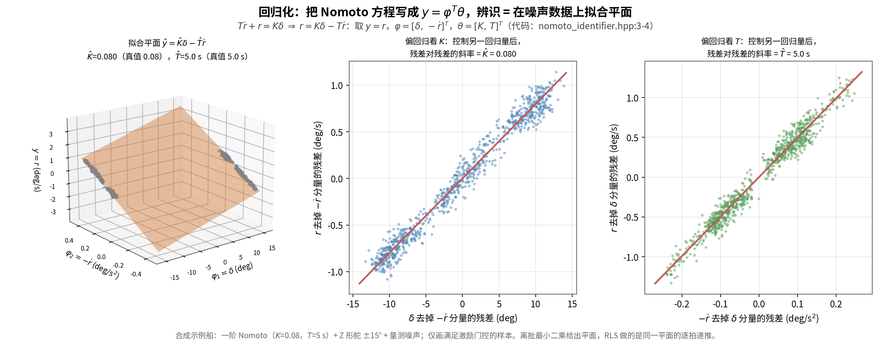
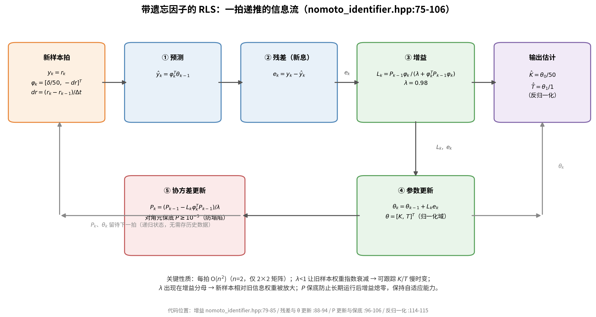
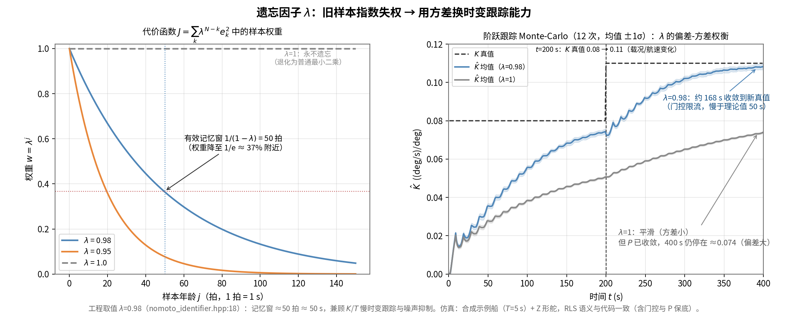
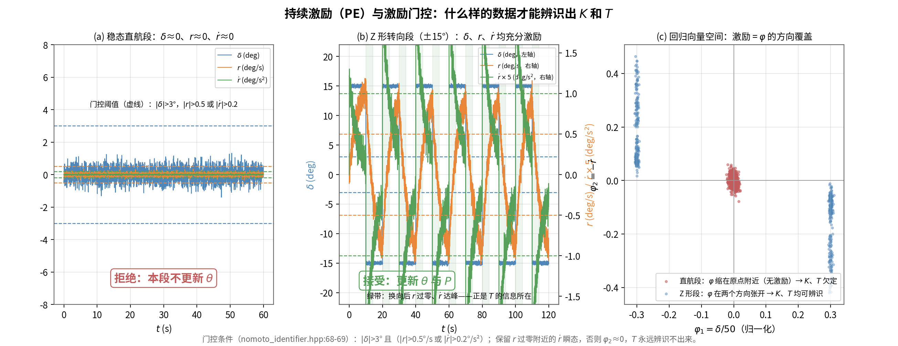
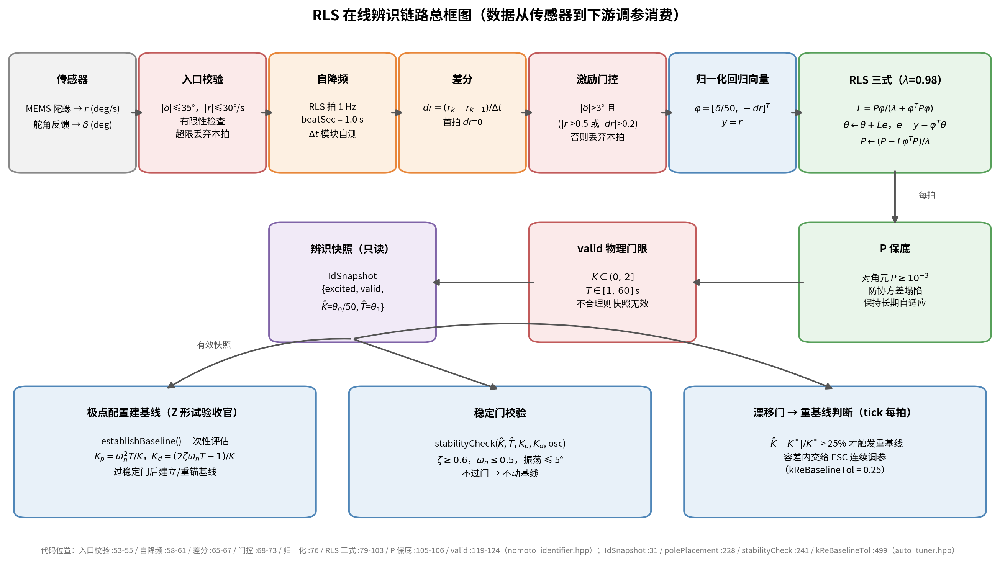
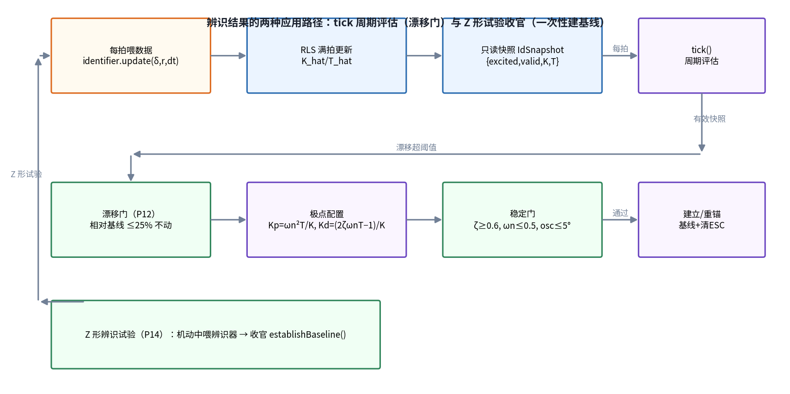
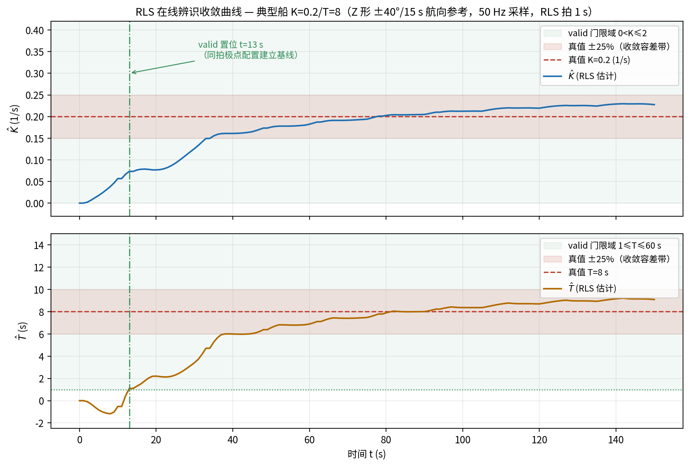
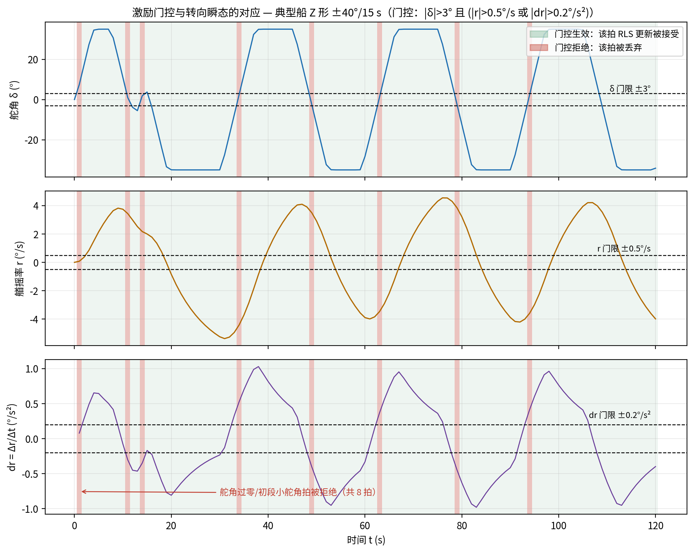
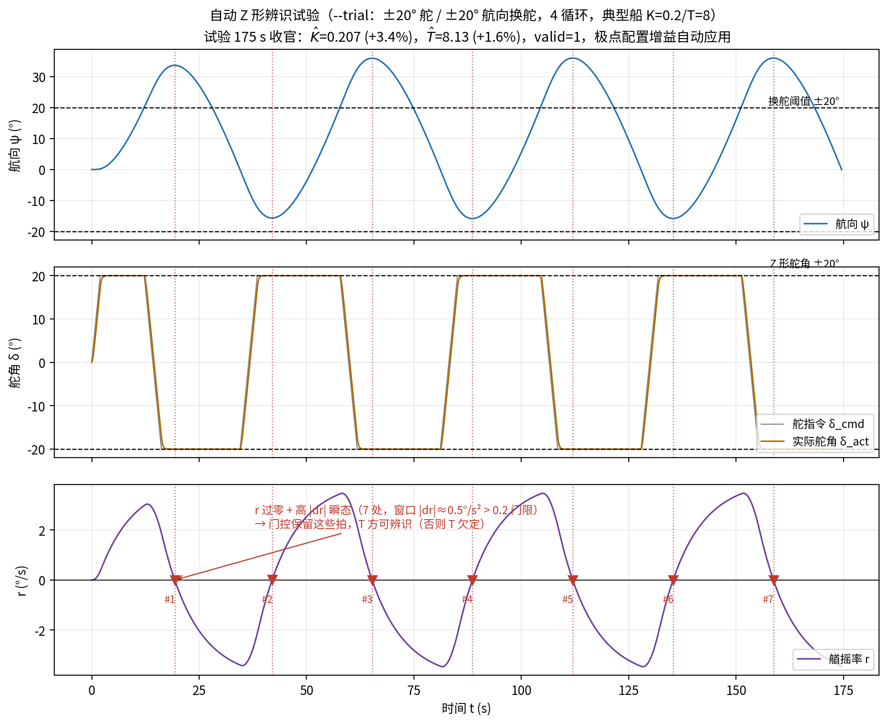
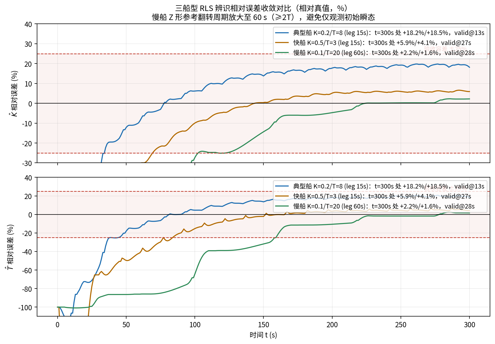

# RLS 方案数学推导与算法实现详解

> 本文档是船舶自动舵 RLS（Recursive Least Squares，递归最小二乘）在线辨识方案的专项技术文档，包含两部分：**数学推导**（第 2~8 章，不跳步的完整推导）与**算法实现**（第 9 章，代码级流程），并给出仿真验证（第 10 章）与已知限制的诚实讨论（第 11 章）。
>
> 事实来源约定：一切公式与流程均与源码严格对齐——`control/include/nomoto_identifier.hpp`（辨识器本体）、`control/include/auto_tuner.hpp`（消费方：极点配置 / 稳定门 / 漂移门）、`control/include/autopilot_core.hpp`（调用方：模式与主循环）、`control/include/maneuver_sequencer.hpp`（Z 形机动生成）。引用格式：`文件路径:行号`，所有数值默认值以源码为准。高层背景参见 `docs/工程总体分析与ESC方案原理.md` §2.3 与第 3 节；辨识结果的应用侧（极点配置基线、ESC 微调）的完整推导见姊妹篇 `docs/ESC方案数学推导与算法实现详解.md`。
>
> 记号约定：$\delta$ 为舵角（deg），$r=\dot\psi$ 为艏摇率/转向率（deg/s），$\dot r$ 为转向加速度（deg/s²），$K$、$T$ 为 Nomoto 一阶模型参数，$\hat K,\hat T$ 为其 RLS 估计值；$\varphi$ 为回归向量，$\theta=[K,T]^{\mathsf T}$ 为被估参数，$P$ 为协方差矩阵，$\lambda$ 为遗忘因子。所有公式使用 KaTeX 兼容 LaTeX 记法。

**目录**

- [1. 引言](#1-引言)
- [2. 被控对象建模：一阶 Nomoto 模型的物理来历](#2-被控对象建模一阶-nomoto-模型的物理来历)
- [3. 回归化与归一化推导](#3-回归化与归一化推导)
- [4. 加权最小二乘与 RLS 递推三式完整推导](#4-加权最小二乘与-rls-递推三式完整推导)
- [5. 遗忘因子与 P 保底](#5-遗忘因子与-p-保底lambda--098)
- [6. 激励条件与门控：持续激励（PE）分析](#6-激励条件与门控持续激励pe分析)
- [7. 自降频采样分析](#7-自降频采样分析)
- [8. 收敛性与误差分析](#8-收敛性与误差分析)
- [9. 算法实现流程（代码级）](#9-算法实现流程代码级)
- [10. 仿真验证](#10-仿真验证)
- [11. 已知限制与讨论](#11-已知限制与讨论)
- [12. 附录](#12-附录)

---

## 1. 引言

### 1.1 为什么需要在线辨识

船舶操纵性随船速、载荷、吃水、海况显著变化：水动力导数（附加质量、阻尼、舵效）本身就是工况的函数，固定参数模型无法全工况准确。本工程的控制律是 PD，其增益 $K_p,K_d$ 的解析整定（极点配置）需要知道被控对象——舵角到艏摇率通道——的模型参数。若模型靠离线一次标定，换船、换载、变速之后标定值即失真，解析整定的增益随之失真。

因此需要一个**在线**辨识器：从日常操舵（或一次短暂的专用机动）中实时估计当前工况下的模型参数，供下游重建控制增益基线。对方案的具体约束是：

- **算力可忽略**：嵌入式 ECU 上运行，每拍只允许常数次乘加；
- **无需存储历史**：在线递推，不能攒一批数据再做批处理最小二乘；
- **能跟踪慢时变**：船况分钟级漂移时估计值要跟得上，不能"睡死"；
- **劣质数据不进估计**：稳态直航时数据里本就没有全部参数的信息（§6），辨识器必须知道何时**不更新**；
- **估计失败要可检测**：辨识失真时必须能被打上"无效"标记，由下游保守拒用，而不是静默输出错误增益。

带遗忘因子的 RLS（Recursive Least Squares）恰好命中全部约束：每拍 $O(n^2)$（本问题 $n=2$，约 20 次 FLOP）、只存递归状态 $\theta,P$、遗忘因子提供时变跟踪能力、激励门控与物理门限承担"不更新"与"可检测"两条防线。本文给出该方案从对象建模到代码行号的完整链条。

### 1.2 在三层调参架构中的位置

工程采用由粗到细的三层调参结构（设计文档 §3.10，`docs/工程总体分析与ESC方案原理.md` §3.1）：

1. **层 1 增益调度表**（`gain_schedule.hpp`）：按船速 × 海况查表给名义增益，管"快变量"（航速），是任何情况下的兜底；
2. **层 2 RLS 辨识 + 极点配置**（`nomoto_identifier.hpp` + `AutoTuner::polePlacement`，**本文主题**）：在线辨识 $\hat K,\hat T$，解析反解 PD 增益，建立**基线（baseline）**——一个"已验证安全"的锚点；
3. **层 3 ESC 极值搜索**（`AutoTuner` 的 ESC 环节）：在基线附近注入 ±5% 正交载波，实测性能梯度做连续微调，吸收辨识残差与非线性影响。

层 2 是承上启下的枢纽：向上它把"船当前是什么动态"凝缩成两个数 $\hat K,\hat T$；向下它通过极点配置（§9.5）把这两个数变成 PD 增益基线，交给 ESC 在其邻域内微调。辨识误差到增益的映射是单调有理的（§9.5），因此辨识精度直接决定基线质量——这是全文对误差来源（§8、§11）斤斤计较的原因。基线建立后增益所有权移交 `AutoTuner`，不再跟随调度表每拍刷新（`auto_tuner.hpp:155`）；当辨识显示 $K,T$ 相对基线漂移超 ±25% 阈值时重新极点配置并重锚 ESC（P12 漂移重基线，§9.5）。

### 1.3 全链路速览

```
船舶(δ→r) → NomotoIdentifier.update(δ,r,dt)   [50 Hz 调用，1 Hz RLS 拍]
          → IdSnapshot{excited,valid,K,T}     autopilot_core.hpp:176-178
          → AutoTuner.tick()                  auto_tuner.hpp:150-183
              ├─ 漂移门 ±25%                   auto_tuner.hpp:308-313
              ├─ 极点配置 polePlacement        auto_tuner.hpp:228-237
              └─ 稳定门 stabilityCheck         auto_tuner.hpp:241-254
          → PD 增益基线 → ESC 微调
```

本文结构：第 2 章推导被控对象（Nomoto 模型来历与 $K/T$ 物理意义）；第 3 章把微分方程回归化为 $y_k=\varphi_k^{\mathsf T}\theta$ 并做归一化；第 4 章从加权最小二乘目标出发，经 Woodbury 引理完整推出 RLS 递推三式；第 5 章分析遗忘因子与 $P$ 保底；第 6 章给出持续激励（PE）条件与激励门控的数学对应；第 7 章分析 50 Hz→1 Hz 自降频采样；第 8 章给出收敛性与三类误差来源；第 9 章把每个环节落到代码行号并给出与下游的衔接；第 10 章为仿真验证；第 11 章诚实列出已知限制；第 12 章附录为参数表、公式↔代码对照表与测试清单。

---

## 2. 被控对象建模：一阶 Nomoto 模型的物理来历

### 2.1 从船舶操纵性方程出发

船舶水面运动在"定常直航 + 小扰动"假设下，只保留横荡（sway，速度 $v$）与艏摇（yaw，角速度 $r$）两个自由度的线性化方程（Abkowitz 线性模型）：

$$
\begin{aligned}
\text{横荡：}\quad & (m - Y_{\dot v})\,\dot v + (m x_G - Y_{\dot r})\,\dot r = Y_v\,v + (Y_r - mU)\,r + Y_\delta\,\delta \\
\text{艏摇：}\quad & (m x_G - N_{\dot v})\,\dot v + (I_z - N_{\dot r})\,\dot r = N_v\,v + N_r\,r + N_\delta\,\delta
\end{aligned}
$$

其中 $m$ 为船体质量，$I_z$ 为艏摇转动惯量，$x_G$ 为重心纵向位置，$U$ 为前速；$Y_v, Y_r, Y_\delta$ 与 $N_v, N_r, N_\delta$ 分别为横荡力、艏摇力矩对 $v, r, \delta$ 的流体动力导数；$Y_{\dot v}, Y_{\dot r}, N_{\dot v}, N_{\dot r}$ 为附加质量（附加惯量）导数。水动力导数随船型、航速、载况、水深而变——这正是 $K/T$ 需要**在线**辨识而非一次标定了事的物理根源（§1.1）。

### 2.2 消去横荡：一阶 Nomoto 模型

舵角变化引起的艏摇响应远慢于横荡力的建立（横荡压力平衡在秒的零头量级即完成），因此对横荡方程取**准定常近似** $\dot v \approx 0$、$\dot r$ 的横荡耦合项忽略不计：

$$
v \approx \frac{(mU - Y_r)\,r - Y_\delta\,\delta}{Y_v}
$$

（注意 $Y_v<0$，分母非零。）代入艏摇方程并同样略去 $\dot v$ 项：

$$
(I_z - N_{\dot r})\,\dot r
= N_v\,\frac{(mU - Y_r)\,r - Y_\delta\,\delta}{Y_v} + N_r\,r + N_\delta\,\delta
$$

把含 $r$ 的项归并到左边、含 $\delta$ 的项留在右边：

$$
\underbrace{(I_z - N_{\dot r})}_{\text{有效艏摇惯性 } \mathcal I}\,\dot r
\;+\;
\underbrace{\left(\frac{N_v\,(Y_r - mU)}{Y_v} - N_r\right)}_{\text{等效艏摇阻尼 } \mathcal N}\,r
\;=\;
\underbrace{\left(N_\delta - \frac{N_v Y_\delta}{Y_v}\right)}_{\text{舵效艏摇力矩系数 } \mathcal M}\,\delta
$$

两边同除以等效阻尼 $\mathcal N$，即得**一阶 Nomoto 模型**：

$$
\boxed{\;T\,\dot r + r = K\,\delta\;}
$$

三个集总参数与流体动力导数的关系（示意，符号随导数符号约定而异）：

$$
T = \frac{\mathcal I}{\mathcal N}, \qquad K = \frac{\mathcal M}{\mathcal N}
$$

对航向稳定的船舶，等效阻尼 $\mathcal N>0$（在常用符号约定下），故 $T>0$、$K>0$——这是 `valid()` 物理门限要求 $K>0$、$T\ge 1$ 的力学依据（`nomoto_identifier.hpp:119-124`，详见 §8.4）。

### 2.3 参数的物理意义与量纲

| 参数 | 名称 | 定义 | 物理意义 | 量纲（本工程单位制） | 工程取值范围 |
|---|---|---|---|---|---|
| $K$ | 旋回性指数 | $\mathcal M/\mathcal N$ | 单位舵角产生的**稳态**转向率：$\delta$ 恒定时每度舵角换来 $K$ 度/秒的转首角速度 | $\mathrm{s^{-1}}$（(deg/s)/deg） | $(0,2]$，典型 $0.05\sim0.5$ |
| $T$ | 追随性指数 | $\mathcal I/\mathcal N$ | 艏摇惯性相对阻尼的时间尺度：转首响应滞后舵角约 $T$ 秒 | $\mathrm{s}$ | $[1,60]$ |

对 $\delta$ 取拉氏变换（零初值），$\delta\to r$ 是一阶惯性环节：

$$
\frac{r(s)}{\delta(s)} = \frac{K}{Ts+1}
$$

阶跃响应 $r(t) = K\delta_0\left(1 - e^{-t/T}\right)$：稳态增益 $K$、上升时间由 $T$ 决定，两个参数各管一件事——这决定了 §6 的可辨识性结构：$K$ 由**稳态段**数据决定，$T$ 只能由**瞬态段**数据决定。

再串一级航向积分 $\dot\psi = r$，舵角到航向的通道为：

$$
\frac{\psi(s)}{\delta(s)} = \frac{K}{s\,(Ts+1)}
$$

即下游极点配置面对的被控对象（§9.5）。

---

## 3. 回归化与归一化推导

### 3.1 后向差分离散：从微分方程到 $y_k = \varphi_k^{\mathsf T}\theta$

辨识器拿不到 $\dot r$ 的直接量测（罗经/惯导给的是 $\psi$ 或 $r$），只能用差分近似。采用**后向欧拉**：

$$
\dot r\big|_{t_k} \;\approx\; \frac{r_k - r_{k-1}}{\Delta t}
$$

其中 $\Delta t$ 为两次用于递推的样本之间的真实间隔（实现中为两次 RLS 拍之间的间隔，见 §7）。代入 $T\dot r + r = K\delta$：

$$
T\,\frac{r_k - r_{k-1}}{\Delta t} + r_k = K\,\delta_k
$$

把未知参数 $K$、$T$ 整理到"已知量 × 参数"的位置上——将 $r_k$ 单独留在左边：

$$
r_k = K\,\delta_k - T\,\frac{r_k - r_{k-1}}{\Delta t}
$$

记差分转向加速度

$$
dr_k \;=\; \frac{r_k - r_{k-1}}{\Delta t}
$$

则方程变成标准的**线性参数回归**：

$$
\boxed{\;y_k = \varphi_k^{\mathsf T}\,\theta\;}
\qquad
y_k = r_k,\qquad
\varphi_k = \begin{bmatrix} \delta_k \\ -dr_k \end{bmatrix},\qquad
\theta = \begin{bmatrix} K \\ T \end{bmatrix}
$$

逐分量验证：$\varphi_k^{\mathsf T}\theta = K\delta_k + T\cdot(-dr_k) = K\delta_k - T\,dr_k = r_k = y_k$。✓

**关键点**：$K$、$T$ 以线性方式出现，整个辨识问题归结为（加权）线性最小二乘，无需任何非线性迭代；这是选择"对 $r$ 回归"而非"对 $\psi$ 回归"或"直接拟合传递函数"的原因。

实现对应：回归化写在模块头注释（`nomoto_identifier.hpp:3-4`），差分在 `nomoto_identifier.hpp:65-67`，$\varphi$ 构造在 `nomoto_identifier.hpp:76`，$y=r$ 在 `nomoto_identifier.hpp:88`。

回归化的几何图像：每个样本 $(\delta_k,\,-dr_k,\,r_k)$ 是三维空间中的一个点，真参数 $\theta^*$ 决定一张过原点的平面 $y=\varphi^{\mathsf T}\theta^*$，辨识就是在噪声数据上拟合这张平面；批处理最小二乘一次给出平面，RLS 做的是同一平面的逐拍递推。



上图中左为合成示例船（$K=0.08,\ T=5$ s，Z 形舵 ±15° + 量测噪声，仅画过激励门的样本）的拟合平面；中、右为偏回归视图——控制另一回归量后，残差对残差的斜率分别给出 $\hat K$ 与 $\hat T$。两个偏回归方向的数据"张开程度"差异已经预告了 §6 的核心问题：$\delta$ 方向能量充沛，而 $-dr$ 方向能量集中在少数瞬态样本上。

### 3.2 差分 $dr$ 的噪声放大问题

差分是回归化的必要代价。设 $r$ 的量测含零均值白噪声 $n_k$，$\mathrm{Var}[n_k] = \sigma_r^2$，相邻样本独立。则 $dr$ 中的噪声分量为

$$
\nu_k = \frac{n_k - n_{k-1}}{\Delta t},
\qquad
\mathrm{Var}[\nu_k] = \frac{\mathrm{Var}[n_k] + \mathrm{Var}[n_{k-1}]}{\Delta t^2} = \frac{2\sigma_r^2}{\Delta t^2}
$$

噪声标准差 $\sigma_\nu = \sqrt{2}\,\sigma_r / \Delta t$，**与采样间隔成反比**：

- $\Delta t = 0.02\,\mathrm{s}$（50 Hz 直接差分）：$\sigma_\nu \approx 70.7\,\sigma_r$；
- $\Delta t = 1\,\mathrm{s}$（1 Hz RLS 拍差分）：$\sigma_\nu \approx 1.41\,\sigma_r$。

同一传感器，仅把差分间隔从 20 ms 放大到 1 s，$dr$ 噪声标准差压低 **50 倍**。而只要船舶动态远慢于 $1/\Delta t$（$T\ge1\,\mathrm{s}$ 保证），差分对**真实信号** $\dot r$ 的估计基本不损失（见 §7.2）。信噪比因此近似正比于 $\Delta t$ 改善——这是 §7 自降频设计的核心收益。

实现中首拍无差分锚点，置 $dr=0$ 跳过（`first_` 标志，`nomoto_identifier.hpp:66`）；被拒绝的非法输入拍**不写** `prevR_`，防止毛刺成为下一拍的差分锚点（`nomoto_identifier.hpp:50-55`，详见 §6.4）。

### 3.3 归一化：dScale/drScale 消除量级病态

原始回归量两个分量量级悬殊：舵角 $\delta$ 典型变化幅度 $3^\circ\sim35^\circ$（激励门限 3°、舵限幅 35°），差分加速度 $dr$ 典型幅度 $0.2\sim1\ \mathrm{deg/s^2}$。设二者的 RMS 幅度为 $\delta_{\mathrm{rms}}\approx 10$、$dr_{\mathrm{rms}}\approx 0.5$，则信息矩阵

$$
R_N = \sum_{k=1}^{N}\lambda^{N-k}\,\varphi_k\varphi_k^{\mathsf T}
= \begin{bmatrix} \sum \lambda^{N-k}\delta_k^2 & -\sum \lambda^{N-k}\delta_k dr_k \\[1mm] -\sum \lambda^{N-k}\delta_k dr_k & \sum \lambda^{N-k}dr_k^2 \end{bmatrix}
$$

的对角元之比达 $(\delta_{\mathrm{rms}}/dr_{\mathrm{rms}})^2 \approx (10/0.5)^2 = 400$，工况变化时可达 $10^3\sim10^4$。$R_N$ 的病态直接传染给协方差 $P_N = R_N^{-1}$（条件数相同量级），使增益向量 $L_N$ 的数值计算在 $T$ 方向上分辨率粗劣、对舍入误差敏感。

实现做法：给两个回归分量各配一个归一化尺度，令其均为 $O(1)$（`nomoto_identifier.hpp:24-26`）：

$$
\varphi_k = \begin{bmatrix} \delta_k / \mathrm{dScale} \\ -dr_k / \mathrm{drScale} \end{bmatrix}
= \begin{bmatrix} \delta_k / 50 \\ -dr_k / 1 \end{bmatrix}
$$

这等价于对参数做对角预 conditioning：记 $S = \mathrm{diag}(1/\mathrm{dScale},\,1/\mathrm{drScale})$，则归一化回归 $\varphi = S\varphi_{\mathrm{raw}}$，归一化参数 $\theta_n = S^{-1}\theta$，即

$$
\theta_n = \begin{bmatrix} K\cdot\mathrm{dScale} \\ T\cdot\mathrm{drScale} \end{bmatrix} = \begin{bmatrix} 50K \\ T \end{bmatrix}
$$

估计完成后反归一化还原物理量（`nomoto_identifier.hpp:112-115`）：

$$
K = \frac{\theta_0}{\mathrm{dScale}} = \frac{\theta_0}{50},\qquad T = \frac{\theta_1}{\mathrm{drScale}} = \theta_1
$$

效果：回归分量 $\varphi_0\in[-0.7,\,0.7]$（35°/50）、$\varphi_1$ 为 $O(0.2\sim1)$，信息矩阵条件数从 $10^3\sim10^4$ 压到 $O(1\sim10^2)$；同时归一化参数 $\theta_0 = 50K \in (0,100]$、$\theta_1 = T \in [1,60]$ 同为 $O(1\sim10^2)$，使协方差初值可以取统一的 $p_0 = 1$（`nomoto_identifier.hpp:23` 注释"归一化后回归量 O(1)，p0 取 1 量级"）。注意归一化不改变最小二乘的数学解，只改变数值条件与 $P$ 阵的坐标标度——$P$ 的保底值 1e-3（§5.4）也因此在归一化坐标下才有统一意义。

---

## 4. 加权最小二乘与 RLS 递推三式完整推导

### 4.1 为什么要遗忘因子：时变参数跟踪

普通（等权）最小二乘隐含"参数恒定"假设：第 $N$ 步的估计是全部 $N$ 个样本的等权平均，样本越多，旧数据占比越大，估计对新工况的响应越迟钝——$P_N \sim O(1/N)\to 0$，增益 $L_N\to 0$，估计器"睡死"。

但 §2 已说明 $\mathcal I,\mathcal N,\mathcal M$ 随航速、载况、水深、海况**慢变**，$K/T$ 是时变参数。需要的是"旧数据逐渐遗忘、新数据主导"的估计器。标准做法：给第 $k$ 个样本配指数衰减权重 $\lambda^{N-k}$，$0<\lambda\le1$ 为**遗忘因子**：

$$
\boxed{\;J_N(\theta) = \sum_{k=1}^{N}\lambda^{\,N-k}\,\left(y_k - \varphi_k^{\mathsf T}\theta\right)^2\;}
\qquad (\lambda = 0.98,\ \text{nomoto\_identifier.hpp:18})
$$

当前样本权重 1，$a$ 拍之前的样本权重 $\lambda^a$：$\lambda=1$ 退化为普通最小二乘；$\lambda$ 越小遗忘越快。权重序列 $\{\lambda^a\}_{a=0}^{\infty}$ 之和 $= 1/(1-\lambda)$ 是"有效记忆窗口"的样本数（§5.1 展开）。

### 4.2 对 $\theta$ 求导：加权正规方程

$J_N$ 是 $\theta$ 的二次型，极小值在梯度为零处。逐项展开：

$$
J_N(\theta) = \sum_{k=1}^{N}\lambda^{N-k}\left(y_k^2 - 2y_k\varphi_k^{\mathsf T}\theta + \theta^{\mathsf T}\varphi_k\varphi_k^{\mathsf T}\theta\right)
$$

对 $\theta$ 求梯度。用恒等式 $\nabla_\theta(\varphi^{\mathsf T}\theta) = \varphi$、$\nabla_\theta(\theta^{\mathsf T}\varphi\varphi^{\mathsf T}\theta) = 2\varphi\varphi^{\mathsf T}\theta$：

$$
\nabla_\theta J_N
= \sum_{k=1}^{N}\lambda^{N-k}\left(-2y_k\varphi_k + 2\varphi_k\varphi_k^{\mathsf T}\theta\right)
= -2\sum_{k=1}^{N}\lambda^{N-k}\,\varphi_k\left(y_k - \varphi_k^{\mathsf T}\theta\right)
$$

置零，移项得**加权正规方程**：

$$
\boxed{\;\underbrace{\left(\sum_{k=1}^{N}\lambda^{N-k}\varphi_k\varphi_k^{\mathsf T}\right)}_{R_N\ \text{（加权信息矩阵）}}\theta
\;=\;
\underbrace{\sum_{k=1}^{N}\lambda^{N-k}\varphi_k\,y_k}_{r_N\ \text{（加权互相关向量）}}\;}
$$

Hessian 矩阵 $\nabla^2 J_N = 2R_N$：只要 $R_N$ 正定（§6 的持续激励条件保证），$J_N$ 是严格凸二次型，正规方程的解唯一且为全局最小：

$$
\theta_N = R_N^{-1}\,r_N
$$

批处理形式每次要解 $2\times2$ 线性方程组——本问题维数低，直接求逆并非不可行，但递推形式 $O(n^2)$ 每拍更新、无需存储历史数据、且天然携带协方差信息（§4.6），是在线辨识的标准选择。下面由 $R_N, r_N$ 的递推结构出发，逐步推出 RLS 三式。

### 4.3 信息矩阵与互相关向量的递推结构

由定义出发，把第 $N$ 步求和式的最后一项拆出来：

$$
R_N = \sum_{k=1}^{N}\lambda^{N-k}\varphi_k\varphi_k^{\mathsf T}
= \lambda\underbrace{\sum_{k=1}^{N-1}\lambda^{N-1-k}\varphi_k\varphi_k^{\mathsf T}}_{R_{N-1}} + \varphi_N\varphi_N^{\mathsf T}
$$

$$
\boxed{\;R_N = \lambda\,R_{N-1} + \varphi_N\varphi_N^{\mathsf T}\;}
\qquad\text{同理}\qquad
\boxed{\;r_N = \lambda\,r_{N-1} + \varphi_N\,y_N\;}
$$

遗忘因子的力学读法：**旧信息整体乘 $\lambda$ 衰减一拍，再叠加新信息**。这就是 §4.1 指数加权在递推域的精确体现。

### 4.4 矩阵求逆引理（Woodbury / Sherman–Morrison）

**引理**：设 $A$ 可逆，$u$ 为列向量，且 $1 + u^{\mathsf T}A^{-1}u \neq 0$，则秩一更新 $A + uu^{\mathsf T}$ 可逆，且

$$
\left(A + uu^{\mathsf T}\right)^{-1} = A^{-1} - \frac{A^{-1}uu^{\mathsf T}A^{-1}}{1 + u^{\mathsf T}A^{-1}u}
$$

**验证**（右乘 $(A + uu^{\mathsf T})$ 应得单位阵）：

$$
\begin{aligned}
\left(A^{-1} - \frac{A^{-1}uu^{\mathsf T}A^{-1}}{1 + u^{\mathsf T}A^{-1}u}\right)\left(A + uu^{\mathsf T}\right)
&= I + A^{-1}uu^{\mathsf T} - \frac{A^{-1}uu^{\mathsf T} + A^{-1}u\,(u^{\mathsf T}A^{-1}u)\,u^{\mathsf T}}{1 + u^{\mathsf T}A^{-1}u} \\
&= I + A^{-1}uu^{\mathsf T} - \frac{\left(1 + u^{\mathsf T}A^{-1}u\right)\,A^{-1}uu^{\mathsf T}}{1 + u^{\mathsf T}A^{-1}u} = I \quad\blacksquare
\end{aligned}
$$

意义：$R_N$ 每拍都要"求逆"，但秩一更新的逆可以用旧逆**显式写出**，无需重新求逆。

### 4.5 协方差更新式与增益向量

定义协方差矩阵（信息矩阵之逆）

$$
P_N = R_N^{-1}
$$

对 $R_N = \lambda R_{N-1} + \varphi_N\varphi_N^{\mathsf T}$ 用引理，取 $A = \lambda R_{N-1}$（故 $A^{-1} = \dfrac{1}{\lambda}P_{N-1}$）、$u = \varphi_N$：

$$
P_N = \frac{1}{\lambda}P_{N-1}
- \frac{\left(\frac{1}{\lambda}P_{N-1}\right)\varphi_N\varphi_N^{\mathsf T}\left(\frac{1}{\lambda}P_{N-1}\right)}
{1 + \varphi_N^{\mathsf T}\left(\frac{1}{\lambda}P_{N-1}\right)\varphi_N}
$$

第二项分子分母同乘 $\lambda^2$：

$$
P_N = \frac{1}{\lambda}P_{N-1}
- \frac{1}{\lambda}\cdot\frac{P_{N-1}\,\varphi_N\varphi_N^{\mathsf T}P_{N-1}}{\lambda + \varphi_N^{\mathsf T}P_{N-1}\varphi_N}
$$

定义**增益向量**（注意其分母是标量）：

$$
\boxed{\;L_N = \frac{P_{N-1}\,\varphi_N}{\lambda + \varphi_N^{\mathsf T}P_{N-1}\,\varphi_N}\;}
$$

则协方差更新压缩为：

$$
\boxed{\;P_N = \frac{1}{\lambda}\left(P_{N-1} - L_N\,\varphi_N^{\mathsf T}P_{N-1}\right)\;}
$$

**一个有用的恒等式**（下一步推导要用）：由 $L_N$ 定义有 $P_{N-1}\varphi_N = L_N\left(\lambda + \varphi_N^{\mathsf T}P_{N-1}\varphi_N\right)$，于是

$$
P_N\varphi_N = \frac{1}{\lambda}\left(P_{N-1}\varphi_N - L_N\,\varphi_N^{\mathsf T}P_{N-1}\varphi_N\right)
= \frac{1}{\lambda}\left(L_N\lambda + L_N\varphi_N^{\mathsf T}P_{N-1}\varphi_N - L_N\varphi_N^{\mathsf T}P_{N-1}\varphi_N\right) = L_N
$$

即 $\;P_N\varphi_N = L_N$：增益向量就是"新回归量经最新协方差加权后的方向"。

### 4.6 参数更新式

由 $\theta_N = P_N r_N$，代入 $r_N = \lambda r_{N-1} + \varphi_N y_N$ 与 $P_N$ 的更新式：

$$
\theta_N = \frac{1}{\lambda}\left(P_{N-1} - L_N\varphi_N^{\mathsf T}P_{N-1}\right)\left(\lambda\,r_{N-1} + \varphi_N y_N\right)
$$

展开四项：

$$
\theta_N = \underbrace{P_{N-1}r_{N-1}}_{\theta_{N-1}}
\;-\; L_N\varphi_N^{\mathsf T}\underbrace{P_{N-1}r_{N-1}}_{\theta_{N-1}}
\;+\; \frac{1}{\lambda}P_{N-1}\varphi_N\,y_N
\;-\; \frac{1}{\lambda}L_N\,\left(\varphi_N^{\mathsf T}P_{N-1}\varphi_N\right)\,y_N
$$

后两项合并（提出 $\frac{1}{\lambda}y_N$，并代入 $P_{N-1}\varphi_N = L_N(\lambda + \varphi_N^{\mathsf T}P_{N-1}\varphi_N)$）：

$$
\frac{1}{\lambda}\left[L_N\left(\lambda + \varphi_N^{\mathsf T}P_{N-1}\varphi_N\right) - L_N\left(\varphi_N^{\mathsf T}P_{N-1}\varphi_N\right)\right]y_N
= \frac{1}{\lambda}\,L_N\lambda\,y_N = L_N\,y_N
$$

于是

$$
\theta_N = \theta_{N-1} - L_N\,\varphi_N^{\mathsf T}\theta_{N-1} + L_N\,y_N
= \theta_{N-1} + L_N\left(y_N - \varphi_N^{\mathsf T}\theta_{N-1}\right)
$$

定义**先验残差（新息）** $e_N = y_N - \varphi_N^{\mathsf T}\theta_{N-1}$——用旧参数对本拍输出的预测误差——得参数更新式：

$$
\boxed{\;\theta_N = \theta_{N-1} + L_N\left(y_N - \varphi_N^{\mathsf T}\theta_{N-1}\right)\;}
$$

### 4.7 RLS 三式汇总与逐行代码对照

$$
\boxed{\;
\begin{aligned}
L_N &= \frac{P_{N-1}\,\varphi_N}{\lambda + \varphi_N^{\mathsf T}P_{N-1}\varphi_N}
&& \text{增益} & \text{nomoto\_identifier.hpp:79-85} \\
e_N &= y_N - \varphi_N^{\mathsf T}\theta_{N-1}
&& \text{新息} & \text{nomoto\_identifier.hpp:88-90} \\
\theta_N &= \theta_{N-1} + L_N\,e_N
&& \text{参数更新} & \text{nomoto\_identifier.hpp:93-94} \\
P_N &= \frac{1}{\lambda}\left(P_{N-1} - L_N\varphi_N^{\mathsf T}P_{N-1}\right)
&& \text{协方差更新} & \text{nomoto\_identifier.hpp:97-103}
\end{aligned}\;}
$$

代码逐行对应（2 维显式展开，无矩阵库依赖）：

- `Pphi[2]` $= P_{N-1}\varphi_N$（`nomoto_identifier.hpp:79-82`）；
- `denom` $= \lambda + \varphi^{\mathsf T}P\varphi$，并带 $|\mathrm{denom}|<10^{-12}$ 除零保护（`:83-84`）；
- `gainK[2]` $= L_N$（`:85`）；
- `err` $= e_N$（`:88-90`）；
- `theta_[i] += gainK[i]*err`（`:93-94`）；
- `P_[i][j] = (1/λ)(P_[i][j] − gainK[i]*Pphi[j])`，注意 `gainK[i]*Pphi[j]` $= L_N\varphi_N^{\mathsf T}P_{N-1}$ 的第 $(i,j)$ 元（`:99-103`）。

**每拍计算量**：2 维情形下为常数次乘加（约 20 次 FLOP 量级），1 Hz 节拍对 ECU 完全无负担。

一拍递推的信息流（新样本进、预测—残差—增益—参数更新—协方差更新，递归状态留待下一拍）：



### 4.8 $P$ 阵与参数不确定度的关系

设量测噪声 $y_k = \varphi_k^{\mathsf T}\theta^* + \varepsilon_k$，$\varepsilon_k$ 零均值、方差 $\sigma^2$、与 $\varphi$ 不相关，则加权最小二乘估计的误差协方差为

$$
\mathrm{Cov}[\theta_N - \theta^*] = \sigma^2\,R_N^{-1}\,\left(\sum_k \lambda^{2(N-k)}\varphi_k\varphi_k^{\mathsf T}\right)\,R_N^{-1}\;\propto\; P_N
$$

（$\lambda\to1$ 时严格有 $\mathrm{Cov} = \sigma^2 P_N$——中间的双重加权因子退化为 $R_N$ 自身；$\lambda<1$ 时只差一个 $O(1)$ 的加权系数，§8.2 给出平稳情形的精确值 $\frac{1-\lambda}{1+\lambda}\sigma^2\bar R^{-1}$。）因此 **$P$ 的对角元正比于对应参数的估计方差**：$P_{00}$ 大 $\Rightarrow$ $\theta_0$（即 $50K$）不确定；$P_{11}$ 大 $\Rightarrow$ $T$ 不确定。初值 $P_0 = p_0 I$（$p_0=1$）表达"重置后完全不确定"（`nomoto_identifier.hpp:38-39`），随有效样本进入 $P$ 单调收缩（在持续激励下），增益随之减小——估计器从"轻信新数据"过渡到"渐进固化"。两个极端的防护（发散与塌陷）见 §5.3–5.4。

---

## 5. 遗忘因子与 P 保底（$\lambda = 0.98$）

### 5.1 有效记忆窗口 $1/(1-\lambda) = 50$ 样本

权重序列 $w_a = \lambda^a$（$a$ 为距今拍数）的总质量

$$
N_{\mathrm{eff}} = \sum_{a=0}^{\infty}\lambda^a = \frac{1}{1-\lambda} = \frac{1}{0.02} = 50\ \text{个样本}
$$

RLS 拍间隔 1 s（§7），即有效记忆约 **50 s**——恰好覆盖一个 Z 形机动的 2~3 个换舵周期。另外两个常用口径：

- **半衰期**：$\lambda^a = 1/2 \Rightarrow a = \dfrac{\ln 2}{\ln(1/\lambda)} = \dfrac{0.693}{0.0202} \approx 34.3$ 拍（约 34 s 前的数据权重减半）；
- **加权样本的平均年龄** $\bar a = \dfrac{\sum_a a\lambda^a}{\sum_a \lambda^a} = \dfrac{\lambda}{1-\lambda} = 49$ 拍——估计值实质上是"约 49 s 前至今数据的质心"，这是 §8.3 跟踪滞后偏差的来源。

### 5.2 偏差–方差权衡

- **$\lambda$ 小（遗忘快）**：窗口短，跟踪快（滞后偏差小），但有效样本少、估计方差大；
- **$\lambda$ 大（遗忘慢）**：方差小，但对参数真实漂移的响应迟钝，极端 $\lambda\to1$ 完全丧失时变跟踪能力。

半定量（详见 §8.2–8.3）：稳态下估计方差 $\propto \dfrac{1-\lambda}{1+\lambda}$；跟踪线性漂移参数的稳态滞后 $\approx \dfrac{\lambda}{1-\lambda}\times$（每拍漂移量）。$\lambda=0.98$ 意味着：方差压缩系数 $\approx 0.01$（强滤波），代价是约 49 拍的滞后——对"分钟级才显著变化"的船况漂移完全够用，对"秒级突变"（如紧急减速）则由 §9.5 的重基线机制兜底。



上图为 Monte-Carlo 验证（12 次，合成示例船 $T=5$ s + Z 形舵，RLS 语义与代码一致，含门控与 $P$ 保底）：左图为不同 $\lambda$ 的样本权重曲线与有效记忆窗；右图为 $t=200$ s 处 $K$ 真值阶跃（$0.08\to0.11$，模拟载况/航速变化）后的跟踪过程——$\lambda=0.98$ 约 168 s 收敛到新真值（受门控限流影响，慢于理论值 50 s），$\lambda=1$ 平滑但 400 s 后仍停在 $\approx0.074$（$P$ 已收缩，增益熄零，偏差无法消除）。

### 5.3 协方差发散风险

观察协方差更新式：当回归量近似为零（$\varphi_N \approx 0$，稳态直航、舵角在门限以内）时，若仍执行更新，

$$
P_N = \frac{1}{\lambda}\left(P_{N-1} - \underbrace{L_N\varphi_N^{\mathsf T}P_{N-1}}_{\approx\,0}\right) \approx \frac{P_{N-1}}{\lambda}
$$

**每拍放大 $1/\lambda \approx 1.0204$（+2.04%）**，指数发散：50 拍后 $P$ 膨胀至 $e^{50\times0.0202}\approx 2.75$ 倍，500 拍（约 8 分钟直航）后约 $2.2\times10^{4}$ 倍。$P$ 发散 $\Rightarrow$ 增益 $L_N$ 发散 $\Rightarrow$ 一旦重新出现激励，$\theta$ 会被微小新息剧烈拉动，产生危险的增益跳变。这就是激励门控的第一重作用：**$\varphi$ 没有足够能量时整拍跳过，$P$ 冻结**（门控实现见 `nomoto_identifier.hpp:68-73`，数学对应见 §6）。

### 5.4 $P$ 对角保底 1e-3 的作用与代价

与发散相对的另一个极端是**塌陷**：在持续激励下 $P \to 0$，增益趋于零，估计器"睡死"，丧失对后续参数漂移的跟踪能力（§4.1 的等权 LS 困境在数值上同样会发生——浮点下 $P$ 的最小特征值可能压到与舍入误差相当，更新式失去数值意义）。实现对 $P$ 的对角元加下界（`nomoto_identifier.hpp:98,105-106`）：

$$
P_{ii} \leftarrow \max\left(P_{ii},\ 10^{-3}\right),\qquad i = 0,1
$$

作用：保底后增益存在非零下界 $L_N \approx \dfrac{P_{ii}\varphi_i}{\lambda + \cdots} \gtrsim \dfrac{10^{-3}\,\varphi_i}{\lambda + \varphi^{\mathsf T}P\varphi}$，估计器**永远保持最低限度的自适应能力**（"永不睡死"）。

代价（必须如实指出）：保底后 $P_N$ **不再等于**加权信息矩阵的严格逆 $R_N^{-1}$，递推三式与 §4.1 目标函数的严格最优解脱钩——算法从"有限记忆最优估计"退化为"有界增益的次优估计器"。工程上这是有意为之的交换：牺牲渐近最优性（稳态时参数本就在 $P$ floor 对应的精度带内抖动），换取任意时长运行后的跟踪活性与数值鲁棒性。同时注意保底只钳对角元，不重构特征分解，非对角元不受干预——这是一种廉价的近似，在 2 维问题中足够。

---

## 6. 激励条件与门控：持续激励（PE）分析

### 6.1 持续激励条件的数学表述

§4.2 要求 $R_N$ 正定，§8 的收敛性则要求它**一致**正定。持续激励（Persistent Excitation, PE）条件的标准表述：存在整数 $m$ 与常数 $\alpha,\beta>0$，使得对任意起始时刻 $j$ 都有

$$
\alpha\,I \;\preceq\; \sum_{k=j+1}^{j+m}\varphi_k\varphi_k^{\mathsf T} \;\preceq\; \beta\,I
$$

即任意长度 $m$ 的滑动窗内，回归量在各个方向上都有有界非零的能量。本问题 $\varphi \in \mathbb{R}^2$，PE 退化为一个非常直观的几何条件：**序列 $\{\varphi_k\}$ 不能被约束在过原点的某一条直线附近**——否则 $R_N$ 沿该直线法向的特征值恒为零，$T$ 方向（或某个参数组合）欠定。

### 6.2 为什么稳态直航时 $T$ 欠定

稳态直航（或定常旋回）时 $\dot r \approx 0$，故 $dr_k \approx 0$，回归向量

$$
\varphi_k = \begin{bmatrix}\delta_k/50 \\ -dr_k\end{bmatrix} \approx \begin{bmatrix}\delta_k/50 \\ 0\end{bmatrix}
$$

全部分量躺在 $\varphi_1 = 0$ 这条坐标轴上，任意 $N$ 都有

$$
R_N \approx \begin{bmatrix} \sum_k\lambda^{N-k}\delta_k^2/2500 & 0 \\ 0 & 0 \end{bmatrix},
\qquad \lambda_{\min}(R_N) = 0
$$

正规方程退化为单方程 $r_k = K\delta_k$——只能定出 $K$（稳态增益），$T$ 方向完全无信息。物理上这与 §2.3 的阶跃响应分析一致：**稳态数据里根本不含时间常数信息**；$T$ 只影响响应的上升沿，只藏在 $\dot r \neq 0$ 的瞬态里。

反过来，$\varphi$ 两个分量"共线"的更一般情形是 $dr_k \approx c\,\delta_k$（某固定比例 $c$）——此时 $\varphi_k \propto [1/50,\ -c]^{\mathsf T}$ 仍在一条直线上，同样欠定。Z 形机动之所以有效：换舵瞬间 $\delta$ 阶跃而 $r$ 因惯性滞后，$dr$ 出现与 $\delta$ **不成比例**的尖峰，$\varphi$ 的方向在换舵前后扫过二维平面，$R_N$ 两个特征方向都被喂饱。特别地，$r$ 过零（转向反向）附近 $|r|$ 最小而 $|dr|$ 最大——**$T$ 信息密度最高的样本恰好是 $|r|$ 最小的样本**。

### 6.3 门控公式与 PE 的逐条对应

实现中的激励门控（`nomoto_identifier.hpp:68-69`，参数在 `:20-22`）：

$$
\text{本拍更新} \iff \lvert\delta\rvert > \underbrace{3.0^\circ}_{\text{deltaMin}} \;\wedge\; \left(\lvert r\rvert > \underbrace{0.5^\circ/\mathrm{s}}_{\text{rMin}} \;\vee\; \lvert dr\rvert > \underbrace{0.2^\circ/\mathrm{s}^2}_{\text{drMin}}\right)
$$

逐条对应：

| 门控条件 | 数学作用 |
|---|---|
| $\lvert\delta\rvert>3^\circ$ | 保证 $\varphi_0 = \delta/50$ 分量能量远离量测噪声底（$\lvert\varphi_0\rvert>0.06$），是 $R_N$ 第一方向 $\alpha$ 下界的来源；同时保证"输入确实在激励系统" |
| $\lvert r\rvert>0.5^\circ/\mathrm{s}$ | 保证输出信号本身超出噪声，即新息 $e_N$ 中信噪比可接受（$K$ 方向的信息质量） |
| $\lvert dr\rvert>0.2^\circ/\mathrm{s}^2$（**或**条件） | **专门把 $r$ 过零附近的高 $dr$ 瞬态保留进来**——按 §6.2，这正是 $\varphi_1$ 方向（$T$ 方向）能量最集中的样本群，是 PE 第二方向的来源。若没有这一条（只门 $\lvert r\rvert$），过零瞬态会被误杀，$T$ 依旧欠定 |

三条合起来是 PE 条件的**在线启发式实现**：只有二维回归量的两个方向都被注入足够能量时才做递推。门控未通过的拍整体跳过（`return false`，`:70-73`），既不更新 $\theta/P$（同时避免 §5.3 的 $P$ 发散），也不让低质量样本稀释 $R_N$ 的有效条件数。



上图为合成示例（一阶 Nomoto $K=0.08,\ T=5$ s + 量测噪声）：(a) 稳态直航段 $\delta\approx0,\ r\approx0,\ \dot r\approx0$，门控拒绝、不更新；(b) Z 形转向段（±15°）$\delta,r,\dot r$ 均充分激励，换向后 $r$ 过零时 $\dot r$ 达峰——正是 $T$ 的信息所在；(c) 回归向量空间：直航段 $\varphi$ 缩在原点附近（无激励，$K,T$ 欠定），Z 形段 $\varphi$ 在两个方向张开（$K,T$ 均可辨识）。

### 6.4 拒绝拍不写差分锚点（P11 整改）

差分 $dr_k = (r_k - r_{k-1})/\Delta t$ 依赖上一拍锚点 $r_{k-1}$（`prevR_`）。实现区分两类拒绝：

- **非法输入拍**（NaN/Inf、$\lvert\delta\rvert>35^\circ$、$\lvert r\rvert>30^\circ/\mathrm{s}$、$dt\le0$）：直接 `return false`，**不写** `prevR_`（`nomoto_identifier.hpp:53-55`）。若写了，毛刺 $r_{\text{bad}}$ 会成为下一拍差分锚点，$dr_{k+1} = (r_{k+1} - r_{\text{bad}})/\Delta t$ 被污染成一个虚假大值——它恰好能通过 §6.3 的 $\lvert dr\rvert$ 门控进入 $\varphi$，把毒化样本当作"高价值 $T$ 信息"永久写入 $R_N$（$R_N$ 只加不减，遗忘也要 50 拍才衰减）。
- **未激励拍**：跳过递推但**仍写** `prevR_ = r`（`:70-72`）——保证差分锚点始终是"上一拍的样本"，维持点采样语义（见 §7.3），否则激励恢复时 $dr$ 会错误地跨多拍计算而与自测 $\Delta t$ 失配。

数学含义一句话：**差分把单点毛刺放大成两点冲激，锚点管理决定这个冲激能否进入回归**。

---

## 7. 自降频采样分析

### 7.1 50 Hz → 1 Hz：辨识带宽够不够？

控制主循环 50 Hz（$dt = 0.02$ s），RLS 拍固定 $1$ Hz（`beatSec = 1.0`，`nomoto_identifier.hpp:19`）：模块内部累计真实间隔，满 1 s 才递推一次（`:58-61`）。降频后采样率 $f_s = 1$ Hz，Nyquist 频率 $0.5$ Hz。

被辨识动态的带宽：一阶惯性环节 $K/(Ts+1)$ 的截止频率

$$
f_c = \frac{1}{2\pi T} = \begin{cases} 0.159\ \mathrm{Hz}, & T = 1\ \mathrm{s} \\ 2.7\times10^{-3}\ \mathrm{Hz}, & T = 60\ \mathrm{s} \end{cases}
$$

即便对最快的船（$T=1$ s），$f_c = 0.159$ Hz 也只有 Nyquist 的 $1/3$；典型船 $T = 5\sim20$ s 时裕度超过 30 倍。**结论：1 Hz 节拍对 Nomoto 一阶动态的辨识带宽充分**，Z 形机动（换舵周期 $\ge 2T \ge 2$ s，基波 $\le 0.5$ Hz 且富含低频能量）的信息几乎完整保留。注意这里辨识的是"拍时刻的点采样序列"而不是重构连续信号，差的只是模型阶次以上的高频细节——那些本来就在一阶模型假设之外（§8.3）。

代价侧要写清：1 Hz 采样会把 $>0.5$ Hz 的量测噪声（风浪高频分量、传感器噪声）**混叠**进辨识带宽。本方案没有前置抗混叠滤波（局限见 §11.2），靠两样东西部分对冲：差分信噪比的改善（下节）与 $\lambda=0.98$ 的 50 样本等效平均。

### 7.2 低采样率下差分 $dr$ 的信噪比改善

把 §3.2 的结论放进采样框架定量比较。设真实信号 $r(t)$ 在拍间隔内近似线性（$T\ge1$ s 保证，$r$ 的曲率 $\sim \ddot r\,\Delta t^2$ 可忽略），则差分给出的信号估计无系统失真：

$$
dr_k = \frac{r(t_k) - r(t_{k-1})}{\Delta t} = \dot r(t_k) + O\left(\ddot r\,\Delta t\right)
$$

而噪声分量方差 $2\sigma_r^2/\Delta t^2$（§3.2）。于是 $dr$ 的信噪比

$$
\mathrm{SNR}_{dr} = \frac{|\dot r|^2\,\Delta t^2}{2\sigma_r^2} \;\propto\; \Delta t^2
$$

50 Hz（$\Delta t=0.02$）与 1 Hz（$\Delta t=1$）相比，**SNR 提升 $50^2 = 2500$ 倍（标准差口径 50 倍）**。举例：设 $r$ 量测噪声 $\sigma_r = 0.1^\circ/\mathrm{s}$，则 50 Hz 差分噪声 $\sigma_\nu \approx 7.1^\circ/\mathrm{s}^2$——比门控阈值 $0.2^\circ/\mathrm{s}^2$ 大 35 倍，真实瞬态完全淹没；1 Hz 差分噪声 $\sigma_\nu \approx 0.14^\circ/\mathrm{s}^2$——低于门控阈值，与真实 $dr$ 信号（换舵瞬态 $0.2\sim1^\circ/\mathrm{s}^2$）同量级且偏小。**降频不是为了省算力（§4.7 已说明算力可忽略），而是为了让差分这一回归分量在物理上可用**；`beatSec` 注释"降频以减轻 ECU 负担、保证差分信噪比"（`nomoto_identifier.hpp:19`）中的后一半才是主因。

### 7.3 $\Delta t$ 自测的必要性

差分公式里的 $\Delta t$ 必须是**两次 RLS 拍之间的真实间隔**，而非任何名义值。实现（`nomoto_identifier.hpp:58-61`）：

$$
\text{elapsed} \mathrel{+}= \text{dtNow};\quad
\text{若}\ \text{elapsed} \ge \text{beatSec}:\ \Delta t = \text{elapsed},\ \text{elapsed} \leftarrow 0
$$

即 $\Delta t$ 由模块对输入的真实时间戳自累计测得（$\approx 1$ s 但不假设恰为 1 s）。若改用名义常数（旧设计的"50 Hz × 1 s 计数器 + 改写 `Params.dt`"约定，见模块头注释 `:5-8`）：调用频率一旦偏离 50 Hz（任务调度抖动、与其他模块复用、仿真变速），每拍真实间隔与名义 $\Delta t$ 失配 $\Rightarrow$ $dr$ 整体错一个比例因子 $\Rightarrow$ 回归第二分量错一个比例因子 $\Rightarrow$ **$T$ 的估计静默地错同一个比例因子，且无任何报错**。自测 $\Delta t$ 把这个"调用频率语义陷阱"从设计上删除——这正是 `Params` 中不再有 `dt` 字段的原因。

---

## 8. 收敛性与误差分析

### 8.1 PE 下的指数收敛（陈述 + 速率刻画）

**标准结论**：若回归序列满足 §6.1 的 PE 条件、量测噪声零均值且与 $\varphi$ 不相关、真实参数恒定，则带遗忘因子的 RLS 参数误差 $\tilde\theta_N = \theta_N - \theta^*$ 指数收敛到零的邻域。

**推导骨架**：由三式可得误差的齐次递推

$$
\tilde\theta_N = \left(I - L_N\varphi_N^{\mathsf T}\right)\,\tilde\theta_{N-1} + L_N\varepsilon_N
= \lambda\,P_N R_{N-1}\,\tilde\theta_{N-1} + L_N\varepsilon_N
$$

反复迭代，齐次部分 $\tilde\theta_N^{\text{hom}} = \lambda^N P_N R_0\,\tilde\theta_0$。PE 保证 $P_N$ 一致有界（$R_N \succeq \alpha' I$），故

$$
\bigl\|\tilde\theta_N^{\text{hom}}\bigr\| \le C\,\lambda^N\,\bigl\|\tilde\theta_0\bigr\|
$$

**收敛速率由 $\lambda$ 直接决定**：$\lambda^N = e^{-N(1-\lambda)+O((1-\lambda)^2)}$，$\lambda=0.98$ 时误差包络每拍收缩约 2%，时间常数 $\tau_{\text{conv}} \approx 1/(1-\lambda) = 50$ 拍 $\approx$ 50 s。这与仿真实测一致：Z 形 ±40°/15 s 参考下 $t \approx 13$ s 即建立基线、$K/T$ 偏差约 +18%（见 §10.2 与 `docs/auto_tuning/辨识流程原理推导与工作流程.md` §6.4）。

### 8.2 噪声导致的稳态误差点（遗忘因子的代价）

参数恒定 + 平稳噪声的稳态，$R_N$ 以概率收敛到

$$
R_\infty = \sum_{a=0}^{\infty}\lambda^a\,\bar R = \frac{\bar R}{1-\lambda},
\qquad \bar R = \mathbb E[\varphi\varphi^{\mathsf T}]
$$

估计误差协方差（白噪声 $\sigma^2$，计入双重加权的精确系数）：

$$
\mathrm{Cov}[\tilde\theta_\infty]
= R_\infty^{-1}\left(\sum_{a=0}^{\infty}\lambda^{2a}\,\sigma^2\bar R\right)R_\infty^{-1}
= \frac{1-\lambda}{1+\lambda}\,\sigma^2\,\bar R^{-1}
$$

$\lambda=0.98$ 时系数 $\dfrac{0.02}{1.98} \approx 0.0101$：**遗忘因子把稳态误差钉在一个非零的"误差点"上**——即使参数恒定、数据无限，估计也不会收缩到真值，而是在真值附近做幅度 $\propto\sqrt{1-\lambda}$ 的平稳抖动。对照：等权 LS（$\lambda\to1$）系数 $(1-\lambda)/(1+\lambda)\to0$，渐近一致。这就是 §5.2 权衡的定量形式：用 1% 量级的稳态方差换时变跟踪能力。注意 §5.4 的 $P$ 保底（1e-3）在实际代码里给这个误差点再加了一个下界——$P$ 不会低于保底值，增益不会低于对应下界，稳态抖动也不会低于该水平。

### 8.3 三类误差来源的定性–半定量清单

**(a) 量测噪声（方差型误差）**。路径有两条：经 $y_k = r_k$ 直接进入新息（上节，良性）；经差分进入**回归量本身**（§3.2、§7.2）——这构成 errors-in-variables（EIV）问题：$\varphi$ 含噪时最小二乘估计产生**向零收缩的衰减偏差**，半定量地

$$
\hat\theta \;\approx\; \theta^*\cdot\frac{s_\varphi^2}{s_\varphi^2 + \sigma_\varphi^2}
$$

$s_\varphi^2$ 为回归分量信号功率，$\sigma_\varphi^2 = 2\sigma_r^2/\Delta t^2$ 为差分噪声功率。以 $T$ 方向为例：$\Delta t = 1$ s、$\sigma_r = 0.1^\circ/\mathrm{s}$ 时 $\sigma_\varphi \approx 0.14^\circ/\mathrm{s}^2$，Z 形机动 $dr$ 信号 RMS 约 $0.3\sim0.5^\circ/\mathrm{s}^2$，衰减系数 $\approx 0.9$——即 $T$ 估计存在 10% 量级的系统性偏低倾向（仿真中约 +18% 的偏差为噪声、门控选择性采样与初值瞬态的综合结果，见 §10、§11.1）。这解释了为什么激励门控（提高 $s_\varphi$ 的选择性）与降频（压低 $\sigma_\varphi$）对精度缺一不可。

**(b) 遗忘导致的跟踪滞后（偏差型误差）**。参数以每拍 $d$ 的速率线性漂移时，加权窗口的质心滞后真值 $\bar a = \lambda/(1-\lambda) \approx 49$ 拍（§5.1），稳态滞后偏差

$$
\hat\theta - \theta^* \;\approx\; -\frac{\lambda}{1-\lambda}\,d \;=\; -49\,d
$$

例：靠港装卸致 $T$ 以 0.02 s/s 的相对速率漂移（$T=10$ s 时 $d = 0.2\% \cdot T$ 每拍），滞后偏差 $\approx 49\times0.2\% \approx 9.8\%\cdot T$——仍在 §9.5 的 ±25% 漂移门以内，ESC 自治吸收；若漂移更急（航速突变），滞后超限即触发显式重基线。

**(c) 模型失配（结构型误差）**。一阶 Nomoto 是 §2.2 多重近似的产物：被略去的横荡动态、横倾耦合、舵机饱和/死区非线性、风浪外力矩都不在模型内。其效果是最小二乘意义下的"最优拟合参数"随激励频谱移动（低频激励拟合准、高频激励偏差大），且波频艏摇（遭遇频率约 $0.3\sim1.5$ rad/s，部分落在辨识带宽内）被当作噪声甚至信号参与拟合。工程对策都写在代码里：激励门控挑选信噪比最高的频段样本、$valid()$ 物理门限拦截失配产物（下节）、稳定门在应用侧兜底（§9.5）。

### 8.4 $valid()$ 物理门限的依据

`nomoto_identifier.hpp:119-124`：

$$
\text{valid} \iff \hat K \in (0,\,2]\ \mathrm{s^{-1}} \;\wedge\; \hat T \in [1,\,60]\ \mathrm{s}
$$

依据是 §2.2 的集总参数结构与工程包线：

- $\hat K > 0$、$\hat T \ge 1$：航向稳定船 $\mathcal N>0$ 的直接推论（$K = \mathcal M/\mathcal N$，常规舵布置 $\mathcal M>0$；$T = \mathcal I/\mathcal N$，小艇惯性/阻尼比也在秒级）。$\hat K \le 0$ 或 $\hat T < 1$ 意味着数据已被污染或模型失配到失去物理意义；
- $\hat K \le 2\ \mathrm{s^{-1}}$：覆盖快艇高舵效上限（35° 舵产生 $70^\circ/\mathrm{s}$ 转首率已远超实船物理）；
- $\hat T \le 60$ s：覆盖大型满载油轮的最慢响应。

越界即 `valid()=false`，下游整拍拒用（`auto_tuner.hpp:158,191`）——**辨识器自己不做钳位修正**（钳位会把系统性错误伪装成合法值），而是把"不合理"作为信号原样上报，由消费方保守拒绝。

---

## 9. 算法实现流程（代码级）

本章把第 2~8 章的每个数学环节落到代码。核心文件：`control/include/nomoto_identifier.hpp`（辨识器本体，136 行，C++17 header-only，namespace `ar`）；关联文件：`control/include/autopilot_core.hpp`（调用方）、`control/include/auto_tuner.hpp`（消费方）、`control/include/maneuver_sequencer.hpp`（Z 形机动生成）。

### 9.1 模块定位与链路总框图

`NomotoIdentifier` 是一个纯函数式的递推估计器：对外仅暴露 `update(δ, r, dtNow)` 主入口与 `K()/T()/excited()/valid()` 四个只读访问器，不持有任何下游对象；辨识结果由调用方每拍组装成只读快照 `IdSnapshot{excited, valid, K, T}`（`auto_tuner.hpp:31-36`）传给调参器，**辨识器与调参器互不持有**。



公共接口一览：

| 接口 | 行号 | 说明 |
|---|---|---|
| `struct Params` | `nomoto_identifier.hpp:17-27` | 参数组（默认值见附录 A） |
| `NomotoIdentifier()` / `explicit NomotoIdentifier(const Params&)` | `:29-30` | 构造，`reset()` |
| `void setParams(const Params&)` / `const Params& params() const` | `:32-33` | 整组设参（并 `reset()`）/ 只读参数 |
| `void reset()` | `:35-44` | 全状态复位：$\theta\leftarrow0$、$P\leftarrow p_0 I$、`prevR_/elapsed_` 清零、`first_=true`、`excited_=false` |
| `bool update(double delta, double r, double dtNow)` | `:49-110` | 主入口；返回"本拍 RLS 更新是否被接受" |
| `double K() const` / `double T() const` | `:114-115` | 物理量 $K=\theta_0/\mathrm{dScale}$、$T=\theta_1/\mathrm{drScale}$（实时反归一化，无缓存） |
| `bool excited() const` | `:116` | 最近一次判定是否满足激励条件 |
| `bool valid() const` | `:119-124` | 物理合理性门限（§8.4） |

`update()` 输入契约（注释 `:46-48`）：`delta` 舵角（deg）、`r` 转向率（deg/s）、`dtNow` 距上次调用的真实间隔（s）；**可任意频率调用**，内部累计满 `beatSec` 才做一次 RLS 拍（点采样：取拍时刻样本，非拍内平均）；未到期/被拒一律返回 `false`。注意返回值的"被接受"仅指过了激励门且完成递推，调用方（`autopilot_core.hpp:163`）实际忽略返回值。

### 9.2 `update()` 每拍数据流

`update()` 体（`:49-110`）按代码顺序分为八个环节，伪代码与行号一一对应：

```
bool update(δ, r, dtNow):
    # (a) 入口防御                                   :53-55
    if !isfinite(δ) || !isfinite(r):  return false   # 不写 prevR_、不累计 elapsed_
    if |δ| > 35.0 || |r| > 30.0:      return false
    if !(dtNow > 0):                  return false
    # (b) 自降频                                     :58-61
    elapsed_ += dtNow
    if elapsed_ < beatSec: return false
    beatDt = elapsed_; elapsed_ = 0
    # (c) 差分                                       :65-67
    dr = first_ ? 0 : (r − prevR_)/beatDt;  first_ = false
    # (d) 激励门控                                   :68-73
    excited_ = (|δ| > deltaMin) && (|r| > rMin || |dr| > drMin)
    if !excited_: prevR_ = r; return false           # 未激励：写锚点、不递推
    # (e) 回归向量（归一化）                          :76
    φ = [δ/dScale, −dr/drScale]
    # (f) 增益                                       :79-85
    Pφ = P·φ;  denom = λ + φᵀPφ
    if |denom| < 1e-12: prevR_ = r; return false
    gainK = Pφ / denom
    # (g) 残差与参数更新                              :88-94
    err = r − φᵀθ
    θ += gainK · err
    # (h) 协方差更新 + 对角保底                       :97-106
    P ← (1/λ)(P − gainK·(Pφ)ᵀ)
    P[0][0] = max(P[0][0], 1e-3);  P[1][1] = max(P[1][1], 1e-3)
    prevR_ = r; return true                          :108-109
```

对应的流程图（文字版）：

1. `update(δ, r, dtNow)` 由 50 Hz 主循环每拍调用，进入**入口防御**（`:53-55`）：δ、r 均有限且 |δ| ≤ 35° 且 |r| ≤ 30°/s 且 dtNow > 0？
   - 否 → **丢弃本拍**：不写 `prevR_`、不累计 `elapsed_`，`return false`；
   - 是 → 下一步。
2. `elapsed_ += dtNow`（`:58`），判断是否 `elapsed_ ≥ beatSec`（1 s）（`:59`，自降频）？
   - 否（未到期）→ 仅累计，`return false`；
   - 是 → `beatDt = elapsed_`（自测拍长），`elapsed_ = 0`（`:60-61`）。
3. **差分**：`dr = (r − prevR_)/beatDt`，首拍 `dr = 0`（`:65-67`）。
4. **激励门控**（`:68-69`）：|δ| > 3° 且（|r| > 0.5°/s 或 |dr| > 0.2°/s²）？
   - 否（未激励）→ `prevR_ = r`（写锚点），不递推，`return false`（`:70-73`）；
   - 是 → 下一步。
5. 构造回归量并求增益分母：`φ = [δ/50, −dr/1]`（`:76`）；`Pφ = P·φ`，`denom = λ + φᵀPφ`（`:79-83`）。判断 |denom| ≥ 1e-12？（`:84`）
   - 否（除零保护）→ 同未激励分支：`prevR_ = r`，`return false`；
   - 是 → 下一步。
6. **参数更新**：`gainK = Pφ/denom`（`:85`）；`err = r − φᵀθ`（`:88-90`）；`θ += gainK·err`（`:93-94`）。
7. **协方差更新 + 保底**：`P ← (1/λ)(P − gainK·(Pφ)ᵀ)`（`:99-103`）；对角保底 P_ii ≥ 1e-3（`:104-106`）。
8. 收尾：`prevR_ = r`，`return true`（`:108-109`）。

几个值得注意的实现事实：

- **两类拒绝的分野**（§6.4）：入口被拒拍（`:53-55`）连 `elapsed_` 都不累计（NaN 拍不推进降频时钟），也不写 `prevR_`；未激励拍（`:70-73`）与分母保护早退（`:84`）都会写 `prevR_`。
- **`first_` 在首个通过降频的拍即被消耗**（`:66`），与该拍是否过激励门无关；由于未激励分支写 `prevR_`，第二拍起差分锚点始终有效。
- **协方差更新利用对称性**：`gainK[i]*Pphi[j]` 即 $L_N\varphi_N^{\mathsf T}P_{N-1}$ 的第 $(i,j)$ 元（$P$ 对称，$\varphi^{\mathsf T}P=(P\varphi)^{\mathsf T}$），2×2 双循环显式展开（`:99-103`），无矩阵库依赖。
- **非对角元无保底**：`P_[0][1]`/`P_[1][0]` 靠初值对称 + 更新式对称维持，代码未做显式对称化；长期浮点累积下的对称性漂移未防护（9 例单元测试与仿真未暴露问题，见 §11.6）。
- **`excited_` 每个降频拍都刷新**（`:68`），未到期调用不刷新。

### 9.3 每拍主数据流：从传感器到增益

常规航向保持路径（`AUTO_HEADING`）每拍（50 Hz）数据流：

1. `AutopilotCore::step(s, dt)`（`autopilot_core.hpp:82`）按模式分发，`AUTO_HEADING` → `headingControlStep(s, dt)`（`:91`）；
2. `headingControlStep`（`:151-173`）依次：增益调度查询 `schedule_.query(speedKn, seaState, Kp, Kd)`（`:160`）→ **喂辨识器** `identifier_.update(s.rudderDeg, s.rateDegS, dt)`（`:163`，每拍无条件调用，自降频内部消化节拍）→ **组装快照并 tick 调参器** `tuner_.tick({...})`（`:166-167`），其中 `idSnapshot()`（`:176-178`）= `{identifier_.excited(), identifier_.valid(), identifier_.K(), identifier_.T()}` → `pd_.setGains → pd_.update`（`:170-172`）；
3. `AutoTuner::tick(in)`（`auto_tuner.hpp:150-183`）内部：速度门控 `enabled_`（`:152`，默认 ≤15 kn）→ 基线未建立时跟随调度名义值（`:155`）→ **周期辨识评估** `if (enabled_ && in.id.excited && in.id.valid) applyEstimate_(in.id.K, in.id.T, osc, driftGate=true, forceRebase=false)`（`:158-161`）→ 振荡检测/成本累积（`:165-168`）→ ESC 窗口结算 `settleWindow_(in.id)`（`:171-177`）→ ESC 扰动注入并返回增益（`:180-182`）；
4. `applyEstimate_(K, T, oscAmp, driftGate, forceRebase)`（`:308-329`）：漂移门（`:309-313`）→ 极点配置 `polePlacement`（`:315`，实现 `:228-237`）→ 稳定门 `stabilityCheck`（`:316`，实现 `:241-254`）→ 通过则 `setBaseline`、`curKp_/curKd_` 接管、`baseK_/baseT_` 记录基准（`:317-321`），`forceRebase || rebaseline` 时 `rebaseEsc()` 清 ESC 积分状态（`:322-327`）；
5. ESC 窗口结算中的辨识消费（`settleWindow_` `:333-345`）：`Khat = id.valid ? id.K : 0.0`（`:337-338`），仅当 `Khat>0 && That>0` 且过稳定门才接受 ESC 更新，否则回退基线（`:339-344`）。

MANUAL/HOLD 模式不喂辨识器（`step()` `:86-88, :129-132` 无 update 调用）；普通 `AUTO_MANEUVER`（非试验）也不喂（`:108` 的门条件是 `identTrial_ == RUNNING`）。

### 9.4 辨识激励的两种来源与 `establishBaseline` 衔接

辨识结果经两条受控路径生效：



**来源一：P14 自动 Z 形辨识试验**（`startIdentifyTrial`，`autopilot_core.hpp:69-77`）：

- 签名 `startIdentifyTrial(double dz = 20.0, double phiz = 20.0, int cycles = 4)`（`:72`）；流程：`identifier_.reset()`（`:73`，重新辨识不被历史污染）→ `sequencer_.setLegs(ManeuverSequencer::zigzag(0.0, dz, phiz, cycles, false))`（`:74`）→ `identTrial_ = RUNNING`（`:75`）→ `mode_ = AUTO_MANEUVER`（`:76`）。
- Z 形腿生成（`maneuver_sequencer.hpp:125-145`）：共 $2N$ 段 RUDDER 段，交替 `target=±dz`（舵角），触发条件 `HEADING_REACHED`、`threshold=±phiz`（艏向到达即反向）；`returnToStart=false` 时无回航段。
- 试验期间 `step()` 的 `AUTO_MANEUVER` 分支每拍喂辨识器（`:106-110`；注释明确：自降频任意频率均正确；试验显式发起，不受调参器速度门控影响——此处不调 `tuner_.tick`）。
- 机动完成拍（`sequencer_.done()`，`:96`）调 `finalizeIdentTrial()`（`:184-187`）→ `AutoTuner::establishBaseline(snap)`（`auto_tuner.hpp:185-194`）：`!snap.excited || !snap.valid` → false（`:191`）；否则 `applyEstimate_(snap.K, snap.T, 0.0, driftGate=false, forceRebase=true)`（`:192-193`）——语义差异（注释 `:186-188`）：**不做漂移检查**（试验的明确产出）；振荡测量在机动刚结束时无效，osc 以 0 传入由 $\zeta/\omega_n$ 代数条件把关；恒重锚 ESC。
- 状态机 `IdentTrialState {NONE, RUNNING, OK, FAILED}`（`autopilot_core.hpp:34`）；`setMode`（`:45`）与 `startManeuver`（`:64`）会取消进行中的试验。

**来源二：常规机动/航向保持的在线辨识**：

- `headingControlStep` 每拍 `identifier_.update(...)`（`autopilot_core.hpp:163`）：正常操舵（航向改变、抗风流通航）产生的舵角/转向率只要过激励门即被辨识利用。
- 消费路径为 `tuner_.tick` 的周期评估（`auto_tuner.hpp:158-161`，带漂移门）与 ESC 窗口结算的稳定门（`:337-340`），不直接改增益——先过**极点配置 + 稳定门 + 漂移门**三重闸。

### 9.5 与下游的衔接：极点配置、稳定门与 ±25% 漂移门

**(1) $\hat K/\hat T$ 如何进入极点配置。** 被控对象 $\psi(s)/\delta(s) = \dfrac{K}{s(Ts+1)}$（§2.3），PD 控制律 $\delta = K_p e + K_d\dot e$（$e = \psi_{\text{ref}} - \psi$）。闭环特征多项式：

$$
s(Ts+1) + K(K_d s + K_p) = 0
\;\Longrightarrow\;
Ts^2 + (1 + KK_d)s + KK_p = 0
$$

对照标准二阶 $s^2 + 2\zeta\omega_n s + \omega_n^2 = 0$（两边除以 $T$ 后比较系数）：

$$
\frac{KK_p}{T} = \omega_n^2,\qquad \frac{1 + KK_d}{T} = 2\zeta\omega_n
$$

反解得极点配置公式（`AutoTuner::polePlacement`，`auto_tuner.hpp:228-237`，设计目标 $\zeta=0.85$、$\omega_n=0.20$ rad/s，`:84-85`）：

$$
\boxed{\;K_p = \frac{\omega_n^2\,\hat T}{\hat K},\qquad K_d = \frac{2\zeta\omega_n\,\hat T - 1}{\hat K}\;}
$$

（$K_d<0$ 时钳 0——负微分会反向放大振荡，`:235`；$\hat K,\hat T$ 退化到 $10^{-6}$ 以下直接拒绝，`:232`。）**辨识误差到增益的映射是单调有理的**：$\hat K$ 偏小 25% $\Rightarrow K_p,K_d$ 偏大 33%；$\hat T$ 偏大 25% $\Rightarrow K_p$ 偏大 25%、$K_d$ 同向。这是辨识精度要求的定量来源。

**(2) 稳定门。** 极点配置给出的增益还要过四条件稳定门（`stabilityCheck`，`auto_tuner.hpp:241-254`）：把候选 $(K_p,K_d)$ 代回实测/估计模型，重算闭环指标

$$
\omega_n = \sqrt{\frac{K_p\hat K}{\hat T}},\qquad
\zeta = \frac{1 + K_d\hat K}{2\sqrt{\hat T K_p \hat K}}
$$

要求 $\zeta \ge 0.6$（`zetaMin`）、$\omega_n \le 0.5$ rad/s（`wnMax`）、实测振荡幅值 $\le 5^\circ$（`oscMax`）（`:98-100`），外加 $K_p>0$ 与有限性检查。数学含义：极点配置是**设计点**的代数反解，稳定门是**鲁棒性包线**——辨识误差把真实闭环拖离设计点时（$\hat K/\hat T$ 与真值不符，上式算出的才是"真实" $\zeta,\omega_n$），门负责拦截。

**(3) ±25% 漂移门与重基线。** 漂移门（`applyEstimate_`，`auto_tuner.hpp:308-313`，常量 `:499-502`）：

$$
\text{ESC 自治（不动基线）} \iff
\begin{cases}
\lvert\hat K - K_{\text{base}}\rvert \le 0.25\,\max\left(\lvert K_{\text{base}}\rvert,\ 0.05\right) \\
\lvert\hat T - T_{\text{base}}\rvert \le 0.25\,\max\left(\lvert T_{\text{base}}\rvert,\ 1.0\right)
\end{cases}
$$

即**以基线建立时刻的估计为锚的相对误差死区**（分母设下限 $0.05/1.0$，防早期小估计把相对偏差放大失真）。三条数学解读：

1. **死区内的增益摄动有界**。由极点配置映射，$\hat K,\hat T$ 各漂 25% 时 $K_p$ 最坏漂移 $\lvert\Delta K_p/K_p\rvert \approx \lvert\Delta T/T\rvert + \lvert\Delta K/K\rvert \le 50\%$——在 ESC 局部搜索的修正能力半径内（ESC 以基线为中心做梯度微调，5% 幅值摄动 + 每窗 2% 步长），故把修正权交给 ESC 的连续微调，避免基线频繁跳变；
2. **超死区 = 工况真变**。25% 已显著大于 §8.2 的稳态误差点（~1% 级）与 §8.3(b) 的正常滞后（~10% 级），超限大概率是船况/航速真实切换或估计已远离早期未收敛值——此时旧基线对应的 $K_p,K_d$ 已偏离新极点配置解，必须显式重算并重锚；
3. **重锚的清零语义**。重基线时 ESC 积分器清零（`rebaseEsc()`，`:322-327`）：ESC 测得的梯度 $\hat g \approx \partial J/\partial\theta$ 是围绕**旧基线增益与旧模型**的局部量，基线迁移后旧梯度对新点无效，积分状态必须作废，否则相当于把过期梯度施加到新工作点。

下游 ESC 环节的完整推导（代价函数、载波解调、平均化稳定性）超出本文范围，见 `docs/ESC方案数学推导与算法实现详解.md` 第 3~5 章。

---

## 10. 仿真验证

仿真环境：`control/sim/`（Nomoto 一阶对象 + 舵机一阶惯性 $\tau=0.3$ s + 舵速/舵角限幅 + 恒风等效舵角 + 单频规则波 + LCG 确定性量测噪声，控制与仿真同速率 50 Hz 显式欧拉）。构建运行结果（2026-08-21，`control/build` 增量构建，cmake 4.2.3 + g++ 15.2.0）：单元/集成测试 `test_nomoto_identifier` 9/9、`test_autopilot_core` 辨识相关 2/2、`test_auto_tuner` 17/17 全部 PASS；仿真场景 `--ident`、`--trial` 均 PASS（测试清单见附录 C）。

### 10.1 三条激励路径及其精度差异

辨识精度强烈依赖激励质量。本工程有三条到达辨识器的激励路径，精度依次递减：

| 路径 | 场景入口 | 激励形态 | 辨识器状态 | 实测精度（典型船 $K=0.2,\ T=8$ s） |
|---|---|---|---|---|
| **专用 Z 形试验**（trial） | `--trial` → `runIdentTrial`（`main.cpp:163-182`、`simulator.hpp:552-600`）：`startIdentifyTrial(20,20,4)`，调参器强制去激活（`highSpeedDeactivateKn=-1`，`:569-570`） | 开环 Z 形舵 ±20° / 艏向 ±20° 换舵，4 循环 | `reset()` 后干净起跑，收官一次性评估 | $\hat K$ **+3.4%**、$\hat T$ **+1.6%** |
| **航向保持 + 大幅阶跃**（ident） | `--ident` → `runIdent`（`main.cpp:146-160`、`simulator.hpp:159-204`） | 闭环 ±100° 航向阶跃等效 Z 形，调度表装极点配置增益保持闭环 | 在线运行 | $\hat K$ **+14.7%**、$\hat T$ **+13.4%** |
| **全链路在线辨识**（tune） | `--tune`（Z 形 ±40°/15 s 航向参考，ESC 激活） | 闭环 Z 形参考 + ESC ±5% 载波叠加 | 在线运行 + 漂移门/稳定门消费 | $\hat K$ **+18.3%**、$\hat T$ **+18.6%**（末段代表值；$t=300$ s 处 +18.2%/+18.5%） |

差异的三个结构性来源：

1. **激励干净程度**：trial 的舵角序列由 `ManeuverSequencer` 开环给出、不依赖当前增益，4 个完整换向周期密集覆盖两个回归方向；tune 的舵角由闭环产生且叠加 ESC 载波，门控只放行其中的高激励拍（选择性采样，§10.3）。
2. **闭环相关性**：tune/ident 路径中 $\delta$ 依赖当前增益，而当前增益又依赖历史 $\hat K/\hat T$——闭环辨识固有的输入–噪声相关性会抬高偏差；trial 路径无此耦合。
3. **评估口径**：trial 收官走 `establishBaseline`（不做漂移检查、一次性评估），tune 路径的估计持续受 EIV 衰减偏差（§8.3a）、遗忘滞后（§8.3b）与模型失配（§8.3c）的累积影响。

尽管 tune 路径精度最低，+18% 量级仍在 ±25% 漂移门以内，且经 §9.5 的误差–增益映射后基线增益偏差有界，剩余误差由 ESC 在线吸收——这正是三层架构的分工设计。

### 10.2 收敛曲线（tune 路径，典型船）



读图（`--tune`，50 Hz 闭环采样、RLS 拍 1 s）：

- $t=13$ s `valid` 置位（绿点划线），同拍极点配置建立基线（`baselineEstablished`，§9.5）——从全不确定（$P_0=I$）到给出物理合理估计仅需约 13 个有效 RLS 拍，远快于 §8.1 的 50 s 时间常数，因为 Z 形激励的能量密度远高于门控下限；
- 此后 $\hat K,\hat T$ 沿 Z 形周期阶梯式爬升（每次换向注入一批高 $dr$ 样本），约 80 s 后进入真值 ±25% 容差带（粉底区）并缓慢收敛到 +18% 附近的误差点（§8.2）；
- $t<13$ s 段 $\hat T$ 一度为负（无效区）——`valid()` 按设计拒报，下游不使用，体现 §8.4"失败可检测"原则。

### 10.3 激励门控的选择性采样



0–120 s 窗内共 120 个 RLS 拍：**接受 112 拍、拒绝 8 拍**（红带）。被拒绝的拍全部位于舵角过零/初段小舵角区（$\lvert\delta\rvert\le3^\circ$）——正是 §6.2 所述"无信息反而稀释 $R_N$"的样本。注意 $r$ 过零附近（$r$ 门限 ±0.5°/s 两虚线之间）的拍**被保留**：它们靠 $\lvert dr\rvert>0.2^\circ/\mathrm{s}^2$ 的"或"条件过门（第三子图紫线超 dr 门限），正是 §6.3 设计的 $T$ 信息样本群。门控在此场景中同时完成两件事：拒绝无效样本、保留高价值瞬态。

### 10.4 专用 Z 形辨识试验（trial 路径）



`--trial` 全程（典型船 $K=0.2/T=8$，冷启动增益 $K_p=1.0,\ K_d=0.5$，调参器去激活）：

- 试验 **175 s 收官**（4 循环，换舵阈值 ±20°）；全程 $r$ 过零 **9 次**，其中 **7 次**伴随高 $\lvert dr\rvert$ 瞬态（过零处 ±0.5 s 窗口 $\lvert dr\rvert\approx0.5^\circ/\mathrm{s}^2>0.2$ 门限，红三角标注）——这些样本群是 $\hat T$ 收敛的主要载体；
- 收官估计 $\hat K=0.2067$（**+3.4%**）、$\hat T=8.13$（**+1.6%**），`valid=1`；
- 收官即 `establishBaseline`：冷启动增益 $1.0/0.5$ 自动替换为极点配置增益 $K_p=1.5723,\ K_d=8.5277$（$\zeta=0.85,\ \omega_n=0.20$），`applied=1`，模式切回 `AUTO_HEADING`。

对比 §10.2 的 tune 路径（+18% 量级），试验路径精度高出一个量级，代价是 175 s 的专用机动时间——它适合首航标定或大修后重建基线，日常运行则由在线路径维持。

### 10.5 三船型对比（tune 路径）



| 船型 | 真值 $K$ / $T$ | Z 形参考翻转周期 | `valid` 置位 / 建基线 | $t=300$ s 处相对误差（与图一致） | 末段代表误差 |
|---|---|---|---|---|---|
| 典型船 | 0.2 / 8 s | 15 s | 13 s | +18.2% / +18.5% | +18.3% / +18.6% |
| 快船 | 0.5 / 3 s | 15 s | 27 s | +5.9% / +4.1% | +6.2% / +4.3% |
| 慢船 | 0.1 / 20 s | **60 s**（$\ge 2T$） | 28 s | +2.2% / +1.6% | +3.1% / +3.3% |

两点观察：

- **越慢的船误差越小**：慢船的 Z 形参考翻转周期被放大至 60 s（$\ge 2T$，避免船永远停留在初始瞬态，§11.3），瞬态样本的信噪比与"稳态段占比"都更有利；典型船的 15 s 翻转对 $T=8$ s 偏快，稳态信息不足，系统性偏差最大。
- **典型船早期误差线为负**（$t\lesssim30$ s）：初值 $\theta=0$、$P=I$ 下估计从零起步爬升，$\hat T$ 需先穿过无效区再置位——与 §10.2 的单船曲线一致。

---

## 11. 已知限制与讨论

本节诚实列出方案的已知限制，供使用与改进参考。

### 11.1 EIV 衰减偏差：约 10% 量级的系统性偏低倾向

差分使量测噪声进入**回归量本身**（§3.2），构成 errors-in-variables 问题：最小二乘估计向零收缩，半定量衰减系数

$$
\frac{\hat\theta}{\theta^*} \;\approx\; \frac{s_\varphi^2}{s_\varphi^2 + \sigma_\varphi^2},
\qquad \sigma_\varphi^2 = \frac{2\sigma_r^2}{\Delta t^2}
$$

以 $T$ 方向、$\Delta t=1$ s、$\sigma_r=0.1^\circ/\mathrm{s}$ 估算：$\sigma_\varphi\approx0.14^\circ/\mathrm{s}^2$，Z 形机动 $dr$ 信号 RMS 约 $0.3\sim0.5^\circ/\mathrm{s}^2$，衰减系数 $\approx0.9$——即 $\hat T$ 存在 **10% 量级的系统性偏低倾向**。仿真中 tune 路径最终表现为 +18% 偏高（§10.1），是 EIV 偏低倾向与门控选择性采样、初值瞬态、模型失配等因素叠加的净结果，各因素的符号与量级随工况而变，不能指望相互抵消。若未来对精度有更高要求，方向是 IV（工具变量）或偏差补偿最小二乘，而非调小 $\lambda$。

### 11.2 1 Hz 点采样，无前置抗混叠滤波

RLS 拍为**点采样**（取拍时刻样本，非拍内平均，`nomoto_identifier.hpp:47`），采样率 1 Hz 把 $>0.5$ Hz 的量测噪声（风浪高频分量、传感器噪声）混叠进辨识带宽，链路中**没有前置抗混叠低通**。当前靠三样东西部分对冲：差分 SNR 改善（§7.2，$\propto\Delta t^2$）、$\lambda=0.98$ 的 50 样本等效平均（§5.1）、激励门控的信噪比选择性（§6.3）。风险场景：波频艏摇遭遇频率约 $0.3\sim1.5$ rad/s（0.05~0.24 Hz），部分落在辨识带宽内，会被当作噪声甚至信号参与拟合（§8.3c）。改进方向：拍内平均或一阶低通前置（代价是引入相位滞后，需重新校核 $dr$ 语义）。

### 11.3 慢船 + 快换向 Z 形试验：$T$ 欠定风险

可辨识性受激励时间尺度约束：**Z 形换向周期应远大于 $T$（建议 $\ge 2T$）**。若换向周期小于 $T$，船在每次换向后远未到达稳态就再次反向，响应永远停留在初始瞬态——稳态增益信息缺失，$\hat K$ 与 $\hat T$ 同时失真。仿真实证（`docs/auto_tuning/辨识流程原理推导与工作流程.md` §6.5）：$K=0.1/T=20$ s 慢船用默认 15 s 翻转时 $\hat K/\hat T$ 系统性偏大至 **+81%/+89%**；翻转周期放大到 60 s（$\ge2T$，本仿真三船型对比即采用此设置）后降至 +3% 量级。工程含义：P14 试验的 `dz/phiz/cycles` 参数要按船型包线选择，慢船需加大 `phiz`（换向艏向阈值）以拉长换向周期；`valid()` 门限（$T\le60$ s）与稳定门是失真情形的兜底，但不能替代激励设计。

### 11.4 遗忘因子的稳态误差点：系数 0.0101

$\lambda=0.98$ 把稳态误差钉在系数 $\dfrac{1-\lambda}{1+\lambda}\approx0.0101$ 的非零水平（§8.2）：即使参数恒定、数据无限，估计也在真值附近做幅度 $\propto\sqrt{1-\lambda}$ 的平稳抖动，不会渐近一致。这是用 1% 量级稳态方差换时变跟踪能力（§5.2）的有意交换；§5.4 的 $P$ 保底又给该误差点加了下界。对"参数基本恒定的船 + 极长保向工况"场景，这是净损失——但在该场景下激励门控本来就冻结了更新，实际暴露有限。

### 11.5 $P$ 保底对严格最优性的破坏

$P$ 对角保底 1e-3 之后，$P_N$ 不再等于加权信息矩阵的严格逆 $R_N^{-1}$，递推三式与 §4.1 目标函数的严格最优解脱钩，算法从"有限记忆最优估计"退化为"**有界增益的次优估计器**"（§5.4）。此外保底只钳对角元、不重构特征分解，非对角元不受干预，是廉价近似。工程上这是有意交换：牺牲渐近最优性，换取任意时长运行后的跟踪活性与数值鲁棒性——但审查时应知道：长期运行后 $P$ 的对角元读数不再能解释为"估计方差"的严格度量。

### 11.6 其他次要限制

- **一阶模型失配**：被略去的横荡动态、横倾耦合、舵机饱和/死区非线性、风浪外力矩都不在模型内，"最优拟合参数"随激励频谱移动（§8.3c）；
- **点采样语义**：拍内信息丢弃（未做拍内平均），见 §11.2；
- **降频边界浮点问题**：`elapsed_ < beatSec` 严格小于判定（`:59`），`dtNow=0.02` 时第 50 次调用累计 1.00（浮点可能为 0.9999999…），极端情形拍间隔可能漂移一拍；测试 `SelfDecimatesAtAnyCallRate` 通过表明实际无影响；
- **$P$ 非对角元对称性未显式防护**：靠初值对称 + 更新式对称维持（§9.2），长期浮点累积下的漂移未防护，现有测试与仿真未暴露问题。

---

## 12. 附录

### 附录 A：参数表（`NomotoIdentifier::Params`，`nomoto_identifier.hpp:17-27`）

| 字段 | 默认值 | 行号 | 语义 |
|---|---|---|---|
| `lambda` | 0.98 | `:18` | 遗忘因子 $\lambda$（§4.1、§5） |
| `beatSec` | 1.0 | `:19` | RLS 拍间隔（s）（P3：降频减轻 ECU 负担、保证差分信噪比，§7） |
| `deltaMin` | 3.0 | `:20` | 激励阈值：舵角（deg）（§6.3） |
| `rMin` | 0.5 | `:21` | 激励阈值：转向率（deg/s）（§6.3） |
| `drMin` | 0.2 | `:22` | 激励阈值：转向加速度（deg/s²），保留过零瞬态以辨识 $T$（§6.3） |
| `p0` | 1.0 | `:23` | 协方差初值（归一化后回归量 $O(1)$，$p_0$ 取 1 量级，§3.3） |
| `dScale` | 50.0 | `:25` | 舵角归一化尺度（deg）（§3.3） |
| `drScale` | 1.0 | `:26` | 转向加速度归一化尺度（deg/s²）（§3.3） |

内部状态（`reset()` 初值）：`theta_[2]=[0,0]`、`P_=diag(p0,p0)`、`prevR_=0`、`elapsed_=0`、`first_=true`、`excited_=false`（`:35-44, :126-133`）。

### 附录 B：公式 ↔ 代码行号对照表

| 公式/参数 | 本文 | 代码位置 |
|---|---|---|
| $T\dot r + r = K\delta$、回归化 $\varphi=[\delta/50,\ -dr]^{\mathsf T}$ | §2–§3 | `nomoto_identifier.hpp:3-4, 76` |
| 差分 $dr=(r_k-r_{k-1})/\Delta t$，$\Delta t$ 自测 | §3.1, §7.3 | `nomoto_identifier.hpp:58-67` |
| 归一化/反归一化 $K=\theta_0/50,\ T=\theta_1$ | §3.3 | `nomoto_identifier.hpp:24-26, 112-115` |
| 加权目标 $J_N=\sum\lambda^{N-k}e_k^2$，$\lambda=0.98$ | §4.1 | `nomoto_identifier.hpp:18` |
| RLS 三式 + 除零保护 | §4.7 | `nomoto_identifier.hpp:79-103` |
| $p_0=1$ | §4.8 | `nomoto_identifier.hpp:23` |
| $P$ 对角保底 $10^{-3}$ | §5.4 | `nomoto_identifier.hpp:98, 105-106` |
| 激励门控 $3^\circ/0.5^\circ\!/\mathrm{s}/0.2^\circ\!/\mathrm{s}^2$ | §6.3 | `nomoto_identifier.hpp:20-22, 68-69` |
| 入口防御与锚点管理 | §6.4 | `nomoto_identifier.hpp:53-55, 70-72` |
| $valid()$：$K\in(0,2]$、$T\in[1,60]$ s | §8.4 | `nomoto_identifier.hpp:119-124` |
| 极点配置 $K_p=\omega_n^2\hat T/\hat K$ 等（$\zeta=0.85,\ \omega_n=0.20$） | §9.5 | `auto_tuner.hpp:228-237, 84-85` |
| 稳定门 $\zeta\ge0.6,\ \omega_n\le0.5,\ \mathrm{osc}\le5^\circ$ | §9.5 | `auto_tuner.hpp:241-254, 98-100` |
| 漂移门 ±25%（下限 0.05/1.0）、重锚 | §9.5 | `auto_tuner.hpp:308-329, 499-502` |
| 快照组装 `idSnapshot()` | §9.3 | `autopilot_core.hpp:176-178` |
| Z 形试验发起/收官 | §9.4 | `autopilot_core.hpp:69-77, 96-110, 184-187`；`auto_tuner.hpp:185-194` |
| Z 形腿生成 | §9.4 | `maneuver_sequencer.hpp:125-145` |

### 附录 C：测试清单

**`control/tests/test_nomoto_identifier.cpp`（9 例，全部 PASS）**

| 用例 | 行号 | 断言要点 |
|---|---|---|
| `NomotoIdentifier.ConvergesOnNomotoData` | `:16-36` | 真值 K=0.2/T=8，dt=1.0（每次调用即一拍），±25° 非对称 Z 形（8/3 拍保持），放宽门限 rMin=0.1/deltaMin=2.0；400 拍后 excited、valid，$\lvert\hat K-0.2\rvert\le0.05$、$\lvert\hat T-8\rvert\le2.0$ |
| `NomotoIdentifier.SelfDecimatesAtAnyCallRate` | `:40-59` | R1 自降频：50 Hz 调用（dt=0.02）共 20000 次，激励按拍翻转；同样收敛容差 |
| `NomotoIdentifier.NotExcitedWhenIdle` | `:61-65` | 小幅输入（δ=1°, r=0.1）× 50 拍 → `excited()==false` |
| `NomotoIdentifier.RejectsOutOfRangeInput` | `:67-76` | P6：δ=50°(>35)、r=50°/s(>30) 被丢弃；θ 保持初值（1e-9 容差） |
| `NomotoIdentifier.RecoversAfterNaNInput` | `:80-107` | P11 回归：第 200 拍注入单拍 NaN，与干净参考辨识器对比——结果有限、valid，$\lvert\Delta K\rvert\le0.02$、$\lvert\Delta T\rvert\le1.0$ |
| `NomotoIdentifier.InvalidWhenOutOfRange` | `:109-125` | 正常辨识后 `valid()==true`（K=0.2∈(0,2]、T=8∈[1,60]） |
| `PolePlacement.ReturnsFalseOnDegenerate` | `:127-131` | K=0 或 T=0 → 返回 false |
| `PolePlacement.ClampsNegativeKd` | `:133-140` | ωn=0.05 使 2ζωnT<1 → Kd 钳 0 且返回 true |
| `PolePlacement.ProducesTargetZetaWn` | `:142-151` | 反算闭环 ωn=0.25±1e-6、ζ=0.85±1e-3 |

测试辅助：`nomotoStep()`（`:12-14`）用后向欧拉离散 $r_k=(K\delta\,\Delta t+T r_{k-1})/(\Delta t+T)$ 生成与回归式自洽的数据。

**`control/tests/test_autopilot_core.cpp`（辨识相关 2 例，均 PASS）**

- `IdentUpdatesDoNotOverwriteEscGains`（`:215-269`）：合成 Nomoto 数据（K=0.2, T=8）驱动 200 s，基线链收敛到 placement≈(1.588, 8.30)；t=200 s 切 T=12，t≈270 s 时 $\hat T>8.6$（漂移 +13%~19% < 25% 阈值）增益钉住旧基线；t≈284 s 漂移越阈触发显式重基线。
- `IdentTrialIdentifiesAndAppliesGains`（`:401-428`）：P14 回归——未标定冷启动（调度表 1.0/0.5）、ESC 去激活；`startIdentifyTrial(20,20,4)` → RUNNING；K=0.2/T=8 的 Nomoto 船模闭环跑完试验 → `IdentTrialState::OK`、`valid()`、$\hat K=0.2\pm0.05$、$\hat T=8\pm2.0$；试验后增益 = 极点配置（ζ=0.85, ωn=0.2）：Kp≈1.6±0.8、Kd≈8.6±4.0；模式转 AUTO_HEADING。

**`control/tests/test_auto_tuner.cpp`（17 例全 PASS，其中辨识衔接相关）**：辅助 `makeSnap(K,T)`（`:12-13`）构造 excited=valid=true 的 `IdSnapshot`；`establishBaseline` 驱动的行为测试（`:128, :146-148, :184-185, :225-226, :253, :272-273, :288-307` 重基线清 ESC 积分状态等）；`:122` 用默认 `IdSnapshot`（excited=false）验证不触发周期评估。

**仿真场景（`control/sim/`）**：`--ident`（PASS 判据 `valid && |K̂−K|<0.05 && |T̂−T|<2.0`，`main.cpp:156`；ctest `sim_ident`）；`--trial`（PASS 判据 `applied && |errK|≤25% && |errT|≤25%`，`main.cpp:179`；ctest `sim_trial`）；另 `--esc` 长期场景注释（`simulator.hpp:207-212`）记录了激励门设计教训——旧 ±10°/30 s 阶跃多数样本过不了门导致辨识有偏、基线永不建立的假阳性，现用 Z 形 ±40°/15 s 参考。

**本次构建运行结果（2026-08-21，`control/build` 增量构建）**：`test_nomoto_identifier` 9/9、`test_autopilot_core --gtest_filter='*Ident*'` 2/2、`test_auto_tuner` 17/17 PASSED；`ar_sim --ident`：$\hat K=0.2293$（+14.7%）、$\hat T=9.0723$（+13.4%），valid=1 excited=1 → PASS；`ar_sim --trial`：$\hat K=0.2067$（+3.4%）、$\hat T=8.13$（+1.6%），175 s 收官，增益 1.00/0.50 → $K_p=1.5723,\ K_d=8.5277$，applied=1 → PASS。

### 附录 D：关键数值速查

| 量 | 值 | 出处 |
|---|---|---|
| 遗忘因子 $\lambda$ | 0.98 | `nomoto_identifier.hpp:18` |
| 有效记忆窗口 $1/(1-\lambda)$ | 50 样本 ≈ 50 s | §5.1 |
| 权重半衰期 / 平均年龄 | 34.3 拍 / 49 拍 | §5.1 |
| $P$ 无激励发散率 | ×1.0204/拍 | §5.3 |
| 稳态误差系数 $(1-\lambda)/(1+\lambda)$ | ≈ 0.0101 | §8.2、§11.4 |
| 跟踪滞后 | $49\times$ 每拍漂移 | §8.3(b) |
| RLS 拍间隔 / 辨识 Nyquist | 1 s / 0.5 Hz | §7.1 |
| 被辨识带宽 $1/(2\pi T)$ | 0.0027–0.159 Hz | §7.1 |
| 差分降噪（1 Hz vs 50 Hz） | 标准差 ×1/50，SNR ×2500 | §7.2 |
| EIV 衰减偏差量级 | ~10%（$T$ 方向偏低倾向） | §8.3(a)、§11.1 |
| 仿真收敛（tune，典型船） | $t=13$ s 建基线；+18.3%/+18.6%（末段代表值） | §10.2 |
| 仿真精度（ident） | +14.7%/+13.4% | §10.1 |
| 仿真精度（trial，专用 Z 形试验） | +3.4%/+1.6%，175 s 收官 | §10.4 |
| 门控统计（0–120 s） | 接受 112 拍 / 拒绝 8 拍 | §10.3 |
| 慢船激励失配案例 | 15 s 翻转 → +81%/+89%；60 s（≥2T）→ +3% 量级 | §11.3 |
