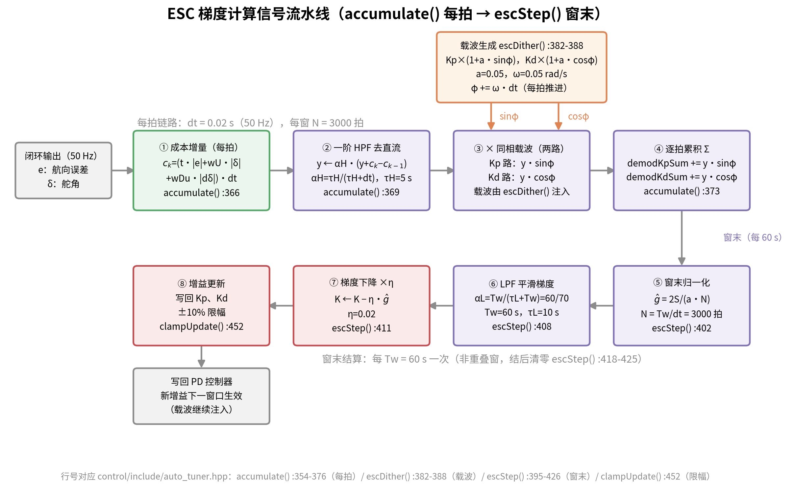
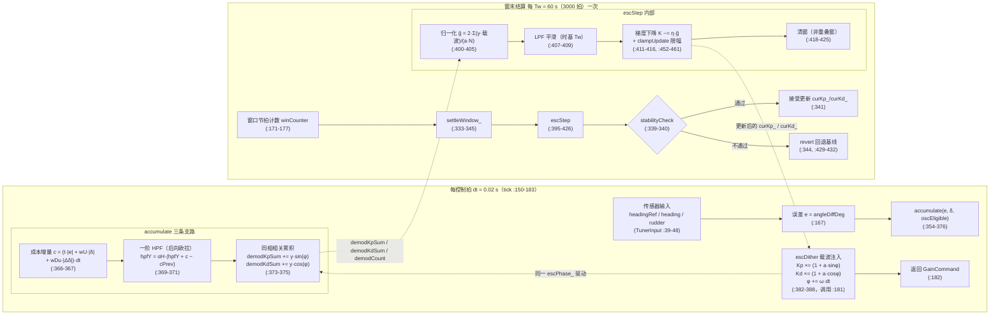
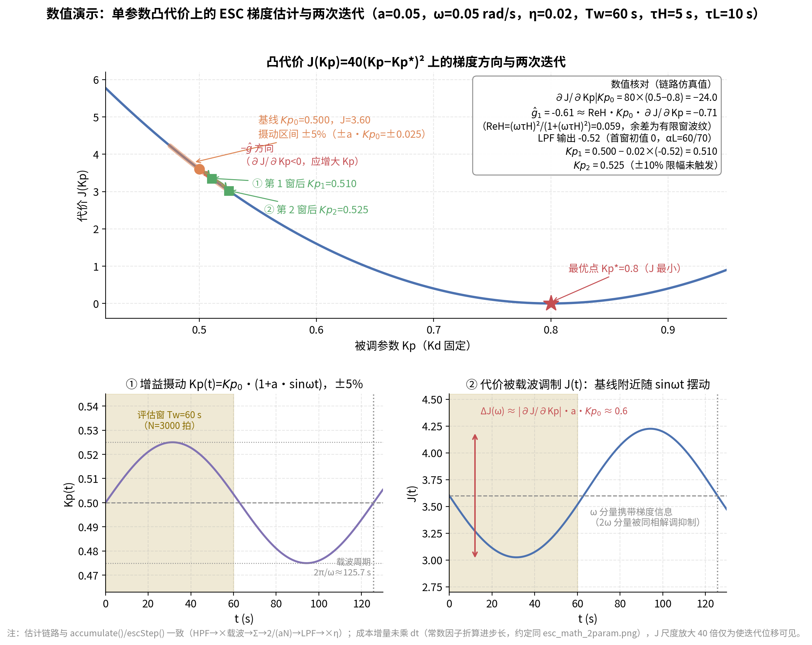

# ESC 代价函数梯度计算详解

> 本文档专题讲解 ESC（极值搜索控制）中**代价函数梯度如何被"测"出来**——不依赖任何模型解析导数，只凭实测代价 $J(t)$，经"摄动 → 高通 → 乘载波 → 平均"链路提取 $\nabla J$。全文三部分：**第 1 章数学推导**（为什么成立）、**第 2 章代码实现**（怎么落地）、**第 3 章数值示例**（数字怎么流）。
>
> **事实来源**：代码 `control/include/auto_tuner.hpp`（`accumulate()` :354-376、`escDither()` :382-388、`escStep()` :395-426、`clampUpdate()` :452-461），引用格式 `auto_tuner.hpp:行号`。高层背景见 `docs/ESC方案数学推导与算法实现详解.md` 第 3~4 章；本文在其基础上把"梯度"这一单一主题展开到可手工复算的深度。

**目录**

- [第 1 章 数学原理：为什么这样能测出梯度](#第-1-章-数学原理为什么这样能测出梯度)
- [第 2 章 代码实现：梯度链路逐行落地](#第-2-章-代码实现梯度链路逐行落地)
- [第 3 章 数值示例：一个窗口的完整数字流](#第-3-章-数值示例一个窗口的完整数字流)
- [结语与速查表](#结语与速查表)

**总览**：梯度计算信号流水线——每拍由 `accumulate()` 完成"成本增量 → HPF → 同相解调累积"，窗末由 `escStep()` 完成"归一化 → LPF → 梯度下降 → 限幅更新"（框内行号对应 `auto_tuner.hpp`）：



---

## 第 1 章 数学原理：为什么这样能测出梯度

> 本文是《ESC 代价函数梯度计算详解》的数学推导部分，回答一个核心问题：**只凭实测的窗口代价 $J(t)$、不向模型要任何解析导数，为什么"摄动 → 高通 → 乘载波 → 平均"这条链路输出的恰好是梯度 $\nabla J$？** 推导与 `control/include/auto_tuner.hpp` 的实现逐环节对应。

记号（与代码默认值一致，`auto_tuner.hpp:87-91, 104`）：

| 记号 | 含义 | 默认值 |
|---|---|---|
| $\theta=(K_p,K_d)$ | 被调参数（PD 增益） | — |
| $a$ | 相对摄动幅值 `escAmp` | 0.05 |
| $\omega$ | 载波角频率 `escFreq` | 0.05 rad/s（周期 $2\pi/\omega\approx125.7$ s） |
| $\tau_H$ / $\tau_L$ | 高通/低通时间常数 | 5 s / 10 s |
| $dt$ | 控制周期 | 0.02 s（50 Hz） |
| $T_w$ | 评估窗口 `windowSec` | 60 s（$N=T_w/dt=3000$ 拍） |
| $\eta$ | 梯度下降步长 `escStep` | 0.02 |

### 1. 问题设定：只能实测、不可求导的 $J(\theta)$

被调参数是 PD 增益 $\theta=(K_p,K_d)$，代价是评估窗口内的 ITAE 型积分：

$$J(\theta)=\int_0^{T_w}\Bigl(t\,|e(t)|+w_U|\delta(t)|+w_{Du}|\dot\delta(t)|\Bigr)\,dt$$

离散实现为每拍成本增量（`accumulate`，`auto_tuner.hpp:366-367`，与 `computeJ` :213-223 的被积函数同口径）：

$$c_k=\bigl(t_k|e_k|+w_U|\delta_k|+w_{Du}|\Delta\delta_k|\bigr)\,dt,\qquad J=\sum_k c_k$$

困难在于：$e(t),\delta(t)$ 是**闭环系统在海况与参考机动下的响应**，$J$ 对 $\theta$ 的依赖穿过"增益 → PD 控制律 → 舵机 → 船体 → 航向误差"整条闭环，没有可用的解析表达式；即便对某个工况写出来，海况一变它就失效。因此对 $J(\theta)$ 我们只知道一件事：**给定 $\theta$，跑一个窗口，实测到一个数**。

> 直觉：这是一个"黑箱函数求最小"问题——能试、能测，但不能求导。

无模型优化里梯度只能靠"试"出来。最朴素的是有限差分（两次试探做一次差商），但它对噪声极敏感，而且每走一步要多花一个窗口。ESC 的办法更巧：**让 $\theta$ 自己持续做小幅周期摄动，把梯度信息调制到一个已知频率的载波上，再从 $J(t)$ 里解调出来**。推导依赖一个前提假设：

**静态映射假设（时间尺度分离）**：闭环动态（调节时间 $\sim3/(\zeta\omega_n)\approx18$ s，目标模态 $\zeta=0.85,\ \omega_n=0.2$）远快于 $\theta$ 的变化，因此每个瞬时 $\theta(t)$ 都对应一个"充分收敛后"的代价，$J$ 可以当作 $\theta$ 的静态光滑函数处理。该假设的破坏后果见 §7.4。

### 2. 摄动与泰勒展开：梯度信息藏在一阶项里

#### 2.1 注入摄动

先取标量 $\theta$（代表 $K_p$ 或 $K_d$）。经典摄动 ESC 给参数叠加小幅正弦：

$$\theta(t)=\bar\theta+a\sin\omega t,\qquad a\ll\bar\theta$$

> 直觉：在原地小步抖动。若当前位置左低右高，抖动引起的代价起伏就与抖动同相；右低左高则反相——起伏相对载波的"相位方向"就是梯度符号。

代码注入的是**相对（乘性）摄动**（`escDither`，`auto_tuner.hpp:382-388`）：$\theta(t)=\bar\theta\bigl(1+a\sin\omega t\bigr)$，等价于把上式的 $a$ 换成 $a\bar\theta$。本节先用加性形式推导（式子更干净），§2.4 再换回相对形式与代码对齐。

#### 2.2 泰勒展开（含二阶项）

$J$ 在 $\bar\theta$ 处做二阶泰勒展开，代入 $\theta(t)-\bar\theta=a\sin\omega t$：

$$J(t)=J(\bar\theta)+J'(\bar\theta)\cdot a\sin\omega t+\frac{1}{2}J''(\bar\theta)\cdot a^2\sin^2\omega t+O(a^3)$$

> 直觉：一阶项是代价对摄动的线性响应，二阶项是曲率带来的二次修正。$a$ 很小，各项按 $a$ 的幂次自动排好大小：一阶 $O(a)$、二阶 $O(a^2)$。

用 $\sin^2\omega t=\dfrac{1-\cos2\omega t}{2}$ 把二阶项拆为直流 + 二倍频，得**完整谐波分解**：

$$\boxed{\;J(t)=\underbrace{J(\bar\theta)+\frac{a^2}{4}J''(\bar\theta)}_{\text{直流 }J_0}\;+\;\underbrace{a\,J'(\bar\theta)\,\sin\omega t}_{\text{基波：携带梯度}}\;-\;\underbrace{\frac{a^2}{4}J''(\bar\theta)\,\cos2\omega t}_{\text{二倍频：干扰}}\;+\;O(a^3)\;}$$

> 直觉：一个纯 $\sin\omega t$ 输入经过非线性系统，产出三种成分——不动的（直流）、同频的（基波）、双倍频的（谐波）。梯度信息**只**在基波里，基波幅值恰好是 $a\,J'(\bar\theta)$。

逐项解读：

- **直流项** $J_0=J(\bar\theta)+\frac{a^2}{4}J''(\bar\theta)$：当前点代价 + 抖动本身的平均代价（dither loss，极小点附近 $J''>0$，该项恒正——即使已停在最优点，抖动也抬高平均代价）。它不含梯度信息，数值上却比基波幅值大几个数量级，必须去除（§3）；
- **基波项** $aJ'(\bar\theta)\sin\omega t$：幅值与梯度成正比，**符号藏在相位里**——$J'>0$（$\bar\theta$ 在最优点右侧）时与载波同相，$J'<0$ 时反相。这就是整条链路要提取的信号；
- **二倍频项** $-\frac{a^2}{4}J''\cos2\omega t$：只含曲率，与 $J'$ 的符号无关，即不含梯度方向信息，是必须被平均掉的干扰（§4）。

#### 2.3 线性项与二次项的分工

- **线性（一阶）项负责"测"**：梯度信息全部在 $O(a)$ 基波中。取大 $a$ 信号更强，但破坏小摄动前提、抬高抖动代价；
- **二次项负责"限制精度"**：它制造两样东西——直流里的 dither loss $\frac{a^2}{4}J''$，以及二倍频干扰。越接近极小值，真实梯度信号 $aJ'(\bar\theta)\to0$，而二次项并不消失，信噪比持续恶化。**这就是"用一次项提取梯度"的方案在极小值附近精度受限的数学根源**：估计在 $|\Delta\bar\theta|\lesssim O(a)$ 的邻域内失去方向性，表现为围绕最优点的极限环——ESC 只能收敛到 $\theta^*$ 的 $O(a)$ 邻域而非精确点（§7.4）。

#### 2.4 从加性摄动回到代码的相对摄动

把 $a\to a\bar\theta$（相对摄动），基波幅值变为 $a\bar\theta J'(\bar\theta)$。用链式法则看更本质：记无量纲相对摄动 $u=a\sin\omega t$，$\theta=\bar\theta(1+u)$，则

$$\frac{\partial J}{\partial u}=\bar\theta\,\frac{\partial J}{\partial\theta}$$

即代码测到的是"**$J$ 对相对摄动的梯度**"，数值上等于 $\bar\theta\,J'(\bar\theta)$——正是 `escStep` 注释（`auto_tuner.hpp:399`）所写的"∂J/∂(增益相对摄动)"。下文为书写简洁仍用加性记号 $a$，结论换回相对形式只需把 $J'$ 替换为 $\bar\theta J'$。

下图给出几何直观：最优点左侧的摄动引起反相的 $J$ 响应（负相关），右侧引起同相响应（正相关），相关性的符号与大小即梯度信息。


### 3. 高通滤波：把直流挡在相关器之外

#### 3.1 为什么需要 HPF

理论上直流 $J_0$ 乘 $\sin\omega t$ 后在整周期内均值也是零，似乎不必滤波。但实测中 $J_0$ 比基波幅值 $aJ'$ 大几个数量级（仿真窗口 $J\sim O(10^4\!\sim\!10^5)$，而 $aJ'$ 在最优点附近趋于零），只要窗口不严格覆盖整数个载波周期、或 $J$ 带慢漂（海况变化、$K/T$ 漂移、机动），巨大的直流/慢漂就会泄漏进相关器淹没信号。高通滤波在解调**之前**把直流与慢漂挡掉，是相关器正常工作的前提。

#### 3.2 一阶高通的频域作用

一阶高通传递函数：

$$H(s)=\frac{s}{s+1/\tau_H}=\frac{\tau_H s}{\tau_H s+1}$$

> 直觉：写成微分方程 $\tau_H\dot y+y=\tau_H\dot c$——输出只跟随输入的"变化率"，输入不动输出归零，直流天然被阻断。

对角频率 $\nu$ 的正弦分量，频率响应的模与相位：

$$|H(j\nu)|=\frac{\nu\tau_H}{\sqrt{1+(\nu\tau_H)^2}},\qquad \angle H(j\nu)=\frac{\pi}{2}-\arctan(\nu\tau_H)$$

> 直觉：$\nu\tau_H$ 是"该频率分量算不算快"的无量纲度量——远快于 $1/\tau_H$ 的几乎全通，远慢的被压掉。

作用于 §2.2 谐波分解的各成分：

- **直流**（$\nu=0$）：$|H|=0$，稳态完全阻断；
- **慢漂**（$\nu\lesssim1/\tau_H$）：按 $\nu\tau_H$ 比例衰减——海况/工况引起的 $J$ 慢变化被抑制；
- **基波**（$\nu=\omega$）：保留，但幅值乘 $|H(j\omega)|$、相位移动 $\varphi_H=\angle H(j\omega)$；
- **二倍频**（$\nu=2\omega$）：$|H(j2\omega)|>|H(j\omega)|$，衰减更小，被保留下来——只能靠下一级解调平均去除。

#### 3.3 量化校核

经典设计要求载波远快于高通截止频率：$\omega\tau_H\gg1$。本项目默认参数：

$$\omega\tau_H=0.05\times5=0.25\;\Rightarrow\;|H(j\omega)|=\frac{0.25}{\sqrt{1+0.25^2}}\approx0.2425,\qquad\varphi_H=\frac{\pi}{2}-\arctan0.25\approx76.0^\circ$$

下一节将证明：解调平均后只有基波的**同相分量**留存，梯度估计实际被乘上

$$\operatorname{Re}H(j\omega)=|H(j\omega)|\cos\varphi_H=\frac{(\omega\tau_H)^2}{1+(\omega\tau_H)^2}\approx0.0588$$

> 直觉：HPF 把基波相位转了 $76^\circ$，与载波"对上相"的部分只剩约 6%——默认参数下梯度幅值被衰减约 17 倍。它只改变步长不改变符号（$\operatorname{Re}H>0$），故减慢收敛而不破坏方向。这属于参数整定问题：先定 $T_w$、再取 $\omega$、最后配 $\tau_H$ 使 $\operatorname{Re}H\gtrsim0.9$（§7.2）。

### 4. 乘以同相载波解调：把梯度"搬"到直流

#### 4.1 解调做什么

HPF 输出保留基波 + 二倍频（直流已除）：

$$y(t)=A\sin(\omega t+\varphi_H)+B\cos(2\omega t+\varphi_2),\qquad A=a\,J'(\bar\theta)\,|H(j\omega)|$$

将 $y(t)$ 乘以与注入**同相**的载波 $\sin\omega t$。代码用同一相位变量 `escPhase_` 驱动注入（`escDither`，`auto_tuner.hpp:384-386`）与解调（`accumulate`，:373：`demodKpSum_ += hpfY_ * std::sin(escPhase_)`），保证因果同相。

> 直觉：乘同频载波是"频率搬家"——两个 $\omega$ 分量相乘产生差频 $0$（直流）与和频 $2\omega$。只有与载波同频的成分能在直流上留下印记，其余成分全被搬到非零频率，随后被平均清除。

#### 4.2 逐项展开（积化和差）

**基波项**（$\sin x\sin y=\frac12[\cos(x-y)-\cos(x+y)]$，取 $x=\omega t+\varphi_H,\ y=\omega t$）：

$$A\sin(\omega t+\varphi_H)\sin\omega t=\frac{A}{2}\cos\varphi_H-\frac{A}{2}\cos(2\omega t+\varphi_H)$$

**二倍频项**（$\cos x\sin y=\frac12[\sin(x+y)-\sin(x-y)]$，取 $x=2\omega t+\varphi_2,\ y=\omega t$）：

$$B\cos(2\omega t+\varphi_2)\sin\omega t=\frac{B}{2}\sin(3\omega t+\varphi_2)-\frac{B}{2}\sin(\omega t+\varphi_2)$$

解调后的频率成分清单：

| 成分 | 来源 | 频率 |
|---|---|---|
| $\dfrac{A}{2}\cos\varphi_H$ | 基波 × 载波（差频） | **0（直流）——梯度信息** |
| $-\dfrac{A}{2}\cos(2\omega t+\varphi_H)$ | 基波 × 载波（和频） | $2\omega$ |
| $-\dfrac{B}{2}\sin(\omega t+\varphi_2)$ | 二倍频 × 载波（差频） | $\omega$ |
| $\dfrac{B}{2}\sin(3\omega t+\varphi_2)$ | 二倍频 × 载波（和频） | $3\omega$ |

**所有非直流成分的频率都不低于 $\omega$**——窗口平均（或低通）即可将其清除，只留下直流项。

#### 4.3 窗口平均：三个均值事实

设窗口覆盖整数个载波周期，则：

$$\langle\sin^2\omega t\rangle=\Big\langle\frac{1-\cos2\omega t}{2}\Big\rangle=\frac12,\qquad \langle\cos2\omega t\,\sin\omega t\rangle=\frac12\big\langle\sin3\omega t-\sin\omega t\big\rangle=0,\qquad \langle\sin\omega t\rangle=0$$

> 直觉：正弦在整周期内正负相抵；$\sin^2$ 恒正，留下均值 $1/2$——这个 $1/2$ 正是归一化系数里那个"2"的来历。

对解调结果逐项取窗口均值：

$$\big\langle y\sin\omega t\big\rangle=\frac{A}{2}\cos\varphi_H-\frac{A}{2}\underbrace{\big\langle\cos(2\omega t+\varphi_H)\big\rangle}_{=\,0}+\frac{B}{2}\underbrace{\big\langle\sin(3\omega t+\varphi_2)\big\rangle}_{=\,0}-\frac{B}{2}\underbrace{\big\langle\sin(\omega t+\varphi_2)\big\rangle}_{=\,0}=\frac{A}{2}\cos\varphi_H$$

#### 4.4 关键恒等式的逐步推导

把 $A=aJ'(\bar\theta)\,|H(j\omega)|$ 代回：

$$\big\langle y\sin\omega t\big\rangle=\frac{a\,J'(\bar\theta)}{2}\,|H(j\omega)|\cos\varphi_H=\frac{a}{2}\,J'(\bar\theta)\,\operatorname{Re}H(j\omega)$$

> 直觉：相关平均测出了基波"与载波同相的分量"的一半；HPF 的相移让这个分量再打一个 $\cos\varphi_H$ 的折扣。

两边同乘 $\dfrac{2}{a}$：

$$\boxed{\;\hat g=\frac{2}{a}\,\big\langle y\sin\omega t\big\rangle=J'(\bar\theta)\cdot\operatorname{Re}H(j\omega)\;\xrightarrow{\ \omega\tau_H\gg1\ }\;J'(\bar\theta)=\frac{\partial J}{\partial\theta}\bigg|_{\bar\theta}\;}$$

由于直流与载波在整周期内正交（$\langle J_0\sin\omega t\rangle=0$），理想情况下 $\langle J\sin\omega t\rangle=\langle y\sin\omega t\rangle$，所以该恒等式也常写成

$$\hat g=\frac{2}{a}\operatorname{avg}\bigl[J(t)\sin\omega t\bigr]\approx\frac{\partial J}{\partial\theta}$$

——HPF 是工程上的保险，在理想恒等式里它"隐身"。归一化系数 $\dfrac{2}{a}$ 的两个因子各有严格来历（离散式中还有一个 $N$，见 §6）：

- **2**：恰好抵消 $\langle\sin^2\rangle=1/2$；
- **1/a**：除掉注入摄动的幅值，把"单位摄动引起的 $J$ 变化"还原出来。

换成代码的相对摄动（§2.4），同一恒等式给出 $\hat g=\bar\theta\,J'(\bar\theta)\operatorname{Re}H(j\omega)$，即 `escStep` 注释（`auto_tuner.hpp:399`）的 $\hat g=2\sum(y\cdot载波)/(aN)\approx\partial J/\partial(\text{增益相对摄动})$。

下图用合成代价 $J(\theta)=(\theta-\theta^*)^2$ 对这条链路做数值验证：原始 $J(t)$ 的直流 + 基波 + 二倍频结构、HPF 后的幅值衰减与相移、乘以同相载波后均值恒正（$\bar\theta$ 在最优点右侧，梯度为正），以及滑动平均收敛到梯度估计值。


### 5. 双参数同时估计：sin/cos 正交解调

#### 5.1 双参数二次型与正交载波注入

两参数同时整定时，局部二次模型推广为（$\boldsymbol\theta=(K_p,K_d)^\top$，$H$ 为 Hessian）：

$$J(\boldsymbol\theta)\approx J^*+\frac12(\boldsymbol\theta-\boldsymbol\theta^*)^\top H\,(\boldsymbol\theta-\boldsymbol\theta^*),\qquad H=\begin{pmatrix}H_{11}&H_{12}\\ H_{12}&H_{22}\end{pmatrix}\succ0$$

代码给两个参数注入**同频、相位差 $90^\circ$** 的载波（`escDither`，`auto_tuner.hpp:384-385`）：

$$K_p(t)=\bar K_p\bigl(1+a\sin\omega t\bigr),\qquad K_d(t)=\bar K_d\bigl(1+a\cos\omega t\bigr)$$

记 $s_1=\sin\omega t,\ s_2=\cos\omega t$，瞬时偏差 $\theta_i-\theta_i^*=\Delta\bar\theta_i+\bar\theta_i a s_i$，代入二次型：

$$J(t)=J^*+\frac{H_{11}}{2}\bigl(\Delta\bar\theta_1+\bar\theta_1 a s_1\bigr)^2+\frac{H_{22}}{2}\bigl(\Delta\bar\theta_2+\bar\theta_2 a s_2\bigr)^2+H_{12}\bigl(\Delta\bar\theta_1+\bar\theta_1 a s_1\bigr)\bigl(\Delta\bar\theta_2+\bar\theta_2 a s_2\bigr)$$

收集基波成分（$s_1^2,s_2^2$ 只产生直流与 $\cos2\omega t$；$s_1s_2=\frac12\sin2\omega t$ 只产生二倍频，均不含基波）：

$$J(t)\supset\underbrace{a\bar K_p\bigl(H_{11}\Delta\bar\theta_1+H_{12}\Delta\bar\theta_2\bigr)}_{=\,a\bar K_p\,\partial J/\partial K_p}\sin\omega t+\underbrace{a\bar K_d\bigl(H_{12}\Delta\bar\theta_1+H_{22}\Delta\bar\theta_2\bigr)}_{=\,a\bar K_d\,\partial J/\partial K_d}\cos\omega t$$

> 直觉：同频的两个正交载波像两条互不干扰的"频道"——$K_p$ 的梯度信息挂在 $\sin$ 频道、$K_d$ 的挂在 $\cos$ 频道。各频道系数含 Hessian 交叉耦合项，测到的是真梯度 $\nabla J$，不是逐坐标偏导的拼凑。

#### 5.2 正交性证明与两路分离

$K_p$ 路解调（乘 $\sin\omega t$）时，$K_d$ 频道基波的贡献为：

$$\Big\langle a\bar K_d\frac{\partial J}{\partial K_d}\cos\omega t\cdot\sin\omega t\Big\rangle=a\bar K_d\frac{\partial J}{\partial K_d}\cdot\frac12\big\langle\sin2\omega t\big\rangle=0$$

> 直觉：$\sin$ 与 $\cos$ 错开四分之一周期，乘积 $\frac12\sin2\omega t$ 仍是整周期正负相抵的正弦——窗口覆盖整数个载波周期时，两个频道**严格**互不串扰。

二倍频干扰与两路载波同样正交：$\langle\cos2\omega t\,\sin\omega t\rangle=\langle\sin2\omega t\,\cos\omega t\rangle=0$（整数周期时严格成立）。于是两路估计互不污染：

$$\hat g_{K_p}=\frac{2}{a}\big\langle y\sin\omega t\big\rangle=\bar K_p\,\frac{\partial J}{\partial K_p}\operatorname{Re}H(j\omega),\qquad \hat g_{K_d}=\frac{2}{a}\big\langle y\cos\omega t\big\rangle=\bar K_d\,\frac{\partial J}{\partial K_d}\operatorname{Re}H(j\omega)$$

对应代码中两路累积量 `demodKpSum_/demodKdSum_`（`accumulate`，`auto_tuner.hpp:373-374`），窗末共用同一归一化系数（`escStep`，:401-405）。

下图在合成二维二次 Bowl $J(K_p,K_d)$ 上复现双参数搜索（算法参数与代码一致：$a=0.05$、$\omega=0.05$ rad/s、$\eta=0.02$、±10% 限幅）：正交 sin/cos 摄动下，增益轨迹从偏离初值螺旋收敛到最优点附近。


### 6. 离散化：从连续相关器到每拍累积

#### 6.1 连续相关器的采样化

连续形式的梯度估计是在一个窗口 $T_w$ 上做相关积分：

$$\hat g=\frac{2}{aT_w}\int_0^{T_w}y(t)\sin\omega t\,dt$$

控制环以 $dt=0.02$ s 采样，窗口内 $N=T_w/dt=3000$ 拍，第 $k$ 拍载波相位 $\varphi_k=\omega t_k$。把积分换成黎曼和（$\frac{1}{T_w}\int_0^{T_w}\!\cdot\,dt\;\to\;\frac1N\sum_{k=0}^{N-1}$）：

$$\hat g=\frac{2}{a}\cdot\frac{1}{N}\sum_{k=0}^{N-1}y_k\sin\varphi_k=\frac{2\,\sum_{k}y_k\sin\varphi_k}{a\,N}$$

> 直觉：连续"平均"落到数字系统就是"累加再除以拍数"——系数里的 $N$ 把代码中的累加和换算回均值。

与代码逐字对应（`escStep`，`auto_tuner.hpp:401-405`）：`norm = 2.0/(escAmp*demodCount_)`，`gKp = demodKpSum_*norm`。其中 `demodKpSum_`/`demodKdSum_` 由 `accumulate` 每拍累加（:373-375，$\sin$ 路进 `demodKpSum_`、$\cos$ 路进 `demodKdSum_`、`demodCount_++`），窗末统一归一化后清零（:417-425，非重叠窗）。**每拍只做一次乘法累加、窗末只做一次除法**——相关器的计算量被均摊到每个控制周期，50 Hz 下开销可忽略。

#### 6.2 每拍 HPF：后向欧拉离散

连续高通 $\tau_H\dot y+y=\tau_H\dot c$ 两边做后向欧拉（$\dot y\approx\dfrac{y_k-y_{k-1}}{dt}$，$\dot c\approx\dfrac{c_k-c_{k-1}}{dt}$）：

$$\tau_H\frac{y_k-y_{k-1}}{dt}+y_k=\tau_H\frac{c_k-c_{k-1}}{dt}\;\Longrightarrow\;y_k(\tau_H+dt)=\tau_H\bigl(y_{k-1}+c_k-c_{k-1}\bigr)$$

归并 $y_k$：

$$\boxed{\;y_k=\alpha_H\bigl(y_{k-1}+c_k-c_{k-1}\bigr),\qquad \alpha_H=\frac{\tau_H}{\tau_H+dt}=\frac{5}{5.02}\approx0.99602\;}$$

与代码逐字对应（`accumulate`，`auto_tuner.hpp:369-371`）：`alphaH = escHPFtau/(escHPFtau+dt)`，`hpfY_ = alphaH*(hpfY_ + c - hpfCPrev_)`。输入 $c_k$ 是每拍成本增量（:366-367），与 `computeJ` 的被积函数严格同口径——HPF 的输入就是代价被积序列，"差分 $c_k-c_{k-1}$ 再乘 $\alpha_H$"实现了"去直流、留交流"。

#### 6.3 窗末：LPF、梯度下降与限幅

窗末每 $T_w$ 秒才来一个新估计 $\hat g_w`，先经一阶 LPF 平滑（`escStep`，:407-409）。由于该滤波器输入的**真实采样间隔是 $T_w$ 而非 $dt$**，后向欧拉系数必须按 $T_w$ 计算：

$$g_w=(1-\alpha_L)\,g_{w-1}+\alpha_L\,\hat g_w,\qquad \alpha_L=\frac{T_w}{\tau_L+T_w}=\frac{60}{10+60}\approx0.857$$

随后梯度下降（:411-412）：$\bar\theta\leftarrow\bar\theta-\eta\,g_w$，$\eta=0.02$；再经 `clampUpdate` 限幅——单窗变动不超过当前值的 ±10%（:413-414，实现 :452-461）——与非负钳位（:415-416）。

> 直觉（P11 整改教训）：ESC 各环节运行在不同节拍上——摄动/解调在每拍（$dt$），LPF/积分在窗末（$T_w$）。**每个滤波器系数必须用它所在环节的真实采样周期计算**；把按 $dt$ 设计的系数用在窗级样本上，等效时间常数被放大 $T_w/dt=3000$ 倍，梯度会被衰减到几乎消失。

#### 6.4 三个时间尺度

整条链路能否成立，归结为时间尺度是否拉开：

$$\underbrace{dt=0.02\ \text{s}}_{\text{控制/解调节拍}}\;\ll\;\underbrace{\tau_{cl}\sim\frac{3}{\zeta\omega_n}\approx18\ \text{s}}_{\text{闭环动态}}\;<\;\underbrace{\frac{2\pi}{\omega}\approx125.7\ \text{s}}_{\text{载波周期}}\;\ll\;\underbrace{\frac{T_w}{\eta\,\bar\theta J''}\sim\text{数十分钟}}_{\text{积分器适应}}$$

- **闭环 ≪ 载波**：每个载波周期内闭环近似到达准稳态，静态映射假设（§1）成立；
- **载波 ≪ 适应**：一个载波周期内 $\bar\theta$ 几乎不动，"中心值 + 摄动"的分解才有意义，窗口平均才是在固定工作点上测梯度；
- 窗口 $T_w=60$ s 本身是噪声方差（§7.3）与更新速率（每窗才能更新一次）之间的折中；注意它与默认载波周期 125.7 s 存在张力——单窗装不满半个载波周期，§4.3 的均值事实不再严格成立（§7.1）。


### 7. 误差来源小结

梯度估计 $\hat g$ 不是真梯度，而是真梯度乘上若干因子、再叠加干扰项。按来源分四类。

#### 7.1 窗口长度 $T_w$

- **整数周期假设**：§4.3 的三个均值事实、§5.2 的正交性都只在窗口覆盖整数个载波周期时严格成立。默认参数 $\omega T_w=0.05\times60=3$ rad，窗内仅 $0.477$ 个载波周期——$\langle\sin^2\rangle$ 偏离 $1/2$、sin/cos 频道轻微串扰、二倍频泄漏进估计。代码的载波相位跨窗连续（`escPhase_` 刻意不清零，`auto_tuner.hpp:436-437`），残余误差逐窗轮转、近似零均值涨落——**偏置转化为方差**，由多窗平均部分吸收；
- **方差与速率折中**：窗口越长（$N$ 越大），噪声方差 $\propto1/N$ 越小（§7.3），但每窗才能更新一次，收敛变慢、对工况漂移的跟踪变迟钝。$T_w=60$ s（$N=3000$）是两者的折中。

#### 7.2 载波频率 $\omega$

- **HPF 衰减**：乘性因子 $\operatorname{Re}H(j\omega)=\dfrac{(\omega\tau_H)^2}{1+(\omega\tau_H)^2}$，默认参数下仅 $0.059$（§3.3）。只改步长不改符号，但直接拖慢收敛；
- **时间尺度分离**：$\omega$ 必须远慢于闭环带宽（静态映射假设）、远快于适应速率（§6.4）。$\omega$ 过低还会靠近海浪遭遇频率（$0.05\sim0.2$ Hz）的谐波与非线性混频产物——与载波同频的干扰 HPF 挡不住、窗口平均也消不掉；
- **整定顺序**：先定 $T_w$，再取 $\omega=2\pi n/T_w$（每窗恰好 $n$ 个整周期），最后配 $\tau_H$ 使 $\operatorname{Re}H(j\omega)\gtrsim0.9$。

#### 7.3 噪声

设每拍成本增量经 HPF 后近似零均值白噪声、方差 $\sigma_y^2$，且与载波不相关，则：

$$\operatorname{Var}\Bigl[\sum_{k=0}^{N-1} y_k\sin\varphi_k\Bigr]=\sum_{k=0}^{N-1}\sigma_y^2\sin^2\varphi_k=\frac{N\sigma_y^2}{2}\;\Longrightarrow\;\boxed{\;\operatorname{Var}[\hat g]=\Bigl(\frac{2}{aN}\Bigr)^2\frac{N\sigma_y^2}{2}=\frac{2\sigma_y^2}{a^2N}\;}$$

- $\propto1/a^2$：加大摄动幅值是压方差最有效的手段，但与抖动代价 $\frac{a^2}{4}J''$（§2.3，$\propto a^2$）正面冲突——$a$ 的取值是经典 ESC 权衡；
- 上式只用到了零均值与不相关假设；与载波**同频**的噪声分量不满足该假设，会原样漏进估计（即 §7.2 的波浪频率问题）；
- 窗内参考机动/海况突变使 $J$ 非平稳，相当于大幅低频噪声，HPF 只能部分抑制，该窗梯度被污染。

#### 7.4 非凸性与模型假设

- **局部性**：推导只要求 $J$ 在工作点附近光滑，ESC 收敛到的是**局部**极小。全局非凸（多个极值、鞍点）超出其能力范围——这正是三层调参架构中由调度表/极点配置先给基线、ESC 只做邻域微调的分工依据；
- **静态映射假设的破坏**：闭环未充分收敛时，$J$ 不是 $\theta$ 的静态函数，基波相位不再单纯由梯度符号决定，估计方向可能短时出错（工程上由稳定门 + 回退兜底）；
- **极值点漂移**：海况变化使 $\theta^*$ 移动，积分器会持续跟踪，但跟踪滞后与 §7.1 的窗口折中直接相关；
- **二次项主导区**：$|\Delta\bar\theta|\lesssim O(a)$ 时，二阶谐波泄漏与真实梯度信号同量级（§2.3），估计在最优点附近失去方向性，表现为围绕 $\theta^*$ 的极限环——精度天花板 $O(a)$。

---

**小结**：梯度信息被摄动调制在载波基波上（§2），HPF 去除具淹没性的直流/慢漂（§3），同相解调把基波搬回直流、把干扰留在 $\omega$ 及以上频率（§4），窗口平均加归一化系数 $\frac{2}{aN}$ 完成提取（§4、§6），sin/cos 正交载波让两个参数共用一条链路互不串扰（§5）。整条链路不建模、不差分，只用实测 $J(t)$ 与已知载波的相关性——这就是"为什么这样能测出梯度"。

---

## 第 2 章 代码实现：梯度链路逐行落地

本节对照 `control/include/auto_tuner.hpp`（510 行）逐行讲解 ESC 梯度估计的落地实现：每控制拍（`dt = 0.02 s`）完成的"成本增量 → HPF → 同相相关累积"链路，与每评估窗口（`Tw = 60 s`，3000 拍）结算一次的"归一化 → LPF → 梯度下降 → 限幅 → 清窗"链路。所有行号均指 `auto_tuner.hpp`。


### 1. 梯度数据流总览



要点：

- 注入与解调共用同一个相位状态 `escPhase_`（:464）：`escDither` 每拍推进相位并施加载波（:384-387），`accumulate` 用同一相位做相关解调（:373-374），二者严格同相，这是"因果解调"的代码基础。
- 累积量（`demodKpSum_` / `demodKdSum_` / `demodCount_`，:474-476）是每拍链路与窗末链路之间的唯一数据通道。
- 更新后的增益写回 `curKp_` / `curKd_`（:341），下一拍的 `escDither` 在其上继续叠加载波，构成闭环寻优。

### 2. 每拍链路：accumulate()（:354-376）

#### 2.1 成本增量构造（:366-367）

```cpp
const double c = (t * std::abs(e) + p_.wU * std::abs(delta)
                + p_.wDu * std::abs(ddelta)) * p_.dt;
```

即

$$
c_k=\bigl(t_k\,|e_k|+w_U\,|\delta_k|+w_{Du}\,|\Delta\delta_k|\bigr)\,dt
$$

三个事实值得注意：

1. **与 `computeJ` 的被积函数严格一致**。`computeJ`（:214-223）的窗口总成本为
   $$J=\sum_i\bigl(t_i\,|e_i|+w_U|\delta_i|+w_{Du}|\Delta\delta_i|\bigr)\,dt\quad(:220)$$
   每拍喂给 HPF 的 $c_k$ 就是这个和式的第 $k$ 项——HPF 的输入与 ITAE 积分的被积序列同口径，梯度估计与窗口评估（`lastJ_ = computeJ()`，:398）度量的是同一个 $J$。
2. **时间权重 $t_k$ 取本拍在窗口内的时刻**：`t = windowErr_.size() * p_.dt`（:356），即窗口起点为 0 的相对时间，与 `computeJ` 中 `t += p_.dt` 的枚举方式一致。
3. **增量口径**：`Δδ_k = δ_k − δ_{k−1}`（:355，`prevDelta_` 于 :360 更新）。三个绝对值序列同时被推入窗口环形缓冲（:357-359，容量 `WIN_N = 3000`，:479-482），供 `computeJ` 与调试使用。

#### 2.2 HPF：后向欧拉推出 αH = τH/(τH + dt)（:369-371）

ESC 解调只关心成本信号中由载波引起的交流分量，需先用高通滤掉直流与慢漂。连续域一阶高通

$$
H(s)=\frac{\tau_H s}{\tau_H s+1}
\;\Longleftrightarrow\;
\tau_H\dot y + y = \tau_H\dot c
$$

对两边做**后向欧拉**离散（采样周期 $dt$，$\dot y\approx\dfrac{y_k-y_{k-1}}{dt}$，$\dot c\approx\dfrac{c_k-c_{k-1}}{dt}$）：

$$
\tau_H\frac{y_k-y_{k-1}}{dt}+y_k=\tau_H\frac{c_k-c_{k-1}}{dt}
$$

两边乘 $dt$ 并归并 $y_k$：

$$
y_k\,(\tau_H+dt)=\tau_H\bigl(y_{k-1}+c_k-c_{k-1}\bigr)
\;\Longrightarrow\;
y_k=\alpha_H\bigl(y_{k-1}+c_k-c_{k-1}\bigr),\qquad
\alpha_H=\frac{\tau_H}{\tau_H+dt}
$$

与代码逐字对应（:369-371）：

```cpp
const double alphaH = p_.escHPFtau / (p_.escHPFtau + p_.dt);   // αH = τH/(τH+dt)
hpfY_ = alphaH * (hpfY_ + c - hpfCPrev_);                      // yk = αH·(y_{k-1} + ck − c_{k-1})
hpfCPrev_ = c;
```

默认参数 $\tau_H=5\,\mathrm{s}$（`escHPFtau`，:90）、$dt=0.02\,\mathrm{s}$，得 $\alpha_H = 5/5.02 \approx 0.99602$。差分项 $c_k-c_{k-1}$ 阻断直流，乘 $\alpha_H$ 提供指数遗忘——结构含义就是"去直流、留交流"。注意 $\alpha_H$ 是常数却每拍重算一次，这是可读性优先的写法，无性能问题。

#### 2.3 同相相关累积（:373-375）

```cpp
demodKpSum_ += hpfY_ * std::sin(escPhase_);
demodKdSum_ += hpfY_ * std::cos(escPhase_);
++demodCount_;
```

即

$$
S_{K_p}\mathrel{+}= y_k\sin\varphi_k,\qquad
S_{K_d}\mathrel{+}= y_k\cos\varphi_k
$$

"同相"是本节的题眼：`escPhase_` 与本拍 `escDither` 注入时使用的相位是**同一个变量的同一个值**（注入发生在 `tick` 末尾 :181，下一拍 `accumulate` 在 :168 先于推进相位执行——严格说解调相位领先注入相位一拍，该一拍偏差对 $\omega\cdot dt=10^{-3}$ rad 的相位增量可忽略）。相比"窗末才做相关"的旧实现，每拍即时相关把 HPF 相移之外的相位失配压到最小，保证相关积分的均值确实携带梯度符号。

### 3. 窗末链路：escStep()（:395-426）

`tick` 内部按 `winBeats = windowSec/dt = 60/0.02 = 3000` 拍触发一次 `settleWindow_`（:171-177 → :333-345），后者调用 `escStep` 完成结算。下面按执行顺序逐行讲解。

#### 3.1 归一化：系数 2/(a·N) 的来源（:400-405）

```cpp
const double norm = 2.0 / (p_.escAmp * static_cast<double>(demodCount_));  // 2/(a·N)
gKp = demodKpSum_ * norm;
gKd = demodKdSum_ * norm;
```

$$
\hat g=\frac{2}{aN}\sum_{k=0}^{N-1}y_k\,s_k,\qquad s_k\in\{\sin\varphi_k,\ \cos\varphi_k\}
$$

三个因子各有严格来历（完整证明见《ESC方案数学推导与算法实现详解》§4.5）：

- **$N$**：把累加和 $\sum$ 换成窗口均值 $\langle\cdot\rangle$。代码中 `N = demodCount_`（:375 逐拍自增），即本窗实际累积的拍数，而非理论值 3000——窗口因 `suspend()`（:199-203）等中断而不满时归一化仍然正确；
- **$2$**：抵消 $\langle\sin^2\rangle = \langle\cos^2\rangle = 1/2$。相关累积的均值里梯度信息以 $\frac{1}{2}a\,\bar\theta J'$ 的形式出现，乘 2 还原；
- **$a$**：注入是相对摄动 $\theta(t)=\bar\theta\,(1+a\,s_k)$（`escAmp`，:87），成本中的载波分量幅值正比于 $a\,\bar\theta J'$，除以 $a$ 才得到相对摄动意义下的梯度 $\bar\theta J'$。

守卫条件（:401）：`demodCount_ > 0 && escAmp > 0`，空窗或零幅值时 $\hat g$ 保持 0，不出现除零。

#### 3.2 LPF：时基为什么是 Tw 而非 dt（:407-409）

```cpp
const double alphaL = p_.windowSec / (p_.escLPFtau + p_.windowSec);   // αL = Tw/(τL+Tw)
gradKp_ = (1.0 - alphaL) * gradKp_ + alphaL * gKp;
gradKd_ = (1.0 - alphaL) * gradKd_ + alphaL * gKd;
```

梯度低通 $G(s)=\dfrac{1}{\tau_L s+1}$ 的输入 $\hat g$ **每 $T_w$ 秒才到达一个新样本**——离散化的真实采样间隔是 $T_w$，不是 $dt$。后向欧拉：

$$
\tau_L\frac{g_w-g_{w-1}}{T_w}+g_w=\hat g_w
\;\Longrightarrow\;
g_w=(1-\alpha_L)\,g_{w-1}+\alpha_L\,\hat g_w,\qquad
\alpha_L=\frac{T_w}{\tau_L+T_w}=\frac{60}{10+60}=0.857
$$

即新梯度样本权重 85.7%。这个 LPF 的平滑作用其实很弱（等效滞后约 0.17 个窗口），梯度方差主要靠窗口平均本身压低；它的角色更接近"相邻窗估计的惯性环节"，防止单窗野值直接全额冲进积分器。

#### 3.3 梯度下降与 clampUpdate 限幅（:411-416、:452-461）

```cpp
double newKp = Kp - p_.escStep * gradKp_;   // η = 0.02（escStep，:89）
double newKd = Kd - p_.escStep * gradKd_;
newKp = clampUpdate(newKp, Kp);
newKd = clampUpdate(newKd, Kd);
Kp = newKp > 0.0 ? newKp : 0.0;            // 非负钳位
Kd = newKd > 0.0 ? newKd : 0.0;
```

更新律 $\bar\theta_{w+1}=\bar\theta_w-\eta\,g_w$（:411-412）。`clampUpdate`（:452-461）施加两道约束：

$$
|\Delta\theta|\le\max\bigl(|\theta_{old}|\cdot 10\%,\ 10^{-3}\bigr)
$$

- **比例限幅 ±10%**（`maxUpdateFrac`，:96）：单窗增益变动不超过当前值的十分之一。远离最优点时 $\eta\hat g$ 通常远超该限幅，更新实际骑在限幅上以固定速率爬坡；接近最优点后才进入线性收缩区。限幅同时充当"野梯度防火墙"——单窗噪声或机动畸变造成的错误估计最多搬动 10%，且随即被稳定门审查；
- **绝对下限 $10^{-3}$**（`absMinUpdate`，:97）：$|old|=0$ 时比例上限退化为 0 会永久锁死更新（例如极点配置在 $\hat T$ 很小时把 $K_d$ 钳到 0），下限保证出现非零梯度符号后 $K_d$ 能以每窗至多 $10^{-3}$ 的速率爬离 0；
- **非负钳位**（:415-416）：增益符号保持物理合法，与稳定门 $K_p>0$（:246）一致。

#### 3.4 清窗与非重叠窗设计（:418-425）

```cpp
windowErr_.clear();
windowDelta_.clear();
windowDDelta_.clear();
hpfCPrev_ = 0.0;
hpfY_ = 0.0;
demodKpSum_ = 0.0;
demodKdSum_ = 0.0;
demodCount_ = 0;
```

结算后清空全部窗口样本与解调累积状态，下一窗从零开始——**非重叠窗**：每个梯度样本的统计区间互不交叠，相邻窗估计近似独立，LPF（:408-409）是在独立样本序列上滤波，而不是在自相关的滑动窗输出上滤波。注意两个刻意不清的状态：

- `gradKp_` / `gradKd_`：LPF 状态跨窗保持，这是滤波器记忆的本职；
- `escPhase_`：载波相位跨窗连续（`rebaseEsc` :438-450 同样保留，注释见 :436-437），避免重锚拍载波突跳，同时让非整周期残余在窗间轮转成近似零均值涨落（偏置转化为方差）。

### 4. P11 整改案例：时基匹配的教训

整改记录写在文件头注释（:8-12），是全节最重要的工程教训。旧实现的症状：**调参结果与初值逐位相同**——ESC 在空转。

根因有两层：

1. **没有真实注入**。旧实现增益在窗口内恒定，窗末算出的"梯度"没有因果来源——$J$ 的波动与载波无关，相关累积的均值不含梯度信息。
2. **滤波器系数用错采样周期**。HPF 与 LPF 系数都按 $dt=0.02\ \mathrm{s}$ 设计，却作用在每 $T_w=60\ \mathrm{s}$ 才来一个的窗级样本上：
   - LPF 侧：正确值 $\alpha_L=\dfrac{60}{10+60}=0.857$；错误地用 $dt$ 计算得 $\alpha_L^{错}=\dfrac{0.02}{10.02}\approx0.002$，相差约 **430 倍**——每个新梯度样本只被采纳 0.2%，估计器近似恒等于初值；
   - HPF 侧：按 $dt$ 设计的差分滤波器用在窗级样本上，等效时间常数被放大 $T_w/dt=3000$ 倍，交流分量同样被衰减。
   两重错误叠加，梯度被衰减 **2~3 个数量级**，再经 ±10% 限幅舍入后增益不动，输出与初值逐位一致。

现行实现的修复（P11，头注释 :8-12 与 §2、§3 的代码即修复结果）：

- 每拍真实注入载波（`escDither`，:382-388）；
- HPF 在每拍成本增量上运行，系数按 $dt$ 计算（:369）——**输入时基与系数时基一致**；
- LPF 在窗末梯度样本上运行，系数按 $T_w$ 计算（:407）——**输入时基与系数时基一致**。

原则可以一句话概括：**ESC 各环节运行在不同时间尺度——扰动注入、HPF、相关解调在每拍（$dt$），归一化、LPF、梯度积分在窗末（$T_w$）——每个滤波器的系数必须用该环节输入样本的真实到达周期计算。** 写滤波器时先问一句"输入多久来一个样本"，就不会犯这个错误。


### 5. 双参数 sin/cos 载波的代码配对

$K_p$、$K_d$ 两参数在同一窗口内同时寻优，靠的是一对正交载波与两路正交解调的严格配对：

| 环节 | $K_p$ 通道 | $K_d$ 通道 |
|---|---|---|
| 注入 `escDither`（:384-385） | `Kp *= 1.0 + escAmp * sin(escPhase_)` | `Kd *= 1.0 + escAmp * cos(escPhase_)` |
| 解调 `accumulate`（:373-374） | `demodKpSum_ += hpfY_ * sin(escPhase_)` | `demodKdSum_ += hpfY_ * cos(escPhase_)` |
| 归一化 `escStep`（:403-404） | `gKp = demodKpSum_ * norm` | `gKd = demodKdSum_ * norm` |

配对规则是"自通道同相相关"：$K_p$ 用 $\sin$ 注入、就用 $\sin$ 解调；$K_d$ 用 $\cos$ 注入、就用 $\cos$ 解调。正交性保证通道间互不串扰（窗口覆盖整数个载波周期时严格成立）：

$$
\bigl\langle\sin\omega t\cdot\cos\omega t\bigr\rangle=0,\qquad
\bigl\langle\sin^2\omega t\bigr\rangle=\bigl\langle\cos^2\omega t\bigr\rangle=\tfrac12
$$

于是同一成本信号 $y_k$ 里，由 $K_p$ 摄动引起的分量只落在 $\sin$ 相关路上、由 $K_d$ 摄动引起的分量只落在 $\cos$ 相关路上，一次窗口测得两个方向的梯度：

$$
\hat g_{K_p}=\frac{2}{aN}\sum_k y_k\sin\varphi_k\approx \bar K_p\,\frac{\partial J}{\partial K_p},
\qquad
\hat g_{K_d}=\frac{2}{aN}\sum_k y_k\cos\varphi_k\approx \bar K_d\,\frac{\partial J}{\partial K_d}
$$

代码上只需注意一点：注入（:384-385）与解调（:373-374）的载波函数选择是**硬编码配对**的，改其中一处而不改另一处，梯度方向会静默丢失（$\langle\sin\cdot\cos\rangle=0$），且没有任何编译期或运行期检查能发现——这是该结构唯一的维护陷阱。

### 6. 公式 ↔ 代码行号对照表

| 公式 | 含义 | 代码位置 |
|---|---|---|
| $c_k=(t_k\vert e_k\vert +w_U\vert \delta_k\vert +w_{Du}\vert \Delta\delta_k\vert )\,dt$ | 每拍成本增量 | `auto_tuner.hpp:366-367`（被积函数同口径 :220） |
| $\alpha_H=\tau_H/(\tau_H+dt)$ | HPF 系数（后向欧拉） | `auto_tuner.hpp:369` |
| $y_k=\alpha_H(y_{k-1}+c_k-c_{k-1})$ | 一阶 HPF 递推 | `auto_tuner.hpp:370-371` |
| $S_{K_p}\mathrel{+}=y_k\sin\varphi_k$ | $K_p$ 路同相相关累积 | `auto_tuner.hpp:373` |
| $S_{K_d}\mathrel{+}=y_k\cos\varphi_k$ | $K_d$ 路同相相关累积 | `auto_tuner.hpp:374` |
| $K_p\!\leftarrow\!K_p(1+a\sin\varphi_k)$ | $K_p$ 载波注入 | `auto_tuner.hpp:384` |
| $K_d\!\leftarrow\!K_d(1+a\cos\varphi_k)$ | $K_d$ 载波注入 | `auto_tuner.hpp:385` |
| $\varphi_{k+1}=\varphi_k+\omega\,dt$ | 载波相位推进 | `auto_tuner.hpp:386-387` |
| $\hat g=\dfrac{2}{aN}\sum_k y_k s_k$ | 解调累积归一化 | `auto_tuner.hpp:401-405` |
| $\alpha_L=T_w/(\tau_L+T_w)$ | LPF 系数（时基 $T_w$） | `auto_tuner.hpp:407` |
| $g_w=(1-\alpha_L)g_{w-1}+\alpha_L\hat g_w$ | 梯度 LPF 递推 | `auto_tuner.hpp:408-409` |
| $\theta\leftarrow\theta-\eta\,g_w$ | 梯度下降（$\eta=0.02$） | `auto_tuner.hpp:411-412`（$\eta$ 定义 :89） |
| $\vert \Delta\theta\vert \le\max(\vert \theta\vert \cdot10\%,\,10^{-3})$ | 更新限幅 | `auto_tuner.hpp:452-461`（参数 :96-97） |
| $\theta\leftarrow\max(\theta,0)$ | 非负钳位 | `auto_tuner.hpp:415-416` |
| $N_{win}=T_w/dt=3000$ | 窗口拍数 | `auto_tuner.hpp:171-173`（缓冲容量 :479） |
| 非重叠窗清窗 | 窗口/解调状态清零 | `auto_tuner.hpp:418-425` |
| 参数 $\zeta=0.85,\ \omega_n=0.2,\ w_U=0.01,\ w_{Du}=0.005,\ a=0.05,\ \omega=0.05,\ \tau_H=5,\ \tau_L=10,\ T_w=60,\ dt=0.02$ | 全部默认值 | `auto_tuner.hpp:84-105` |

---

## 第 3 章 数值示例：一个窗口的完整数字流

> 注：本章示例为严格自洽起见，采用收敛测试配置 $\omega=2\pi/60$、$\tau_H=30\,\mathrm{s}$（每窗恰好一个载波周期，见 `control/tests/test_auto_tuner.cpp:179-181`），与默认参数 $\omega=0.05$、$\tau_H=5\,\mathrm{s}$ 的差异与理由在 §1.2 中说明；除这两个参数外全部对齐代码默认值。



*上图：单参数数值演示——基线处 $\hat g<0$，逐窗更新把 $K_p$ 推向最优；下方波形为 $\pm5\%$ 载波调制下 $K_p(t)$ 与 $J(t)$ 的片段。*

前两章分别给出了梯度测量的数学推导与代码实现细节。本章把整条链路落成一串**可手工复算的数字**：取一个凸的合成代价函数，从一拍载波注入开始，逐环节给出中间量的数值与量纲，直到窗末的梯度下降与限幅；随后演示两个窗末迭代展示增益向最优点移动，复现 P11 教训的量级估计，并给出梯度符号的判读规则。所有数值均可按文中公式手算复现；与逐拍代码复算的差异在 §5 中核查。

### 1. 场景设定

#### 1.1 一维简化与合成代价

只调 $K_p$（$K_d$ 通道固定；其 $\cos$ 载波与 $\sin$ 正交，对本通道解调无贡献，一维化不失一般性，见前章正交性证明）。设真实代价为二次曲线：

$$
j(K_p)=J_0+c\,(K_p-K_p^{*})^2,\qquad K_p^{*}=2.0,\quad c=40\ \tfrac{\text{代价}}{\text{秒}}
$$

$j$ 是**成本变化率**（代价/秒），代码中每拍成本增量 $c_k=j\cdot dt$（`auto_tuner.hpp:366-367`），窗口总代价 $J=\sum_k c_k$。常数 $J_0$ 被 HPF 阻断、不进梯度，取 $J_0=0$（其经每窗清零瞬态的残余影响见 §5）。

$K_p$ 初值取极点配置基线：典型船 $K=0.2,\ T=8\ \mathrm{s}$，目标 $\zeta=0.85,\ \omega_n=0.2\ \mathrm{rad/s}$，由 `polePlacement`（`auto_tuner.hpp:233`）：

$$
\bar K_{p,0}=\frac{\omega_n^2 T}{K}=\frac{0.2^2\times 8}{0.2}=1.6
$$

即初始偏差 $\Delta_0=\bar K_{p,0}-K_p^{*}=-0.4$（增益偏低，位于最优点**左侧**）。真实梯度 $\partial j/\partial K_p=2c\,\Delta_0=-32$ 代价/秒，$j'(\bar K_p)$ 随 $\bar K_p$ 靠近 $K_p^{*}$ 线性减小。

#### 1.2 算法参数：为什么载波取 $\omega=2\pi/60$、$\tau_H=30$ s

除载波频率与 HPF 时间常数外，全部取代码默认值（`auto_tuner.hpp:87-105`）：

| 参数 | 取值 | 出处 |
|---|---|---|
| 摄动幅值 $a$ | $0.05$（±5%，乘性） | `:87` |
| 窗口 $T_w$ / 拍数 $N$ / 控制周期 $dt$ | $60\ \mathrm{s}$ / $3000$ / $0.02\ \mathrm{s}$ | `:104-105` |
| LPF 时间常数 $\tau_L$ | $10\ \mathrm{s}$ | `:91` |
| 积分步长 $\eta$ | $0.02$ | `:89` |
| 单次更新限幅 | $\max(\vert \bar K_p\vert \cdot 10\%,\ 10^{-3})$ | `:96-97` |
| 载波频率 $\omega$ | $\mathbf{2\pi/60=0.10472\ \mathrm{rad/s}}$（周期恰 $60$ s） | 见下 |
| HPF 时间常数 $\tau_H$ | $\mathbf{30\ s}$ | 见下 |

**关于后两行**：默认参数 $\omega=0.05\ \mathrm{rad/s}$（周期 $125.7$ s）下，$60$ s 窗口只装得下 $0.477$ 个载波周期，窗口平均的三个均值事实（$\langle\sin^2\rangle=\tfrac12$ 等）全部失效，每窗梯度估计叠加随起点相位逐窗轮转的残差——这是已知的结构性张力（《ESC方案数学推导与算法实现详解》§4.7、§7.1），手算示例无法在其上做到逐位自洽。仓库的收敛测试因此改用 $\omega=2\pi/60$（**每窗恰好一个载波周期**）并配 $\tau_H=30$ s（`test_auto_tuner.cpp:179-181`，该测试端到端证明 $K_p$ 朝性能改善方向移动）。本章沿用这一配置：整周期使所有正交/归一化关系严格成立，且每窗起点相位相同（相位跨窗连续，3000 拍恰推进 $2\pi$，`:386-387`），两次窗末迭代严格同构。

#### 1.3 复算约定

- **拟稳态假设**：载波远慢于闭环响应（与收敛测试注释"慢于闭环响应，拟稳态成立"一致，`test_auto_tuner.cpp:180`），成本瞬时跟随当前增益，忽略被控对象动态；
- **准稳态近似**：HPF 视为已进入稳态（直流全阻断、基波乘以频响 $H(j\omega)$），窗口求和用等效连续积分 $\sum_k(\cdot)\approx\frac{1}{dt}\int_0^{T_w}(\cdot)\,dt$ 代替逐拍列举，$N=3000$ 拍不逐一写出；该近似与逐拍实现的差异在 §5 定量核查；
- 载波相位在注入与解调间严格同相（同一 `escPhase_` 驱动，`:373` 与 `:384`）。

### 2. 窗口 1：完整数值链条

#### 2.1 载波注入（`escDither`，`:382-388`）

每拍施加乘性摄动，相位逐拍推进 $\omega\,dt=0.10472\times0.02=0.0020944$ rad：

$$
K_p(t)=\bar K_{p,0}\bigl(1+a\sin\omega t\bigr)=1.6\,(1+0.05\sin\omega t)
$$

摄动幅值 $a\bar K_p=0.08$（增益量纲），即 $K_p\in[1.52,\ 1.68]$，相对幅度严格 $\pm5\%$。

#### 2.2 成本信号的三项结构

代入合成代价并展开（$\Delta_0=-0.4$，$a\bar K_p=0.08$）：

$$
\begin{aligned}
j(t)&=40\,\bigl(-0.4+0.08\sin\omega t\bigr)^2\\
&=\underbrace{6.528}_{\text{直流}}\ \underbrace{-\ 2.56\,\sin\omega t}_{\text{基波}}\ \underbrace{-\ 0.128\,\cos 2\omega t}_{\text{二倍频}}\quad[\text{代价}/\text{秒}]
\end{aligned}
$$

- 直流 $j_{dc}=c\bigl(\Delta_0^2+\tfrac{(a\bar K_p)^2}{2}\bigr)=40\times(0.16+0.0032)=6.528$ 代价/秒——含 $J_0$ 时再加 $J_0$，同被阻断；
- **基波幅值 $2c\,\Delta_0\,a\bar K_p=-2.56$ 代价/秒**：幅值正比于真实梯度，负号表示 $\bar K_p$ 在最优点左侧、$j$ 与载波**反相**——梯度符号就藏在这个相位关系里；
- 二倍频幅值 $\tfrac12c(a\bar K_p)^2=0.128$ 代价/秒，不含梯度信息。

每拍成本增量 $c_k=j(t_k)\,dt$（量纲：代价/拍）：直流 $0.13056$、基波幅值 $A_c=-2.56\times0.02=-0.0512$、二倍频幅值 $-0.00256$。

#### 2.3 HPF 之后（`accumulate`，`:369-371`）

离散系数 $\alpha_H=\dfrac{\tau_H}{\tau_H+dt}=\dfrac{30}{30.02}=0.99933$。载波频率处 $\omega\tau_H=\pi$，频响：

$$
|H(j\omega)|=\frac{\pi}{\sqrt{1+\pi^2}}=0.95290,\qquad
\varphi_H=\frac{\pi}{2}-\arctan\pi=17.66^\circ,\qquad
\operatorname{Re}H(j\omega)=\frac{\pi^2}{1+\pi^2}=0.90801
$$

（有用恒等式：$\cos\varphi_H=|H|$，故 $\operatorname{Re}H=|H|\cos\varphi_H=|H|^2$。）稳态输出：

- 直流 $0.13056\to 0$（阻断）；
- 基波：$y_\omega(t)=-0.048788\,\sin(\omega t+17.66^\circ)$ 代价/拍，幅值 $A_y=A_c\,|H|=-0.0512\times0.95290$；
- 二倍频：$|H(j2\omega)|=0.98757$，幅值 $-0.00256\times0.98757=-0.002528$ 代价/拍（高通对高频衰减更小，只能靠下一步解调平均去除）。

#### 2.4 解调累积（`:373-374`）

每拍 $y_k\sin\varphi_k$ 累加。积化和差 $\sin(\omega t+\varphi_H)\sin\omega t=\tfrac12\cos\varphi_H-\tfrac12\cos(2\omega t+\varphi_H)$：整周期窗口内交流项均值为零、二倍频与载波正交（$\langle\cos2\omega t\,\sin\omega t\rangle=0$）、直流已被阻断，只剩期望直流 $\tfrac{A_y}{2}\cos\varphi_H$。用等效连续积分求 $S=\sum_{k=0}^{2999}y_k\sin\varphi_k$：

$$
S\approx\frac{1}{dt}\int_0^{60}y_\omega(t)\sin\omega t\,dt
=\frac{N}{2}\,A_y\cos\varphi_H
=1500\times(-0.048788)\times0.95290=-69.734\ \text{代价}
$$

即窗口平均 $\langle y\sin\varphi\rangle=S/N=-0.023245$ 代价/拍。**负值**：$\bar K_p$ 在最优点左侧。

#### 2.5 归一化 $\hat g$ 与交叉验证（`escStep`，`:400-405`）

$$
\hat g=\frac{2\,S}{a\,N}=\frac{2\times(-69.734)}{0.05\times3000}=\frac{-139.468}{150}=-0.9298
$$

量纲为"代价/单位相对摄动"。三个归一化因子各就各位：$N$ 把累加变均值、$2$ 抵消 $\langle\sin^2\rangle=\tfrac12$、$a$ 除掉注入幅度。

**交叉验证**（前章恒等式 $\hat g=\bar K_p\,j'(\bar K_p)\cdot\operatorname{Re}H(j\omega)\cdot dt$，多出的 $dt$ 来自 $c_k$ 是"每拍增量"而非成本率）：

$$
\hat g=2c\,\Delta_0\,\bar K_{p,0}\cdot\operatorname{Re}H\cdot dt
=(-51.2)\times0.90801\times0.02=-0.9298\ \checkmark
$$

与解调链路逐位一致。可读性校验：$|\hat g|$ 随 $|\Delta|$ 线性变化，符号 $=\mathrm{sgn}(\Delta)$——正是梯度该有的样子。

#### 2.6 LPF、梯度下降与限幅（`:407-416`）

梯度 LPF（时基为窗口周期）：$\alpha_L=\dfrac{T_w}{\tau_L+T_w}=\dfrac{60}{70}=0.85714$。首窗 `gradKp_` 初值为 $0$：

$$
\mathrm{grad}_1=(1-\alpha_L)\cdot0+\alpha_L\,\hat g_1=0.85714\times(-0.9298)=-0.79696
$$

梯度下降 $K_{new}=\bar K_p-\eta\,\mathrm{grad}$（`:411`）：

$$
\Delta K_p=-\eta\,\mathrm{grad}_1=-0.02\times(-0.79696)=+0.015939
\;\Longrightarrow\;
\bar K_{p,1}=1.6+0.015939=1.61594
$$

限幅检查（`clampUpdate`，`:452-461`）：上限 $\max(1.6\times10\%,\ 10^{-3})=0.16$，实际步长 $0.015939<0.16$——**未触发**，裕度约 $10$ 倍；非负钳位（`:415`）同样不触发。首个窗口 $K_p$ 向 $K_p^{*}=2.0$ 移动了偏差量的 $4.0\%$。

#### 2.7 链条汇总

| 环节 | 关键式 | 数值 | 量纲 | 代码 |
|---|---|---|---|---|
| 载波注入 | $1.6(1+0.05\sin\omega t)$ | 幅值 $\pm0.08$ | 增益 | `:382-388` |
| 成本率 $j(t)$ | $6.528-2.56\sin\omega t-0.128\cos2\omega t$ | 基波 $2.56$（反相） | 代价/秒 | `:366-367`（$\times dt$） |
| HPF 输出 | $A_y=A_c\lvert H\rvert=-0.0512\times0.95290$ | $-0.048788$（超前 $17.66^\circ$） | 代价/拍 | `:369-371` |
| 解调累积 $S$ | $\frac{N}{2}A_y\cos\varphi_H$ | $-69.734$ | 代价 | `:373-374` |
| 归一化 $\hat g$ | $\frac{2S}{aN}$ | $-0.9298$ | 代价/相对摄动 | `:400-405` |
| LPF | $0.85714\,\hat g$（首窗） | $-0.79696$ | 同上 | `:407-409` |
| 梯度下降 | $-\eta\,\mathrm{grad}$ | $+0.015939$ | 增益 | `:411` |
| 限幅 | $\max(0.16,\ 10^{-3})$ | 未触发 | 增益 | `:413`、`:452-461` |

### 3. 窗口 2 与收敛趋势

载波相位跨窗连续，本配置下每窗恰 $2\pi$、窗 2 起点相位回到 $0$（`:386-387`），链条与窗 1 严格同构。新中心 $\bar K_{p,1}=1.61594$，$\Delta_1=-0.38406$：

- 基波幅值 $2c\,\Delta_1\,a\bar K_{p,1}=80\times(-0.38406)\times0.080797=-2.4825$ 代价/秒 $\Rightarrow A_{y,2}=-0.047311$ 代价/拍；
- $S_2=1500\times(-0.047311)\times0.95290=-67.623$ 代价；
- $\hat g_2=\dfrac{2\times(-67.623)}{150}=-0.9016$（交叉验证：$2c\,\Delta_1\bar K_{p,1}\cdot\operatorname{Re}H\cdot dt=-0.9016$ ✓）；
- LPF 进入叠加态：$\mathrm{grad}_2=0.14286\times(-0.79696)+0.85714\times(-0.9016)=-0.88668$；
- $\Delta K_p=+0.017734$，限幅上限 $1.61594\times10\%=0.16159$ 不触发，$\bar K_{p,2}=1.63367$。

两个窗末迭代汇总：

| 窗口 | $\bar K_p$ | $\Delta=\bar K_p-K_p^{*}$ | $S$ | $\hat g$ | $\mathrm{grad}$（LPF 后） | $-\eta\,\mathrm{grad}$ | $\bar K_{p,new}$ |
|---|---|---|---|---|---|---|---|
| 1 | $1.60000$ | $-0.40000$ | $-69.734$ | $-0.9298$ | $-0.79696$ | $+0.015939$ | $1.61594$ |
| 2 | $1.61594$ | $-0.38406$ | $-67.623$ | $-0.9016$ | $-0.88668$ | $+0.017734$ | $1.63367$ |

偏差序列 $0.40000\to0.38406\to0.36633$，收缩比 $0.960\to0.954$。LPF 瞬态消退后渐近收缩比

$$
\rho=1-\eta\cdot 2c\bar K_p\,\operatorname{Re}H\cdot dt\approx1-0.0474=0.9526\quad(\text{每窗})
$$

收敛时间常数 $\approx1/(1-\rho)\approx21$ 窗 $\approx21$ min，进入 $K_p^{*}$ 的 $\pm2\%$ 邻域约需 $47$ 窗（$47$ min）——ESC 是三层调参中最慢的一环，只负责吃掉模型误差，粗调是极点配置的事；这一时间尺度与《ESC方案数学推导与算法实现详解》§4.10 的时间尺度三分离一致（其 tune 试验亦给出典型船约 18 窗进入平台）。


上图为完整闭环仿真中的同一机制（仿真场景见《ESC方案数学推导与算法实现详解》§6，对象与代价与本章合成示例不同，但链路相同）：增益中心值（去载波）在窗末阶跃迁移，窗口代价总体下降——本章的两个窗口相当于该轨迹的头两级台阶。

### 4. 反例：HPF 系数错按 $T_w=60$ s 计算（P11 教训的量级复现）

HPF 系数的唯一合法时基是它真实运行的采样周期 $dt=0.02$ s。若错把窗口周期当成采样周期代入同一公式：

$$
\alpha_H^{\text{错}}=\frac{\tau_H}{\tau_H+T_w}=\frac{30}{30+60}=\frac13=0.33333
\qquad(\text{正确值 }0.99933)
$$

滤波器仍每拍执行一次，其极点 $z=\alpha_H^{\text{错}}=1/3$ 约 $1$ 拍即衰减——反解 $\tau=\alpha\,dt/(1-\alpha)$（即 $\alpha=\tau/(\tau+dt)$ 的互逆）得等效时间常数

$$
\tau_{\text{eff}}=\frac{\tfrac13\times0.02}{1-\tfrac13}=0.01\ \mathrm{s}=\tau_H\cdot\frac{dt}{T_w}
$$

比设计值小 $T_w/dt=3000$ 倍。此时 $\omega\tau_{\text{eff}}=0.10472\times0.01=1.05\times10^{-3}\ll1$，HPF 在载波频率近似纯微分：$|H|\approx\omega\tau_{\text{eff}}\approx1.05\times10^{-3}$、相位超前近 $90^\circ$，输出几乎与载波**正交**；解调后只剩同相分量

$$
\operatorname{Re}H(j\omega)=\frac{(\omega\tau_{\text{eff}})^2}{1+(\omega\tau_{\text{eff}})^2}\approx1.10\times10^{-6}
\qquad(\text{正确值 }0.90801)
$$

梯度被衰减 $\approx0.90801/1.10\times10^{-6}\approx8\times10^{5}$ 倍（约 $6$ 个数量级）。逐拍复算印证：$\hat g=-1.35\times10^{-6}$（衰减 $6.9\times10^{5}$，与连续估计同量级，残差来自 $\tau_{\text{eff}}\approx dt$ 时连续等效的近似），单窗步长 $\eta\,|\mathrm{grad}|\approx2.6\times10^{-8}$——$K_p$ 的变化低于任何物理与数值分辨率，**调参结果与初值逐位相同**。

这正是 P11 的症状（`auto_tuner.hpp:393-394` 注释、《ESC方案数学推导与算法实现详解》§4.8.2）。历史 bug 是反方向用错（按 $dt$ 设计的系数用在每 60 s 才来一个的样本上）且 HPF/LPF 两侧叠加，记录为衰减 $2\sim3$ 个数量级；其中 LPF 一侧单独就差 $\alpha_L^{\text{错}}=\dfrac{0.02}{10.02}=0.002$ vs 正确 $0.857$，约 $430$ 倍。方向不同、倍数不同，结论同一条：**ESC 各环节运行在不同时间尺度（扰动/解调在每拍 $dt$、LPF/积分在窗末 $T_w$），滤波器系数必须用该环节真实的采样周期计算**。

### 5. 与逐拍实现的一致性核查

§2 的主链用了准稳态近似。用 `accumulate`/`escStep` 的逐拍逻辑严格复算本例（含每窗末 HPF 状态清零，`:421-422`），窗 1 得 $\hat g=-0.2038$（$S=-15.287$），而非 $-0.9298$。链路是线性的，差异可按成分精确分解（逐拍复算值）：

| 成分 | 对 $\hat g$ 的贡献 |
|---|---|
| 基波准稳态（§2 主链） | $-0.9298$ |
| 载波起动瞬态（HPF 零状态响应 $e^{-t/\tau_H}$ 与载波相关） | $+0.0742$ |
| 直流台阶瞬态（清零后首拍差分 $c_0-0$ 放入整个直流，$\hat g_{dc}=\dfrac{2\,j_{dc}}{aN}\displaystyle\int_0^{60}e^{-t/30}\sin\omega t\,dt\approx0.1\,j_{dc}$） | $+0.6521$ |
| 二倍频起动瞬态（高通对高频成分即时通过，起动残余 $\propto1/(1+(2\omega\tau_H)^2)$，可忽略） | $-0.0003$ |
| 合计 | $-0.2038$（与逐拍复算逐位一致） |

三点说明：

1. **根因是每窗清零 HPF 状态**（`:421-422`），静态合成成本的首拍差分形成一个直流台阶；真实成本含 ITAE 时间权重 $t\,|e|$（权重 $t=$ `windowErr_.size()*dt`，`:356`），每窗从 $0$ 斜坡上升、首拍成本增量为 $0$，不存在这一人为台阶，台阶项只剩 $w_U|\delta|+w_{D u}|\Delta\delta|$ 小项——准稳态链才是真实场景的正确量级模型；
2. 本配置每窗起点相位相同，瞬态偏置逐窗重复，表现为收敛点的固定小偏移而非方向错误：逐拍复算的增益轨迹 $1.60000\to1.60350\to1.60758$ 仍单调朝向 $K_p^{*}$，梯度符号不变；
3. 主链采用准稳态值是为了让每一步都能手算复现；若拿示波器/日志逐拍核对，应预期测得的 $|\hat g|$ 系统性偏小并带固定偏置——属已知近似，不是链路错误。

### 6. 梯度符号判读规则

$\hat g$ 估计是代价对无量纲相对摄动的偏导，$\hat g=\bar K_p\,j'(\bar K_p)\cdot\operatorname{Re}H(j\omega)\cdot dt$。$\bar K_p>0$、$\operatorname{Re}H>0$ 均为正，故

$$
\mathrm{sgn}(\hat g)=\mathrm{sgn}\!\left(\frac{\partial j}{\partial K_p}\Big|_{\bar K_p}\right)
$$

配合更新律 $K_{new}=\bar K_p-\eta\,\hat g$（`:411`）：

- **$\hat g>0$**：当前点代价随 $K_p$ 增大而增大，$\bar K_p$ 在最优点**右侧** $\Rightarrow$ 更新**减小** $K_p$，朝 $K_p^{*}$ 走；
- **$\hat g<0$**：$\bar K_p$ 在最优点**左侧** $\Rightarrow$ 更新**增大** $K_p$（本章两窗皆如此：$\hat g=-0.93,\ -0.90$，$K_p$ 从 $1.6$ 经 $1.616$ 到 $1.634$，单调逼近 $K_p^{*}=2.0$）；
- **$\hat g\approx0$**：已进入极值邻域（梯度本身趋于零）——或链路失效。鉴别方法是 P11 回归判据：看增益是否**逐位不动**，收敛时增益仍在载波与残差驱动下做小幅窗间迁移，失效时增益与初值完全一致；
- $K_d$ 通道同理，用 $\cos$ 载波解调出的 $\hat g_{K_d}$ 判读（`:374`、`:404`）。


上图给出符号规则的图形化版本：最优点左侧（$\theta_L$）$J$ 响应与载波**反相**、相关累积为负（$\hat g<0$，应增大增益）；右侧（$\theta_R$）**同相**、相关累积为正（$\hat g>0$，应减小增益）。本章 $\bar K_p=1.6<K_p^{*}$ 正是左图情形。

---

## 结语与速查表

梯度估计的本质一句话：**用已知的小摄动给代价"打标签"，再用同频相关把标签捡回来**——捡回来的直流分量就是梯度方向。整条链路的安全与精度由四组设计保证：

| 环节 | 公式 | 代码位置 | 要点 |
|---|---|---|---|
| 成本增量 | $c_k=(t\lvert e\rvert+w_U\lvert\delta\rvert+w_{Du}\lvert\dot\delta\rvert)dt$ | `accumulate` :366 | 与 `computeJ` 被积函数逐字一致 |
| 高通去直流 | $y_k=\alpha_H(y_{k-1}+c_k-c_{k-1})$，$\alpha_H=\tau_H/(\tau_H+dt)$ | `accumulate` :369-371 | 时基是控制周期 $dt$ |
| 同相解调累积 | $S=\sum_k y_k\cdot$载波$_k$ | `accumulate` :373-374 | 注入与解调共用 `escPhase_` |
| 归一化 | $\hat g=2S/(aN)$ | `escStep` :402 | 系数 2 与 $1/a$ 来自正弦相关器 |
| LPF 平滑 | $\alpha_L=T_w/(\tau_L+T_w)$ | `escStep` :408 | 时基是窗口周期 $T_w$（P11 教训） |
| 梯度下降 | $K\leftarrow K-\eta\hat g$，限幅 $\pm10\%$ | `escStep` :411-416、`clampUpdate` :452 | 限幅含绝对下限防锁死 |

两条维护红线：

1. **时基匹配**：滤波器系数必须按输入样本的真实到达周期计算——HPF 输入每拍到达（按 $dt$），LPF 输入每窗到达（按 $T_w$）。P11 用错时基导致梯度衰减 2~3 个数量级、"调参结果与初值逐位相同"，回归判据见 `control/tests/test_auto_tuner.cpp`。
2. **注入-解调配对**：`escDither` 的 sin/cos（:384-385）与 `accumulate` 的 sin/cos（:373-374）是硬编码配对，单边改动会静默丢失梯度且不报任何错误。

> 备注：既有图 `assets/esc_math_demod.png` 中"有效增益 $\approx0.24$"的标注与推导文档 §4.3 的同相衰减因子 $\mathrm{Re}\,H(j\omega)=(\omega\tau_H)^2/(1+(\omega\tau_H)^2)\approx0.059$ 不一致，以公式与本文数值为准（该图为既有资产，待复核重绘）。
