# ESC 代码函数实现流程文档

> 本文档面向代码阅读与维护，逐函数说明 ESC（极值搜索控制）自动调参模块的作用、输入输出与调用关系，并给出每拍主流程与窗末结算流程的完整实现框架。
>
> **事实来源约定**：一切行为描述均与源码严格对齐——`control/include/auto_tuner.hpp`（ESC 全部实现，共 510 行），引用格式 `auto_tuner.hpp:行号`。上层集成点见 `control/include/autopilot_core.hpp`。数学推导（为什么这样做）见 `docs/ESC方案数学推导与算法实现详解.md`，本文只回答"代码怎么跑"。

**目录**

- [1. 模块总览](#1-模块总览)
- [2. 实现框架与数据流](#2-实现框架与数据流)
- [3. 对外接口（3 个动作）](#3-对外接口3-个动作)
- [4. 内部机制函数详解](#4-内部机制函数详解)
- [5. 工具函数与数据结构](#5-工具函数与数据结构)
- [6. 状态变量总表](#6-状态变量总表)
- [7. 生命周期与时序](#7-生命周期与时序)
- [8. 安全防线汇总](#8-安全防线汇总)
- [9. 逐函数执行流程图](#9-逐函数执行流程图)

---

## 1. 模块总览

ESC 自动调参由单个类 `AutoTuner`（`auto_tuner.hpp:80-508`）承载，无堆分配、无外部依赖（仅依赖 `NomotoIdentifier` 的快照投影与 `angle_utils`），满足 ECU 部署约束。

模块在三层调参架构中承担**层 2（极点配置基线）+ 层 3（ESC 精调）**两个角色：

| 层 | 职责 | 对应函数 |
|---|---|---|
| 层 1 | 增益调度表（按船速×海况查名义值，兜底） | 不在本模块（`GainSchedule`） |
| 层 2 | RLS 辨识 $\hat K,\hat T$ → 极点配置解析反解 $K_p,K_d$，建立基线 | `polePlacement()` + `applyEstimate_()` |
| 层 3 | 基线邻域内注入载波、实测性能梯度、连续微调 | `escDither()` + `accumulate()` + `escStep()` |

安全机制（稳定门、回退、漂移重基线、振荡门控）横切两层：`stabilityCheck()` / `revert()` / `rebaseEsc()` / `OscillationDetector`。

### 设计沿革（源码头注释，`auto_tuner.hpp:1-19`）

- **P2**：`std::deque` → 固定环形数组（无堆分配）；ESC 升级为标准结构；
- **P4**：新增 `OscillationDetector`，稳定门改用实测振荡幅值；
- **P11**：ESC 真正注入扰动（旧实现窗口内增益恒定、滤波器系数用错采样周期，梯度被衰减 2~3 个量级，调参结果与初值逐位相同）；
- **P12**：ESC 增益所有权——仅当 $\hat K,\hat T$ 漂移超阈值才显式重基线；振荡检测仅在航向参考稳定后喂入；
- **R1**：编排权从 `AutopilotCore` 收回本模块——节拍计数、ESC 窗口、速度门控、增益所有权、漂移重基线、振荡门控全部内收，对外只剩 `tick()` / `establishBaseline()` / `suspend()` 三个动作。

---

## 2. 实现框架与数据流

### 2.1 与上层（AutopilotCore）的关系

`AutopilotCore` 回归"模式状态机 + 机动编排 + 每拍转发"，每拍闭环只剩五步（`autopilot_core.hpp:151-177`）：

```
调度查询(schedKp/schedKd) → 喂辨识器 → tuner_.tick(TunerInput) → 转发增益给 PD → PD 闭环
```

另外两个集成点：

- **模式切换**：切到 MANUAL/HOLD 时调 `tuner_.suspend()`（`autopilot_core.hpp:47`）；
- **辨识试验收官**：Z 形机动结束时调 `tuner_.establishBaseline(idSnapshot())`（`autopilot_core.hpp:185`），返回值映射试验 OK/FAILED。

### 2.2 模块内部数据流

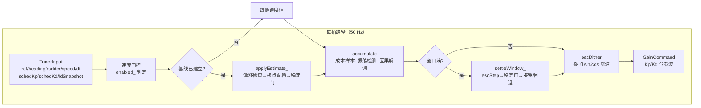

关键时序特征：

- **扰动注入在每拍**（`escDither`），不在窗末——载波在窗口内持续激励闭环；
- **解调在每拍**（`accumulate` 内）——成本增量经 HPF 后立即与同相载波相乘累积，保证因果性；
- **结算在窗末**（每 $T_w=60\,\mathrm{s}$，3000 拍）——`escStep` 归一化梯度、LPF 平滑、积分更新，随后稳定门裁决接受或回退。

### 2.3 双参数正交解调

$K_p$ 用 $\sin(\omega t)$ 载波、$K_d$ 用 $\cos(\omega t)$ 载波（`escDither`，`auto_tuner.hpp:384-385`），两载波正交，解调时分别与 $\sin/\cos$ 相关即可同时分离两个梯度分量（`accumulate`，`auto_tuner.hpp:373-374`），无需分时轮询。

---

## 3. 对外接口（3 个动作）

R1 深化后，模块对外只暴露三个动作接口（`auto_tuner.hpp:144`），其余全部是只读查询或私有机制。

### 3.1 `tick(const TunerInput&) → GainCommand`（`auto_tuner.hpp:150-183`）

**作用**：每控制拍调用一次，返回本拍应施加到 PD 控制器的增益（已含 ESC 扰动载波）。这是模块的主入口，内部按固定顺序完成七步：

1. **速度门控**（`:152`）：`enabled_ = (speedKn <= highSpeedDeactivateKn)`，默认 15 kn 以上去激活——高速时 ESC 与辨识评估全部停摆，增益直通；
2. **基线未建立时跟随调度值**（`:155`）：`curKp_/curKd_` 覆盖为 `schedKp/schedKd`。基线建立后**不再跟随**——增益所有权移交 ESC（P12），防止调度表每拍覆盖 ESC 的调整成果；
3. **周期辨识评估**（`:158-161`）：仅当 `enabled_ && id.excited && id.valid` 三条件同时满足才调 `applyEstimate_(driftGate=true, forceRebase=false)`——即走"漂移检查"路径，漂移在阈值内不动基线；
4. **参考稳定度计时 + 误差计算**（`:165-167`）：`headingRefDeg` 变化时清零 `refAgeSec_`，否则累加 `dt`；误差用 `angleDiffDeg` 做角度回绕处理；
5. **性能样本累积**（`:168`）：调 `accumulate(e, rudderDeg, refAgeSec_ >= 30s)`——第三个参数是振荡检测门控：参考稳定满 30 s 才把误差喂给振荡检测器（机动期间的误差摆动是指令响应，不是闭环振荡）；
6. **ESC 窗口结算**（`:171-177`）：窗口拍数由 `windowSec/dt` 换算（默认 60/0.02=3000 拍），计数器 `winCounter_` 自维护，满窗调 `settleWindow_()`；
7. **扰动注入并返回**（`:180-182`）：基线已建立时调 `escDither(Kp, Kd)` 叠加载波（不持久化，只作用于本拍输出），返回 `GainCommand`。

### 3.2 `establishBaseline(const IdSnapshot&) → bool`（`auto_tuner.hpp:190-194`）

**作用**：一次性评估辨识快照并建立基线。两个使用场景：P14 自动 Z 形辨识试验收官；人工标定注入。

与 `tick()` 的周期评估共享 `applyEstimate_()` 私有路径，但语义不同：

| 维度 | `tick()` 周期评估 | `establishBaseline()` 一次性评估 |
|---|---|---|
| 漂移检查 | 做（`driftGate=true`） | 不做（试验产出是明确的） |
| 振荡测量 | 用实测值 `oscDetector_.amplitude()` | 以 0 传入（机动刚结束测量无效，由 ζ/ωn 代数条件把关） |
| ESC 重锚 | 仅重基线时 | 恒重锚（`forceRebase=true`） |

返回 `false` 表示快照不满足 `excited && valid`，或极点配置/稳定门未通过——调用方据此判定试验 FAILED，保持原增益。

### 3.3 `suspend()`（`auto_tuner.hpp:199-203`）

**作用**：模式生命周期钩子，切出自动模式（MANUAL/HOLD）时调用。做三件事：

- `enabled_ = false`；
- `rebaseEsc()`：清空全部测量状态（窗口样本、解调累积、HPF 状态、梯度积分器）——**保留基线增益与基线估计**；
- `winCounter_ = 0`：窗口节拍重对齐。

它根治了旧 `disable()` 只翻标志位的问题：手动操舵期间的旧测量若不清，会混进下一次自动模式的第一个窗口。

### 3.4 只读查询

| 函数 | 行号 | 作用 |
|---|---|---|
| `enabled()` | `:207` | 速度门控当前状态 |
| `baselineEstablished()` | `:209` | 基线是否建立（替代"增益偏离 1e-9 反推"的迂回断言） |
| `currentGains(Kp&, Kd&)` | `:211` | 当前增益只读投影（不含载波），供测试与遥测 |
| `computeJ()` | `:214-223` | 计算当前窗口的 ITAE 代价（见 §4.6） |
| `oscDetector()` | `:294` | 振荡检测器只读引用 |

---

## 4. 内部机制函数详解

以下函数均为私有（R1 起），只能经 `tick()` / `establishBaseline()` / `suspend()` 驱动。

### 4.1 `applyEstimate_(K, T, oscAmp, driftGate, forceRebase) → bool`（`auto_tuner.hpp:308-329`）

**作用**：评估并应用一组辨识估计——`tick` 周期路径与 `establishBaseline` 一次性路径的**共享实现**，两条路径的全部语义差异都折叠在 `driftGate` / `forceRebase` 两个标志里。

执行顺序：

1. **漂移检查**（`:309-313`，仅 `driftGate=true` 且已有基线）：若
$$|\hat K-K_{base}| \le 0.25\cdot\max(|K_{base}|,\,0.05)\quad\text{且}\quad|\hat T-T_{base}| \le 0.25\cdot\max(|T_{base}|,\,1.0)$$
则直接返回 false——漂移在 25% 阈值内时新旧极点配置差异在 ESC 自身修正能力范围内，交给 ESC 连续调参，不动基线（P12 漂移重基线策略；分母下限 `kReBaselineKFloor/TFloor` 防止早期小估计把相对偏差放大到失真，`:499-502`）；
2. **极点配置**（`:315`）：`polePlacement()` 解出候选 $K_p,K_d$，失败即拒；
3. **稳定门**（`:316`）：`stabilityCheck()` 四条件，不过即拒；
4. **接受**（`:317-321`）：`setBaseline()` 更新基线增益，`baselineEstablished_=true`，`curKp_/curKd_` 切到新配置，`baseK_/baseT_` 记录本次基线对应的估计（作为后续漂移判据的基准）；
5. **重锚**（`:322-327`，`forceRebase || 已有旧基线`）：`rebaseEsc()` 清零 ESC 积分器与测量状态，窗口节拍重对齐。旧梯度是围绕旧增益旧模型测得的，不得施加到新基线。

### 4.2 `settleWindow_(const IdSnapshot&)`（`auto_tuner.hpp:333-345`）

**作用**：ESC 窗口结算，每 $T_w$ 执行一次（原 `AutopilotCore::escTrigger`，R1 内收）。

流程：

1. 守卫：`!enabled_ || !baselineEstablished_` 直接返回（`:334`）；
2. 取当前增益副本，调 `escStep(Kp, Kd)` 算出新候选增益（`:335-336`）；
3. **窗末稳定门**（`:337-340`）：用最新有效辨识估计 $\hat K,\hat T$（无效则以 0 传入使检查自然失败）+ 实测振荡幅值，对**新候选增益**做 `stabilityCheck`；
4. 过门：`curKp_/curKd_` 持久化为新增益（`:341`）；不过门：`revert()` 回退到基线（`:344`）。

这是 ESC 微调永远走不出安全域的制度保证：**ESC 积分器可以任意走，但只有过稳定门的那一步才被持久化**。

### 4.3 `accumulate(e, delta, oscEligible)`（`auto_tuner.hpp:354-376`）

**作用**：每拍性能样本累积 + 因果解调，ESC 梯度估计的数据源头。三条支路：

**支路 1：ITAE 样本入窗**（`:355-360`）——向三个环形缓冲分别推入 $|e|$、$|\delta|$、$|\Delta\delta|$，供窗末 `computeJ()` 使用；`prevDelta_` 维护舵角差分。

**支路 2：振荡检测喂入**（`:362`）——仅当 `oscEligible=true`（参考稳定满 30 s）才把带符号误差喂给 `OscillationDetector`。

**支路 3：ESC 因果解调**（`:364-375`，仅 `enabled_`）——P11 整改的核心：

- 本拍成本增量 $c_k = \big(t|e| + w_U|\delta| + w_{D u}|\Delta\delta|\big)\,dt$，与 `computeJ` 被积函数严格一致（`:366-367`）；
- 一阶高通（后向欧拉，系数 $\alpha_H=\tau_H/(\tau_H+dt)$ 按**控制周期**计算）去除直流/慢漂分量：`hpfY_ = α_H·(hpfY_ + c - hpfCPrev_)`（`:369-371`）；
- 与本拍载波同相相关累积：`demodKpSum_ += hpfY_·sin(φ)`、`demodKdSum_ += hpfY_·cos(φ)`（`:373-374`）。

P11 的历史教训写在注释里：旧实现把按 `dt` 设计的 HPF/LPF 用在每 60 s 才来一个的样本上，梯度被衰减 2~3 个数量级，调参结果与初值逐位相同——所以解调必须每拍做，系数必须按真实采样周期算。

### 4.4 `escDither(Kp&, Kd&)`（`auto_tuner.hpp:382-388`）

**作用**：每拍扰动注入，经典摄动 ESC 的激励端。

```
Kp *= 1 + a·sin(φ)     // a = escAmp = 0.05
Kd *= 1 + a·cos(φ)     // 正交载波
φ  += ω·dt             // ω = escFreq = 0.05 rad/s，周期 ≈ 125.7 s
```

要点：

- **相对摄动**：载波以比例形式（±5%）叠加，增益量级变化时扰动自动缩放；
- **不持久化**：修改的是 `tick()` 里的输出副本，`curKp_/curKd_` 本体不带载波——载波只是"探针"，不是增益的一部分；
- **相位连续性**：相位超过 $2\pi$ 回绕（`:387`），且 `rebaseEsc()` 故意不清 `escPhase_`，避免重锚拍载波突跳（`:434-437` 注释）。

### 4.5 `escStep(Kp&, Kd&)`（`auto_tuner.hpp:395-426`）

**作用**：窗末梯度结算与积分更新，ESC 的"决策"环节。五步：

1. **记录本窗代价**（`:398`）：`lastJ_ = computeJ()`（观测用）；
2. **梯度归一化**（`:400-405`）：解调累积量换算为梯度估计
$$\hat g = \frac{2}{a\cdot N}\sum_k y_k\cdot\text{载波}_k$$
系数 2 来自正弦相关器的幅值还原，$a$ 是摄动幅值，$N$ 是窗口拍数。这是"代价对增益相对摄动的偏导"的实测估计；
3. **LPF 平滑**（`:407-409`）：梯度估计经一阶低通，系数 $\alpha_L = T_w/(\tau_L+T_w)$ 按**窗口周期**计算（输入每 60 s 才到达一次，这是与 HPF 不同的时基，P11 整改点之一）；
4. **梯度下降 + 幅值约束**（`:411-416`）：$K_{new} = K - \eta\hat g$，经 `clampUpdate()` 限制单次更新幅度，再 clamp 到非负；
5. **清窗**（`:418-425`）：三个环形缓冲、HPF 状态、解调累积全部清零——下一窗从零开始（**非重叠窗**设计）。

### 4.6 `computeJ() → double`（`auto_tuner.hpp:214-223`）

**作用**：计算当前窗口的 ITAE 代价

$$J=\int_0^{T_w}\big(t\,|e(t)| + w_U|\delta(t)| + w_{Du}|\dot\delta(t)|\big)\,dt$$

逐拍遍历三个环形缓冲求和。时间权重 $t$ 使误差越晚消除惩罚越重（ITAE 的标准性质，压制长尾巴）；$w_U=0.01$、$w_{Du}=0.005$ 把操舵能耗与舵机动作率折进代价，防止 ESC 为了追求航向精度把增益推高到伤舵机的区域。公开成员，主要供观测与 `escStep` 记录。

### 4.7 `polePlacement(K, T, zeta, wn, Kp&, Kd&) → bool`（`auto_tuner.hpp:228-237`）

**作用**：层 2 极点配置，静态函数，**全仓库公式唯一定义处**（仿真场景安装调度表也应调此处）：

$$K_p=\frac{\omega_n^2 T}{K},\qquad K_d=\frac{2\zeta\omega_n T - 1}{K}$$

- 前置检查：$K,T$ 有限且 $|K|,|T|\ge 10^{-6}$，否则返回 false（P6）；
- $K_d$ clamp 到 $\ge 0$（`:235`）：负 $K_d$ 会反向放大振荡（模型慢到 $2\zeta\omega_n T<1$ 时公式给出负值，物理上宁可不要微分项）。

### 4.8 `stabilityCheck(K, T, Kp, Kd, oscAmplitude) → bool`（`auto_tuner.hpp:241-254`）

**作用**：§3.10.7 稳定门，四条件全满足才接受。详见本文档 §8 与专项讨论；此处列要点：

- 前置合法性：$K,T$ 有限、非近零，$K_p>0$；
- 用候选参数反推闭环名义模态 $\omega_n=\sqrt{K_p K/T}$、$\zeta=(1+K_d K)/(2\sqrt{T K_p K})$；
- 三道门槛：$\zeta\ge 0.6$（阻尼下限）、$\omega_n\le 0.5$ rad/s（带宽上限，保护舵机）、实测振荡峰-峰 $\le 5°$（与模型无关的兜底）。

两个调用点：`applyEstimate_`（建基线前）与 `settleWindow_`（ESC 步持久化前）。

### 4.9 `revert(Kp&, Kd&)`（`auto_tuner.hpp:429-432`）

**作用**：回退——把增益恢复为基线值 `baselineKp_/baselineKd_`。仅在 `settleWindow_` 稳定门不通过时调用。基线始终是"最近一次通过全部检查的增益"，因此回退目标天然安全。

### 4.10 `rebaseEsc()`（`auto_tuner.hpp:438-450`）

**作用**：ESC 状态重锚——清零梯度积分器、HPF 状态、解调累积、窗口样本、`prevDelta_`。**保留**基线增益、`curKp_/curKd_`、基线估计与载波相位。

两个调用点：显式重基线（`applyEstimate_`）与模式挂起（`suspend`）。理由：旧梯度与旧窗口成本围绕旧增益旧模型测得，继续积分会把陈旧信息施加到新基线；相位不清是为了载波连续。

### 4.11 `clampUpdate(newVal, oldVal) → double`（`auto_tuner.hpp:452-461`）

**作用**：单次更新幅值限制，$|\Delta| \le \max(|old|\cdot 10\%,\ 10^{-3})$。

P11 整改点在注释里：`old==0` 时纯比例上限为 0 会**永久锁死更新**（典型场景：极点配置把 $K_d$ 钳到 0，此后 ESC 永远无法把 $K_d$ 调起来），所以加绝对下限 `absMinUpdate=1e-3`。这是 ESC 的"最大步长"安全绳——即使梯度估计被噪声污染，单窗增益变化也不超过 10%。

---

## 5. 工具函数与数据结构

### 5.1 `OscillationDetector`（嵌套类，`auto_tuner.hpp:257-292`）

**作用**：基于航向误差的峰-峰幅值估计，为稳定门提供与模型无关的实测振荡指标（P4）。

算法（`update(e, dt)`）：

- 按符号跟踪正半周峰值 `maxPos_` 与负半周谷值 `minNeg_`；
- **过零结算**：符号翻转时，刚结束的半周期峰值归档（`lastPosPeak_/lastNegPeak_`）；负半周结束时计算跨完整周期的峰-峰值 `pp`；
- 幅值更新策略**保守**：`pp` 大于当前估计则立即取大，否则按 $0.9/0.1$ 平滑衰减——振荡起来立刻可见，消失时缓慢确认；
- P11：`reset()` 同时清空历史峰，避免上一窗口峰值泄漏进下一窗口。

### 5.2 `RingBuffer<T, N>`（`auto_tuner.hpp:57-78`）

固定容量环形数组（模板），替代 `std::deque`，**无堆分配**（P2，ECU 友好）。`push` 覆盖最旧样本，`operator[]` 按写入顺序（最旧→最新）访问。模块内实例化为三个 3000 点缓冲（`windowErr_/windowDelta_/windowDDelta_`，60 s / 0.02 s）。

### 5.3 `IdSnapshot` / `TunerInput` / `GainCommand`（`auto_tuner.hpp:31-54`）

- `IdSnapshot`：辨识器的只读投影（`excited`/`valid`/`K`/`T`）。**本模块不持有辨识器**——由调用方每拍喂数据并组装快照传入，保持模块间单向依赖；
- `TunerInput`：每拍输入打包（参考/实际航向、舵角、船速、`dt`、调度名义值、辨识快照）；
- `GainCommand`：每拍输出（含载波的 $K_p,K_d$）。

---

## 6. 状态变量总表

| 变量 | 初值 | 含义 | 谁写 | 谁清 |
|---|---|---|---|---|
| `curKp_/curKd_` | 0 | 当前增益（基线建立后 ESC 拥有） | `tick`/`applyEstimate_`/`settleWindow_` | `reset` |
| `baselineKp_/baselineKd_` | 0 | 基线增益（回退目标） | `setBaseline`（经 `applyEstimate_`） | `reset` |
| `baseK_/baseT_` | 0 | 基线对应的 K/T 估计（漂移判据基准） | `applyEstimate_` | `reset` |
| `baselineEstablished_` | false | 基线建立标志 | `applyEstimate_` | `reset` |
| `enabled_` | false | 速度门控状态 | `tick`/`suspend` | `reset` |
| `escPhase_` | 0 | 载波相位 (rad) | `escDither` | `reset`（`rebaseEsc` 故意不清） |
| `gradKp_/gradKd_` | 0 | LPF 后的梯度估计 | `escStep` | `reset`/`rebaseEsc` |
| `hpfCPrev_/hpfY_` | 0 | HPF 状态 | `accumulate` | `reset`/`escStep`/`rebaseEsc` |
| `demodKpSum_/demodKdSum_/demodCount_` | 0 | 解调累积 | `accumulate` | `reset`/`escStep`/`rebaseEsc` |
| `windowErr_/windowDelta_/windowDDelta_` | 空 | ITAE 样本窗（3000 点环形） | `accumulate` | `reset`/`escStep`/`rebaseEsc` |
| `prevDelta_` | 0 | 舵角差分基准 | `accumulate` | `reset`/`rebaseEsc` |
| `winCounter_` | 0 | 窗口节拍计数 | `tick` | `reset`/`suspend`/`applyEstimate_` |
| `prevRef_/refAgeSec_` | 0 | 参考变化检测与稳定计时 | `tick` | `reset` |
| `oscDetector_` | — | 振荡检测器 | `accumulate`（门控） | `reset` |
| `lastJ_` | 0 | 上窗代价（观测） | `escStep` | `reset` |

### 策略常量（constexpr，行为不变、不新增可调面，`auto_tuner.hpp:499-507`）

| 常量 | 值 | 含义 |
|---|---|---|
| `kReBaselineTol` | 0.25 | K/T 相对漂移超 25% 才显式重基线 |
| `kReBaselineKFloor` / `kReBaselineTFloor` | 0.05 / 1.0 | 相对漂移分母下限（防早期小估计失真） |
| `kOscRefSettleSec` | 30.0 | 参考稳定满 30 s 才喂入振荡检测（覆盖典型船约 4T 调节时间） |

---

## 7. 生命周期与时序

### 7.1 典型会话

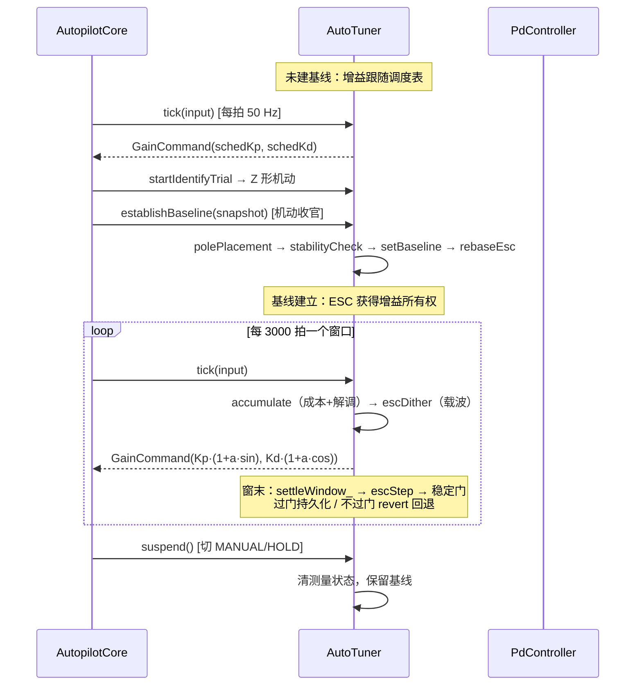

### 7.2 三个时间尺度

| 尺度 | 周期 | 发生的事 |
|---|---|---|
| 控制拍 | 20 ms（50 Hz） | 载波注入、成本累积、HPF、解调累积、振荡检测 |
| 评估窗口 | 60 s（3000 拍） | 梯度归一化、LPF、积分更新、稳定门、接受/回退 |
| 重基线 | 事件驱动 | K/T 漂移超 25% 或辨识试验收官 → 极点配置 + 重锚 |

载波周期 ≈125.7 s 是窗口的约 2 倍——每窗覆盖约两个完整载波周期，相关器能有效抑制非载波频率的代价分量（详见数学推导文档 §4）。

---

## 8. 安全防线汇总

按数据流向，一组候选增益从产生到持久化要过的关卡：

1. **辨识合理性**：`IdSnapshot.valid`（$K\in(0,2]$、$T\in[1,60]$，由 `NomotoIdentifier` 保证）+ `excited`；
2. **极点配置合法性**：`polePlacement` 前置检查 + $K_d\ge 0$ clamp；
3. **稳定门（建基线）**：`applyEstimate_` 内 `stabilityCheck` 四条件；
4. **速度门控**：>15 kn 时 ESC 与评估整体停摆；
5. **更新限幅**：`clampUpdate` 单窗 ≤10%（含绝对下限防锁死）；
6. **稳定门（窗末）**：`settleWindow_` 对 ESC 新增益再做 `stabilityCheck`，含实测振荡 ≤5°；
7. **回退**：不过门即 `revert` 到基线——基线本身必然曾通过全部检查；
8. **振荡门控**：参考机动期间 osc 测量不喂入，避免把指令响应误判为闭环振荡；
9. **重锚隔离**：重基线/挂起时 `rebaseEsc` 清零，陈旧梯度不得跨基线使用。

设计原则一句话：**ESC 积分器是"提案者"，稳定门是"裁决者"，基线是"最后的安全岛"**——任何一步出问题，系统最多损失一个窗口（60 s）的微调进度，不会损失稳定性。

---

## 9. 逐函数执行流程图

本章为每个函数配一张执行流程图，图题即该函数的**作用**，节点内标注关键行号。按调用频率排序：每拍执行 → 窗末执行 → 事件驱动 → 工具函数。

### 9.1 `tick()` —— 模块主入口：每拍编排全部机制并给出本拍增益

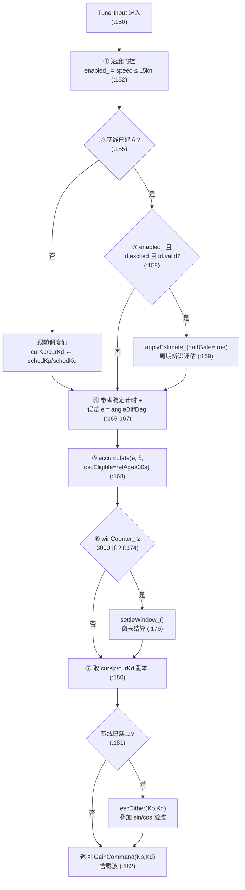

### 9.2 `accumulate()` —— 每拍数据源：成本样本入窗 + 振荡检测喂入 + ESC 因果解调

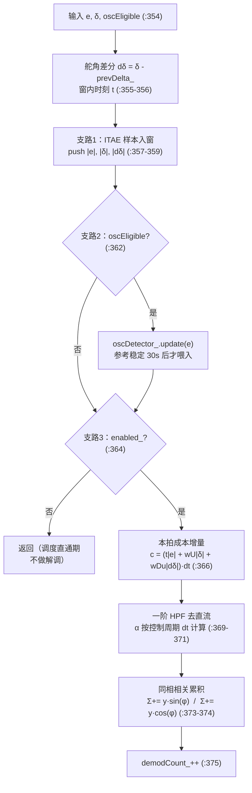

### 9.3 `escDither()` —— 激励端：每拍把 ±5% 正交载波叠加到输出增益（不持久化）

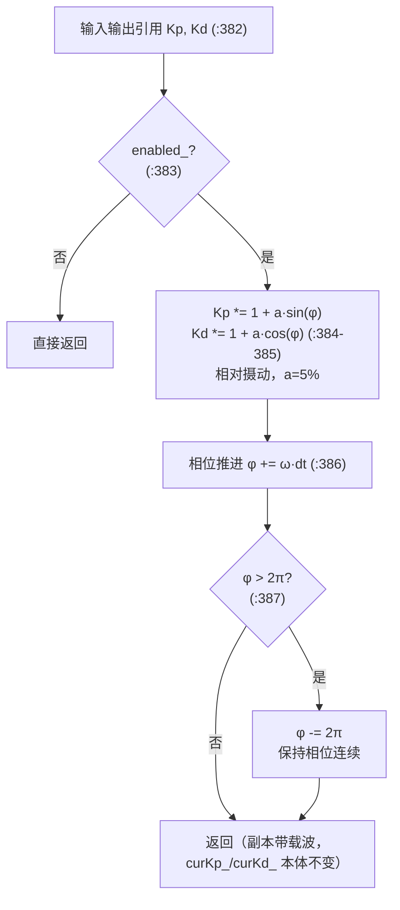

### 9.4 `settleWindow_()` —— 窗末裁决：ESC 步进 → 稳定门 → 持久化或回退

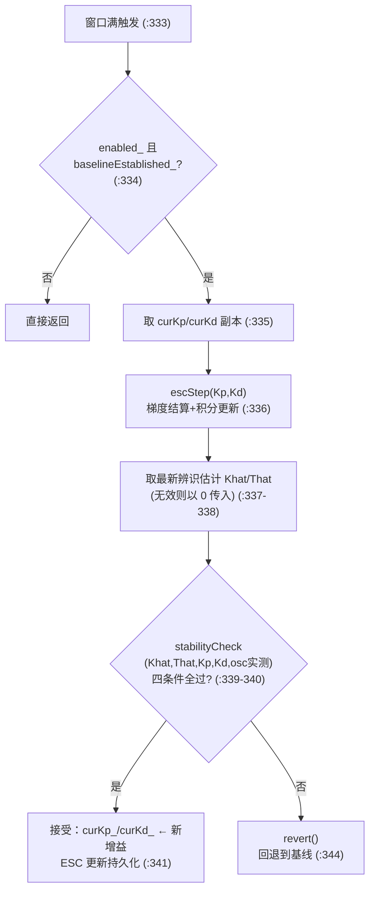

### 9.5 `escStep()` —— 窗末决策：解调累积 → 归一化梯度 → LPF → 限幅积分 → 清窗

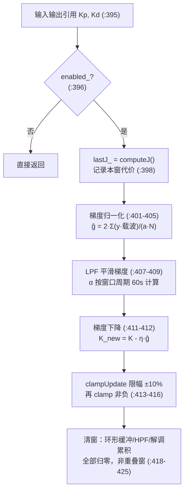

### 9.6 `applyEstimate_()` —— 辨识评估共享路径：漂移检查 → 极点配置 → 稳定门 → 建基线/重锚

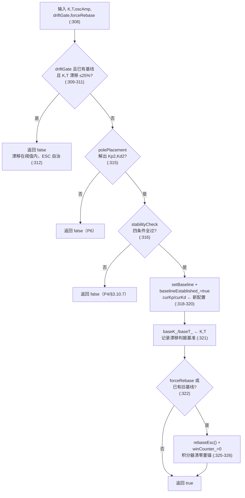

### 9.7 `establishBaseline()` —— 一次性建基线入口：辨识试验收官 / 人工标定注入

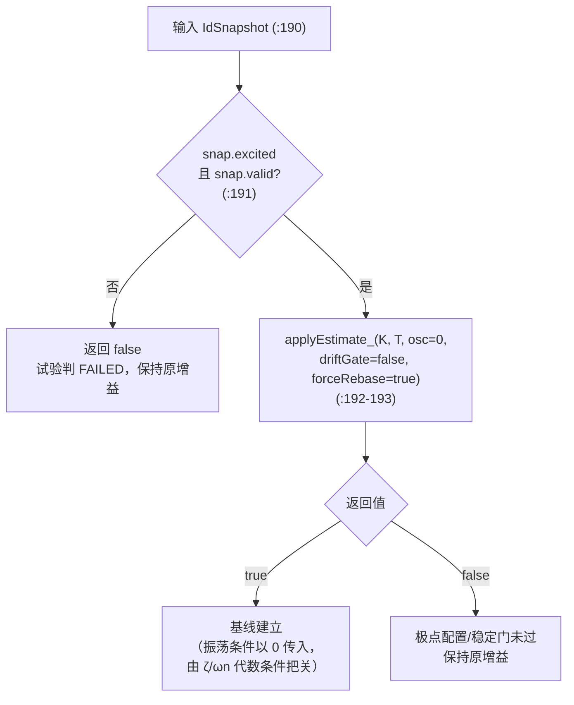

### 9.8 `suspend()` —— 模式生命周期钩子：切出自动模式时清测量状态、保留基线

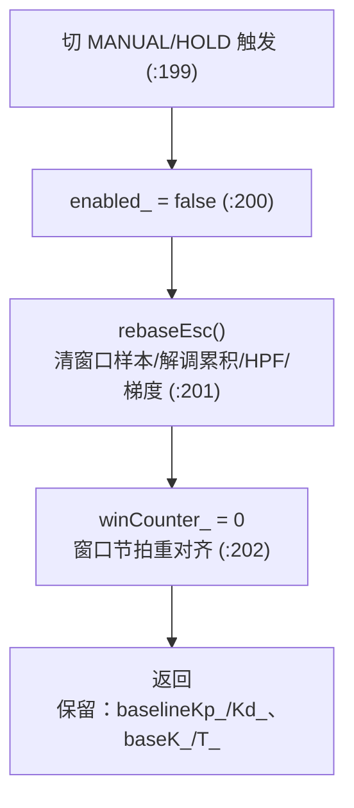

### 9.9 `polePlacement()` —— 层 2 解析基线：由 K,T 反解 PD 增益（全仓库公式唯一定义处）

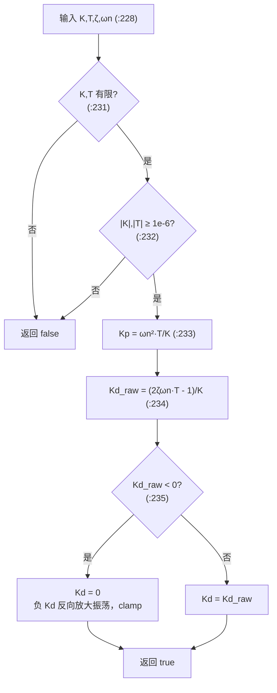

### 9.10 `stabilityCheck()` —— 稳定门：前置合法性 + ζ/ωn/实测振荡 四条件全过才接受

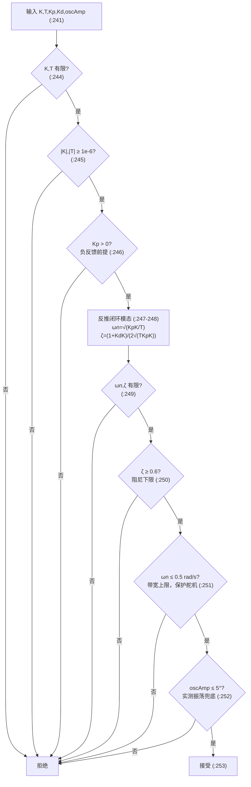

### 9.11 `OscillationDetector::update()` —— 实测振荡估计：过零结算跨完整周期的峰-峰幅值

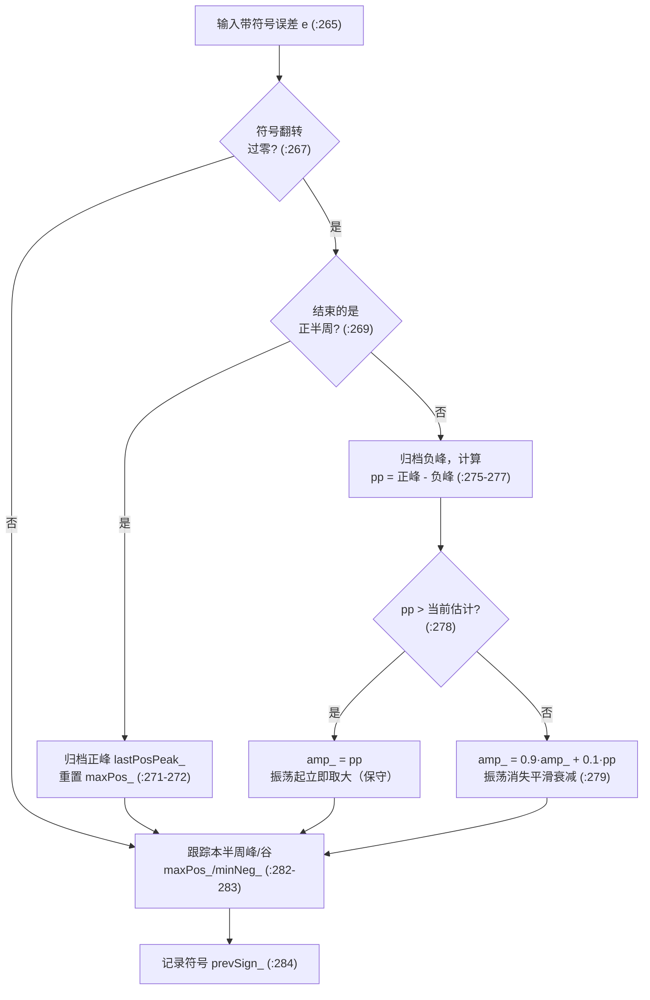

### 9.12 `computeJ()` —— 代价计算：当前窗口 ITAE 积分（误差时间加权 + 操舵代价）

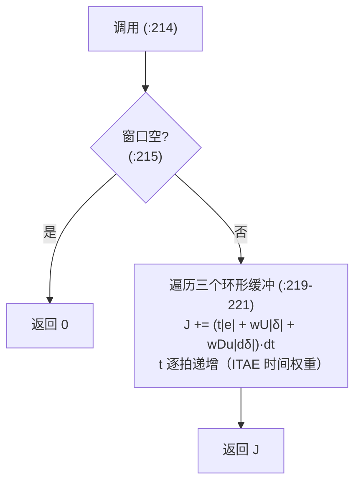

### 9.13 三个小工具函数

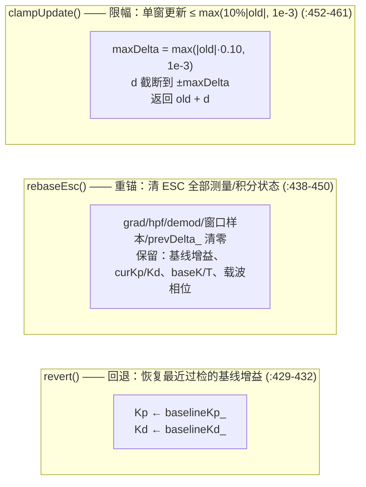

### 9.14 函数间调用关系总图

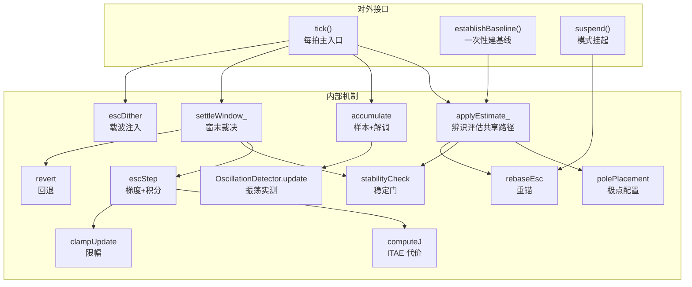
