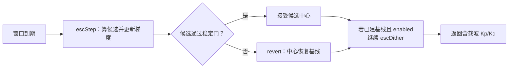
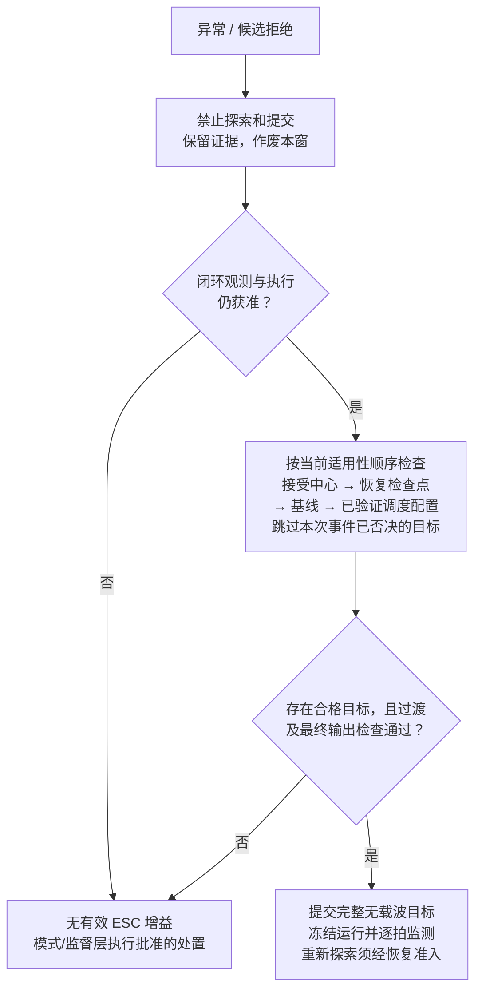
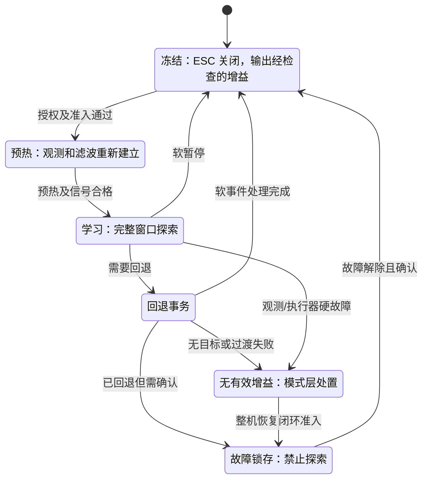
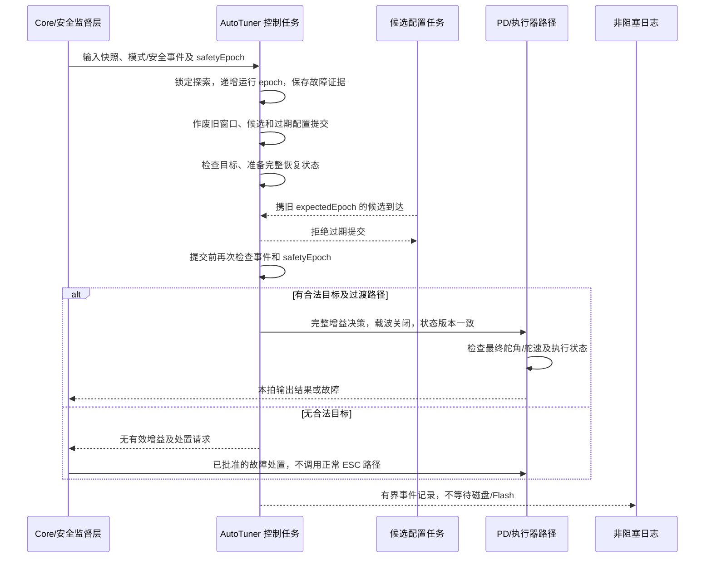
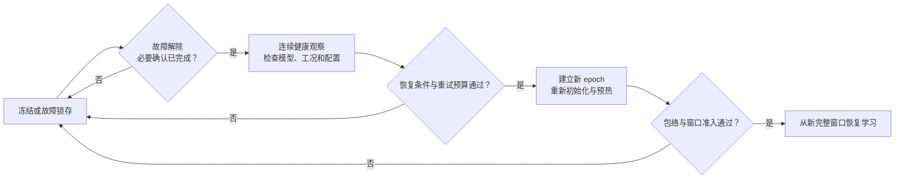
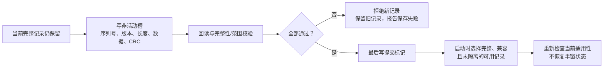

# ESC 减参方案回退流程设计

> 版本：V1.0 · 2026-09-17  
> 状态：**待评审设计，不代表回退机制已实现或获得实船放行。**  
> 适用范围：ESC 极值搜索减参方案的窗口拒绝、暂停、增益回退、受控恢复、配置撤销和算法/固件回滚。  
> 依据：现有[减参方案](ESC减参方案设计文档.md)、[实施阶段计划](ESC减参方案实施阶段计划.md)及 `833d3c5` 加当前未提交工作区源码；不是冻结发布基线。本文所有新增状态、类型和原因码均为拟议设计。

<style>
@media print {
  pre.mermaid-block { break-inside: avoid; page-break-inside: avoid; padding: 0; }
  pre.mermaid-block svg { max-height: 225mm; }
  [id="152-测试矩阵"] + table th:first-child,
  [id="152-测试矩阵"] + table td:first-child { min-width: 22mm; white-space: nowrap; }
}
</style>

## 1. 设计结论

推荐采用“**先禁止探索与提交，再选择当前仍适用的回退目标；无合格目标则交由整机故障策略处置；恢复必须重新准入**”的流程。

必须区分以下动作，不能用一个 `revert()` 或 `enabled=false` 代替：

| 动作 | 适用情形 | 主要结果 |
|---|---|---|
| 拒绝候选 | 新中心未通过检查，但当前接受中心仍适用 | 不提交新中心；必要时暂停并清理污染的学习状态 |
| 暂停学习 | 低信号、参考变化、掉拍、工况禁止等 | 关闭载波、不更新中心；保持经重新检查的工作增益 |
| 增益回退 | 已应用中心不再适用，或确认其性能退化 | 改用合格的恢复检查点、基线或调度配置 |
| 整机故障处置 | 闭环观测/执行能力失效，或没有合格目标 | 禁止继续正常 ESC/PD 路径，请求批准的模式/执行器处置 |
| 配置或版本回滚 | 新配置、算法、固件未通过验证 | 在受控条件下恢复已验证组合，不继承不兼容的学习状态 |

**旧基线不是永久安全证书，关闭 ESC 也不等于关闭自动舵。** 当前传感器、工况、安全限制和执行器状态决定是否还能继续航向闭环；本文不指定“故障一律回中”“一律 HOLD”或“请求人工后继续原算法”。这些动作须由整机负责人批准。

本设计不新增现场性能旋钮。冷却时间、恢复门槛、失败计数策略属于版本化安全/船型配置；操作员只进行允许的停用、确认、重新使能或维护回滚操作。

## 2. 当前实现与设计差距

### 2.1 已核对的源码事实

| 当前入口 | 当前行为 | 本设计要求补齐的内容 |
|---|---|---|
| `AutoTuner::tick()`，约第 150 行 | 窗末调用 `settleWindow_`，之后仍可能调用 `escDither` | 回退当拍禁止再次叠加载波；输出前执行最终检查 |
| `settleWindow_()`，约第 336 行 | 先 `escStep`，再用当前辨识快照检查候选；失败恢复基线 | 候选与已接受状态隔离，回退目标另做适用性检查 |
| `revert()`，约第 432 行 | 仅把传入 Kp/Kd 改为 `baselineKp_/baselineKd_` | 不等于事务回退、状态清理、故障锁存或恢复流程 |
| `escStep()`，约第 398 行 | 会更新平滑梯度，并清本窗样本、HPF 和解调累计 | 拒绝候选后不能让拒绝路径遗留的梯度继续驱动更新 |
| `suspend()` / `rebaseEsc()` | 清部分测量状态、保留基线；未完整清理参考/振荡历史；`rebaseEsc` 不复位载波相位 | 按事件定义清理范围；停用/故障不可被下拍速度门控重新开启 |
| `stabilityCheck()`，约第 241 行 | 检查模型与名义阻尼/频率/振荡条件 | 不等于完整实船安全证明；补模型年龄、质量、最终增益与过程故障判定 |
| `IdSnapshot` / `GainCommand` | 分别只有 `{excited, valid, K, T}` 与 `{Kp, Kd}` | 增加可审计的质量/新鲜度及无有效增益时的显式返回契约 |
| `AutopilotCore::setMode()` 等 | 部分模式转换清 PD/挂起 tuner，机动路径还有直接模式赋值 | 覆盖所有模式入口；明确模式层与执行器层的接管责任 |
| `ParamStore::load()` | 直接修改目标对象，返回解析/CRC 结果；未调用 `validateRange()` | 临时解析、范围/版本校验、原子接管和可恢复存储 |

源码入口：[auto_tuner.hpp](../control/include/auto_tuner.hpp)、[autopilot_core.hpp](../control/include/autopilot_core.hpp)、[pd_controller.hpp](../control/include/pd_controller.hpp)、[param_store.hpp](../control/include/param_store.hpp)。行号仅辅助定位，以函数名和当前源码为准。

### 2.2 当前回退不是“恢复基线后停学”



图 1：现有调用顺序的简化图，不是新方案。`tick()` 每拍按速度重算 `enabled_`，因此仅调用一次 `suspend()` 不能构成持久故障锁存。

现有 `SettleRevertsToBaselineWhenEstimateInvalid`、`RebaselineClearsIntegratorState` 等测试可作为历史行为入口，但不能证明本文的目标选择、同拍禁载波或安全恢复契约已经成立。参见[调参器测试](../control/tests/test_auto_tuner.cpp)和[调试接口测试](../control/tests/test_tuner_debug_api.cpp)。

## 3. 对象、版本与所有权

### 3.1 不把几个“历史值”混成一个备份

| 对象 | 含义与内容 | 可否直接作为回退目标 |
|---|---|---|
| `baseline` 基线 | 经极点配置/标定建立的增益及模型、船型、适用范围 | 仅在当前重新检查通过时 |
| `acceptedCenter` 接受中心 | 最近一次通过算法准入并提交的无载波中心 | 不意味着已独立验证性能；仍需检查 |
| `candidateCenter` 候选中心 | 由本窗梯度提出、尚未提交的临时值 | 不可作为恢复备份 |
| `recoveryCheckpoint` 恢复检查点 | 保留的前一接受中心或经独立验证的工作点，并带来源与适用条件 | 按可信度和当前适用性选择，不因名字带 good 就直接使用 |
| `appliedGains` 实际施加增益 | 某拍含载波、检查后交给 PD 的 Kp/Kd | 用于时序追踪；不当作学习中心或永久基线 |
| `validatedSchedule` 已验证调度配置 | 已放行船型/工况的名义调度表 | 查到值不等于适用；未知工况或无有效配置时不可使用 |

一维 q、二维相对坐标和物理 Kp/Kd 不可互换。尤其不能只恢复 q 数值，却配上另一组模型、阻尼或基线频率。

### 3.2 拟议恢复记录

恢复记录至少保存：`checkpointId`、物理 Kp/Kd、可选 q/二维中心、`algorithmId`、`coordinateVersion`、`costDefinitionId`、`profileId/version`、`planId`、`modelAnchorId`、`safetyEpoch`、基线来源、适用速度/海况/载况、记录时间及验证状态。

- q 只在模型锚点、坐标和配置身份一致时恢复；否则可把物理 Kp/Kd 作为待检查的冻结候选，**不强行反算并接回一维学习**。
- 新建模型锚点后，重新推导基线和 q 坐标。`q=0` 表示新基线，不代表任意旧增益。
- 故障前后的快照放在有界 RAM 记录中；不每次接受中心就擦写 Flash。
- 保存检查点与提交候选是同一逻辑事务：不得先覆盖唯一旧检查点，再检查新候选。

`AutoTuner` 继续拥有中心、基线、窗口、相位、梯度和回退状态；Core 不复制一套 ESC 状态机。Core/整机监督层负责模式与故障输出，PD/执行器路径负责最终舵角约束。配置和 NVM 任务不直接改控制任务正在使用的状态。

## 4. 故障分级与触发矩阵

以下原因码为拟议命名。严重度由当前闭环是否仍可安全运行决定，不能只按故障名称机械分类。

| 触发事件 / 原因码 | 首选动作 | 保持/回退的必要条件 | 恢复方式 |
|---|---|---|---|
| 梯度信号不足 / `LOW_SIGNAL` | 作废学习结果，暂停载波 | 当前接受中心仍适用，观测与执行器正常 | 条件改善后按已验证重试节奏重新预热；不自动造机动 |
| 探索幅值为零 / `PROBE_DISABLED` | 关闭探索，不做除幅值计算 | 冻结中心通过检查 | 用户重新使能且完整包络可行 |
| 目标阶跃 / `REFERENCE_CHANGED` | 作废本窗、清相关历史 | 航向控制仍准入 | 参考稳定后重新预热 |
| 模式切换/机动 / `MODE_CHANGED` | 取消所有待提交学习结果 | 输出归新模式所有 | 回到允许模式后重新准入 |
| 超过 ESC 工况范围 / `OPERATING_INHIBIT` | 停学、重新选冻结工作点 | 该工作点适用当前工况，不能只看 ESC 速度门限 | 工况回到带滞回的允许区间 |
| 小幅时序异常使窗口不可信 / `WINDOW_INVALID` | 作废窗口，不提交 | 当前控制拍本身仍有合法时基和输入 | 时钟连续有效后预热 |
| 非法 dt、数据陈旧/非有限 / `INPUT_INVALID` | 若闭环观测不可用则立即请求整机处置 | 仅缺失优化辅助量时才允许经独立准入的名义控制 | 健康监测通过；严重故障须确认 |
| 模型漂移/失效 / `MODEL_INVALID` | 停学，重选检查点或调度配置 | 有不依赖失效估计的已验证适用依据 | 新模型锚点评估通过后重锚 |
| 候选中心/包络不合法 / `CANDIDATE_REJECTED` | 拒绝候选，按拒绝类型暂停 | 旧接受中心及其当前输出仍合法 | 清失效学习状态，必要时重建计划 |
| 最终含载波增益不合法 / `APPLIED_GAIN_REJECTED` | 当拍禁止该输出，关闭载波，选目标 | 无载波目标通过最终检查 | 锁定相应失效计划，评估后恢复 |
| 振荡、误差或执行器硬保护触发 / `CONTROL_FAULT` | 立即禁止探索，交监督层裁决 | 不允许仅清振荡历史就宣布基线安全 | 锁存故障，按整机条件确认恢复 |
| 可比较试验确认性能退化 / `PERFORMANCE_REGRESSION` | 关闭载波，恢复合格检查点 | 外部指标口径一致，检查点仍适用 | 排查后授权重试；不能只凭单窗 J 上升认定 |
| 安全域收紧 / `SAFETY_CHANGED` | 立即检查所有现用目标，撤销旧待提交项 | 必须满足新安全域 | 不能等窗末或用旧配置撤销新安全限制 |
| 新配置无效 / `CONFIG_REJECTED` | 拒绝新配置，保留完整旧计划 | 旧计划仍满足当前安全域 | 修正配置后重新申请 |
| 连续失败/恢复抖动 / `RETRY_EXHAUSTED` | 锁定学习停用，必要时升级处置 | 冻结控制仍需持续检查 | 人工确认及故障原因解除 |

同拍多事件时：**整机硬故障/安全限制优先于模式事件，模式事件优先于配置事务，配置事务优先于普通窗末学习。** 记录全部原因位图，并给出本次实际处置的主原因。性能偏好和旧配置不得覆盖更高优先级的安全事件。

## 5. 回退目标选择流程



图 2：默认选择顺序。若故障原因已否决某目标，直接跳过它；例如确认当前接受中心导致退化时，不能又因它数值合法而选回同一中心。

每个目标都要检查：数值有限性与单位、配置/坐标兼容性、模型/船型适用性、安全域版本、当前工况、观测/执行器可用性，以及批准的输出过渡规则。模型已经失效时，不能继续拿失效模型作为目标通过的唯一证据。

有限数量的候选按固定顺序检查，单拍不做无界重试。若过程级故障使所有增益都不满足准入，不必遍历尝试不同增益，更不能在真实舵机上逐个试错寻找“能用”的目标。

## 6. 状态机与故障锁存

状态描述的是调参器，不是替代 `Mode` 的另一套航行模式。



图 3：主要状态迁移；**任意状态**发生更高优先级硬故障均可进入 `NoGain`，不能因图中省略某条边而屏蔽故障。

- 预热期间准入消失则返回冻结；若工作点不再适用则进入回退。冻结/锁存期间目标失效且没有合格替代时，同样进入 `NoGain`。图中省略这些重复检查边以保持可读性。
- `Latched` 可以携带一个仍被允许使用的冻结目标；这不表示自动模式始终可用，模式层仍可选择退出。
- `NoGain` 不返回伪造的零增益/NaN 作为信号，也不允许 Core 继续正常 PD 调用。必须走显式故障返回分支。
- 学习许可分解为操作授权、模式准入、工况准入、计划有效、故障锁存和恢复条件；不能由一个速度比较覆盖全部结果。
- 停用请求和安全故障最迟在**下一次输出提交前**阻断载波和学习提交。控制循环未运行/超时的情况，由独立调度监测或硬件保护覆盖；不能声称仅靠 `tick()` 处理所有超时。

## 7. 一次回退事务的执行顺序

### 7.1 单写者、失效优先、提交前复核



图 4：“原子”指控制任务在一个提交边界发布整组一致状态，不假设多个浮点字段可天然原子写入。多任务/中断共享应采用经验证的单写者消息、双缓冲或短临界区；若检查后安全状态又变化，最终提交端必须拒绝过期决策。

### 7.2 拟议决策接口

建议扩展 `tick()` 的返回契约，或新增与返回值同版本的决策包，至少携带：

```text
TunerDecision（拟议接口，并非可直接调用的现有 API）
  gainsValid, Kp, Kd              # gainsValid=false 时，增益字段不可使用
  tunerState, primaryReason, reasonBits
  explorationAllowed             # 回退/冻结/锁存时必须为 false
  actionRequest                  # 由 Core 映射到批准的整机处置
  runtimeEpoch, safetyEpoch, planId, checkpointId, eventId
```

Core 必须先检查决策有效性/版本，再 `setGains()` 和执行闭环。没有有效增益时，正常路径不能“暂用上次返回值”掩盖故障；确需短时保持某输出时，必须由已批准的监督策略显式授权、限制时长并监测执行结果。

### 7.3 拟议执行骨架

```text
process_control_cycle(input, events):
    snapshot = capture_consistent_context(input, events)
    if snapshot prohibits normal control:
        invalidate_epoch_and_learning()
        return NO_VALID_GAINS(reason)

    classify events before ordinary window settlement
    if pause / revert / config invalidation is required:
        save pre-event evidence in bounded RAM
        block learning and dither; invalidate old epoch/candidates
        target = choose_applicable_target(snapshot, event-specific exclusions)
        if target absent: return NO_VALID_GAINS(reason)
        prepare target + reset policy + no-dither output together
        if latest safety/mode epoch differs: reject and escalate/re-evaluate boundedly
        if transition/output contract fails: return NO_VALID_GAINS(reason)
        commit complete state and decision; enqueue event without blocking
        return FROZEN_OR_LATCHED_DECISION

    run warmup/window processing only under the current valid epoch
    commit candidate only if epoch, final envelope and safety checks still match
```

这里的执行顺序是契约，不是当前代码的实现。回退路径不得在返回前再次落入正常 `escDither`，也不得在异常分支中执行 Flash 擦写、网络等待或无界分配。

## 8. 状态清理与证据保留矩阵

| 状态/对象 | 正常完整窗接受 | 软暂停/候选拒绝后重试 | 重锚/增益回退 | 进程重启/跨算法版本 |
|---|---|---|---|---|
| 窗口累计、有效窗长、相关累计 | 清本窗并推进编号 | 作废、清空 | 作废、清空 | 不恢复 |
| HPF/梯度 LPF | B/C 路径连续保留；A0/B0 按其版本契约 | 清失效状态，重新预热 | 清零并重新预热 | 不恢复 |
| 中心与模型锚点 | 成套提交接受中心 | 保留仍适用的接受中心 | 成套恢复或建立新锚点 | 仅加载兼容且重新准入的记录 |
| 载波相位、应用时间/观测对齐记录 | 正常连续推进 | 标为失效；新探索周期重建 | 标为失效；新探索周期重建 | 不恢复 |
| 舵角差分的上一样本 | 连续保留 | 标无效；首个合法样本建立基准，不计算跨空档导数 | 同左 | 同左 |
| 参考稳定计时、优化用振荡历史 | 连续更新 | 参考/工况/数据变化时重建；不得继承过期“稳定” | 重新建立测量资格 | 重新建立 |
| 过程安全监测、故障锁存 | 连续保留 | 不因清学习状态而消失 | 保留故障证据与锁存；不得用清零制造健康 | 按整机启动策略重新监测；严重锁存的保持方式另行规定 |
| 失败次数、重试节奏 | 仅按已验证的健康窗口规则更新 | 增加/保留，禁止靠暂停清零绕过 | 保留事件链 | 跨重启是否保留须评审，防止反复复位无限试探 |
| PD 的上一输出/微分状态 | 连续保留 | 根据观测连续性处理，不跟随 ESC 清窗一起清零 | 按第 9 节执行独立过渡 | 用合法测量及执行状态重新初始化 |

候选拒绝如果只是可预期的合法边界投影，可按已验证策略继续；如果由数值异常、裁剪、失配或安全失败引起，不能把同一失效梯度留到下一次更新。本设计的首轮实现对这类拒绝采用“暂停、清失效学习状态、预热”策略，后续优化需独立验证。

恢复前使用的健康观测必须是新鲜有效数据。清空优化用振荡历史只是避免跨上下文污染，绝不是允许用 `oscAmplitude=0` 绕过真实振荡故障。

## 9. 增益恢复与舵角输出连续性

### 9.1 恢复增益不能顺手重置整个 PD

`PdController::reset()` 会把 `prevOut_` 等清零。若只是更换 ESC 中心、传感器连续有效，应保留合法的 PD 连续状态，再通过已验证的最终输出约束；若观测不连续，则使微分记忆失效，用首个有效观测重新初始化，避免跨掉拍求导。

新模式进入时，应根据真实有效的舵角反馈和执行器状态初始化输出基准，不能无条件从 0° 开始，也不能把陈旧反馈当作实际舵角。正常增益切换与模式重置必须分别测试。

### 9.2 渐变不是天然安全保证

- 软暂停且原输出仍合法时，可按已验证策略渐退载波/平滑过渡，但从事件发生起停止学习，过渡样本不计入有效窗口。
- 首轮实现可统一采用下一输出边界直接关闭载波，并由已验证的舵角/舵速路径限制瞬变；不得据此声称闭环已经无扰。
- 硬故障或已判定非法的含载波增益不能为追求平滑继续保留若干拍。立即阻断非法候选，再执行合格的过渡或整机处置。
- 插值两个合法端点不证明中间点合法；尤其不可跨非连通可行域。每个过渡点仍需按当前约束检查。
- 在有效 Δt、输出基准和执行器配置下检查最终舵令的幅值、变化率及有限性。当前 PD 在限幅后量化，必须额外验证最终量化结果；不能只检查量化前的实数值。

若新限制与上一输出不兼容，使幅值、变化率和量化可达集合无法同时满足，应按整机冲突策略升级处置。不得静默放宽安全项，也不得宣称对任何初始舵角都能同时满足所有约束。回退动作的增益变化上限与正常学习步长是不同约束，不能把必要故障处置拖延为多个学习窗口。

## 10. 单变量 q 的回退算例

仅用于核对坐标一致性，不是实船参数建议。沿用方案算例：`Khat=0.2 s⁻¹`、`That=8 s`、`ζ*=0.85`、`ωn,b=0.20 rad/s`。

```text
ωn = ωn,b · exp(q)
Kp = ωn² · That / Khat
Kd = (2 · ζ* · ωn · That − 1) / Khat
```

| 对象 | q | ωn / rad/s | Kp | Kd / s |
|---|---:|---:|---:|---:|
| 原基线 | 0 | 0.20 | 1.600 | 8.600 |
| 最近接受中心 | ln(1.10) ≈ 0.09531 | 0.22 | 1.936 | 9.960 |
| 尚未提交候选 | ln(1.25) ≈ 0.22314 | 0.25 | 2.500 | 12.000 |

假设探索比例 `p=2%`，候选正峰为 `ωn=0.25×1.02=0.255 rad/s`。若**仅为演示**设定名义频率上限为 0.252 rad/s，则候选中心本身合规，但完整探索包络不合规。

1. 正常推导器应先把中心约束到含幅值余量的可行域；这里模拟候选路径仍出现包络失败，最终门必须拒绝。
2. 最近接受中心及当前观测仍适用时，不提交 q=0.22314，关闭探索后保持 Kp=1.936、Kd=9.960；这叫拒绝候选，不必抹掉全部历史学习成果。
3. 如果新证据也否决最近接受中心，再检查恢复检查点/基线。基线通过时恢复其成套身份和物理增益；基线失效则继续降级选择或返回无有效增益。
4. 如果模型锚点已改变，不把旧 q=0.09531 塞进新映射。需要新基线、新坐标和预热；旧 J、梯度、相位一并失效。

将探索幅度、q 步长、Kp/Kd 相对变化、舵角变化混称为“2% 回退”会导致错误接口和测试。日志必须同时记录坐标中心、物理中心与实际施加增益。

## 11. 恢复准入、冷却与防反复触发

允许恢复探索必须同时满足：自动航向模式授权、操作使能、故障已处理、传感器/执行器连续健康、时间轴有效、工况允许、模型和计划有效、完整扰动包络可行，以及预热/信号准入规则。



图 5：软暂停可以按经验证策略自动重试；硬故障、重复失败和版本回滚后的首次使能需要显式批准。清告警只表示确认收到，不等于传感器已恢复，不等于自动使能 ESC。

预热应区分被动健康检查与获准后的有限探索试探：先确认观测、模型、输出和完整包络有效，再按已验证计划允许预热载波，但仍禁止中心学习更新；只有获得足够的有效观测后才进入学习。不能要求“载波始终关闭时先测到载波相关梯度”才允许恢复，也不能因低信号而无限试探。预热失败立即停探并消耗相应重试预算，不自动增幅或发起机动。

| 内部策略项 | 定义原则 | 禁止的实现 |
|---|---|---|
| 健康观察时长 | 有效观测持续满足条件的真实时间 | 用调度拍数掩盖掉拍；无数据时继续累计健康时间 |
| 冷却时间/重试节奏 | 限制反复注入扰动，按船型验证 | 故障存在时到时自动解锁 |
| 工况滞回 | 开启与关闭准入分别定义，避免门限附近抖动 | 放宽硬安全边界来减少告警 |
| 失败计数窗口 | 按事件 ID 去重，保留跨暂停的失败轨迹 | 每拍计一次同一故障或每次 reset 清零 |
| 恢复预算耗尽 | 停学锁存，说明需人工处理的原因 | 无限重试、自动增大探索幅度或自动发起机动 |

上述时长、次数和门槛必须在试验前冻结于安全/船型配置中；本文不凭经验填写可直接烧录的数值。整机要求的严重故障跨重启锁存可由独立事件记录/监督器实现，不能为持久化锁存而阻塞当拍保护。

## 12. 配置撤销与掉电恢复

### 12.1 配置事务

普通性能设置先在临时对象中校验、推导、绑定版本，再在允许边界接管；立即停用和安全域收紧不能等待窗末。应用前收到安全事件时，候选的 `expectedEpoch` 失效，必须拒绝，而不是在回退结束后延迟生效。

“撤销配置”应恢复**整组兼容设置、profile 和派生计划**，不是恢复单个 `escStep` 或 `escAmp`。撤销时保留当前已生效的更严格安全限制；如果旧计划不再满足限制，则撤销失败并停学，不能回滚掉安全收紧。

运行生效与持久化成功是两个状态。遥测区分 `activeConfigId`、`persistedConfigId`、`saveRequestId/status`；保存失败不能谎报成功，也不必因 NVM 写失败擅自撤销仍合格的运行配置。是否允许继续使用尚未持久化的配置，由发布策略明确规定。

### 12.2 拟议双槽流程



图 6：仅为逻辑事务，不假定芯片写擦粒度或提交标记天然原子。STM32/RH850 必须按具体型号、BSP、ECC、寿命及写擦期间执行限制验证；本设计不规定地址或寄存器。

- 启动选择不是“序列号最大就用”：先检查提交状态、长度、完整性、schema/算法兼容性、被隔离版本与适用性。CRC 只检测特定完整性问题，不替代发布真实性验证。
- 故障配置应按批准策略标记为不可自动重试；启动不能因为它较新而再次应用已确认失败的配置。隔离记录本身也需要掉电一致性设计。
- 所有槽都不可用时，仅可使用已验证且适合本机/船型的内置配置；没有这种配置则保持无有效目标并按整机启动策略处置，不临时编一组“保守默认值”。
- 恢复配置/基线不恢复载波相位、梯度、半窗累计和陈旧振荡历史；重新建立观测、模型适用性和预热条件。

## 13. 算法与固件版本回滚

### 13.1 与实施阶段的对应关系

| 失败位置 | 可考虑保留/回滚的方案 | 必须保留的边界 |
|---|---|---|
| C：一维性能不足 | 经验证的 B2：归一化二维方案 | 不迁移 q/梯度；二维幅值不能继续称为“带宽探索幅度” |
| B：新代价/标度未通过 | 经验证的 B1：成套参数、二维旧代价 | 新旧 J 不直接比较；恢复匹配的学习档位和协议 |
| A1：推导/配置接入未通过 | 经验证的 B0：A0 修正后的二维路径 | 保留时基、统计、最终安全门和生命周期修正 |
| D1：界面/协议失败 | 撤销该配置入口或回滚匹配工具 | 不允许旧工具按新字段语义写设备 |
| D2/E：目标板/现场失败 | 经验证的固件、配置和平台组合，或停用 | 保留失败数据，重新评审；不是把旧二进制烧回就结束 |

`R0` 表示未经 A0 修正的历史实现，只作历史参照，**不是默认安全回滚版本**。上述 B0～B3 沿用实施计划的试验组名称，不代表仓库现在已经提供四种可选择运行模式。

### 13.2 受控切换流程

1. 冻结问题证据和发布组合标识，停止新算法探索；按整机批准的维护条件解除控制输出所有权。
2. 选定已验证的目标固件、算法、profile、schema、协议/UI 和目标硬件组合；检查完整性及适用性，保留当前版本的可恢复副本。
3. 读取目标版本认识的记录，或执行显式验证过的迁移。旧固件不认识新 schema 时拒绝；保留独立旧记录，避免升级后覆写唯一兼容副本。
4. 重新初始化调参器；只恢复允许跨版本迁移的配置或经确认基线，不迁移窗口、梯度、滤波、载波或未提交候选。
5. 完成构建/启动/接口冒烟、无探索的基线验证、恢复准入和授权使能；逐项记录结果。任一步失败则停留维护/批准的降级状态。

禁止在正常学习窗口中无痕从 B3 热切换到 B2。确需不退出自动控制的运行期算法切换，应另行设计双路径隔离、输出所有权交接与切换安全证明，不能作为本文首轮实现的隐藏功能。

## 14. 遥测、日志与操作反馈

每个事件至少记录：`bootId/eventId`、单调时间与有效性、触发状态、全部原因及主原因、处置层级、旧/新 runtime epoch、安全域版本、算法/profile/plan/checkpoint 标识、模型来源/年龄/质量、窗口编号/有效时长、中心及实际施加增益、旧/新舵令、载波许可、确认状态和恢复预算。

记录 `candidate_rejected`、`window_invalidated`、`rollback_started`、`rollback_committed`、`rollback_failed`、`recovery_armed`、`learning_resumed` 等不同事件。不要只用 `J=0` 或“增益发生变化”推断发生了回退。

UI 应分别显示“航向闭环仍运行但 ESC 已停学”“已恢复基线、等待确认”和“自动控制不可继续、需接管”等状态；没有设备新鲜遥测时显示断开/陈旧，不使用本地 JS 演示状态冒充设备结果。

日志使用有界队列；队列满时保护动作继续，记录丢弃计数和最近关键事件摘要。控制路径不等待完整故障文件保存。调试 `force*`/私有状态注入仍只用于试验，不作为正式恢复入口。

## 15. 验收用例与必须成立的不变量

### 15.1 不变量

1. 本窗未通过准入，不提交其候选；旧 epoch 的候选永远不能在恢复后补提交。
2. 探索被阻断后，下一输出提交不得包含未经许可的载波；冻结/锁存状态仍逐拍检查适用性。
3. 回退得到的是完整一致的目标与上下文，不出现旧 q 配新模型、半组配置或旧梯度配新基线。
4. 任何目标被选择前均经过当前约束检查；故障不存在合法增益解时，不用零、NaN 或隐式旧值伪装成功。
5. 清学习状态不清除尚未解除的过程故障；恢复需证据、条件与授权，不只需要时间过去。
6. 只要控制任务在规定预算内运行，故障处理和候选选择的时间/空间有界；任务失活由独立保护覆盖。

### 15.2 测试矩阵

| 编号 | 场景 | 关键断言 |
|---|---|---|
| RB-01 | 候选包络失败，接受中心正常 | 候选不提交；目标为合格中心；事件原因正确 |
| RB-02 | 当拍实际载波峰值越界 | 非法增益未进入 PD；没有“先输出下一拍再回退” |
| RB-03 | 当前中心失效，旧检查点可用 | 完整恢复目标；上下文版本一致；清旧学习状态 |
| RB-04 | 检查点失效但基线可用 | 跳过检查点，基线经当前检查后才使用 |
| RB-05 | 基线失效但独立调度配置可用 | 不用失效模型背书；调度来源和工况可追溯 |
| RB-06 | 所有目标失效或传感器硬故障 | 显式无有效增益；正常 PD 分支不执行；整机动作符合批准契约 |
| RB-07 | 已有振荡故障，随后清优化历史 | 锁存仍存在；不得以清零后的幅值恢复探索 |
| RB-08 | 回退后下一拍速度重新满足门控 | 故障/操作停用不被速度门控覆盖 |
| RB-09 | 回退与窗末同时发生 | 回退优先；窗末候选不能提交 |
| RB-10 | 旧配置异步到达、应用前安全域收紧 | epoch 冲突拒绝；旧安全域不得覆盖新限制 |
| RB-11 | 模型重锚后尝试恢复旧 q | 拒绝不兼容坐标；不得带入旧梯度和相位 |
| RB-12 | 手动/自动/机动/辨识试验切换 | 所有直接模式入口均覆盖；输出所有权唯一 |
| RB-13 | 非正/NaN/Inf dt、长空档、时间戳乱序 | 不污染后续有效状态；错误输入不被当有效观测 |
| RB-14 | 首拍、反馈中断后恢复、舵角接近限位 | 不跨空档求导；无误从 0 初始化造成的异常过渡 |
| RB-15 | 量化后越界、幅值与舵速约束无交集 | 检查最终输出；冲突升级而非静默放宽约束 |
| RB-16 | 故障恢复边界来回抖动、同事件重复上报 | 滞回有效；计数去重；预算耗尽锁存，无无限重试 |
| RB-17 | 相邻窗 J 上升但参考/海况已变 | 不误认作可比较的性能退化，也不接受污染窗口 |
| RB-18 | B3 回滚 B2/B1，旧 UI/协议连接 | 不迁移不兼容学习状态；字段语义明确兼容或拒绝 |
| RB-19 | 每个 NVM 写擦边界断电/复位 | 加载完整兼容记录或明确拒绝；不使用半条记录 |
| RB-20 | 最新记录已隔离、双槽均坏、未知 schema | 不自动重用故障配置；无已验证默认时禁止自动探索 |
| RB-21 | 回退路径日志满、NVM 忙、配置任务竞争 | 保护不等待 I/O；完整决策原子接管 |
| RB-22 | 窗末/回退/恢复/模式事件叠加的目标板峰值耗时 | 满足批准的 WCET、栈/RAM 和故障响应预算 |

先做纯函数/状态迁移与故障注入，再进行主机闭环、目标板/HIL，最后在独立保护和人工可接管条件下开展获批实船试验。纯状态测试不证明实船稳定性；只有输出数值有限也不能算回退安全通过。

响应时限、允许输出变化、恢复观察时长、模型年龄/质量、性能退化门槛、失败预算和目标板资源预算均须由项目方在测试前冻结。当前 50 Hz 调用习惯不能直接替代实际调度最坏时延证明。

## 16. 实施拆分与待决策项

| 对应阶段 | 回退专题交付 | 进入下一步的证据 |
|---|---|---|
| P0 | 故障输出契约、原因分级、目标适用性与预算定义 | 整机/算法/测试负责人完成评审 |
| A0 | 同拍禁载波、候选隔离、状态清理、故障锁存和 Core 分支 | RB-01～16、21 的基础契约通过 |
| A1 | 版本化恢复记录、计划事务、epoch 校验 | 非法配置不影响原有效计划，过期候选不能接管 |
| B/C | 坐标/代价兼容规则、q 包络、可比较退化判定 | RB-11、17、18 和多工况闭环对照 |
| D1/D2 | 遥测/确认接口、NVM/启动恢复、单目标板资源报告 | RB-19～22、掉电与协议验收 |
| E | 已批准操作规程、版本回滚演练、放行组合清单 | HIL/实船证据及负责人签认 |

开工前必须明确：无有效增益时的整机动作、谁拥有最终输出禁止权、真实安全域与量化冲突策略、恢复/确认权限、各故障能否自动恢复、模型新鲜度与适用性规则、严重锁存跨重启的保持方式，以及旧固件/配置的兼容保存方案。缺少这些决定时可以做接口和主机测试，不能声称可实船放行。

本次只交付设计文档和阅读用导出件，**未修改控制算法、未执行算法测试、未实现上述回退状态机、未批准任何设备或实船操作**。图中流程、原因码、接口和用例均为后续实现与评审的依据，不是现有功能清单。

文档格式与复查方式见[文档格式维护说明](文档格式维护说明.md)。可在仓库根目录执行：

```bash
python3 scripts/format_docs.py --check
python3 scripts/check_doc_render.py
python3 md2pdf.py docs/ESC减参方案回退流程设计.md
```

对应 PDF 输出为 `pdf_output/docs_ESC减参方案回退流程设计.pdf`。Mermaid 图直接保存在本 Markdown 中；PDF 用于无需 Mermaid 预览支持的阅读和评审。
