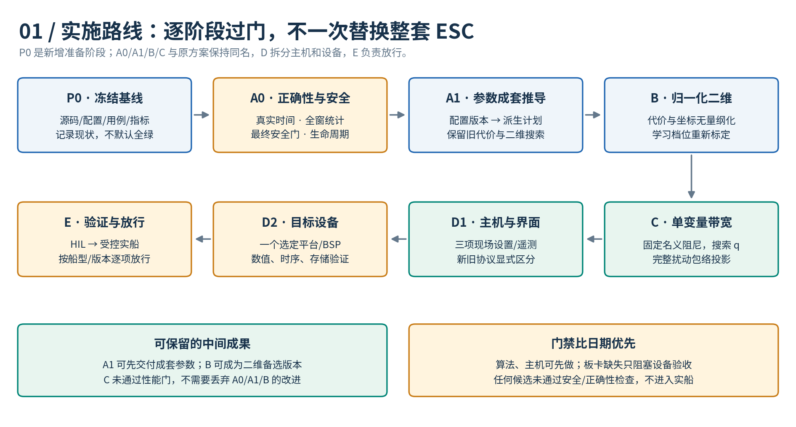
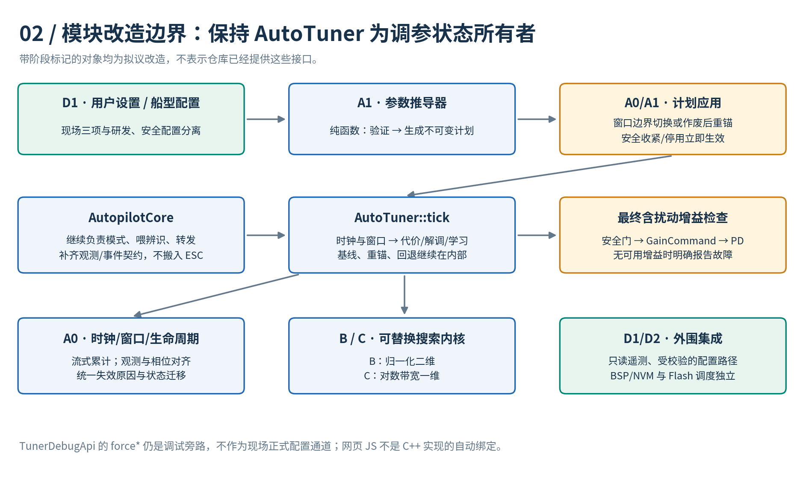
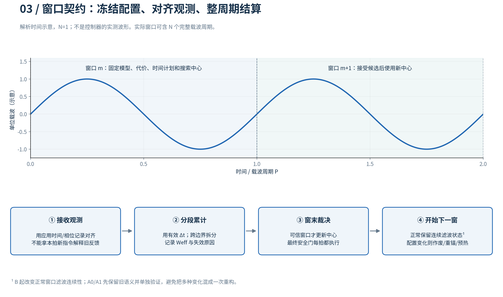
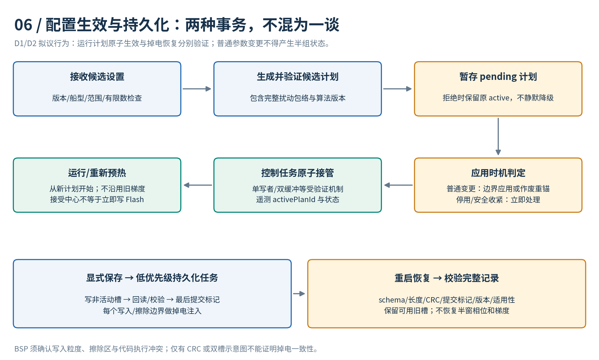
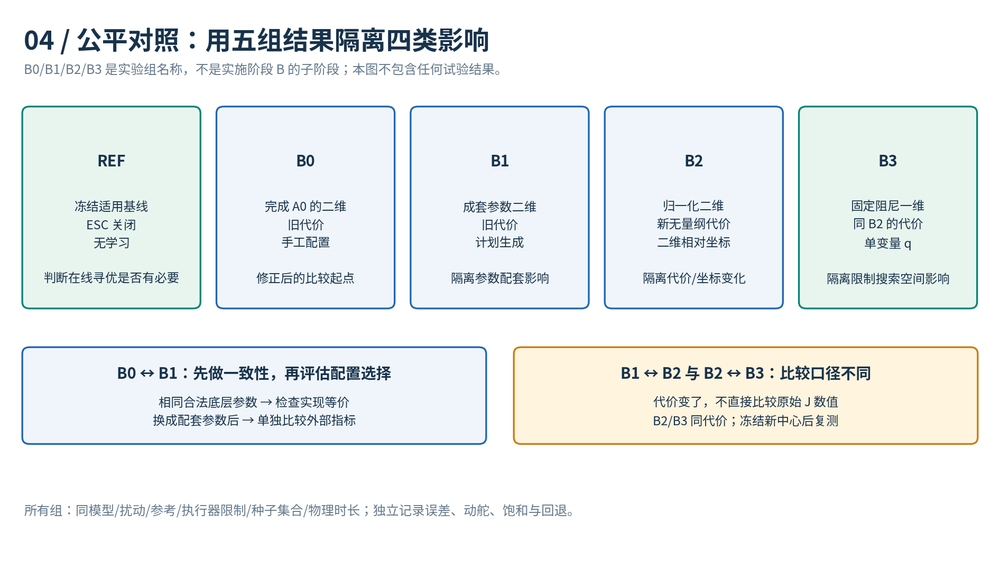
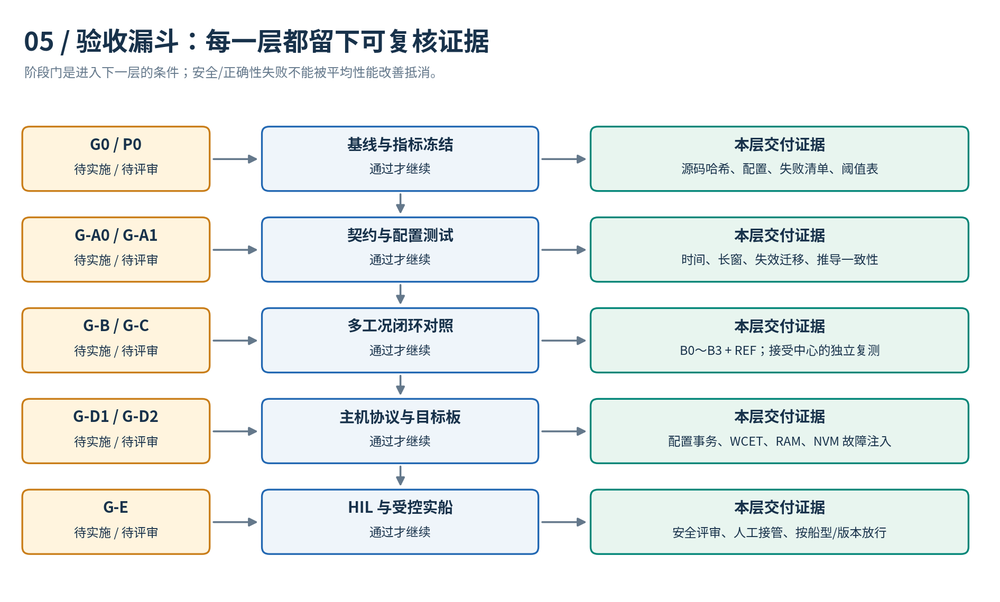

# ESC 减参方案实施阶段计划

> 版本：V1.0 · 2026-09-15  
> 状态：**待评审的实施计划，所有阶段均未在本次执行。** 本文不表示减参算法已完成、性能已改善或参数已获实船放行。  
> 依据：[ESC 减参方案设计文档](ESC减参方案设计文档.md)、[项目架构与全函数调用说明](项目架构与全函数调用说明.md)及当前工作区源码。  
> 本次交付：计划文档、6 张 PNG/SVG 配图、离线 HTML 阅读版及生成/校验脚本；不修改控制算法。

阅读入口：[图文 HTML 版](esc_parameter_reduction/implementation/ESC减参实施计划.html) · [配图与复现说明](esc_parameter_reduction/implementation/README.md)。

## 1. 实施目标与范围

最终目标是将现场主要性能设置收敛为**学习速度、带宽探索幅度、舵机活动权重**三项。内部通过版本化船型配置生成配套时间参数，采用无量纲代价，再评估固定名义阻尼下的一维带宽搜索是否能取代直接调整 `Kp/Kd` 的二维搜索。

“三项”不包括安全边界、传感器质量要求、模型适用范围、船型选择和启停操作，也不是系统只保留三个参数。

### 1.1 阶段依赖



主线为 **P0 → A0 → A1 → B → C → D1 → D2 → E**。A0/A1/B/C 沿用设计文档的阶段名称；P0 是开工准备，D 拆为主机与设备，E 单列验证放行。可以提前开展接口草图、板卡选型、测试数据准备，但正式集成和验收不得越过前置门槛。

| 阶段 | 主要改变 | 刻意不同时改变 | 可以保留的独立成果 |
|---|---|---|---|
| P0 | 冻结源码、配置、测试和指标 | 不改算法 | 可复现的现状与问题清单 |
| A0 | 时基、全窗统计、时序、安全、生命周期 | 不做降维、不换新代价 | 修正后的二维比较基线 |
| A1 | 参数来源和配套推导 | 仍使用旧代价与二维搜索 | 可审计的配置和运行计划 |
| B | 无量纲代价、二维相对坐标、对应滤波/学习语义 | 暂不固定阻尼降维 | 可作为最终备选的二维方案 |
| C | 搜索变量改为对数带宽 q | 保持 B 的评价代价 | 经比较验证的一维方案 |
| D1 | 主机配置、遥测、界面与协议 | 不另写一套网页控制算法 | 可解释的现场操作入口 |
| D2 | 一个选定 MCU 平台、运行时与持久化 | 不同时承诺适配全部芯片系列 | 目标板资源和可靠性证据 |
| E | HIL、受控实船、版本放行 | 不再把未评审算法变化混入验收 | 有适用条件的发布包 |

### 1.2 不在本次实施主线内

不引入 Newton 型 ESC，不重写整个自动舵，不把 `TunerDebugApi::force*` 接到正常航行路径，不为制造梯度信号而自动发起航向机动，也不要求 MCU 运行时解析 YAML。BSP 从零建设、多种芯片同时适配、整船安全认证需要另行立项和估算。

本文是路线和验收计划，不是已创建的工单集合。批准开工后，按仓库约定在 `.scratch/esc-parameter-reduction/spec.md` 保存正式规格，每个实现任务单独放入该目录的 `issues/NN-*.md`；本文的任务编号用于后续拆单和追踪。

## 2. 当前实现基线与改造落点

### 2.1 已有事实与待实施工作

| 当前源码事实 | 对实施计划的影响 | 主要落点 |
|---|---|---|
| `AutoTuner::Params` 有 17 个字段 | 分类为用户设置、船型配置、安全配置、派生值和运行时输入 | A1/B/C/D1 |
| 参考稳定计时用 `in.dt`，ESC 相位/窗口/积分用 `p_.dt` | 必须先明确实际采样时钟与掉拍策略 | A0 |
| 三路 `RingBuffer<double,3000>`；J 遍历保留样本 | 长窗不能靠扩大 `windowSec` 解决；先建立完整窗口统计 | A0 |
| `tick` 窗末稳定检查后再注入载波 | 必须检查最终含扰动增益，不能只检查中心 | A0/C |
| `suspend/rebaseEsc` 未同路径清除全部参考/振荡历史 | 要定义状态迁移，而不是简单“全部清零”或“只禁用” | A0 |
| `setParams` 会 `reset` | 增加受控的配置事务，不能假设已有无扰热更新 | A1/D1 |
| Core 的机动启动/结束存在直接模式赋值路径 | 覆盖这些入口的挂起、重锚、恢复契约 | A0 |
| `TunerDebugApi` 直接读取私有字段，CLI/Python 依赖快照 | 改统计或状态时同步迁移调试接口与解析器 | A0/B/D1 |
| `runTuneConvergence` 根据 J 清零推断结算 | 加显式窗口事件和版本化日志，避免把重锚误认成正常结算 | A0/D1 |
| `ParamStore::load` 未调用 `validateRange`，也没有新 ESC schema | 配置存储要显式校验、事务提交和版本迁移 | D1/D2 |
| 网页有独立 JavaScript 演示算法；无现成 ECU WebSocket 服务端 | 不以网页曲线作为 C++ 新算法验收证据 | D1 |
| 当前控制构建是主机 C++17，没有现成 STM32/RH850 BSP | 芯片/工具链/驱动确认后才进入设备验收 | D2 |

源码入口：[auto_tuner.hpp](../control/include/auto_tuner.hpp)、[autopilot_core.hpp](../control/include/autopilot_core.hpp)、[tuner_debug_api.hpp](../control/include/tuner_debug_api.hpp)、[param_store.hpp](../control/include/param_store.hpp)、[simulator.hpp](../control/sim/simulator.hpp)、[debug_ui.html](../control/ui/debug_ui.html)。上述事实来自源码核对，不以历史 PASS 数量证明新方案可用。

### 2.2 模块边界



遵守现有 R1 架构：`AutoTuner::tick()` 保持每拍单入口，基线、窗口、载波、梯度、重锚和回退状态继续由 `AutoTuner` 持有；`AutopilotCore` 负责模式、传感器/辨识快照与结果转发。可以拆内部纯函数或小对象，但不要把 ESC 计数器和增益副本重新搬回 Core。

以下是**拟议类型/文件名，不是现有接口**，应在 P0/A1 评审后定稿：

| 拟议组成 | 职责 | 首次引入 |
|---|---|---|
| `EscUserSettings` | 三项现场设置；仅在单变量方案获准后赋予完整最终语义 | C/D1 |
| `EscProfile`、`EscSafetyLimits` | 船型标度、时间比例、学习档位、噪声规则、独立安全范围 | A1，后续版本扩展 |
| `EscRuntimePlan` | 经验证且有版本的派生参数，窗口内不可变 | A1 |
| `EscWindowStats` | 常数空间累计、有效窗长、显式窗口事件 | A0 |
| `EscStatus`、原因码 | 预热/学习/禁止/信号不足/回退及错误解释 | A0 起逐步补齐 |
| `esc_plan.hpp` / `esc_window.hpp` | 纯推导与统计辅助实现；可先内部实现，按测试边界再拆文件 | A0/A1 |
| `test_esc_plan.cpp` 等新目标 | 独立测试新契约；须加入 `control/tests/CMakeLists.txt` | A1 起 |

## 3. 人员、工作量与待决策项

### 3.1 建议分工与粗估

角色是建议职责，不是已分配给具体人员的承诺。算法负责人维护模型/优化契约，控制开发负责 C++ 实现，测试负责人维护对照与判据，平台负责人负责时钟/BSP/NVM，整机负责人批准安全策略和实船试验。

| 阶段 | 主责角色 | 初步工程工作量 | 估算前提 |
|---|---|---:|---|
| P0 | 算法 + 测试 | 2～3 人日 | 能构建主机基线、能取得现有配置 |
| A0 | 控制开发 + 测试 | 6～10 人日 | 按下文分小步修正，包含回归与调试接口迁移 |
| A1 | 控制开发 + 算法 | 4～6 人日 | 先使用明确标为实验的配置集合，不等待海试标定完成 |
| B | 算法 + 控制开发 | 5～8 人日 | 有确定性测试信号和可运行的多模型仿真 |
| C | 算法 + 测试 | 5～8 人日 | B 可复现，名义阻尼/映射边界已经评审 |
| D1 | 工具/界面开发 + 测试 | 4～6 人日 | 协议与状态字段已冻结 |
| D2 | 平台 + 测试 | 5～8 人日 | **已具备选定板卡的基础 BSP、调度、I/O 和可用 NVM 驱动** |
| E | 测试 + 整机安全负责人 | 单独排期 | HIL 台架、船期、天气、人员与授权决定 |

P0～C 合计约 **22～35 人日**；加 D1/D2 约 **31～49 人日**，不含基础 BSP 从零建设、采购、船型数据采集、HIL/海试占用及未知问题返工。人日不是日历天，也不能假设多个人员就能把强依赖链按人数等比例压缩；P0 完成后应重新估算。

### 3.2 不阻塞写计划、但会阻塞特定验收的选择

| 决策 | 最迟确认点 | 未确认时允许做什么 | 未确认时禁止声称什么 |
|---|---|---|---|
| 首个目标芯片具体型号、编译器、FPU/ABI、任务周期 | D2 开始前；接口假设在 P0 留档 | 主机与纯算法开发 | 已完成 STM32/RH850 适配 |
| 航向误差、动舵、响应速度和可接受退化阈值 | P0，最迟在对照数据揭盲前 | 准备测试框架 | 性能已通过业务验收 |
| 无适用增益、传感器失效时的整机处置和返回接口 | A0 安全门定稿前 | 故障检测/事件单测 | 任意零增益/零舵令就是安全回退 |
| 船型模型范围、模型质量/年龄、载波周期候选集合 | A1 配置准入；C/E 放行前复核 | 标为实验的候选方案 | 仿真候选已是实船可用 profile |
| 固定名义阻尼是否满足全部目标工况 | G-C 对照评审 | 保留 B 二维路径 | 一维降参必然更优 |
| 存储容量、写擦粒度、执行冲突、寿命和掉电策略 | D2 存储设计前 | 主机内存后端故障注入 | 通用双槽示意等于芯片级可靠实现 |

## 4. P0：冻结可复现基线与验收契约

**进入条件：** 计划获准启动；不要求已有测试全部通过，但必须能区分环境问题、历史缺陷和新增回归。

| 任务 | 实现/准备内容 | 交付证据 |
|---|---|---|
| P0-01 基线快照 | 记录 commit、工作区差异、相关源码哈希、编译器、选项、依赖、运行命令 | `baseline_manifest` 与可复现命令；不得忽略未提交改动 |
| P0-02 测试盘点 | 执行现有单测、仿真冒烟、调试协议验收；为已知缺陷增加能定位的复现 | 逐项结果/退出码/失败原因，不只记总 PASS 数 |
| P0-03 指标冻结 | 确定外部性能指标、模型/工况集合、随机种子、物理观察时长、容差和资源预算 | 评审签认的测试计划与阈值表 |
| P0-04 契约定稿 | 审定观测时间、命令应用时间、模型质量/新鲜度、配置生效、故障输出、旧接口兼容策略 | 接口草图、状态迁移表、待决策清单 |

**明确约定：** 当前 `IdSnapshot` 的 `{excited,valid,K,T}` 不等于有统计置信度或模型年龄，`GainCommand` 当前只含 `Kp/Kd`。新增质量/故障信息需要可审计的接口扩展或明确的配套状态契约，不能假设这些信息已经存在。

**出口 G0：** 能在同一冻结输入下重现现状；每个已知失败都有归因和后续任务；安全处置接口不留“返回 NaN/零即可”的隐含约定。未修正原算法仅作历史参照 `R0`，不能因为需要比较就拿它作安全可发布版本。

## 5. A0：先修时基、窗口、时序与安全

**进入条件：** G0 通过。**目标：** 得到可用于公平比较的修正二维基线 B0；不以本阶段指标变化宣称减参收益。

### 5.1 实现任务

| 任务 | 改造内容 | 主要文件/函数 | 必须出现的测试 |
|---|---|---|---|
| A0-01 真实时钟 | 校验 `dt` 有限/正值/允许间隔；用有效实际时间推进相位、滤波和窗口，严重掉拍作废 | `tick/accumulate/escDither`；Core 输入边界 | 非正/NaN/Inf、抖动、跳时、长空档，不得污染后续状态 |
| A0-02 全窗统计 | 流式累计完整窗口；J 时间权重不再由环形缓冲大小决定；历史曲线转为独立诊断数据 | `computeJ/accumulate/escStep`、调试快照 | 超过 3000/6000 样本仍与离线参考一致；窗末计算量不随窗长线性增长 |
| A0-03 观测相位 | 记录应用相位/时间并与观测对齐；区分采样/计算延迟和对象物理相位 | `tick`、输入契约、仿真喂样逻辑 | 已知观测延迟、跨边界采样、丢失应用记录；不把新指令与旧观测直接相关 |
| A0-04 最终安全门 | 对含载波最终增益检查有限性、适用模型与安全范围；受裁剪窗口不学习 | `stabilityCheck/settleWindow_/tick` | 中心合规但扰动峰值越界、非法增益、无适用基线、更新被执行器约束破坏 |
| A0-05 生命周期 | 明确正常结算、挂起、参考变更、机动、重锚、故障和恢复的清理范围 | `reset/suspend/rebaseEsc`；Core 全部模式入口 | 手动↔自动、机动启动/结束、辨识试验收尾、振荡历史与首拍舵速初始化 |
| A0-06 显式事件 | 增加窗口编号、结束原因、有效时长与接受/拒绝记录；同步快照/CLI/解析器 | `TunerDebugApi`、`runTuneConvergence`、监视器/验收脚本 | 不再用 `Jpre>0 && Jpost==0` 区分正常结算、清窗和重锚 |

### 5.2 避免“修窗口”时顺手改变全部数学语义

流式统计先保留旧代价项的含义，例如累计 `t·|e|`、`|δ|` 与 `|δk−δk−1|` 的加权时间积分，使用明确的实际窗内时间。原第三项是舵角差分，不是舵速；**它本身随采样频率变化，A0 不承诺旧代价跨采样率数值完全相同**。此阶段验证的是“同一真实采样序列的流式结果与离线参考一致”，舵速与无量纲代价在 B 单独引入。

正常窗口的滤波清理语义先保留并记录，不能把移除每窗 HPF 重置混称为等价重构；B 再验证连续滤波状态。修正时序、真实时钟和安全门本来就可能改变旧结果，应单独记录预期差异并更新相应测试依据，而不是压低断言让结果过关。

### 5.3 资源与失败处置

当前三路样本数组在 `sizeof(double)=8` 时仅数据区占 72,000 B。拟用常数状态替代正常 ESC 全窗存储，但若保留主机诊断环形缓冲，应与运行内核隔离并注明构建选项；以实际 `sizeof`、map 文件和调用耗时报告确认收益。

遇到异常时先停止探索、标记失效窗口；最近接受增益和旧基线都必须重新检查适用性。没有可用增益时按 P0 批准的整机契约报告故障/交由模式层处置，不人为返回任意“看起来保守”的数值。

**交付：** 修正二维 B0、独立流式参考对照、生命周期用例、接口迁移表、显式事件日志、资源差异报告。  
**出口 G-A0：** 新安全/时间/窗口用例通过，既有行为差异均有说明；调试和仿真工具不再依赖被删除的缓冲字段。失败则停留本阶段修正，不能用未经修正的 R0 代替 B0 继续放行。

## 6. A1：版本化配置与时间参数成套推导

**进入条件：** G-A0 通过。**目标：** 改参数来源，不把新代价或降维同时混入。

### 6.1 实现任务

| 任务 | 内容 | 验收证据 |
|---|---|---|
| A1-01 配置分层 | 区分算法版本、船型版本、安全范围和实验/放行状态；定义不可变 `EscRuntimePlan` | schema、单位表、必填/默认/非法值规则 |
| A1-02 纯参数推导器 | 从已列明的候选 P、正整数 N、比例系数生成 Ω/W/τH/τL；拒绝不可行组合 | 无运行状态依赖的单测，相同输入产生相同计划 |
| A1-03 整周期执行 | 窗口按完整 N 周期结束；跨边界采样按评审算法拆分/插值，记录 `Weff` | 相位/积分边界测试，不以四舍五入的拍数替代实际整周期 |
| A1-04 冻结与切换 | 一窗内冻结模型锚点、代价定义、比例、幅值、学习档位；计划应用需要可观测事务 | 中途更新不产生半组参数；重锚清旧窗口 |
| A1-05 一致性比较 | 手工装配同一组合法派生参数与推导器输出对照，再单测不同配置的影响 | B0/B1 等参数轨迹对比，以及另行的配套参数试验 |

推导关系：`Ω=2π/P`、`W=N·P`、`τH=cH·P`、`τL=cL·W`。P 由响应、舵机、噪声和任务谱共同约束，不能简单设成某个未经验证的 `T` 倍数，也不能为了界面等待时间上限强行截短。

### 6.2 三个容易混淆的兼容问题

1. 当前默认 Ω/W 未构成整周期。A1 的一致性测试应使用**相同合法配置**；不要求新准入器无条件接受全部旧默认组合。历史组合仅留在显式实验兼容路径，不静默改值后声称“完全一致”。
2. A1 仍是二维原始增益扰动，此时的幅值和学习率不是 C 的带宽探索比例或无量纲 η。暂保留研发配置界面，不提前用“带宽探索 2%”包装旧 `escAmp=0.02`。
3. 实验 profile 可以用于主机验证，但要标明未放行；保存成带版本文件不等于配置已经通过船型验证。



**交付：** 参数推导器、实验 profile、计划指纹/版本、合法/非法用例、等参数一致性记录。  
**出口 G-A1：** 推导与手工装配对照通过；非法、无可行周期或空边界产生明确拒绝，不绕过安全门。此时可以独立交付“成套参数 + 修正二维 ESC”，无需等待一维方案。

## 7. B：无量纲代价与二维相对坐标

**进入条件：** G-A1 通过。**目标：** 得到稳定可测、可作一维对照的二维归一化版本 B2。

### 7.1 实现任务

| 任务 | 内容 | 验收重点 |
|---|---|---|
| B-01 新代价 | 使用误差/舵角/滤波舵速的无量纲平方项；λ 为活动偏好，β 与标度属于 profile | 单位换算、固定标度、滤波后真实舵速、非法标度拒绝 |
| B-02 二维坐标 | 保留两个搜索方向，但使用围绕基线的相对尺度坐标 | 基线 `Kd=0` 仍可表示/更新；不得直接 `log(Kd)` |
| B-03 解调与学习 | 成本密度输入 HPF，时间权重只在累计时处理；按有效窗长归一化和窗时长平滑 | 已知幅相信号、解析响应、采样变化、延迟/噪声测试 |
| B-04 连续滤波与信号门 | 正常窗保留连续滤波/梯度状态；暂停/重锚/配置变化按契约清理和预热 | 恒定信号无虚假梯度；噪声过大/扰动为零不学习 |
| B-05 重标定与对照 | 新学习档位单独标定；与 B1、冻结基线 REF 比较 | 不搬用旧 `wU/wDu/escStep` 数值，不直接比较不同定义的 J |

新代价摘要：

```text
c = (e/e0)^2 + λ · [β·(δ/δ0)^2 + (1−β)·(filtered_rudder_speed/vδ0)^2]
Jbar = Σ(c·Δt) / Weff
```

建议二维坐标先使用正标度的仿射形式：`uP=(Kp−Kp,b)/sP`、`uD=(Kd−Kd,b)/sD`，其中 `sP/sD` 在窗口内固定、为正且来自版本化规则。这样可覆盖零 Kd；坐标尺度不是新增现场旋钮。最终物理增益与扰动包络仍要检查，坐标合法不等于执行器响应必然安全。

**交付：** 新代价/坐标实现、标度及学习 profile 版本、解析单测、B1/B2/REF 多工况数据。  
**出口 G-B：** 正确性和安全门通过，外部业务指标符合 P0 阈值或有正式记录的否决结论；信号不足时允许保持而非强迫每窗更新。B 未通过则不做 C 的默认化，避免在未知的代价/学习问题上继续降维。

## 8. C：固定名义阻尼的单变量带宽搜索

**进入条件：** G-B 通过，候选船型已有有效模型锚点与名义阻尼配置。

### 8.1 实现任务

| 任务 | 内容 | 验收重点 |
|---|---|---|
| C-01 q 坐标与映射 | `q=ln(ωn/ωn,b)`；固定 ζ*；使用现有 `AutoTuner::polePlacement` 唯一公式 | 原方案手算点；映射单调性/有限性/符号约定 |
| C-02 搜索可行域 | 结合模型、硬件、增益和稳定约束确定连通可行区间 | 近零/负 K、T 失效、Kd 下界、空区间拒绝 |
| C-03 扰动包络 | `a=ln(1+p)`；中心约束到 `[qL+a,qU−a]`，逐拍再查最终 Kp/Kd | 中心合法峰值越界、边界投影、失真窗口作废 |
| C-04 窗末更新 | 一个窗口中心固定，可信相关量生成受限 Δq；模型漂移触发重锚 | 无信号/零幅值不除零、不更新；旧梯度不带入新模型 |
| C-05 降维对照 | 与 B2 使用同一新代价、模型和外部判据；冻结接受中心后再测 | 分清载波、极点重锚与真实中心改善；报告性能退化工况 |

核心映射为：

```text
ωn_applied = ωn,b · exp(q_center + a·sin(phase))
Kp = ωn_applied^2 · That/Khat
Kd = (2·ζ*·ωn_applied·That − 1)/Khat
```

必须先满足 `ωn_applied ≥ 1/(2·ζ*·That)` 等可行域条件。不能依靠现有公式把负 Kd 钳到零后，仍声称固定了名义阻尼。固定 ζ* 也不保证带舵机滞后、微分滤波和饱和的实际阻尼固定。

### 8.2 G-C 是选择门，不是强制一维化

**交付：** q 搜索、包络/边界测试、B2/B3/REF 对照、各工况失败与限制清单。  
**出口 G-C：** 安全与业务门均满足才选择一维为候选默认。若一维性能不足，可以保留 B2 或为少数工况保留经验证配置，需明确算法版本和现场界面语义；不得自动在运行中跨算法热切换并继承旧梯度。选择 B2 时，最终三项设置的语义也需另行评审，不能继续把二维幅值叫作带宽探索幅度。

## 9. D1：主机配置、遥测、调试与现场界面

**进入条件：** 候选算法经 G-C 选择；接口草图可在 A1 后提前开展，但正式联调使用冻结版本。

| 任务 | 内容 | 验收证据 |
|---|---|---|
| D1-01 三项设置 | 为已选单变量版本展示学习速度、带宽探索幅度、活动权重；显示预计周期和限制 | 每个 UI 字段唯一映射到已验证计划；不允许直接放宽安全项 |
| D1-02 正式配置入口 | 通过校验/推导/计划事务应用，不通过 `force*` 注入状态 | 非法/未知版本/重复/中途请求用例；请求与生效确认区分 |
| D1-03 状态与日志 | 预热、学习、信号不足、工况禁止、窗口作废、回退、故障；记录原因和版本 | CLI/Python/CSV/界面对同一快照解释一致 |
| D1-04 调试协议兼容 | 更新 `TunerDebugApi`、CLI、验收和监视器；版本化旧字段和 `currentJ` 含义 | 旧协议明确兼容或拒绝，不悄悄把 ITAE 改叫 Jbar |
| D1-05 网页边界 | 明确“本地 JS 演示”与“C++/设备遥测”模式；若接 WebSocket，单列桥接实现与测试 | 未连接显示断开/陈旧；不把本地假 CRC/演示曲线当设备数据 |

最小遥测建议包含：`algorithmVersion/profileVersion/planId`、模型来源/年龄/质量、P/W/`Weff`、状态/原因、窗口编号、q 或二维中心、**含载波实际 Kp/Kd**、Jbar/旧代价版本、梯度/信号质量、结算/接受/回退计数。诊断日志采取有界缓冲与非阻塞输出，不占用控制路径做文件写入。

**交付：** 界面、受校验配置路径、协议迁移说明、日志字典、端到端验收。  
**出口 G-D1：** 三项设置能被解释和追溯；错误配置不影响原有效计划；调试旁路与正常配置通道分离。没有实现桥接服务时，明确交付边界为主机 CLI/文件或回放，不宣称网页已控制设备。

## 10. D2：目标 MCU 与持久化接入

**进入条件：** 选择具体芯片与工具链，基础 BSP 可用，G-D1 通过；主机回归包和数值参考已经冻结。默认先适配**一个**平台，STM32 与 RH850 是候选，不在未确认型号时写死 FPU、Flash 地址或烧录参数。

### 10.1 设备任务

| 任务 | 内容 | 验收证据 |
|---|---|---|
| D2-01 平台构建 | 交叉工具链、编译选项、ABI、数学库、链接/初始化与 I/O 适配 | 明确板卡/芯片/编译器版本的构建产物和 map |
| D2-02 时间/数值 | 实际时钟、时间戳对齐、float/double 选择；测试 sin/exp 等开销和精度 | 同输入主机/目标参考误差、最坏执行时间、掉拍统计 |
| D2-03 实时资源 | 稳态 tick、窗末、重锚、故障、通信/中断竞争的峰值耗时；栈/RAM | 满足整机分配的预算；不存在控制路径动态分配和阻塞 I/O |
| D2-04 配置生效 | 控制任务单写者或经验证双缓冲；低优先级生成候选，原子接管 | 竞态/中途更新/停用/安全收紧测试；无半组配置 |
| D2-05 NVM 格式 | 显式序列化：schema/算法/船型版本、长度、序列号、CRC、提交状态 | 截断、超长、NaN/Inf、未知版本、旧版本兼容性测试 |
| D2-06 断电与恢复 | 按实际写擦粒度设计双槽或日志；写非活动记录、回读验证、最后提交 | 每个写擦边界断电/复位注入；有效旧记录保留，错误记录不应用 |



### 10.2 不应沿用的假设

当前 `ParamStore` 不是新方案的完整存储层：其 `version` 是保存时递增的字段，不等于新增算法/schema 的迁移分派；`load` 直接修改目标并仅走解析/CRC 路径。新实现应先对受界限约束的临时记录完成长度、CRC、范围、版本与适用性校验，再原子应用，不让损坏计数触发无界分配。

主机 YAML 可以作为配置源；设备端从受校验的二进制记录得到设置和 profile 标识，重新推导计划。保存经明确确认的配置/基线，不每拍保存载波相位、半窗梯度或滤波中间量；重启后重新检查模型/工况并预热。

Flash 写擦是否阻塞取指、是否有可用 Data Flash、ECC 和写入原子粒度取决于具体芯片。双槽设计必须结合这些限制验证，不能只凭一张流程图保证断电一致性。旧固件不认识新记录时应拒绝或使用专门保留的兼容记录，禁止按旧结构强行解释。

**交付：** 单平台固件候选、时间/数值/内存报告、BSP/NVM 说明、故障注入记录、升级/降级兼容矩阵。  
**出口 G-D2：** 满足该板卡的预算与安全契约，重启/异常均可解释；Flash 写擦不破坏控制任务。如果目标板不可用，停在主机交付状态，不虚填设备测试结果。

## 11. E：HIL、受控实船与版本放行

**进入条件：** G-D2 通过，HIL/试验场地、人工接管、独立保护和整机负责人授权齐备。软件阶段完成不自动授权现场试验。

| 子步骤 | 工作 | 进入下一步的条件 |
|---|---|---|
| E-01 台架/HIL | 注入传感器异常、通信延迟、执行器饱和、模型变化、故障恢复；验证真实固件 | 安全动作、失效窗口处理、实时预算和日志齐全 |
| E-02 禁止输出的观测验证 | 新算法只观察/记录候选，不控制舵机；验证协议、时钟和状态 | 无误触发，无控制输出旁路；明确这种模式不能证明闭环寻优收益 |
| E-03 受控闭环试验 | 在批准工况/小探索幅度/人工可接管条件下逐级测试；同条件基线对照 | 各阶段预定安全和业务门均满足，出现异常立即按规程中止 |
| E-04 放行包 | 绑定固件、算法、profile、板卡、船型、可用工况和回退策略 | 负责人签认记录，已知限制、部署/回滚说明齐全 |

**出口 G-E：** 仅放行已验证的组合，未知海况/船型/参数不自动继承许可。若现场失败，按最早失效契约回到 A0/B/C 或 D2，保留失败数据；不得只扩大 `oscMax`、缩短窗口或关闭告警来通过验收。

## 12. 对照试验与量化验收



### 12.1 实验分组

| 组别 | 定义 | 比较目的 |
|---|---|---|
| REF | 冻结已验证且适用于该场景的基线，关闭 ESC | 判断在线探索是否值得，以及探索成本 |
| B0 | 完成 A0 的二维旧代价路径 | 修正后的算法比较起点 |
| B1 | A1 成套参数，二维旧代价 | 分离“来源等价”和“选了更合适参数”的影响 |
| B2 | B 的无量纲代价与二维相对搜索 | 评估目标函数、标度和学习语义变化 |
| B3 | C 的同代价一维搜索 | 评估降维的收益与性能代价 |

每组使用相同模型真值集合、海况/扰动实现、参考任务、执行器限制、随机种子集合和物理试验时长。在线算法只得到真实可用的辨识结果与观测，不把仿真真值偷偷喂入新算法。载波周期不同造成有效窗口数不同，必须同时报告物理时间与有效窗口数。

现有典型/快/慢船模可作为种子集合，随后加入噪声、迟滞、饱和、模型失配、参考突变和稀少激励。正常航向保持与主动辨识/周期机动分开报告，不把结构化参考激励所得收益直接外推为所有航行条件。

### 12.2 确定性的代码/数学契约

| 契约测试 | 判据 |
|---|---|
| 非有限/非法输入 | 不产生可下发的非法增益，不污染下一有效周期；状态/原因可检查 |
| 配套关系 | 在所选数值类型容差内满足 ΩP=2π、W=NP、滤波时间比例及包络边界 |
| 超长窗口 | 同采样序列流式累计与离线参考一致，结果不依赖诊断缓冲容量 |
| 边界采样 | 分段积分/相位处理与参考算法一致，不漏算/重算边界区间 |
| 新代价 | 单位变换和标度同步变换后物理评价一致；采样变化按参考信号误差预算比较 |
| 单变量映射 | 复现原方案 `K=0.2,T=8,ζ=0.85,ωn=0.20 → Kp=1.6,Kd=8.6` 等手算点 |
| 零幅值/低信号 | 不除零、不凭噪声更新，保持或暂停并报告原因 |
| 状态迁移 | 旧窗口/梯度/参考/振荡历史按表清理，重锚后的首拍无错误舵速尖峰 |
| 配置事务 | 要么旧计划完整生效，要么新计划完整生效；故障和版本拒绝不留半组状态 |

浮点容差应按 float/double、运算尺度、积分方案和窗口时长分别规定，并在测试前冻结；不套用单一 `1e-6` 判断所有物理量，也不因目标板误差而事后任意放宽。

### 12.3 必须由项目方填写并冻结的放行阈值

| 指标 | 测量方式 | 门槛记录要求 |
|---|---|---|
| 航向误差 RMS/峰值、稳态偏差 | 同任务/时长、相同角差定义 | 绝对上限与相对 REF 的可接受退化 |
| 超调、整定时间、独立 ITAE | 单独的阶跃或任务评价，不混入不同定义的在线 J | 按船型/任务确定上限 |
| 舵角 RMS、舵速 RMS、总行程 | 实际反馈、统一采样与滤波定义 | 允许的活动上限；不是直接油耗/磨损保证 |
| 饱和占比、回退/窗口作废次数 | 独立事件与持续时间统计 | 安全相关上限、异常样本逐个解释 |
| 学习收益与时间 | 冻结接受中心后独立复测；报告分布及不利工况 | 最小收益/允许无学习情形/最大等待时间 |
| 现场调试负担 | 记录人工调整次数、配置选择与解释成本 | 与旧流程相同任务条件比较 |
| 目标板 WCET、栈/RAM、掉拍 | 包含窗末、重锚、故障与中断竞争 | 不超过整机分配预算，不能用平均耗时替代 |

以上门槛当前是待确认事项，不虚构性能提升百分比。门槛未签认可以运行探索性试验，但不能给出“性能放行”结论。

## 13. 阶段门、日志与回滚



### 13.1 每次阶段评审必须具备的交付包

每阶段包含源码差异及哈希、构建环境、算法/profile 版本、命令与种子、机器可读结果、失败列表、资源报告（若适用）、已知限制和评审结论。提交/PR 与测试报告关联到本文任务编号，不能只给一张“曲线变好了”的截图。

建议实验记录至少包含 `runId/sourceHash/algorithmVersion/profileVersion/planId/modelCase/seed/timebase/status/reason/windowId/windowDuration/centerGains/appliedGains/costDefinition`。原始测量、派生指标与接受/回退事件分开保存，能重算外部指标。

### 13.2 三种“回退”分别处理

| 情形 | 动作 | 不允许的简化 |
|---|---|---|
| 本窗不可信/信号不足 | 停止本次更新、作废必要状态，保持仍适用的最近接受增益或按规则暂停 | 强行让参数每窗变化 |
| 运行安全条件失败 | 重新检查基线适用性；不适用则按整机策略退出/请求接管 | 认为旧基线永久安全 |
| 新算法/固件版本未过门 | 主机保留上一已验证实现；设备按兼容矩阵部署经验证的旧版本和记录 | 运行中无痕切换搜索坐标并复用旧梯度；旧程序强读新 schema |

普通性能设置可在窗口边界应用，也可作废当前窗口后重锚；**停用、传感器故障和安全范围收紧不能为了等待窗末而延迟生效**。改动安全域后旧计划可能立即失效，处理优先级由安全动作决定。

## 14. 建议拆分顺序与首轮交付

不要按“一次提交重写 AutoTuner”的方式实施。建议把高风险语义变化拆成可单独复核的变更包：

| 顺序 | 变更包 | 主要验证 |
|---:|---|---|
| 1 | P0 基线与失败复现、状态/时间接口草图 | 可复现现状，不改线上行为 |
| 2 | A0 时间输入校验与对齐记录 | 时间/相位参考测试 |
| 3 | A0 流式全窗统计 + 显式事件 + 工具兼容 | 离线参考、长窗、协议回归 |
| 4 | A0 最终安全门 + 全模式生命周期 | 包络、故障、恢复测试 |
| 5 | A1 配置结构与纯推导器，再接计划应用 | 纯函数 → 等参数 → 集成三层测试 |
| 6 | B 新代价/坐标，再变滤波和学习语义 | 每个子变化有对照，不一次重标定所有项 |
| 7 | C q 映射/包络，再接一维学习 | 手算/边界 → 单步 → 闭环 |
| 8 | D1/D2 接入，最后 E | 版本与事务 → 目标板 → HIL/实船 |

第一轮建议只承诺 **P0 + A0**：交付修正二维比较基线、明确的时序/状态契约和可追溯事件，不立即承诺一维收敛或现场三旋钮放行。第二轮再以 G-A0 结果决定 A1/B/C 的具体工作量与 profile 标定计划。

现有构建/测试入口见 [control/CMakeLists.txt](../control/CMakeLists.txt)、[tests/CMakeLists.txt](../control/tests/CMakeLists.txt)和 [sim/CMakeLists.txt](../control/sim/CMakeLists.txt)。新增测试必须注册到构建/CTest；CLI 协议验收也应纳入阶段回归，不能只新增未被执行的测试文件。

## 15. 本次文档交付与复现

本次仅编写计划并生成配图，**未执行算法测试**、未实现 A0～E、未修改已有控制源文件，也未创建或认领实现工单。现有源码事实与拟议接口已分别标明；图中的箭头、阶段状态及比较组均是计划示意，不是已完成进度或测试结果。

运行以下命令可以重新生成 6 组 PNG/SVG、离线 HTML，并校验本地链接、HTML 锚点、阶段覆盖和图片文件：

```bash
python3 docs/esc_parameter_reduction/implementation/build_document.py
```

工具复用现有 ESC 方案的绘图样式，不覆盖原方案的四张图；依赖 Python、NumPy、Matplotlib、中文字体、`markdown-it-py` 与 Pillow。浏览器可打开 HTML 版并打印为 PDF；无需联网加载字体或图表库。生成校验结果见 [validation.json](esc_parameter_reduction/implementation/validation.json)，它只证明文档产物检查通过，不代表算法已通过阶段门。

与计划配套的原始依据：[ESC 减参方案设计文档](ESC减参方案设计文档.md)、[ESC 滤波器设计文档](ESC滤波器设计文档.md)、[工程优化分析报告](工程优化分析报告.md)、[领域术语与 R1 边界](../CONTEXT.md)。实现阶段应对当前源码重新核查，不能用历史文档替代代码和试验记录。
