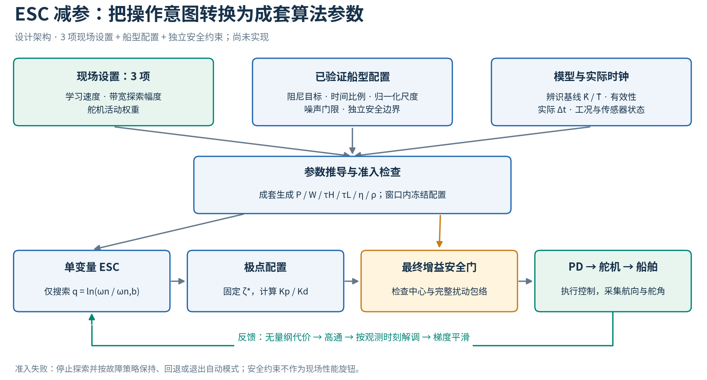
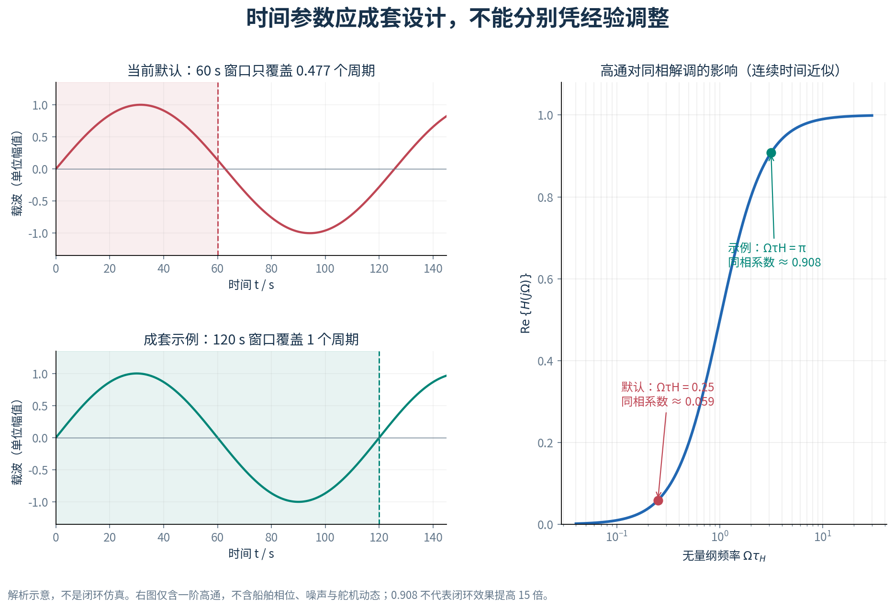
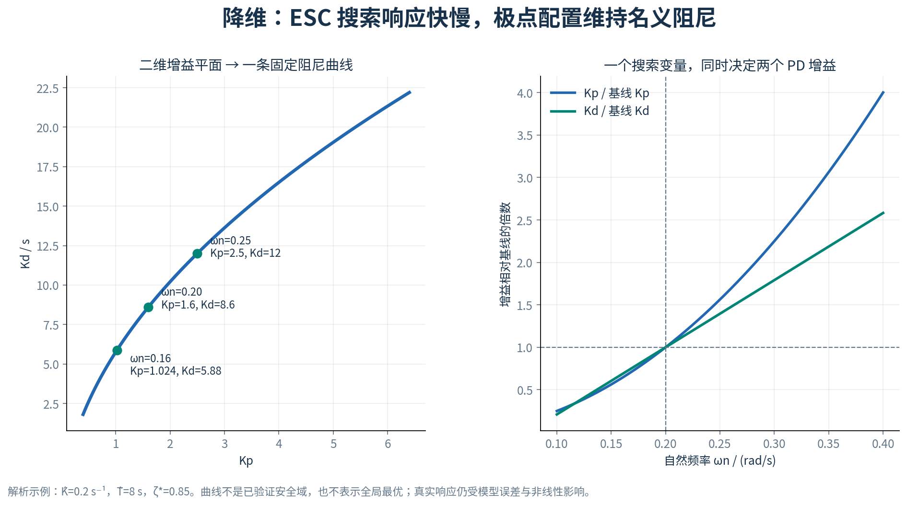
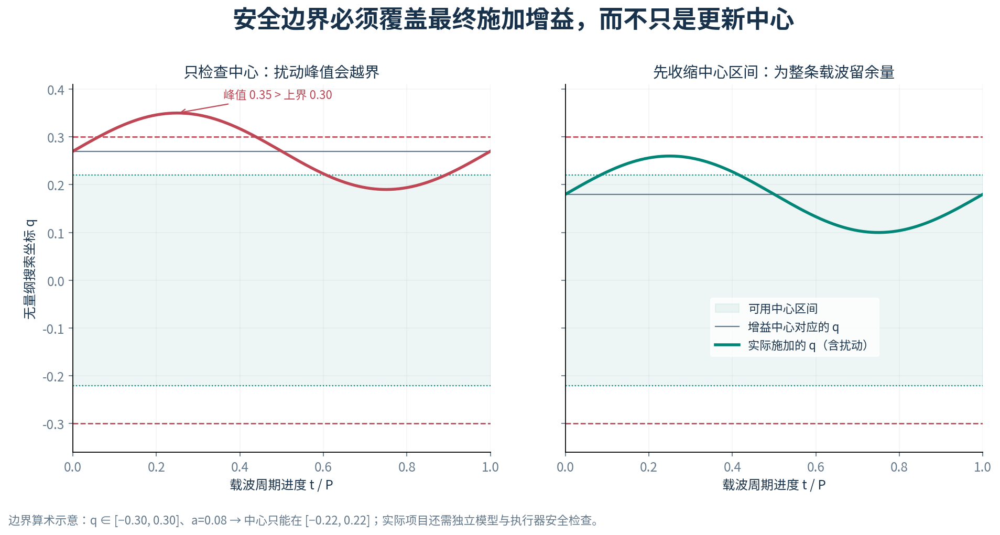
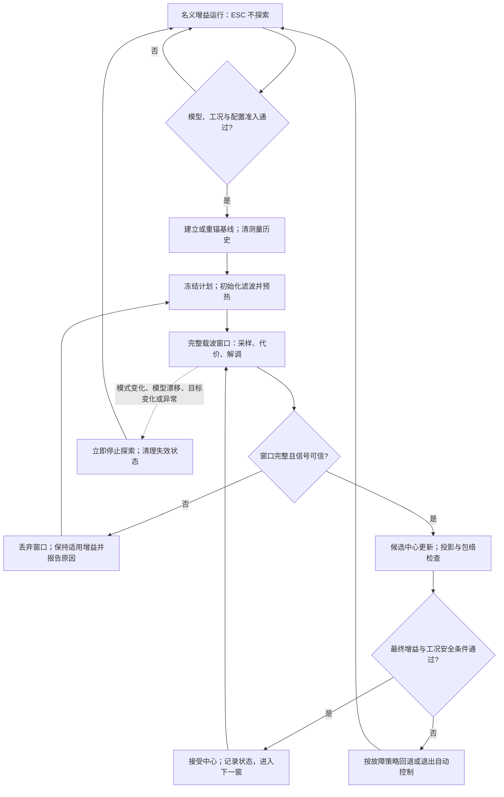

# ESC 减参方案设计文档

> 适用工程：auto_rudder 船用自动舵  
> 版本：V1.0 · 2026-09-14  
> 状态：**设计提案，尚未实现与闭环验证；不是实船参数放行文件。**  
> 代码依据：工作区 `833d3c5` 基线及当前源码；本次仅新增文档与配图，不改控制算法。文中的数字算例和曲线均为解析示意，不是仿真或海试成绩。

## 1. 方案结论：现场主要调 3 项，内部参数自动配套

这里的 ESC 指“极值搜索（Extremum Seeking Control）”，不是电机电子调速器。

建议采用：**时间参数成套推导 + 无量纲代价与更新 + 固定名义阻尼的单变量 ESC**。

| 现场设置 | 操作员表达的意图 | 内部处理 |
|---|---|---|
| 学习速度 | 多久调整一次、每次允许学习多少 | 从已验证档位生成学习率与更新上限，显示预计窗口时长 |
| 带宽探索幅度 | 允许响应快慢在多大范围内试探 | 转为搜索坐标的载波幅值，再校验完整增益扰动包络 |
| 舵机活动权重 | 航向精度与少动舵之间如何取舍 | 对归一化舵角、舵速代价共同加权 |

“3 项”是现场性能调试入口的目标，不是声称整个系统只剩 3 个参数。船型配置、辨识质量要求、速度门限、舵角/舵速约束、增益边界等仍然存在，由研发和标定人员维护。启停操作、配置版本选择也不计入性能旋钮。



图 1：分离操作意图、算法参数和安全约束。框图表示拟议架构，不表示当前代码已经具备这些接口。

预期收益是降低现场试错维度、减少参数单位与时间尺度混用，并让每组配置可追溯。**是否更快收敛、是否改善航向保持、是否减少舵机活动，需要第 12 节的对照试验回答。**

## 2. 当前实现为什么难调

### 2.1 源码落点

| 文件与函数 | 当前职责 | 与减参方案的关系 |
|---|---|---|
| [auto_tuner.hpp](../control/include/auto_tuner.hpp)：`Params`、`tick()` | 参数定义、门控、窗口、增益所有权 | 减参逻辑继续放在 `AutoTuner` 内，不回迁到 core |
| 同文件：`polePlacement()` | 从 K/T、ζ、ωn 计算 Kp/Kd | 复用唯一的极点配置公式，增加调用前准入检查 |
| 同文件：`accumulate()`、`escDither()`、`escStep()` | 每拍代价、高通、双载波、窗末更新 | 归一化与单变量寻优的主要改造位置 |
| [autopilot_core.hpp](../control/include/autopilot_core.hpp)：`headingControlStep()` | 喂辨识器、转发 `tick()` 结果到 PD | 维持现有职责边界，统一真实时间输入 |
| [simulator.hpp](../control/sim/simulator.hpp)：`runEsc()` | 带结构化参考激励的 ESC 实验 | 已有“窗口、频率、滤波时间常数配套”的实验做法 |
| [test_auto_tuner.cpp](../control/tests/test_auto_tuner.cpp) | 调参器单元测试 | 扩展契约测试，不能仅凭增益变化判断寻优成功 |

当前 `Params` 有 17 个字段，分属极点目标、算法配置、代价权重、安全约束与时基。它们不是 17 个同等独立、都必须现场调节的自由度。

### 2.2 参数之间有强耦合

- `escFreq` 决定一个载波周期多长；`windowSec` 决定解调观察多久。只改其中一个，会改变每窗包含的载波周期数。
- `escHPFtau` 决定载波成分经高通后保留的幅值与相位；`escLPFtau` 决定跨窗口梯度平滑。它们分别工作在“每拍”和“每窗”时钟上。
- `escStep` 的有效大小受代价单位、载波幅值、增益坐标和采样处理方式影响，原始数值不容易跨船型迁移。
- `wU`、`wDu` 直接混合不同量纲；当前 `ddelta` 是舵角差分，未除以 `dt`，不能直接视为舵速。
- Kp、Kd 同时变化，会同时影响名义响应快慢与阻尼，增大定位调试问题的难度。

当前默认值为 Ω = 0.05 rad/s、W = 60 s，载波周期约 125.66 s，每窗只有 0.477 个周期。这个组合不满足整周期相关统计的设计条件；这并不等于“ESC 必然无法运行”，但其梯度更易受窗口端点与慢变项影响。

`runEsc()` 则使用 `W = 4 × legSec`、`Ω = 2π/W`、`τH = τL = W/2`。这支持把参数配套关系显式化的工程方向，但它是特定实验配置，**不能把其中放宽的 `oscMax = 20` 或参考机动策略直接当作实船默认值**。

## 3. 原有 17 个字段如何处理

| 原字段 | 当前默认值 | 拟议归属与处理 |
|---|---:|---|
| `zeta` | 0.85 | 船型配置的固定名义阻尼 ζ*；不是取消安全阻尼下限 |
| `wn` | 0.20 rad/s | 船型配置给定初始 ωn,b，运行时通过单变量 q 寻优 |
| `escAmp` | 0.05 | 改为带宽探索幅度 p，经对数变换得到 a；新旧语义不相同 |
| `escFreq` | 0.05 rad/s | 由载波周期 P 推导 Ω = 2π/P |
| `escStep` | 0.02 | 学习速度档位映射为无量纲学习率 η；需重新标定 |
| `escHPFtau` | 5 s | 由 τH = cH P 推导 |
| `escLPFtau` | 10 s | 由 τL = cL W 推导 |
| `wU` | 0.01 | 替换为归一化代价中的 λβ；不得原值直接复制 |
| `wDu` | 0.005 | 替换为 λ(1−β)，作用于归一化、滤波后的舵速 |
| `maxUpdateFrac` | 0.10 | 新路径用 q 的每窗更新上限 ρ；最终物理增益限幅仍独立保留 |
| `absMinUpdate` | 0.001 | 对数带宽搜索不再需要用此项解决零增益锁死；旧二维路径保留兼容 |
| `zetaMin` | 0.6 | 独立安全配置，保留 |
| `wnMax` | 0.5 rad/s | 独立安全配置，保留并参与完整扰动包络检查 |
| `oscMax` | 5° | 独立安全配置，保留；按实测振荡定义与有效期使用 |
| `highSpeedDeactivateKn` | 15 kn | 船型/工况准入条件，保留，不随学习速度放宽 |
| `windowSec` | 60 s | 由 W = NP 推导，N 为配置中的正整数 |
| `dt` | 0.02 s | 期望调度周期只用于诊断；积分、滤波、相位使用有效的实际 Δt |

新增的 cH、cL、N、β、归一化尺度、噪声门限等应收敛到有版本的船型配置中。减参是“减少现场独立选择”，不是把隐藏常数当成不需要验证的真理。

## 4. 第一层减参：把时间参数成套生成

### 4.1 以一个载波周期为时间基准

定义 P 为载波周期，Ω 为载波角频率，W 为评估窗口：

$$
\Omega=\frac{2\pi}{P},\qquad W=NP,\qquad
\tau_H=c_HP,\qquad \tau_L=c_LW,\qquad N\in\mathbb{N}^{+}.
$$

Ω 是“试探变化多快”，ωn 是“闭环名义响应多快”，两者不可混用。

P 应从**已验证的船型候选周期集合**中选择，结合闭环响应、舵机动态、噪声与参考信号频谱确定。可用 `P ≥ cP × t_response` 作为候选筛选条件，但 cP 和 `t_response` 的定义必须通过试验标定，不能仅用 Nomoto 的 T 生搬硬套。

若没有同时满足时间尺度分离、允许等待时间和噪声要求的候选周期，停止探索并报告原因。不要为了满足 UI 的最大等待时间，把本来必须更长的周期强行缩短。



图 2：左侧是载波与窗口的解析关系；右侧是单个高通环节，不包含船舶、执行器或完整闭环。

一阶连续时间高通为：

$$
H(s)=\frac{\tau_Hs}{1+\tau_Hs},\qquad
\operatorname{Re}\{H(j\Omega)\}
=\frac{(\Omega\tau_H)^2}{1+(\Omega\tau_H)^2}.
$$

在输入为纯正弦、同相解调、稳态整周期平均的简化条件下，同相分量受上述实部系数影响。默认 ΩτH = 0.25，对应约 0.059；若 τH = P/2，则 ΩτH = π，对应约 0.908。**这不是闭环性能提高倍数**，离散化和对象相位仍需独立验证。

### 4.2 窗口契约

1. 每窗冻结模型锚点 K̂/T̂、ζ*、P、N、a、λ、归一化尺度和学习档位；不能半窗换评价规则。
2. 用实际 Δt 推进相位和积分；窗口按累计完整 N 个载波周期结束。遇到跨边界采样，规定并测试分段积分/相位插值，不能只用四舍五入后的拍数假装整周期。
3. 记录实际有效窗长 Weff，用它归一化代价和相关量。严重掉拍或超时使当前窗口作废，不能把长空档当作有效采样。
4. 航向目标阶跃、模式变化、模型重锚、传感器异常或明显工况变化时，丢弃本窗，重新预热。
5. 整周期只解决部分有限窗泄漏问题；任意其他频率、非线性谐波和参考激励不自动与载波正交。周期性辨识试验与正常航向保持应采用独立、经验证的准入规则。

## 5. 第二层减参：统一代价尺度，只暴露一个偏好权重

### 5.1 拟议在线代价

选择固定、正数的标度 e0、δ0、vδ0，分别表示航向误差、舵角、舵速的工程参考量；从船型配置读取。定义：

$$
c_k=\left(\frac{e_k}{e_0}\right)^2+
\lambda\left[
\beta\left(\frac{\delta_k}{\delta_0}\right)^2+
(1-\beta)\left(\frac{\widehat{\dot\delta}_k}{v_{\delta0}}\right)^2
\right],\qquad 0\le\beta\le1,\quad\lambda\ge0.
$$

$$
\bar J=\frac{\sum_k c_k\,\Delta t_k}{W_{\mathrm{eff}}},\qquad
W_{\mathrm{eff}}=\sum_k\Delta t_k.
$$

其中 e 使用统一角度差约定，δ 优先使用有效的实际舵角反馈；舵速由有效时间差求导并采用已标定滤波。新标度 `vδ0` 指舵速，避免与领域术语中的船舶转向率 r 混淆。

| 项目 | 归属 | 原因 |
|---|---|---|
| λ：舵机活动权重 | 现场设置 | 一个明确的“航向精度—动舵代价”偏好 |
| β：舵角与舵速的内部比例 | 船型/执行器配置 | 不应让普通用户再调第二个相似权重 |
| e0、δ0、vδ0 | 船型配置 | 保持单位变化前后物理含义一致；比较期间固定 |
| 舵速滤波、异常值与噪声判据 | 传感器/执行器配置 | 由噪声与设备能力确定，不由性能旋钮随意改写 |

λ 越大，目标函数对舵机活动的惩罚越强；不保证任何海况下实际动舵都单调减少。此代价是活动代理量，**不是电耗、油耗或机械磨损的直接测量**。

### 5.2 为什么不能把旧权重直接搬过来

当前代码对 `t|e|`、`|δ|`、`|δk−δk−1|` 加权积分。新方案改为无量纲平方代价，并对实际舵速计价，改变了优化目标，不只是换单位。

- 旧 `wU = 0.01`、`wDu = 0.005` 不能直接解释为新 λ、β。
- 高通的输入使用代价密度 ck；时间积分只在加权累积时乘 Δt，避免学习率被采样间隔重复缩放。
- 保留 ITAE、稳态误差、超调等作为独立验收指标。连续在线寻优不直接把每窗重置的 `t|e|` 当作平稳代价信号，以免时间斜坡和重置边缘污染载波频段。
- 如果任务是“每次重复航向阶跃后比较整段 ITAE”，应采用第 13 节的试验式离散寻优；不要混淆试验编号与控制采样时间。

## 6. 第三层减参：由二维 Kp/Kd 搜索降为一维带宽搜索

### 6.1 固定名义阻尼，复用现有极点配置

在一阶 Nomoto 模型、理想 PD 和相应反馈符号约定下，闭环特征多项式为：

$$
Ts^2+(1+KK_d)s+KK_p.
$$

将其与目标二阶多项式匹配，得到仓库现有 `polePlacement()` 的公式：

$$
K_p=\frac{\omega_n^2\hat T}{\hat K},\qquad
K_d=\frac{2\zeta^*\omega_n\hat T-1}{\hat K}.
$$

固定 ζ*，ESC 只调整 ωn。这里的 ωn 是名义自然频率，文中“带宽探索”用它代表响应快慢，并不声称等于完整实船闭环的 −3 dB 带宽。



图 3：从二维平面限制到一条曲线，减少自由度；曲线本身不是安全认证，也不保证包含二维问题的最优点。

使用对数相对坐标：

$$
q=\ln\frac{\omega_n}{\omega_{n,b}},\qquad
q_{\mathrm{applied},k}=\bar q_m+a\sin\theta_k,\qquad
\omega_{n,k}=\omega_{n,b}\exp(q_{\mathrm{applied},k}).
$$

ωn,b 是当前基线的名义自然频率；q̄m 是第 m 窗的搜索中心。一个窗口内中心保持不变，窗末才学习更新。

如果现场输入 p 表示“带宽向上试探不超过 p”，取 a = ln(1+p)。向下的相对变化为 p/(1+p)，不与向上严格对称。载波在 q 空间对称，不在物理增益空间线性对称。

### 6.2 前提与局限

- 本路径要求已验证的正向控制符号约定、K̂ > 0、T̂ > 0、有效模型以及可接受的不确定性；近零、非有限或未支持的负 K 模型拒绝进入。
- Kd ≥ 0 要求 `ωn ≥ 1/(2ζ*T̂)`。应在搜索域中满足，不能依靠当前 `polePlacement()` 将负 Kd 钳成 0 后仍声称维持固定 ζ*。
- 舵机时滞、PD 微分滤波、死区、量化、饱和和模型误差都会破坏理想二阶假设。固定的是**名义阻尼目标**，不是实测阻尼保证。
- 模型锚点在窗口内冻结；模型漂移达到重锚条件时清旧梯度、换基线并重新预热。禁止每拍跟随 K̂/T̂ 改写映射，同时还把代价变化全归因于 ESC。
- 单变量方法可能牺牲最佳可达性能。若多工况验证显示固定 ζ* 曲线不够，应回到二维归一化方案或少量已验证阻尼配置，不能宣称降维必然更优。
- 完全平静且误差、舵角都接近零时，扰动控制器增益未必产生可辨识响应。**没有足够梯度信号就不更新**；不能为了“让参数动起来”擅自启动航向机动。

## 7. 归一化 ESC 更新与安全包络

### 7.1 每拍观测、每窗学习

拟议高通递推为：

$$
\alpha_{H,k}=\frac{\tau_H}{\tau_H+\Delta t_k},\qquad
z_k=\alpha_{H,k}(z_{k-1}+c_k-c_{k-1}).
$$

窗末相关统计和平滑为：

$$
\hat g_m=\frac{2}{aW_{\mathrm{eff}}}
\sum_{k\in m}z_k\sin(\theta_{\mathrm{obs},k})\Delta t_k,
\qquad
\alpha_{L,m}=\frac{W_{\mathrm{eff}}}{\tau_L+W_{\mathrm{eff}}},
$$

$$
\bar g_m=(1-\alpha_{L,m})\bar g_{m-1}+\alpha_{L,m}\hat g_m,
\qquad
\Delta q_m=\operatorname{clip}(-\eta\bar g_m,-\rho,\rho).
$$

θobs 是与观测时间对齐的载波相位；应保存应用时间与相位，先对齐采样、计算和执行时序，不能把尚未施加的新载波与旧观测直接混为因果关系。物理对象动态造成的相位滞后是另一问题，需要通过周期选择与试验验证；只有在适当小扰动、慢学习和相位条件下，相关量才可近似表示下降方向。

学习速度档位映射到已标定的 (η, ρ)，必要时选择配套周期配置。ρ 是每窗最大 q 步长，对应向上最多 `exp(ρ)−1` 的相对 ωn 中心变化；它不是原 `maxUpdateFrac` 的等价替换。归一化不消除代价曲率差异，η 仍需要验证。

正常连续窗口仅清积分累计量，不每窗无条件清高通与梯度平滑状态。暂停、重锚、目标或代价定义变化时清理并预热；预热长度纳入船型配置。a = 0 表示关闭探索，跳过除以 a 的梯度计算；幅值过小、信号低于噪声门限时冻结更新。

### 7.2 安全检查覆盖“中心 + 扰动”

设模型、硬件及稳定性约束给出当前允许的 `q ∈ [qL, qU]`，则中心必须位于：

$$
\bar q\in[q_L+a,\ q_U-a],\qquad
\bar q_{m+1}=\Pi_{[q_L+a,q_U-a]}(\bar q_m+\Delta q_m).
$$

这里的区间只是把已验证可行域映射到单变量坐标后的表示；如果真实可行域并非单一区间，须选择经过验证的连通子区间，不能跨越不安全间隙。



图 4：纯边界算术示意。除预留载波余量外，每拍还要检查最终 Kp/Kd 的有限性、模型条件及独立安全约束。

如果区间收缩后为空，可在已验证规则内减小幅值；若减小后信号不可辨识，暂停 ESC。若实际控制被限幅、载波失真或工况突变，丢弃受污染窗口；安全执行路径优先，不能继续把裁剪后的信号当作理想正弦学习。

噪声不足时保持最近接受且仍适用于当前工况的工作增益；安全条件不满足时回退到重新检查过的基线。若基线也不适用，按整机故障策略退出自动控制或请求人工接管。**“回退”不能等同于旧基线永久安全。**

## 8. 生命周期与操作者看到的状态



该图描述新方案的逻辑，不是当前 `tick()` 的逐行流程。预热和正常窗口内同样执行每拍安全门，不能等到窗末才处理异常。

建议遥测至少包括：`profileVersion`、基线来源、模型年龄、P/W、窗口进度、q 中心、含载波 ωn/Kp/Kd、J̄、梯度与信号质量、接受/拒绝原因、回退次数。UI 显示“预热中 / 学习中 / 信号不足 / 工况禁止 / 已回退”等可解释状态，而不是仅显示一个启用布尔值。

暂停清理要覆盖窗口、解调、梯度、高通、上一拍舵角初始化标志、振荡检测历史和参考稳定计时。保留什么、清除什么应以状态转移测试为准，不能沿用“所有清零”或“只翻 enabled”两种简单策略。

## 9. 一组可以手算核对的示例

以下只用于核对公式，不是推荐烧录参数：K̂ = 0.2 s⁻¹、T̂ = 8 s、ζ* = 0.85、ωn,b = 0.20 rad/s。

| ωn / (rad/s) | Kp | Kd / s | 含义 |
|---:|---:|---:|---|
| 0.16 | 1.024 | 5.88 | 沿名义固定阻尼曲线降低响应速度 |
| 0.20 | 1.600 | 8.60 | 算例基线 |
| 0.25 | 2.500 | 12.00 | 沿名义固定阻尼曲线提高响应速度 |

取 p = 2%，则 a = ln(1.02) ≈ 0.01980。正峰时 ωn = 0.204 rad/s，Kp = 1.66464，Kd = 8.872。即：

- ωn 增加 2%，Kp 增加 4.04%，Kd 增加约 3.16%。
- “探索幅度 2%”不是“Kp/Kd 都只变 2%”，更不是“舵角只变 2%”。
- 在 Kd 接近 0 的区域，相对 Kd 变化可能很大，应使用绝对增益、执行器和稳定性约束，不仅看百分比。

另取配套时间示例 P = 120 s、N = 1、cH = cL = 0.5，得到 Ω ≈ 0.05236 rad/s、W = 120 s、τH = τL = 60 s。该周期是说明用值，尚未按对象动态验证。

在严格 50 Hz 下，一个这样的窗口有 6000 个样本。当前 `WIN_N = 3000` 无法保存全窗的三路原始序列，因此必须先修复窗口统计再评估方案；不能仅把 `windowSec` 改为 120。

## 10. STM32 落地与参数存储建议

### 10.1 接口分为用户设置、船型配置、派生计划

以下为拟议接口草图，**仓库尚未提供这些类型或解析器**：

```cpp
enum class LearningPace : uint8_t { Slow, Normal };

struct EscUserSettings {
    LearningPace learningPace;
    float bandwidthProbeFrac;     // p：带宽向上探索比例
    float rudderActivityWeight;   // lambda：无量纲活动代价权重
};

// 船型配置另含：模型适用范围、zetaTarget、归一化尺度、
// N/cH/cL、学习档位映射、噪声规则、预热规则和安全边界。
// 派生计划另含：P/W/tauH/tauL、a/eta/rho、q 边界及版本。
// 启动或重锚时生成并验证，tick 内不解析配置文件。
```

主机端 YAML 可以保留人类可读形式；MCU 端优先使用显式序列化、带版本和完整性校验的参数记录。是否具备文件系统是另一个平台选择，ESC 减参不依赖 MCU 运行时解析 YAML。

```yaml
# 仅展示拟议配置格式；本工程尚无此 schema，也无已放行的同名船型配置。
schema_version: 1
profile_id: example_unvalidated
esc:
  learning_pace: slow
  bandwidth_probe_frac: 0.02
  rudder_activity_weight: 1.0
```

新旧参数语义不同，不能把旧 `AutoTuner::Params` 内存按新结构解释。加载时验证 schema、长度、校验、数值有限性、范围和船型版本；明确未知版本的拒绝或迁移策略。不能直接把含填充字节的 C++ 结构体作为长期跨版本格式。

### 10.2 实时性与 RAM

归一化代价、相关量和窗口时间均可流式累计，正常 ESC 不需要保存全部历史样本。当前三路 `3000 × double` 样本数组在 `sizeof(double)=8` 时仅数据区就占 72,000 B，约 70.3 KiB。改为常数状态可去掉这部分全窗存储；具体总节省还要扣除新增状态，并用目标编译结果确认。

| 位置 | 推荐做什么 | 不应做什么 |
|---|---|---|
| 控制周期 | 校验有效 Δt、少量滤波/累积、极点映射、最终安全门 | 动态分配、读写 YAML、阻塞通信、直接擦写 Flash |
| 窗口结算 | 常数时间统计、候选更新与准入检查 | 遍历随窗口长度增长的大数组 |
| 低优先级配置任务 | 校验设置、生成候选计划、原子切换/重锚 | 一边修改参数一边让控制周期读到半组配置 |
| 持久化任务 | 保存显式确认的配置或接受基线，记录版本与有效条件 | 每拍保存 q、载波或梯度状态 |

采用 float 还是 double，要按目标 STM32 的 FPU、精度与执行时间实测决定；`exp`、`sin` 等也计入最坏执行时间预算，不先假定它们足够便宜。ESC 状态 O(1) 并不代表整个工程已经无动态内存。

建议区分三类持久化对象：用户设置/船型版本、经确认的基线及其适用条件、调试日志。载波相位、半窗梯度、高通中间状态是暂态，重启后重新预热。具体 Flash 驱动、擦写调度、断电一致性和容量分区仍需按目标板卡实现与验证。

## 11. 分阶段实施：每一步都能单独验收

| 阶段 | 主要工作 | 为什么单独做 | 阶段出口 |
|---|---|---|---|
| A0：统计与安全前置修正 | 统一真实时钟；修正全窗统计；最终扰动安全门；生命周期清理；非有限输入处理 | 防止把现存缺陷造成的变化误认为减参收益 | 时基、窗口、边界和异常测试通过 |
| A1：参数成套推导 | 保持二维搜索与旧代价，增加版本化配置和参数推导器 | 验证“减少手动配置”本身 | 相同底层参数下与 A0 行为一致；新配套参数单独对照 |
| B：归一化 | 引入新代价与相对增益坐标，仍保留二维搜索 | 隔离代价和学习尺度变化 | 单位/采样变化测试；跨模型重新标定学习档位 |
| C：单变量寻优 | 固定 ζ*，搜索 q，加入包络投影 | 单独衡量限制搜索空间的代价 | 与 B 比较性能、安全和可调性 |
| D：设备与 UI 接入 | 3 项现场设置、状态解释、持久化与版本迁移 | 算法合格后才降低操作入口复杂度 | 主机、固件、日志对同一配置解释一致 |

前置问题与当前代码的对应关系：

- `tick()` 的参考稳定计时使用 `in.dt`，相位、代价和窗口使用 `p_.dt`，存在双时基。
- `WIN_N = 3000` 限制保存窗口；长窗口的 `computeJ()` 只计算保留样本，`accumulate()` 的时间权重又依赖缓冲大小，统计语义不一致。
- `tick()` 在窗末稳定检查后再加载波返回，最终含扰动增益没有同等的逐拍检查。
- `suspend()` 通过 `rebaseEsc()` 清测量，但参考稳定计时与振荡检测历史未同路径完整清理。
- 当前高通每窗清零及 `t|e|` 的窗口重置会带来瞬态；调整该语义应显式记录，不冒充等价重构。

这些是本次源码核对所得；本提案不修改它们。更广的工程问题见[工程优化分析报告](工程优化分析报告.md)，滤波细节可对照[ESC 滤波器设计文档](ESC滤波器设计文档.md)。两份文档中的历史测试结果不代表新方案已经验证。

## 12. 验证矩阵与放行条件

### 12.1 先测契约，再看收益

| 测试类别 | 必测场景 | 应证明什么 |
|---|---|---|
| 参数推导 | 单位正确、N 正整数、非法/缺失 profile、NaN/Inf、零/负时间常数 | 不生成不可执行计划；拒绝原因可观测 |
| 时基与窗口 | 不同采样率、抖动、跨边界采样、严重掉拍、6000 点以上窗口 | 同一物理信号下统计在规定数值误差内一致；失效窗口不学习 |
| 高通与解调 | 常值、已知幅相正弦、观测延迟、参考同频、边界重置 | 与解析响应一致；不把参考变化或时间重置误判为梯度 |
| 单变量映射 | 本文手算点、Kd=0 边界、模型近零/负值、搜索域为空 | 映射与唯一公式一致，非法模型拒绝 |
| 安全包络 | 中心合规但峰值越界、边界投影、饱和导致载波失真 | 每拍最终增益受约束，受污染窗口被丢弃 |
| 生命周期 | 手动/自动/机动切换、目标突变、重锚、掉电重启 | 旧梯度、旧振荡和错误时间基准不泄漏到新窗口 |
| 信号可辨识性 | 零误差平衡、波浪噪声盖过载波、幅值为零 | 允许“不学习”；不得把噪声驱动的增益漂移当成收敛 |
| 参数持久化 | 截断、损坏、未知版本、断电、半组配置更新 | 旧的有效记录可恢复或安全拒绝，不加载半条新记录 |
| STM32 实时性 | 目标 MCU 实测周期、窗末耗时、栈峰值与 RAM | 满足整机分配的最坏时延/内存预算；控制路径无阻塞 IO |

### 12.2 公平对照

建立四组：B0 = 完成 A0 的原算法；B1 = 成套参数、保持原代价/二维搜索；B2 = 归一化代价与二维搜索；B3 = 本文单变量方案。另设“冻结已验证基线、关闭 ESC”的参考组。

各组使用同一船模集合、海况、参考任务、执行器限制、初始条件及随机种子，并记录实际配置。B0/B1 可做等参数一致性比较；B1/B2 已改变优化目标，只能用统一的外部指标比较，不能直接比较不同定义的 J 大小。B2/B3 保持代价相同，以隔离降维的影响。

应报告航向误差 RMS/峰值、稳态误差、超调与整定时间、舵角 RMS、舵速 RMS/总行程、饱和占比、回退次数、有效学习窗口数、达到目标所需时间及现场人工调整次数。模拟器真值可用于离线评价，不能作为在线调参器额外输入而不披露。

放行要求：

1. 先通过安全与正确性测试；测试失败不能用“平均代价更好”抵消。
2. 业务方在试验前给定允许的性能退化、动舵与整定时间门限，记录多工况结果；不预设未经实测的提升百分比。
3. 检查接受的**中心增益**及其独立复测表现，区分极点重锚、ESC 学习与瞬时载波造成的变化；`gainsMoved` 不是收敛证据。
4. 允许没有足够信号时维持基线；“每窗参数都在变化”不是成功标准。
5. 经仿真、回放、目标板/HIL 和受控实船逐级验证后，才将配置标为已放行。实船保留人工接管和独立保护，本文不替代整机安全评审。

## 13. 备选方案与取舍

| 方案 | 适用情况 | 优点 | 代价/边界 |
|---|---|---|---|
| 成套配置 + 二维归一化 ESC | 固定阻尼曲线不足以覆盖性能需求 | 保留 Kp/Kd 搜索自由度，仍能减少现场旋钮 | 需要处理多变量解调、对象相位与方向耦合 |
| 本文单变量方案 | 已有可信 K/T 基线，名义阻尼目标可固定 | 一个搜索方向、物理含义清楚、便于约束 | 限制最优解范围；依赖模型锚点与相位条件 |
| 重复试验式离散 ES | 维护/标定阶段可重复执行可比较的闭环试验 | 每次试验完整结算指标，适合整段 ITAE/ISE | 等待与试验成本高，不能直接当成连续在线寻优 |
| Newton 型 ES | 学习速度强烈受未知曲率影响且允许复杂实现 | 文献研究了通过曲率信息降低收敛速率对 Hessian 的依赖 | 引入曲率估计、正则化及额外验证，不是本工程首轮减参捷径 |

Killingsworth 与 Krstić 的论文采用重复闭环阶跃试验，在每次试验结束计算代价，再由离散 ES 更新 PID；文中的迭代编号不是 MCU 的控制采样拍，且目标是局部优化，不保证全局最优。[PID Tuning Using Extremum Seeking，IEEE Control Systems Magazine，2006](https://flyingv.ucsd.edu/papers/PDF/80.pdf)

Newton 型方案的理论出发点可参见原论文；其特定假设下的收敛分析不能直接当成本船模、饱和舵机及本文方案的稳定性证明。[Multivariable Newton-based extremum seeking](https://flyingv.ucsd.edu/papers/PDF/161.pdf)

## 14. 推荐执行顺序与交付物

优先完成 A0 与 A1，让当前 ESC 的时钟、窗口、安全和参数来源可解释；随后单独评估归一化，再决定是否将单变量路径作为默认。若 C 阶段性能不足，保留 B 的二维实现并不会丢失前两阶段的减参收益。

后续实现应交付：参数推导器及版本化船型配置、状态与拒绝原因遥测、契约测试、同种子对照数据、目标板资源报告和经过放行的参数记录。本次交付仅是方案文档、4 张解析配图及其可复现脚本。

配图源文件与生成说明见 [esc_parameter_reduction/README.md](esc_parameter_reduction/README.md)。图中没有使用 `esc.csv`、`tune.csv` 或未经核验的历史试验结果，也没有绘制虚构的收敛曲线。
