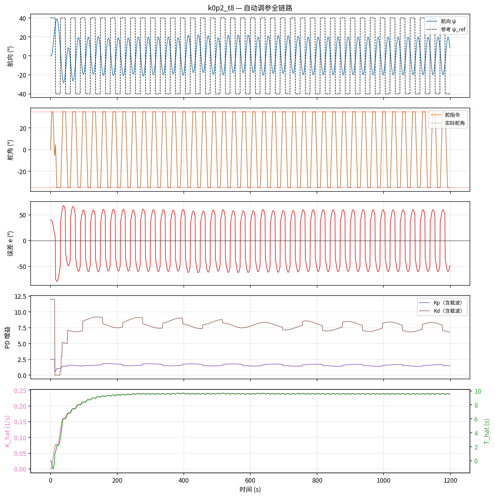
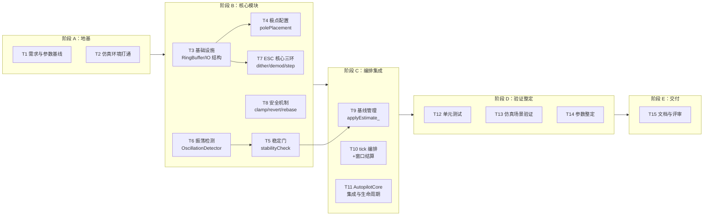
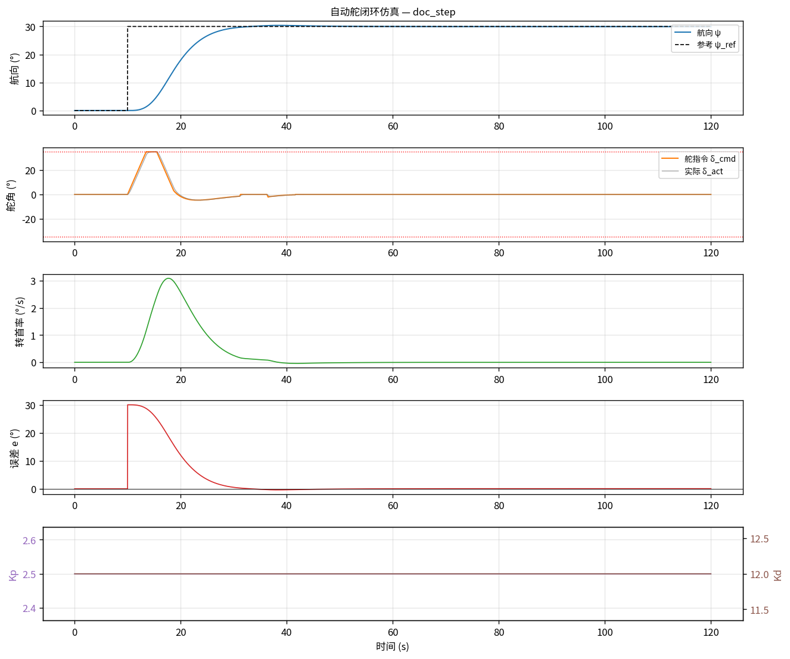
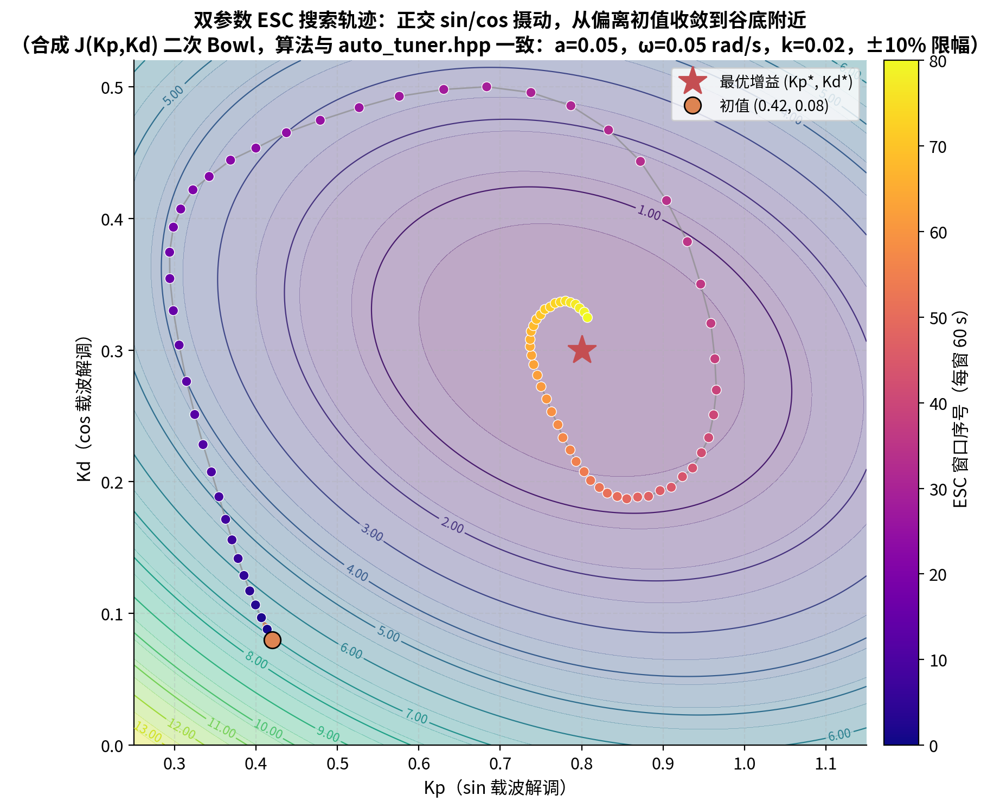
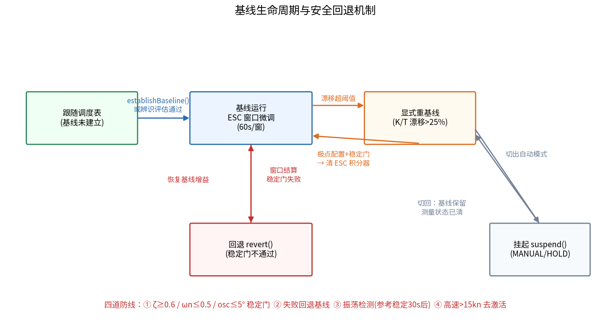
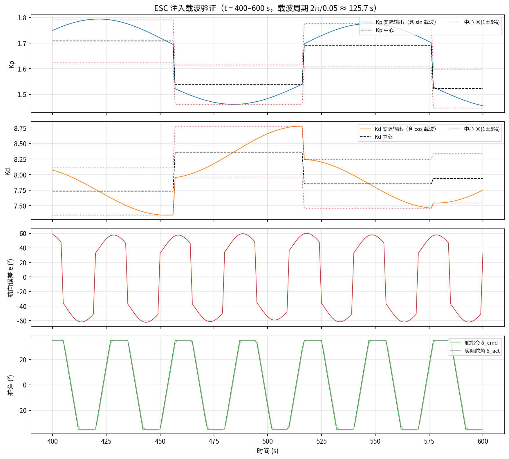
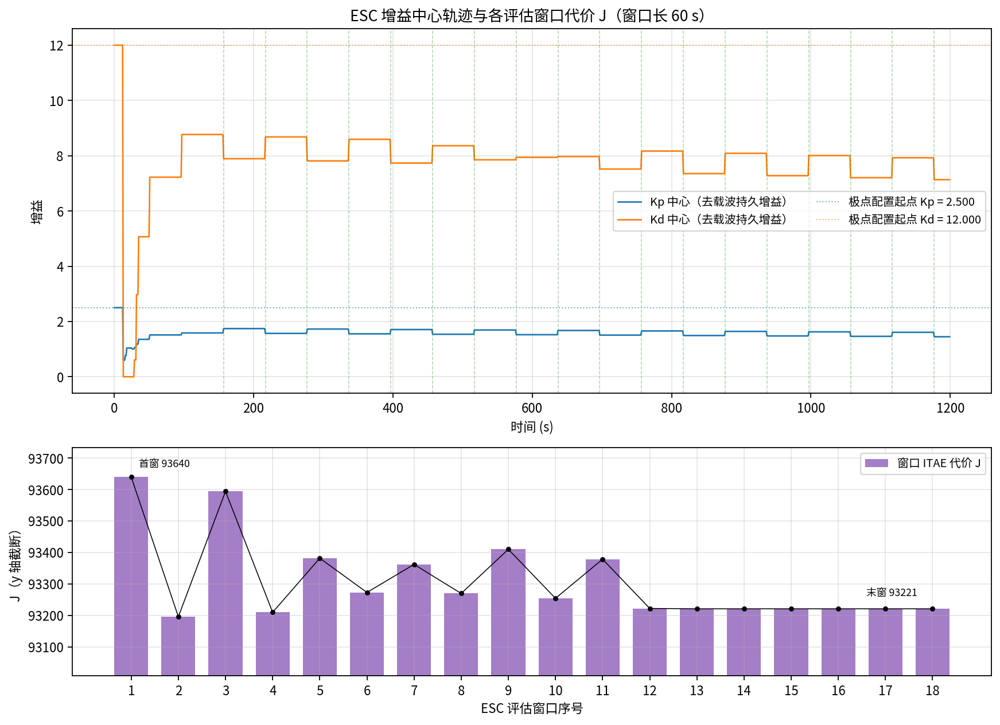
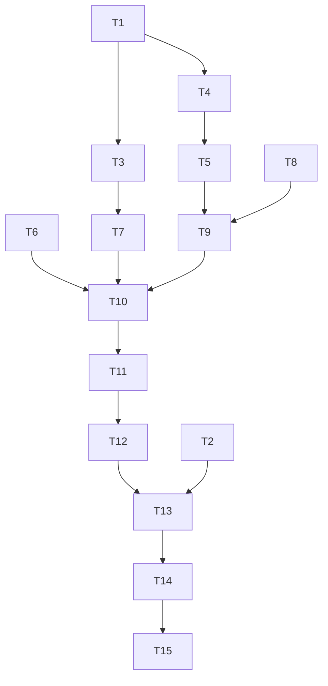

# ESC 方案开发任务拆解（步骤文档）

> 本文档把 ESC（极值搜索控制）在线调参方案的开发工作拆解为可执行、可验收的任务序列，面向开发排期与分工。每个任务给出**目标、涉及文件、实施要点、验收标准与依赖关系**，配流程图与仿真图说明。
>
> **代码事实来源**：`control/include/auto_tuner.hpp`（ESC 实现）、`control/include/autopilot_core.hpp`（集成）、`control/sim/`（仿真）、`control/tests/test_auto_tuner.cpp`（测试）。算法原理见 `docs/ESC方案数学推导与算法实现详解.md`，代码逐函数说明见 `docs/ESC代码函数实现流程.md`——本文只回答"按什么顺序做、每步做到什么程度算完"。

**目录**

- [1. 目标与范围](#1-目标与范围)
- [2. 总体路线与阶段划分](#2-总体路线与阶段划分)
- [3. 阶段 A：需求基线与仿真环境（T1~T2）](#3-阶段-a需求基线与仿真环境t1t2)
- [4. 阶段 B：核心算法模块开发（T3~T8）](#4-阶段-b核心算法模块开发t3t8)
- [5. 阶段 C：编排与集成（T9~T11）](#5-阶段-c编排与集成t9t11)
- [6. 阶段 D：验证与整定（T12~T14）](#6-阶段-d验证与整定t12t14)
- [7. 阶段 E：交付（T15）](#7-阶段-e交付t15)
- [8. 任务总表与依赖图](#8-任务总表与依赖图)
- [9. 风险与注意事项](#9-风险与注意事项)

---

## 1. 目标与范围

**目标**：在船舶自动舵 PD 控制律之上，交付一套"RLS 辨识 + 极点配置基线 + ESC 在线精调"的自动调参能力，使航向保持代价 $J=\int(t|e|+w_U|\delta|+w_{Du}|\dot\delta|)dt$ 在真实闭环上在线最小化，且全过程满足稳定门约束。

**范围内**：`AutoTuner` 模块全部功能（极点配置、稳定门、振荡检测、ESC 摄动/解调/积分、基线管理、漂移重基线、模式生命周期）、与 `AutopilotCore` 的集成、仿真验证、单元测试、参数整定。

**范围外**：RLS 辨识器本身（`nomoto_identifier.hpp`，独立任务线）、PD 控制律、增益调度表（层 1，沿用既有实现）、上位机 UI。

**架构定位**（三层调参，本方案覆盖层 2/层 3）：

---

## 2. 总体路线与阶段划分

开发按"**先有可信基线，再做在线精调；先模块单测，再编排集成；先仿真验证，再参数整定**"的顺序推进：

ESC 闭环的工作原理（即我们要建造的东西）：

---

## 3. 阶段 A：需求基线与仿真环境（T1~T2）

### T1 需求与参数基线冻结

- **目标**：把设计文档 §3.10 的指标落成一张可验收的参数表，作为后续所有任务的对照基准。
- **产出**：
  - `AutoTuner::Params` 默认值表（`auto_tuner.hpp:82-106`）：极点配置目标 $\zeta=0.85,\omega_n=0.2$、ESC 参数 $a=0.05,\omega=0.05\ \mathrm{rad/s},\eta=0.02,\tau_H=5\,\mathrm{s},\tau_L=10\,\mathrm{s}$、窗口 $T_w=60\,\mathrm{s}$、安全约束 $\zeta_{\min}=0.6,\omega_{n,\max}=0.5,\mathrm{osc}_{\max}=5°$、更新限幅 10%、高速去激活 15 kn；
  - 性能指标定义：ITAE 代价权重 $w_U=0.01,w_{Du}=0.005$；
  - 验收指标：仿真中 ESC 收敛后 $J$ 相比极点配置基线可测下降、增益全程过稳定门。
- **验收标准**：参数表经评审冻结；每一项都能指到代码默认值或文档章节。
- **依赖**：无（入口任务）。

### T2 仿真环境打通

- **目标**：`control/sim/` 能跑通"Nomoto 被控对象 + 扰动 + 场景"的最小闭环，为后续每个模块提供即改即验的手段。
- **涉及文件**：`control/sim/main.cpp`、`simulator.hpp`、`nomoto_plant.hpp`、`disturbances.hpp`、`scenarios.hpp`；构建 `cd control/build && cmake .. && make`。
- **实施要点**：先跑固定增益 PD 保向场景，确认航向阶跃响应与舵角曲线合理（基准图如下），再接入辨识器与调参器。
- **验收标准**：固定增益基线仿真出图（阶跃响应无发散）；`ctest` 既有测试全绿。

---

## 4. 阶段 B：核心算法模块开发（T3~T8）

本阶段任务**全部在无编排的状态下独立开发、独立单测**——每个函数都是纯逻辑，不依赖 `tick()` 也能测。

### T3 基础设施：RingBuffer 与 IO 结构

- **目标**：固定容量环形数组（无堆分配，ECU 友好）+ 三个 IO 结构体。
- **涉及文件**：`auto_tuner.hpp:57-78`（`RingBuffer`）、`:31-54`（`IdSnapshot`/`TunerInput`/`GainCommand`）。
- **实施要点**：`RingBuffer<double, 3000>`（60 s / 0.02 s）；`push` 覆盖最旧样本；`operator[]` 按写入顺序访问——ITAE 的时间权重 $t$ 依赖遍历顺序，不能反。
- **验收标准**：满窗环绕写入后遍历顺序正确；无堆分配（静态容量）。

### T4 极点配置 `polePlacement()`

- **目标**：由 $\hat K,\hat T$ 解析反解 $K_p=\omega_n^2T/K$、$K_d=(2\zeta\omega_nT-1)/K$，作为 ESC 的基线锚点。
- **涉及文件**：`auto_tuner.hpp:228-237`。
- **实施要点**：前置检查（$K,T$ 有限、$|K|,|T|\ge10^{-6}$）；$K_d$ 负值 clamp 到 0（`auto_tuner.hpp:235`）；**该函数是全仓库公式唯一定义处**，仿真安装调度表也调它。
- **验收标准**：典型船 $K{=}0.2,T{=}8$ 代入结果与手算一致；退化输入（NaN、0、负值）返回 false。
- **依赖**：T1（目标 $\zeta,\omega_n$）。

### T5 稳定门 `stabilityCheck()`

- **目标**：四条件裁决器——前置合法性 + $\zeta\ge0.6$ + $\omega_n\le0.5$ + 实测振荡 $\le5°$。
- **涉及文件**：`auto_tuner.hpp:241-254`。
- **实施要点**：先写前置检查（NaN 会穿透大小比较，必须显式 `isfinite`）；模态反推公式与 T4 共用同一组 $\hat K,\hat T$；振荡幅值参数化传入，不在函数内持有检测器。
- **验收标准**：构造四组"恰好违反一条"的用例，每组都被拒；全合规输入被接受。
- **依赖**：T4；振荡条件先以桩值传入，T6 完成后接实测。

### T6 振荡检测 `OscillationDetector`

- **目标**：与模型无关的实测振荡指标，给 T5 的第四条门供数。
- **涉及文件**：`auto_tuner.hpp:257-292`。
- **实施要点**：过零结算、跨完整周期取峰-峰；幅值更新**保守**（起振立即取大、消失 $0.9/0.1$ 平滑衰减）；`reset()` 必须同时清历史峰（P11 教训：上一窗口峰值泄漏会污染下一窗）。
- **验收标准**：喂入已知幅值正弦误差，输出幅值收敛到其峰-峰值；直流偏置误差不误报。

### T7 ESC 核心三环：摄动 → 解调 → 积分

**本阶段最关键的 task，也是历史上 bug 最集中的地方（P11 整改区）。**

- **T7.1 载波注入 `escDither()`**（`auto_tuner.hpp:382-388`）：每拍 $K_p\times(1+a\sin\varphi)$、$K_d\times(1+a\cos\varphi)$，相位按 $\omega\,dt$ 推进、$2\pi$ 回绕。**每拍执行，不持久化**（只改输出副本）。
- **T7.2 因果解调（`accumulate()` 支路 3）**（`auto_tuner.hpp:364-375`）：每拍成本增量 $c_k$ → 一阶 HPF（系数按**控制周期** $dt$ 算）→ 与同相载波相乘累积。
- **T7.3 窗末结算 `escStep()`**（`auto_tuner.hpp:395-426`）：梯度归一化 $\hat g=2\sum(y\cdot\text{载波})/(aN)$ → LPF（系数按**窗口周期** $T_w$ 算）→ 梯度下降 → 清窗（非重叠窗）。

- **实施要点（P11 血泪教训，写进任务卡）**：
  1. 窗口内增益必须真抖——增益恒定则窗末"梯度"没有因果来源；
  2. HPF 时基是 20 ms、LPF 时基是 60 s，两个滤波器系数不能用同一个采样周期算——旧实现梯度被衰减 2~3 个数量级，调参结果与初值逐位相同；
  3. 双参数用 sin/cos 正交载波同时解调，不要分时轮询。
- **验收标准**：仿真中增益确实从初值移动（回归 P11 的"逐位相同" bug）；凸代价函数上 $K_p,K_d$ 收敛到最优点邻域。
- **依赖**：T3（环形缓冲）、T1（ESC 参数）。

### T8 安全小件：clampUpdate / revert / rebaseEsc

- **目标**：三根安全绳，函数小但语义精确。
- **涉及文件**：`auto_tuner.hpp:452-461`（限幅）、`:429-432`（回退）、`:438-450`（重锚）。
- **实施要点**：
  - `clampUpdate`：上限取 $\max(|old|\cdot10\%,\ 10^{-3})$——`old==0` 时纯比例上限会**永久锁死更新**（P11：极点配置把 $K_d$ 钳 0 后 ESC 再也调不动它）；
  - `rebaseEsc`：清梯度/HPF/解调/窗口样本，**但不清载波相位**（避免重锚拍载波突跳）、不清基线；
  - `revert`：只恢复基线，别的不碰。
- **验收标准**：每个函数对应一个针对性单测（锁死回归、相位连续性、回退正确性）。

---

## 5. 阶段 C：编排与集成（T9~T11）

模块件齐了，本阶段把它们编成"每拍自动运转"的机器。R1 深化的教训：**编排逻辑必须收在 `AutoTuner` 内部**（P11/P12/P14 的 bug 全部诞生在旧的外部编排层），所以 T9/T10 直接按内收形态开发，不要再走"core 编排"的回头路。

### T9 基线管理 `applyEstimate_()`

- **目标**：辨识评估共享路径——漂移检查 → 极点配置 → 稳定门 → 建基线/重锚（`auto_tuner.hpp:308-329`）。
- **实施要点**：P12 漂移策略——$|\Delta K|,|\Delta T|$ 在 25% 阈值内（分母带下限 `kReBaselineKFloor=0.05`/`kReBaselineTFloor=1.0`）交给 ESC 自治，不动基线；重基线时必须 `rebaseEsc()` + 窗口节拍清零（陈旧梯度不得施加到新基线）。
- **验收标准**：漂移 24% 不动基线、26% 触发重基线且梯度积分器归零。
- **依赖**：T4、T5、T8。

### T10 `tick()` 编排与窗口结算 `settleWindow_()`

- **目标**：每拍七步主流程（速度门控 → 调度跟随 → 辨识评估 → 样本累积 → 窗口结算 → 载波注入 → 返回），见 `auto_tuner.hpp:150-183`。
- **实施要点**：
  - **增益所有权**（P12）：基线建立后 `curKp_/curKd_` 归 ESC 拥有，不再跟随调度表每拍刷新——否则 ESC 每拍的调整被调度表覆盖；
  - **振荡门控**（P12）：参考变化后 30 s 内不喂振荡检测（机动期间的误差摆动是指令响应）；
  - **窗末裁决**（`settleWindow_`，`:333-345`）：ESC 步进后必须过稳定门才持久化，不过门 `revert()` 回退。

- **验收标准**：基线建立前后增益来源切换正确；构造稳定门必失败场景，增益回退到基线。
- **依赖**：T6~T9。

### T11 AutopilotCore 集成与模式生命周期

- **目标**：`AutopilotCore` 回归"状态机 + 转发"，每拍闭环五步（`autopilot_core.hpp:151-177`）；模式切换与辨识试验两个钩子接对。
- **涉及文件**：`autopilot_core.hpp:47`（MANUAL/HOLD → `suspend()`）、`:166-167`（每拍 `tick()`）、`:185`（试验收官 `establishBaseline()`）。
- **实施要点**：`suspend()` 清测量状态但**保留基线**（手动操舵期间的旧测量不得混入下一窗口）；`establishBaseline` 以 osc=0 传入、由 ζ/ωn 代数条件把关（机动刚结束振荡测量无效）。
- **验收标准**：模式 AUTO→MANUAL→AUTO 往返后窗口无脏数据；Z 形试验收官成功建基线，失败保持原增益。

---

## 6. 阶段 D：验证与整定（T12~T14）

### T12 单元测试

- **目标**：`control/tests/test_auto_tuner.cpp` 覆盖全部关键行为。
- **必含用例**：极点配置正/退化输入；稳定门四条件逐条违反；振荡检测幅值收敛；ESC 收敛性（凸代价上增益移动方向正确）；clampUpdate 锁死回归；漂移重基线阈值边界；suspend 状态清理；基线所有权（调度表不再覆盖）。
- **验收标准**：`cd control/build && ctest` 全绿；P11/P12/P14 的每个历史 bug 有对应回归用例。
- **依赖**：T4~T11。

### T13 仿真场景验证

- **目标**：在 `control/sim/scenarios.hpp` 的场景矩阵上验证端到端效果：不同船型（$K,T$ 组合）× 海况（扰动）× 工况（保向/改向）。
- **看点（对照下图形态验收）**：
  - 载波确实叠加在增益上（dither 图）；
  - $K_p,K_d$ 从极点配置基线出发向更优区域移动并收敛（gains 图）；
  - $J$ 相对基线可测下降（overview 图）；
  - 全程无稳定门触发后的发散、回退机制可演示。

- **验收标准**：每个场景出图归档；收敛性、稳定性、回退演示三项结论写入验证记录。
- **依赖**：T12。

### T14 参数整定

- **目标**：六个 ESC 参数（$a,\omega,\eta,\tau_H,\tau_L,T_w$）在仿真中寻一组稳健默认值，并给出整定指导。
- **实施要点**：满足时间尺度分离（载波周期 ≈126 s 远慢于闭环、每窗覆盖约 2 个载波周期）；梯度噪声与收敛速度用 $\eta,\tau_L$ 权衡；诚实记录已知张力（默认参数组的结构性张力见推导文档第 7 章）。

- **验收标准**：整定记录（每组参数对应的收敛曲线）；默认参数在所有 T13 场景下过稳定门。
- **依赖**：T13。

---

## 7. 阶段 E：交付（T15）

### T15 文档与评审

- **目标**：三件套文档与代码同步定稿：
  1. 数学推导（`docs/ESC方案数学推导与算法实现详解.md`）；
  2. 代码函数实现流程（`docs/ESC代码函数实现流程.md`）；
  3. 本文档（任务拆解，追溯"每个函数是哪个任务造的"）。
- **验收标准**：文档中行号引用与代码当前版本一致；评审通过；`graphify-out/` 增量更新（`/graphify . --update`）。
- **依赖**：T14。

---

## 8. 任务总表与依赖图

| 编号 | 任务 | 主要产出 | 关键文件 | 依赖 | 建议量级 |
|---|---|---|---|---|---|
| T1 | 需求与参数基线 | 冻结参数表 | 设计文档 §3.10 | — | 0.5 d |
| T2 | 仿真环境打通 | 基线仿真出图 | `control/sim/` | — | 1 d |
| T3 | 基础设施 | RingBuffer + IO 结构 | `auto_tuner.hpp:57-78` | T1 | 0.5 d |
| T4 | 极点配置 | `polePlacement` | `auto_tuner.hpp:228-237` | T1 | 0.5 d |
| T5 | 稳定门 | `stabilityCheck` | `auto_tuner.hpp:241-254` | T4 | 1 d |
| T6 | 振荡检测 | `OscillationDetector` | `auto_tuner.hpp:257-292` | — | 1 d |
| T7 | ESC 核心三环 | dither/demod/step | `auto_tuner.hpp:354-426` | T1, T3 | 3 d |
| T8 | 安全小件 | clamp/revert/rebase | `auto_tuner.hpp:429-461` | T1 | 0.5 d |
| T9 | 基线管理 | `applyEstimate_` | `auto_tuner.hpp:308-329` | T4, T5, T8 | 1 d |
| T10 | tick 编排 | `tick` + `settleWindow_` | `auto_tuner.hpp:150-183` | T6~T9 | 2 d |
| T11 | Core 集成 | 模式钩子 + 转发 | `autopilot_core.hpp` | T10 | 1 d |
| T12 | 单元测试 | 回归用例集 | `tests/test_auto_tuner.cpp` | T4~T11 | 2 d |
| T13 | 仿真验证 | 场景矩阵出图 | `control/sim/` | T12 | 2 d |
| T14 | 参数整定 | 整定记录 | `AutoTuner::Params` | T13 | 2 d |
| T15 | 文档评审 | 三件套定稿 | `docs/` | T14 | 1 d |

**关键路径**：T1 → T3 → T7 → T10 → T11 → T12 → T13 → T14 → T15（ESC 核心三环与编排是工期与风险的集中点，合计约 5 d）。

**并行机会**：T2（仿真）与 T3~T8（模块）可并行；T6（振荡检测）与 T4/T5 可并行；T12 的用例骨架可在 T7 完成前先写。

---

## 9. 风险与注意事项

1. **P11 类回归（最高危）**：滤波器时基错误、窗口内增益恒定——症状是"调参结果与初值逐位相同"。T7 验收必须显式检查增益确实移动，T12 必须有对应回归用例。
2. **编排外置**：历史上 bug 集中在 core 侧的编排层。T9~T11 坚持编排内收原则，新增需求优先改 `AutoTuner` 内部，不在调用方加状态。
3. **增益所有权**：基线建立后任何"每拍用调度表刷新增益"的改动都会静默抵消 ESC 调整，代码评审时专门盯这一点。
4. **稳定门是唯一裁决者**：任何旁路 `stabilityCheck` 的增益写入路径（调试接口、标定工具）都视为缺陷。
5. **参数整定的诚实性**：ESC 只有局部收敛保证，$J$ 下降幅度以仿真实测为准，不在文档中写超出证据的指标（推导文档第 7 章的已知限制保持同步更新）。
