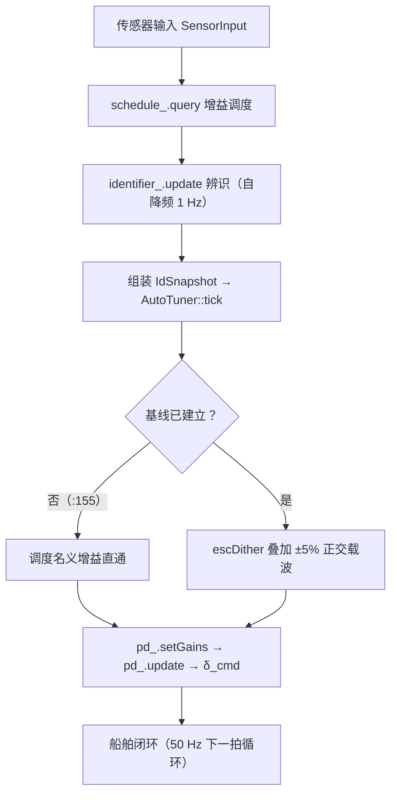
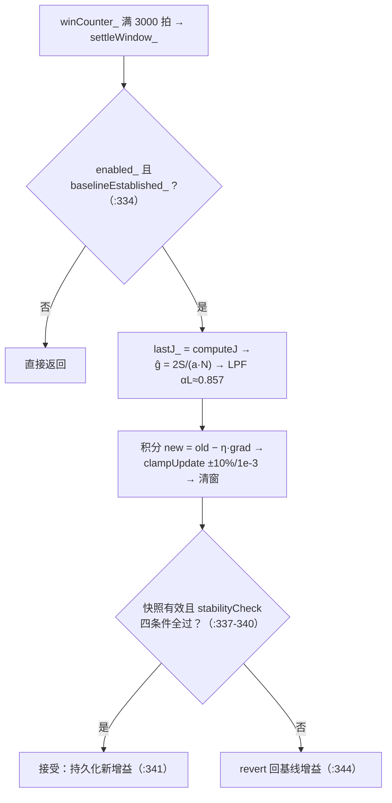
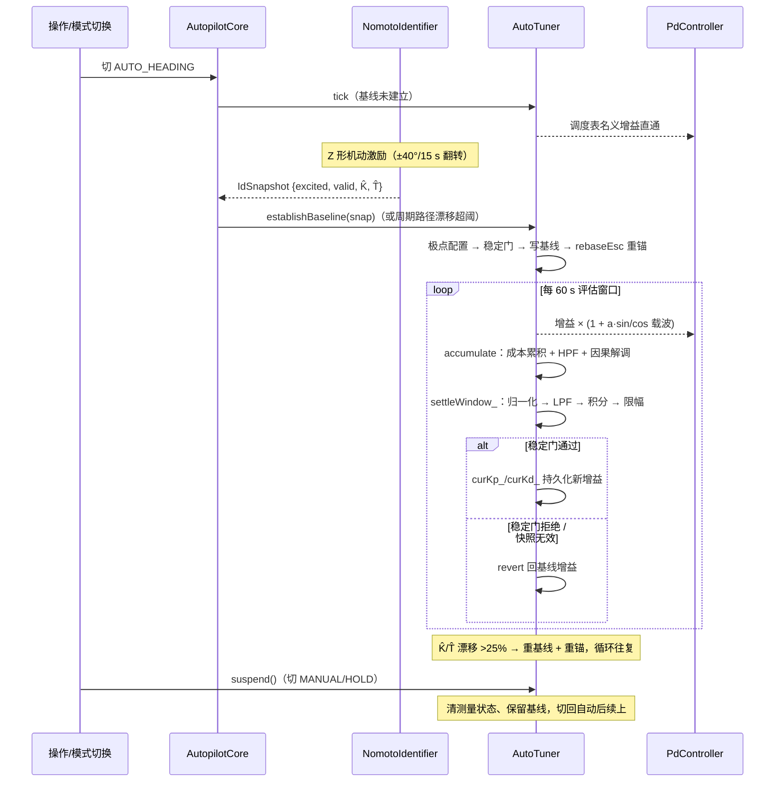
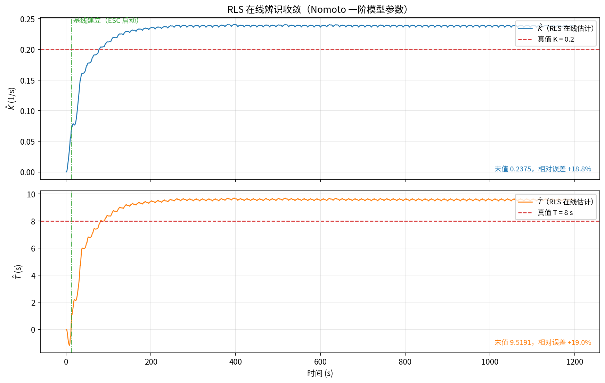

# ESC 方案数学推导与算法实现详解

> 本文档是船舶自动舵 ESC（Extremum Seeking Control，极值搜索控制）在线调参方案的专项技术文档，包含两部分：**数学推导**（第 2~4 章，不跳步的完整推导）与**算法实现**（第 5 章，代码级流程），并给出仿真验证（第 6 章）与已知限制的诚实讨论（第 7 章）。
>
> 事实来源约定：一切公式与流程均与源码严格对齐——`control/include/auto_tuner.hpp`（ESC / 极点配置 / 稳定门）、`control/include/pd_controller.hpp`（PD 律）、`control/include/nomoto_identifier.hpp`（Nomoto 辨识）、`control/include/autopilot_core.hpp`（模式与主循环）。引用格式：`文件路径:行号`。高层背景参见 `docs/工程总体分析与ESC方案原理.md` 第 3 节，本文在其基础上展开全部中间步骤。
>
> 记号约定：$\theta$ 泛指被整定参数（$K_p$ 或 $K_d$），$\bar\theta$ 为其去载波中心值，上标 $*$ 表示最优点，$\hat K,\hat T$ 为 RLS 辨识估计值。

**目录**

- [1. 引言](#1-引言)
- [2. 被控对象与闭环数学模型](#2-被控对象与闭环数学模型)
- [3. 代价函数设计](#3-代价函数设计)
- [4. ESC 数学推导](#4-esc-数学推导)
- [5. 算法实现流程（代码级）](#5-算法实现流程代码级)
- [6. 仿真验证](#6-仿真验证)
- [7. 已知限制与讨论](#7-已知限制与讨论)
- [8. 附录](#8-附录)

---

## 1. 引言

### 1.1 为什么需要 ESC

船舶操纵性随船速、载荷、吃水、海况显著变化，固定增益无法全工况最优。本工程的控制律是 **PD（故意无积分项）**，其增益 $K_p,K_d$ 可以由"RLS 在线辨识 Nomoto 参数 + 极点配置"解析给出（第 2 章）。但解析解建立在三个近似之上：

1. **模型近似**：真实船舶艏摇不是严格的一阶 Nomoto，$K,T$ 本身还随工况缓变，辨识估计带有百分之十几量级的误差（本工程仿真中约 $+18\%$，见第 6 章）；
2. **非线性环节**：实际 PD 实现含死区、微分滤波、舵角/舵速限幅、输出量化（§2.2），解析推导采用的是理想线性化模型；
3. **目标近似**：极点配置把"好"定义为一对目标模态 $(\zeta,\omega_n)$，而工程真正关心的是一个可在线计算的代价 $J$（航向误差 + 操舵代价，第 3 章）——模态目标只是 $J$ 的代理。

因此解析基线只是"足够好的起点"，不是 $J$ 意义下的最优点。**ESC 的作用是在真实闭环上直接实测 $J$ 对增益的梯度，做不依赖模型精度的在线微调**：往增益上注入微小正弦摄动，利用代价信号中与载波同频的分量把梯度"调"出来，再沿负梯度方向缓慢积分。它不需要知道 $J$ 的解析表达式，也不需要更多的模型假设——这是它相对"再辨识 + 再配置"路线的结构性优势：保向工况下激励贫乏，被动辨识"需要学习的时候学不动"，而 ESC **主动注入激励**，绕开了持续激励（PE）问题。

选型层面的完整论证（与 50 年工业实践同构、可解释可认证、样本代价低、天花板是只能在 PD 结构内寻优）见 `docs/工程总体分析与ESC方案原理.md` §3.8 与 `docs/adaptive_autopilot_research/` 调研文档。

### 1.2 三层调参架构

工程采用由粗到细的三层结构（设计文档 §3.10）：

1. **层 1 增益调度表**（`gain_schedule.hpp`）：按船速 × 海况查表给名义增益，管"快变量"（航速），是任何情况下的兜底；
2. **层 2 RLS 辨识 + 极点配置**（`nomoto_identifier.hpp` + `AutoTuner::polePlacement`）：在线辨识 $\hat K,\hat T$，解析反解 PD 增益，建立**基线（baseline）**——一个"已验证安全"的锚点；
3. **层 3 ESC 极值搜索**（`AutoTuner` 的 ESC 环节）：在基线附近注入 $\pm5\%$ 正交载波，实测性能梯度做连续微调。

三层的分工由理论保证界定：ESC 的平均化稳定性结论是**局部**的（§4.10），只覆盖基线邻域；全局的粗调由层 1/层 2 负责。基线建立后增益所有权移交 `AutoTuner`，不再跟随调度表每拍刷新（`auto_tuner.hpp:155`）；当辨识显示 $K,T$ 相对漂移超 25% 阈值时重新极点配置并重锚 ESC（P12 漂移重基线，§5.6）。

### 1.3 记号与默认参数

下表是全文使用的符号与代码默认值（`AutoTuner::Params`，`auto_tuner.hpp:82-106`）：

| 符号 | 含义 | 默认值 |
|---|---|---|
| $\hat K,\hat T$ | Nomoto 一阶模型参数估计（`IdSnapshot`，`auto_tuner.hpp:31-36`） | 典型船 $K{=}0.2,\,T{=}8$ |
| $\zeta,\omega_n$ | 极点配置目标阻尼比 / 自然频率（`zeta/wn`） | $0.85$ / $0.20\ \mathrm{rad/s}$ |
| $a$ | ESC 相对摄动幅值（`escAmp`） | $0.05$（5%） |
| $\omega$ | ESC 载波角频率（`escFreq`） | $0.05\ \mathrm{rad/s}$（周期 $\approx 125.7\ \mathrm{s}$） |
| $\eta$ | ESC 积分步长（`escStep`） | $0.02$ |
| $\tau_H$ | 高通时间常数（`escHPFtau`） | $5\ \mathrm{s}$ |
| $\tau_L$ | 梯度低通时间常数（`escLPFtau`） | $10\ \mathrm{s}$ |
| $T_w$ | 评估窗口长度（`windowSec`） | $60\ \mathrm{s}$（3000 拍） |
| $dt$ | 控制周期（`dt`） | $0.02\ \mathrm{s}$（50 Hz） |
| $w_U,w_{Du}$ | 代价权重（`wU/wDu`） | $0.01$ / $0.005$ |
| `maxUpdateFrac` / `absMinUpdate` | 更新限幅（比例 / 绝对下限） | $0.10$ / $10^{-3}$ |

**阅读地图**：第 2 章推导闭环模型与极点配置公式；第 3 章定义代价函数 $J$；第 4 章是 ESC 的完整数学推导（摄动 → 高通 → 解调 → 平均 → 积分，含双参数正交、离散化、收敛条件与误差来源）；第 5 章把每个环节落到代码行号，给出每拍主流程、窗末结算流程、四道安全防线与生命周期时序；第 6 章为仿真验证；第 7 章诚实列出已知限制（含默认参数组的结构性张力）；第 8 章附录为参数总表与公式 ↔ 代码行号对照表。

---

## 2. 被控对象与闭环数学模型

### 2.1 一阶 Nomoto 模型

船舶艏摇动力学用一阶 Nomoto 模型近似（舵角 $\delta$ 为输入，转首率 $r=\dot\psi$ 为输出）：

$$
T\,\dot r + r = K\,\delta
$$

零初值下拉氏变换得 $r(s)/\delta(s) = \dfrac{K}{Ts+1}$。由 $\dot\psi = r$ 串联一个积分环节，舵角到航向的传递函数为：

$$
G(s)\;=\;\frac{\psi(s)}{\delta(s)}\;=\;\frac{K}{s\,(Ts+1)}
$$

其中 $K$（旋回性指数，量纲 $\mathrm{s^{-1}}$）表示单位舵角产生的稳态转首率，$T$（追随性指数，量纲 $\mathrm{s}$）表示转向惯性时间常数。$K,T$ 随船速/载况/海况缓变，由 `NomotoIdentifier` 在线 RLS 辨识（`nomoto_identifier.hpp`），经只读快照 `IdSnapshot`（`auto_tuner.hpp:31-36`）送入 `AutoTuner`。

### 2.2 PD 控制律与理想化假设

理想 PD 律（对应设计文档 §3.2，代码 `pd_controller.hpp:90`）：

$$
\delta = K_p\,e + K_d\,\dot e,\qquad e = \psi_r - \psi
$$

频域写法 $\delta(s) = (K_p + K_d s)\,E(s)$。工程实现中还有四个非线性/滤波环节（`pd_controller.hpp:66-109`）：$0.3^\circ$ 死区（:71）、微分一阶低通 $\tau{=}0.2\ \mathrm{s}$（:86-87）、舵角 $\pm35^\circ$ 与舵速 $10^\circ/\mathrm{s}$ 限幅（:93-100）、$0.1^\circ$ 量化（:103）。**本章解析推导采用理想线性化假设**，其合理性：

- 微分滤波时间常数 $\tau=0.2\ \mathrm{s} \ll 1/\omega_n = 5\ \mathrm{s}$，在闭环带宽内滤波器近似为直通；
- 死区/量化仅引入 $O(0.1^\circ\sim0.3^\circ)$ 的残差，ESC 层会把这些残差当作代价的一部分在线吸收；
- 限幅只在机动瞬态触发，保向工况（ESC 的主要工作场景）下不进入饱和。

### 2.3 闭环传递函数与特征多项式

由 $E = \psi_r - \psi$、$\psi = G(s)(K_p + K_d s)E$，得：

$$
\psi = G(s)(K_p+K_d s)\,(\psi_r - \psi)
\;\Longrightarrow\;
\bigl[1 + G(s)(K_p+K_d s)\bigr]\psi = G(s)(K_p+K_d s)\,\psi_r
$$

代入 $G(s)=\dfrac{K}{s(Ts+1)}$，闭环传递函数：

$$
\frac{\psi(s)}{\psi_r(s)}
=\frac{K\,(K_p+K_d s)}{s(Ts+1)+K(K_p+K_d s)}
=\frac{K\,(K_p+K_d s)}{T s^2+(1+K K_d)\,s+K K_p}
$$

**闭环特征多项式**（全文核心公式之一）：

$$
\boxed{\;T s^2+(1+K\,K_d)\,s+K\,K_p = 0\;}
$$

二阶系统 Routh 稳定条件即各项系数同号：$T>0$、$KK_p>0$、$1+KK_d>0$。代码中 `polePlacement` 把 $K_d$ 钳到非负（`auto_tuner.hpp:235`），保证 $1+KK_d\ge 1>0$，$K_p>0$ 由稳定门强制（:246）。

### 2.4 极点配置：对照标准二阶反解 $K_p,K_d$

把特征多项式除以 $T$ 化为首一形式：

$$
s^2+\frac{1+K K_d}{T}\,s+\frac{K K_p}{T}=0
$$

与标准二阶 $s^2+2\zeta\omega_n s+\omega_n^2=0$ 逐项对照系数：

$$
\omega_n^2=\frac{K K_p}{T},
\qquad
2\zeta\omega_n=\frac{1+K K_d}{T}
$$

由第一式直接解出 $K_p$；第二式两边乘 $T$ 得 $KK_d = 2\zeta\omega_n T - 1$，再解出 $K_d$。以辨识估计 $\hat K,\hat T$ 代替真值，即得**极点配置公式**（全仓库唯一实现处 `polePlacement`，`auto_tuner.hpp:228-237`，代码 :233-234）：

$$
\boxed{\;K_p=\frac{\omega_n^2\,\hat T}{\hat K},\qquad
K_d=\frac{2\zeta\omega_n\hat T-1}{\hat K}\;}
$$

代码中 `kdRaw < 0` 时钳为 0（:235）：当 $2\zeta\omega_n\hat T<1$，即 $\hat T<\dfrac{1}{2\zeta\omega_n}=\dfrac{1}{2\times0.85\times0.20}\approx 2.94\ \mathrm{s}$ 时解析解要求负 $K_d$——负微分增益会反向放大振荡（$1+KK_d<1$，等效阻尼被削甚至变负），故钳 0，阻尼由对象的 $1$ 项天然提供。

**一致性校验（正/反解互逆）**：稳定门 `stabilityCheck`（`auto_tuner.hpp:241-254`）用同一组公式从 $(K_p,K_d,\hat K,\hat T)$ 反解闭环模态（:247-248）：

$$
\tilde\omega_n=\sqrt{\frac{K_p\hat K}{\hat T}},
\qquad
\tilde\zeta=\frac{1+K_d\hat K}{2\sqrt{\hat T K_p\hat K}}
$$

把极点配置结果代回：$\sqrt{K_p\hat K/\hat T}=\sqrt{\omega_n^2\hat T/\hat T}=\omega_n$ ✓；$\dfrac{1+K_d\hat K}{2\sqrt{\hat T K_p\hat K}}=\dfrac{2\zeta\omega_n\hat T}{2\sqrt{\hat T\cdot\omega_n^2\hat T}}=\dfrac{2\zeta\omega_n\hat T}{2\omega_n\hat T}=\zeta$ ✓。正解与反解严格互逆，配置目标与门限判定口径完全一致。

### 2.5 目标模态 $\zeta=0.85$、$\omega_n=0.20\ \mathrm{rad/s}$ 的物理意义

- **超调量**：二阶阶跃超调 $\sigma = \exp\!\bigl(-\pi\zeta/\sqrt{1-\zeta^2}\bigr)$。代入 $\zeta=0.85$：$\sqrt{1-\zeta^2}=0.527$，$\sigma=\exp(-5.07)\approx 0.6\%$，对 $30^\circ$ 阶跃仅约 $0.2^\circ$，远优于 $\le 10\%$ 的指标——**故意选接近临界阻尼，把"不超调"置于"响应快"之上**（超调对船舶意味着多打舵、多耗能）。
- **调节时间**：5% 准则 $t_s\approx 3/(\zeta\omega_n)=3/0.17\approx 17.6\ \mathrm{s}$，满足 $\le 30\ \mathrm{s}$ 指标且留有余量。
- **振荡模态**：阻尼振荡频率 $\omega_d=\omega_n\sqrt{1-\zeta^2}\approx 0.105\ \mathrm{rad/s}$，视在周期约 $60\ \mathrm{s}$——闭环"秒级到十秒级"的时间尺度，是 ESC 时间尺度分离假设（§4.10）的基准。
- **与波浪谱的关系**：波浪遭遇频率约 $0.05\sim0.2\ \mathrm{Hz}$（$0.31\sim1.26\ \mathrm{rad/s}$），闭环带宽 $\omega_n=0.20\ \mathrm{rad/s}$ 明显低于波频，控制器不试图对抗波频摇艏——这是节能口径的正确选择（打舵压不住波频运动，只会白耗舵机能耗）。
- **稳定门余量**：`wnMax=0.5`、`zetaMin=0.6`（`auto_tuner.hpp:98-99`），即 ESC 微调被允许在 $\omega_n\in(0,0.5]$、$\zeta\in[0.6,\infty)$ 的模态包络内移动，目标点 $(0.20,0.85)$ 位于包络内部。

---

## 3. 代价函数设计

### 3.1 定义与离散实现

$$
J=\int_0^{T_w}\Bigl(t\,|e(t)|+w_U\,|\delta(t)|+w_{Du}\,|\dot\delta(t)|\Bigr)\,dt
$$

离散实现（`computeJ`，`auto_tuner.hpp:214-223`；每拍增量 `accumulate`，:366-367）：

$$
J \approx \sum_{k=0}^{N-1}\Bigl(t_k|e_k|+w_U|\delta_k|+w_{Du}|\Delta\delta_k|\Bigr)\,dt,
\qquad t_k=k\,dt,\quad N=T_w/dt=3000
$$

窗口**非重叠**，结算后清零（`escStep` 内 :418-425）；样本存 `RingBuffer<double,3000>`（:479-482），主循环零堆分配。ITAE 时钟 $t_k$ 每窗从 0 重启（`accumulate` :356 用 `windowErr_.size()*dt`），保证各窗 $J$ 口径一致。注意 `computeJ` 只用于可观测输出 `lastJ_`（:398），ESC 梯度并不直接由它差分得到（见第 4 章）。

三项的量纲与权重：$e,\delta$ 取度，$t\,|e|$ 主导全项（$T_w$ 尺度下数值最大），$w_U=0.01$、$w_{Du}=0.005$ 是小权重修正项。

### 3.2 $t|e|$：ITAE 时间加权

- 与 IAE（$\int|e|dt$）、ISE（$\int e^2dt$）相比，ITAE 的误差被时间显式加权：**早期误差廉价、晚期误差昂贵**。对衰减时间常数为 $\tau$ 的误差 $e(t)=e_0e^{-t/\tau}$，IAE 贡献 $e_0\tau$ 而 ITAE 贡献 $e_0\tau^2$——收敛慢被二次惩罚，梯度方向天然指向"加快收敛"。
- 对不可消除的稳态误差 $e_{ss}$：IAE 贡献 $e_{ss}T_w$，ITAE 贡献 $e_{ss}T_w^2/2$——随窗长二次增长，给 ESC 持续且强烈的消差压力。这与"PD 故意无积分、固有静差由外层补偿"的架构决策互相呼应：ESC 会推动 $K_p$ 增大以压低静差，稳定门则防止推过头。
- $t|e|$ 对峰值不敏感（相对 ISE），与"不超调优先"的 $\zeta=0.85$ 目标一致。

### 3.3 $w_U|\delta|$、$w_{Du}|\dot\delta|$：操舵惩罚与节能口径

- **舵角惩罚 $w_U|\delta|$**：舵角产生附加阻力（舵诱导阻力近似 $\propto\delta^2$），直航保向时平均舵角直接对应推力损失。节能调研（`docs/ship_energy_research/`）的口径是航向保持优化可省约 0.1–1% 燃油；$|\delta|$ 是 $\delta^2$ 的线性代理——对符号鲁棒、计算零开销，且对小舵角不过度敏感。设计文档已声明的未实现升级项是操舵附加阻力型 $J=E[\psi_e^2+\lambda\delta^2]$（$\lambda\approx1/12$，P1 建议）。
- **舵速惩罚 $w_{Du}|\dot\delta|$**：操舵频次指标为 $\le 6$ 次/分；液压舵机功耗与磨损正比于操舵行程总量 $\int|\dot\delta|dt$。该项抑制抖振（hunting），护舵机、省舵机能耗。
- **与 ESC 的关系**：ESC 最小化的不是纯跟踪误差而是"误差 + 操舵代价"的加权和，其最优点 $\theta^*$ 因此略偏离纯 ITAE 最优点——这正是节能口径进入调参目标的通道：**把 $w_U,w_{Du}$ 调大，ESC 自动收敛到更"懒"的增益**。

---

## 4. ESC 数学推导

本章给出 ESC 核心算法"摄动 → 高通 → 解调 → 平均 → 积分"的完整推导：先在单参数情形逐步展开（§4.1–§4.5），再推广到双参数正交载波（§4.6–§4.7），然后处理离散化（§4.8）、更新律与收敛条件（§4.9）、稳定性理论定位（§4.10），最后系统梳理梯度估计的偏置与方差来源（§4.11）。

### 4.1 最优点附近的二次泰勒模型

设代价对被调参数 $\theta$（先取标量，代表 $K_p$ 或 $K_d$）的静态映射 $J(\theta)$ 在最优点 $\theta^*$ 附近光滑且取局部极小，二阶泰勒展开：

$$
J(\theta)\approx J^*+\frac{1}{2}J''\,(\theta-\theta^*)^2,
\qquad J^*=J(\theta^*),\quad J''=\left.\frac{\partial^2 J}{\partial\theta^2}\right|_{\theta^*}>0
$$

"静态映射"的前提是闭环动态远快于 $\theta$ 的变化（时间尺度分离，§4.10），使得每个 $\theta$ 都对应一个充分收敛后的窗口代价。当前点梯度：

$$
\left.\frac{\partial J}{\partial\theta}\right|_{\bar\theta}=J''(\bar\theta-\theta^*)
$$

——**梯度与到最优点的偏差成正比，且带符号**：只要测出梯度符号与大小，就知道往哪边走、走多远。ESC 的全部技巧在于：不建模、不差分，只用摄动 + 相关把 $J''(\bar\theta-\theta^*)$ 从实测 $J(t)$ 里"调出来"。下图给出直观几何：最优点左侧的摄动引起反相的 $J$ 响应（负相关），右侧引起同相响应（正相关），相关性的符号与大小即梯度信息。

### 4.2 注入相对摄动后 $J(t)$ 的谐波展开（系数写全）

代码注入的是**相对（乘性）摄动**（`escDither`，`auto_tuner.hpp:382-388`）：

$$
\theta(t)=\bar\theta\,\bigl(1+a\sin\omega t\bigr)
$$

记当前偏差 $\Delta\bar\theta=\bar\theta-\theta^*$，则瞬时偏差：

$$
\theta(t)-\theta^*=\Delta\bar\theta+\bar\theta\,a\sin\omega t
$$

代入二次模型：

$$
\begin{aligned}
J(t)
&=J^*+\frac{1}{2}J''\bigl(\Delta\bar\theta+\bar\theta a\sin\omega t\bigr)^2\\
&=J^*+\frac{1}{2}J''\Delta\bar\theta^2
+J''\Delta\bar\theta\,\bar\theta a\sin\omega t
+\frac{1}{2}J''\bar\theta^2 a^2\sin^2\omega t
\end{aligned}
$$

用 $\sin^2\omega t=\dfrac{1-\cos 2\omega t}{2}$ 把末项拆为直流 + 二倍频，得**完整谐波分解**：

$$
\boxed{\;
J(t)=\underbrace{J^*+\frac{1}{2}J''\Delta\bar\theta^2+\frac{1}{4}J''\bar\theta^2a^2}_{\text{直流 }J_0}
+\underbrace{J''\bar\theta\,a\,\Delta\bar\theta\,\sin\omega t}_{\text{基波（含梯度信息）}}
-\underbrace{\frac{1}{4}J''\bar\theta^2a^2\,\cos 2\omega t}_{\text{二倍频}}\;}
$$

逐项解读：

- **直流项** $J_0=J^*+\frac12J''\Delta\bar\theta^2+\frac14J''\bar\theta^2a^2$：当前点代价 + **摄动本身的代价**（dither loss，$\frac14J''\bar\theta^2a^2$，恒正——抖动一定付出代价，§4.11 用到）；
- **基波项**：幅值 $J''\bar\theta a\Delta\bar\theta=a\bar\theta\,\dfrac{\partial J}{\partial\theta}\Big|_{\bar\theta}$——**与当前点梯度成正比且同相/反相携带符号**：$\bar\theta$ 在 $\theta^*$ 右侧（$\Delta\bar\theta>0$）时 $J$ 与 $\sin\omega t$ 同相，左侧反相。这就是可被相关检测提取的信号；
- **二倍频项**：幅值 $\frac14J''\bar\theta^2a^2$，不含梯度信息（与 $\Delta\bar\theta$ 无关），是必须被平均掉的干扰。

### 4.3 高通滤波 $H(s)=\dfrac{s}{s+1/\tau_H}$ 的幅相作用

HPF 的任务是去掉直流项 $J_0$（其数值比基波幅值大几个数量级，不去掉会淹没相关器）。一阶高通：

$$
H(s)=\frac{s}{s+1/\tau_H}=\frac{\tau_H s}{\tau_H s+1}
$$

对角频率 $\nu$ 的正弦分量，频率响应的模与相位：

$$
|H(j\nu)|=\frac{\nu\tau_H}{\sqrt{1+(\nu\tau_H)^2}},
\qquad
\angle H(j\nu)=\frac{\pi}{2}-\arctan(\nu\tau_H)
$$

- **直流**（$\nu=0$）：$|H|=0$，完全阻断（稳态意义下）；
- **基波**（$\nu=\omega$）：输出为 $J''\bar\theta a\Delta\bar\theta\,|H(j\omega)|\,\sin(\omega t+\varphi_H)$，$\varphi_H=\angle H(j\omega)$；
- **二倍频**（$\nu=2\omega$）：$|H(j2\omega)|>|H(j\omega)|$，高通对高频衰减更小——二倍频被保留下来，只能靠后面的解调平均去除。

**关键量化**（这是 ESC 参数是否合理的第一道检验，经典设计要求 $\omega\tau_H\gg1$）：

| 配置 | $\omega\tau_H$ | $\lvert H(j\omega)\rvert$ | $\varphi_H$ | $\operatorname{Re}H(j\omega)=\dfrac{(\omega\tau_H)^2}{1+(\omega\tau_H)^2}$ |
|---|---|---|---|---|
| 默认 $\omega{=}0.05,\ \tau_H{=}5$ | $0.25$ | $0.2425$ | $75.96^\circ$ | $\mathbf{0.0588}$ |
| 收敛测试 $\omega{=}2\pi/60,\ \tau_H{=}30$（`test_auto_tuner.cpp:179-181`） | $3.14$ | $0.953$ | $17.7^\circ$ | $0.908$ |
| 单元测试 $\omega{=}2\pi,\ \tau_H{=}5$（`test_autopilot_core.cpp:146`） | $31.4$ | $0.9995$ | $1.8^\circ$ | $0.999$ |

下一节将证明：解调平均后只有**同相分量**留存，故梯度估计被乘上偏置因子 $\operatorname{Re}H(j\omega)$。默认参数下该因子仅 $0.059$——**梯度被衰减约 17 倍**；收敛测试配置下为 $0.91$，接近理想。这与高层文档"默认 $\omega=0.05$ 更像占位符、收敛测试实际改用 `escFreq=2π/60` 等配套参数"的备注互为印证（详见 §7.1 的完整讨论）。

### 4.4 与同相载波相乘解调：三角恒等式逐项展开

设 HPF 输出（保留基波 + 二倍频，直流已除）：

$$
y(t)=A\sin(\omega t+\varphi_H)+B\cos(2\omega t+\varphi_2),
\qquad A=J''\bar\theta a\Delta\bar\theta\,|H(j\omega)|
$$

乘以与本拍注入**同相**的载波 $\sin\omega t$（代码 `accumulate` :373：`demodKpSum_ += hpfY_ * std::sin(escPhase_)`，同一 `escPhase_` 驱动 `escDither` 的注入，保证因果同相）。逐项展开：

**基波项**（积化和差 $\sin x\sin y=\frac12[\cos(x-y)-\cos(x+y)]$）：

$$
A\sin(\omega t+\varphi_H)\sin\omega t
=\frac{A}{2}\cos\varphi_H-\frac{A}{2}\cos(2\omega t+\varphi_H)
$$

**二倍频项**（$\cos x\sin y=\frac12[\sin(x+y)-\sin(x-y)]$）：

$$
B\cos(2\omega t+\varphi_2)\sin\omega t
=\frac{B}{2}\sin(3\omega t+\varphi_2)-\frac{B}{2}\sin(\omega t+\varphi_2)
$$

可见乘积由三类成分构成：

1. **期望直流** $\dfrac{A}{2}\cos\varphi_H=\dfrac{J''\bar\theta a\Delta\bar\theta}{2}\operatorname{Re}H(j\omega)$——梯度信息；
2. **$2\omega$ 与 $\omega$、$3\omega$ 交流项**——整数周期窗口内均值为零；
3. HPF 瞬态与残余慢漂——随 $\tau_H$ 指数衰减。

注意 $\cos\varphi_H$ 因子：**载波相位必须对准**，任何相位失配（如 HPF 相移、额外滤波延迟）都按 $\cos(\text{失配})$ 衰减梯度。代码用同一 `escPhase_` 同时驱动注入与解调且解调在每拍即时进行（"因果解调"，:372-375），把这个失配压缩到只剩 HPF 相移 $\varphi_H$（另有一个"解调相位领先一拍"的存疑项，见 §7.4）。

下图用合成信号（$J(\theta)=(\theta-\theta^*)^2$、$\bar\theta-\theta^*=0.8$、默认参数 $a=0.05$、$\omega=0.05\ \mathrm{rad/s}$）对这条链路做了数值验证：原始 $J(t)$ 的直流 + 基波 + 二倍频结构、HPF 后的幅值衰减（$\omega\tau_H=0.25$）、乘以同相载波后均值恒正（$\bar\theta$ 在最优点右侧、梯度为正），以及归一化滑动平均收敛到梯度估计值（幅值含 HPF 衰减因子，方向正确）。

### 4.5 窗口平均与 $\hat g=\dfrac{2\sum(y_k\sin\varphi_k)}{aN}$ 的完整证明

窗口内有 $N$ 拍样本，代码在窗末归一化（`escStep` :399-405，系数 :402）：

$$
\hat g=\frac{2}{aN}\sum_{k=0}^{N-1}y_k\sin\varphi_k
$$

**断言**：当窗口覆盖整数个载波周期、且 $\omega\tau_H\gg1$ 时，$\hat g=\bar\theta\,\dfrac{\partial J}{\partial\theta}\Big|_{\bar\theta}$，即恰好是（相对摄动意义下的）梯度估计。

**证明**。把求和写成 $N$ 乘均值。需要三个初等均值事实（窗口覆盖整数个载波周期时严格成立；证明见下注）：

$$
\langle\sin^2\omega t\rangle=\frac12,\qquad
\langle\cos 2\omega t\,\sin\omega t\rangle=0,\qquad
\langle\text{常数}\cdot\sin\omega t\rangle=0
$$

（注：$\langle\sin^2\rangle=\langle\frac{1-\cos2\omega t}{2}\rangle=\frac12-\frac12\langle\cos2\omega t\rangle=\frac12$，因为整周期内 $\langle\cos2\omega t\rangle=0$；$\langle\cos2\omega t\sin\omega t\rangle=\frac12\langle\sin3\omega t-\sin\omega t\rangle=0$；常数乘 $\sin$ 整周期均值为 0。）

对解调结果逐项取窗口平均：

- 基波贡献：$\Big\langle\dfrac{A}{2}\cos\varphi_H-\dfrac{A}{2}\cos(2\omega t+\varphi_H)\Big\rangle=\dfrac{A}{2}\cos\varphi_H+0$——**$\sin^2$ 均值 $1/2$ 在此进入**；
- 二倍频贡献：$\dfrac{B}{2}\langle\sin3\omega t\rangle-\dfrac{B}{2}\langle\sin\omega t\rangle=0$；
- 已被 HPF 阻断的直流残余贡献：$0$（稳态）。

于是

$$
\left\langle y\sin\omega t\right\rangle=\frac{A}{2}\cos\varphi_H
=\frac{J''\bar\theta a\,\Delta\bar\theta}{2}\,|H(j\omega)|\cos\varphi_H
=\frac{a}{2}\,\bar\theta\,\frac{\partial J}{\partial\theta}\Big|_{\bar\theta}\,\operatorname{Re}H(j\omega)
$$

（最后一步用 $|H|\cos\varphi_H=\operatorname{Re}H(j\omega)=\dfrac{(\omega\tau_H)^2}{1+(\omega\tau_H)^2}$。）

代回归一化式：

$$
\hat g=\frac{2}{a}\cdot\frac{1}{N}\sum_{k}y_k\sin\varphi_k
=\frac{2}{a}\cdot\frac{a}{2}\,\bar\theta\,\frac{\partial J}{\partial\theta}\Big|_{\bar\theta}\operatorname{Re}H(j\omega)
=\bar\theta\,\frac{\partial J}{\partial\theta}\Big|_{\bar\theta}\cdot\operatorname{Re}H(j\omega)
$$

当 $\omega\tau_H\gg1$（$\operatorname{Re}H\to1$）时 $\hat g\to\bar\theta\,J'(\bar\theta)$。**归一化系数 $\dfrac{2}{aN}$ 的三个因子各有严格来历**：

- **$N$**：把代码中的累加和 $\sum$ 换成均值 $\langle\cdot\rangle$；
- **$2$**：恰好抵消 $\sin^2$ 的窗口均值 $1/2$；
- **$a$**：除掉注入摄动的幅值，把"每单位摄动引起的 $J$ 变化"还原出来。

由于摄动是相对形式 $\theta=\bar\theta(1+u)$，$u=a\sin\omega t$ 无量纲，链式法则给出 $\dfrac{\partial J}{\partial u}=\bar\theta\,\dfrac{\partial J}{\partial\theta}$——所以 $\hat g$ 的准确含义是"**$J$ 对无量纲相对摄动的梯度**"（代码注释 :399 的"∂J/∂(增益相对摄动)"），数值上等于 $\bar\theta J'(\bar\theta)$，量纲与 $J$ 相同。这既是它的优点（多参数时天然按各自量级加权）也是 §4.11 量纲近似的来源。

---

### 4.6 双参数正交载波：$K_p$ 用 $\sin$、$K_d$ 用 $\cos$

#### 4.6.1 双参数二次型展开

两参数同时整定时，二次模型推广为（$\boldsymbol\theta=(K_p,K_d)^\top$，$H$ 为 Hessian）：

$$
J(\boldsymbol\theta)\approx J^*+\frac{1}{2}(\boldsymbol\theta-\boldsymbol\theta^*)^\top
H\,(\boldsymbol\theta-\boldsymbol\theta^*),\qquad
H=\begin{pmatrix}H_{11}&H_{12}\\H_{12}&H_{22}\end{pmatrix}\succ 0
$$

注入正交载波（`escDither`，`auto_tuner.hpp:384-385`）：

$$
K_p(t)=\bar K_p\bigl(1+a\sin\omega t\bigr),\qquad
K_d(t)=\bar K_d\bigl(1+a\cos\omega t\bigr)
$$

记 $s_1=\sin\omega t,\ s_2=\cos\omega t$，瞬时偏差 $\theta_i-\theta_i^*=\Delta\bar\theta_i+\bar\theta_i a s_i$。代入二次型并展开交叉项：

$$
\begin{aligned}
J(t)=J^*&+\frac{H_{11}}{2}\bigl(\Delta\bar\theta_1+\bar\theta_1 a s_1\bigr)^2
+\frac{H_{22}}{2}\bigl(\Delta\bar\theta_2+\bar\theta_2 a s_2\bigr)^2\\
&+H_{12}\bigl(\Delta\bar\theta_1+\bar\theta_1 a s_1\bigr)\bigl(\Delta\bar\theta_2+\bar\theta_2 a s_2\bigr)
\end{aligned}
$$

收集 $\sin\omega t$ 与 $\cos\omega t$ 的基波系数（其余成分为直流与 $2\omega$ 谐波：$s_1^2,s_2^2\to$ 直流 $+\cos2\omega t$，$s_1s_2=\frac12\sin2\omega t$）：

$$
J(t)\supset
\underbrace{a\bar\theta_1\bigl(H_{11}\Delta\bar\theta_1+H_{12}\Delta\bar\theta_2\bigr)}_{=\,a\bar\theta_1\,\partial J/\partial\theta_1}\sin\omega t
+\underbrace{a\bar\theta_2\bigl(H_{12}\Delta\bar\theta_1+H_{22}\Delta\bar\theta_2\bigr)}_{=\,a\bar\theta_2\,\partial J/\partial\theta_2}\cos\omega t
$$

**每个载波分量的系数恰好是该参数方向的全梯度分量（含 Hessian 交叉耦合项）**——即多参数 ESC 测的是真梯度 $\nabla J$，不是逐坐标偏导的拼凑。

#### 4.6.2 正交性：$\langle\sin\cdot\cos\rangle=0$ 的证明与解调分离

$K_d$ 通道的解调用 $\cos\omega t$（`accumulate` :374）。$K_p$ 路解调时，$K_d$ 载波分量的贡献为：

$$
\Big\langle a\bar\theta_2\frac{\partial J}{\partial\theta_2}\cos\omega t\cdot\sin\omega t\Big\rangle
=a\bar\theta_2\frac{\partial J}{\partial\theta_2}\cdot\frac12\big\langle\sin 2\omega t\big\rangle=0
$$

窗口覆盖整数个载波周期时**严格为零**——两路解调互不串扰。$2\omega$ 谐波与两路载波同样正交（$\langle\cos2\omega t\sin\omega t\rangle=\langle\sin2\omega t\sin\omega t\rangle=0$）。于是：

$$
\hat g_{K_p}=\frac{2}{aN}\sum_k y_k\sin\varphi_k=\bar K_p\,\frac{\partial J}{\partial K_p}\operatorname{Re}H(j\omega),
\qquad
\hat g_{K_d}=\frac{2}{aN}\sum_k y_k\cos\varphi_k=\bar K_d\,\frac{\partial J}{\partial K_d}\operatorname{Re}H(j\omega)
$$

（`escStep` :401-405，同一归一化系数作用于两路累积量 `demodKpSum_/demodKdSum_`。）

下图在合成二维二次 Bowl $J(K_p,K_d)$ 上复现了双参数搜索（算法参数与 `auto_tuner.hpp` 一致：$a=0.05$、$\omega=0.05\ \mathrm{rad/s}$、$\eta=0.02$、$\pm10\%$ 限幅）：正交 sin/cos 摄动下，增益轨迹从偏离初值 $(0.42,0.08)$ 螺旋收敛到最优点 $(K_p^*,K_d^*)$ 附近。

### 4.7 有限窗口、非整数载波周期的残余串扰

整数周期假设不成立时，需要对任意起点相位 $\varphi_0$、窗长 $T_w$ 计算真实均值。记 $\Phi=\omega T_w$，则：

$$
\begin{aligned}
m_{ss}&=\frac{1}{T_w}\int_0^{T_w}\sin^2(\omega t+\varphi_0)\,dt
=\frac12-\frac{\sin\Phi\,\cos(2\varphi_0+\Phi)}{2\Phi}\\[4pt]
m_{cs}&=\frac{1}{T_w}\int_0^{T_w}\cos(\omega t+\varphi_0)\sin(\omega t+\varphi_0)\,dt
=\frac{\sin\Phi\,\sin(2\varphi_0+\Phi)}{2\Phi}\\[4pt]
m_{s}&=\frac{1}{T_w}\int_0^{T_w}\sin(\omega t+\varphi_0)\,dt
=\frac{2\sin(\Phi/2)\sin(\varphi_0+\Phi/2)}{\Phi}
\end{aligned}
$$

此时 $K_p$ 通道的估计变为（忽略 HPF 因子，量级分析）：

$$
\hat g_{K_p}=\frac{2}{a}\Bigl[
C_s\,m_{ss}+C_c\,m_{cs}+\bigl(\tfrac{B}{2}(\sin3\omega t\text{ 均值})-\tfrac{B}{2}m_s\bigr)\Bigr],
\quad C_s=a\bar\theta_1\partial_1J,\ \ C_c=a\bar\theta_2\partial_2J
$$

**数值对比**（取参考相位 $\varphi_0=0$；$\Phi=3$ 时 $\sin3=0.1411$、$\cos3=-0.9900$）：

| 量 | 理想（整周期） | 测试配置 $\omega{=}2\pi/60,\ T_w{=}60$（$\Phi=2\pi$） | 默认 $\omega{=}0.05,\ T_w{=}60$（$\Phi=3$，窗内仅 $0.477$ 个载波周期） |
|---|---|---|---|
| $m_{ss}$（自通道归一化） | $0.5$ | $0.5$（严格） | $0.5+\frac{0.2794}{12}=0.523$（偏 $+4.7\%$） |
| $m_{cs}$（$K_d$→$K_p$ 串扰） | $0$ | $0$（严格） | $\frac{\sin^2 3}{6}=0.0033$（相对串扰 $\approx0.63\%$） |
| $m_s$（二倍频泄漏通道） | $0$ | $0$（严格） | $\frac{1-\cos3}{3}=0.663$ |
| $\langle\cos2\omega t\sin\omega t\rangle$ | $0$ | $0$（严格） | $\frac12\bigl(\frac{1-\cos9}{9}-0.663\bigr)=-0.225$ |

默认参数下的量级结论（$\varphi_0=0$ 参考相位）：

- 串扰项本身很小（$\sim0.6\%$），**真正严重的是二倍频泄漏**：其贡献约 $\dfrac{2}{a}\cdot\dfrac{J''\bar\theta^2a^2}{4}\cdot0.225\cdot|H(j2\omega)|\approx0.05\,a\,J''\bar\theta^2$（$|H(j2\omega)|=0.447$），与梯度信号 $J''\bar\theta\Delta\bar\theta\cdot\operatorname{Re}H\approx0.059\,J''\bar\theta\Delta\bar\theta$ 之比为 $\approx 0.86\,a\,\bar\theta/\Delta\bar\theta$——**当 $|\Delta\bar\theta|\lesssim 4\%\cdot\bar\theta$ 时，谐波泄漏超过真实梯度信号**，估计在最优点附近几个百分点的邻域内失去方向性，表现为围绕 $\theta^*$ 的极限环；
- 代码的载波相位**跨窗连续**（`escPhase_` 在 `reset/rebaseEsc` 中刻意保留，:436-437、:464），非整数周期意味着每窗起点相位 $\varphi_0$ 逐窗轮转，上述残余不再是固定偏置而在窗间近似零均值涨落——**偏置转化为方差**（§4.11），由 LPF 与多窗平均部分吸收；
- 结论与工程备注一致：**默认 $\omega=0.05\ \mathrm{rad/s}$（周期 $125.7\ \mathrm{s}$）与 $T_w=60\ \mathrm{s}$ 存在结构性张力**——窗内装不满半个载波周期，§4.5 的三个均值事实全部失效；收敛测试改用 $\omega=2\pi/60$（每窗恰好 1 个整周期，`test_auto_tuner.cpp:179-181`）后所有正交/归一化关系严格成立，代价是 HPF 偏置因子仍有 $0.908$（$\tau_H=30$）。参数整定的正确顺序是：先定 $T_w$，再取 $\omega=2\pi n/T_w$，最后配 $\tau_H$ 使 $(\omega\tau_H)^2/(1+(\omega\tau_H)^2)\gtrsim0.9$。该问题的完整讨论见 §7.1。

### 4.8 离散化实现：每拍 HPF 与窗末 LPF

#### 4.8.1 每拍 HPF：后向欧拉推出 $y_k=\alpha_H(y_{k-1}+c_k-c_{k-1})$

连续域高通 $H(s)=\dfrac{\tau_H s}{\tau_H s+1}$，即输入输出方程：

$$
(\tau_H s+1)Y=\tau_H s\,C
\;\Longleftrightarrow\;
\tau_H\dot y+y=\tau_H\dot c
$$

对两边做**后向欧拉**离散（采样周期 $dt$，$\dot y\approx\dfrac{y_k-y_{k-1}}{dt}$，$\dot c\approx\dfrac{c_k-c_{k-1}}{dt}$）：

$$
\tau_H\frac{y_k-y_{k-1}}{dt}+y_k=\tau_H\frac{c_k-c_{k-1}}{dt}
$$

两边乘 $dt$ 并归并 $y_k$：

$$
y_k(\tau_H+dt)=\tau_H\bigl(y_{k-1}+c_k-c_{k-1}\bigr)
\;\Longrightarrow\;
\boxed{\;y_k=\alpha_H\bigl(y_{k-1}+c_k-c_{k-1}\bigr),\qquad
\alpha_H=\frac{\tau_H}{\tau_H+dt}\;}
$$

与代码逐字对应（`accumulate`，`auto_tuner.hpp:369-371`）：`alphaH = escHPFtau/(escHPFtau+dt)`，`hpfY_ = alphaH*(hpfY_ + c - hpfCPrev_)`。数值：$\alpha_H=5/5.02=0.99602$。注意 $c_k$ 是**每拍**成本增量 $c_k=(t_k|e_k|+w_U|\delta_k|+w_{Du}|\Delta\delta_k|)\,dt$（:366-367），与 `computeJ` 的被积函数严格一致——HPF 的输入与被积序列同口径，差分 $c_k-c_{k-1}$ 与乘法 $\alpha_H$ 共同实现"去直流、留交流"。

#### 4.8.2 窗末 LPF：为什么系数必须用 $T_w$ 而非 $dt$（P11 整改教训）

梯度低通的连续模型 $G(s)=\dfrac{1}{\tau_L s+1}$，即 $\tau_L\dot g+g=\hat g$。它的输入 $\hat g$ **每 $T_w$ 秒才到达一个新样本**（`escStep` 由 `settleWindow_` 每 `winBeats` 拍调用一次，:171-177 → :333-345 → :336）。因此离散化时真实的采样间隔是 $T_w$，后向欧拉给出：

$$
\tau_L\frac{g_w-g_{w-1}}{T_w}+g_w=\hat g_w
\;\Longrightarrow\;
g_w\Bigl(1+\frac{T_w}{\tau_L}\Bigr)=g_{w-1}+\frac{T_w}{\tau_L}\hat g_w
$$

$$
\boxed{\;g_w=(1-\alpha_L)\,g_{w-1}+\alpha_L\,\hat g_w,\qquad
\alpha_L=\frac{T_w}{\tau_L+T_w}=\frac{60}{10+60}=0.857\;}
$$

与代码逐字对应（`escStep` :407-409）：`alphaL = windowSec/(escLPFtau+windowSec)`。

**P11 教训的定量表述**：旧实现把按 $dt=0.02\ \mathrm{s}$ 设计的系数用在每 $T_w=60\ \mathrm{s}$ 才来一个的样本上。若错误地用 $dt$ 计算，$\alpha_L^{错}=\dfrac{0.02}{10.02}=0.002$，与正确值 $0.857$ 相差约 **430 倍**——新梯度几乎进不了估计器；HPF 侧同理（按 $dt$ 设计的差分滤波器用在窗级样本上，等效时间常数被放大 $T_w/dt=3000$ 倍）。两重错误叠加使梯度被衰减 2~3 个数量级，调参结果与初值逐位相同。**原则：ESC 各环节运行在不同时间尺度——扰动/解调在每拍（$dt$）、LPF/积分在窗末（$T_w$）——每个滤波器系数必须用该环节真实的采样周期计算。**（整改记录见 `auto_tuner.hpp:8-12` 头注释。）

顺带指出：$\alpha_L=0.857$ 意味着新样本权重 85.7%，LPF 平滑很弱（等效滞后约 $(1-\alpha_L)/\alpha_L\approx0.17$ 个窗口）——梯度估计的方差主要靠窗口平均本身压低，而不是靠这个 LPF（《工程总体分析与ESC方案原理》§3.9 已列为已知限制）。

### 4.9 更新律 $\bar\theta\leftarrow\bar\theta-\eta\hat g$：收敛条件与限幅

#### 4.9.1 平均化更新方程与收敛条件

窗末更新（`escStep` :411-412）：$\bar\theta_{w+1}=\bar\theta_w-\eta\,g_w$。把 LPF 近似为直通（$\alpha_L=0.857$，滞后仅 0.17 窗，定性结论不变），代入 §4.5 的梯度估计 $\hat g=\bar\theta J''(\bar\theta-\theta^*)\operatorname{Re}H$：

$$
\Delta\bar\theta_{w+1}
=\bigl(1-\eta\,\bar\theta_w J''\operatorname{Re}H(j\omega)\bigr)\,\Delta\bar\theta_w
$$

这是每窗一拍的**线性收缩映射**。逐窗收敛（不振荡发散）的充要条件：

$$
\boxed{\;0<\eta\,\bar\theta\,J''\,\operatorname{Re}H(j\omega)<2\;}
$$

- 左半不等式：$J''>0$（在极小点附近）、$\eta>0$ 自动满足——方向永远指向谷底；
- 右半不等式：步长上界。$\eta\bar\theta J''\operatorname{Re}H>2$ 时逐窗过冲发散；$=1$ 时一窗到位（临界）；$<1$ 时单调收缩。

收缩因子 $\rho=1-\eta\bar\theta J''\operatorname{Re}H$，等效连续时间常数 $\tau_{adapt}\approx\dfrac{T_w}{\eta\bar\theta J''\operatorname{Re}H}$。**困难在于 $J''$ 事先未知**（这正是用 ESC 而不是解析解的原因），所以无法先验设定最优 $\eta$；$\eta=0.02$ 是保守小步长，配合两道工程兜底：

1. **更新限幅** `clampUpdate`（:452-461）：$|\Delta\bar\theta|\le\max(|\bar\theta_{old}|\cdot10\%,\,10^{-3})$。量级估计：仿真中窗口 $J\sim O(10^4\!\sim\!10^5)$（tune 试验 $J: 93639.7\to93221.2$），梯度 $\hat g=\bar\theta J'(\bar\theta)$ 同量级，$\eta\hat g$ 远超 $\pm10\%$ 限幅——**远离最优点时更新实际骑在限幅上**（每窗最多动 10%，相当于归一化的固定速率爬坡），只有接近最优点、梯度足够小时才进入上述线性收缩区。限幅因此同时扮演了"自适应步长归一化"与"野梯度防火墙"（单窗噪声/机动畸变造成的错误估计最多造成 10% 偏移，且随即被稳定门审查）双重角色；
2. **稳定门 + 回退**（§5.5 工程层，§2.4 数学口径）：每窗结算后过 `stabilityCheck`，不过则 `revert` 回基线（`settleWindow_` :339-344），发散路径被硬切断。

$\eta=0.02$ 的另一个作用是维护时间尺度分离：适应速率 $\eta\bar\theta J''/T_w$ 必须远慢于载波（§4.10），小 $\eta$ 直接拉大这个比例。

#### 4.9.2 $\pm10\%$ 比例限幅与 $10^{-3}$ 绝对下限

`clampUpdate`（:452-461）取 `maxDelta = max(|old|·maxUpdateFrac, absMinUpdate)`：

- **比例限幅（10%）**：单窗增益变动不超过当前值的十分之一，与 ESC"微调"定位一致——粗调是极点配置的事；
- **绝对下限（$10^{-3}$，P11 引入）**：防止 $|old|=0$ 时比例上限退化为 0 造成永久锁死。边界情形：极点配置在 $\hat T<2.94\ \mathrm{s}$ 时把 $K_d$ 钳到 0（§2.4），此后 $K_d$ 通道的相对摄动 $\bar K_d(1+a\cos\omega t)\equiv0$，**该通道不再有自有激励，梯度信息只可能来自 Hessian 交叉项与噪声相关**；此时 `absMinUpdate` 保证"一旦出现非零梯度符号，更新步长不被比例上限锁死"，$K_d$ 能以每窗至多 $10^{-3}$ 的速率爬离 0（回归测试 `EscUpdateUnsticksFromZeroKd`，`test_auto_tuner.cpp:218-244`，断言 $0<K_d\le3\times10^{-3}$ 恰是这一机制的锁定）。这是一个**工程补丁而非数学上完备的激励**——数学上 $K_d=0$ 处无法测得该方向梯度，见 §7.5；
- 更新后还有非负钳位（:415-416），与稳定门 $K_p>0$（:246）一起保证增益符号物理合法。

### 4.10 稳定性概述：时间尺度三分离与平均化/奇异摄动理论

#### 4.10.1 时间尺度三分离假设

ESC 全部推导依赖三条时间尺度严格拉开（快 → 慢）：

$$
\underbrace{\tau_{cl}\sim\frac{3}{\zeta\omega_n}\approx18\ \mathrm{s}}_{\text{闭环动态}}
\;\ll\;
\underbrace{2\pi/\omega}_{\text{载波周期}}
\;\ll\;
\underbrace{\frac{T_w}{\eta\bar\theta J''\operatorname{Re}H}}_{\text{积分器适应}}
$$

- **闭环 ≪ 载波**：每个载波周期内闭环近似到达准稳态，$J(\theta)$ 才能当作**静态映射**处理（§4.1 的泰勒模型是对静态映射展开的）；
- **载波 ≪ 适应**：$\theta$ 在一个载波周期内几乎不动，"中心值 $\bar\theta$ + 摄动"的分解才有意义，窗口平均才是在固定工作点上测梯度；
- 校核本项目参数：测试配置下载波周期 $60\ \mathrm{s}$，$\tau_{cl}/T_{载波}\approx0.3$——分离比仅 3 倍余度，属"勉强成立"；默认配置（载波 $125.7\ \mathrm{s}$）分离比 7 倍，但付出了 §4.7 的非整数窗口代价。**这两个默认值的张力（载波周期 vs 窗口长度不可兼得）是默认参数组最根本的设计瑕疵**。适应时间常数以 tune 试验为准：典型船约 18 窗（$18\times60\ \mathrm{s}=18\ \mathrm{min}$）进入平台，确实远慢于载波。

下图把三个时间尺度画在同一坐标系里：闭环误差调节时间约 24 s（秒级）、载波周期约 126 s（百秒级，图中标出 60 s 评估窗与载波周期的相对大小——默认参数下单窗装不满半个周期，即 §4.7 的问题）、积分器以每 60 s 一次的节拍经数十分钟收敛（多窗口级）。

#### 4.10.2 Krstić–Wang 平均化 + 奇异摄动：条件 → 结论对应

完整证明见 Krstić & Wang, *"Stability of extremum seeking feedback for general nonlinear dynamic systems"*, Automatica, 2000（及 Krstić 专著 *Real-Time Optimization by Extremum-Seeking Control*, 2003）。此处只把定理的条件与本方案的环节一一对应，并陈述结论（不重新证明）：

| 定理条件（假设侧） | 本方案对应环节 |
|---|---|
| 代价 $J(\theta)$ 光滑，存在孤立局部极小且 $J''(\theta^*)>0$ | §3 代价函数对增益的静态映射（仿真/实测以 $J$ 平台确认极小存在） |
| 闭环（被摄动的内环）对被调参数**指数稳定**且远快于适应环 | PD + Nomoto 闭环，$\zeta\ge0.6,\ \omega_n\le0.5$ 由稳定门保证（`stabilityCheck` :241-254）；时间尺度分离 §4.10.1 |
| 摄动周期信号、幅值 $a$ 充分小 | $a=5\%$ 相对摄动（`escDither` :382-388） |
| 适应增益 $\eta$ 充分小（奇异摄动参数） | $\eta=0.02$，另有 $\pm10\%$ 限幅压顶（`clampUpdate`） |
| HPF/LPF 截止频率配置使解调信号保相位 | $\tau_H,\tau_L$；§4.3/§4.8 给出量化判据 |

**结论侧**：在上述条件下，存在 $a^*,\eta^*>0$，使得 $\forall a\le a^*,\eta\le\eta^*$，闭环轨迹**实用稳定（practical stability）**——$\theta(t)$ 以由平均化系统给出的速率局部指数收敛到 $\theta^*$ 的 $O(a)$ 邻域（邻域半径随 $a\to0$、$1/\omega\to0$ 而趋于 0）。对应到本方案：

- **"收敛到 $O(a)$ 邻域而非精确点"** 解释了为什么不能把 $a$ 取大换收敛速度：精度天花板与抖动代价（§4.11）都随 $a$ 线性/二次增长；
- **"局部"** 解释了为什么需要极点配置先给基线：ESC 只保证基线邻域内的收敛，全局寻优超出理论覆盖范围——这正是三层调参架构（调度表 → 极点配置 → ESC）的理论分工依据；
- 定理不显式覆盖的环节（限幅、回退、死区、窗口非整数周期）属于工程加固，其安全性由稳定门 + 回退路径独立保证，不依赖平均化理论。

### 4.11 梯度估计的偏置与方差来源分析

#### 4.11.1 系统性偏置（乘性/加性）

| 来源 | 数学形式 | 本项目量级 |
|---|---|---|
| HPF 增益/相位（§4.3/§4.5） | 乘性因子 $\operatorname{Re}H(j\omega)=\dfrac{(\omega\tau_H)^2}{1+(\omega\tau_H)^2}$ | 默认 $0.059$（衰减 17 倍）；测试配置 $0.908$ |
| 非整数窗口 $\sin^2$ 均值偏移（§4.7） | 乘性因子 $2m_{ss}$ | 默认 $1.047$（$\varphi_0=0$，逐窗轮转） |
| 二倍频/基波泄漏（§4.7） | 加性项 $\propto \frac{a}{2}J''\bar\theta^2\cdot(\text{泄漏均值})$ | 默认参数下 $|\Delta\bar\theta|\lesssim4\%\,\bar\theta$ 时淹没信号 |
| 窗口内参考机动/海况突变 | 加性畸变（$J$ 的非平稳成分穿不过 HPF 但被部分泄漏） | 振荡检测有 30 s 参考稳定门控（:165-166, :505），**$J$ 累积本身无门控**——机动窗的梯度被污染 |
| $J$ 慢漂（$K,T$ 变化、风压差） | HPF 阻不绝 $\nu\lesssim1/\tau_H$ 的漂移，残余以近直流形式泄漏进相关器 | $\tau_H=5\ \mathrm{s}$ 以下频段，靠窗间涨落抵消 |

所有乘性偏置的共同点：**只改变步长不改变符号**（只要 $\operatorname{Re}H>0$），因此减慢收敛而不破坏方向；加性偏置才制造极限环。这一区分决定了整改优先级。

#### 4.11.2 方差（噪声口径）

设每拍成本增量 $c_k$ 含零均值噪声、经 HPF 后近似白噪声、方差 $\sigma_y^2$。则：

$$
\operatorname{Var}\!\left[\sum_k y_k\sin\varphi_k\right]
=\sum_k\sigma_y^2\sin^2\varphi_k=\frac{N\sigma_y^2}{2}
\;\Longrightarrow\;
\boxed{\;\operatorname{Var}[\hat g]=\Bigl(\frac{2}{aN}\Bigr)^2\frac{N\sigma_y^2}{2}=\frac{2\sigma_y^2}{a^2N}\;}
$$

- **$\propto 1/N$**：窗口越长方差越小——$T_w=60\ \mathrm{s}$（$N=3000$）是方差与收敛速度（每窗才能更新一次）之间的折中；
- **$\propto 1/a^2$**：摄动幅值是压方差最有效的旋钮，但与抖动代价（§4.11.4，$\propto a^2$）正面冲突——经典 ESC 权衡；
- **噪声的频谱分布很关键**：HPF 只去直流，**与载波同频的噪声全通**。波浪遭遇频率 $0.05\sim0.2\ \mathrm{Hz}$ 与默认/测试载波（$0.008\sim0.017\ \mathrm{Hz}$）尚差一个数量级，但高海况下波频谐波与非线性混频产物可能落到载波附近——这正是《工程总体分析与ESC方案原理》§3.9 把"缺波浪滤波"列为高海况最大短板、并建议激励频率避开遭遇谱峰的数学原因；
- 非整数窗口的逐窗相位轮转（§4.7）把系统性泄漏转化为窗间零均值涨落，等效增加方差而非偏置。

#### 4.11.3 相对摄动梯度 vs 绝对加法更新的量纲分析

§4.5 已证 $\hat g=\bar\theta J'(\bar\theta)$，量纲与 $J$ 相同（对无量纲相对摄动的导数）。而更新律做的是**绝对加法**：

$$
\bar\theta\leftarrow\bar\theta-\eta\hat g
\;\Longleftrightarrow\;
\frac{\Delta\bar\theta}{\bar\theta}=-\eta\,J'(\bar\theta)
$$

右端 $\eta J'(\bar\theta)$ 要无量纲，$\eta$ 必须带"增益/$J$"量纲——但 $J$ 的绝对量级随工况（海况、参考机动、窗长）变化，固定的 $\eta=0.02$ 无法在所有工况下保持归一化。**这是一个自觉的工程近似**，其有效性由三层结构兜底：

1. 在最优点附近 $J'(\bar\theta)=J''\Delta\bar\theta\to0$，更新自动减速，量纲失配的影响随之消失（终段精度不受 $\eta$ 口径影响）；
2. 远离最优点时 $\eta\hat g$ 恒超 $\pm10\%$ 限幅（§4.9 的量级估计），实际步长被限幅归一化为"每窗最多 10%"，$\eta$ 只决定进入线性区的时机；
3. 方向（符号）始终正确——相对摄动估计的符号不依赖 $J$ 的绝对标定。

代价是：**中段收敛速率随工况 $J$ 量级漂移**，无法先验给出统一收敛时间；这也是"固定步长、无自适应步长"被列为已知限制（《工程总体分析与ESC方案原理》§3.9）的根源。

#### 4.11.4 摄动自身的代价（dither loss）

§4.2 直流展开中的 $\frac14J''\bar\theta^2a^2$ 项是摄动注入的固有代价：**即使已经精确停在最优点，抖动仍使窗口代价抬高** $\frac14J''\bar\theta^2a^2$。对 $a=5\%$，稳态代价增量约为 $\frac14J''\bar\theta^2\cdot0.0025$——通常可忽略，但它与 §4.11.2 的 $1/a^2$ 方差一起构成 $a$ 的完整权衡：

$$
\underbrace{\frac14J''\bar\theta^2a^2}_{\text{稳态代价损失}\ \uparrow a^2}
\qquad\text{vs.}\qquad
\underbrace{\frac{2\sigma_y^2}{a^2N}}_{\text{梯度方差}\ \downarrow a^{-2}}
$$

理论最优 $a$ 使两者边际相等；工程上 $a$ 还受操舵平顺性约束（增益每拍 $\pm5\%$ 抖动直接传导到舵令，影响舵机磨损——高海况建议的 dead-zone/泄漏项即针对此，见《工程总体分析与ESC方案原理》§3.9）。

---

## 5. 算法实现流程（代码级）

本章把第 4 章的每个数学环节落到 `control/include/auto_tuner.hpp`（510 行，namespace `ar`）的具体实现。核心事实：`AutoTuner` 对外仅 3 个动作——`tick()`（每拍主入口）、`establishBaseline()`（一次性建基线）、`suspend()`（挂起）；所有 ESC 更新都必须经过稳定门才能生效。

### 5.1 信号链总览

下图给出 ESC 完整信号链与代码行号的对应关系：上半环每拍执行（扰动注入 → PD 闭环 → 代价累积 → HPF → 相关解调），下半环每 60 s 窗末执行一次（归一化 → LPF → 积分 → 限幅 → 稳定门），稳定门不通过则回退基线。

### 5.2 模块接口与数据结构

**输入 `TunerInput`**（`auto_tuner.hpp:39-48`）：`headingRefDeg`（目标航向）、`headingDeg`（实际航向）、`rudderDeg`（舵角反馈）、`speedKn`（船速，高速门控内部判定）、`dt`（真实调用间隔）、`schedKp/schedKd`（调度名义值，基线未建立时直通）、`id`（`IdSnapshot` 辨识快照：`excited/valid/K/T`，:31-36）。

**输出 `GainCommand`**（:51-54）：`{Kp, Kd}`——**已含 ESC 载波**，直接交给 PD。

**关键内部状态**（声明 :463-507，`reset()` :114-142 清零）：

| 状态 | 行号 | 含义 |
|---|---|---|
| `escPhase_` | :464 | 载波相位（rad），重锚时刻意保留以保相位连续 |
| `baselineKp_/baselineKd_` | :466-467 | 基线增益（回退目标） |
| `gradKp_/gradKd_` | :469-470 | LPF 平滑后的梯度估计（积分器输入） |
| `hpfY_/hpfCPrev_` | :472-473 | HPF 状态 |
| `demodKpSum_/demodKdSum_/demodCount_` | :474-476 | 解调相关累积量（sin/cos 通道）与拍数 |
| `windowErr_/windowDelta_/windowDDelta_` | :479-482 | 窗口样本环形缓冲（`RingBuffer<double,3000>`，零堆分配） |
| `curKp_/curKd_` | :487-488 | 当前去载波中心增益（基线建立后归 ESC 所有） |
| `baseK_/baseT_` | :489-490 | 基线对应的 K/T 估计（漂移判据基准） |
| `winCounter_` | :491 | 窗口节拍计数 |
| `oscDetector_` | :483 | 振荡检测器（嵌套类，:257-292） |

### 5.3 每拍主流程（50 Hz）

主循环数据流（`AutopilotCore::headingControlStep`，`autopilot_core.hpp:151-173`）：

`tick()` 内部按代码顺序执行 7 步（`auto_tuner.hpp:150-183`）：

1. **速度门控**（:152）：`enabled_ = (speedKn <= highSpeedDeactivateKn)`，默认 ≤15 kn 启用；
2. **基线未建立时跟随调度值**（:155）：`curKp_/curKd_ = schedKp/schedKd`（P11：否则 ESC 增益每拍被调度表覆盖）；
3. **周期辨识评估**（:158-161）：`enabled_ && id.excited && id.valid` 时调 `applyEstimate_`（漂移门控，见 §5.6）；
4. **参考稳定度计时**（:165-166）：参考变化则 `refAgeSec_` 清零，否则累加 `dt`；
5. **误差与累积**（:167-168）：`e = angleDiffDeg(ref, heading)`（`angle_utils.hpp:32-34`，归一化到 (-180,180]）→ `accumulate(e, rudderDeg, oscEligible = refAgeSec_ >= 30 s)`；
6. **窗口结算判定**（:171-177）：`winBeats = round(windowSec/dt) = 3000`，计数满则 `settleWindow_(id)`；
7. **扰动注入与返回**（:180-182）：取 `curKp_/curKd_`，基线已建立才 `escDither` 叠载波，返回 `{Kp,Kd}`。

其中第 5 步的 `accumulate`（:354-376）是每拍 ESC 测量的核心，按代码顺序：算 `dδ`、以 `windowErr_.size()*dt` 推出本拍窗内时刻（ITAE 时间权重）、三样本入环形缓冲、（满足 30 s 门控才）喂振荡检测、`enabled_` 为真才计算成本增量 $c_k$ 并做 HPF 与双路因果解调累积。注意三个环形缓冲**不受 `enabled_` 影响**持续写入，`enabled_` 只门控解调段（:364）。`escDither`（:382-388）先以当前相位施加载波再推进相位 `escPhase_ += escFreq·dt`（>2π 回卷），载波只作用于当拍返回值、不写入 `curKp_/curKd_` 本体。

下图是 `tick()` 每拍内部流程的完整示意：

### 5.4 窗末结算流程（每 60 s）

触发：`tick` 内 `++winCounter_ >= winBeats(=3000)` → 计数清零 → `settleWindow_(id)`（:171-177）。结算分两层：**试更新**（`escStep`，:395-426，在局部副本上完成归一化 → LPF → 积分 → 限幅 → 清窗）与**接受/回退裁决**（`settleWindow_` 本体，:333-345）：

两个值得注意的实现事实：

- **快照无效 ⇒ 必回退**：`id.valid==false` 时 `Khat=0`，稳定门第一条件即失败，本窗试更新被丢弃（:337-344）。辨识长期无效时 ESC 实际停摆，增益钉在极点配置基线——这是保守安全设计；
- **非重叠窗**：结算后下一窗从零开始累积；ITAE 时钟、HPF、解调累积全部清零，但**载波相位 `escPhase_` 跨窗连续**（:464，见 §4.7 的"偏置转化为方差"讨论）。

### 5.5 安全机制：四道防线

ESC 更新**不直接生效**，全部增益变更须过稳定门。四道防线按"代数判定 → 回退 → 测量判定 → 全局门控"层层设防：

1. **四条件稳定门**（`stabilityCheck`，:241-254）：用辨识快照 $\hat K/\hat T$ 反解闭环模态（§2.4 的逆公式），四个条件全部满足才接受——① $K,T$ 有限且非退化（$|K|,|T|\ge10^{-6}$）；② $K_p>0$；③ $\zeta\ge0.6$ 且 $\omega_n\le0.5\ \mathrm{rad/s}$；④ 实测振荡峰-峰幅值 $\le5^\circ$（`oscMax`）；
2. **回退**（`settleWindow_` :333-345 → `revert` :429-432）：窗口结算不过门则恢复到基线增益——基线永远是"已验证安全"的锚点；辨识快照无效时保守拒绝；
3. **振荡检测**（`OscillationDetector`，:257-292）：航向误差过零结算峰-峰幅值，取大者保守更新、否则 $0.9/0.1$ 平滑衰减；且**参考稳定满 30 s 后才喂入**（`kOscRefSettleSec`，:505）——机动期间的误差摆动是指令响应而非闭环振荡；
4. **速度门控**：>15 kn 整体去激活（`highSpeedDeactivateKn`，:102, :152），仅层 1/层 2 运行。

另有更新本身的限幅（`clampUpdate`，±10%/10⁻³，§4.9）可视为第 0 道防线：任何单窗更新最多移动 10%，野梯度不会造成大跳变。

### 5.6 生命周期：基线建立、漂移重基线与挂起

基线的生命周期由共享实现 `applyEstimate_`（:308-329）驱动，两条调用路径：

- **tick 周期路径**（:159-160，`driftGate=true`）：快照有效时先查漂移——$|\Delta K|,|\Delta T|$ 相对基线在 25% 阈值内（分母带下限 0.05/1.0，:499-502）则直接返回，**ESC 自治、不动基线**（P12）；超阈值说明船况真变，才重新极点配置 + 过稳定门 + 写基线，且因已有旧基线而 `rebaseEsc()` 重锚（清 ESC 积分器/解调/窗口样本，:438-450）——旧梯度围绕旧增益旧模型测得，不得施加到新基线；
- **一次性路径**（`establishBaseline`，:190-194，`driftGate=false, forceRebase=true`）：P14 辨识试验收官（`AutopilotCore::finalizeIdentTrial`，`autopilot_core.hpp:184-187`）或人工标定注入；跳过漂移检查、振荡量以 0 把关（机动刚结束振荡测量无效），恒重锚，返回值映射试验 OK/FAILED。

`rebaseEsc` 清零：`gradKp_/gradKd_`、`hpfCPrev_/hpfY_`、解调累积、三个窗口环形缓冲、`prevDelta_`；**不清 `escPhase_`**——相位连续避免重锚拍载波突跳（注释 :436-437）。

`suspend()`（:199-203）在切出自动模式（MANUAL/HOLD）时由 `AutopilotCore::setMode` 调用（`autopilot_core.hpp:47`）：停用 + 清测量状态，**保留基线**，切回后无缝续上（P9：旧实现只翻标志位，手动操舵期间的旧测量会混进下一窗口）。

完整调参时序（冷启动 → 收敛）：

### 5.7 工程要点

- **零堆分配**：窗口样本用固定容量 `RingBuffer<double,3000>`（:57-78，P2 整改），主循环无任何堆分配，满足嵌入式硬实时约束；
- **混合时基**：`escDither`/`accumulate` 内部用固定 `p_.dt=0.02 s` 作时基（HPF 系数、载波相位推进、ITAE 时间权重），而参考稳定计时用真实 `in.dt` 累加（:166）——调用方周期偏离 0.02 s 时两者口径不同，属既有设计（`p_.dt` 注释 :105 自称"内部系数时基"），使用时应保证 50 Hz 调用；
- **P11 整改的两条主线**：①扰动必须真实注入（旧实现窗内增益恒定 → 解调恒零）；②滤波器系数必须用各环节真实采样周期（§4.8.2）；另有 `initBaseline` 防切入瞬跳、更新限幅绝对下限防 $K_d=0$ 锁死（§4.9.2）；
- **`lastJ_` 只写不读**：记录后未被任何逻辑读取（疑似遗留调试字段，见 §7.5）。

---

## 6. 仿真验证

### 6.1 试验设置

数据来自闭环仿真器 `ar_sim --tune`（`control/sim/main.cpp:184-218` → `Simulator::runTuneConvergence`，`control/sim/simulator.hpp:332-455`），导出的逐秒 CSV 共 1200 行样本 + 18 行窗口结算记录：

| 配置项 | 取值 |
|---|---|
| 对象 | 典型船 Nomoto $K=0.2\ \mathrm{s^{-1}}$、$T=8\ \mathrm{s}$，舵机一阶惯性 + 限幅 |
| 工况 | 10 kn，1200 s（20 min），50 Hz 显式欧拉 |
| 参考激励 | Z 形 $\pm40^\circ$、每 15 s 翻转（既是辨识激励也是跟踪任务） |
| 调度表初值 | 以真值极点配置安装：$K_{p0}=2.5$、$K_{d0}=12.0$（仿真器目标模态 $\zeta=0.85,\omega_n=0.25$） |
| 调参器参数 | **默认组**：$a=0.05$、$\omega=0.05\ \mathrm{rad/s}$、$\tau_H=5$、$\tau_L=10$、$T_w=60\ \mathrm{s}$、$\eta=0.02$；仅速度门控改为始终启用 |
| 收敛判据（`simulator.hpp:436-452`） | ① 基线建立且辨识 `valid`；② ≥4 窗且末 3 窗 $J$ 相对散布 ≤10%；③ 末窗 $J$ ≤ 首窗 ×1.02 且 $\hat K/\hat T$ 偏差 ≤25%；④ 全程数值有界 |

### 6.2 RLS 在线辨识收敛

RLS 在 Z 形激励下约 1 min 收敛，$t=13\ \mathrm{s}$ 时快照首次满足 `excited && valid`，极点配置建立基线、ESC 启动（图中绿色点划线）：

末段估计围绕真值小幅波动：$\hat K\approx0.2364\sim0.2375$（$+18.2\%\sim+18.8\%$）、$\hat T\approx9.48\sim9.52\ \mathrm{s}$（$+18.5\%\sim+19.0\%$），均在收敛判据的 $\pm25\%$ 容差内。**这 +18% 量级的系统性偏差正是 ESC 存在的理由**（§1.1）：辨识受回归化与激励频谱限制不可能精确，极点配置把这个含误差的模型当真理，得到的基线注定偏离 $J$ 的最优点。

值得记录的瞬态细节：$t=13\ \mathrm{s}$ 建基线时早期估计还很差（$\hat K\approx0.073$、$\hat T\approx1.1\ \mathrm{s}$），极点配置产出 $(K_p,K_d)\approx(0.60,\,0)$——$\hat T<2.94\ \mathrm{s}$ 触发 §2.4 的 $K_d$ 钳 0；此后随 RLS 收敛，$K,T$ 估计相对漂移多次越过 25% 阈值，P12 漂移重基线机制逐级把基线抬到 $(1.51,\ 7.22)$（$t=51\ \mathrm{s}$）一带，第 1 个评估窗结算时中心值已是 $(1.58,\ 8.77)$。整条"早期保守基线 → 漂移重基线 → ESC 接管微调"的链路按 §5.6 的设计运转。

### 6.3 载波注入特写

$t=400\sim600\ \mathrm{s}$ 窗口的增益特写：$K_p$ 实际输出围绕中心值做 $\pm5\%$ 正弦调制（$\omega=0.05\ \mathrm{rad/s}$，周期 $\approx125.7\ \mathrm{s}$，200 s 内约 1.6 个周期），$K_d$ 用正交的余弦载波；窗末结算时刻中心值阶跃迁移。下方同时给出航向误差与舵角——载波对操舵的附加扰动淹没在 Z 形机动的舵角摆幅中。

### 6.4 ESC 增益轨迹与窗口代价

18 个评估窗（每窗 60 s）的中心增益轨迹与各窗 $J$：

- 窗口代价：首窗 $J=93639.7$ → 末窗 $J=93221.2$，**变化 $-0.45\%$**；末 3 窗 $J$ 相同（散布 0%，满足 ≤10% 平台判据）；
- 增益：$K_p$ 中心在 $1.45\sim1.74$、$K_d$ 中心在 $7.1\sim8.8$ 的邻域内逐窗迁移（每窗 ≤±10% 限幅），未触发稳定门回退，全程 `stable=1`；
- 终判 **converged=1**：四条判据（基线 + 辨识 valid、末 3 窗平台、$J$ 不劣化 + 辨识偏差 ≤25%、数值有界）全部满足。

关于"$-0.45\%$ 意味着什么"的正确解读见 §7.2——它不是性能大幅提升的证据。

### 6.5 全链路概览

四联图按时间轴对齐：航向误差（Z 形跟踪，$\pm60^\circ$ 峰值来自 ±40° 阶跃翻转瞬态）→ 舵角（指令与实际，贴 ±35° 限幅）→ 增益中心轨迹 → 窗口 $J$ 结算点。绿色点划线为基线建立时刻（$t=13\ \mathrm{s}$）；$J$ 在约 800 s（第 12 窗）后进入平台。

### 6.6 单元测试证据

仿真之外，调参链路有 22 个专项 GoogleTest 用例锁定关键行为（2026-08-21 本机实测 `test_auto_tuner` 17/17、`test_autopilot_core` 17/17 通过，全库 90/90）：

- **端到端收敛**（`EscTunesKpTowardOptimum`，`test_auto_tuner.cpp:177-216`）：真实 PD + Nomoto 对象（$K=0.5/T=2$）、故意偏低基线 $K_p=0.15$，**配套参数** $\omega=2\pi/60$（每窗恰好 1 个载波周期）、$a=0.10$、$\tau_H=30\ \mathrm{s}$ 下，8 窗后 $K_p>0.18$（向改善方向移动）且 $J_{last}<J_{first}$——这是梯度下降严格成立的证据；
- **安全行为**：`WindowSettleUpdateIsClamped`（每窗更新要么被 ±10%/10⁻³ 限幅、要么被稳定门精确回退）、`SettleRevertsToBaselineWhenEstimateInvalid`（快照无效必回退）、`EscFallbackRestoresBaselineOnOscillation`（注入 12° 峰-峰振荡 → 结算被拒 → 回退基线）；
- **机构细节**：`EscDitherModulatesGains`（载波峰-峰 $\approx2aK_p$ 真实到达 PD 增益）、`EscUpdateUnsticksFromZeroKd`（$K_d=0$ 解锁，§4.9.2）、`RebaselineClearsIntegratorState`（重锚作废旧解调累积）、`IdentUpdatesDoNotOverwriteEscGains`（P12：漂移 13% 不动基线、越阈才重基线）等。

---

## 7. 已知限制与讨论

本章集中列出推导与实现核对中确认的已知限制，按影响排序。其中 §7.1 与 §7.2 是解读本文档结论（特别是第 6 章仿真数字）的前提。

### 7.1 默认载波 $\omega=0.05\ \mathrm{rad/s}$ 与 60 s 窗口的结构性张力

这是默认参数组最根本的设计瑕疵，数学细节见 §4.3 与 §4.7，要点：

- **窗内仅 0.477 个载波周期**（$\Phi=\omega T_w=3\ \mathrm{rad}$）：§4.5 梯度估计赖以成立的三个整周期均值事实全部失效，双参数正交性（§4.6）严格性不再；数值上 $m_{ss}$ 偏 $+4.7\%$、二倍频泄漏通道 $-0.225$ 不消失——当 $|\Delta\bar\theta|\lesssim4\%\,\bar\theta$ 时谐波泄漏超过真实梯度信号，估计在最优点邻域内失去方向性；
- **HPF 在载波频率处衰减至约 1/4**：$|H(j\omega)|=0.2425$，且相位超前 $76^\circ$，进入梯度估计的同相分量只剩 $\operatorname{Re}H(j\omega)=0.0588$——**梯度被等效衰减约 17 倍**；
- **收敛证据的口径必须说清楚**：端到端"梯度下降严格成立"的证据来自配套参数（$\omega=2\pi/60$、$a=0.10$、$\tau_H=30$，$\operatorname{Re}H=0.908$、每窗整周期）的单元测试 `EscTunesKpTowardOptimum`；而第 6 章的 tune 仿真恰恰运行在**默认参数组**上——它观察到的是"$J$ 平台 + $J$ 不劣化 + 增益在基线邻域内稳定迁移、稳定门零回退"，即 ESC 在默认参数下表现为**低速徘徊而不劣化**，这与 §4.7 的分析（泄漏偏置逐窗轮转转化为方差、限幅与稳定门兜底）自洽，但它不构成严格梯度收敛的证据；
- **整改方向**（参数整定正确顺序）：先定 $T_w$，再取 $\omega=2\pi n/T_w$（每窗整数个载波周期），最后配 $\tau_H$ 使 $(\omega\tau_H)^2/(1+(\omega\tau_H)^2)\gtrsim0.9$。对 $T_w=60\ \mathrm{s}$：$\omega=2\pi/60\approx0.105\ \mathrm{rad/s}$、$\tau_H=30\ \mathrm{s}$ 即单测采用的一组（$\operatorname{Re}H=0.908$）。在那之前，`Params` 中的默认值应视为**占位符，需成套重配**。

### 7.2 "$J$ 改善 $-0.45\%$"的正确解读

第 6 章窗口代价从 93639.7 降到 93221.2，只有 $-0.45\%$。正确解读有三层：

1. **它不是"ESC 带来大幅性能提升"的证据**。本试验的 $J$ 被 Z 形机动的 ±40° 阶跃瞬态主导，对该邻域内 ±10% 的增益变化天然不敏感（代价曲面在基线附近很平）；且极点配置基线（即便含 +18% 辨识误差）本来就不差；
2. **它的准确含义是"在 $J$ 不劣化的前提下，ESC 确实把增益调离了偏保守的解析初值，并在新工作点稳定下来"**——验证的是"无模型在线微调机制端到端可用且安全"，即机制正确性，而非收益幅度；
3. **收益幅度的验证需要更苛刻的试验设计**：故意偏置的初值（单测 $K_p=0.15$ 起点即此类，8 窗后 $J$ 显著下降）、更接近保向工况的参考（小幅扰动而非持续 Z 形机动）、以及对照组（ESC 开/关）。这属于后续工作。

### 7.3 $w_{Du}$ 项文档公式与代码实现的量纲差异

§3.1 的文档公式 $J=\int(\cdots+w_{Du}|\dot\delta|)\,dt$ 的严格离散应为 $w_{Du}\sum|\dot\delta_k|\,dt=w_{Du}\sum|\Delta\delta_k|$；而代码 `accumulate` :366-367 与 `computeJ` :220 均为 `wDu*|Δδ|*dt`——多乘了一个 $dt=0.02$，等效于把文档口径的 $w_{Du}$ 缩为 $w_{Du}\cdot dt=10^{-4}$（相差 50 倍）。由于 $w_{Du}$ 项在三项中本就是小权重修正，该差异不改变任何已报告结论的方向；但哪一端是设计意图需与作者核对（若以代码为准，文档公式应改写并声明实现权重为 $w_{Du}\,dt$；若以文档为准，代码多乘了一个 $dt$）。

### 7.4 解调相位领先一拍的存疑项

`tick` 内 `accumulate`（用当前 `escPhase_` 解调，:373-374）先于 `escDither`（用同一相位施加载波后再推进，:384-386）。即第 $k$ 拍施加的载波相位为 $\varphi_k$，而第 $k+1$ 拍测量成本时以 $\varphi_{k+1}$ 解调——严格说存在 1 拍（0.02 s）错位，解调参考**领先**产生该拍成本的载波 $\omega\,dt$ 弧度。默认 $\omega=0.05\ \mathrm{rad/s}$ 时相位差仅 0.001 rad（相关衰减 $\cos(0.001)\approx1$），影响可忽略；高频测试载波（如 $2\pi\ \mathrm{rad/s}$，0.126 rad/拍）下相关增益衰减约 0.8%，测试仍通过。这是否为有意设计（对齐"施加后下一拍才见成本"的因果延迟）源码无注释说明，列为存疑项；若按无意处理，修复方式是把解调改用上一拍相位。

### 7.5 其他已知限制

- **固定步长、无自适应步长**：$\eta=0.02$ 固定，中段收敛速率随工况 $J$ 量级漂移（§4.11.3 量纲分析），无法先验给出统一收敛时间；
- **梯度 LPF 平滑很弱**：$\alpha_L=0.857$，新样本权重 85.7%，方差主要靠窗口平均压低；若人为调大 $\tau_L$，窗级滞后会收紧 §4.9 收敛条件 $0<\eta\bar\theta J''\operatorname{Re}H<2$ 的有效上界（滞后环易振荡），该边界未显式推导；
- **$K_d=0$ 边界的激励缺失**：相对摄动在 $\bar K_d=0$ 处恒为零，该方向梯度数学上不可观测，`absMinUpdate` 解锁的方向正确性无理论保证（§4.9.2）；如需严格，可对该通道改用加性摄动 $K_d=\bar K_d+a\sin\omega t$；
- **机动窗口的代价污染**：振荡检测喂入有 30 s 参考稳定门控（:505），但成本累积与 ESC 解调**无门控**——参考机动窗的 $J$ 含大误差瞬态，其梯度不代表稳态工作点，当前靠稳定门 + 回退兜底；如需严格，可在参考变化后冻结本窗解调累积；
- **白噪声近似与缺波浪滤波**：§4.11.2 的方差公式假设 HPF 后噪声近似白；波浪引起的航向误差是窄带有色噪声，该假设低估方差。高海况（4–5 级）的最大短板是缺波浪滤波（陷波/Kalman），波频谐波可能落到载波附近淹没梯度——高海况保护三件套（dead-zone、泄漏项、激励频率避开遭遇谱峰 $0.05\sim0.2\ \mathrm{Hz}$）与降级链见《工程总体分析与ESC方案原理》§3.9；
- **无显式收敛停机判据**：仿真以"末 3 窗 $J$ 平台"外判收敛，固件内部靠稳定门 + 回退兜底；`lastJ_` 只写不读（疑似遗留调试字段）；
- **混合时基**：ESC 内部系数按固定 `p_.dt=0.02 s` 设计，调用方实际周期偏离 50 Hz 时 HPF/载波/ITAE 口径随之漂移（§5.7）。

---

## 8. 附录

### 8.1 参数总表

`AutoTuner::Params` 全部默认值（`auto_tuner.hpp:82-106`）与内部常量（:499-507）：

| 参数 | 默认值 | 含义 | 行号 |
|---|---|---|---|
| `zeta` | 0.85 | 极点配置目标阻尼比 | :84 |
| `wn` | 0.20 rad/s | 极点配置目标自然频率 | :85 |
| `escAmp` | 0.05 | ESC 相对摄动幅值（乘性） | :87 |
| `escFreq` | 0.05 rad/s | ESC 载波角频率（周期 ≈125.66 s，占位符，见 §7.1） | :88 |
| `escStep` | 0.02 | ESC 积分步长 $\eta$ | :89 |
| `escHPFtau` | 5.0 s | 高通时间常数 $\tau_H$ | :90 |
| `escLPFtau` | 10.0 s | 梯度低通时间常数 $\tau_L$ | :91 |
| `wU` | 0.01 | 舵角代价权重 $w_U$ | :93 |
| `wDu` | 0.005 | 舵速代价权重 $w_{Du}$（量纲差异见 §7.3） | :94 |
| `maxUpdateFrac` | 0.10 | 单次更新比例限幅 ±10% | :96 |
| `absMinUpdate` | 1e-3 | 单次更新绝对下限（P11：防 $K_d{=}0$ 锁死） | :97 |
| `zetaMin` | 0.6 | 稳定门：阻尼比下限 | :98 |
| `wnMax` | 0.5 rad/s | 稳定门：自然频率上限 | :99 |
| `oscMax` | 5.0 deg | 稳定门：振荡峰-峰幅值阈值 | :100 |
| `highSpeedDeactivateKn` | 15.0 | 高速去激活阈值 (kn) | :102 |
| `windowSec` | 60.0 | 评估窗口长度 $T_w$ (s) | :104 |
| `dt` | 0.02 | 控制周期 (s)：HPF/ITAE/载波相位/窗口拍数的内部时基 | :105 |
| `kReBaselineTol` | 0.25 | K/T 相对漂移重基线阈值（内部常量） | :499 |
| `kReBaselineKFloor` / `kReBaselineTFloor` | 0.05 / 1.0 | 漂移判据分母下限（内部常量） | :501-502 |
| `kOscRefSettleSec` | 30.0 | 参考稳定满 30 s 才喂振荡检测（内部常量） | :505 |
| `WIN_N` | 3000 | 窗口环形缓冲容量（$T_w/dt$） | :479 |

仿真器侧目标模态（`control/sim/simulator.hpp:39-40`）：$\zeta=0.85$、$\omega_n=0.25\ \mathrm{rad/s}$（与固件默认 0.20 不同，第 6 章的 $K_{p0}=2.5,K_{d0}=12.0$ 按 0.25 计算）。

### 8.2 公式 ↔ 代码行号对照表

| 本文公式/环节 | 代码位置 |
|---|---|
| 极点配置 $K_p=\omega_n^2\hat T/\hat K,\ K_d=(2\zeta\omega_n\hat T-1)/\hat K$（§2.4） | `polePlacement`，`auto_tuner.hpp:233-234` |
| $K_d$ 负值钳 0（$2\zeta\omega_n\hat T<1$） | `auto_tuner.hpp:235` |
| 稳定门反解 $\tilde\omega_n=\sqrt{K_p\hat K/\hat T}$、$\tilde\zeta=(1+K_d\hat K)/(2\sqrt{\hat T K_p\hat K})$（§2.4） | `stabilityCheck`，`auto_tuner.hpp:247-248` |
| $J$ 离散求和（§3.1） | `computeJ` :214-223；`accumulate` :366-367 |
| 相对摄动 $\bar\theta(1+a\sin\varphi)/(1+a\cos\varphi)$（§4.2、§4.6） | `escDither` :384-385 |
| HPF $y_k=\alpha_H(y_{k-1}+c_k-c_{k-1})$，$\alpha_H=\tau_H/(\tau_H+dt)$（§4.8.1） | `accumulate` :369-371 |
| 每拍因果解调累积（§4.4） | `accumulate` :373-375 |
| $\hat g=2S/(aN)$（§4.5） | `escStep` :399-405 |
| LPF $g\leftarrow(1-\alpha_L)g+\alpha_L\hat g$，$\alpha_L=T_w/(\tau_L+T_w)$（§4.8.2） | `escStep` :407-409 |
| 更新 $\bar\theta\leftarrow\bar\theta-\eta g$，非负钳位（§4.9） | `escStep` :411-416 |
| $\pm10\%$ / $10^{-3}$ 限幅（§4.9.2） | `clampUpdate` :452-461 |
| 窗口结算裁决（接受/回退）（§5.4） | `settleWindow_` :333-345，`revert` :429-432 |
| 重锚（清 ESC 状态、保留载波相位）（§5.6） | `rebaseEsc` :438-450 |
| 漂移重基线（25% 阈值）（§5.6） | `applyEstimate_` :308-329 |
| 振荡检测（峰-峰幅值 + 30 s 门控）（§5.5） | `OscillationDetector` :257-292；门控 :165-166, :505 |
| 速度门控（§5.5） | :102, :152 |
| PD 律 $\delta=K_pe+K_d\dot e$（§2.2） | `pd_controller.hpp:90` |
| 角度归一化误差（§5.3） | `angle_utils.hpp:32-34` |

### 8.3 ESC/调参相关测试用例清单

`control/tests/test_auto_tuner.cpp`（14 个 ESC/调参专项）与 `test_autopilot_core.cpp`（8 个链路相关）要点：

| 用例 | 位置 | 断言要点 |
|---|---|---|
| `PolePlacementProducesTargetZetaWn` | `test_auto_tuner.cpp:27-35` | 配置出的增益反算 $\omega_n,\zeta$ 误差 <1e-6/1e-3（正反解互逆） |
| `PolePlacementClampsNegativeKd` | :43-48 | $K_d$ 解析为负时钳 0 |
| `StabilityCheck*`（3 例） | :50-69 | 健康配置过门；低 $\zeta$ / 高 $\omega_n$ 被拒 |
| `OscillationDetector*`（2 例） | :72-79, :100-113 | ±3° 正弦 → 峰-峰 ≈6°±1；reset 清历史峰 |
| `StabilityCheckRejectsOscillation` | :81-87 | 振荡 8° > 5° 被拒 |
| `EscDitherModulatesGains` | :118-137 | 载波峰-峰 ≈2·a·Kp 真实到达输出；基线未建立时直通 |
| `WindowSettleUpdateIsClamped` | :141-172 | 逐窗"被限幅 ∨ 被精确回退" |
| `EscTunesKpTowardOptimum` | :177-216 | 配套参数端到端收敛（§6.6） |
| `EscUpdateUnsticksFromZeroKd` | :218-244 | $K_d=0$ 解锁且 ≤3×absMinUpdate |
| `SettleReverts/Accepts*`（2 例） | :248-285 | 快照无效必回退；快照健康接受有界更新 |
| `RebaselineClearsIntegratorState` | :289-312 | 重锚作废旧解调累积 |
| `HighSpeed/LowSpeedTuner*`（2 例） | `test_autopilot_core.cpp:71-87` | 速度门控 15 kn 上下行为 |
| `EscDitherReachesPdGainsAfterBaseline` | :142-191 | 在线辨识 → 基线 → 载波真实到达 PD |
| `NoBaselinePassesScheduleGainsThrough` | :193-206 | 无激励时调度增益逐位直通 |
| `IdentUpdatesDoNotOverwriteEscGains` | :215-275 | P12：漂移 13% 不动基线、越阈显式重基线 |
| `EscFallbackRestoresBaselineOnOscillation` | :282-354 | 振荡超限 → 结算被拒 → 回退基线 |
| `OscDetectorStarvedDuringReferenceMotion` | :357-378 | 参考机动期间振荡检测不喂入、稳定 30 s 后恢复 |
| `IdentTrialIdentifiesAndAppliesGains` | :401-428 | P14 自动 Z 形试验端到端：辨识 → 建基线 → 增益 ≈ 极点配置 |

验证结果：`control/build/tests/test_auto_tuner` 17/17、`test_autopilot_core` 17/17 通过（2026-08-21 本机实测）；全库 8 个测试可执行共 90 用例全绿。

### 8.4 参考文档

- `docs/工程总体分析与ESC方案原理.md`——高层分析与选型结论（§3 ESC 方案原理、§3.9 已知限制）；
- `docs/auto_tuning/辨识流程原理推导与工作流程.md`、`docs/auto_tuning/自动调参流程图文详解.md`——RLS 辨识与调参流程专项；
- `docs/adaptive_autopilot_research/`——自适应算法谱系调研（选型理由与高海况适应性）；
- `docs/ship_energy_research/`——节能口径调研（代价函数操舵项的动机）；
- Krstić, M. & Wang, H.-H., "Stability of extremum seeking feedback for general nonlinear dynamic systems", *Automatica*, 2000；Krstić, M., *Real-Time Optimization by Extremum-Seeking Control*, 2003——§4.10 稳定性理论出处。
