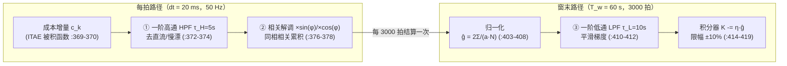

# ESC 滤波器设计文档

> 本文档是 ESC（Extremum Seeking Control，极值搜索控制）在线调参方案中**滤波器环节的专项设计文档**，覆盖信号链上全部滤波机制的设计需求、方案选型、参数整定准则、离散化实现、状态管理与验证。
>
> **事实来源约定**：一切设计描述与源码严格对齐——`control/include/auto_tuner.hpp`（ESC 全部实现），引用格式 `auto_tuner.hpp:行号`。数学推导（为什么这些滤波器能测出梯度）见 `docs/ESC方案数学推导与算法实现详解.md` 第 4 章与 `docs/ESC代价函数梯度计算详解.md`，本文回答的是"**滤波器怎么设计、参数怎么配、状态怎么管**"。
>
> **术语**：沿用根目录 `CONTEXT.md` 的统一语言（载波、因果解调、重锚、回退等）。

**目录**

- [1. 引言](#1-引言)
- [2. 信号链总览：三个滤波环节](#2-信号链总览三个滤波环节)
- [3. 高通滤波器（HPF）设计](#3-高通滤波器hpf设计)
- [4. 相关解调与窗口平均（隐式滤波）](#4-相关解调与窗口平均隐式滤波)
- [5. 梯度低通滤波器（LPF）设计](#5-梯度低通滤波器lpf设计)
- [6. 双时间尺度与滤波器状态管理](#6-双时间尺度与滤波器状态管理)
- [7. 参数整定准则](#7-参数整定准则)
- [8. 已知限制](#8-已知限制)
- [9. 验证](#9-验证)
- [10. 附录：公式 ↔ 代码行号对照](#10-附录公式--代码行号对照)

---

## 1. 引言

### 1.1 为什么 ESC 需要滤波器

ESC 在 PD 增益 $K_p,K_d$ 上叠加 $\pm5\%$ 正弦载波（`escDither`，`auto_tuner.hpp:385`），代价信号 $J(t)$ 中与载波同频的基波分量携带梯度信息。但实测 $J(t)$ 是"直流 + 基波 + 二倍频 + 噪声/慢漂"的混合体：

- **直流项** $J_0$（当前点代价 + 抖动平均代价）比基波幅值大几个数量级，不去除则泄漏进相关器淹没信号；
- **慢漂**（海况变化、$K/T$ 漂移、风压差）同样污染梯度方向；
- **二倍频与高频噪声**需要在平均中抑制；
- **窗级梯度估计**逐窗到达、带涨落，直接进积分器会引起增益抖动。

因此信号链上需要滤波机制把"基波"从其余成分中干净地分离出来。ESC 的梯度估计精度，一半取决于载波参数，另一半取决于这组滤波器的设计与参数匹配。

### 1.2 设计目标与工程约束

| 目标 | 说明 |
|---|---|
| 去直流/慢漂 | HPF 在解调**之前**阻断 $J_0$ 与低频漂移，是相关器正常工作的前提 |
| 保相位 | 滤波器在载波频率处的相移按 $\cos(\text{失配})$ 衰减梯度，相位设计必须与解调器对准 |
| 平滑梯度 | 窗级梯度估计经 LPF 平滑后再进积分器，压低逐窗涨落 |
| ECU 可部署 | 一阶、固定状态数、无堆分配、50 Hz 实时可承受（P2 整改基调，头注释 `auto_tuner.hpp:6`） |
| 双时基正确 | 滤波器系数必须按各环节**真实采样周期**计算（P11 整改教训，§5.2） |

---

## 2. 信号链总览：三个滤波环节

ESC 信号链上共有三个起滤波作用的环节，运行在两个时间尺度上：



| # | 环节 | 性质 | 运行频率 | 任务 |
|---|---|---|---|---|
| ① | HPF $y_k=\alpha_H(y_{k-1}+c_k-c_{k-1})$ | 显式滤波器 | 每拍（$dt$） | 去直流与慢漂，输出纯交流分量 |
| ② | 相关解调 + 窗口平均 | **隐式滤波**（相关器） | 每拍累积、窗末取值 | 只留与载波同频同相分量，抑制二倍频与其他频率 |
| ③ | LPF $g\leftarrow(1-\alpha_L)g+\alpha_L\hat g$ | 显式滤波器 | 每窗（$T_w$） | 平滑窗级梯度估计 |

设计要点一句话：**② 是梯度提取的主滤波器（相关器天然带通），① 是它的保护前置，③ 是它的输出后置平滑**。

---

## 3. 高通滤波器（HPF）设计

### 3.1 设计需求

理论上直流 $J_0$ 乘以 $\sin\omega t$ 后整周期均值为零，似乎不必滤波。但工程上两个事实使其成为必需：

1. $J_0$ 数值比基波幅值 $a\bar\theta J'$ 大几个数量级（窗口 $J\sim O(10^4\!\sim\!10^5)$），窗口只要不满整数个载波周期，直流残余就泄漏进相关器；
2. $J$ 带慢漂（海况、$K/T$ 漂移、机动）时，漂移分量同样污染梯度方向。

HPF 的位置在**解调之前**（`accumulate`，`auto_tuner.hpp:369-378` 的顺序：先 HPF 后乘载波），这是因果解调结构的一部分。

### 3.2 方案选型：一阶高通

连续域传递函数：

$$H(s)=\frac{s}{s+1/\tau_H}=\frac{\tau_H s}{\tau_H s+1},\qquad \tau_H\dot y+y=\tau_H\dot c$$

选一阶而非高阶（Butterworth 等）的理由：

- 任务只是"去直流、留基波"，载波频率与直流之间有几个数量级的频率间隔，一阶 rolloff（20 dB/十倍频）已足够；
- 状态只需两个寄存器（`hpfY_`、`hpfCPrev_`，`auto_tuner.hpp:475-476`），无堆分配，满足 ECU 约束；
- 高阶滤波引入的相位滞后与瞬态会恶化 §3.4 的相位对准问题，得不偿失。

### 3.3 离散化：后向欧拉

对 $\tau_H\dot y+y=\tau_H\dot c$ 用后向欧拉（$\dot x\approx(x_k-x_{k-1})/dt$）：

$$y_k=\alpha_H\bigl(y_{k-1}+c_k-c_{k-1}\bigr),\qquad \boxed{\;\alpha_H=\frac{\tau_H}{\tau_H+dt}\;}$$

与代码逐字对应（`auto_tuner.hpp:372-374`）：

```cpp
const double alphaH = p_.escHPFtau / (p_.escHPFtau + p_.dt);  // :372，α_H = 5/5.02 = 0.99602
hpfY_ = alphaH * (hpfY_ + c - hpfCPrev_);                     // :373
hpfCPrev_ = c;                                                // :374
```

设计细节：

- **输入是每拍成本增量** $c_k=(t_k|e_k|+w_U|\delta_k|+w_{Du}|\Delta\delta_k|)\,dt$（`:369-370`），与 `computeJ` 的被积函数严格同口径——HPF 的输入与被积序列一致，差分 $c_k-c_{k-1}$ 与乘 $\alpha_H$ 共同实现"去直流、留交流"；
- **后向欧拉天然绝对稳定**，$dt\ll\tau_H$ 时离散与连续响应几乎一致；
- 系数按**控制周期** $dt=0.02\ \mathrm{s}$ 计算（`p_.dt` 是内部系数时基，`:105`），这是与 LPF 的时基分界点（§5.2）。

### 3.4 频域量化校核：$\omega\tau_H$ 判据

对角频率 $\nu$ 的正弦分量：

$$|H(j\nu)|=\frac{\nu\tau_H}{\sqrt{1+(\nu\tau_H)^2}},\qquad \angle H(j\nu)=\frac{\pi}{2}-\arctan(\nu\tau_H)$$

HPF 对基波同时产生幅值衰减与相位超前，进入梯度估计的同相分量只剩实部：

$$\operatorname{Re}H(j\omega)=\frac{(\omega\tau_H)^2}{1+(\omega\tau_H)^2}$$

**这是梯度估计的乘性衰减因子，也是 HPF 参数是否合理的第一道检验**（经典设计要求 $\omega\tau_H\gg1$）。三组实际配置的量化对比：

| 配置 | $\omega\tau_H$ | $\lvert H(j\omega)\rvert$ | 相位超前 | $\operatorname{Re}H(j\omega)$ |
|---|---|---|---|---|
| 默认 $\omega{=}0.05,\ \tau_H{=}5$（`Params`，`:88-90`） | $0.25$ | $0.2425$ | $75.96^\circ$ | $\mathbf{0.0588}$（梯度衰减约 17 倍） |
| 收敛测试 $\omega{=}2\pi/60,\ \tau_H{=}30$（`test_auto_tuner.cpp:179-181`） | $3.14$ | $0.953$ | $17.7^\circ$ | $0.908$ |
| 单元测试 $\omega{=}2\pi,\ \tau_H{=}5$（`test_autopilot_core.cpp:146`） | $31.4$ | $0.9995$ | $1.8^\circ$ | $0.999$ |

结论：**默认参数组不满足 $\omega\tau_H\gg1$**，$\operatorname{Re}H=0.059$ 意味着梯度被等效衰减约 17 倍——这是默认参数组的已知瑕疵（§8.1），整定准则见 §7。

### 3.5 相位对准设计

梯度估计对载波相位失配按 $\cos(\text{失配})$ 衰减。本设计的对策：

- **同一相位源**：注入（`escDither`）与解调（`accumulate`）共用 `escPhase_`，不存在两个振荡器的相位漂移；
- **因果解调**：解调在每拍即时进行（HPF 输出立即乘本拍载波，`:373→:376-377`），把失配压缩到只剩 HPF 自身相移 $\varphi_H$；
- **相位连续性**：`escPhase_` 超 $2\pi$ 回绕（`:390`），且 `rebaseEsc()` 刻意不清相位（`:437-440` 注释），避免重锚拍载波突跳——代价是非整数周期窗的泄漏偏置逐窗轮转，由"偏置转化为方差"吸收（数学推导文档 §4.7）。

---

## 4. 相关解调与窗口平均（隐式滤波）

相关器不是以"滤波器"命名，但它是整条链里**频率选择性最强的环节**：

$$\hat g=\frac{2}{aN}\sum_{k=1}^{N} y_k\cdot\text{载波}_k,\qquad N=T_w/dt=3000$$

实现于 `accumulate` 的每拍累积（`:376-378`）与 `escStep` 的窗末归一化（`:403-408`）。其滤波性质：

- **只留同频同相分量**：$J(t)$ 谐波分解中的基波与 $\sin\omega t$ 相关得非零均值；直流（HPF 残余）、二倍频 $-\frac{a^2}{4}J''\cos2\omega t$、以及一切非载波频率成分，在**整数个载波周期**的窗口内相关均值严格为零；
- **双参数正交**：$K_p$ 用 $\sin$、$K_d$ 用 $\cos$（`:387-388`），两路相关器互不正交泄漏，可同时解调两个梯度分量，无需分时轮询；
- **方差主战场**：窗口平均（$N=3000$ 点求和）是压低梯度估计方差的主要机制，③ 号 LPF 只起辅助作用（§5.3）。

**设计前提**：相关器的"零泄漏"性质依赖窗口覆盖整数个载波周期（$\omega=2\pi n/T_w$），这直接决定了 §7 的整定顺序。载波相位跨窗连续（§3.5）使非整数窗下的残余偏置逐窗轮转、近似零均值——偏置转化为方差，再由窗口平均与 LPF 部分吸收。

---

## 5. 梯度低通滤波器（LPF）设计

### 5.1 设计需求

窗末归一化得到的 $\hat g$ 是逐窗到达的涨落序列（受海况、机动、非整数窗残余影响）。直接进积分器会让增益逐窗抖动，故用一阶低通平滑：

$$G(s)=\frac{1}{\tau_L s+1},\qquad \tau_L\dot g+g=\hat g$$

### 5.2 时基差异：系数必须用 $T_w$ 而非 $dt$（P11 整改教训）

LPF 的输入**每 $T_w=60\ \mathrm{s}$ 才到达一个新样本**（`escStep` 由 `settleWindow_` 每 3000 拍调一次，`:171-177→:336→:398`），因此离散化的真实采样间隔是 $T_w$，后向欧拉给出：

$$g_w=(1-\alpha_L)g_{w-1}+\alpha_L\hat g_w,\qquad \boxed{\;\alpha_L=\frac{T_w}{\tau_L+T_w}=\frac{60}{10+60}=0.857\;}$$

与代码逐字对应（`escStep`，`auto_tuner.hpp:410-412`）：`alphaL = windowSec/(escLPFtau+windowSec)`。

**P11 教训的定量表述**：旧实现把按 $dt=0.02\ \mathrm{s}$ 设计的系数用在窗级样本上，$\alpha_L^{错}=0.02/10.02=0.002$，与正确值 $0.857$ 相差约 **430 倍**——新梯度几乎进不了估计器；HPF 侧同理（按 $dt$ 设计的滤波器用在窗级样本上，等效时间常数被放大 $T_w/dt=3000$ 倍）。两重错误叠加使梯度被衰减 2~3 个数量级，调参结果与初值逐位相同（整改记录见头注释 `auto_tuner.hpp:8-12`）。

> **设计原则**：ESC 各环节运行在不同时间尺度——扰动/解调/HPF 在每拍（$dt$），LPF/积分在窗末（$T_w$）——**每个滤波器系数必须用该环节真实的采样周期计算**。

### 5.3 弱平滑事实与设计边界

$\alpha_L=0.857$ 意味着新样本权重 85.7%，等效滞后仅 $(1-\alpha_L)/\alpha_L\approx0.17$ 个窗口——**LPF 平滑很弱，梯度方差主要靠 3000 点窗口平均压低，而不是靠它**。这是有意的保守设计：人为调大 $\tau_L$ 会引入窗级滞后，收紧梯度下降收敛条件 $0<\eta\bar\theta J''\operatorname{Re}H<2$ 的有效上界（滞后环易振荡）。$\tau_L=10\ \mathrm{s}$ 的取值定位为"去毛刺"而非"估平均"。

---

## 6. 双时间尺度与滤波器状态管理

### 6.1 两级时基总表

| 尺度 | 周期 | 涉及的滤波环节 | 系数时基 |
|---|---|---|---|
| 控制拍 | $dt=20\ \mathrm{ms}$（50 Hz） | HPF、相关解调累积、载波相位推进 | `p_.dt`（`:105`） |
| 评估窗口 | $T_w=60\ \mathrm{s}$（3000 拍） | 归一化、LPF、积分更新 | `p_.windowSec`（`:104`） |

### 6.2 状态变量与清零时机

滤波器状态的完整性是梯度估计正确性的前提——陈旧状态会把围绕旧增益、旧模型测得的信息施加到新基线上。清零矩阵：

| 状态 | 变量（行号） | `escStep` 窗末清窗（`:420-428`） | `rebaseEsc` 重锚（`:441-453`） | `suspend` 挂起（`:199-203`） |
|---|---|---|---|---|
| HPF 输出/上拍输入 | `hpfY_/hpfCPrev_`（`:475-476`） | ✔ | ✔ | ✔（经 rebaseEsc） |
| 解调累积 | `demodKpSum_/demodKdSum_/demodCount_`（`:477-479`） | ✔ | ✔ | ✔ |
| 梯度积分器输入（LPF 状态） | `gradKp_/gradKd_`（`:472-473`） | ✘（跨窗保持，LPF 的意义所在） | ✔ | ✔ |
| 窗口样本 | `windowErr_/windowDelta_/windowDDelta_`（`:483-485`） | ✔ | ✔ | ✔ |
| 载波相位 | `escPhase_`（`:467`） | ✘（刻意跨窗连续） | ✘（刻意保留，`:437-440`） | ✘ |

三条设计规则：

1. **非重叠窗**：窗末结算后 HPF 与解调累积清零，下一窗从零开始——窗间梯度相互独立，不混时基；
2. **重锚隔离**：重基线（K/T 漂移超 25%）或挂起时全部测量状态清零，但 LPF 状态（梯度积分器输入）只在重锚/挂起清、不在窗末清——它本就是跨窗平滑器；
3. **相位豁免**：`escPhase_` 在一切清零路径中都保留，载波连续优先于窗口对齐（§3.5）。

---

## 7. 参数整定准则

三个滤波环节与载波参数强耦合，整定必须成套进行。**正确顺序**（数学推导文档 §4.7/§7 的结论）：

1. **先定窗口** $T_w$：按工况取（默认 60 s），需覆盖闭环调节时间（典型船 $4T$）的数倍；
2. **再定载波** $\omega=2\pi n/T_w$：使每窗恰好覆盖 $n$ 个整数载波周期，相关器正交性严格成立。$T_w=60\ \mathrm{s}$ 时 $\omega=2\pi/60\approx0.105\ \mathrm{rad/s}$（$n{=}1$）；
3. **最后配 HPF** $\tau_H$：使 $\operatorname{Re}H(j\omega)=\dfrac{(\omega\tau_H)^2}{1+(\omega\tau_H)^2}\gtrsim0.9$，即 $\omega\tau_H\gtrsim3$。上式下 $\tau_H=30\ \mathrm{s}$（$\operatorname{Re}H=0.908$）；
4. **校核 LPF**：$\tau_L\ll T_w$ 保持弱平滑定位（$\tau_L=10\ \mathrm{s}$ 时 $\alpha_L=0.857$）；若加大 $\tau_L$ 需重新评估积分环稳定性。

配套参数参考组（收敛测试采用，`test_auto_tuner.cpp:179-181`）：

| 参数 | 符号 | 默认组 | 配套组（推荐） |
|---|---|---|---|
| 窗口长度 | $T_w$ | 60 s | 60 s |
| 载波角频率 | $\omega$ | 0.05 rad/s（周期 125.7 s） | $2\pi/60\approx0.105$ rad/s（每窗 1 周期） |
| 摄动幅值 | $a$ | 0.05 | 0.10 |
| HPF 时间常数 | $\tau_H$ | 5 s（$\operatorname{Re}H=0.059$） | 30 s（$\operatorname{Re}H=0.908$） |
| LPF 时间常数 | $\tau_L$ | 10 s（$\alpha_L=0.857$） | 10 s |
| 积分步长 | $\eta$ | 0.02 | 0.02 |

**默认组应视为占位符**——在按上表成套重配之前，ESC 在默认参数下表现为低速徘徊而不劣化（泄漏偏置逐窗轮转 + 限幅/稳定门兜底），不构成严格梯度收敛。

---

## 8. 已知限制

1. **默认参数组结构性张力**（§3.4/§7）：$\omega=0.05$ 与 $T_w=60\ \mathrm{s}$ 下窗内装不满半个载波周期，相关器正交性失效且 $\operatorname{Re}H=0.059$——梯度被衰减约 17 倍。整改方向即 §7 的成套整定；
2. **缺波浪滤波**：HPF 只去直流，**与载波同频的噪声全通**。波浪遭遇频率 $0.05\sim0.2\ \mathrm{Hz}$ 与载波（$0.008\sim0.017\ \mathrm{Hz}$）尚差一个数量级，但高海况下波频谐波与非线性混频产物可能落到载波附近淹没梯度——这是高海况（4–5 级）的最大短板，高海况保护（dead-zone、泄漏项、激励频率避开遭遇谱峰）见《工程总体分析与ESC方案原理》§3.9；
3. **LPF 弱平滑**：$\alpha_L=0.857$，方差主靠窗口平均；加大 $\tau_L$ 的稳定性边界未显式推导，调参时需谨慎；
4. **混合时基**：HPF 系数、载波相位、ITAE 时间权重用固定 `p_.dt=0.02 s` 作时基，调用方实际周期偏离 50 Hz 时口径随之漂移——部署时必须保证 50 Hz 调用节拍；
5. **HPF 瞬态**：重锚/挂起后 HPF 状态清零，首个窗口含滤波器启动瞬态（随 $\tau_H$ 指数衰减），对梯度方向的影响由窗间涨落平均吸收。

---

## 9. 验证

| 验证项 | 位置 | 与滤波器的关系 |
|---|---|---|
| `EscTunesKpTowardOptimum` | `control/tests/test_auto_tuner.cpp:177-216` | 端到端收敛证据，采用 §7 配套参数组（$\operatorname{Re}H=0.908$、每窗整周期） |
| `EscDitherModulatesGains` | `test_auto_tuner.cpp:118-137` | 载波真实到达输出（解调链路的激励端前提） |
| `WindowSettleUpdateIsClamped` | `test_auto_tuner.cpp:141-172` | 窗末结算含 LPF/积分/限幅的确定性行为 |
| `RebaselineClearsIntegratorState` | `test_auto_tuner.cpp:289-313` | 重锚清零滤波器/解调状态（§6.2 规则 2） |
| tune 仿真（`tune.csv`） | `control/sim` | 默认参数组下"低速徘徊而不劣化"的实际表现 |

---

## 10. 附录：公式 ↔ 代码行号对照

| 设计项 | 公式 | 代码位置（`auto_tuner.hpp`） |
|---|---|---|
| 参数定义 $\tau_H,\tau_L$ | — | `Params.escHPFtau/escLPFtau`，`:90-91` |
| 时基定义 $dt,T_w$ | — | `Params.dt/windowSec`，`:104-105` |
| HPF 输入（成本增量） | $c_k=(t_k\lvert e_k\rvert+w_U\lvert\delta_k\rvert+w_{Du}\lvert\Delta\delta_k\rvert)\,dt$ | `accumulate`，`:369-370` |
| HPF 离散 | $y_k=\alpha_H(y_{k-1}+c_k-c_{k-1})$，$\alpha_H=\tau_H/(\tau_H+dt)$ | `accumulate`，`:372-374` |
| 相关解调 | $\sum y_k\sin\varphi_k$ / $\sum y_k\cos\varphi_k$ | `accumulate`，`:376-378` |
| 载波注入（正交） | $K_p(1+a\sin\varphi)$，$K_d(1+a\cos\varphi)$ | `escDither`，`:387-390` |
| 梯度归一化 | $\hat g=2\sum(y\cdot\text{载波})/(aN)$ | `escStep`，`:403-408` |
| LPF 离散 | $g\leftarrow(1-\alpha_L)g+\alpha_L\hat g$，$\alpha_L=T_w/(\tau_L+T_w)$ | `escStep`，`:410-412` |
| 积分 + 限幅 | $K\leftarrow K-\eta g$，$\lvert\Delta\rvert\le\max(10\%\lvert K\rvert,10^{-3})$ | `escStep`，`:414-419`；`clampUpdate`，`:455-464` |
| 窗末清窗（非重叠窗） | — | `escStep`，`:420-428` |
| 重锚清零（保留载波相位） | — | `rebaseEsc`，`:437-453` |
| 挂起清测量状态 | — | `suspend`，`:199-203` |
