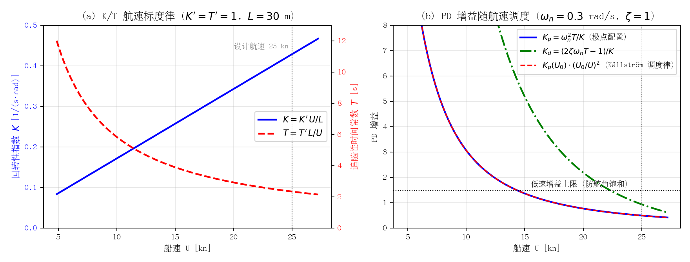
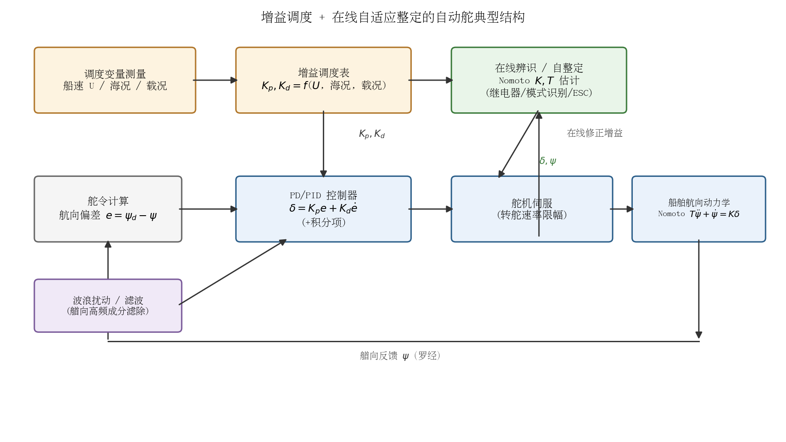
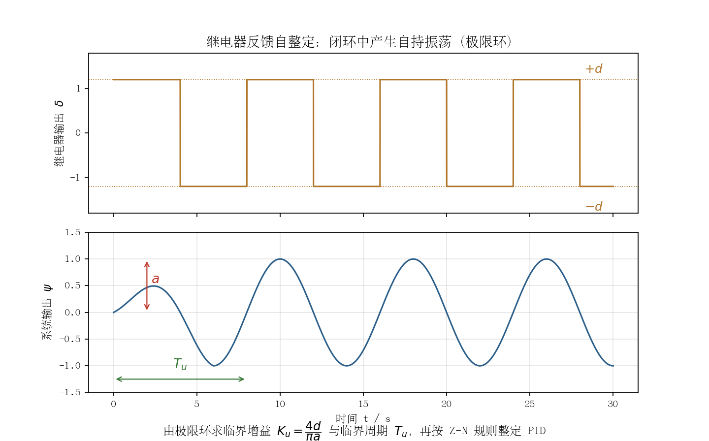
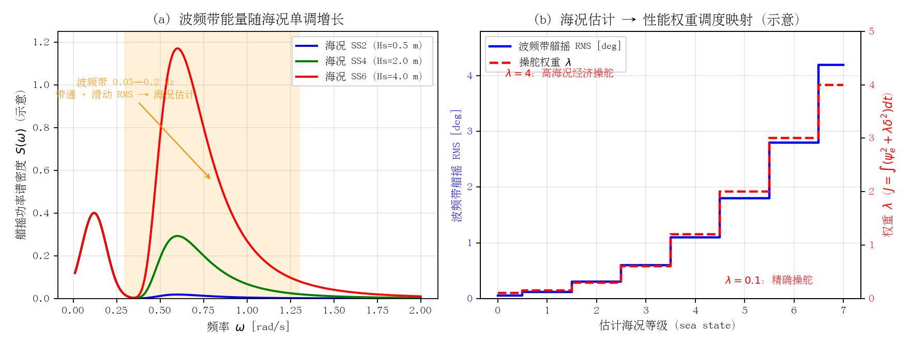

## 自适应 PID 与增益调度自动舵

增益调度（gain scheduling）与自适应 PID 是工业自动舵中最成熟、应用最广的两条技术路线：前者利用"船舶操纵性随航速/载况变化的规律已知"这一先验，用解析标度律实时修正控制器增益；后者通过在线整定（继电器反馈、模式识别、最小方差自校正等）补偿海况、载况等慢变未知因素。自 1970 年代 Källström 等人在油轮上完成首次系统性实船验证以来，二者往往以"调度管快变量、自适应管慢变量"的分工结构组合使用，并已成为 Kongsberg、Tokyo Keiki、YOKOGAWA、Anschütz、Sperry 等主流商用自动舵的标准配置。本节梳理其算法原理、代表性工作、商用产品实践与 IMO 性能标准要求，并讨论其对本项目（PD + 增益调度 + ESC 在线辨识 + 极点配置）方案的借鉴意义。

### 算法原理

#### 增益调度的理论基础：Nomoto 模型与航速标度律

船舶航向保持控制最常用 Nomoto 一阶模型描述舵角到艏向的通道（含积分环节）：

$$T\dot{r}+r=K\delta,\qquad \frac{\psi(s)}{\delta(s)}=\frac{K}{s(1+sT)}$$

其中 $K$ 为回转性指数、$T$ 为追随性时间常数。更精细的场合使用 Nomoto 二阶模型：

$$\frac{r(s)}{\delta(s)}=\frac{K(1+T_3 s)}{(1+T_1 s)(1+T_2 s)}$$

增益调度可行性的核心是 **K/T 的无量纲航速标度律**（van Amerongen 1984）：

$$K=K'\frac{U}{L},\qquad T=T'\frac{L}{U}$$

其中 $U$ 为船速、$L$ 为船长，无量纲参数 $K'$、$T'$ 对航速变化不敏感（典型量级 0.5–2.0）。这意味着只要已知参考航速下的模型参数，其余航速下的参数即可解析外推，调度表无需逐点插值标定。Källström（1977/1979）进一步给出按"闭环响应不变"还是"航迹不变"两种设计目标的**速度调度增益**：

$$G_V(t)=\left(\frac{V_0}{V(t)}\right)^2\ \text{（响应时间不变）};\qquad G_V(t)=\frac{V_0}{V(t)}\ \text{（航迹不变，用于辨识器）}$$

并指出低速时必须对增益设上限以避免舵角饱和。调度作用于 Kalman 滤波器、自校正器与转向调节器三处，因为"调度对航速变化的响应远快于自适应辨识的收敛"。

按海况/经济性的调度则以**操舵附加阻力准则**为物理依据（Norrbin 1972、Koyama 1967，经 Källström 引用）：航向误差与舵角都以平方项增加航行阻力——

$$\frac{\Delta R}{R}=k\left(\bar{\psi}_e^{\,2}+\lambda\bar{\delta}^{\,2}\right),\qquad k\approx0.014\ \text{deg}^{-2},\ \lambda=1/12\ \text{（典型油轮）}$$

对应性能指标 $J=\int\left(\psi_e^2+\lambda\delta^2\right)dt$：精确操舵（进出港）取 $\lambda\approx0.1$，高海况经济操舵可取 $\lambda\approx4$。对 Nomoto 一阶模型求解该 LQ 指标（对 $\dot r=-r/T+(K/T)\delta$ 解 Riccati 方程）即得最优 PD 增益（van Amerongen 1984）：

$$K_p=\frac{1}{\sqrt{\lambda}},\qquad K_d=\frac{1}{K}\left(\sqrt{1+\frac{2K}{\sqrt{\lambda}}}-1\right)$$

这给出了"按海况调度"的解析形式：**高海况增大 $\lambda$（压低舵动、放宽航向精度），而非盲目提高增益**。

基于 Nomoto 一阶模型的 PD 极点配置整定公式（Fossen 教材）把期望闭环自然频率 $\omega_n$、阻尼比 $\zeta$ 与模型参数直接挂钩：

$$K_p=\frac{\omega_n^2 T}{K},\qquad K_d=\frac{2\zeta\omega_n T-1}{K}$$

与航速标度律联立，即可解析生成随航速连续变化的增益表——这正是"模型辨识 + 极点配置"型自适应自动舵的标准闭环。

#### K/T 航速标度律的解析推导

标度律 $K\propto U/L$、$T\propto L/U$ 并非纯经验拟合，可由线性化操纵方程经量纲分析直接导出。水平面线性化艏摇方程（并入横漂-艏摇耦合的等效效应后）为：

$$(I_z-N_{\dot r})\,\dot r+(-N_r)\,r=(-N_\delta)\,\delta$$

与 Nomoto 一阶模型对比得 $T=(I_z-N_{\dot r})/(-N_r)$、$K=(-N_\delta)/(-N_r)$。在 Froude 相似前提下，各水动力导数的量纲标度为：

- 附加转动惯量 $I_z-N_{\dot r}\propto\rho L^5$（质量矩 ∝ 排水质量 $\times L^2$，排水质量 ∝ $\rho L^3$）；
- 艏摇阻尼 $-N_r\propto\rho U L^4$（船体水动力 ∝ $\rho U\,(rL)\,L^2$，力臂 ∝ $L$）；
- 舵力矩 $-N_\delta\propto\rho U^2 L^3$（舵升力 ∝ $\rho U^2 A_R\,\delta$，$A_R\propto L^2$，力臂 ∝ $L$）。

代入即得标度律：

$$T=\frac{\rho L^5}{\rho U L^4}=T'\frac{L}{U},\qquad K=\frac{\rho U^2 L^3}{\rho U L^4}=K'\frac{U}{L}$$

无量纲参数 $K'=KL/U$、$T'=TU/L$（即操纵性 prime 系统的标准定义）对同型船在不同航速下近似不变（典型量级 0.5–2.0，van Amerongen 1984 实船/船模数据支持）——这就是"调度表可解析外推、无需逐点标定"的物理依据。

该推导有两条直接的控制推论：

1. **与极点配置联立可反推出 Källström 经验调度律**：保持闭环自然频率 $\omega_n$ 不变（响应时间不变）时，$K_p=\omega_n^2 T/K=\left(\omega_n^2 T'/K'\right)(L/U)^2\propto U^{-2}$——这正是 Källström（1977）"真时间不变 ⇒ $G_V=(V_0/V)^2$"调度律的解析证明，两条独立路线互相印证；
2. **标度律的失效边界即自适应的起作用区间**：低速时舵进速不再正比于船速（零速下舵力仅由螺旋桨滑流产生），浅水、污底、载况变化会缓慢改变水动力导数——$K'$、$T'$ 在其标称带内的慢变漂移正是留给在线辨识（本项目 ESC）跟踪的残余量；同时 $K_p\propto U^{-2}$ 表明低速增益必须限幅，否则舵角饱和。

*图 3-1 K/T 航速标度律与极点配置 PD 增益调度数值示例（$L=30$ m、$K'=T'=1$、$\omega_n=0.3$ rad/s、$\zeta=1$）：(a) $K\propto U/L$、$T\propto L/U$；(b) 保持 $\omega_n$ 不变时 $K_p$ 精确按 $(U_0/U)^2$ 缩放，与 Källström 经验调度律完全一致；低速段增益须限幅以防舵角饱和。*

#### 自适应 PID 的三种在线整定方法

**（1）继电器反馈自整定（relay feedback autotuning）。** Åström & Hägglund（1984）提出用继电环节替代 Ziegler–Nichols 开环临界增益试验：闭环中接入幅值为 $d$ 的理想继电器，系统在相位 $-\pi$ 频率处产生幅值可控的自持振荡（极限环），过程不会远离设定点，安全性远优于开环扫临界稳定边界。由描述函数法，临界增益与临界周期为：

$$K_u=\frac{4d}{\pi a},\qquad T_u=\text{实测振荡周期}$$

再按 Z-N 临界比例度规则整定：

$$K_p=0.6K_u,\qquad T_i=0.5T_u,\qquad T_d=0.125T_u$$

该方法已成为工业 PID 自整定的事实标准（ABB、Honeywell 等单回路控制器普遍内置）。在船舶领域的权威实船记录集中于机舱蒸汽/给水回路 PID 整定；**直接用于商船航向自整定的权威实船文献未能核实**，航向自整定的主流路线是自校正与模式识别，继电器法多见于仿真研究。

**（2）模式识别自适应（pattern recognition）。** Bristol（1977）提出、Kraus & Myron（1984）工程化的 Foxboro EXACT 是**第一个商用自适应 PID 控制器**（1984 年 10 月发布）：不做显式参数辨识，而是监测误差响应的超调量、阻尼比、周期等"模式特征"，按预置启发规则（仿 Z-N 阶跃响应法）直接修正 PID 参数。其特点是对噪声和非线性鲁棒、无需激励信号，但整定粒度粗、规则库依赖专家经验。这一思路与商用自动舵面板上"海况/Weather 档位 → 预置增益组"的实现方式在工程上等价。

**（3）最小方差/自校正 PID（minimum variance / self-tuning）。** 理论基础为 Åström & Wittenmark（1973）的自校正调节器（递推最小二乘 RLS 在线辨识 + 最小方差控制律）与 Clarke & Gawthrop（1975/1979）的广义最小方差（GMV，引入控制加权以抑制过激舵动）。对 ARMAX 模型 $A(q^{-1})y(t)=B(q^{-1})u(t-k)+C(q^{-1})e(t)$，由恒等式 $C=AF+q^{-k}G$ 得控制律：

$$u(t)=-\frac{G(q^{-1})}{B(q^{-1})F(q^{-1})}\,y(t)$$

Källström 的实船版本在此基础上以 $\nabla\delta_e$ 引入积分作用、RLS 带指数遗忘因子跟踪慢变参数。配套的船舶辨识工程经验（数据滤波、采样率与模型阶次选择）见 Åström & Källström（1976）与 Källström & Åström（1981）。

*图 3-2 增益调度与在线自适应整定组合的典型自动舵结构：调度变量（航速/海况/载况）经解析标度律或查表生成基准增益，在线辨识/自整定模块（Nomoto K/T 估计）对残余慢变失配做修正。*

*图 3-3 继电器反馈自整定原理：继电环节（幅值 $d$）使闭环产生自持振荡，由输出振荡幅值 $a$ 与周期 $T_u$ 求临界增益 $K_u=4d/(\pi a)$，再按 Z-N 规则整定 PID。*

#### 海况估计：把 Weather 旋钮变成在线观测量

MSC.64(67) Annex 3 §7.2 允许以"自动调整功能"替代船员手动 Weather 调节，其技术前提是把"海况"从人工档位变成在线估计量（sea state estimator）。文献与商用产品中有三条成熟路线：

**（1）航向/艏摇谱法（波频带能量）。** 波浪引起的艏摇运动功率集中在波峰频段（典型 0.05–0.2 Hz，van Amerongen 1984），明显高于船舶可控响应带宽，与低频可控运动在频谱上天然可分。对航向误差或艏摇率信号在波频带内带通滤波并估计其滑动方差/RMS，所得波频带能量随海况单调上升，可直接映射为海况等级或连续调度参数。van Amerongen（1984）明确指出"滤波量应随噪声水平自适应"（the amount of filtering should be adaptive with respect to the level of the noise）——即波浪滤波带宽本身就应由在线海况（噪声）估计调度，这是航向谱法最早的工程表述。

**（2）扰动模型在线辨识。** YDK（原 YOKOGAWA）BNAAC 的官方结构即为"船舶基本模型 + 扰动模型辨识器"：在线估计作用于船体的风、浪扰动模型并与船模合并更新，据此自动计算最优舵增益（官方实测舵动量 −60%）；Ohtsu（1979）的 AR 随机模型自动舵同样通过在线辨识噪声统计量调整控制律。这条路线的海况估计与参数辨识共用同一套递推辨识框架。

**（3）操舵统计量反馈。** 直接统计单位时间舵动量、舵角 RMS、舵机反向次数等"操舵代价"观测量，与航向精度统计量一起反馈调节 $\lambda$/死区/滤波强度——Anschütz NautoPilot 5000 NX 的 ECOnomy 模式（官方称 adaptive mode）即"持续监测船体实际偏航运动，将对称的、因船体惯性本就无法校正的波频运动滤除而不予操舵修正"（据厂商公开资料）。

工程要点（对本项目直接适用）：海况估计的时间常数应远慢于波频周期（避免把单个波误判为海况变化）、又远快于海况的实际演变（分钟级）；估计输出建议作用于**性能权重**——$\lambda$、等效 $\omega_n$、死区、滤波带宽、ESC 激励幅值与频段——而非直接乘在反馈增益上；且应与参数辨识解耦——ESC 负责跟踪 $K$、$T$，海况估计负责调度权重，二者时间尺度分离可避免相互干扰。

*图 3-4 基于航向谱的海况估计原理：(a) 艏摇运动谱中波频带（阴影，0.05–0.2 Hz）能量随海况单调增长，与低频可控段在频谱上可分；(b) 波频带 RMS → 海况等级 → 操舵权重 $\lambda$ 的调度映射（$\lambda=0.1$ 精确操舵 → $\lambda=4$ 高海况经济操舵，数值为示意）。*

### 典型应用与代表性工作

| 作者/机构 | 年代 | 系统/文献 | 一句话贡献 |
|---|---|---|---|
| Minorsky / Sperry | 1922 | 早期自动舵理论 | 自动操舵的比例-微分控制奠基 |
| Nomoto 等 | 1957 | "On the Steering Qualities of Ships", *ISP* 4(35) | 一阶/二阶 K-T 转向模型，一切调度与整定的模型基础 |
| Åström & Wittenmark | 1973 | *Automatica* 9:185–199 | RLS + 最小方差自校正调节器理论 |
| Clarke & Gawthrop | 1975/1979 | *Proc. IEE* 122(9)/126(6) | 广义最小方差（控制加权）自校正 |
| Källström, Åström 等（LTH + Kockums 船厂） | 1976–1981 | KADPIL 1/2；*Automatica* 1979/1981 | 速度调度 + 自校正 + 分阶段转向的油轮自适应自动舵，三艘油轮 130 余次实船试验验证 |
| van Amerongen（TU Delft） | 1975–1984 | MRAS 自适应自动舵；*Automatica* 1984 | 模型参考自适应 + 自适应状态估计，实船/船模试验宣称相对调好 PID 节油最高 5%（海况 2–4 级实测 0.5–2%） |
| Ohtsu, Horigome, Kitagawa（东京商船大学） | 1979 | *Automatica* 15(3):255–268 | AR 随机模型噪声自适应自动舵，横河商用产品的技术源头（合理推断，无厂商官方确认） |
| Bristol / Kraus & Myron（Foxboro） | 1977/1984 | EXACT 模式识别自适应 PID | 首个商用自适应 PID 控制器 |
| Åström & Hägglund | 1984/1995 | 继电器反馈自整定 | 工业 PID 自整定事实标准 |
| Holzhüter & Strauch（Anschütz） | 1987 | 10th IFAC 世界大会论文 | 商用自适应自动舵的公开学术记录 |
| Fossen（NTNU） | 1994–2021 | 教材 + Stena HSS 1500 高速双体船自动舵（40+ kn） | Nomoto 极点配置整定、波浪滤波、高速船增益调度工程化 |

KADPIL 工程的关键数据（Källström 1977 报告）至今仍是路线论证的直接证据：固定增益 PD 自动舵在不同载况/海况下的损失函数相差 **5–8 倍**，"一套参数包打天下"不可行；转向工况不适合纯自适应，Källström 采用**分阶段变结构控制**（起动段比例艏摇率反馈 + 舵角饱和 → 定常回转段艏摇率积分 → 停转段类 PD deadbeat），各阶段固定增益但仍乘速度调度因子。

### 主流商用自动舵的自适应策略

- **Kongsberg K-Bridge Autopilot**：官方样本宣称"self-adapting"，运行中"学习"船舶对不同舵令的响应并相应调整操舵指令，以在当前海况下尽量平滑操舵（"learns how the vessel reacts to different rudder commands…steer the ship as smoothly as possible"）；操舵可全量适配船舶特性（含当前载况）与当前海况/天气；提供 Precision/Economy 双模式。具体算法属专有，官方未公开细节。
- **Tokyo Keiki PR-6000**：提供 ADPT（自适应舵控制）与 PID 两种自动模式，面板含 Weather（0–10 级海况）与 Rudder Ratio 调节；符合 IMO A.342(IX)。最新一代 **PR-9000** 提供 NCT（Notable Control Technology，选件）"自动计算适应船舶操纵特性与外部影响的设定，显著减少波浪引起的无效舵动"，内部算法官方未披露。
- **YOKOGAWA（现 YDK）PT500**：分 PT500A（Adaptive）与 PT500D（Digital/PID）两型，符合 A.342(IX) 并获 NK 型式认可。其升级包 **BNAAC**（Batch Noise Adaptive Autopilot Controller）官方资料给出了明确的模型化结构：船舶基本模型 + 扰动模型辨识器 + 在线更新 + 按当前船模自动计算最优舵增益；实测在 6,200 TEU 集装箱船与好望角型散货船上**舵动量减少约 60%（航向保持精度不降）并降低油耗**，泊港 2 小时内可完成升级。
- **Anschütz NautoPilot 5000 / 5000 NX**：宣称 adaptive 转向算法，低速仍高精度；ECOnomy 模式（官方称 adaptive mode）持续监测船体实际偏航运动，将对称的、因船体惯性不可校正的波频运动滤除而不予操舵修正，以减少舵动；节油方面，厂商资料宣称各节油功能组合约 2.5%，波罗的海原型船试验统计约 1–4%（视航线与海况）；具备 Heading/Rudder Plot 操舵绩效实时显示。算法细节未公开。
- **Sperry Marine NAVIPILOT 4000**：手册级资料最透明——官方特性页宣称"continuous self-tuning adaptation"、能自动适应船舶载况特性与天气条件；操作/安装手册（JA19-8039E）载明 "Adaptive Self-Tuning" 选件：在线监测操舵性能并自动调整 **rudder gain（舵增益）与 counter rudder（压舵）** 等参数（含 RESET TUNING 时压舵增益复位等细节），即使载况/吃水差改变也保持整定最优。

横向规律：五大厂商的"自适应"话术高度一致——按**海况**自动调增益（经济取向）、按**载况/航速**保持整定、以**减少舵动量**为节油主手段；除 Sperry 与 Yokogawa BNAAC 外，各厂均未公开算法细节，宣称的"学习/模糊/自适应"机制大多无法核实到算法层面。

### IMO 性能标准对自适应的要求

IMO 标准是自适应自动舵的工程约束框架，主要条文如下：

- **A.342(IX)**（1975）§1.2 即要求自动舵"能**适应不同天气与载况下船舶不同的操舵特性**"；§4.2 规定"除非设备装有**自动调整功能**，否则应配备供船员调整天气影响和操舵性能的操作控制器"；另有舵角限幅（§5）与**允许偏航（permitted yaw）**要求——应防止正常偏航运动引起不必要的舵动（§6）。
- **MSC.64(67) Annex 3**（1996，航向控制系统 HCS 性能标准，修订 A.342(IX)）§3.1 明确 HCS"应能**手动或自动适应**不同航速、天气与载况下不同的操舵特性"——"自动适应"首次成为标准明示选项；§3.3–3.6 要求自动模式下舵角限制与指示、防止正常偏航引起不必要舵作动、改向无显著超调；§8.2 明确：**当控制参数随航速自动适配时，HCS 必须接入合适的航速信息源**——标准从传感器层面认可并规范了速度增益调度。
- 安全兜底（对一切自适应算法的硬约束）：自动/手动切换在任意舵角位置 3 秒内完成，任何故障下可切回手动（§4.1–4.2）；手动切自动时以实际艏向为预设艏向（§4.3）；电源故障与偏航（off-heading）报警（§6.1–6.2）。
- **ISO 11674**（2019 版现行）是与 MSC.64(67) Annex 3 对应的测试/型式认可标准；欧盟船载设备指令（MED）的 HCS 合规路径为 IMO Res. A.342(IX) + MSC.64(67) Annex 3 或 ISO 11674。

### 工程优缺点

**增益调度：**
- 优点：响应快（航速变化即时补偿，无需等辨识收敛）；解析标度律 $K\propto U/L$、$T\propto L/U$ 使调度表可解析生成而非插值标定；结构简单、可认证性好（IMO §8.2 已为其规定传感器条件）；"调度管航速、自适应管其余"的分工大幅减轻在线辨识负担。
- 缺点：只覆盖"影响规律已知"的变量（主要是航速）；对海况、载况、浅水、污底等慢变未知因素无能为力——这正是必须叠加自适应环节的原因；调度点间插值与增益突变需平滑处理；低速增益须限幅。

**自适应 PID / 自校正：**
- 优点：免人工整定（实船经验表明值班船员很少能把 PID 调到最优）；节油有量化记录（KADPIL 相对调好 PID 省 0.3–0.9%，综合优化估计 2–3%；van Amerongen MRAS 最高 5%；Yokogawa BNAAC 舵动量 −60%）；五大商用厂全部提供某种自适应，属成熟技术。
- 缺点：在线辨识需要持续激励，定常航行存在参数漂移风险（需遗忘因子、死区、协方差监控等监督层）；纯最小方差律控制量过大，工程上必须加控制加权（GMV）或舵角/舵速限幅；认证与故障切换要求高；各厂算法黑盒，宣称机制缺乏公开验证数据；高海况下波频运动不可控，盲目跟踪反而增阻——必须靠波浪滤波/死区而非更高增益（van Amerongen 1984 明确论证）。

### 对本项目方案的关联与借鉴点

本项目方案为"PD + 增益调度（海况 0..3 级 × 船速段）+ ESC 在线辨识 Nomoto K/T + 极点配置基线"，与上述工业实践高度同构，可借鉴之处包括：

1. **分工架构与历史最佳实践一致**：Källström 的结论"调度管航速（快变量）、自适应管海况载况（慢变量）"直接支持本方案——25 kn 游艇航速范围大，用 $K=K'U/L$、$T=T'L/U$ 解析调度吸收航速变化后，ESC 辨识只需跟踪残余慢变失配，激励需求与漂移风险都更低。
2. **极点配置 + Nomoto 是教科书级闭环**：Fossen 公式 $K_p=\omega_n^2T/K$、$K_d=(2\zeta\omega_n T-1)/K$ 把辨识出的 $\hat K,\hat T$ 直接映射为 PD 增益，辨识-整定链路完全解析、可解释、便于认证，优于查表插值。
3. **海况适应应体现在"性能指标权重"而非单纯增益**：操舵阻力准则 $J=\int(\psi_e^2+\lambda\delta^2)dt$ 表明高海况应增大 $\lambda$（压舵动）而非追高航向精度；商用产品的 Weather/Economy 模式均如此。建议把 $\lambda$（或等效的 $\omega_n$/死区/滤波带宽）作为随海况调度的第二调度变量，海况本身由"波频带能量/扰动辨识/操舵统计"在线估计（见本节"海况估计"小节）——这比只调度 K/T 更贴近 IMO"防止正常偏航引起不必要舵动"的强制要求。
4. **IMO 合规自查清单**：3 秒手动切换与故障兜底、改向无显著超调、舵角限幅与指示、off-heading 报警、速度调度须接航速传感器（MSC.64(67) §8.2）——设计评审可逐条对照。
5. **ESC 辨识的工程防护**：借鉴自校正自动舵的监督层——指数遗忘因子、激励不足时冻结参数、参数限界（$K',T'$ 物理量级 0.5–2.0 可作硬约束）、大机动转向与航向保持分模式辨识/冻结（Källström 分阶段转向调节器说明大机动时线性辨识不可靠）。
6. **波浪滤波不可省**：van Amerongen 与 Källström 均指出波频运动不可控，必须从反馈中剥离，否则高海况下任何自适应都会把增益用错方向；ESC 的扰动注入也应避开波峰频段（典型 0.05–0.2 Hz）。
7. **验证基准可复用**：用 Norrbin 阻力准则（$k=0.014$、$\lambda=1/12$）估算相对固定参数 PD 的节油率，与文献基准（自校正增益 0.3–0.9%、综合 2–3%、BNAAC 舵动量 −60%）对比，可作为本方案仿真验证的量化参照。

### 参考资料

1. Källström, Åström, Thorell, Eriksson, Sten, "Adaptive Autopilots for Steering of Large Tankers", LTH Report TFRT-3145, 1977. https://lucris.lub.lu.se/ws/files/4680687/8777572.pdf
2. Källström, Åström, Thorell, Eriksson, Sten, "Adaptive autopilots for tankers", *Automatica* 15(3):241–254, 1979. https://www.sciencedirect.com/science/article/pii/0005109879900426
3. van Amerongen, "Adaptive Steering of Ships—A Model Reference Approach", *Automatica* 20(1):3–14, 1984. https://afscheid.vanamerongen.org/publicaties/amerongen84.pdf
4. Åström & Källström, "Identification of ship steering dynamics", *Automatica* 12(1):9–22, 1976；Källström & Åström, "Experiences of system identification applied to ship steering", *Automatica* 17(1):187–198, 1981（DOI:10.1016/0005-1098(81)90094-7，著录见 https://ouci.dntb.gov.ua/en/works/96Rbzwp9/）
5. Åström & Hägglund, "Automatic tuning of simple regulators with specifications on phase and amplitude margins", *Automatica* 20(6):645, 1984；Control Engineering 科普文 https://www.controleng.com/relay-method-automates-pid-loop-tuning/
6. Åström, *Advanced PID Control* (ISA, 2006), 第 9 章 "Automatic Tuning and Adaptation". https://skoge.folk.ntnu.no/puublications_others/books/Åstrom-2006_Advanced%20PID%20Control/9.Automatic%20Tuning%20and%20Adaptation.pdf
7. Kraus & Myron, "Self-tuning PID controller uses pattern recognition approach", *Control Engineering* 31(6):106–111, 1984；EXACT 章节（Springer）https://link.springer.com/chapter/10.1007/978-1-4757-1895-9_10
8. Åström & Wittenmark, "On self tuning regulators", *Automatica* 9(2):185–199, 1973（DOI:10.1016/0005-1098(73)90073-3）
9. Ohtsu, Horigome, Kitagawa, "A new ship's auto pilot design through a stochastic model", *Automatica* 15(3):255–268, 1979. https://www.sciencedirect.com/science/article/pii/0005109879900438
10. Fossen, *Handbook of Marine Craft Hydrodynamics and Motion Control*, Wiley, 2011/2021. https://www.wiley-vch.de/de/fachgebiete/ingenieurwesen/handbook-of-marine-craft-hydrodynamics-and-motion-control-978-1-119-57505-4 ；配套代码 https://github.com/cybergalactic/FossenHandbook
11. Fossen et al., "Autopilot and track-keeping algorithms for high-speed craft", *Control Engineering Practice*. https://www.sciencedirect.com/science/article/abs/pii/S0967066199001677
12. IMO Resolution A.342(IX) (1975) 全文. https://law.resource.org/pub/us/cfr/ibr/006/un.imo.a.342.1975.pdf
13. IMO MSC.64(67) Annex 3, "Recommendation on Performance Standards for Heading Control Systems"，全文（IMO 官方）. https://wwwcdn.imo.org/localresources/en/KnowledgeCentre/IndexofIMOResolutions/MSCResolutions/MSC.64(67).pdf ；著录页 https://www.imorules.com/GUID-DA17652A-12DE-4088-8B18-824828996833.html
14. ISO 11674:2019 *Ships and marine technology — Heading control systems*. https://cdn.standards.iteh.ai/samples/68748/142d0270f3304da1accb24f578edb07c/ISO-11674-2019.pdf
15. Kongsberg K-Bridge Autopilot 官方资料. https://www.kongsbergmaritime.com/contentassets/52c907fdef4f4cffafbf86fcebc46434/308695e---autopilot.pdf
16. Tokyo Keiki PR-6000 官方样本. https://pdf.nauticexpo.com/pdf/tokio-keiki/pr-6000/30608-9024.html ；PR-9000 官方产品页 https://www.tokyokeiki.jp/e/products/detail.html?pdid=273
17. YOKOGAWA PT500 官方样本. https://static.mackaycomm.com/wp-content/uploads/2021/08/Yokogawa_PT500_Autopilot_Brochure_Mar2008_Mackay.pdf ；BNAAC 官方资料 https://www.codar.com.sg/wp-content/uploads/2019/01/BNAAC-UPGRADING-FOR-PT500-AUTOPILOT.pdf
18. Anschütz NautoPilot 5000 官方样本. https://pdf.nauticexpo.com/pdf/anschuetz/nautopilot-5000/30676-122589.html ；NautoPilot 5000 NX 节油功能与海试数据报道（Riviera Maritime Media）https://www.rivieramm.com/news-content-hub/news-content-hub/new-autopilot-demonstrates-fuel-savings-in-the-baltic-75615
19. Sperry Marine NAVIPILOT 4000 官方特性页. https://www.sperrymarine.com/navipilot-4000-marine-autopilot/features ；NAVIPILOT 4000 安装与操作手册（JA19-8039E，含 Adaptive Self-Tuning 参数细节，第三方存档）https://pdfcoffee.com/navipilot4000-installampoperation-manual-pdf-pdf-free.html
20. Warwick 继电器自整定综述. https://warwick.ac.uk/fac/cross_fac/iatl/research/reinvention/archive/volume5issue2/hornsey/

*未核实事项说明：各厂商自适应算法的内部机制（Kongsberg "learning"、Tokyo Keiki NCT、Anschütz）均无官方公开细节；Sperry NAVIPILOT 4000 手册细节来自第三方存档（pdfcoffee），官方特性页仅支撑"continuous self-tuning"的总体宣称；Anschütz 节油率以厂商资料（约 2.5%）与原型船海试报道（约 1–4%）为准，早期"2.5–5%"表述中的 5% 上限未找到来源，已删去；Tokyo Keiki PR-8000 系列官方资料未检索到（现役官方页为 PR-9000）；继电器反馈直接用于商船航向自整定的权威实船文献未找到；Nomoto 1957 原文无公开电子版（仅著录可验）；Ohtsu 1979 与横河 PT500A/BNAAC 的直接承继关系为合理推断，无厂商官方确认。*
