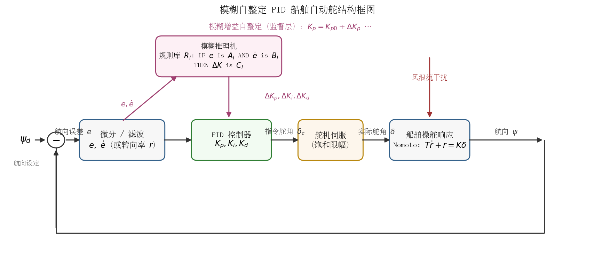
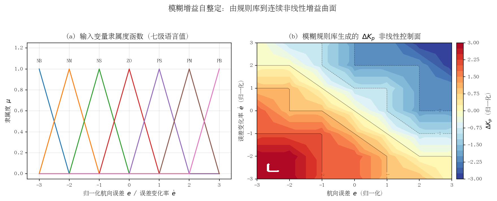

## 模糊自适应控制自动舵

### 算法原理

#### 模糊控制的基本结构

模糊控制（Fuzzy Logic Control, FLC）把操舵人员的经验知识表达为 IF–THEN 语言规则，通过"模糊化 → 规则推理 → 解模糊化"三步将传感器量映射为控制量，不需要精确的被控对象数学模型。船舶操舵回路中被控对象通常用一阶 Nomoto 模型近似：

$$T\dot{r} + r = K\delta, \qquad \frac{\psi(s)}{\delta(s)} = \frac{K}{s(Ts+1)}$$

其中 $\psi$ 为航向角，$r=\dot\psi$ 为转向率，$\delta$ 为舵角，$K$、$T$ 随船速、装载与海况显著变化——这正是引入模糊/自适应机制的动机。

船舶自动舵中模糊控制器有两种典型结构（[Roberts et al., 2003, *Mechatronics*](https://www.sciencedirect.com/science/article/abs/pii/S0957415803000448)）：

1. **直接型模糊 PD/PID**：以航向误差 $e=\psi_d-\psi$ 与误差变化率 $\dot e$（或转向率 $r$）为输入，规则库直接输出指令舵角 $\delta_c$。采用三角隶属度、max–min 推理与重心法解模糊时，其输入输出关系本质上是**变增益的非线性 PD**：在线性区内局部有 $\delta_c \approx k_1(e,\dot e)\,e + k_2(e,\dot e)\,\dot e$，增益随工作点连续变化。
2. **监督型模糊自整定 PID（增益自整定型）**：底层仍为常规 PID，模糊推理机作为监督层，根据 $e$、$\dot e$ 在线修正增益（[Tomera, 2017, TransNav](https://www.mdpi.com/2077-1312/13/5/851) 综述引文 33）：

$$K_p = K_{p0} + \Delta K_p(e,\dot e),\quad K_i = K_{i0} + \Delta K_i(e,\dot e),\quad K_d = K_{d0} + \Delta K_d(e,\dot e)$$

$$\delta_c = K_p e + K_i \int_0^t e\,\mathrm{d}\tau + K_d \dot e$$

#### 规则库如何根据航向误差与转向率调增益

输入变量一般取七级语言值 {NB, NM, NS, ZO, PS, PM, PB}，规则库是 $7\times7$ 的经验表，其设计直觉与人工操舵一致（[张学飞等, 2019,《中国舰船研究》](https://www.ship-research.com/article/cstr/32390.14.j.issn.1673-3185.01518)）：

- **误差大**（|e| 大）→ 增大 $K_p$ 加速回舵、取较小 $K_i$ 防止积分饱和；
- **误差与误差变化率同号**（误差在扩大）→ 增大 $K_p$、$K_d$ 抑制发散；
- **误差接近零且变化率大**（正在快速接近目标）→ 减小 $K_p$、增大 $K_d$ 提前"压舵"防超调；
- **小误差稳态段** → 增大 $K_i$ 消除风流造成的稳态偏差，同时压低 $K_p$ 避免波浪引起的舵机频繁动作。

规则表经推理与解模糊后生成一张连续的非线性增益曲面，如下图所示。这把"离散的查表式经验"变成了**全状态空间内平滑变化的增益律**——这是模糊调增益与人工分段调参的本质区别。

#### 模糊自适应：自组织模糊与模糊+自适应律

规则库本身依赖专家经验、一旦写好便固定不变，进一步的"自适应"沿两条路线发展：

1. **自组织模糊控制（SOC, Self-Organizing Fuzzy Control）**：源于 Procyk & Mamdani（1979）的自组织过程控制器，在基本模糊控制器之上加一个"性能评价—规则修正"层，根据响应偏离期望轨迹的程度在线修改规则结论（后件），使规则库在运行中自我完善。Sutton 等人将该思想用于船舶自动舵，并用人工神经网络离线/在线整定模糊控制器参数（[Sutton, Roberts & Taylor, 1997, *Trans. Inst. Measurement and Control* 19(2)](https://link.springer.com/article/10.1007/s40815-020-00880-3) 参考文献 4）。
2. **模糊 + 自适应律（间接/直接自适应模糊）**：用模糊逻辑系统逼近船舶模型中的未知非线性项 $f(\cdot)$，即 $\hat f = \theta^{T}\xi(x)$，并以 Lyapunov 方法推导参数自适应律

$$\dot\theta = -\gamma\, e^{T}Pb\,\xi(x)$$

在理论上保证闭环一致最终有界（UUB）。代表性工作为杨益生等提出的模型参考自适应鲁棒模糊自动舵（[Yang, Zhou & Ren, 2003, *Applied Soft Computing* 3(4): 305–316](https://link.springer.com/article/10.1007/s40815-024-01835-8) 参考文献 9），以及小增益定理框架下的自适应模糊鲁棒跟踪控制（[Yang & Ren, 2003, *IEEE Trans. Fuzzy Systems* 11(6): 783–795](https://www.mdpi.com/2077-1312/9/8/828) 参考文献 4）。这类方案把"模糊逼近器"与"严格稳定性证明"结合起来，弥补了纯经验模糊控制缺乏稳定性理论的短板。
3. **神经模糊（ANFIS）**：用神经网络的学习能力自动辨识隶属度函数与规则参数，兼顾模糊系统的可解释性与神经网络的自学习。Pham（2023）针对扰动环境设计了 ANFIS 自动舵并做了仿真验证（[Pham, 2023, *JMSE* 11(7): 1262](https://www.mdpi.com/2077-1312/11/7/1262)）；Sutton/Roberts 团队更早将 ANN 用于模糊自动舵整定（[Roberts et al., 2003](https://www.sciencedirect.com/science/article/abs/pii/S0957415803000448)）。

### 在船舶自动舵中的典型应用与代表性工作

模糊控制是最早进入船舶自动舵的智能控制方法，发展脉络清晰：

| 年代 | 作者/团队 | 工作与验证平台 |
|---|---|---|
| 1977 | van Amerongen, van Nauta Lemke, van der Veen（荷兰 Delft） | **第一篇模糊船舶自动舵论文**《An autopilot for ships designed with fuzzy sets》，IFAC/IFIP 会议，仿真验证（[EOLSS 文献注](https://www.eolss.net/sample-chapters/c18/E6-43-36-03.pdf)、[van Amerongen 出版物列表](https://afscheid.vanamerongen.org/publicaties/)） |
| 1993 | Layne & Passino（美国 Ohio State） | 模糊模型参考学习控制（FMRLC）用于货船转向，"学习层+模糊控制层"结构，含舵机饱和与传感器噪声的仿真（[Roberts et al., 2003 综述](https://www.sciencedirect.com/science/article/abs/pii/S0957415803000448)） |
| 1997 | Sutton, Roberts, Taylor（英国 Plymouth） | 用 ANN 整定模糊自动舵，实船缩比模型试验 |
| 2003 | Yang, Zhou & Ren（中国大连海事大学） | 模型参考自适应鲁棒模糊自动舵，针对不确定非线性船舶模型给出 Lyapunov 稳定性证明与仿真 |
| 2006 | Cheng, Yi & Zhao | 航迹点跟踪模糊自动舵，欠驱动船舶仿真（[WCCI 2006 论文](http://congres.cran.univ-lorraine.fr/2006/WCCI_2006/data/pdffiles/papers/0357.pdf)） |
| 2017 | Tomera（波兰 Gdynia 海事大学） | 模糊自整定 PID 自动舵，仿真后在 **"Blue Lady" 训练船**（Iława 船舶操纵研究训练中心）上做了实船试验，验证实环境下航向与航迹控制性能（[TransNav 2017](https://www.mdpi.com/2077-1312/13/5/851) 综述引文 33；[Blue Lady 实船试验报道](https://pdfs.semanticscholar.org/caa2/a32a0db292765a6264fa15c889ad326f35f1.pdf)） |
| 2019 | 张学飞等（中国海洋大学） | 三自由度响应型 Nomoto 模型 + 模糊自整定 PID 无人帆船航向控制，不同航速与随机干扰下 Simulink 仿真，超调与抗扰性能优于常规 PID（[《中国舰船研究》14(6)](https://www.ship-research.com/article/cstr/32390.14.j.issn.1673-3185.01518)） |
| 2023 | Pham et al. | 扰动环境下的 ANFIS 自动舵，仿真验证（[JMSE 11(7): 1262](https://www.mdpi.com/2077-1312/11/7/1262)） |

总体看，模糊/模糊自适应方案的**仿真验证非常充分**，实船验证相对少但有标志性案例（Tomera 的 Blue Lady 实船试验）；已有综述指出该类方法相对常规 PID 在超调量、调节时间与参数摄动鲁棒性上普遍有改善（[MDPI 船舶自动舵技术综述, 2025](https://www.mdpi.com/2077-1312/13/5/851)）。

### 与增益调度的关系

模糊自整定 PID 与增益调度（Gain Scheduling）在本质上是**同一思想——"按工况变增益"——的两种实现**：

- **增益调度**是离散实现：把工况空间（海况 × 船速 × 装载）划分为若干区域，每个区域离线整定一组 PID 增益，运行时按调度变量（scheduling variable）查表/插值切换。优点是结构透明、可逐区验证、易通过船级社审查；缺点是区域边界处增益跳变需插值平滑，且调度变量必须可测量、可预知。
- **模糊自整定**是连续实现：规则库+隶属度函数把上述"分区表"内嵌为连续曲面，输入直接就是回路内部信号（$e$、$\dot e$），无需显式的工况识别，天然完成插值与平滑过渡。可以说**模糊推理机就是一个可微、可插值的增益调度器**。
- 互补点：增益调度按"外部环境工况"（船速、海况）前馈式调增益，模糊监督按"回路瞬态行为"（误差动态）反馈式调增益。二者正交，可叠加使用——例如以船速/海况调度给出基线增益 $K_{p0}$，再由模糊层在其上做 $\pm\Delta K$ 的瞬态修正。

### 工程优缺点

**优点**

- 不依赖精确模型：规则来自操舵经验，对 Nomoto $K$、$T$ 的大范围摄动（船速、装载变化）有天然鲁棒性；
- 实现成本低：$7\times7$ 规则表推理在 PLC/单片机上可实时运行，Tomera 已在 PLC 上实现并实船验证（[Polish Maritime Research, 2012](http://www.bg.pg.gda.pl/pmr/pdf/PMRes_2012_special1.pdf)）；
- 可解释、可审计：每条规则对应明确的操舵直觉，便于工程审查与渐进式改进；
- 与 PID 无缝兼容：监督型结构保留 PID 底层，可回退、可逐层启用。

**缺点**

- 纯经验模糊控制**缺乏系统性设计方法与稳定性证明**，规则库整定（隶属度参数、比例因子）仍靠试凑；
- 自适应模糊（Yang & Ren 类）虽有 Lyapunov 保证，但结构复杂、计算量增加，且逼近误差需鲁棒项补偿，工程落地案例少；
- 规则与隶属度若针对平静海况整定，**高海况下波浪高频分量会经 $\dot e$ 通道放大为频繁操舵**——必须配合波浪滤波（限波器/卡尔曼滤波）使用，否则加剧舵机磨损；
- 性能上限受规则表分辨率约束，难以表达"按预测行为操舵"这类需要模型的策略。

### 对本项目（PD + 增益调度 + ESC 在线调参）的借鉴点

1. **增益调度表的"模糊化"平滑**：本项目按海况 0–3 级 × 船速段做离散增益调度，可用模糊隶属度函数替代硬分区边界，使增益在海况/船速连续变化时平滑过渡，消除分区切换瞬态；规则表即可由现有调度表直接转化，改动量小、行为可预期。
2. **瞬态增益修正层**：在 ESC 辨识给出的极点配置基线增益之上，叠加一个以 $(e, \dot e)$ 为输入的小幅值模糊修正项 $\Delta K$，在大改向机动时临时提高微分作用抑制超调，在航向保持段压低增益减少操舵次数——与 ESC 的慢自适应形成"快/慢两层"。
3. **波浪滤波与模糊监督的协同**：模糊监督层以 $\dot e$ 为输入，对波浪高频噪声敏感；本项目已有的滤波环节应放在模糊层之前，或改用滤波后的转向率 $r$ 作为输入，避免 3 级海况下增益被波浪调制而频繁抖动。
4. **作为 ESC 失效时的降级方案**：模糊规则库存储的是专家经验增益律，在辨识激励不足或参数发散时可作为安全的回退控制律，提升系统整体容错性。

### 参考资料

1. van Amerongen J., van Nauta Lemke H.R., van der Veen J.C.T. *An autopilot for ships designed with fuzzy sets*. Proc. 5th IFAC/IFIP Conf. on Digital Computer Applications to Process Control, The Hague, 1977. 文献注：[EOLSS](https://www.eolss.net/sample-chapters/c18/E6-43-36-03.pdf)；[作者出版物列表](https://afscheid.vanamerongen.org/publicaties/)
2. Roberts G.N., Sutton R., Zirilli A., Tiano A. *Intelligent ship autopilots — A historical perspective*. Mechatronics, 13(10): 1091–1103, 2003. https://www.sciencedirect.com/science/article/abs/pii/S0957415803000448
3. Yang Y., Zhou C., Ren J. *Model reference adaptive robust fuzzy control for ship steering autopilot with uncertain nonlinear systems*. Applied Soft Computing, 3(4): 305–316, 2003. DOI: 10.1016/j.asoc.2003.05.001（引文见 [Springer](https://link.springer.com/article/10.1007/s40815-024-01835-8)）
4. Yang Y., Ren J. *Adaptive fuzzy robust tracking controller design via small gain approach and its application*. IEEE Trans. Fuzzy Systems, 11(6): 783–795, 2003.（引文见 [JMSE 9(8):828](https://www.mdpi.com/2077-1312/9/8/828)）
5. Sutton R., Roberts G.N., Taylor S.D. *Tuning fuzzy ship autopilots using artificial neural networks*. Trans. Inst. Measurement and Control, 19(2): 94–106, 1997.（引文见 [Springer](https://link.springer.com/article/10.1007/s40815-020-00880-3)）
6. Tomera M. *Fuzzy Self-Tuning PID Controller for a Ship Autopilot*. TransNav 2017, Gdynia.（引文见 [MDPI JMSE 13(5):851 综述](https://www.mdpi.com/2077-1312/13/5/851)）
7. Tomera M. 等. Blue Lady 训练船实船控制试验. [Waypoint Path Controller for Ships（含实船试验说明）](https://pdfs.semanticscholar.org/caa2/a32a0db292765a6264fa15c889ad326f35f1.pdf)；[Polish Maritime Research 2012](http://www.bg.pg.gda.pl/pmr/pdf/PMRes_2012_special1.pdf)
8. 张学飞, 袁鹏, 田军哲 等. 基于模糊PID的无人帆船航向控制方法. 《中国舰船研究》, 14(6), 2019. https://www.ship-research.com/article/cstr/32390.14.j.issn.1673-3185.01518
9. Pham D.A. et al. *Designing a Ship Autopilot System for Operation in a Disturbed Environment Using the Adaptive Neural Fuzzy Inference System*. JMSE, 11(7): 1262, 2023. https://www.mdpi.com/2077-1312/11/7/1262
10. Cheng J., Yi J., Zhao D. *A New Fuzzy Autopilot for Way-point Tracking Control of Underactuated Ships*. WCCI 2006. http://congres.cran.univ-lorraine.fr/2006/WCCI_2006/data/pdffiles/papers/0357.pdf
11. *A Comprehensive Review of Ship Automatic Rudder Technology: Development, Challenges, and Prospects*. JMSE, 13(5): 851, 2025. https://www.mdpi.com/2077-1312/13/5/851
12. Fossen T.I. *Handbook of Marine Craft Hydrodynamics and Motion Control*. Wiley, 2011.（引文见 [Springer 章节](https://link.springer.com/chapter/10.1007/978-981-16-5912-6_55)）
