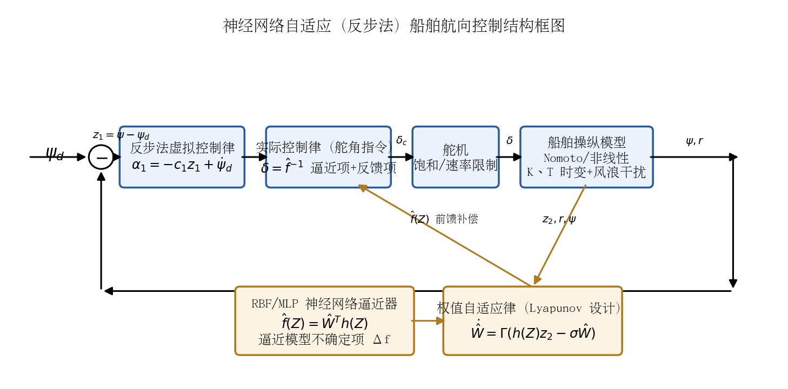
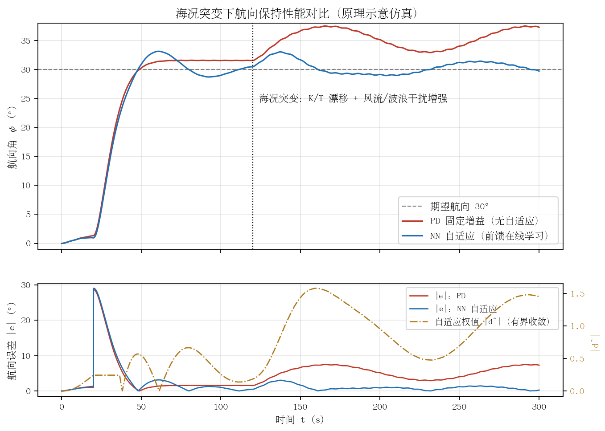

## 神经网络自适应控制自动舵

### 动机与基本思想

船舶航向控制的经典模型——一阶/二阶 Nomoto 模型 $T\ddot{\psi}+\dot{\psi}=K\delta$（或 $T\dot{r}+r=K\delta$）——中的回转性指数 $K$ 与追随性指数 $T$ 并非常数：它们随航速、吃水/装载、水深变化，且受风浪流干扰作用而显著漂移；实际水动力还存在 $\alpha r^3$ 型非线性项与舵机饱和、速率限制、间隙等非光滑环节。固定增益 PID/PD 难以覆盖全部工况，而查表式增益调度只能覆盖预先枚举的工况点，工况表之外的组合（如"低航速 + 高海况 + 浅吃水"）仍是盲区。神经网络（NN）自适应控制的核心思想是：**利用神经网络的万能逼近能力，在线逼近模型中的未知非线性函数或等效干扰，再由 Lyapunov 方法同步设计控制律与权值自适应律，保证闭环信号一致最终有界（UUB）**。这一理论体系由 Ge S. S. 等人在《Stable Adaptive Neural Network Control》（Kluwer, 2001）中系统化（[参考文献](http://jase.tku.edu.tw/articles/jase-201706-20-2-03.pdf) 引述），并被大量移植到船舶航向/航迹控制中。

### 三类主流结构

#### （1）NN 自适应逆控制

直接逆控制的思路是训练一个神经网络逼近船舶操纵逆动力学 $\delta = f^{-1}(\psi, \dot{\psi}, \ddot{\psi}_{d})$，将其与参考模型串联，使"NN 逆模型 × 船舶正模型"近似为单位环节，输出即复现参考航向轨迹。权值训练通常采用**特化学习（specialized learning）**：以航向误差经船舶雅可比（或其符号/近似模型）反传更新权值，从而避免对精确逆模型的离线辨识。代表性工作是英国格拉斯哥大学 Unar 与 Murray-Smith 的前馈神经网络船舶自动舵（*Int. J. Adaptive Control & Signal Processing*, 1999, 13(4): 203–218，DOI: 10.1002/(SICI)1099-1115(199906)13:4<203::AID-ACS544>3.0.CO;2-T，[引文出处](http://jase.tku.edu.tw/articles/jase-201706-20-2-03.pdf)）；同一时期 Burns 提出人工神经网络自动舵并做了仿真验证（[参考文献引述](https://arxiv.org/pdf/2204.00757v1)）。土耳其学者 Alarçin 进一步将 NN 嵌入**内模控制（IMC）**结构：NN 正模型与 NN 逆模型并联构成内模回路，提升了逆控制在模型失配下的鲁棒性（[J. Marine Science and Technology (NTOU), 2007](https://jmstt.ntou.edu.tw/cgi/viewcontent.cgi?article=2042&context=journal)）。近年还有将训练好的自适应神经模糊逆模型与分数阶 $PI^\lambda D^\mu$ 并联作为逆控制器的方案（[Li et al., Applied Sciences, 2022](https://www.mdpi.com/2076-3417/12/11/5604)）。

NN 逆控制结构简单、直观，但**逆模型在舵机饱和区不可导、在非最小相位/强干扰下训练可能发散**，闭环稳定性通常无法用严格 Lyapunov 方法证明，工程上多依赖离线训练 + 在线微调（fine-tuning）的保守策略。

#### （2）NN + 自适应反步法（adaptive backstepping with NN）

这是当前文献中最主流、稳定性证明最完备的一条路线。考虑带未知非线性项的 Norrbin/Nomoto 型模型：

$$T\ddot{\psi} + \dot{\psi} + \alpha \dot{\psi}^3 = K\delta + d(t)$$

定义航向误差面 $z_1 = \psi - \psi_d$，第一步反步取虚拟控制律

$$\alpha_1 = -c_1 z_1 + \dot{\psi}_d, \qquad z_2 = \dot{\psi} - \alpha_1$$

第二步中，系统不确定项（含未知水动力函数、$K/T$ 漂移引起的系数摄动与风浪等效干扰的集总项）$\Delta f(Z)$ 由 RBF 神经网络在线逼近：

$$\Delta f(Z) = W^{*\mathsf{T}} h(Z) + \varepsilon, \qquad \hat{f}(Z) = \hat{W}^{\mathsf{T}} h(Z)$$

其中 $h(Z)$ 为高斯基函数向量，$Z=[\psi, \dot{\psi}, \delta]^{\mathsf{T}}$ 为网络输入，$\varepsilon$ 为有界逼近误差。实际控制律取

$$\delta = \frac{1}{\hat{g}}\left(-\hat{f}(Z) - c_2 z_2 - z_1 + \dot{\alpha}_1\right)$$

权值自适应律由 Lyapunov 函数 $V=\frac{1}{2}z_1^2+\frac{1}{2}z_2^2+\frac{1}{2}\tilde{W}^{\mathsf{T}}\Gamma^{-1}\tilde{W}$ 反演得到，并加 $\sigma$-修正（泄漏项）防止权值漂移：

$$\dot{\hat{W}} = \Gamma\left(h(Z)\,z_2 - \sigma \hat{W}\right)$$

可证 $\dot{V} \le -c V + \mu$，即闭环所有信号一致最终有界，稳态误差可通过增大 $c_i$、减小 $\sigma$ 任意调小。为避免反步法对虚拟控制律反复求导引起的"微分爆炸"，李铁山、杜佳璐（大连海事大学）等引入**动态面控制（DSC）**：用一阶低通滤波器替代对 $\alpha_1$ 的解析求导，配合 MLP 网络逼近不确定性，大幅降低了控制律复杂度并利于实船实现（苗保彬、李铁山等，《[基于 DSC 和 MLP 的船舶航向跟踪控制](https://xb.dlmu.edu.cn/CN/Y2013/V39/I4/5)》，大连海事大学学报，2013）。刘洋、郭晨给出 RBF 网络自适应航向保持的完整非线性设计（《[船舶航向保持 RBF 神经网络自适应非线性控制](https://xb.dlmu.edu.cn/CN/Y2013/V39/I4/1)》，大连海事大学学报，2013）；Zhu、Du、Kao 进一步处理了输入饱和与输出约束下的鲁棒自适应 NN 航迹跟踪（[J. Franklin Institute, 2020, 357(13): 8591–8610](http://www.maritimejournal.cn/data/article/shhsdxxb/preview/pdf/20240203.pdf) 引述）。

#### （3）NN 观测器 / 逼近器处理不可测状态与时变海况

实船上转首角速度 $r$ 常无独立传感器或噪声很大，北京理工大学学报报道的**基于神经网络的自适应输出反馈航向控制**用 NN 逼近未知动态、以观测器重构 $r$，仅用航向角量测即实现跟踪，并给出 Lyapunov 稳定性证明（《[基于自适应输出反馈的船舶航向控制](https://journal.bit.edu.cn/zr/cn/article/pdf/preview/20110412.pdf)》，2011）。另一条路线是**神经网络扰动观测器（NDOB）**：用 NN 在线估计风浪流集总扰动并在控制律中前馈抵消，如基于 NN 扰动观测器的舵减摇/航向动态逆控制（[J. Marine Science and Technology, 2025](https://link.springer.com/article/10.1007/s00773-025-01099-3)）。此类"观测器 + 前馈"结构与工程上常用的扩张状态观测器（ESO）思路一致，对**时变海况**尤为关键：海况变化本质上表现为 $K/T$ 漂移与扰动谱变化，NN 逼近器将其作为"未知函数"在线学习，无需显式的海况分级与工况表。

### 代表性工作与人物谱系

- **van Amerongen（1982/1984，Delft）**：模型参考自适应舵（MRAS）奠基之作，*Automatica*, 20(1): 3–14（[DOI 引述](http://jase.tku.edu.tw/articles/jase-201706-20-2-03.pdf)），是 NN 自适应舵的前身。
- **杨盐生（1994，大连海事大学）**：国内最早的"神经网络自适应船舶自动操纵"工作之一（[文献引述](http://jase.tku.edu.tw/articles/jase-201706-20-2-03.pdf)）。
- **Tzeng（曾庆尧，台湾海洋大学，1990s–2000s）**：反馈线性化舵、NN/模糊/H∞ 混合航向控制系列工作，多次在实船与仿真中验证（如 [JMSTT 内模控制文献](https://jmstt.ntou.edu.tw/cgi/viewcontent.cgi?article=2042&context=journal)引述其工作）。
- **张显库（大连海事大学）**：以闭环增益成形算法（CGSA）、Lyapunov 直接法非线性航向保持著称（《基于 Lyapunov 稳定性的船舶航向保持非线性控制》，西南交通大学学报，2010，[引文出处](https://xb.dlmu.edu.cn/CN/Y2013/V39/I4/1)），并出版教材《船舶运动控制》（国防工业出版社，2006）；其团队（邓雅洁等）将事件触发 + 模糊/NN 用于欠驱动船航迹跟踪（[Ocean Engineering, 2019, 186: 106122](http://www.maritimejournal.cn/data/article/shhsdxxb/preview/pdf/20240203.pdf) 引述）。
- **李铁山、杜佳璐、郭晨、卜仁祥等（大连海事大学）**：DSC+MLP、RBF 自适应反步、迭代滑模等系列，构成国内 NN 反步自动舵的主要谱系（[大连海事大学学报 2013(4)](https://xb.dlmu.edu.cn/CN/Y2013/V39/I4/5)）。
- **Le T. T.（2021）**：基于神经网络的船舶航向控制系统，*J. Marine Science and Technology*, 26: 963–972（[Springer](https://link.springer.com/article/10.1007/s00773-020-00783-w)），综述了 NN 舵的近期进展。

### 稳定性证明思路（工程视角摘要）

NN 自适应反步法的证明套路固定，工程上可直接复用：

1. 构造误差面 $z_1, z_2$ 与 NN 权值误差 $\tilde{W} = \hat{W} - W^{*}$；
2. 取候选 Lyapunov 函数 $V=\frac{1}{2}z_1^2+\frac{1}{2}z_2^2+\frac{1}{2}\tilde{W}^{\mathsf{T}}\Gamma^{-1}\tilde{W}$；
3. 将自适应律设计为恰好对消 $\dot{V}$ 中含 $\tilde{W}$ 的项，剩余项用杨氏不等式放缩；
4. 得 $\dot{V}\le -cV+\mu$，即 **UUB**：跟踪误差收敛到以 $\sqrt{2\mu}$ 为半径的邻域，半径由逼近误差 $\varepsilon$、扰动上界与泄漏系数 $\sigma$ 决定。

需要注意，该结论保证的是"有界"而非"渐近收敛"，且**持续激励（PE）条件不满足时权值只保证有界、不保证收敛到真值**——这正是工程上必须加 $\sigma$-修正、死区或投影算子的原因。

### 工程优缺点

**优点**

- 不依赖精确的 $K/T$ 先验值，能在线消化海况、航速、装载引起的模型漂移，理论上无需维护庞大的增益调度表；
- 反步/DSC 框架下稳定性可证（UUB），且 DSC 结构简单、可在普通嵌入式 MCU/DSP 上实现；
- NN 观测器/扰动观测器可减少对转首角速度传感器的依赖，并同时抑制慢变干扰（风流压差）与模型失配；
- 与现有 PD 回路天然兼容：NN 输出可作为前馈补偿项叠加在原 PD 舵角指令上，便于渐进式改造。

**缺点与落地难点**

- **瞬态风险**：上电初期权值未收敛，NN 输出可能产生较大错误前馈，需要权值限幅（投影算子）、输出限幅与"先 PD 后叠加"的软启动策略；
- **激励不足时学到错误模型**：船舶长时间直航时输入信号贫乏（不满足 PE），NN 可能把波浪高频分量或传感器偏置学进权值，需死区（误差小时冻结学习）+ 泄漏项；
- **验证与取证难**：NN 权值时变使传统频域裕度分析失效，船级社/IMO 对"学习型控制器"尚无成熟认证路径，工程上普遍采用"NN 仅作补偿、基础回路仍为可证明稳定的 PD/PID"的保底架构；
- **超参数敏感**：基函数中心/宽度、学习率 $\Gamma$、泄漏 $\sigma$ 需要针对船型整定，调参负担从"整定 PID 增益"转移为"整定 NN 超参数"，并不消失；
- **计算与实时性**：RBF 网络在低配单片机上可行，但大规模 MLP 的在线训练在资源受限舵机控制器上仍需谨慎评估。

### 与本项目（PD + 增益调度 + ESC 在线调参）的关联与借鉴

本项目当前方案为 PD + 海况/航速二维增益调度 + ESC 在线辨识 Nomoto $K/T$ 并极点配置。NN 自适应路线可在三个层面提供借鉴：

1. **ESC 的函数逼近升级**：ESC 目前辨识的是标量参数 $(K, T)$，隐含"Nomoto 结构正确"的假设。RBF 网络可看作 ESC 的推广——把"激励—响应"搜索目标从两个参数扩展为未知函数 $\Delta f(Z)$，从而吸收 Nomoto 模型未建模的非线性（如 $\alpha r^3$ 项、舵效非线性）。文献中的 NN 逼近器可直接替换/补充 ESC 的辨识环节。
2. **增益调度表的替代或兜底**：在调度表工况点之间，可用小型 RBF 网络（输入：航速、估计海况、转首角速度）插值/外推 PD 增益，减少表格维数灾难；调度表则作为 NN 失效时的保底。
3. **工程化经验的直接移植**：NN 文献中的软启动、权值投影、学习死区、$\sigma$-泄漏等措施，同样适用于本项目 ESC 调参的稳健化（ESC 也存在扰动幅值/频率整定与收敛性问题）；而本项目 ESC"只动两个物理参数、可解释性强"的优点，恰是 NN 方案取证困难的对照——推荐的落地形态是 **PD 基础回路 + ESC 参数级自适应 +（可选）NN 前馈补偿**的分层架构，而非端到端 NN 控制。

下图给出原理示意仿真：海况突增（$K/T$ 漂移 + 风流/波浪干扰增强，$t=120\,\mathrm{s}$）后，固定增益 PD 因慢变干扰产生约 5–7° 的持续航向偏差，而带在线学习前馈的自适应方案经短暂学习后把误差压回 1° 量级，且自适应权值保持有界收敛——这正是 NN/自适应前馈相对纯 PD 的核心价值区间。

### 参考资料

1. Unar M. A., Murray-Smith D. J. Automatic steering of ships using neural networks. *Int. J. Adaptive Control & Signal Processing*, 1999, 13(4): 203–218.（引文页：[JASE 期刊 PDF](http://jase.tku.edu.tw/articles/jase-201706-20-2-03.pdf)）
2. van Amerongen J. Adaptive steering of ships — a model reference approach. *Automatica*, 1984, 20(1): 3–14.（引文页：同上 [JASE PDF](http://jase.tku.edu.tw/articles/jase-201706-20-2-03.pdf)）
3. Burns R. S. 等早期 ANN 自动舵工作综述引文：[A neural network based heading and position control system of a ship, arXiv:2204.00757](https://arxiv.org/pdf/2204.00757v1)
4. 苗保彬, 李铁山, 罗伟林, 等. 基于 DSC 和 MLP 的船舶航向跟踪控制. 大连海事大学学报, 2013, 39(4): 5–8. https://xb.dlmu.edu.cn/CN/Y2013/V39/I4/5
5. 刘洋, 郭晨. 船舶航向保持 RBF 神经网络自适应非线性控制. 大连海事大学学报, 2013, 39(4): 1–4. https://xb.dlmu.edu.cn/CN/Y2013/V39/I4/1
6. 张显库. 基于 Lyapunov 稳定性的船舶航向保持非线性控制. 西南交通大学学报, 2010, 45(1): 140–143.（引文页：同上 [大连海事大学学报](https://xb.dlmu.edu.cn/CN/Y2013/V39/I4/1)）
7. 基于自适应输出反馈的船舶航向控制. 北京理工大学学报, 2011. https://journal.bit.edu.cn/zr/cn/article/pdf/preview/20110412.pdf
8. Le T. T. Ship heading control system using neural network. *J. Marine Science and Technology*, 2021, 26: 963–972. https://link.springer.com/article/10.1007/s00773-020-00783-w
9. Alarçin F. Internal model control using neural network for ship steering. *J. Marine Science and Technology (NTOU)*, 2007. https://jmstt.ntou.edu.tw/cgi/viewcontent.cgi?article=2042&context=journal
10. Zhu G. B., Du J. L., Kao Y. G. Robust adaptive neural trajectory tracking control of surface vessels under input and output constraints. *J. Franklin Institute*, 2020, 357(13): 8591–8610.（引文页：[上海海事大学学报 PDF](http://www.maritimejournal.cn/data/article/shhsdxxb/preview/pdf/20240203.pdf)）
11. Dynamic inverse control of ship rudder roll/yaw stabilization based on neural network disturbance observer. *J. Marine Science and Technology*, 2025. https://link.springer.com/article/10.1007/s00773-025-01099-3
12. Li G. et al. Fractional-order PIλDμ controller using adaptive neural fuzzy model for course control of underactuated ships. *Applied Sciences*, 2022, 12(11): 5604. https://www.mdpi.com/2076-3417/12/11/5604
