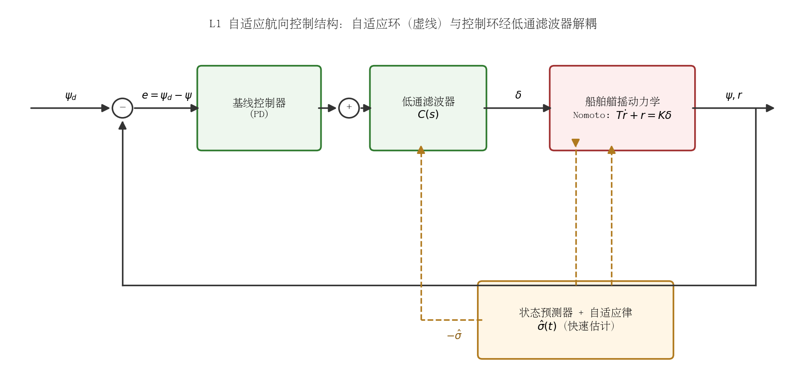
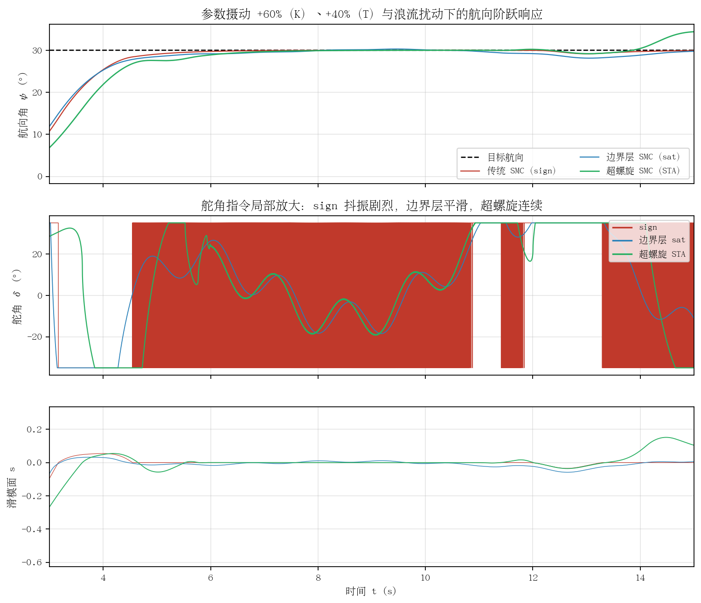
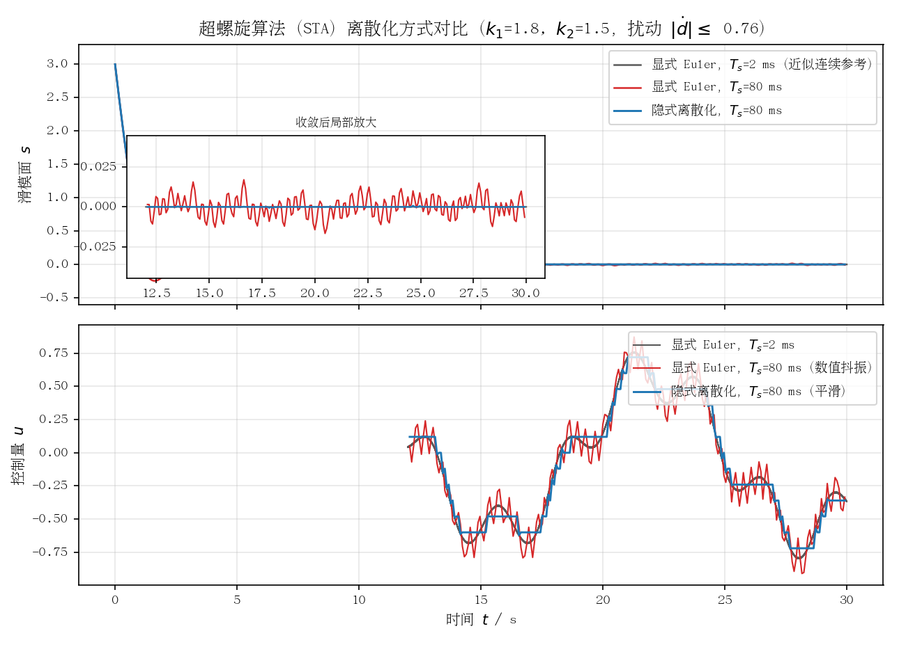

## 鲁棒自适应控制：L1 自适应与自适应滑模

本节调研两类"鲁棒自适应"控制思路在船舶航向/航迹控制中的应用：L1 自适应控制（L1 Adaptive Control, L1AC）与自适应滑模控制（Adaptive Sliding Mode Control, ASMC）。二者的共同点是**不依赖精确的在线参数辨识收敛**，而是通过结构性机制（低通滤波解耦 / 滑模不变性）在保证鲁棒性的前提下实现快速适应，正好切中传统 MRAC 与增益调度"适应快则鲁棒性差、鲁棒强则适应慢"的矛盾。

### 1. L1 自适应控制：原理与结构

#### 1.1 核心思想

L1 自适应控制由 Cao 与 Hovakimyan 于 2006 年提出（[ACC 2006 Part I](https://arxiv.org/html/2307.04030v1) 参考文献 [36]；系统理论见专著 [Hovakimyan & Cao, *L1 Adaptive Control Theory: Guaranteed Robustness with Fast Adaptation*, SIAM, 2010](https://www.mdpi.com/1996-1073/15/10/3602) 参考文献 [9]）。其关键洞察是：传统 MRAC 中提高自适应增益会同时把高频估计噪声注入控制通道，破坏鲁棒性；L1AC 在控制律中串入一个**低通滤波器 $C(s)$**，将"估计环"与"控制环"解耦——自适应增益可以取得任意大（仅受硬件计算速度限制）以实现快速估计，而控制信号带宽始终被 $C(s)$ 限制在执行机构可承受的范围内，鲁棒性由滤波器带宽保证（[NASA L1 技术报告](https://www.nasa.gov/wp-content/uploads/2019/10/moore_2013_phi_eternalflight_-_tagged.pdf)；[三菱重工技术综述](https://www.mhi.com/technology/review/sites/g/files/jwhtju2326/files/tr/pdf/e611/e611190.pdf)）。

#### 1.2 基本结构（以船舶艏摇为例）

考虑带匹配不确定性的艏摇通道（一阶 Nomoto 模型的状态空间形式）：

$$
\dot{x}(t) = A_m x(t) + b\big(\omega\, u(t) + \sigma(t, x)\big), \qquad x = [\psi,\ r]^\top
$$

其中 $A_m$ 为期望（参考）闭环动态，$\omega$ 为舵效增益不确定性（对应 $K$ 的摄动），$\sigma(t,x)$ 汇聚参数摄动与风浪流等效扰动。L1AC 由三部分组成：

1. **状态预测器**：
$$
\dot{\hat{x}}(t) = A_m \hat{x}(t) + b\big(\hat{\omega}(t) u(t) + \hat{\sigma}(t)\big), \qquad \hat{x}(0)=x(0)
$$

2. **自适应律**（分段常数律，按采样周期 $T_s$ 更新）：
$$
\hat{\sigma}(t) = -\Phi^{-1}(T_s)\, e^{A_m T_s}\, \tilde{x}(iT_s), \qquad \tilde{x} = \hat{x} - x
$$
也可用投影算子律 $\dot{\hat{\sigma}} = \Gamma\,\mathrm{Proj}(\hat{\sigma}, -\tilde{x}^\top P b)$，自适应增益 $\Gamma$ 可取得很大而不损伤鲁棒性。

3. **低通滤波控制律**：
$$
u(s) = -k\,D(s)\,\big(\hat{\omega}(s)u(s) + \hat{\sigma}(s) - k_g r(s)\big)\ \text{经}\ C(s)\ \text{限带}
$$
稳定性由 **L1 范数条件**保证：$\|G(s)\|_{\mathcal{L}_1} L < 1$，其中 $G(s)$ 为含滤波器的开环传函，$L$ 为不确定性 $\sigma$ 的 Lipschitz 常数界。该条件同时给出可量化的鲁棒裕度（时延裕度、增益裕度有闭式下界，见 [Cao & Hovakimyan, Stability Margins of L1 Adaptive Controller, ACC 2007](https://arxiv.org/html/2307.04030v1) 参考文献 [35]）。

*图 6-1 L1 自适应航向控制结构：状态预测器+自适应律（虚线）快速估计集总不确定性 $\hat\sigma$，补偿信号经低通滤波器 $C(s)$ 限带后叠加在基线 PD 控制输出上，实现适应性与鲁棒性的解耦。*

#### 1.3 在船舶控制中的代表性工作

| 工作 | 对象 | 要点 |
|---|---|---|
| [Xu, Oliveira & Guedes Soares (2021), *European Journal of Control* 58:357–372](https://www.sciencedirect.com/science/article/abs/pii/S0947358020300261) | 欠驱动水面船路径跟随 | L1 自适应 + 反步（backstepping）复合结构，利用"估计与控制解耦"特性处理海洋扰动与模型不确定性，被引 65 次（Semantic Scholar 统计，截至 2026-08-12），是船舶领域 L1AC 的代表作 |
| [Maruf et al. (2021), *IOP Conf. Ser.: Earth Environ. Sci.* 649, 012055](https://iopscience.iop.org/article/10.1088/1755-1315/649/1/012055) | 无人水面艇（USV） | 针对 USV 的 L1 自适应控制器，验证了"快速自适应而不失鲁棒性"，控制律中嵌入低通滤波器 |
| [三菱重工技术综述 Vol.61 No.1 (2024)](https://www.mhi.com/technology/review/sites/g/files/jwhtju2326/files/tr/pdf/e611/e611190.pdf) | AUV 姿态控制（纵摇/横摇/艏摇） | 将 L1 自适应控制器**前置挂接在既有 PID 姿态控制器之前**，即"增广（augmentation）"式改造，不推翻原有控制律——对工程升级极具参考价值；已用 6 自由度非线性模型 + ISSC 不规则波谱完成仿真验证（4 kn、近水面、有义波高 3.72 m 工况下纵摇/横摇/艏摇振荡峰值分别削减 41%/32%/46%），尚为仿真阶段结果 |
| [自适应 Nomoto 模型路径跟随（*J. Mar. Sci. Technol.*, 2018）](https://link.springer.com/article/10.1007/s00773-017-0518-y) | 船舶路径跟随 | 制导/控制子系统解耦，自适应 Nomoto 模型 + L1AC 在线辨识系统不确定性 |

此外，L1AC 在航空领域已有 NASA AirSTAR 飞行试验、Calspan Learjet 变稳机等实飞验证（见 [Xu et al. 2021 引文](https://ouci.dntb.gov.ua/en/works/42ORVoel/) 参考文献 [15]），工程成熟度在自适应控制家族中最高；eVTOL、无人直升机等文献也强调其"免去繁复增益调度"的优点（[MDPI Drones, 2024](https://www.mdpi.com/2504-446X/8/11/649/xml)；[MDPI Symmetry, 2021](https://www.mdpi.com/2073-8994/13/11/2125)）。

#### 1.4 L1 范数鲁棒条件的直观解释

稳定性条件 $\|G(s)\|_{\mathcal{L}_1} L < 1$ 初看抽象，其实质是一条**小增益定理（small-gain theorem）回路增益约束**，可以用三句话建立直觉：

1. **$\mathcal{L}_1$ 范数是什么**：对 LTI 系统 $G(s)$，$\|G\|_{\mathcal{L}_1} = \int_0^\infty |g(\tau)|\,d\tau$（$g$ 为脉冲响应），它恰好等于该系统对任意有界输入的诱导 $\mathcal{L}_\infty$ 增益——即"最坏情况下输出幅值是输入幅值的多少倍"，且这一界对任意波形（不限于正弦）都成立，这正是它比 $H_\infty$ 范数更适合处理"波形未知的不确定性信号"的原因（[Hovakimyan & Cao 专著，SIAM 2010](https://epubs.siam.org/doi/book/10.1137/1.9780898719367)）。
2. **回路里有两个"增益"相乘**：不确定性 $\sigma(t,x)$ 依赖状态 $x$，其 Lipschitz 常数 $L$ 是"$x$ 变化一个单位、$\sigma$ 最多变化 $L$ 个单位"的增益；而 $G(s)$ 是从 $\sigma$ 注入点出发、绕回路与滤波器 $C(s)$ 一圈、再回到 $x$ 的传递函数。两者首尾相接构成一个隐式反馈环，$\|G\|_{\mathcal{L}_1} L$ 就是这个环的总增益——小于 1 则任何不确定波形都不可能在环内自我放大，闭环鲁棒稳定。这与经典 Nyquist/增益裕度的"回路增益留折扣"思想完全同构，只是换成了对任意波形成立的 $\mathcal{L}_1$ 度量。
3. **滤波器带宽是唯一的"旋钮"**：$C(s)$ 带宽越窄，$\|G\|_{\mathcal{L}_1}$ 越小，允许的不确定性界 $L$ 越大（鲁棒性越强）；但 $C(s)$ 同时限制补偿信号的带宽——带宽窄了，快变扰动分量被滤掉，只能补偿其低频部分。L1AC 的全部设计折中就浓缩在这一个旋钮上：**估计环可以无限快，鲁棒性与补偿带宽的权衡全部交给 $C(s)$**。

对船舶航向回路的工程含义：波浪遭遇频率约 0.3–1 rad/s 决定了 $C(s)$ 截止频率的下界（再低就补偿不了波浪引起的等效舵效/阻尼摄动）；舵机带宽（典型 0.5–2 Hz 量级）与测量噪声决定其上界（再高就把舵机推向饱和并放大噪声）。时延的影响也在同一框架内量化：回路时延等效于抬高滤波器边缘处的有效回路增益，L1 理论给出时延裕度的闭式下界（[Cao & Hovakimyan, ACC 2007](https://arxiv.org/html/2307.04030v1) 参考文献 [35]），设计时应让"允许时延下界 > 采样周期 + 舵机响应延迟 + 通信延迟"留有 2 倍以上余量。

### 2. 自适应滑模控制（ASMC）

#### 2.1 滑模控制基础与自适应增益

对航向误差 $e = \psi - \psi_d$，取滑模面

$$
s = \dot{e} + \lambda e, \qquad \lambda > 0
$$

由一阶 Nomoto 模型 $T\dot{r} + r = K\delta + w$（$w$ 为风浪流等效扰动），等效控制 + 切换控制的舵角律为

$$
\delta = \underbrace{\frac{T}{K}\left(\ddot{\psi}_d - \lambda\dot{e} + \frac{r}{T}\right)}_{\text{等效控制}\ \delta_{eq}} \;-\; \underbrace{\frac{T}{K}\,\hat{\eta}\,\mathrm{sign}(s)}_{\text{切换项}}
$$

当 $s\dot{s} < 0$ 成立时状态被"吸附"到滑模面上，此后闭环动态由 $s=0$ 决定，**对满足匹配条件的参数摄动（$K, T$ 摄动）与扰动 $w$ 具有完全不变性**——这是 SMC 鲁棒性的来源（[Sliding mode 船舶航向控制综述引文](https://hrcak.srce.hr/file/325615)）。

传统 SMC 要求预知不确定性上界 $\eta \geq |w|_{\max} + \dots$，且上界越保守舵机负担越重。**自适应滑模**用在线自适应律估计该上界：

$$
\dot{\hat{\eta}} = \gamma\,|s|, \qquad \gamma > 0
$$

无需已知扰动界即可保证滑模到达；为避免增益只增不减的过估计，工程上常用"双层自适应（dual-layer）"或带泄漏项的改进律（[Shtessel et al., Super-twisting adaptive sliding mode control: a Lyapunov design, 2010](https://hal.science/hal-05240882v1/file/YBS2010.pdf)；[固定时间双层自适应船舶轨迹跟踪, 2023](https://pdf.hanspub.org/dsc20230200000_12233485.pdf)）。

#### 2.2 船舶应用代表性工作

- **[Liu (2018), *Polish Maritime Research*：波浪增速阻力导致船速损失下的自适应滑模保向控制](https://reference-global.com/2/v2/download/article/10.2478/pomr-2018-0128.pdf)**：针对波浪附加阻力引起船速变化、进而使 Nomoto $K/T$ 与舵机动态大幅摄动的问题，将未知有界不确定性合并后用 Lyapunov 直接法设计自适应律，在双舵船上仿真验证了时变波浪扰动 + 时变参数下的鲁棒保向性能。该场景与"最大海况适应性"问题高度同构。
- **[Perera & Guedes Soares (2012), *Ocean Engineering* 51:49–62：预滤波滑模船舶操舵控制](https://doi.org/10.1016/j.oceaneng.2012.04.014)**：基于二阶 Nomoto 模型的非线性操舵系统滑模控制，处理参数不确定性与未建模动态并抑制外部扰动。
- **[IFAC CAMS 2013：练习船"汐路丸（Shioji-Maru）"实船试验](https://www.sciencedirect.com/science/article/pii/S1474667016461355)**（Mizuno & Matsumoto，*IFAC Proceedings Volumes* 46(33):67–72，第 9 届 IFAC 船舶控制系统应用会议，大阪）：滑模自动操纵系统，用**增益调度 + 自适应增益调整**抑制输入抖振，目标航线由 Hermite 插值按最短时间操纵解生成；在多种工况的实船海试中，控制性能全面优于船上一贯使用的传统 PID——说明"SMC + 增益调度/自适应增益"的组合在实船上可行。
- **[超螺旋滑模 + ADP 自适应增益 + 时延估计的 MASS 控制（*Ocean Engineering*, 2021](https://www.sciencedirect.com/science/article/abs/pii/S0029801819306638)**）：针对海上自主水面船（MASS），用自适应增益超螺旋算法处理参数与非参数不确定性（含波浪、海流时变扰动），兼顾鲁棒性与抖振抑制。

#### 2.3 抖振问题与抑制手段

抖振（chattering）是 sign 函数不连续性 + 有限采样/执行器惯性引起的高频开关振荡，会加剧舵机磨损、激发未建模动态，是 SMC 工程化的首要障碍（[Kybernetika, 2005](https://www.kybernetika.cz/content/2005/5/601/paper.pdf)）。主流抑制手段：

1. **边界层法（Boundary Layer, Slotine）**：用饱和函数 $\mathrm{sat}(s/\phi)$ 替换 $\mathrm{sign}(s)$，在 $|s|<\phi$ 内连续插值。简单有效，但只能收敛到 $|s|\leq\phi$ 的残差集——边界层越宽控制越平滑、稳态精度越差，存在"平滑—精度"折中（[NTU 船舶 SMC 论文](https://scholars.lib.ntu.edu.tw/bitstreams/a89062e9-9b29-4c86-ae4b-35d9d2e7dc55/download)）。
2. **高阶滑模 / 超螺旋算法（Super-Twisting, Levant）**：
$$
\delta_{st} = -k_1 |s|^{1/2}\mathrm{sign}(s) + z, \qquad \dot{z} = -k_2\,\mathrm{sign}(s)
$$
不连续项只出现在 $\dot z$（即舵角速率）通道，**舵角本身连续**，在保持有限时间收敛与匹配扰动完全补偿的同时从机理上消除抖振，是目前船舶 SMC 文献的主流选择（[Levant 1993/1998 综述引述](https://livrepository.liverpool.ac.uk/3198071/1/201155893_Apr2026%20(002).pdf)；[Rivera et al., Super-Twisting Sliding Mode in Motion Control Systems](https://cdn.intechopen.com/pdfs/15216/InTech-Super_twisting_sliding_mode_in_motion_control_systems.pdf)）。配合自适应增益（$k_1, k_2$ 在线调整）可免知扰动上界（[Shtessel et al. 2010](https://hal.science/hal-05240882v1/file/YBS2010.pdf)）。
3. **与观测器/增益调度复合**：用扰动观测器（TDE、ESO）承担大部分扰动补偿，切换增益只需覆盖残差，可大幅降低抖振幅值（如前述 [Ocean Engineering 2021](https://www.sciencedirect.com/science/article/abs/pii/S0029801819306638) 的 TDE 方案；[Shioji-Maru 的增益调度方案](https://www.sciencedirect.com/science/article/pii/S1474667016461355)）。

图 6-2 为一阶 Nomoto 航向回路在 **$K$ 摄动 +60%、$T$ 摄动 +40% 且叠加浪流扰动**下的数值对比（切换增益固定、无增益调度）：三种滑模实现都能把航向收敛到目标值附近（鲁棒性相当），但舵角指令形态截然不同——sign 实现出现满幅 bang-bang 抖振，边界层实现平滑但滑模面存在稳态残差，超螺旋实现舵角连续且滑模面收敛最好。

*图 6-2 参数摄动与浪流扰动下三种滑模舵角律的对比（一阶 Nomoto 航向回路，舵限 ±35°）：上—航向阶跃响应；中—舵角指令局部放大，sign 抖振剧烈、边界层平滑、超螺旋连续；下—滑模面 $s$ 收敛过程。*

#### 2.4 超螺旋算法（STA）的离散化与嵌入式实现注意点

连续时间 STA"舵角连续、无抖振"的优点**并不会被数字实现自动继承**——离散化方式直接决定嵌入式部署的成败，这是船舶文献很少展开、但工程上最先踩到的坑。

**显式 Euler 离散化会引入数值抖振。** 将 $\dot z = -k_2\,\mathrm{sign}(s)$ 按显式 Euler 展开后，sign 项以零阶保持方式作用于整个采样周期：$s$ 一旦进入零邻域，控制量就在 $\pm k_2 T_s$ 量级间跳变，形成周期极限环。理论上收敛后 $|s|$ 残差为 $O(T_s)$ 量级（[Yan, Yu & Yu, *IEEE TAC* 66(6):2817–2824, 2021](https://arxiv.org/html/2209.03825v3) 参考文献 [3]），控制量抖振幅值正比于增益与 $T_s$ 的乘积——增益越大、采样越慢越糟，等于把连续 STA 的抖振抑制成果在数字域又丢了回去。

**隐式离散化（implicit / backward Euler）是目前的标准解法。** Brogliato、Polyakov 与 Efimov（[*IEEE TAC* 65(8):3707–3713, 2020](https://inria.hal.science/hal-02336599v1)）提出的隐式方案把下一步的 $\mathrm{sign}(s_{k+1})$ 当作待求量，解一个一步包含（one-step inclusion）。标量情形有**闭式解**，每步只需一次开方与几次比较：记 $A = s_k + T_s\,(d_k + z_k)$（$d_k$ 为本拍等效扰动/未控动态项），

$$
s_{k+1} = \begin{cases} 0, & |A| \le k_2 T_s^2 \\[4pt] \mathrm{sign}(A)\,y^2,\quad y = \dfrac{-k_1 T_s + \sqrt{k_1^2 T_s^2 + 4\big(|A| - k_2 T_s^2\big)}}{2}, & |A| > k_2 T_s^2 \end{cases}
$$

随后 $z_{k+1} = z_k - k_2 T_s\,\mathrm{sign}(s_{k+1})$，$u_{k+1} = -k_1\sqrt{|s_{k+1}|}\,\mathrm{sign}(s_{k+1}) + z_{k+1}$。该方案的收敛后残差为 $O(T_s^2)$，且控制量平滑、无需随 $T_s$ 增大而牺牲增益。图 6-3 的数值对比：同样 $T_s = 80$ ms 下，显式 Euler 收敛后 $|s|$ 峰值约 $1.7\times10^{-2}$ 且控制量明显毛刺，隐式方案残差约 $7\times10^{-4}$（缩小约 23 倍）、控制量平滑跟踪扰动补偿需求。

*图 6-3 超螺旋算法离散化方式对比（$\dot s = u + d(t)$，$d$ 为有界斜率扰动，$k_1=1.8,\ k_2=1.5$）：上—滑模面 $s$ 收敛过程及收敛后局部放大，显式 Euler（$T_s$=80 ms）出现数值极限环，隐式离散化残差小约 23 倍；下—控制量 $u$，隐式方案平滑无高频开关。*

**嵌入式实现清单（结合本项目舵机与控制器条件）：**

1. **计算量无忧**：标量 STA 隐式更新每拍仅一次开方运算，无三角函数、无矩阵求逆，定点 MCU 亦可承受；多维推广（多滑模面）才需要定点迭代 2–3 次求解包含。
2. **舵角饱和与抗积分饱和**：舵限 ±35° 饱和时 $z$ 通道（$\dot z = -k_2\mathrm{sign}(s)$）持续积分会造成 windup，恢复时反向超调。隐式框架下已有带执行器饱和的"条件化（conditioned）STA"严格解（[Seeber et al., arXiv:2406.16094, 2024](https://arxiv.org/abs/2406.16094)）；工程上至少应对 $z$ 加条件积分或限幅，并与舵角速率限制联动。
3. **采样周期选取**：隐式方案对 $T_s$ 不敏感，但 $T_s$ 仍须远小于扰动变化时间常数与期望的滑模到达时间。对本项目 25 kn 游艇，波浪扰动主导周期 3–10 s，控制周期 20–100 ms 均可满足；若用显式 Euler 则必须压低到 10 ms 级才能抑制数值抖振，白白增加算力负担。
4. **测量噪声通道**：$s = \dot e + \lambda e$ 中的艏摇角速度 $r$ 含罗经/IMU 噪声，会使 sign 在 $s\approx 0$ 处误切换；隐式方案对噪声更鲁棒但仍建议对 $r$ 做低通/跟踪微分器预处理，滤波带宽取波浪频率上限的 3–5 倍以限制相位滞后。若叠加自适应增益（Shtessel 律），应加泄漏项或死区，防止噪声把增益顶到投影上界。
5. **验收用例建议**：在 SIL/HIL 中固定 $T_s$ 与增益，先跑显式 Euler 复现数值抖振作为"反例基线"，再切换隐式方案对比 $|s|$ 残差与舵角速率统计，作为 STA 嵌入式实现的回归测试。

### 3. 与其他自适应方案的鲁棒性对比

| 维度 | MRAC（模型参考） | **L1 自适应** | **自适应滑模** | 本项目：PD + 增益调度 + ESC 在线辨识极点配置 |
|---|---|---|---|---|
| 适应速度 | 增益与鲁棒性耦合，快适应易振荡 | **任意快**（仅受算力限制），鲁棒性由滤波器保证 | 到达滑模面即生效，快 | 辨识收敛速度受激励条件限制，分钟级 |
| 鲁棒性机理 | 依赖持续激励与鲁棒修正（σ-mod 等） | L1 范数条件，**可量化裕度**（时延/增益裕度有下界） | 匹配不确定性**完全不变性**，但不匹配扰动（如艏摇测量噪声通道）无此保证 | 依赖辨识精度；辨识错误直接反映到极点配置，鲁棒性无显式保证 |
| 扰动类型 | 慢变参数 | 快变/突变参数与匹配扰动均可 | 匹配扰动、有界参数摄动 | 慢变工况（海况、船速段） |
| 瞬态性能保证 | 一般无 | **有**（闭环与参考系统误差界 ∝ 1/√Γ） | 有限时间到达 + 滑模阶段降阶动态 | 无显式瞬态保证 |
| 主要工程负担 | 鲁棒修正调参 | 滤波器 $C(s)$ 带宽设计（性能/鲁棒折中）；对时延敏感 | 抖振；对测量噪声敏感（$\dot e$ 需求） | 激励注入影响操舵平顺性；增益表维护 |
| 实船/实飞验证 | 早期自动舵（Norrbin/Aström 时代） | 航空实飞成熟；船舶以仿真为主、AUV 增广方案已完成工程仿真验证（三菱重工，尚无公开实船/样机数据） | Shioji-Maru 实船海试 | 本项目自研方案 |

要点小结：

- **L1AC 与自适应 SMC 处理的是"快变不确定性"**（突变风压、波浪引起的等效舵效/阻尼摄动、航速损失导致的 $K/T$ 漂移），而本项目 ESC 在线辨识面向的是"慢变工况"的精细调参——两者在时间尺度上互补而非互斥（[Liu 2018](https://reference-global.com/2/v2/download/article/10.2478/pomr-2018-0128.pdf) 正是把船速损失当作快变不确定性用 ASMC 处理）。
- MRAC 类方案（含本项目 ESC+极点配置）的性能上限取决于"模型对不对"；L1AC 与 SMC 则把不确定性当作有界信号直接压制，**对模型误差的容忍度更高**，代价分别是滤波器带宽折中与抖振/噪声敏感性。

### 4. 工程优缺点

**L1 自适应控制**

- 优点：快速自适应与鲁棒性解耦、瞬态与稳态性能有理论保证、可增广挂接在既有 PD/PID 控制器之前（三菱重工 AUV 方案证明该改造模式可行）、有望替代或精简增益调度表。
- 缺点：低通滤波器引入的相位滞后限制了对极高频扰动的补偿能力；对回路时延较敏感（时延裕度虽可量化但有限）；理论条件（L1 范数条件）到工程参数（滤波器带宽/阶次）的映射需要针对舵机带宽、采样率重新标定；船舶领域尚缺公开实船试验报告。

**自适应滑模控制**

- 优点：对匹配参数摄动与风浪流扰动的强不变性、结构简单（一阶 Nomoto 即可设计）、自适应增益免知扰动上界、已有实船海试先例（Shioji-Maru）。
- 缺点：抖振是必须正面处理的工程问题（边界层牺牲精度、超螺旋增加调参维度 $k_1, k_2$）；滑模面含 $\dot e$（即艏摇角速度 $r$），对罗经/IMU 噪声敏感，通常需配滤波器或观测器，而滤波相位滞后又会恶化抖振；不匹配扰动无不变性保证。

### 5. 对本项目（PD + 增益调度 + ESC）的借鉴点

1. **增广而非替换**：借鉴三菱重工 AUV 的做法，将 L1 自适应回路（或自适应滑模补偿项）作为**增广层**叠加在现有 PD 基线上——正常海况下增广输出近似为零，PD+增益调度+ESC 照常工作；遭遇超出增益表覆盖范围的突变工况（如 3 级海况上限附近的波浪增速阻力导致船速骤降、$K/T$ 漂移）时由增广层兜底。这与"最大海况适应性"的诉求直接对应。
2. **ESC 与 L1/ASMC 的时间尺度分工**：ESC 在线辨识继续负责分钟级的慢变工况精细调优（经济性/操舵量最优），L1AC 或 ASMC 负责秒级快变不确定性的鲁棒压制，二者频带不冲突；本项目已有的 $K/T$ 在线辨识结果可直接用作滑模等效控制 $\delta_{eq}$ 中的标称参数，比固定标称模型显著降低切换增益需求，从源头减轻抖振。
3. **抖振抑制经验可直接迁移**：本项目若在 ESC 激励注入或高海况下出现舵角高频抖动，可借鉴边界层/超螺旋的思路——把不连续作用移到舵角速率通道，或对补偿信号做低通限带（这正是 L1AC 的核心机制）。
4. **鲁棒性量化**：L1AC 的 L1 范数条件与裕度分析提供了一种把"自适应控制鲁棒性"写成可校验不等式的范式，可作为本项目论证最大海况适应边界（如 3 级海况下允许的最大 $K/T$ 漂移范围）的理论工具。
5. **优先级建议**：若只做一步鲁棒性增强，自适应超螺旋滑模的工程量最小（在现有 PD 输出上加一个连续补偿项即可，无需状态预测器），且船舶实船证据最充分；L1AC 理论保证更完备，适合作为中期升级方向。

### 参考资料

1. Hovakimyan N., Cao C. *L1 Adaptive Control Theory: Guaranteed Robustness with Fast Adaptation*. SIAM, 2010. https://epubs.siam.org/doi/book/10.1137/1.9780898719367 （引见 https://www.mdpi.com/1996-1073/15/10/3602 参考文献 [9]）
2. Cao C., Hovakimyan N. Design and Analysis of a Novel L1 Adaptive Controller, Part I/II. ACC 2006.（引见 https://arxiv.org/html/2307.04030v1 参考文献 [36]）
3. Cao C., Hovakimyan N. Stability Margins of L1 Adaptive Controller: Part II. ACC 2007.（引见 https://arxiv.org/html/2307.04030v1 参考文献 [35]）
4. Xu H., Oliveira P., Guedes Soares C. L1 adaptive backstepping control for path-following of underactuated marine surface ships. *European Journal of Control*, 58:357–372, 2021. https://www.sciencedirect.com/science/article/abs/pii/S0947358020300261 （DOI: 10.1016/j.ejcon.2020.08.003；Semantic Scholar 被引 65 次，截至 2026-08-12）
5. Maruf A. et al. L1 adaptive controller for unmanned surface vehicle. *IOP Conf. Ser.: Earth Environ. Sci.* 649, 012055, 2021. https://iopscience.iop.org/article/10.1088/1755-1315/649/1/012055
6. Nishida S., Yashiro Y., Eguchi K., Koshiro A. Adaptive Control of Autonomous Unmanned Vehicle in Presence of Environmental Variation（AUV 姿态控制的 L1 自适应增广设计：纵摇/横摇/艏摇，前置挂接既有 PID；仿真验证）. *Mitsubishi Heavy Industries Technical Review* Vol.61 No.1, March 2024. https://www.mhi.com/technology/review/sites/g/files/jwhtju2326/files/tr/pdf/e611/e611190.pdf
7. Adaptive Nomoto model used in the path following problem of ships. *J. Mar. Sci. Technol.*, 2018. https://www.x-mol.com/paper/1225052458260676608?adv= （期刊页 https://link.springer.com/article/10.1007/s00773-017-0518-y ）
8. NASA: L1 Adaptive Control 技术报告（AirSTAR 等飞行验证背景）. https://www.nasa.gov/wp-content/uploads/2019/10/moore_2013_phi_eternalflight_-_tagged.pdf
9. Liu Z. Adaptive sliding mode control for ship course keeping（船速损失与双舵船）. *Polish Maritime Research*, 2018. https://reference-global.com/2/v2/download/article/10.2478/pomr-2018-0128.pdf
10. Perera L.P., Guedes Soares C. Pre-filtered sliding mode control for nonlinear ship steering associated with disturbances. *Ocean Engineering* 51:49–62, 2012. https://doi.org/10.1016/j.oceaneng.2012.04.014
11. Mizuno N., Matsumoto S. Design and Evaluation of Simple Ship's Automatic Maneuvering System Using Sliding Mode Controller（Shioji-Maru 实船海试，SMC+增益调度+自适应增益）. *IFAC Proceedings Volumes* 46(33):67–72, 2013（9th IFAC CAMS, Osaka）. https://www.sciencedirect.com/science/article/pii/S1474667016461355
12. High performance super-twisting sliding mode control for a maritime autonomous surface ship (MASS) using ADP-based adaptive gains and time delay estimation. *Ocean Engineering*, 2021. https://www.sciencedirect.com/science/article/abs/pii/S0029801819306638
13. Shtessel Y., Moreno J.A., Plestan F., Fridman L.M., Poznyak A.S. Super-twisting adaptive sliding mode control: a Lyapunov design. *49th IEEE Conference on Decision and Control (CDC)*, pp. 5109–5113, 2010. https://hal.science/hal-05240882v1/file/YBS2010.pdf
14. Levant A. 高阶滑模与超螺旋算法（SOSM 消除抖振机理综述）. https://livrepository.liverpool.ac.uk/3198071/1/201155893_Apr2026%20(002).pdf
15. Rivera J. et al. Super-Twisting Sliding Mode in Motion Control Systems. InTech, 2011. https://cdn.intechopen.com/pdfs/15216/InTech-Super_twisting_sliding_mode_in_motion_control_systems.pdf
16. Slotine 边界层法在船舶 SMC 中的应用与"平滑—精度"折中分析（NTU）. https://scholars.lib.ntu.edu.tw/bitstreams/a89062e9-9b29-4c86-ae4b-35d9d2e7dc55/download
17. 船舶航向滑模控制文献综述（含自适应分层滑模等）. https://hrcak.srce.hr/file/325615
18. 固定时间滑模 + 双层自适应律的船舶轨迹跟踪（增益随扰动动态调整以降抖振）. https://pdf.hanspub.org/dsc20230200000_12233485.pdf
19. ITTC 推荐规程：基于 Nomoto 一阶模型的航向控制与 Z 形试验辨识. https://www.ittc.info/media/11888/75-02-07-021.pdf
20. Brogliato B., Polyakov A., Efimov D. The implicit discretization of the super-twisting sliding-mode control algorithm. *IEEE Transactions on Automatic Control* 65(8):3707–3713, 2020. https://inria.hal.science/hal-02336599v1
21. Seeber R. et al. Proper implicit discretization of the super-twisting controller—without and with actuator saturation（含执行器饱和的条件化 STA 隐式离散化）. arXiv:2406.16094, 2024. https://arxiv.org/abs/2406.16094
22. Yan Y., Yu S., Yu X. Euler's discretization effect on a sliding-mode control system with supertwisting algorithm（显式 Euler 离散化残差 O(T_s) 分析）. *IEEE Transactions on Automatic Control* 66(6):2817–2824, 2021.（引见 https://arxiv.org/html/2209.03825v3 参考文献 [3]）
