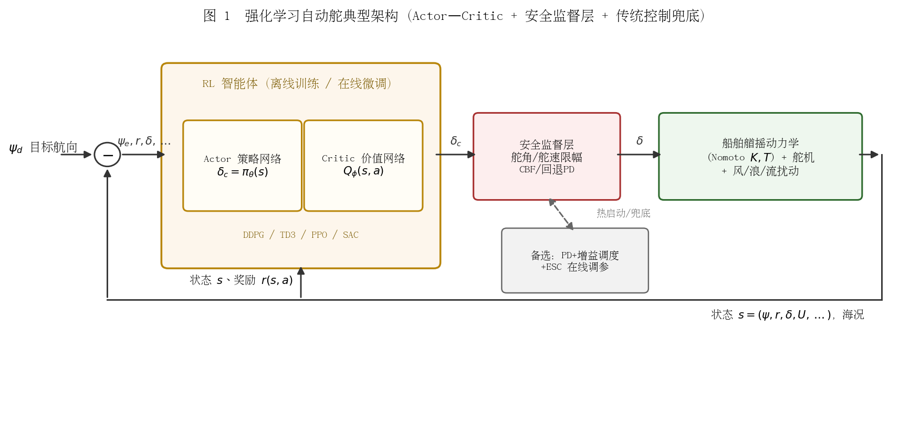
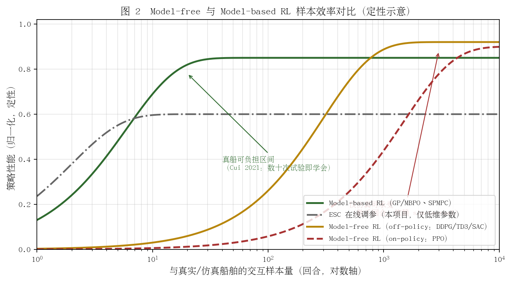
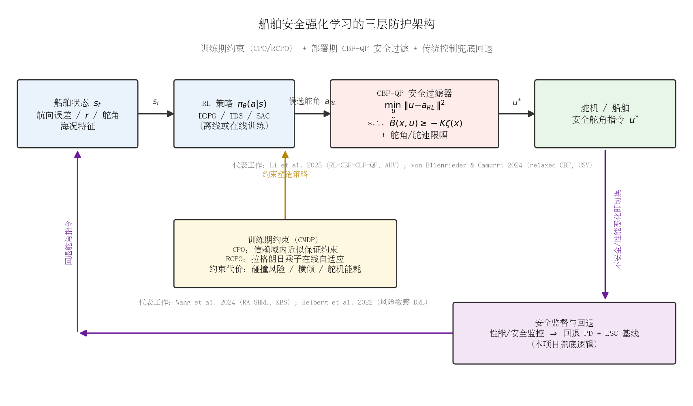

## 强化学习与数据驱动自适应自动舵

### 1. 算法原理

强化学习（Reinforcement Learning, RL）将船舶航向/航迹控制建模为马尔可夫决策过程（MDP）：智能体（舵控策略）在每个控制周期观测状态 $s_t$（航向误差 $\psi_e$、转艏角速度 $r$、舵角 $\delta$、船速 $U$、海况特征等），输出动作 $a_t$（舵角指令 $\delta_c$），并从环境获得奖励 $r_t$（通常取航向误差、舵角/舵速惩罚的加权和），目标是最大化折扣累积回报：

$$J(\pi) = \mathbb{E}_{\pi}\left[\sum_{t=0}^{\infty} \gamma^{t} r(s_t, a_t)\right], \qquad \gamma \in (0,1)$$

其理论基础是 Bellman 最优方程：

$$Q^{*}(s,a) = \mathbb{E}\left[r(s,a) + \gamma \max_{a'} Q^{*}(s',a')\right]$$

船舶控制的动作空间连续（舵角），因此研究主流是连续控制算法，可分为两类：

- **确定性策略梯度类（off-policy）**：DDPG（Deep Deterministic Policy Gradient，[Lillicrap et al., 2015](https://arxiv.org/abs/1509.02971)）用 Actor 网络 $\pi_\theta(s)$ 直接输出舵角，Critic 网络 $Q_\phi(s,a)$ 评估动作价值，Actor 沿确定性策略梯度上升：

$$\nabla_{\theta} J \approx \mathbb{E}_{s \sim \mathcal{D}}\left[\left.\nabla_{a} Q_{\phi}(s,a)\right|_{a=\pi_{\theta}(s)} \nabla_{\theta} \pi_{\theta}(s)\right]$$

- **TD3**（Twin Delayed DDPG，[Fujimoto et al., 2018](https://arxiv.org/abs/1802.09477)）针对 DDPG 的 Q 值过估计与训练不稳定问题，引入双 Critic 取小、Actor 延迟更新、目标策略平滑正则化：

$$y = r + \gamma \min_{i=1,2} Q_{\phi'_{i}}\big(s',\; \pi_{\theta'}(s') + \epsilon\big), \qquad \epsilon \sim \mathrm{clip}\big(\mathcal{N}(0,\sigma),\, -c,\, c\big)$$

- **SAC**（Soft Actor–Critic，[Haarnoja et al., 2018](https://arxiv.org/abs/1801.01290)）在回报中加入策略熵项，鼓励探索的同时提高鲁棒性，是目前连续控制中样本效率与稳定性综合表现最好的 model-free 算法之一：

$$J(\pi) = \sum_{t} \mathbb{E}_{(s_t,a_t)\sim \pi}\left[r(s_t,a_t) + \alpha\, \mathcal{H}\big(\pi(\cdot|s_t)\big)\right]$$

- **PPO**（Proximal Policy Optimization，[Schulman et al., 2017](https://arxiv.org/abs/1707.06347)）是 on-policy 随机策略算法，通过截断重要性采样比约束策略更新步长，训练稳定但样本效率低于 off-policy 算法：

$$L^{\mathrm{CLIP}}(\theta) = \mathbb{E}_{t}\left[\min\big(\rho_t \hat{A}_t,\; \mathrm{clip}(\rho_t,\, 1-\varepsilon,\, 1+\varepsilon)\hat{A}_t\big)\right], \qquad \rho_t = \frac{\pi_\theta(a_t|s_t)}{\pi_{\theta_{\mathrm{old}}}(a_t|s_t)}$$

在船舶自动舵语境下，被控对象通常取一阶/二阶 Nomoto 模型 $T\dot{r} + r = K\delta$（或其非线性扩展）叠加风浪扰动；RL 智能体不需要知道 $K, T$，而是通过与（仿真或真实）环境的交互直接学习状态到舵角的映射。典型的工程化架构如图 1 所示：Actor–Critic 智能体输出舵角指令，经安全监督层（舵角/舵速限幅、CBF 或回退 PD）后驱动舵机，传统控制回路作为热启动与兜底。

**图 1　强化学习自动舵典型架构（Actor–Critic + 安全监督层 + 传统控制兜底）**

### 2. 在船舶自动舵中的典型应用与代表性工作

RL 用于船舶航向/航迹控制的研究自 2016 年前后兴起，大致沿"路径跟随 → 变工况鲁棒化 → 样本效率 → 真船验证"的路线演进：

| 代表性工作 | 年代 | 算法 | 任务与贡献 |
|---|---|---|---|
| Shen & Guo（上海海事大学） | 2016 | Actor–Critic（MLP 网络） | 欠驱动船路径跟随的早期 RL 尝试（ICIST 2016，见 [arXiv 引用页](https://arxiv.org/pdf/2203.00368)） |
| Martinsen & Lekkas（NTNU） | 2018 | DDPG | [直线路径跟随](https://doi.org/10.1016/j.ifacol.2018.09.502)（IFAC CAMS）；[曲线路径跟随，三种船型 + 海流](https://doi.org/10.1109/OCEANS.2018.8604829)（OCEANS 2018），并证明迁移学习可显著加速训练（用直线路径策略热启动曲线路径训练，收敛"快得多"且性能无差别，见 [NTNU Open 原文结论](https://ntnuopen.ntnu.no/ntnu-xmlui/bitstream/handle/11250/2596760/OCEANS_2018__Curved_Path_Following_with_Deep_Reinforcement_Learning__Results_from_Three_Vessel_Models%20(1).pdf?sequence=4)）；提出抑制舵角抖动的奖励函数设计 |
| Martinsen, Lekkas, Gros 等（NTNU） | 2020 | DRL | [变工况 USV 轨迹跟踪](https://pmc.ncbi.nlm.nih.gov/articles/PMC7806118/)（Frontiers in Robotics and AI），在负载/航速变化下验证 RL 控制器的适应性 |
| Cui, Osaki, Matsubara（奈良先端科学技术大学院大学 / FURUNO） | 2019–2021 | GP model-based RL + MPC（SPMPC） | [面向真船的样本高效自动舵](https://arxiv.org/abs/1901.07905)（IROS 2019），[期刊版见 J. Field Robotics](https://onlinelibrary.wiley.com/doi/full/10.1002/rob.21990)：用高斯过程在线学习动力学模型并嵌入 MPC 闭环，**真尺船（7.93 m 日产 JoyFisher 25，单机，GPS/航速/航向/风速传感器）仅以 10 次随机 rollout 初始化 GP 模型 + 10 次 RL rollout（合计约 600 步样本）即学会自动舵任务**，是 RL 真船落地的标志性工作 |
| Qin 等 | 2022 | DRL + ADRC | [DRL 自抗扰航向控制](https://www.sciencedirect.com/science/article/abs/pii/S0925231221015812)（Neurocomputing），RL 在线整定 ADRC 参数，属"RL + 传统控制"混合路线 |
| Sivaraj 等 | 2022–2023 | DQN / PPO / DDPG / TD3 / SAC | [DQN 数据驱动航向控制与路径跟随（静水与波浪，KVLCC2）](https://www.sciencedirect.com/science/article/abs/pii/S0029801822011489)；[三种 off-policy（DDPG/TD3/SAC）与一种 on-policy（PPO）DRL 控制器在静水与波浪中路径跟随的对比](https://www.sciencedirect.com/science/article/abs/pii/S0029801823019911)（Ocean Engineering），是算法选型的重要对比基准 |
| Greep 等（MARIN、伊斯坦布尔理工大学等） | 2025 | 样本高效 RL | [波浪中航向保持的样本高效 RL](https://www.sciencedirect.com/science/article/abs/pii/S0952197624020074)（Engineering Applications of Artificial Intelligence），系统对比 model-free 与 model-based RL 智能体并与 LQR 基线比较，直接针对"波浪扰动下减少训练样本"这一痛点 |
| Yoshioka, Hashimoto, Matsuda（大阪公立大学等） | 2026 | 改进 DDPG | [实船测量线跟踪操船支援系统](https://www.mdpi.com/2673-4052/7/1/16)（MDPI Automation）：在研究船 TAKAMARU 丸（29.5 m）上实测，发现 DDPG 习得策略存在左右不对称、舵令跳变剧烈等问题，并提出对称约束网络、动作变化惩罚与情境自适应平滑（SAPS）加以修正——是少见的真实船舶 DRL 实验报告 |

此外，ITTC（国际船模试验池会议）第 29 届[论文集](https://ittc.info/media/10938/volume-i.pdf)据称已将"机器学习自动舵"列为专门议题，并指出 DRL 控制器"无需训练数据和数学模型的先验知识、具备自学习能力"（该表述与"无需训练数据"在字面上与 RL 依赖交互数据的事实相悖，**待核实**）。

### 3. Model-free 与 Model-based 的对比

| 维度 | Model-free RL（DDPG/TD3/PPO/SAC） | Model-based RL（GP/MBPO/SPMPC 等） |
|---|---|---|
| 是否用模型 | 不用；直接从交互数据学策略/价值 | 在线或离线学习动力学模型（如 GP），用于规划（MPC）或生成虚拟样本 |
| 样本效率 | 低：通常需 $10^3\sim10^4$ 回合级交互，真船难以承受 | 高：[Cui 2021](https://onlinelibrary.wiley.com/doi/full/10.1002/rob.21990) 真船约 20 次 rollout（约 600 步样本）即收敛 |
| 渐近性能 | 高（策略容量大，可逼近复杂非线性最优策略） | 受模型精度限制，模型失配会成为性能瓶颈 |
| 稳定性分析 | 一般无闭环稳定性证明，依赖奖励塑形与经验调参 | 可与 MPC/Lyapunov 框架结合给出稳定保证（如 [Berkenkamp et al., NeurIPS 2017](https://arxiv.org/abs/1705.08551) 的带稳定保证 MBRL，被 [Cui 2021](https://onlinelibrary.wiley.com/doi/full/10.1002/rob.21990) 引用为该方向基础） |
| 工程实现 | 框架成熟（Stable-Baselines3 等），但超参敏感 | 需额外实现模型学习与不确定性管理，复杂度高 |

两者的样本效率差异如图 2 定性所示：model-based RL 的收敛样本量比 model-free 低 1–2 个数量级，是"真船可负担"与"仅仿真可承受"的分水岭；本项目的 ESC 在线调参本质上是一种极低维（2–3 个参数）的在线无模型优化，样本代价介于两者之间，但可适应的自由度也最小。

**图 2　Model-free 与 Model-based RL 样本效率对比（定性示意，非实测数据）**

### 4. 样本效率与 sim-to-real 问题

Model-free DRL 在船舶控制中的最大工程障碍是**样本效率与 sim-to-real 鸿沟**：

- **样本效率**：DDPG/TD3/SAC 在仿真中通常需要数千回合才能收敛（[Sivaraj 2023](https://www.sciencedirect.com/science/article/abs/pii/S0029801823019911) 的对比实验即在此量级），真船每回合耗时分钟级且存在安全风险，直接在线训练不可行。对策包括：off-policy 经验回放复用数据、迁移学习（[Martinsen & Lekkas 2018](https://doi.org/10.1109/OCEANS.2018.8604829) 用直线跟随策略热启动曲线跟随，收敛"显著更快"）、模仿学习预训练、以及改用 model-based 路线（[Cui 2021](https://onlinelibrary.wiley.com/doi/full/10.1002/rob.21990)、[Greep 2025](https://www.sciencedirect.com/science/article/abs/pii/S0952197624020074)）。
- **sim-to-real**：仿真训练的部署依赖域随机化（domain randomization，随机化水动力系数、海况、传感器噪声）与课程学习（curriculum learning，扰动强度渐进增加）。[MDPI J. Mar. Sci. Eng. 2025 的 ASV 避碰研究](https://www.mdpi.com/2077-1312/13/9/1727)表明，加入域随机化+课程学习的 Sim2Real 训练后，策略在最复杂测试场景（Stage 3）成功率达 93.2%，比未做 Sim2Real 的 TD3 基线（86.4%）高约 7 个百分点，比经典 PID+VO 方法（74.0%）高约 19 个百分点；该研究同时发现仅用域随机化、不用课程学习的智能体在 7 万回合内无法收敛，说明课程学习是稳定训练的必要条件。但 [Yoshioka 2026](https://www.mdpi.com/2673-4052/7/1/16) 的实船实验也揭示了仿真难以预见的真实现象（如习得策略的左右舵不对称），说明"仿真训练 + 实船小规模在线微调"仍是必要流程。

### 5. 在线安全探索与稳定保障

RL 的探索噪声直接作用于舵角，在线训练时必须解决安全问题，主流手段有三类：

1. **安全强化学习（Safe RL）**：将舵角、转艏角速度、横倾等约束写成 CMDP（约束 MDP）或用控制障碍函数（CBF）构造安全过滤器，把 RL 输出投影到安全集——CBF+RL 的系统性综述见 [arXiv:2404.16879](https://arxiv.org/html/2404.16879v1)，AUV 上已有 RL+QP 安全过滤器的轨迹跟踪验证（[Li et al., 2025](https://www.mdpi.com/2504-446X/9/1/65)）。
2. **稳定保证的 MBRL**：以 Lyapunov 方法约束策略更新区域，保证闭环稳定（[Berkenkamp et al., NeurIPS 2017](https://arxiv.org/abs/1705.08551)）。
3. **RL + 传统控制混合**：不让 RL 直接打舵，而是让 RL 在线调整 PD/PID/ADRC 的增益或补偿量，底层保留有稳定性结论的线性控制器，并设置监督切换逻辑（性能恶化即回退基线控制器）。船舶方向的实例包括 [Qin et al. 2022 的 DRL-ADRC 航向控制](https://www.sciencedirect.com/science/article/abs/pii/S0925231221015812)；航空领域同类思路（RL 外环策略 + 在线残差动力学预测补偿扰动，Crazyflie 实机验证）见 [arXiv:2605.16015](https://arxiv.org/html/2605.16015v1)。混合架构是当前工程界最认可的路径——RL 的收益体现在"自适应调参"，而不是"取代反馈控制律"。

#### 补充：Safe RL 前沿——CPO/RCPO 与 CBF+RL 在船舶控制中的最新工作

安全强化学习的形式化框架是约束 MDP（CMDP）：在主回报之外定义约束代价 $c_i(s,a)$（碰撞风险、横倾角、舵角/舵速超限、舵机能耗等），要求折扣约束代价不超过阈值 $d_i$：

$$J_{c_i}(\pi) = \mathbb{E}_{\pi}\left[\sum_{t=0}^{\infty} \gamma^{t} c_i(s_t,a_t)\right] \le d_i$$

主流求解路线分"训练期约束"与"部署期过滤"两类：

- **约束策略优化（训练期）**：CPO（Constrained Policy Optimization，[Achiam et al., ICML 2017](https://arxiv.org/abs/1705.10528)）在信赖域内求解带约束的策略更新，理论上保证每次迭代近似满足约束，但需二阶近似、实现复杂；RCPO（Reward Constrained Policy Optimization，[Tessler et al., ICLR 2019](https://arxiv.org/abs/1805.11028)）用拉格朗日松弛把约束转化为在线自适应的惩罚权重，可直接嫁接到 PPO/SAC 等成熟算法上（即 PPO/SAC-Lagrangian 变体），是工程上最常用的 CMDP 解法。
- **CBF 安全过滤（部署期）**：不改动训练过程，在策略输出后串联一个 CBF-QP 安全过滤器，对 RL 动作做"最小修改"投影到安全集：

$$u^{*}(x) = \arg\min_{u}\ \tfrac{1}{2}\|u - a_{RL}\|^2 \qquad \text{s.t.}\quad \dot{B}(x) + \alpha\big(B(x)\big) \ge 0,\ \ u\in\mathcal{U}$$

其中 $B(x)$ 为（指数）控制障碍函数，$\mathcal{U}$ 为舵角/舵速物理限幅。RL 学到的动力学不确定性估计还可注入 CBF/CLF 约束项中在线补偿模型失配（系统综述见 [arXiv:2404.16879](https://arxiv.org/html/2404.16879v1)）。

船舶与海洋机器人方向 2022 年以来的代表性工作：

| 工作 | 年份 | 方法 | 内容 |
|---|---|---|---|
| Heiberg et al.（NTNU/SINTEF 等） | 2022 | 风险敏感 DRL | [COLREGs 的风险化 DRL 实现](https://doi.org/10.1016/j.neunet.2022.04.008)（Neural Networks 152:17–33），把碰撞风险显式写入状态与奖励设计，USV 避碰 |
| Krasowski 等 | 2024 | 可证明规则合规的 Safe RL | [开阔海面上可证明交通规则合规的安全 RL](https://arxiv.org/abs/2402.08502)，用时序逻辑形式化 COLREGs 并结合动作屏蔽（action masking）将 RL 动作限制在经过验证的规则合规集合内，训练与部署全程零碰撞、零违规 |
| Wang et al.（利物浦约翰摩尔斯大学等） | 2024 | 安全分层 RL（RA-SHRL） | [COLREGs 约束的 MASS 风险感知避碰决策](https://doi.org/10.1016/j.knosys.2024.112205)（Knowledge-Based Systems 300:112205），风险与可靠性双 Critic + 分层结构，面向多船会遇场景 |
| von Ellenrieder & Camurri | 2024 | relaxed CBF（非 RL，可作安全层） | [欠驱动 USV 最近安全接近的 relaxed CBF 控制](https://ieeexplore.ieee.org/document/10639539)（IEEE J. Ocean. Eng. 49(4)），backstepping + 松弛 CBF，提供可直接叠加在 RL 策略之后的解析安全层 |
| Li et al. | 2025 | RL-CBF-CLF-QP | [TD3 在线学习 CBF/CLF 约束中的模型不确定性项，QP 求解安全控制输入](https://www.mdpi.com/2504-446X/9/1/65)（Drones 9(1):65），BlueROV2 AUV 轨迹跟踪仿真验证，不确定性补偿后既避免冒进也缓解过度保守 |

三层防护的总体架构如图 3 所示：训练期用 CPO/RCPO 把安全代价写进 CMDP，部署期用 CBF-QP 对 RL 输出做实时投影，最外层保留"回退传统控制器"的监督切换——这与本项目"PD + ESC 兜底"的架构天然兼容。

**图 3　船舶安全强化学习的三层防护架构（训练期 CMDP 约束 + 部署期 CBF-QP 过滤 + 传统控制回退）**

对本项目的直接启示：若未来在仿真中训练 RL 辅助策略，可将舵角、舵速、最大横摇/横倾约束写成 CBF-QP 安全过滤器套在 RL 输出之后（$B(x)$ 只需基于名义 Nomoto 模型构造，维度低、QP 可实时求解）；训练期用 RCPO 式拉格朗日惩罚把"舵机能耗、最大舵速"写进约束而非手工调奖励权重，可减少奖励塑形的试错成本。

### 6. 与本项目 ESC 在线调参的异同

本项目现行方案为 PD + 增益调度（海况 0–3 级 × 船速段）+ ESC 在线自动调参（Nomoto $K/T$ 在线辨识 + 极点配置基线）。ESC（极值搜索）通过注入小幅正弦扰动 $\theta(t)=\hat{\theta}(t)+a\sin\omega t$ 并解调代价函数响应，在线估计代价对参数的梯度：

$$\dot{\hat{\theta}} = -k\, \xi(t), \qquad \xi \approx \frac{\partial J}{\partial \theta}\bigg|_{\hat{\theta}}$$

其闭环稳定性由 Krstić–Wang 的平均化+奇异摄动理论严格保证（[Krstić & Wang, Automatica 2000](https://doi.org/10.1016/S0005-1098(00)00010-3)），工程综述见 [CEAS EuroGNC 2022](https://eurognc.ceas.org/archive/EuroGNC2022/pdf/CEAS-GNC-2022-001.pdf)，PID/PI 参数的 ESC 整定亦有成熟先例（[UCSD 课程复现报告](https://flyingv.ucsd.edu/smoura/files/ME569.pdf)）。与 RL 对比：

| 维度 | ESC 在线调参（本项目） | 强化学习 |
|---|---|---|
| 优化对象 | 低维连续参数（$K_P, K_D$ 等 2–3 维） | 高维策略（神经网络数千~百万参数） |
| 探索方式 | 确定性小幅正弦扰动，幅度可控、谱已知 | 随机探索噪声，真船上有安全风险 |
| 稳定/收敛保证 | 有（平均化+奇异摄动，局部指数稳定） | 一般无；需 CBF/Lyapunov 等额外机制 |
| 样本代价 | 极低（在线连续运行即收敛） | model-free 极高，model-based 中等 |
| 表达能力 | 只能调到给定结构（PD）内的最优 | 可学到非线性、前馈、浪频滤波等超出 PD 结构的策略 |
| 可解释性/认证 | 好，参数物理意义明确 | 差，黑箱策略难以通过船级社认证 |

二者在数学上同属"无模型在线优化"：ESC 可视为**单点、局部梯度、低维的确定性策略搜索**；RL 则是**全局、高维的随机策略搜索**。ESC 的天花板是控制器结构本身（PD 结构内最优），RL 的天花板是样本与安全问题。

### 7. 对本项目的借鉴点

1. **结构保守、调度/补偿层学习**：借鉴"RL 调增益而非直接打舵"的混合路线（[Qin 2022](https://www.sciencedirect.com/science/article/abs/pii/S0925231221015812)），可将现有增益调度表视为 RL/数据驱动方法的"动作空间"，用离线 RL 在仿真中优化调度表数值，而底层 PD 与 ESC 兜底逻辑不变——风险最小、可认证性最好。
2. **辨识结果反哺仿真**：ESC 在线辨识的 Nomoto $K/T$ 可直接用于校准 RL 训练用仿真器，缩小 sim-to-real 鸿沟；反过来，高保真仿真 + 域随机化训练的 RL 策略可作为 ESC 调参的初值与性能上限参照。
3. **样本效率路线选型**：若未来引入 RL，优先 model-based（GP/SPMPC 式，[Cui 2021](https://onlinelibrary.wiley.com/doi/full/10.1002/rob.21990)）或"仿真预训练 + 实船微调"，避免 model-free 直接在线训练；安全层必须包含舵角/舵速限幅与回退到现行 PD+ESC 方案的监督切换。
4. **奖励设计即海况适应性设计**：Martinsen 的防舵抖动奖励、浪频滤波惩罚项可直接移植为本项目 ESC 代价函数的补充项（舵机能耗、横摇耦合惩罚），无需引入完整 RL 框架即可受益。

### 8. 参考资料

1. Lillicrap et al., 2015, [Continuous Control with Deep Reinforcement Learning (DDPG)](https://arxiv.org/abs/1509.02971)
2. Fujimoto et al., 2018, [Addressing Function Approximation Error in Actor-Critic Methods (TD3)](https://arxiv.org/abs/1802.09477)
3. Haarnoja et al., 2018, [Soft Actor-Critic: Off-Policy Maximum Entropy Deep RL](https://arxiv.org/abs/1801.01290)
4. Schulman et al., 2017, [Proximal Policy Optimization Algorithms (PPO)](https://arxiv.org/abs/1707.06347)
5. Martinsen & Lekkas, 2018, [Straight-Path Following for Underactuated Marine Vessels using Deep RL](https://doi.org/10.1016/j.ifacol.2018.09.502)（IFAC-PapersOnLine 51(29):329–334, CAMS 2018）
6. Martinsen & Lekkas, 2018, [Curved Path Following with Deep RL: Results from Three Vessel Models](https://doi.org/10.1109/OCEANS.2018.8604829)（OCEANS 2018 MTS/IEEE Charleston）
7. Martinsen et al., 2020, [Reinforcement Learning-Based Tracking Control of USVs in Varying Operational Conditions](https://pmc.ncbi.nlm.nih.gov/articles/PMC7806118/)
8. Cui, Osaki & Matsubara, 2019, [Reinforcement Learning Boat Autopilot: A Sample-efficient and Model Predictive Control based Approach (SPMPC)](https://arxiv.org/abs/1901.07905)（IROS 2019）；期刊版：2021, [Autonomous boat driving system using sample-efficient model predictive control-based reinforcement learning approach](https://onlinelibrary.wiley.com/doi/full/10.1002/rob.21990)（J. Field Robotics 38(2):331–354）
9. Qin et al., 2022, [Deep reinforcement learning based active disturbance rejection control for ship course control](https://www.sciencedirect.com/science/article/abs/pii/S0925231221015812)（Neurocomputing 484:99–108）
10. Sivaraj et al., 2022, [Data driven control based on Deep Q-Network algorithm for heading control and path following of a ship in calm water and waves](https://www.sciencedirect.com/science/article/abs/pii/S0029801822011489)（Ocean Engineering 259, 111802）；2023, [On the performance of different Deep Reinforcement Learning based controllers for the path-following of a ship](https://www.sciencedirect.com/science/article/abs/pii/S0029801823019911)（Ocean Engineering 286, 115607）
11. Greep et al., 2025, [Ship course-keeping in waves using sample-efficient reinforcement learning](https://www.sciencedirect.com/science/article/abs/pii/S0952197624020074)（Engineering Applications of Artificial Intelligence 141, 109848）
12. Yoshioka, Hashimoto & Matsuda, 2026, [Human-Navigable Ship-Handling Support Using Improved Deep Deterministic Policy Gradient for Survey Line Tracking](https://www.mdpi.com/2673-4052/7/1/16)（Automation 7(1):16）
13. ITTC, [Proceedings of the 29th ITTC, Vol. I（机器学习自动舵议题，表述待核实）](https://ittc.info/media/10938/volume-i.pdf)
14. [Learning Control Barrier Functions and their application in RL: A Survey](https://arxiv.org/html/2404.16879v1)；Li et al., 2025, [Safety-Enhanced RL for AUV Trajectory Tracking](https://www.mdpi.com/2504-446X/9/1/65)
15. Berkenkamp et al., 2017, [Safe Model-based Reinforcement Learning with Stability Guarantees](https://arxiv.org/abs/1705.08551)（NeurIPS 2017）
16. [Robust Collision Avoidance for ASVs Using DRL with Sim2Real Methods (域随机化+课程学习)](https://www.mdpi.com/2077-1312/13/9/1727)（J. Mar. Sci. Eng. 13(9):1727, 2025）
17. Krstić & Wang, 2000, [Stability of extremum seeking feedback for general nonlinear dynamic systems](https://doi.org/10.1016/S0005-1098(00)00010-3)（Automatica 36(4):595–601）；ESC 工程综述：[CEAS EuroGNC 2022](https://eurognc.ceas.org/archive/EuroGNC2022/pdf/CEAS-GNC-2022-001.pdf)；PID 的 ESC 整定：[UCSD ME569 报告](https://flyingv.ucsd.edu/smoura/files/ME569.pdf)
18. Achiam et al., 2017, [Constrained Policy Optimization (CPO)](https://arxiv.org/abs/1705.10528)（ICML 2017）；Tessler et al., 2018, [Reward Constrained Policy Optimization (RCPO)](https://arxiv.org/abs/1805.11028)（ICLR 2019）
19. Heiberg et al., 2022, [Risk-based implementation of COLREGs for autonomous surface vehicles using DRL](https://doi.org/10.1016/j.neunet.2022.04.008)（Neural Networks 152:17–33）；Krasowski et al., 2024, [Provable Traffic Rule Compliance in Safe RL on the Open Sea](https://arxiv.org/abs/2402.08502)；Wang et al., 2024, [COLREGs-constrained safe RL for MASS collision avoidance (RA-SHRL)](https://doi.org/10.1016/j.knosys.2024.112205)（Knowledge-Based Systems 300:112205）
20. von Ellenrieder & Camurri, 2024, [Relaxed Control Barrier Function Based Control for Closest Approach by Underactuated USVs](https://ieeexplore.ieee.org/document/10639539)（IEEE J. Ocean. Eng. 49(4)）
