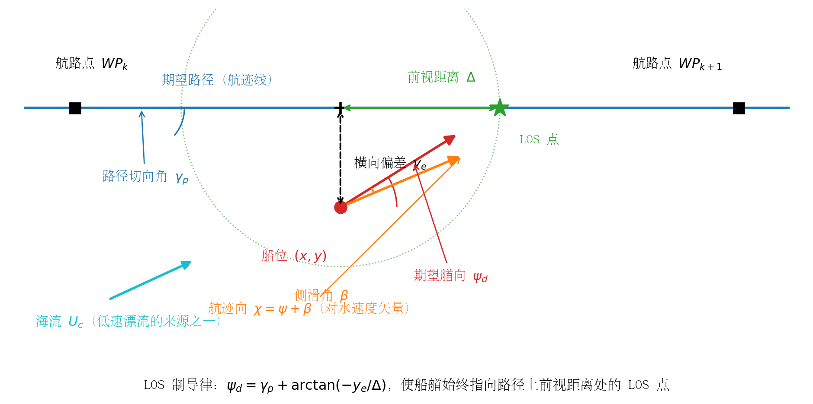
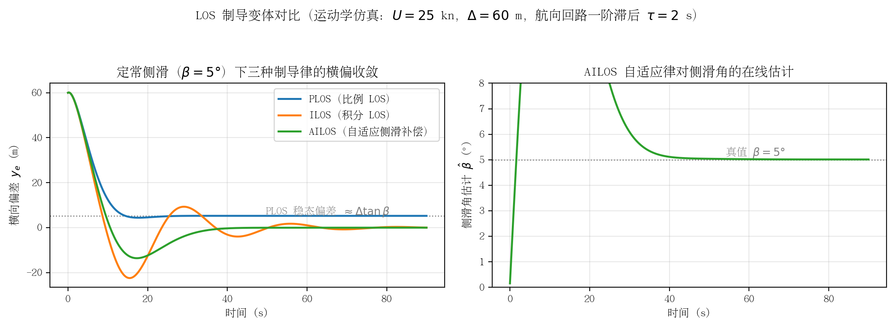

## 航迹/路径跟踪中的自适应控制（航迹舵）

前八章讨论的是**航向层**问题：给定艏向设定值 $\psi_d$，如何让船又快又省地跟上。本章把视野抬高一层到**航迹层**（track keeping / path following）：给定一条由航路点串起来的计划航线，如何让船的位置贴着这条线走。这是商用"航迹舵"（track control system）的功能定位——IMO 早在 1998 年就为其颁布了专门的性能标准（MSC.74(69) 附件 2，适用船速上限 30 kn，恰好覆盖本项目 25 kn 游艇）[1]。对本项目而言，本章是"当前仅航向闭环"到"全航迹自动舵"之间的技术桥梁：结论先行——**制导-控制分层结构下，现有航向环（PD + 增益调度 + ESC）原样保留为内环，外环加一个 LOS 制导器即可获得航迹保持能力**，这是文献与工业界共同验证过的最低风险演进路径。

### 制导-控制分层结构（guidance–control）

船舶运动控制普遍采用三层级联结构（Fossen 教材称之为 guidance–navigation–control, GNC）[2]：

- **规划层**：离线或在线生成计划航线，通常是一串航路点 $WP_1,\dots,WP_N$ 及相邻点间的直线段（leg），转折点处按预设转弯半径或回转率过渡；
- **制导层（guidance）**：根据当前船位与路径的几何关系，计算期望艏向 $\psi_d$（或期望航迹向 $\chi_d$）与期望航速 $U_d$，输出给控制层。LOS（line-of-sight，视线）制导是该层的事实标准；
- **控制层**：航向自动舵，跟踪 $\psi_d$——这正是本项目已建成的部分。

分层之所以可行，依赖**时间尺度分离**：制导环的带宽必须显著低于航向环带宽（工程上取 1/3–1/5 以下），这样分析内环时可把 $\psi_d$ 当作慢变参考，分析外环时可把内环近似为理想跟踪（$\psi=\psi_d$），整体稳定性再按级联系统（cascade）严格证明 [3][4]。IMO 航迹控制性能标准也默认了这一架构：标准要求航迹控制系统在位置传感器失效时**自动降级为航向控制**并以当前艏向为设定值 [1]——即航向环被明确定义为航迹环的安全兜底。

需要强调欠驱动（underactuation）约束：常规单体船只有螺旋桨（纵荡）与舵（转艏）两个控制输入，横荡方向没有直接控制力。因此航迹环**不能直接对横向偏差施加控制力**，只能通过调整艏向让对地速度矢量慢慢转回航线——这就是"制导律输出艏向参考、而不是横向力"的根本原因，也是侧滑角（sideslip）问题成为航迹保持核心难点的根源 [4][5]。

### LOS 制导律及其自适应变体

#### 比例 LOS（PLOS）与前视距离

LOS 制导模仿有经验舵手的操船直觉：在路径上取船位投影点前方一段"前视距离" $\Delta$ 处的 LOS 点，令船艏指向它（图 9-1）。对切向角为 $\gamma_p$ 的直线路径，横向偏差为 $y_e$ 时 [4][6]：

$$\psi_d=\gamma_p+\arctan\!\left(-\frac{y_e}{\Delta}\right)$$

*图 9-1 LOS 制导几何：制导律由横向偏差 $y_e$ 与前视距离 $\Delta$ 生成期望艏向 $\psi_d$；风、流使艏向 $\psi$ 与对水航迹向 $\chi$ 之间出现侧滑角 $\beta=\chi-\psi$，这是横偏稳态误差的来源。*

该律的源头可追溯到 Healey & Lienard 1993 年用于 AUV 的滑模+LOS 工作 [7]，船舶情形的系统表述见 Fossen, Breivik & Skjetne（2003）[5] 与 Breivik & Fossen（2005）的 2D/3D 制导原理 [8]。Fossen & Pettersen（2014）证明了比例 LOS 制导律的**一致半全局指数稳定（USGES）**——注意横偏动力学中的正弦项带来固有的"增益随横偏增大而饱和"特性，全局指数稳定在结构上不可能达到，USGES 已是最强结论 [6]。

前视距离 $\Delta$ 是 LOS 唯一的整定参数，作用相当于外环比例增益的倒数：$\Delta$ 小则收敛快但超调大、艏向指令抖动剧烈；$\Delta$ 大则平滑但贴线慢。工程经验取 $\Delta\approx(1.5\sim3)\,L_{pp}$ 量级；Lekkas & Fossen（2012）提出**时变前视距离**：横偏大时用大 $\Delta$ 平滑接近、接近路径后收缩 $\Delta$ 加快消除残余偏差，兼顾两段性能 [9]。这本质上是"以误差为调度变量的增益调度"，与本项目航向环的海况×船速调度在思想上同构。

#### 侧滑角问题与 ILOS

比例 LOS 有一个结构性缺陷：横偏动力学为 $\dot y_e = U\sin(\psi-\gamma_p+\beta)$，其中 $\beta=\operatorname{atan2}(v,u)$ 是侧滑角 [3]。定常风、流造成的漂流力使船以非零 $\beta$ 航行，而船横向无控制力、只能靠艏向补偿，于是 PLOS 的稳态横偏不为零：

$$y_e^{ss}\approx\Delta\tan\beta$$

对 25 kn 游艇，$\beta=5°$、$\Delta=60$ m 时稳态横偏约 5.2 m——在开阔水域可接受，但在狭水道或桥区已不可容忍（图 9-2 蓝线）。

**积分 LOS（ILOS）**由 Børhaug, Pavlov & Pettersen（2008）提出：在制导律中加入横偏积分项，等效于在外环嵌入一个"自动压差角"，可证明在定常不可约流下横偏全局 $\kappa$-指数收敛到零 [10]：

$$\psi_d=\gamma_p+\arctan\!\left(-\frac{y_e+y_{int}}{\Delta}\right),\qquad \dot y_{int}=\frac{\kappa\,\Delta\, U\,y_e}{\Delta^2+(y_e+y_{int})^2}$$

Caharija 等（2016）给出了 ILOS 迄今最完整的"理论-仿真-海试"三合一验证：在 NTNU 的 Charlie 双体 USV（特隆赫姆港）与 CNR 的 USV（第勒尼安海）上完成多组实船试验，证明 ILOS 在真实海流、风浪下能把横偏压到米级，而纯比例 LOS 残留明显稳态偏差 [11]。这是航迹舵自适应外环**最有分量的实船证据**。

#### 自适应 LOS：在线估计侧滑角（AILOS/ALOS）

Fossen, Pettersen & Galeazzi（2015）换了一个视角：不引入显式积分器，而把未知侧滑角 $\beta$ 当作慢变未知参数，用参数自适应律在线估计并直接补偿 [3]：

$$\psi_d=\gamma_p+\arctan\!\left(-\frac{y_e}{\Delta}-\hat\beta\right),\qquad \dot{\hat\beta}=\gamma\,\frac{U\Delta}{\sqrt{\Delta^2+(y_e+\Delta\hat\beta)^2}}\,y_e$$

该文证明了 $(y_e,\tilde\beta)=(0,0)$ 的 USGES——估计误差指数收敛到零，强于 ILOS 原来的 $\kappa$-指数结果；并指出**参数自适应律在结构上就是一种积分作用**，故该律又称"自适应积分 LOS（AILOS）"。它适用于 Dubins 路径（直线+圆弧），与本项目航线"直航道段+定半径转向"的形态一致。Fossen & Lekkas（2015/2017）进一步给出直接式与间接式两种自适应积分 LOS 方案，间接式用扰动观测器显式估计流速，具有全局 $\kappa$-指数稳定性 [12]；Fossen（2023）将其整理为面向飞行器与船舶的统一 ALOS 制导律并给出 USGES 证明 [13]。图 9-2 的运动学仿真（25 kn、$\Delta=60$ m、$\beta=5°$ 定常侧滑）直观展示了三者的差别：PLOS 残留 $\Delta\tan\beta$ 稳态偏差，ILOS 与 AILOS 均收敛到零，AILOS 的 $\hat\beta$ 在数十秒内收敛到真值。

*图 9-2 定常侧滑（$\beta=5°$）下三种 LOS 制导律的横偏收敛与 AILOS 的侧滑角在线估计（简化运动学仿真，$U=25$ kn，$\Delta=60$ m，航向回路一阶滞后 $\tau=2$ s；生成脚本 `figs/make_fig_09.py`）。PLOS 稳态偏差 $\approx\Delta\tan\beta$；ILOS/AILOS 消除稳态偏差但引入超调，积分/自适应增益越大超调越明显，工程上需折中。*

#### ELOS：基于扩展状态观测器的 LOS

以 Liu, Wang & Peng 为代表的 ELOS（ESO-based LOS）路线用**扩展状态观测器**在线估计纵荡/横荡速度（或等效集总扰动），无需横荡速度量测即可解算并精确补偿侧滑角 [14]。与 AILOS 相比：AILOS 把 $\beta$ 当**常值参数**（自适应律天然带低通特性，只能跟踪慢变），ELOS 把 $\beta$（或流速）当**状态**处理，可跟踪快变侧滑，代价是观测器带宽整定更敏感、对量测噪声更挑剔。二者与 ILOS 的谱系关系及更多变体（双曲正切 LOS、向量场制导、预测 LOS 等）见 Gu 等的 LOS 综述 [15]。

### 欠驱动路径跟踪控制与侧滑角估计路线对比

若不愿采用分层结构，也可以在 Serret–Frenet 路径坐标系下做一体化欠驱动控制设计（backstepping、滑模、动态面等），直接输出舵角——理论工具成熟（Breivik & Fossen 2005 [8]、Lekkas & Fossen 曲线路径 ILOS [16]），但失去了"外环可独立于内环验证、内环可作安全兜底"的工程优势，且控制器与具体船型动力学强耦合。对本项目这种已有成熟航向环的情形，分层结构几乎是唯一合理选择。

侧滑角 $\beta$ 的获取有三条工程路线，按可靠性排序：

| 路线 | 原理 | 优点 | 局限 |
|---|---|---|---|
| 直接量测 | GNSS 航迹向 COG 减罗经艏向：$\hat\beta=\chi_{COG}-\psi$（低速时 COG 不可用） | 零模型依赖、实现最简 | GNSS 失效即失效；波频振荡需滤波 |
| 状态观测器 | ESO/Kalman 估计 $u,v$ 或流速（ELOS 路线 [14]；Fossen 2022 用 EKF 从 GNSS 位置估计 SOG/COG [17]） | 可跟踪快变侧滑 | 带宽整定敏感、依赖模型结构 |
| 参数自适应 | AILOS/ALOS 把 $\beta$ 当慢变参数 [3][13] | 无量测要求、有 USGES 证明 | 只能跟踪慢变；转弯段 $\beta$ 突变需重新收敛 |

注意一个常被忽视的事实：在 25 kn 下 $\beta$ 通常只有几度（Fossen 等指出正常航行侧滑角典型小于 5° [3]），但 $\Delta\tan\beta$ 的杠杆效应把几度侧滑放大成米级横偏——所以"艇小、流弱就不用补偿侧滑"的直觉是错的。

### 代表性文献与海试/工程证据

| 作者/机构 | 年代 | 文献/系统 | 一句话贡献 | 验证方式 |
|---|---|---|---|---|
| Healey & Lienard | 1993 | IEEE JOE 18(3) [7] | LOS 制导 + 滑模控制用于 AUV 的奠基工作 | 仿真 |
| Fossen, Breivik & Skjetne | 2003 | IFAC MCMC [5] | 欠驱动船舶 LOS 路径跟踪的系统表述 | 仿真 |
| Breivik & Fossen | 2005 | IEEE CDC [8] | 2D/3D 基于制导的路径跟踪统一原理 | 理论 |
| Børhaug, Pavlov & Pettersen | 2008 | IEEE CDC [10] | ILOS：积分作用对抗定常海流 | 理论+仿真 |
| Lekkas & Fossen | 2012 | IFAC CAMS [9] | 时变前视距离（自适应 $\Delta$） | 仿真 |
| Fossen & Pettersen | 2014 | *Automatica* [6] | 比例 LOS 的 USGES 严格证明 | 理论 |
| Lekkas & Fossen | 2014 | IEEE TCST [16] | 曲线路径 ILOS（单调 Hermite 样条参数化） | 理论+仿真 |
| Fossen, Pettersen & Galeazzi | 2015 | IEEE TCST [3] | AILOS：自适应侧滑补偿，USGES | 理论+案例仿真 |
| Fossen & Lekkas | 2015/2017 | *Int. J. Adapt. Control Signal Process.* [12] | 直接/间接自适应积分 LOS，扰动观测器估流 | 理论+仿真 |
| Caharija, Pettersen 等 | 2016 | IEEE TCST [11] | ILOS 理论-仿真-海试三合一验证（Charlie USV 等） | **海试** |
| Liu, Wang & Peng | 2017 | IEEE JOE [14] | ELOS：ESO 精确侧滑补偿，无需速度量测 | 理论+仿真 |
| Fossen | 2023 | IEEE TCST [13] | 统一 ALOS 制导律，USGES | 理论+仿真 |
| Gu, Wang, Peng, Wang & Han | 2023 | IEEE TSMC: Systems [15] | LOS 制导谱系综述（截至 2022 的变体全景） | 综述 |

工程与法规层面的证据同样充分：

- **IMO 标准化**：MSC.74(69) 附件 2《航迹控制系统性能标准》把航迹舵定义为"使船舶自动保持在计划航迹上"的设备，明确规定了横偏报警（cross track alarm）、换向提前提示、转向点确认、定位/罗经双源监测、以及**位置传感器失效时自动降级为航向控制**等全套安全逻辑 [1]——商用航迹舵（ECDIS 航线 + 自动舵联动）据此已成为商船标配，说明"制导外环 + 航向内环"架构经过了大范围工业检验。
- **自主船实船数据**：特隆赫姆峡湾自主船试验区（NAVISP 项目）公布的自动舵航段横偏统计显示，实船自主航行横偏均值约 1.4–11.3 m（不同航段差异主要来自风、流方向与航线的夹角）[18]——这正是"无流补偿时横偏量级"的真实写照，也印证了侧滑补偿的必要性。

### 对本项目（当前仅航向层闭环）的演进路径建议

本项目现状：航向环 PD + 海况×船速增益调度 + ESC 在线调参，Nomoto $K/T$ 在线辨识 + 极点配置基线。向航迹舵演进建议分四步，每步都不破坏已有航向环：

1. **第一步：PLOS 外环（最小可行航迹舵）**。接入 GNSS 位置与航路点管理（NMEA 0183 的 RTE/WPL 语句即可），按 $\psi_d=\gamma_p+\arctan(-y_e/\Delta)$ 生成期望艏向送给现有航向环。25 kn（12.86 m/s）下建议 $\Delta$ 初值 60–100 m（约 4–7 倍船长），制导环带宽压到航向环的 1/3 以下。此步已能消除 90% 的人工修正工作量，风险最低。
2. **第二步：ILOS 抗流 + 航路点切换逻辑**。在开阔水域试航确认 PLOS 稳定后加积分项，并补 IMO 标准要求的配套逻辑：横偏限值报警、转向点提前提示与确认、定半径转向过渡。注意 ILOS 给 $\psi_d$ 加的是慢变偏置，**不向航向环注入激励**，因此与 ESC 的 $K/T$ 辨识天然兼容（区别于高频抖动的 ESC 激励本身）；但积分项必须配抗饱和，横偏过大时冻结积分防止 wind-up 后的深冲。
3. **第三步：侧滑角估计的冗余配置**。主用 GNSS COG−艏向直接解算 $\beta$（最廉价可靠），AILOS 自适应估计作为 GNSS 降级时的备份通道；位置与 COG 量测先经波浪滤波（见第 8 章陷波器/Kalman 滤波讨论）再进制导环，否则一阶波频位置振荡会被外环当成横偏去"跟"，徒增舵机活动量。
4. **第四步：安全降级与验证程序**。对照 MSC.74(69) 落实降级链：GNSS 失效→冻结外环、切回纯航向保持（以当前艏向为设定值）；罗经失效→保舵角报警。验证程序参照 Caharija 等的做法 [11]：先在仿真（可用 NTNU 开源 MSS 工具箱 [19]）中注入定常流/风浪验证横偏收敛，再湖试、再海试，逐级放大 $\Delta$ 扫描与 $\beta$ 工况。

一个与第 8 章结论的衔接提醒：航迹层同样存在"最大海况退化"问题——海况 4–5 时位置量测的波频成分增大、低速大漂角工况下 $\beta$ 变大且时变，AILOS 的"慢变 $\beta$"假设被削弱，此时应放大 $\Delta$、降低制导环带宽甚至临时切回航向保持，把"贴线精度"目标降级为"安全航行"目标，与航向环的高海况降级策略保持一致。

### 参考资料

1. [IMO Resolution MSC.74(69) Annex 2：Recommendation on Performance Standards for Track Control Systems (1998)](https://wwwcdn.imo.org/localresources/en/KnowledgeCentre/IndexofIMOResolutions/MSCResolutions/MSC.74(69).pdf)
2. [Fossen, Handbook of Marine Craft Hydrodynamics and Motion Control (2021 第 2 版)](https://www.fossen.biz/publications/)
3. [Fossen, Pettersen & Galeazzi, Line-of-Sight Path Following for Dubins Paths with Adaptive Sideslip Compensation of Drift Forces, IEEE TCST 23(2):820–827 (2015)](https://www.fossen.biz/publications/2015%20Fossen%20et%20al%20TCST.pdf)，[doi:10.1109/TCST.2014.2338354](https://doi.org/10.1109/TCST.2014.2338354)
4. [欠驱动船舶制导-控制分层结构综述（Ocean Eng. 2019，引言部分）](https://www.sciencedirect.com/science/article/abs/pii/S0029801818308357)
5. [Fossen, Breivik & Skjetne, Line-of-sight path following of underactuated marine craft, IFAC MCMC (2003)（文献库条目）](https://www.fossen.biz/publications/)
6. [Fossen & Pettersen, On uniform semiglobal exponential stability (USGES) of proportional line-of-sight guidance laws, Automatica 50(11):2912–2917 (2014)，doi:10.1016/j.automatica.2014.10.018](https://doi.org/10.1016/j.automatica.2014.10.018)
7. [Healey & Lienard 滑模+LOS AUV 制导（1993）（参考文献页证实出处）](https://link.springer.com/content/pdf/10.1007/s11804-023-00338-6.pdf)
8. [Breivik & Fossen, Principles of guidance-based path following in 2D and 3D, IEEE CDC (2005)（arXiv 2505.08344 参考文献页证实出处）](https://arxiv.org/pdf/2505.08344)
9. [Lekkas & Fossen, A time-varying lookahead distance guidance law for path following, IFAC-PapersOnLine 45(27):398–403 (2012)（J. Marine Science and Technology 参考文献页证实出处）](https://link.springer.com/content/pdf/10.1007/s00773-025-01055-1.pdf)
10. [Børhaug, Pavlov & Pettersen, Integral LOS control for path following of underactuated marine surface vessels in the presence of constant ocean currents, IEEE CDC:4984–4991 (2008)，doi:10.1109/CDC.2008.4739352](https://doi.org/10.1109/CDC.2008.4739352)
11. [Caharija et al., Integral line-of-sight guidance and control of underactuated marine vehicles: Theory, simulations, and experiments, IEEE TCST 24(5):1623–1642 (2016)，doi:10.1109/TCST.2015.2504838](https://doi.org/10.1109/TCST.2015.2504838)
12. [Fossen & Lekkas, Direct and indirect adaptive integral line-of-sight path-following controllers for marine craft exposed to ocean currents, IJACSP 31(4):445–463，doi:10.1002/acs.2550](https://doi.org/10.1002/acs.2550)
13. [Fossen, An adaptive line-of-sight (ALOS) guidance law for path following of aircraft and marine craft, IEEE TCST 31(6):2887–2894 (2023)，doi:10.1109/TCST.2023.3259819](https://doi.org/10.1109/TCST.2023.3259819)
14. [Liu, Wang & Peng, ESO-based line-of-sight guidance law for path following of underactuated marine surface vehicles with exact sideslip compensation, IEEE JOE 42(2):477–487 (2017)（Sensors 2024 改进 ELOS 论文及其参考文献页）](https://www.mdpi.com/1424-8220/24/16/5384)
15. [Gu, Wang, Peng, Wang & Han, Advances in line-of-sight guidance for path following of autonomous marine vehicles: An overview, IEEE TSMC: Systems 53(1):12–28 (2023)（Nature Communications Engineering 参考文献页证实出处）](https://www.nature.com/articles/s44172-025-00521-3)
16. [Lekkas & Fossen, Integral LOS path following for curved paths based on a monotone cubic Hermite spline parametrization, IEEE TCST 22(6):2287–2301 (2014)，doi:10.1109/TCST.2014.2306774](https://doi.org/10.1109/TCST.2014.2306774)
17. [Fossen, Line-of-sight path-following control utilizing an extended Kalman filter for estimation of speed and course over ground from GNSS positions, JMST 27:806–813 (2022)，doi:10.1007/s00773-022-00872-y](https://doi.org/10.1007/s00773-022-00872-y)
18. [ESA NAVISP：Trondheimsfjorden 自主船试验区验证报告（自动舵航段横偏统计：均值 1.4–11.3 m）](https://navisp.esa.int/uploads/files/project_documents/NAVISP3-005_FINAL_PRESENTATION_v2.pdf?v=573969)
19. [Fossen & Perez, Marine Systems Simulator (MSS) 开源工具箱](https://github.com/cybergalactic/MSS)
