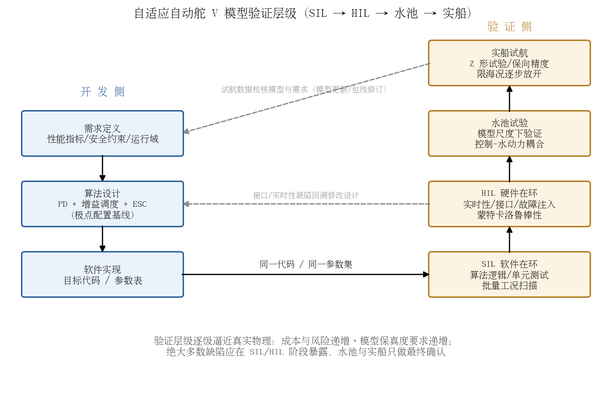
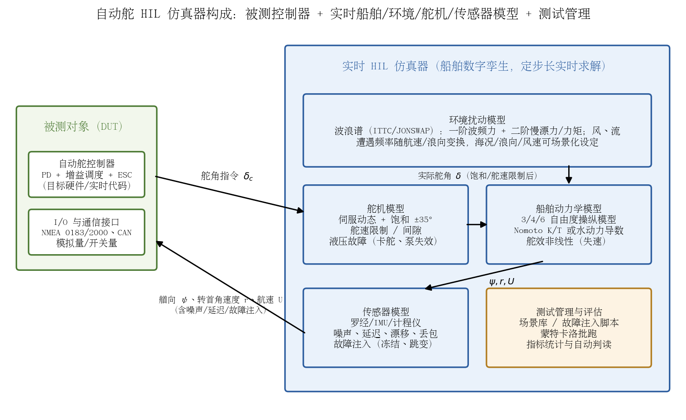

## 自适应自动舵的验证与确认方法

前述各章分析的是"算法能不能控"，本章回答"如何证明它可控"：自适应算法的参数随工况在线变化，传统"一组标称工况 + 几次试航"的验证方式覆盖不了其行为空间，必须建立分层、统计化、贯穿全生命周期的验证与确认（V&V）体系。本章先给出 SIL→HIL→水池→实船的四级验证层级，再剖析 HIL 仿真器的构成与蒙特卡洛鲁棒性验证方法，然后梳理 IMO 与船级社（CCS/DNV）的相关要求，最后讨论自适应算法特有的验证难题与对策，并对本项目（PD + 海况×船速增益调度 + ESC 在线调参）的 HIL 验证体系给出具体建议。

### 验证层级：SIL → HIL → 水池 → 实船

船舶控制系统的验证遵循 V 模型：左侧逐级设计分解，右侧逐级集成验证，每层验证结论回溯修订对应层级的设计产物（图 12-1）。四个验证层级的定位与分工如下：

- **SIL（软件在环）**：控制算法以纯软件形式与非实时仿真模型闭环运行。目标是验证算法逻辑正确性——状态机切换、增益调度插值、ESC 收敛行为、限幅与保护逻辑；优势是可超实时批量运行，适合工况扫描与长历时统计。SIL 暴露不了实时性问题（任务超时、通信抖动、数值舍入在定点目标机上的影响）。
- **HIL（硬件在环）**：真实控制器（目标硬件 + 实时代码）通过真实 I/O 接口接入实时仿真器，仿真器以定步长实时求解船舶与环境模型。这是**软件功能与故障处理能力验证的核心层级**：可安全注入传感器故障、舵机故障、通信中断等危险工况，复现"虚拟试航"。MTS 动力定位委员会的技术文件把 HIL 明确定义为"用船舶专用仿真器对计算机软件进行测试与验证……在船舶建造完成前进行彻底的功能与故障测试"的过程 [9]；DNV 也将其作为控制系统软件第三方验证的标准手段，并建议**每次软件更新后重新进行 HIL 测试** [7]。
- **水池试验**：在拖曳水池/耐波性水池中用缩尺模型验证控制-水动力耦合效应，特别是 HIL 模型中简化掉的成分：非线性波浪力、舵-桨-船体干扰、大幅运动下的舵效变化。对自适应算法的价值在于校核仿真模型本身（模型确认），而非逐条测试软件。
- **实船试航**：最终确认环节。按 IMO MSC.137(76)，操纵性符合性可以"模型试验/仿真预报 + 实船试验验证"的方式证明，标准试航机动包括回转试验、10°/10° 与 20°/20° Z 形试验、全速倒车停船试验，且允许设计阶段用数学模型预报、实船试验校核 [4]。对自动舵则需在限海况下逐步放开：先在低海况验证保向精度与改向超调，再逐级提高海况与机动幅度。

层级设计的基本原则是**缺陷前移**：SIL 几乎零成本，HIL 成本中等但能覆盖危险工况，水池与实船成本高昂且不可复现——因此绝大多数缺陷必须在 SIL/HIL 阶段暴露，后两级只做确认而非排错。

### HIL 仿真器构成

一套自动舵 HIL 仿真器由被测对象（DUT）与实时仿真器两部分构成（图 12-2）。被测对象是运行在目标硬件上的真实控制器及其 I/O 接口（NMEA 0183/2000、CAN、模拟量）；实时仿真器是被控对象与环境的数字孪生，包含四类核心模型 [7][9]：

1. **船舶动力学模型**：3/4/6 自由度操纵运动模型。对本项目，最小可用配置是二阶 Nomoto 模型（$K$、$T$ 按航速/装载调度，叠加非线性项 $T\dot r + r + \alpha r^3 = K\delta$）；用于高海况验证时应升级含横摇耦合的 4 自由度模型，并纳入舵效非线性（大舵角失速，见第 8 章）。模型参数须有溯源性：由系统辨识（本项目 ESC/Z 形试验数据）、水池试验或 CFD 求得，并用独立工况数据做模型确认。
2. **波浪/风/流扰动模型**：波浪采用 ITTC/JONSWAP 谱生成一阶波频力（二阶波频振子模型 $H_w(s)=K_w s/(s^2+2\lambda\omega_0 s+\omega_0^2)$）与正比于 $H_{1/3}^2$ 的二阶慢漂力/力矩；关键细节是**遭遇频率变换** $\omega_e = \omega - \frac{\omega^2 U}{g}\cos\chi$——同一海况在不同航速、浪向下对控制系统的激励完全不同，这正是波浪滤波与自适应律压力测试的核心变量（机理见第 8 章）。风用平均风 + 阵风谱，流用慢变漂移模型。
3. **舵机模型**：伺服动态（一阶/二阶滞后）、舵角饱和（±35°）、舵速限制、机械间隙，以及故障模式——卡舵、液压泵失效、舵角反馈丢失。舵机模型保真度直接决定"饱和-辨识失配"这类自适应特有故障能否在 HIL 中暴露。
4. **传感器模型**：罗经/IMU/计程仪的噪声、量化、延迟、漂移与丢包特性，并支持故障注入（输出冻结、跳变、缓慢漂移）——MSC.64(67) 要求自动舵对传感器失效给出报警 [1]，这些报警逻辑只能在带故障注入的 HIL 上验证。

此外还需要**实时调度与 I/O 板卡**（保证模型求解与接口时钟同步，步长抖动会污染控制器微分项）和**测试管理与评估层**（场景库管理、故障注入脚本、蒙特卡洛批跑、指标统计与自动判读）。DNV 的 HIL 实践强调两点值得借鉴：一是"黑盒"测试——测试方无需知道控制器内部代码，只通过接口激励与响应判读，适合第三方验证 [7]；二是 HIL 仿真器本身必须先用实船/水池数据做确认，否则"用错误模型验证正确控制器"得出的是虚假信心 [9][13]。

### 蒙特卡洛鲁棒性验证

自适应系统的行为空间是"工况 × 参数轨迹"的乘积，少量设计点试验无法覆盖。工程惯例是蒙特卡洛批跑：对不确定量按分布随机抽样，批量闭环仿真，统计性能指标分布与失效概率。航空领域已将其作为自适应控制律验证的标准收尾手段——例如 Citation X 自适应自动舵在 64 个代表性巡航点验证后，仍要求以蒙特卡洛仿真对气动参数、执行器动态、传感器不确定性与扰动做系统统计评估 [14]。

对本项目，随机化维度至少应包括：

- **对象不确定性**：Nomoto $K$、$T$ 在辨识真值 ±30% 内抽样（覆盖辨识误差与装载变化），附加非线性项系数摄动；
- **环境不确定性**：海况（$H_{1/3}$、谱峰周期）、浪向、风速风向、流，覆盖内部 0..3 级标称域并外推至海况 4–5；
- **初始条件与任务**：初始航向偏差、改向幅度（5°–60°）、改向时机与波浪相位的相对关系；
- **故障注入**：传感器噪声方差放大、丢包率、舵速降级（模拟液压老化）；
- **自适应机制的特有变量**：ESC 激励幅值/频率、海况估计误差与延迟——海况估计错一档时调度增益是否仍安全。

判读指标分两类：**安全指标**（最大航向偏差、最大舵角/舵速、饱和时间占比、失稳发散次数——一票否决）与**性能指标**（保向精度 RMS、改向超调、舵机活动量、能耗）。统计口径必须给置信区间而非点估计：若 $n$ 次独立试验零失效，则失效概率 $p$ 的 95% 置信上界约为 $3/n$（"三西格玛法则"的零失效形式，即 $1-(1-p)^n \ge 0.95$）——要声明 $p<10^{-3}$ 需约 3000 次无失效试验。这一量级只有 SIL（超实时）+ HIL（实时但可并行多实例）组合才能负担，也再次说明蒙特卡洛的主战场是 SIL/HIL 而非实船。DNV 在自主航行系统验证中推荐的正是这条路线：以数字孪生为载体的场景化、统计化仿真验证，实船试验只保留少量关键场景做最终确认 [13]。

### IMO 与船级社相关要求

#### IMO MSC.64(67) Annex 3：航向控制系统性能标准

IMO 对自动舵的现行性能标准是 MSC.64(67) 附件 3《航向控制系统性能标准建议案》（1996 年通过，替代 A.342(IX)，适用于 1999 年 1 月 1 日后安装的设备）[1]。与本项目直接相关的条款：

- **3.1 适应性**："航向控制系统应能**手动或自动**适应不同航速、气象与装载条件下船舶的操舵特性"——IMO 标准从 1996 年起就明确容纳自动适应（自适应）方案，本项目 ESC 在线调参在法规框架内；
- **3.3 舵角限制**：自动模式下必须提供舵角限制手段，并在达到限幅时给出指示；
- **3.4 允许艏摇（permitted yaw）**：必须防止正常艏摇引起舵的不必要动作——这是"波浪滤波/死区"要求的法规出处，直接对应第 8 章的波浪滤波分析；
- **3.6 限制超调**：改向至预设航向不得有显著超调；
- **4 切换**：自动/手动切换须能在舵处于任何位置时以单一操作在 3 秒内完成，且自动舵任何故障下均可切回手动；手动切自动时以实际航向为预设航向；
- **6 报警**：电源故障、偏航报警（off-heading alarm）、航向监视器（双罗经时比对独立航向源）、传感器状态指示（外部传感器输入缺失时给出指示）；
- **7.2 / 8.2**：若不具备自动调整功能则必须提供手动气象调节手段；**当控制参数随航速自动调整时，必须接入航速信息源**——对本项目"船速×海况增益调度"而言，航速输入的失效模式（丢信号、错误值）就成为法规关注的验证点。

配套的试验方法是 ISO 11674《船舶与海上技术——航向控制系统》，规定符合 MSC.64(67) Annex 3 的最低操作、功能与性能要求、试验方法及判定准则，其性能试验允许使用基于螺旋桨推进 + 常规舵船模的仿真器 [2]；若扩展到航迹控制，则对应 MSC.74(69) Annex 2 与 IEC 62065（航迹控制系统的操作与性能要求、试验方法及所需试验结果）[3]。

#### 舵机与操纵性试验

- **操舵装置**：SOLAS 对主操舵装置的要求为船舶以最大营运航速前进时，舵自一舷 35° 转至另一舷 30° 不超过 28 s [6]——这是舵机模型舵速上限的法规基线，也是试航舵机试验的必测项；
- **操纵性标准**：MSC.137(76) 规定回转试验（进距 ≤4.5L、战术直径 ≤5L）、10°/10° Z 形试验第一超越角随 $L/V$ 分档（10°/20°/插值）、20°/20° Z 形第一超越角 ≤25°、停船冲程 ≤15L 等衡准，并明确允许"设计阶段模型预报 + 实船试验校核"的符合性证明路径 [4]，MSC/Circ.1053 给出解释性细则。自动舵验证中的 Z 形试验应与这些衡准挂钩，但注意 MSC.137(76) 适用 100 m 以上船舶，对 25 kn 游艇属自愿采用的设计参考而非强制要求。

#### DNV：HIL 测试制度化与对自适应/AI 软件的保证框架

DNV 是船舶控制软件验证制度化的推动者：2014 年收购 NTNU 孵化的 Marine Cybernetics（首家把 HIL 测试引入海事行业的第三方公司），理由是"越来越多严重事故由软件问题引起，不能只靠硬件检验" [8]。其现行做法对自适应软件的启示有三层 [7][10][11]：

1. **HIL 测试作为标准服务**：覆盖 DP、操舵/推进等控制系统，强调功能与故障处理的系统测试、黑盒第三方验证、以及**软件更新后回归 HIL 测试**——后一点对"参数在线变化"的自适应系统尤为关键；
2. **新技术资格确认（TQ）**：DNV-RP-A203 为无现成规范可依的新技术提供基于风险与证据链的资格确认流程 [10]——自适应/学习型控制器在船级社眼中即属此类；
3. **AI 系统保证**：DNV-RP-0671（Assurance of AI-enabled systems，2023）把 AI/数据驱动组件的审定组织为"保证案例（assurance case）"：用结构化论证把"系统安全"的顶层主张连接到可验证的证据（测试结果、仿真场景、鲁棒性检查、监控日志），并要求保证是**持续的**——模型更新、数据漂移、工况变化后须更新证据、重新评估 [11]。

#### CCS：智能船舶规范与智能航行检验指南

CCS《智能船舶规范》对申请智能航行功能标志的船舶要求提交自主航行设计方案（含自主控制方案）、感知系统图纸等供批准，智能航行相关系统与设备须经 CCS 型式认可及产品检验，自主航行系统须满足《钢质海船入级规范》对 **III 类计算机系统**的要求 [5]；配套的《智能航行系统检验指南》进一步对智能航行系统（含自主航行与辅助航行）的开发、应用、**测试验证**与实船应用提出具体技术要求 [12]。对本项目级别的"自适应自动舵"（属辅助航行/增强控制而非自主航行），CCS 路径同样以"图纸审查 + 型式认可（含软件评估）+ 实船试验"为主线，自适应/自学习功能按 III 类计算机系统的软件评估对待，核心关注点是失效安全与降级逻辑。

**小结两家态度**：船级社并不排斥自适应控制——IMO 性能标准早已为"自动适应"留出位置；但自适应功能越复杂，举证责任越重：需要用保证案例把"参数会变"这一事实转化为"变化有界、越界有监控、失控有兜底"的可审计证据链。这与第 8 章的技术结论（自适应必须配包线保护与兜底基线）在法规层面是同构的。

### 自适应算法特有的验证难题与对策

#### 难题一：非确定性与不可复现

固定参数控制器在相同初始条件下行为可复现；自适应控制器的参数是历史的函数，同一试验场景在不同运行时刻（参数已收敛/未收敛/刚经历扰动）表现不同，单次试验通过不代表再次通过。ESC 还有随机性来源（激励相位、噪声驱动的梯度估计）。**对策**：①把"自适应状态"纳入测试初始条件——试验矩阵必须显式区分"冷启动（标称参数）""稳态收敛后""辨识中途"三种入口；②蒙特卡洛统计判读替代单次通过判据；③全程记录参数轨迹日志，使任何失效可回放复现（输入序列 + 初始参数即可重演）。

#### 难题二：回归测试基线漂移

传统回归测试以"输出与基线逐点一致"判通过；自适应系统的合法行为是一个分布，算法改进（如 ESC 增益调整）会使整个参数轨迹改变，基线对比要么频繁误报、要么被迫放宽到失去意义。**对策**：①回归判据从"轨迹一致"改为"**包络一致**"——安全指标（最大偏差、饱和时间）不退化，性能指标分布不劣化（如 RMS 航向误差的 95% 分位数不高于基线版本）；②维护**数字孪生回归平台**：模型确认后的仿真器作为永久回归资产，每次软件/参数变更自动重跑场景库——这正是 DNV 建议"软件更新后重测 HIL"的工程化形态 [7]，也是 DNV 数字孪生保证实践（RP-A204）的思路 [13]；③版本冻结：上船版本冻结参数边界与保护逻辑，新算法先在"影子模式"（平行运行但不接舵）下积累实船数据，再切换。

#### 难题三：理论保证与工程实现的鸿沟

自适应律的稳定性证明建立在理想假设上（无饱和、无延迟、PE 条件满足），实船全部不成立；而"证明不了"不等于"不安全"。**对策是分三层补足**：

1. **包线保护（运行时保证）**：在自适应控制器之外套一层与算法无关的监督层——舵角/舵速/航向偏差硬限幅、异常检测（参数漂移速率、误差能量超阈值）与无条件回退到固定增益 PD 兜底。这就是 Simplex/运行时保证（Runtime Assurance）架构："用简单控制复杂"——经过验证的简单安全控制器随时接管未经完全验证的高性能控制器 [15]。第 8 章"增益调度 PID 作安全兜底"的结论在此落地为架构要求；
2. **运行时监控**：在线监控辨识量（$\hat K$、$\hat T$ 及其置信度）、海况估计、舵机活动量，一方面触发降级逻辑，另一方面持续积累保证案例所需的运行证据（对应 DNV-RP-0671 的持续保证要求 [11]）；
3. **数字孪生回归**：见上，保证"每次变更后全场景库重测"在经济上可行。

### 对本项目 HIL 验证体系的建议

结合本项目现状（PD + 海况×船速增益调度 + ESC 在线调参，Nomoto $K/T$ 在线辨识 + 极点配置基线），建议按以下优先级建设：

1. **先 SIL 后 HIL，模型从简但接口从真**。SIL 阶段用二阶 Nomoto + 波频振子 + 二阶慢漂的简化模型即可完成算法逻辑与长历时统计验证；HIL 阶段的必要性不在于模型更精细，而在于**真实硬件、真实接口、真实故障**——优先把舵机饱和/舵速限制、罗经故障注入、航速源失效（MSC.64(67) §8.2 的法规关注点 [1]）做实，而不是追求高阶水动力。
2. **场景库结构化，按"标称域 + 外推域 + 故障域"三层组织**。标称域覆盖内部海况 0..3 级 × 全船速段；外推域覆盖海况 4–5（检验第 8 章建议的冻结/兜底逻辑是否被正确触发）；故障域覆盖传感器、舵机、通信三类失效模式。每个场景标注预期行为（性能指标 / 安全指标 / 应触发的保护动作），支持自动判读。
3. **蒙特卡洛嵌入 SIL 流水线**。随机化 $K/T$（±30%）、海况参数、浪向、初始条件与海况估计误差；对安全指标采用零失效置信上界口径（$p < 3/n$），对性能指标报告分位数。重点蒙特卡洛对象是 ESC：验证"海况突变 → 辨识漂移 → 包线保护接管 → 恢复"全链路在统计意义下不漏失。
4. **把 MSC.64(67) Annex 3 条款直接转成验收用例**：3 s 内手动接管、舵角限幅指示、偏航报警、传感器缺失指示、手动切自动时接管实际航向——这些是法规字面要求，应逐条对应 HIL 测试用例并保留证据 [1]。
5. **建立"版本-证据"台账**：每次软件或参数表变更，自动触发数字孪生回归（场景库全量重跑），产出可审计的对比报告（安全包络不退化、性能分位数不劣化）。这套台账既是工程资产，也是未来面对 CCS 型式认可或 DNV 式保证案例审查时的证据主体 [5][11]。

### 参考资料

1. [IMO Resolution MSC.64(67) Annex 3：Recommendation on Performance Standards for Heading Control Systems（官方 PDF）](https://wwwcdn.imo.org/localresources/en/KnowledgeCentre/IndexofIMOResolutions/MSCResolutions/MSC.64(67).pdf)
2. [ISO 11674:2019 Ships and marine technology — Heading control systems（标准预览，含仿真器性能试验说明）](https://cdn.standards.iteh.ai/samples/68748/142d0270f3304da1accb24f578edb07c/ISO-11674-2019.pdf)
3. [IEC 62065:2014 航迹控制系统——操作与性能要求、试验方法及所需试验结果（对应 MSC.74(69) Annex 2）](https://webstore.ansi.org/standards/iec/iec62065eden2014)
4. [IMO Resolution MSC.137(76)：Standards for Ship Manoeuvrability（官方 PDF，含 Z 形/回转/停船试验衡准与模型预报符合性路径）](https://wwwcdn.imo.org/localresources/en/KnowledgeCentre/IndexofIMOResolutions/MSCResolutions/MSC.137(76).pdf)
5. [CCS《智能船舶规范》（智能航行功能标志、图纸审查、III 类计算机系统要求）](https://www.ccs.org.cn/ccswz/file/download?fileid=202312061011848316)
6. [SOLAS 操舵装置要求（35°→30° ≤ 28 s）](https://www.amnautical.com/blogs/the-mariners-blog/understanding-steering-gear-ships)
7. [DNV：HIL testing of marine systems（控制系统软件 HIL 验证服务，软件更新后重测建议）](https://www.dnv.us/services/hil-testing-of-marine-systems-83385/)
8. [DNV GL 收购 Marine Cybernetics（HIL 测试引入海事行业的缘起）](https://drillingcontractor.org/dnv-acquires-marine-cybernetics-28958)
9. [MTS DP 委员会 TECHOP (D-08)：SOFTWARE TESTING（HIL 定义、船舶专用仿真器构成、虚拟试航）](https://dynamic-positioning.com/files_mailing/TECHOP%20(D-08%20-%20Rev1%20-%20Jan21)%20SOFTWARE%20TESTING.pdf)
10. [DNV-RP-A203：Technology Qualification（新技术资格确认推荐做法）](https://www.dnv.us/services/technology-qualification-4779/)
11. [DNV 报告引述 DNV-RP-0671《Assurance of AI-enabled systems》(2023) 与 AMLAS 方法（AI 保证案例、持续保证）](https://www.havtil.no/contentassets/ef58508a2e4641aebba4091811795020/dnv-2024-1519-state-of-the-art-for-responsible-use-of-artificial-intelligence-in-the-petroleum-sector.pdf)
12. [CCS《智能航行系统检验指南》（智能航行系统开发、应用、测试验证技术要求）](https://www.ccs.org.cn/ccswz/file/download?fileid=202304200483843827)
13. [Pedersen et al., Towards simulation-based verification of autonomous navigation systems（DNV 数字孪生场景化仿真验证路线，Ocean Engineering 2020）](https://www.sciencedirect.com/science/article/abs/pii/S092575352030196X)
14. [Adaptive Autopilot Design and Implementation for Cessna Citation X（64 工况验证 + 蒙特卡洛鲁棒性评估的航空实践，Aerospace 2026）](https://www.mdpi.com/2226-4310/13/4/318)
15. [Mehmood et al., The Black-Box Simplex Architecture for Runtime Assurance of Autonomous CPS（运行时保证/兜底切换架构）](https://arxiv.org/pdf/2102.12981)
