# 自动舵自适应算法调研与最大海况适应性分析

> 调研日期：2026-08 · 面向项目：auto_rudder（25 kn 游艇自动舵，PD + 增益调度 + ESC 在线调参）

## 摘要

本文系统调研了船舶自动舵领域的八类自适应控制算法——模型参考自适应（MRAC）、自校正调节器/最小方差与 LQG（STR/LQG）、自适应 PID 与增益调度、模糊自适应、神经网络自适应、鲁棒自适应（L1 自适应 / 自适应滑模）、强化学习与数据驱动方法——并从扰动机理出发，逐类分析各算法在最大海况下能否正常运行，给出"算法 × 海况"可行性对比与面向本项目的工程建议。第 2 版进一步覆盖四个扩展专题：航迹舵（自适应 LOS 制导）、舵减摇（航向-横摇联合控制）、自适应/学习型 MPC、自适应算法的验证与确认方法；全部关键数据均回溯一手来源逐条核验。

**核心结论**：

1. 自适应自动舵已有 50 年工程积累：1970 年代 Åström/Källström 的自校正油轮自动舵（130 余次实船试验，节油 0.3–0.9%）与 Van Amerongen 的 MRAC 自动舵均已商用化，恶劣海况恰是自适应收益最大的场景。
2. **波浪滤波是高海况适应性的前提，先于一切自适应算法**——一阶波频分量必须先滤除，否则自适应律被"假激励"误导、舵机空转磨损。
3. 舵机硬约束（舵速约 2.3°/s、舵角 ±35° 失速）决定海况上限，控制器带宽须留 3–5 倍裕度，辨识必须用实际舵角而非舵令。
4. 本项目"PD + 海况×船速调度 + ESC"的结构与工业界"调度管快变量、自适应管慢变量"的经典分工同构，方向正确；首要改进项是补波浪滤波、ESC 高海况保护（dead-zone / 泄漏项 / 冻结降级）、并将调度域显式扩展到海况 4–5。

## 算法总览

| 算法 | 自适应对象 | 成熟度（实船） | 最大海况可行性* | 代表工作 |
|------|-----------|--------------|----------------|---------|
| MRAC | 控制器增益（直接） | 高（1970s 商用） | 可用（需陷波+慢自适应+抗饱和） | Van Amerongen 1984 |
| STR / LQG | 模型参数（间接，RLS+MV/LQ） | 高（KADPIL 商用） | 可用（高海况收益最大；需滤波防有偏） | Källström 1979 |
| 增益调度 + 自适应 PID | 增益查表/在线整定 | 极高（行业标准） | **最好**（扩展调度域后海况 4–5 可行） | Kongsberg 等商用舵 |
| 模糊自适应 | 增益曲面/规则库 | 中（少量实船） | 可用（必须配波浪滤波） | Tomera 2017 |
| 神经网络自适应 | 未知函数逼近 | 中（仿真为主） | 受限（分布外无保证，只宜限幅补偿） | 李铁山/张显库谱系 |
| L1 自适应 | 快速自适应+低通解耦 | 中高（航空已商用） | **好**（鲁棒性可量化） | Xu 2021；Raymarine |
| 自适应滑模 | 切换增益/扰动界 | 中高（Shioji-Maru 海试） | 好（需边界层/超螺旋抑抖） | Perera 2012 |
| 强化学习 | 端到端策略 | 低（个别真船） | 弱（仅离线冻结或监督下微调） | Cui 2019（SPMPC） |

\* "最大海况"指本项目 25 kn 游艇的设计上限海况 4–5（WMO 分级，H₁/₃ ≈ 2–4 m）；海况 ≥6 时一切算法均应以安全降级而非航向精度为目标。详见第八章。

## 目录

1. [模型参考自适应控制（MRAC）](#模型参考自适应控制mrac在船舶自动舵中的应用)
2. [自校正调节器（STR）与最小方差 / LQG 自适应](#自校正调节器str与最小方差--lqg-自适应自动舵)
3. [自适应 PID 与增益调度](#自适应-pid-与增益调度自动舵)
4. [模糊自适应控制](#模糊自适应控制自动舵)
5. [神经网络自适应控制](#神经网络自适应控制自动舵)
6. [鲁棒自适应：L1 自适应与自适应滑模](#鲁棒自适应控制l1-自适应与自适应滑模)
7. [强化学习与数据驱动自适应](#强化学习与数据驱动自适应自动舵)
8. [最大海况下的适应性分析](#最大海况下的适应性分析)
9. [航迹/路径跟踪中的自适应控制（航迹舵）](#航迹路径跟踪中的自适应控制航迹舵)
10. [舵减摇与航向-横摇联合自适应控制](#舵减摇与航向-横摇联合自适应控制)
11. [自适应与学习型 MPC 在船舶运动控制](#自适应与学习型-mpc-在船舶运动控制)
12. [自适应自动舵的验证与确认方法](#自适应自动舵的验证与确认方法)
13. [相关产品与专利](#相关产品与专利)
14. [结论与对本项目的建议](#结论与对本项目的建议)

> **第 2 版说明（2026-08）**：本版对全部章节做了逐条数据核验（每个关键数字回溯一手来源，已修正的错误在各章节内直接更正，无法核实者标注"待核实"），并新增第 9–12 章（航迹舵、舵减摇、自适应 MPC、验证确认方法）。
>
> **第 3 版说明（2026-08）**：新增第 13 章"相关产品与专利"——48 件经逐页核实的公开专利，给出"公司 — 产品 — 专利"映射，并与第 1–8 章的算法谱系互证。

---

---

## 模型参考自适应控制（MRAC）在船舶自动舵中的应用

### 1. MRAC 基本原理

模型参考自适应控制（Model Reference Adaptive Control, MRAC/MRAS）的核心思想是：用一个**参考模型**显式地给出闭环系统的期望动态，当对象实际输出与参考模型输出出现偏差时，由**自适应机构**在线调整控制器参数（直接自适应），使对象-控制器组成的闭环逐渐逼近参考模型的行为。其优化目标可写为最小化广义误差的平方积分

$$
J = \int_0^{T} e^2(t)\,\mathrm{d}t, \qquad e(t) = y(t) - y_m(t)
$$

其中 $y$ 为对象输出，$y_m$ 为参考模型输出（[van Amerongen 的 MRAS 讲义](https://dynamicalsystems.nl/intelligentcontrol/Intelligent_Control_MRAS.pdf)）。MRAC 属于**直接自适应控制**：不显式辨识对象参数，而是直接调整控制器增益，这是它与"辨识 + 控制器再设计"的间接自适应（自校正）路线的本质区别。

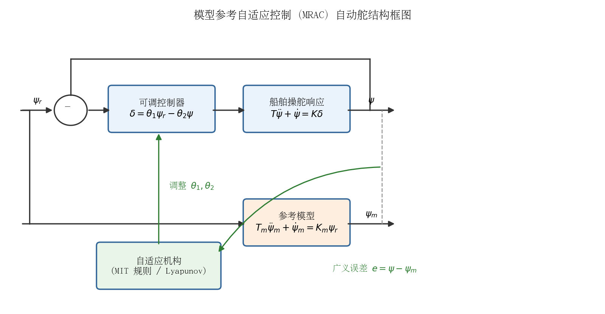

#### 1.1 MIT 规则（梯度法）

最早的 MRAC 设计方法由 MIT 仪器实验室的 Whitaker 等人于 1958 年提出（[Whitaker et al., MIT Report R-164, 1958；转引自 Springer 教材章节](https://link.springer.com/content/pdf/10.1007/978-1-4471-4396-3_9.pdf?pdf=inline%20link)），称为 **MIT 规则**。其出发点是沿准则 $J(\theta)=\frac{1}{2}e^2$ 的负梯度方向调整控制器参数 $\theta$：

$$
\dot{\theta} = -\gamma\,\frac{\partial J}{\partial \theta} = -\gamma\, e\,\frac{\partial e}{\partial \theta}
$$

其中 $\gamma>0$ 为自适应增益，$\partial e/\partial\theta$ 称为**灵敏度导数**（sensitivity derivative）。由于灵敏度导数依赖未知的对象参数，实际实现时需用参考模型参数近似（例如用模型输出对参数的灵敏度滤波器代替）。

MIT 规则结构简单、易于实现，但它本质上是局部梯度下降，**不保证闭环稳定**：当自适应增益 $\gamma$ 过大或参考输入幅值过大时，自适应回路可能失稳。这一缺陷促使 Parks 于 1966 年提出基于 Lyapunov 稳定性理论的重设计方法（[Parks, IEEE Trans. Automatic Control, 11(3): 362–367, 1966；转引自 Springer 教材章节](https://link.springer.com/content/pdf/10.1007/978-1-4471-4396-3_9.pdf?pdf=inline%20link)）。

#### 1.2 Lyapunov 设计

Lyapunov 设计把自适应律的选取反过来做：先构造包含跟踪误差与参数误差的 Lyapunov 函数，再选择使 $\dot{V}\le 0$ 的自适应律，从而**按构造保证稳定性**。以一阶对象为例，设

$$
\dot{y} = -a\,y + b\,u, \qquad u = \theta_1 r - \theta_2 y
$$

参考模型为 $\dot{y}_m = -a_m y_m + b_m r$（$a_m>0$）。理想匹配参数为 $\theta_1^* = b_m/b$，$\theta_2^* = (a_m-a)/b$。定义参数误差 $\tilde{\theta}_i = \theta_i - \theta_i^*$，则误差方程为

$$
\dot{e} = -a_m e + b\left(\tilde{\theta}_1 r - \tilde{\theta}_2 y\right)
$$

取 Lyapunov 函数（设 $b>0$ 已知符号）

$$
V = \frac{1}{2}e^2 + \frac{b}{2\gamma}\left(\tilde{\theta}_1^2 + \tilde{\theta}_2^2\right)
$$

沿轨迹求导并选择自适应律

$$
\dot{\theta}_1 = -\gamma\, e\, r, \qquad \dot{\theta}_2 = \gamma\, e\, y
$$

即可使 $\dot{V} = -a_m e^2 \le 0$，闭环所有信号有界且 $e(t)\to 0$。这一"一阶对象 + 前馈/反馈两参数"结构恰好对应一阶 Nomoto 船舶模型下的艏向控制，因此成为船舶 MRAC 自动舵的标准设计模板（推导框架见 [van Amerongen 的 MRAS 讲义](https://dynamicalsystems.nl/intelligentcontrol/Intelligent_Control_MRAS.pdf) 与 [Python Control 库的 MRAC 示例](https://python-control.readthedocs.io/en/0.10.2/examples/mrac_siso_lyapunov.html)）。

### 2. Norrbin / Nomoto 一阶参考模型

船舶操舵响应最经典的简化模型是 Nomoto 一阶模型（1957），描述舵角 $\delta$ 到转艏角速度 $r=\dot{\psi}$ 的传递关系：

$$
T\dot{r} + r = K\delta \quad\Longleftrightarrow\quad T\ddot{\psi} + \dot{\psi} = K\delta
$$

其中增益与时间常数随船速 $U$、船长 $L$ 按如下规律换算（[Van Amerongen, Automatica, 1984](https://afscheid.vanamerongen.org/publicaties/amerongen84.pdf)）：

$$
K = K^*\frac{U}{L}, \qquad T = T^*\frac{L}{U}
$$

$K^*$、$T^*$ 为关于船速近似不变的无因次常数，量级在 0.5–2.0。Norrbin（1963）在一阶模型中引入非线性项以描述大舵角下的非线性操舵特性：

$$
T\dot{r} + H_N(r) = K\delta, \qquad H_N(r) = n_3 r^3 + n_2 r^2 + n_1 r + n_0
$$

Nomoto 一阶模型可视为 Norrbin 模型的线性特例（$H_N(r)=r$）。在 MRAC 自动舵中，参考模型通常就取这种**一阶（Norrbin/Nomoto 型）环节**，并附加转艏速率限幅，用于把阶跃式改向指令整形为"起转—恒速率转艏—无超调回正"的理想艏向轨迹：

$$
T_m\ddot{\psi}_m + \dot{\psi}_m = K_m\,\psi_r
$$

Van Amerongen 建议参考模型时间常数 $T_m$ 取为船舶主导时间常数的 $1/2 \sim 1/3$，因为合理设计的航向控制器（带速率反馈）会把闭环等效时间常数压缩到开环的 $1/2 \sim 1/3$，这样能保证实际艏向跟得上模型轨迹（[Van Amerongen, Automatica, 1984](https://afscheid.vanamerongen.org/publicaties/amerongen84.pdf)）。

### 3. Van Amerongen 等人的经典 MRAC 自动舵

MRAC 在船舶自动舵中的系统性应用由荷兰代尔夫特理工大学的 **J. van Amerongen** 及其合作者开创，代表性工作包括：

- **Van Amerongen & Udink ten Cate (1975)**，《Model reference adaptive autopilots for ships》，Automatica 11(1), 441–449——首个基于梯度法（MIT 规则）的船舶 MRAC 自动舵（[文献线索见 EOLSS 船舶自动化章节](https://www.eolss.net/sample-chapters/c18/E6-43-36-03.pdf)）。
- **Van Amerongen & Van Nauta Lemke (1978–1980)**：数字 MRAC 自动舵的海上试验与最优操舵准则研究。
- **Van Amerongen (1982/1984)**：博士论文及发表于 Automatica 20(1) 的总结性论文《[Adaptive Steering of Ships — A Model Reference Approach](https://afscheid.vanamerongen.org/publicaties/amerongen84.pdf)》（被引 300 余次），给出了完整的 MRAC 自动舵体系：
  - **改向（course changing）模式**：采用串联参考模型对设定值整形（生成限速率转艏轨迹），并用并联参考模型 + MIT 规则**直接自适应**调整控制器增益，补偿船速、载况、水深变化引起的 $K$、$T$ 摄动；对舵机饱和、舵速限制（典型值 $|\delta|\le35°$、$|\dot{\delta}|\le 2\sim7°/s$）这类非线性给出了专门处理；
  - **保向（course keeping）模式**：采用**间接自适应**——在线辨识 + 基于性能指标
    $$
    J = \int \left(\varepsilon^2 + \lambda\,\delta^2\right)\mathrm{d}t
    $$
    的 LQ 最优增益（$K_p = 1/\sqrt{\lambda}$ 等），其中 $\varepsilon$ 为艏向误差、$\delta$ 为舵角；$\lambda$ 建议取值范围 0.1（精确操舵）到 4（小船高海况经济性操舵）；并配合**自适应状态估计器**估计被波浪污染的低频艏向/转艏速率；
  - 海上实船试验表明，相对常规 PID 自动舵**节油最高约 5%**（原文："fuel savings up to 5% … mainly possible because of the adaptive state estimator"），主要来自自适应状态估计（含波浪滤波）（[Van Amerongen, Automatica, 1984](https://afscheid.vanamerongen.org/publicaties/amerongen84.pdf)）。
- **Van Amerongen, van der Klugt & van Nauta Lemke (1990)**：《Rudder roll stabilization for ships》，Automatica 26(4)，把 MRAC 自动舵扩展到舵减摇（[EOLSS 文献目录](https://www.eolss.net/sample-chapters/c18/E6-43-36-03.pdf)）。
- **Holzhüter & Strauch (1987)**：《A commercial adaptive autopilot for ships: design and operational experiences》，IFAC——MRAC 类自适应自动舵的商用化与运行经验（[NTNU 学位论文引目](https://ntnuopen.ntnu.no/ntnu-xmlui/bitstream/handle/11250/2773646/Andreas%20Bell%20Martinsen_PhD.pdf)）。

后续工作中，Fossen 等人把 Lyapunov 设计、输出反馈（仅需罗经艏向测量）与陷波（notch）波浪滤波结合起来：如《[A globally stable adaptive ship autopilot with wave filter using only yaw angle measurements](https://www.mic-journal.no/PDF/1996/MIC-1996-2-4.pdf)》（1996，全局稳定 MRAC + 级联陷波滤波器，并用参考模型整形技术引入积分作用）和 Lauvdal & Fossen 的《[Robust adaptive ship autopilot with wave filter...](https://www.fossen.biz/publications/1998%20Lauvdal%20and%20Fossen%20IJACSP.pdf)》（IJACSP, 1998），解决了 Van Amerongen 方案依赖全状态反馈（需转艏角速度）的问题。

### 4. 参考模型如何抑制波浪频率响应

波浪引起的艏摇力矩峰值频率典型范围为 **0.05–0.2 Hz**（约 0.3–1.3 rad/s）（[Van Amerongen, Automatica, 1984](https://afscheid.vanamerongen.org/publicaties/amerongen84.pdf)）。这一频段远高于船舶操舵响应的有效带宽，用舵去补偿波浪频率运动不仅无效，反而因舵机大舵角快速动作的相位滞后**放大**船体运动并增加阻力。MRAC 从三个层面抑制波浪频率响应：

1. **参考模型本身是低通滤波器**：一阶参考模型 $G_m(s)=K_m/(T_m s+1)$ 的截止频率 $1/T_m$ 远低于波浪频率，设定值经模型整形后只含低频分量，闭环只需跟踪低频轨迹，结构上就不会去"追浪"（见下图 a）。
2. **慢自适应避免波浪注入参数回路**：自适应律由广义误差 $e=\psi-\psi_m$ 驱动。只要自适应增益 $\gamma$ 取得小（自适应回路带宽远低于波浪频率），波浪频率分量在参数更新积分中被平均掉，不会引起参数漂移；反之波浪噪声大时若 $\gamma$ 过大，会产生参数漂移甚至失稳——这正是 1996 年 Fossen 等人引入陷波滤波器的原因（[MIC 1996 论文](https://www.mic-journal.no/PDF/1996/MIC-1996-2-4.pdf)）。
3. **滤波量随噪声水平自适应**：Van Amerongen 指出常用的死区并不是正确解法，必须精心设计低通滤波器去除舵令中的高频噪声，且滤波强度应随波浪噪声水平自适应调整；"精度—经济性"旋钮同时改变 $\lambda$ 与滤波量——高海况下取大 $\lambda$（少动舵）并允许最大滤波（[Van Amerongen, Automatica, 1984](https://afscheid.vanamerongen.org/publicaties/amerongen84.pdf)）。

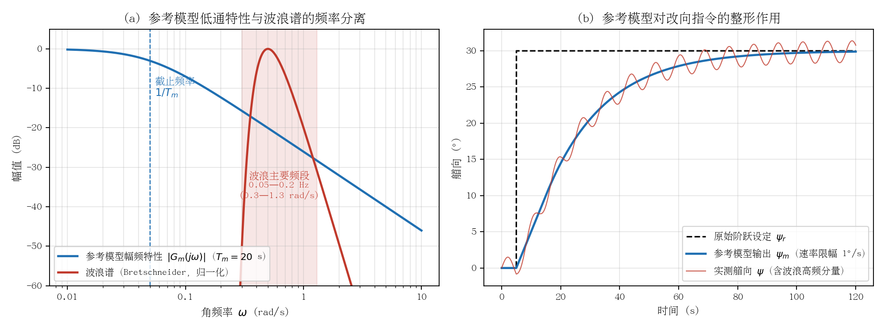

上图中：(a) 一阶参考模型（$T_m=20$ s）在波浪主要频段（0.3–1.3 rad/s）的衰减约为 16 dB（低频端 0.3 rad/s）至 28 dB（高频端 1.3 rad/s）——按 $|G_m(j\omega)|=1/\sqrt{1+(\omega T_m)^2}$ 计算，低频端约 15.7 dB，严格说在频段下沿**不足 20 dB**，需配合舵令低通/陷波滤波才能保证充分隔离；实现期望动态与波浪扰动的频率分离；(b) 阶跃改向指令经带转艏速率限幅的参考模型整形为平滑轨迹，实测艏向中的波浪高频分量仅围绕期望轨迹波动，不进入舵令。

### 5. 工程优缺点

**优点**

- 期望性能由参考模型**显式表达**，物理意义直观；操作员只需调整"转艏速率""精度/经济性"等少量高层旋钮，无需理解 PID 参数整定（[Van Amerongen, Automatica, 1984](https://afscheid.vanamerongen.org/publicaties/amerongen84.pdf)）；
- 直接自适应无需显式参数辨识，算法简单、计算量小，适合嵌入式实现；参数自适应回路具有"记忆"，对象参数缓慢变化（船速、载况）时性能优良；
- 参考模型天然完成设定值整形与波浪频率隔离，配合自适应滤波可显著降低操舵阻力，实船试验节油最高约 5%。

**缺点**

- MIT 规则本身**不保证稳定**，需 Lyapunov 重设计；而 Lyapunov 设计对对象相对阶、未建模动态（舵机饱和与舵速限制）敏感，需要专门的抗饱和/抗漂移处理（见第 6 节）；
- 经典方案假设**全状态反馈**（需转艏角速度），罗经只提供艏向时必须引入状态估计器，增加复杂度（后续输出反馈方案缓解了这一点）；
- 波浪噪声环境下存在**参数漂移**风险，必须配合陷波/低通滤波、死区或归一化自适应律等鲁棒化措施；
- 高海况下对象非线性增强（Norrbin 立方项、舵机饱和），一阶线性参考模型与实际动态失配加大，自适应收敛变慢甚至失效，需与增益调度等手段结合。

### 6. 舵机饱和下的鲁棒修正自适应律（σ-/e-modification）

理想 Lyapunov 自适应律 $\dot{\theta}=-\gamma e\,\zeta$（$\zeta$ 为回归信号，如 $r$、$y$）的稳定性证明建立在"对象与参考模型严格匹配、无扰动、执行机构无约束"的理想前提上，而自动舵的实船环境两条都不满足：

- **舵角/舵速饱和**：饱和期间艏向无法跟上参考模型，广义误差 $e$ 持续偏大，自适应机构却把这部分"不可行误差"照样积分进参数，形成与积分饱和（integrator windup）同构的**参数回卷**；
- **波浪噪声与未建模动态**：Rohrs 等人 1985 年的著名反例表明，即使是有界小扰动加未建模动态，也足以使理想 MRAC 的参数缓慢漂移直至突发失稳（bursting）（[Rohrs et al., IEEE Trans. Automatic Control, 30(9): 881–889, 1985；转引自 MIT 学位论文引目](https://dspace.mit.edu/bitstream/handle/1721.1/111744/1004393438-MIT.pdf?sequence=1&isAllowed=y)）。

工程上的标准对策是在自适应律中加入**鲁棒修正项**，代表性形式有：

**σ-modification**（Ioannou & Kokotovic, 1984）：加入把参数持续"拉回"原点的固定泄漏项

$$
\dot{\theta} = -\gamma\, e\,\zeta - \gamma\sigma\,\theta, \qquad \sigma>0
$$

泄漏项 $-\gamma\sigma\theta$ 使参数更新方程成为以 $-\gamma e\zeta$ 为输入的稳定一阶滤波器，从而保证所有信号一致有界；代价是引入 $O(\sigma)$ 量级的残余误差——扰动消失后 $e$ 不再渐近归零，参数稳态值相对 $\theta^*$ 存在偏差（[Ioannou & Kokotovic, Automatica, 20(5): 583–594, 1984；文献信息见 arXiv 综述引目](https://arxiv.org/pdf/2202.09834v1.pdf)）。

**e-modification**（Narendra & Annaswamy, 1987）：把固定泄漏改为与跟踪误差幅值成正比的可变泄漏

$$
\dot{\theta} = -\gamma\, e\,\zeta - \gamma\sigma\,|e|\,\theta
$$

饱和或波浪扰动使 $|e|$ 增大时泄漏自动加强、抑制漂移；$e\to 0$ 时泄漏消失，因此保留了理想律的收敛性质（无扰动时仍可使 $e\to 0$），且不需要持续激励（PE）条件即保证有界（[Narendra & Annaswamy, IEEE Trans. Automatic Control, 32(2): 134–145, 1987；文献信息见 IntechOpen 章节引目](https://www.intechopen.com/chapters/1175769)）。

此外常用的还有**参数投影**（把 $\theta$ 约束在已知凸集内）、**死区**（$|e|$ 低于噪声水平时冻结更新）与**归一化自适应律**。值得指出的是，Van Amerongen 1984 年的方案在结构层面已包含抗饱和思想：舵角与舵速限幅被直接做进**串联参考模型**——参考轨迹本身受限、永远可行，饱和期间广义误差不会因"追不上的指令"而发散，本质上是一种"参考模型级抗饱和"（[Van Amerongen, Automatica, 1984](https://afscheid.vanamerongen.org/publicaties/amerongen84.pdf)）。

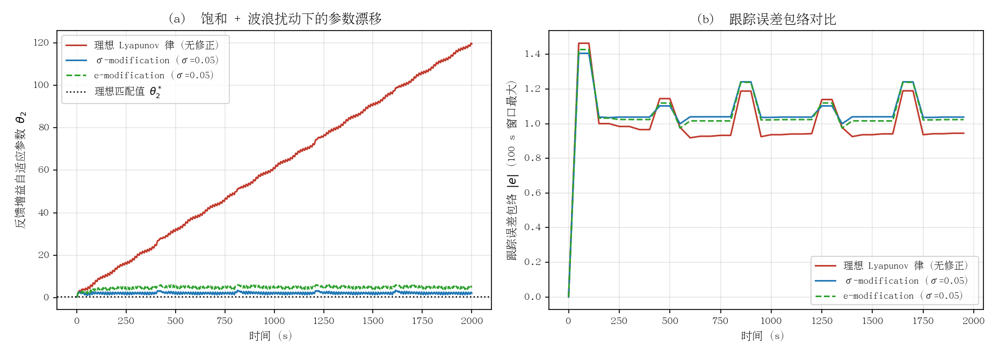

上图为一阶 Nomoto 型对象 + 舵角饱和 + 波浪扰动（0.08/0.17 Hz）下的数值仿真：(a) 理想 Lyapunov 律的反馈增益 $\theta_2$ 在 2000 s 内持续漂移、远离理想匹配值近两个数量级，而 σ- 与 e-modification 始终将其约束在 $\theta_2^*$ 附近；(b) 修正律的代价是略大的残余跟踪误差——这正是"鲁棒性—精度"折中的直观体现（仿真脚本见 `figs/make_fig_01_sigma_mod.py`）。

#### 6.1 与本项目 ESC 在线调参的对比

- **漂移机制不同，但风险同构**：MRAC 是连续积分型更新，误差信号被直接积分，饱和/噪声期会产生单向漂移；本项目 ESC 是"扰动—平均"型极值搜索，按目标函数梯度的慢变估计更新，其解调平均环节对高频波浪噪声天然不敏感。但饱和期间实测性能指标 $J$ 被"削顶"，梯度估计出现偏置，同样会把增益推向错误方向——因此 ESC 也需要"饱和段冻结更新/剔除饱和数据"的纪律，与 MRAC 的死区、泄漏思想同构；
- **泄漏思想可直接移植到 ESC**：在 ESC/极点配置更新回路中加入向先验值（增益调度表插值结果）的回拉项 $\dot{k}=-\gamma\,\hat{g}-\sigma\,(k-k_{\text{sched}})$，把海况×船速调度表当作参数"锚"，防止 ESC 在异常海况或传感器故障下漂出安全域——这相当于给间接自适应回路加一层 σ-modification；
- **参考模型级抗饱和已部分落地**：本项目若采用第 2 节所述带舵角/舵速限幅的参考模型做设定值整形，饱和期的误差就不会注入 ESC 的目标函数，是最廉价的第一道防线；
- **实现成本**：两类修正律只需在参数更新方程中各加一项，与现有 ESC、极点配置代码完全解耦，适合作为安全加固项引入，无需改动控制结构。

### 7. 与本项目（PD + 增益调度 + ESC 在线调参）方案的关联与借鉴

本项目当前方案为 PD 控制器 + 海况（0–3 级）× 船速段的增益调度 + 基于 Nomoto $K$/$T$ 在线辨识与极点配置的 ESC 自动调参。从自适应控制分类看（[van Amerongen MRAS 讲义](https://dynamicalsystems.nl/intelligentcontrol/Intelligent_Control_MRAS.pdf)）：

- 本项目的"船速段增益调度"对应 Van Amerongen 所说的 **gain scheduling**（$K=K^*U/L$、$T=T^*L/U$ 的显式换算）；"ESC 在线辨识 $K$/$T$ + 极点配置"则属于**间接自适应**（显式辨识 + 控制器再设计），与 Van Amerongen 保向模式的技术路线一致；
- **MRAC 提供了另一条互补路线**：不辨识对象参数，用参考模型 + MIT/Lyapunov 律**直接**调整 PD 增益。具体可借鉴点：
  1. **引入串联一阶参考模型（带转艏速率限幅）对艏向设定值整形**：避免阶跃改向指令直接冲击 PD 产生大舵角，同时把期望动态限制在低频段，是抑制波浪频率舵动的结构性手段，实现成本极低；
  2. **性能指标 $J=\int(\varepsilon^2+\lambda\delta^2)\mathrm{d}t$ 可作为 ESC 调参的目标函数**，并把 $\lambda$ 与在线估计的波浪噪声水平挂钩，将当前离散的"海况 0–3 级"档位**连续化**——高海况自动加大 $\lambda$ 与滤波量、少动舵；
  3. **自适应回路带宽纪律**：若未来在 ESC 之外叠加 MIT/Lyapunov 增益微调回路，其带宽必须远低于波浪频率（或加陷波滤波），否则波浪分量会注入参数更新导致漂移——这对本项目 ESC 的激励设计与收敛速度选取同样是硬约束；
  4. **抗饱和处理**：Van Amerongen 对舵角/舵速饱和下的 MRAC 给出了专门方案，对本项目 25 kn 游艇在大舵角改向时的积分/增益回卷设计有直接参考价值（具体修正律形式与 ESC 对比见第 6 节）。

### 8. 参考资料

1. J. van Amerongen, "Adaptive Steering of Ships — A Model Reference Approach", *Automatica*, 20(1), 3–14, 1984. <https://afscheid.vanamerongen.org/publicaties/amerongen84.pdf>
2. J. van Amerongen, "Intelligent Control part 1 — Model Reference Adaptive Control Systems"（University of Twente 讲义）, 2004. <https://dynamicalsystems.nl/intelligentcontrol/Intelligent_Control_MRAS.pdf>
3. J. van Amerongen, A.J. Udink ten Cate, "Model reference adaptive autopilots for ships", *Automatica*, 11(1), 441–449, 1975（文献信息见 <https://www.eolss.net/sample-chapters/c18/E6-43-36-03.pdf>）
4. H.P. Whitaker, J. Yamron, A. Kezer, "Design of Model Reference Adaptive Control Systems for Aircraft", MIT Instrumentation Lab Report R-164, 1958；P.C. Parks, "Lyapunov redesign of model reference adaptive control systems", *IEEE Trans. Automatic Control*, 11(3), 362–367, 1966（均转引自 <https://link.springer.com/content/pdf/10.1007/978-1-4471-4396-3_9.pdf?pdf=inline%20link>）
5. T. Lauvdal, T.I. Fossen, "Robust adaptive ship autopilot with wave filter...", *Int. J. Adaptive Control and Signal Processing*, 1998. <https://www.fossen.biz/publications/1998%20Lauvdal%20and%20Fossen%20IJACSP.pdf>
6. T.I. Fossen, J.P. Strand（等）, "A globally stable adaptive ship autopilot with wave filter using only yaw angle measurements", *Modeling, Identification and Control*, 1996. <https://www.mic-journal.no/PDF/1996/MIC-1996-2-4.pdf>
7. T.I. Fossen, "High Performance Ship Autopilot With Wave Filter", SCSS, 1993. <https://www.fossen.biz/publications/1993%20Fossen%20SCSS.pdf>
8. T. Holzhüter, H. Strauch, "A commercial adaptive autopilot for ships: design and operational experiences", *IFAC Proceedings Volumes*, 20(5), 233–238, 1987（文献信息见 <https://ntnuopen.ntnu.no/ntnu-xmlui/bitstream/handle/11250/2773646/Andreas%20Bell%20Martinsen_PhD.pdf>）
9. J. van Amerongen, P.G.M. van der Klugt, H.R. van Nauta Lemke, "Rudder roll stabilization for ships", *Automatica*, 26(4), 679–690, 1990（文献信息见 <https://www.eolss.net/sample-chapters/c18/E6-43-36-03.pdf>）
10. Python Control Systems Library, "Model-Reference Adaptive Control (MRAC) SISO, direct Lyapunov rule"（一阶对象 Lyapunov MRAC 推导示例）. <https://python-control.readthedocs.io/en/0.10.2/examples/mrac_siso_lyapunov.html>
11. P.A. Ioannou, P.V. Kokotovic, "Instability analysis and improvement of robustness of adaptive control"（σ-modification 的原始出处）, *Automatica*, 20(5), 583–594, 1984（文献信息见 <https://arxiv.org/pdf/2202.09834v1.pdf>）
12. K.S. Narendra, A.M. Annaswamy, "A New Adaptive Law for Robust Adaptation Without Persistent Excitation"（e-modification 的原始出处）, *IEEE Trans. Automatic Control*, 32(2), 134–145, 1987（文献信息见 <https://www.intechopen.com/chapters/1175769>）
13. C.E. Rohrs, L. Valavani, M. Athans, G. Stein, "Robustness of continuous-time adaptive control algorithms in the presence of unmodeled dynamics", *IEEE Trans. Automatic Control*, 30(9), 881–889, 1985（文献信息见 <https://dspace.mit.edu/bitstream/handle/1721.1/111744/1004393438-MIT.pdf?sequence=1&isAllowed=y>）

---

## 自校正调节器（STR）与最小方差 / LQG 自适应自动舵

### 1. 算法原理

#### 1.1 自校正调节器的基本框架

自校正调节器（Self-Tuning Regulator, STR）由 Åström 与 Wittenmark 于 1973 年提出（[On self-tuning regulators, Automatica](https://doi.org/10.1016/0005-1098(73)90073-3)），其核心思想是把**在线参数辨识**与**基于模型的控制器综合**在每个采样周期内交替执行：

1. 用递推最小二乘（RLS）等算法在线辨识一个输入输出模型（通常取受控自回归滑动平均模型，ARMAX）的参数；
2. 按**确定性等价（certainty equivalence）**原则，把当前参数估计当作真值，代入设计方程直接算出控制器参数。

带遗忘因子的 RLS 递推式为

$$
\hat{\theta}(t)=\hat{\theta}(t-1)+K(t)\,\varepsilon(t),\qquad
K(t)=\frac{P(t-1)\varphi(t)}{\lambda_f+\varphi^{T}(t)P(t-1)\varphi(t)},
$$

$$
P(t)=\frac{1}{\lambda_f}\left[P(t-1)-K(t)\varphi^{T}(t)P(t-1)\right],
$$

其中 $\lambda_f\in(0,1]$ 为遗忘因子，用于跟踪船舶动力学的慢时变（航速、载况、海况引起的 $K$、$T$ 变化）。

#### 1.2 最小方差（MV）与广义最小方差（GMV）控制

对 ARMAX 模型

$$
A(z^{-1})\,y(t)=z^{-k}B(z^{-1})\,u(t)+C(z^{-1})\,e(t),
$$

最小方差控制律通过 Diophantine 方程 $C=AF+z^{-k}G$ 求得，使 $k$ 步预报误差方差最小：

$$
u(t)=-\frac{G(z^{-1})}{B(z^{-1})F(z^{-1})}\,y(t).
$$

船舶航向保持的真正目标并非航向误差方差最小，而是**操舵引起的附加阻力最小**。Koyama（1967）与 Norrbin（1972）给出的近似关系（被 Källström 等直接用作自校正器的损失函数，见 [TFRT-3145](https://lucris.lub.lu.se/ws/files/4680687/8777572.pdf) 式 (2.2)）为

$$
\frac{\Delta R}{R}\approx k\left(\overline{\psi_e^{2}}+\lambda\,\overline{\delta^{2}}\right),\qquad
k\approx 0.014\ \mathrm{deg}^{-2},\quad \lambda=1/12,
$$

其中 $k$、$\lambda$ 的具体数值为 Norrbin（1972）针对典型油轮所给（推导见 1.4 节），TFRT-3145 在其全部仿真中恒定取 $\lambda=1/12$ 计算损失函数。

即航向误差均方值与舵角均方值的加权和正比于阻力增量。这自然导出广义最小方差型准则

$$
J=E\left[\left(\psi(t+k)-\psi_{ref}\right)^{2}+\lambda\,\delta^{2}(t)\right],
$$

其中权重 $\lambda$ 有明确的物理含义（操纵性附加阻力），而非抽象调参旋钮。采样化后该准则近似等价于最小化航向的多步预报值，预报时域越长等价于对控制量的加权越重（[Källström et al., 1977, LTH Report TFRT-3145](https://lucris.lub.lu.se/ws/files/4680687/8777572.pdf)）。

#### 1.3 LQG 自适应结构

LQG 路线把问题写成状态空间形式：用（自适应）Kalman 滤波器在线估计航向、艏摇角速度、横漂速度、舵角偏置及传感器偏置等状态，再用线性二次型状态反馈

$$
u(t)=-L\,\hat{x}(t),\qquad
J=E\left[\int \left(x^{T}Q_1x+\rho\,u^{2}\right)dt\right]
$$

构成完整控制器。依据**分离原理**，滤波与反馈可独立设计；辨识模块（RLS 或扩展 Kalman 滤波）在线刷新对象模型后，重新求解 Riccati 方程（或多项式方程）更新 $L$。Katebi 等采用 Kučera/Grimble 的**多项式 LQG** 方法，避免显式求解 Riccati 方程，并把操舵附加阻力项直接嵌入二次型准则（[Katebi et al., LQG Adaptive Autopilot Design, IFAC 1985](https://www.sciencedirect.com/science/article/pii/S1474667017607420)；[Katebi & Byrne, LQG adaptive ship autopilot, Trans. Inst. MC, 1988](https://www.eolss.net/sample-chapters/c18/E6-43-36-03.pdf) 参考文献[18]）。

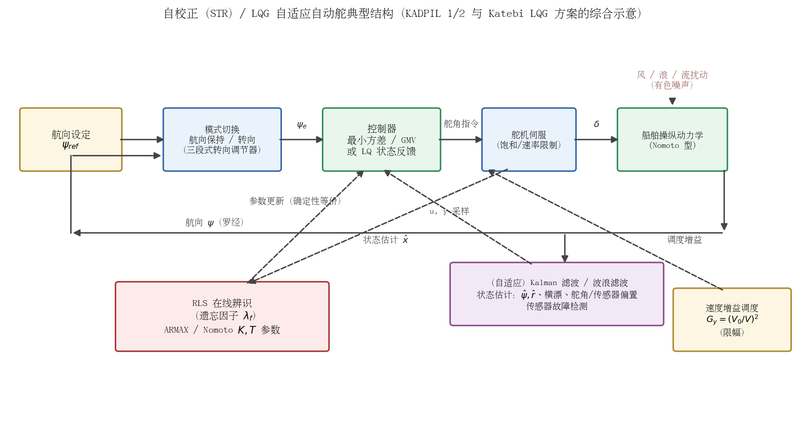

上图概括了 1970–80 年代自适应自动舵的典型结构：RLS 在线辨识 + 最小方差/LQG 控制器 + Kalman 滤波（含波浪滤波），航速变化由**增益调度**快速补偿、其余慢变因素（载况、海况）交由自适应环路处理。

#### 1.4 GMV 损失函数中 λ 与操舵附加阻力关系的推导

TFRT-3145 式（2.2）的经验关系 $\Delta R/R\approx k(\overline{\psi_e^2}+\lambda\overline{\delta^2})$ 并非纯曲线拟合，其结构可由小角度假设下的船体/舵水动力二阶展开推出。按 [TFRT-3145](https://lucris.lub.lu.se/ws/files/4680687/8777572.pdf) 对航向保持问题的归因，附加阻力来自三部分：艏摇角速度–横漂速度耦合的减速力、漂角增大引起的船体阻力增量、航向偏离造成的航程损失（最后一项较小，通常忽略）。前两项分别对应损失函数中的两项：

- **船体项（航向误差）**：定常航速 $V$ 下船体阻力对漂角 $\beta$ 是对称（偶）函数，小角度泰勒展开的一阶项为零，得 $R(\beta)\approx R_0(1+k_\beta\beta^2)$。航向误差振荡时船体平均漂角与航向误差同量级，$\overline{\beta^2}\propto\overline{\psi_e^2}$，故 $\Delta R_{hull}/R_0\propto\overline{\psi_e^2}$；
- **舵项（操舵）**：舵角 $\delta$ 产生舵升力 $L=\tfrac12\rho V^2A_R C_{L\alpha}\delta$，其诱导阻力 $D_i=L^2/(\tfrac12\rho V^2A_R\cdot\pi e\,\Lambda_R)\propto\delta^2$（$\Lambda_R$ 为舵展弦比），叠加舵型阻随迎角的二次增长，得 $\Delta R_{rudder}/R_0\propto\overline{\delta^2}$。

两式合并即得 $\Delta R/R_0 = k\,\overline{\psi_e^2}+k_\delta\,\overline{\delta^2}=k\left(\overline{\psi_e^2}+\lambda\,\overline{\delta^2}\right)$，其中

$$
\lambda=\frac{k_\delta}{k}=\frac{\text{单位均方舵角的附加阻力}}{\text{单位均方航向误差的附加阻力}} .
$$

Norrbin（1972）对典型油轮估算得 $k\approx0.014\ \mathrm{deg}^{-2}$、$\lambda=1/12\approx0.083$（经 Källström 等引用为工程取值）。一个直观算例：$\psi_{e,rms}=1^\circ$、$\delta_{rms}=3^\circ$ 时，两项对损失函数的贡献分别为 $1$ 与 $\lambda\cdot 9=0.75$，同量级——说明"为压航向误差而多打舵"本身就在消耗推进能量，这正是不能只最小化航向误差方差的原因。

由此，GMV 准则 $J=E[\psi_e^2+\lambda\delta^2]$ 中的权重 $\lambda$ 有了明确的物理标定：$\lambda$ 偏大则惩罚操舵、舵机磨损小但航向保持差；$\lambda$ 偏小则航向紧、舵动剧烈，附加阻力反而上升；$\lambda=1/12$ 给出（该型油轮）阻力最优的折中点。需要注意该关系是**定常速、小舵角、航向保持工况**下的二阶近似，$k$ 与 $\lambda$ 均随船型与工况（载况、航速、水深）变化；大转向等非线性工况不适用。

#### 1.5 辨识残差白性检验的工程做法

RLS 类辨识的一致性依赖于一个可检验的前提：**预报误差（创新序列）$\varepsilon(t)$ 为白噪声**。若噪声模型 $C(z^{-1})$ 的阶次不足——例如把波浪引起的有色扰动当作白噪声——残差必然有色，参数估计随之有偏。TFRT-3145 明确记载，"RLS + LQ（解 Riccati 方程）"版本性能反不如结构更简单的最小方差自校正器，原因正是有色波浪扰动导致参数估计有偏。因此残差白性检验不是理论装饰，而是辨识质量的在线仪表。工程上的标准做法：

1. **滑动窗口样本自相关 + Bartlett 置信带**：在最近 $N$ 个样本上计算归一化自相关 $\hat\rho(\tau)=\hat r(\tau)/\hat r(0)$。白噪声假设下 $\hat\rho(\tau)\sim\mathcal N(0,1/N)$（Bartlett 渐近结果），故 95% 置信带为 $\pm1.96/\sqrt{N}$；若出带滞后点显著超过 5%，判定残差非白。
2. **Ljung–Box 混成检验**：$Q=N(N+2)\sum_{\tau=1}^{m}\hat\rho^2(\tau)/(N-\tau)$ 在白性假设下近似服从 $\chi^2(m)$，$m$ 取 10–20，$Q$ 超临界值即拒绝白性假设——比逐点看置信带更不易被偶然出带误导。
3. **残差–输入互相关检验**：$\hat r_{\varepsilon u}(\tau)$ 用于检验对象动态模型是否充分（白性检验暴露噪声模型缺陷，互相关检验暴露对象模型缺陷），两者应同时监控。
4. **在线实现要点**：用与遗忘因子一致的指数加权递推估计 $\hat r(\tau)$，避免存储全窗；窗口长度应覆盖若干波浪遭遇周期（遭遇频率典型 0.05–0.3 Hz，1 Hz 采样时 $N$ 取数百至数千）；检验统计量本身应低通后再触发报警，避免在海况瞬变时抖动。

   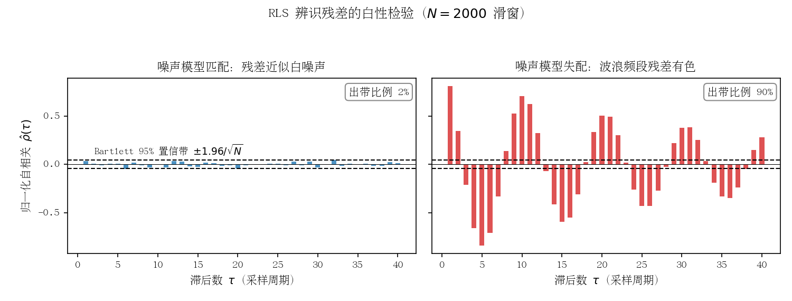

   上图为数值演示：噪声模型匹配时残差自相关几乎全部落在 Bartlett 带内（出带 2%，左）；未建波浪有色噪声模型时，二阶波浪成型滤波器（谐振峰约 0.1 Hz）产生的有色残差大量出带（90%，右），其缓慢起伏形态正是波浪谱在滞后域的指纹。

5. **判定非白后的处置**：(a) 增广噪声模型——提高 ARMAX 中 $C(z^{-1})$ 阶次，或显式并入二阶波浪成型滤波器 $H(z)=\sigma^2 z^{-1}/(1-2\zeta\omega_0 z^{-1}+\omega_0^2 z^{-2})$；(b) 对输入输出数据做高通/陷波预处理，把波浪频段隔离在辨识带宽之外；(c) 在白性恢复之前冻结参数更新或收紧参数限幅，防止有偏估计进入控制律。
6. **对本项目的映射**：对 Nomoto $K/T$ 在线辨识的残差做同样的白性监控，可作为"海况升高导致 $K/T$ 估计系统性偏移"的**早期预警量**——残差在波浪频段出现能量集中时，先于控制性能恶化给出信号，触发波浪滤波或噪声模型增广。

### 2. 代表性工作与工程应用

- **船舶操纵动力学辨识奠基**：Åström & Källström, *Identification of ship steering dynamics*, Automatica, 1976——用极大似然法从油轮实船试航数据辨识 Nomoto 型操纵模型及波浪扰动模型，为后续自适应设计提供了模型与噪声统计基础（引自 [船舶航向保持控制研究综述, 2022](http://www.aquaticjournal.com/article/doi/10.3969/j.issn.1673-9159.2022.06.006) 文献列表）。
- **KADPIL 1 / KADPIL 2（瑞典 LTH + Kockums Automation，1974–1979）**：Åström、Källström 与 Kockums 工程师合作的经典工程。简单版 KADPIL 1 = 速度调度 + RLS/最小方差自校正器（仅用罗经航向）；高级版 KADPIL 2 增加 Kalman 滤波，可融合艏摇角速度、横漂速度、舵角等多传感器信息，并能估计传感器偏置、检测传感器故障（graceful degradation）。转向采用**三段式固定增益转向调节器**（启动比例速率反馈 → 恒定旋回速率控制 → PD 式制动），航速影响按 $G_y(V)=(V_0/V)^2$（时间尺度不变）或 $V_0/V$（航迹不变）做增益调度并限幅。成果发表于 Källström, Åström, Thorell, Eriksson, Sten, *Adaptive autopilots for tankers*, Automatica 15(3):241–254, 1979，工程细节见 [LTH Report TFRT-3145 (1977)](https://lucris.lub.lu.se/ws/files/4680687/8777572.pdf)。
- **实船验证规模**：在 3 艘不同油轮（25.5 万吨级、35.5 万吨级等）上完成 **130 余次实船试验**；为 "Sea Swift" 设计的自适应自动舵自 **1974 年 10 月起投入日常运营**，是最早长期商用的自适应自动舵之一（同上 LTH 报告）。
- **理论总结**：Åström, *Why use adaptive techniques for steering large tankers*, Int. J. Control 32(4):689–708, 1980（引自 [Automation for the Maritime Industries](https://digital.csic.es/bitstream/10261/2906/1/Maritime_Industries.pdf) 文献[15]）——指出固定增益 PD 自动舵在不同海况/载况下的损失函数可相差 **5～8 倍**，而最优整定的收益随扰动增强而增大，这正是需要自适应的定量理由。
- **MRAC 平行路线**：van Amerongen（代尔夫特理工）的模型参考自适应自动舵（PhD 1982；[Automatica 1984](https://afscheid.vanamerongen.org/publicaties/amerongen84.pdf)），相对常规 PID 演示了最高约 **5%** 的燃油节省，并走向商品化。
- **LQG 自适应路线**：Katebi 与 Byrne（Strathclyde 大学），*LQG adaptive ship autopilot*, Trans. Inst. MC 10(4):187–197, 1988；Grimble & Katebi（1986）把航向保持损失函数与船体纵荡方向运动方程导出的能量损失联系起来，用 LQG 同时优化航向精度与操舵能耗（引自 [Liu et al., Ocean Engineering, 2016](https://www.sciencedirect.com/science/article/pii/S002980181500623X) 及 [EOLSS 综述](https://www.eolss.net/sample-chapters/c18/E6-43-36-03.pdf) 文献[18]）。此外还有 Sheffield 大学 Mort（1983 博士论文）的自校正自动舵研究（同 CSIC 文献[6]）。
- **商业化历程**：KADPIL 系列由 Kockums Automation AB 推向产品化，1970 年代中期即有商用系统在船服役；1980 年代起自适应（含 MRAC 与自校正）自动舵进入多家厂商产品线。但值得注意的是，由于整定与认证成本、可靠性顾虑，**至今市场上绝大多数在役自动舵仍是 PID + 增益调度结构**（[Jurnal Teknologi 综述](https://journals.utm.my/jurnalteknologi/article/download/4635/3223/12968)；[EOLSS 综述](https://www.eolss.net/sample-chapters/c18/E6-43-36-03.pdf)）。

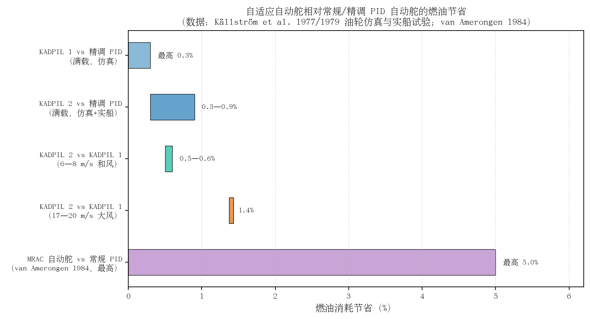

关键量化结论（[Källström et al., LTH Report TFRT-3145](https://lucris.lub.lu.se/ws/files/4680687/8777572.pdf) 第 3 节仿真总结，实船试验趋势一致）：满载工况下 KADPIL 2 相对精调 PID 节省燃油约 **0.3–0.9%**（低值对应 PID 使用 Kalman 滤波估计、高值对应 PID 直接用未滤波测量）；海况越恶劣收益越大——255,000 tdw 满载油轮仿真中，17–20 m/s 大风（fresh gale，蒲福 8 级）下 KADPIL 2 相对 KADPIL 1 的增益达 **1.4%**，远高于 6–8 m/s 和风（moderate breeze）时的 0.5–0.6%（报告引言按 0.5% 估计，仿真节给出 0.6%）；低速航行时收益同样显著增大。报告同时指出：仿真略微高估了精调 PID 的性能，**实船试验中自适应自动舵的收益比仿真更大**。叠加 Schilling 关于"PID 从通常整定到最优整定可省 1–2%"的估计，自适应自动舵相对粗放整定的常规 PID 总节省可达 **2–3%**。

### 3. 工程优缺点

**优点**

- **免人工整定、面向经济指标**：损失函数直接对应操舵附加阻力，控制器参数随海况/载况/航速自动收敛到近最优点，避免"水手凭经验调灵敏度旋钮"的随意性；
- **恶劣海况与低速下收益最大**——恰恰覆盖固定增益 PID 表现最差、被迫切换人工操舵的场景；
- **Kalman 滤波带来的附加价值**：平滑的航向/艏摇估计、波浪滤波、传感器偏置估计与故障检测，系统可优雅降级（仅航向一路信号仍可运行）；
- **速度调度 + 自适应分工合理**：可解析、变化快的航速因素用增益调度即时补偿，不可解析、慢变的载况/海况因素用自适应慢速跟踪，两者互补。

**缺点与风险**

- **激励依赖与参数漂移**：直线巡航时激励弱，RLS 参数可能缓慢漂移（协方差"上爆"），工程上需配合遗忘因子下限、协方差监控、死区与参数限幅等"安全夹克"；
- **有色噪声下辨识有偏**：Källström 报告明确记载，基于"RLS + LQ（解 Riccati 方程）"的版本因波浪扰动为有色噪声导致参数估计有偏，性能反而不如结构更简单的最小方差自校正器——说明**辨识结构必须与噪声模型匹配**；
- **大转向时非线性显著**：满载油轮的"舵角–旋回速率"稳态曲线强非线性（不稳定载况下存在多值区），单一线性自适应律无法覆盖，KADPIL 不得不为转向单独设计三段式调节器；
- **稳定性与收敛性分析困难、认证门槛高**：这也是自适应方案未能大规模取代 PID 自动舵的现实原因之一；
- **计算与调试成本**（1970 年代小型机 2k 字代码量曾是工程考量；今天已非瓶颈，但验证确认成本仍在）。

### 4. 与本项目（PD + 增益调度 + ESC）方案的关联与借鉴

1. **结构同源**：本项目"Nomoto $K/T$ 在线辨识 + 极点配置"属于**显式（间接）自适应**——先辨识对象参数、再算控制器参数；Källström 的最小方差 STR 属于**隐式（直接）自适应**——直接辨识控制器参数。前者物理可解释性强、便于监控与限幅（$K$、$T$ 有明确物理意义），后者实现更简、无需显式设计步骤。本项目的选择与 Källström 报告中"RLS+LQ"尝试同属一族，应吸取其教训：**关注辨识残差是否白化**，必要时为波浪扰动增补有色噪声模型或对信号做高通/陷波预处理，避免海况升高时 $K/T$ 估计出现系统性偏移。
2. **损失函数可直接借用**：GMV 准则 $J=E[\psi_e^2+\lambda\delta^2]$（$\lambda\approx 1/12$ 源自附加阻力物理推导）可作为本项目 ESC 在线调参的代价函数或至少作为海试评价指标，使 ESC 的寻优目标从"航向误差最小"升级为"阻力增量最小"，与 KADPIL 的 0.3–0.9% 节油结论直接可比。
3. **增益调度分工验证**：KADPIL 证明"航速用增益调度（$G_y\propto(V_0/V)^2$，限幅）+ 其余慢变因素用自适应"是稳健的工程分工；本项目的"海况 × 船速段"调度表 + ESC 微调与之同构，可借鉴其**调度响应快、自适应跟踪慢**的带宽分离原则，避免 ESC 去追逐本应由调度表处理的航速瞬变。
4. **恶劣海况是自适应的主战场**：历史数据一致表明海况越高、航速越低，自适应相对固定增益的收益越大（大风下 1.4% vs 和风下 0.5%）。对本项目"最大海况适应性"的结论性启示：海况 3 级段应保留并强化在线调整能力，而不是退回保守的固定参数。
5. **转向与大机动需独立通道**：三段式转向调节器（启动—恒速率—制动）与航向保持自校正器分离的做法，可直接映射到本项目航向保持/改向双模式设计；大改向时的舵角饱和与速率限制必须显式处理，不能依赖辨识-控制环路线性外推。
6. **状态估计的增值空间**：KADPIL 2 的经验表明，仅增加一个设计良好的 Kalman 滤波器（航向 + 艏摇 + 偏置估计），即使控制器不变也能节油 0.3–0.6%，并获得传感器故障检测能力——这是本项目在现有 ESC 框架下成本最低的性能升级选项之一。

### 5. 参考资料

1. [Källström C.G., Åström K.J., Thorell N.E., Eriksson J., Sten L., "Adaptive Autopilots for Steering of Large Tankers", LTH Report TFRT-3145（报告编号 LUTFD2/(TFRT-3145)/1-66/(1977)），1977 年 7 月，66 页（全文 PDF，隆德大学）](https://lucris.lub.lu.se/ws/files/4680687/8777572.pdf)
2. Källström C.G., Åström K.J., Thorell N.E., Eriksson J., Sten L., "Adaptive autopilots for tankers", *Automatica*, 15(3):241–254, 1979, [DOI: 10.1016/0005-1098(79)90042-6](https://doi.org/10.1016/0005-1098(79)90042-6)（题录见 [隆德大学研究门户](https://portal.research.lu.se/sv/publications/adaptive-autopilots-for-tankers/) 与 [智能船舶远程驾驶控制技术研究现状与趋势](https://www.opticsjournal.net/Articles/OJcce32d184bc6b11b/FullText) 文献[86]）
3. Åström K.J., Källström C.G., "Identification of ship steering dynamics", *Automatica*, 12(1):9–22, 1976（题录见 [船舶航向保持控制研究综述](http://www.aquaticjournal.com/article/doi/10.3969/j.issn.1673-9159.2022.06.006)）
4. Åström K.J., Wittenmark B., "On self-tuning regulators", *Automatica*, 9:185–199, 1973, [DOI](https://doi.org/10.1016/0005-1098(73)90073-3)
5. Åström K.J., "Why use adaptive techniques for steering large tankers", *Int. J. Control*, 32(4):689–708, 1980（题录见 [Automation for the Maritime Industries, DIGITAL.CSIC](https://digital.csic.es/bitstream/10261/2906/1/Maritime_Industries.pdf) 文献[15]）
6. [Katebi M.R., et al., "LQG Adaptive Autopilot Design", IFAC Workshop, 1985 (ScienceDirect)](https://www.sciencedirect.com/science/article/pii/S1474667017607420)
7. Katebi M.R., Byrne J.C., "LQG adaptive ship autopilot", *Trans. Inst. MC*, 10(4):187–197, 1988（题录见 [EOLSS: Ship Control 综述](https://www.eolss.net/sample-chapters/c18/E6-43-36-03.pdf) 文献[18] 及 [ACM 文献列表](https://dl.acm.org/doi/abs/10.5555/3151573.3151575) 文献[11]）
8. [van Amerongen J., "Adaptive steering of ships – a model reference approach", *Automatica*, 1984（作者主页全文）](https://afscheid.vanamerongen.org/publicaties/amerongen84.pdf)
9. [Liu Z. et al., "Ship forward speed loss minimization using nonlinear course keeping and roll motion controllers", *Ocean Engineering*, 2016（Grimble & Katebi 1986、Katebi & Byrne 1986 操舵附加阻力 LQG 工作的转述）](https://www.sciencedirect.com/science/article/pii/S002980181500623X)
10. [Velasco F.J. et al., "Automation for the Maritime Industries"（自适应自动舵文献谱系与 Mort 1983 等）](https://digital.csic.es/bitstream/10261/2906/1/Maritime_Industries.pdf)
11. [EOLSS, "Ship Control" 章节（PID 自动舵历史与自适应动因综述）](https://www.eolss.net/sample-chapters/c18/E6-43-36-03.pdf)

---

## 自适应 PID 与增益调度自动舵

增益调度（gain scheduling）与自适应 PID 是工业自动舵中最成熟、应用最广的两条技术路线：前者利用"船舶操纵性随航速/载况变化的规律已知"这一先验，用解析标度律实时修正控制器增益；后者通过在线整定（继电器反馈、模式识别、最小方差自校正等）补偿海况、载况等慢变未知因素。自 1970 年代 Källström 等人在油轮上完成首次系统性实船验证以来，二者往往以"调度管快变量、自适应管慢变量"的分工结构组合使用，并已成为 Kongsberg、Tokyo Keiki、YOKOGAWA、Anschütz、Sperry 等主流商用自动舵的标准配置。本节梳理其算法原理、代表性工作、商用产品实践与 IMO 性能标准要求，并讨论其对本项目（PD + 增益调度 + ESC 在线辨识 + 极点配置）方案的借鉴意义。

### 算法原理

#### 增益调度的理论基础：Nomoto 模型与航速标度律

船舶航向保持控制最常用 Nomoto 一阶模型描述舵角到艏向的通道（含积分环节）：

$$T\dot{r}+r=K\delta,\qquad \frac{\psi(s)}{\delta(s)}=\frac{K}{s(1+sT)}$$

其中 $K$ 为回转性指数、$T$ 为追随性时间常数。更精细的场合使用 Nomoto 二阶模型：

$$\frac{r(s)}{\delta(s)}=\frac{K(1+T_3 s)}{(1+T_1 s)(1+T_2 s)}$$

增益调度可行性的核心是 **K/T 的无量纲航速标度律**（van Amerongen 1984）：

$$K=K'\frac{U}{L},\qquad T=T'\frac{L}{U}$$

其中 $U$ 为船速、$L$ 为船长，无量纲参数 $K'$、$T'$ 对航速变化不敏感（典型量级 0.5–2.0）。这意味着只要已知参考航速下的模型参数，其余航速下的参数即可解析外推，调度表无需逐点插值标定。Källström（1977/1979）进一步给出按"闭环响应不变"还是"航迹不变"两种设计目标的**速度调度增益**：

$$G_V(t)=\left(\frac{V_0}{V(t)}\right)^2\ \text{（响应时间不变）};\qquad G_V(t)=\frac{V_0}{V(t)}\ \text{（航迹不变，用于辨识器）}$$

并指出低速时必须对增益设上限以避免舵角饱和。调度作用于 Kalman 滤波器、自校正器与转向调节器三处，因为"调度对航速变化的响应远快于自适应辨识的收敛"。

按海况/经济性的调度则以**操舵附加阻力准则**为物理依据（Norrbin 1972、Koyama 1967，经 Källström 引用）：航向误差与舵角都以平方项增加航行阻力——

$$\frac{\Delta R}{R}=k\left(\bar{\psi}_e^{\,2}+\lambda\bar{\delta}^{\,2}\right),\qquad k\approx0.014\ \text{deg}^{-2},\ \lambda=1/12\ \text{（典型油轮）}$$

对应性能指标 $J=\int\left(\psi_e^2+\lambda\delta^2\right)dt$：精确操舵（进出港）取 $\lambda\approx0.1$，高海况经济操舵可取 $\lambda\approx4$。对 Nomoto 一阶模型求解该 LQ 指标（对 $\dot r=-r/T+(K/T)\delta$ 解 Riccati 方程）即得最优 PD 增益（van Amerongen 1984）：

$$K_p=\frac{1}{\sqrt{\lambda}},\qquad K_d=\frac{1}{K}\left(\sqrt{1+\frac{2K}{\sqrt{\lambda}}}-1\right)$$

这给出了"按海况调度"的解析形式：**高海况增大 $\lambda$（压低舵动、放宽航向精度），而非盲目提高增益**。

基于 Nomoto 一阶模型的 PD 极点配置整定公式（Fossen 教材）把期望闭环自然频率 $\omega_n$、阻尼比 $\zeta$ 与模型参数直接挂钩：

$$K_p=\frac{\omega_n^2 T}{K},\qquad K_d=\frac{2\zeta\omega_n T-1}{K}$$

与航速标度律联立，即可解析生成随航速连续变化的增益表——这正是"模型辨识 + 极点配置"型自适应自动舵的标准闭环。

#### K/T 航速标度律的解析推导

标度律 $K\propto U/L$、$T\propto L/U$ 并非纯经验拟合，可由线性化操纵方程经量纲分析直接导出。水平面线性化艏摇方程（并入横漂-艏摇耦合的等效效应后）为：

$$(I_z-N_{\dot r})\,\dot r+(-N_r)\,r=(-N_\delta)\,\delta$$

与 Nomoto 一阶模型对比得 $T=(I_z-N_{\dot r})/(-N_r)$、$K=(-N_\delta)/(-N_r)$。在 Froude 相似前提下，各水动力导数的量纲标度为：

- 附加转动惯量 $I_z-N_{\dot r}\propto\rho L^5$（质量矩 ∝ 排水质量 $\times L^2$，排水质量 ∝ $\rho L^3$）；
- 艏摇阻尼 $-N_r\propto\rho U L^4$（船体水动力 ∝ $\rho U\,(rL)\,L^2$，力臂 ∝ $L$）；
- 舵力矩 $-N_\delta\propto\rho U^2 L^3$（舵升力 ∝ $\rho U^2 A_R\,\delta$，$A_R\propto L^2$，力臂 ∝ $L$）。

代入即得标度律：

$$T=\frac{\rho L^5}{\rho U L^4}=T'\frac{L}{U},\qquad K=\frac{\rho U^2 L^3}{\rho U L^4}=K'\frac{U}{L}$$

无量纲参数 $K'=KL/U$、$T'=TU/L$（即操纵性 prime 系统的标准定义）对同型船在不同航速下近似不变（典型量级 0.5–2.0，van Amerongen 1984 实船/船模数据支持）——这就是"调度表可解析外推、无需逐点标定"的物理依据。

该推导有两条直接的控制推论：

1. **与极点配置联立可反推出 Källström 经验调度律**：保持闭环自然频率 $\omega_n$ 不变（响应时间不变）时，$K_p=\omega_n^2 T/K=\left(\omega_n^2 T'/K'\right)(L/U)^2\propto U^{-2}$——这正是 Källström（1977）"真时间不变 ⇒ $G_V=(V_0/V)^2$"调度律的解析证明，两条独立路线互相印证；
2. **标度律的失效边界即自适应的起作用区间**：低速时舵进速不再正比于船速（零速下舵力仅由螺旋桨滑流产生），浅水、污底、载况变化会缓慢改变水动力导数——$K'$、$T'$ 在其标称带内的慢变漂移正是留给在线辨识（本项目 ESC）跟踪的残余量；同时 $K_p\propto U^{-2}$ 表明低速增益必须限幅，否则舵角饱和。

*图 3-1 K/T 航速标度律与极点配置 PD 增益调度数值示例（$L=30$ m、$K'=T'=1$、$\omega_n=0.3$ rad/s、$\zeta=1$）：(a) $K\propto U/L$、$T\propto L/U$；(b) 保持 $\omega_n$ 不变时 $K_p$ 精确按 $(U_0/U)^2$ 缩放，与 Källström 经验调度律完全一致；低速段增益须限幅以防舵角饱和。*

#### 自适应 PID 的三种在线整定方法

**（1）继电器反馈自整定（relay feedback autotuning）。** Åström & Hägglund（1984）提出用继电环节替代 Ziegler–Nichols 开环临界增益试验：闭环中接入幅值为 $d$ 的理想继电器，系统在相位 $-\pi$ 频率处产生幅值可控的自持振荡（极限环），过程不会远离设定点，安全性远优于开环扫临界稳定边界。由描述函数法，临界增益与临界周期为：

$$K_u=\frac{4d}{\pi a},\qquad T_u=\text{实测振荡周期}$$

再按 Z-N 临界比例度规则整定：

$$K_p=0.6K_u,\qquad T_i=0.5T_u,\qquad T_d=0.125T_u$$

该方法已成为工业 PID 自整定的事实标准（ABB、Honeywell 等单回路控制器普遍内置）。在船舶领域的权威实船记录集中于机舱蒸汽/给水回路 PID 整定；**直接用于商船航向自整定的权威实船文献未能核实**，航向自整定的主流路线是自校正与模式识别，继电器法多见于仿真研究。

**（2）模式识别自适应（pattern recognition）。** Bristol（1977）提出、Kraus & Myron（1984）工程化的 Foxboro EXACT 是**第一个商用自适应 PID 控制器**（1984 年 10 月发布）：不做显式参数辨识，而是监测误差响应的超调量、阻尼比、周期等"模式特征"，按预置启发规则（仿 Z-N 阶跃响应法）直接修正 PID 参数。其特点是对噪声和非线性鲁棒、无需激励信号，但整定粒度粗、规则库依赖专家经验。这一思路与商用自动舵面板上"海况/Weather 档位 → 预置增益组"的实现方式在工程上等价。

**（3）最小方差/自校正 PID（minimum variance / self-tuning）。** 理论基础为 Åström & Wittenmark（1973）的自校正调节器（递推最小二乘 RLS 在线辨识 + 最小方差控制律）与 Clarke & Gawthrop（1975/1979）的广义最小方差（GMV，引入控制加权以抑制过激舵动）。对 ARMAX 模型 $A(q^{-1})y(t)=B(q^{-1})u(t-k)+C(q^{-1})e(t)$，由恒等式 $C=AF+q^{-k}G$ 得控制律：

$$u(t)=-\frac{G(q^{-1})}{B(q^{-1})F(q^{-1})}\,y(t)$$

Källström 的实船版本在此基础上以 $\nabla\delta_e$ 引入积分作用、RLS 带指数遗忘因子跟踪慢变参数。配套的船舶辨识工程经验（数据滤波、采样率与模型阶次选择）见 Åström & Källström（1976）与 Källström & Åström（1981）。

*图 3-2 增益调度与在线自适应整定组合的典型自动舵结构：调度变量（航速/海况/载况）经解析标度律或查表生成基准增益，在线辨识/自整定模块（Nomoto K/T 估计）对残余慢变失配做修正。*

*图 3-3 继电器反馈自整定原理：继电环节（幅值 $d$）使闭环产生自持振荡，由输出振荡幅值 $a$ 与周期 $T_u$ 求临界增益 $K_u=4d/(\pi a)$，再按 Z-N 规则整定 PID。*

#### 海况估计：把 Weather 旋钮变成在线观测量

MSC.64(67) Annex 3 §7.2 允许以"自动调整功能"替代船员手动 Weather 调节，其技术前提是把"海况"从人工档位变成在线估计量（sea state estimator）。文献与商用产品中有三条成熟路线：

**（1）航向/艏摇谱法（波频带能量）。** 波浪引起的艏摇运动功率集中在波峰频段（典型 0.05–0.2 Hz，van Amerongen 1984），明显高于船舶可控响应带宽，与低频可控运动在频谱上天然可分。对航向误差或艏摇率信号在波频带内带通滤波并估计其滑动方差/RMS，所得波频带能量随海况单调上升，可直接映射为海况等级或连续调度参数。van Amerongen（1984）明确指出"滤波量应随噪声水平自适应"（the amount of filtering should be adaptive with respect to the level of the noise）——即波浪滤波带宽本身就应由在线海况（噪声）估计调度，这是航向谱法最早的工程表述。

**（2）扰动模型在线辨识。** YDK（原 YOKOGAWA）BNAAC 的官方结构即为"船舶基本模型 + 扰动模型辨识器"：在线估计作用于船体的风、浪扰动模型并与船模合并更新，据此自动计算最优舵增益（官方实测舵动量 −60%）；Ohtsu（1979）的 AR 随机模型自动舵同样通过在线辨识噪声统计量调整控制律。这条路线的海况估计与参数辨识共用同一套递推辨识框架。

**（3）操舵统计量反馈。** 直接统计单位时间舵动量、舵角 RMS、舵机反向次数等"操舵代价"观测量，与航向精度统计量一起反馈调节 $\lambda$/死区/滤波强度——Anschütz NautoPilot 5000 NX 的 ECOnomy 模式（官方称 adaptive mode）即"持续监测船体实际偏航运动，将对称的、因船体惯性本就无法校正的波频运动滤除而不予操舵修正"（据厂商公开资料）。

工程要点（对本项目直接适用）：海况估计的时间常数应远慢于波频周期（避免把单个波误判为海况变化）、又远快于海况的实际演变（分钟级）；估计输出建议作用于**性能权重**——$\lambda$、等效 $\omega_n$、死区、滤波带宽、ESC 激励幅值与频段——而非直接乘在反馈增益上；且应与参数辨识解耦——ESC 负责跟踪 $K$、$T$，海况估计负责调度权重，二者时间尺度分离可避免相互干扰。

*图 3-4 基于航向谱的海况估计原理：(a) 艏摇运动谱中波频带（阴影，0.05–0.2 Hz）能量随海况单调增长，与低频可控段在频谱上可分；(b) 波频带 RMS → 海况等级 → 操舵权重 $\lambda$ 的调度映射（$\lambda=0.1$ 精确操舵 → $\lambda=4$ 高海况经济操舵，数值为示意）。*

### 典型应用与代表性工作

| 作者/机构 | 年代 | 系统/文献 | 一句话贡献 |
|---|---|---|---|
| Minorsky / Sperry | 1922 | 早期自动舵理论 | 自动操舵的比例-微分控制奠基 |
| Nomoto 等 | 1957 | "On the Steering Qualities of Ships", *ISP* 4(35) | 一阶/二阶 K-T 转向模型，一切调度与整定的模型基础 |
| Åström & Wittenmark | 1973 | *Automatica* 9:185–199 | RLS + 最小方差自校正调节器理论 |
| Clarke & Gawthrop | 1975/1979 | *Proc. IEE* 122(9)/126(6) | 广义最小方差（控制加权）自校正 |
| Källström, Åström 等（LTH + Kockums 船厂） | 1976–1981 | KADPIL 1/2；*Automatica* 1979/1981 | 速度调度 + 自校正 + 分阶段转向的油轮自适应自动舵，三艘油轮 130 余次实船试验验证 |
| van Amerongen（TU Delft） | 1975–1984 | MRAS 自适应自动舵；*Automatica* 1984 | 模型参考自适应 + 自适应状态估计，实船/船模试验宣称相对调好 PID 节油最高 5%（海况 2–4 级实测 0.5–2%） |
| Ohtsu, Horigome, Kitagawa（东京商船大学） | 1979 | *Automatica* 15(3):255–268 | AR 随机模型噪声自适应自动舵，横河商用产品的技术源头（合理推断，无厂商官方确认） |
| Bristol / Kraus & Myron（Foxboro） | 1977/1984 | EXACT 模式识别自适应 PID | 首个商用自适应 PID 控制器 |
| Åström & Hägglund | 1984/1995 | 继电器反馈自整定 | 工业 PID 自整定事实标准 |
| Holzhüter & Strauch（Anschütz） | 1987 | 10th IFAC 世界大会论文 | 商用自适应自动舵的公开学术记录 |
| Fossen（NTNU） | 1994–2021 | 教材 + Stena HSS 1500 高速双体船自动舵（40+ kn） | Nomoto 极点配置整定、波浪滤波、高速船增益调度工程化 |

KADPIL 工程的关键数据（Källström 1977 报告）至今仍是路线论证的直接证据：固定增益 PD 自动舵在不同载况/海况下的损失函数相差 **5–8 倍**，"一套参数包打天下"不可行；转向工况不适合纯自适应，Källström 采用**分阶段变结构控制**（起动段比例艏摇率反馈 + 舵角饱和 → 定常回转段艏摇率积分 → 停转段类 PD deadbeat），各阶段固定增益但仍乘速度调度因子。

### 主流商用自动舵的自适应策略

- **Kongsberg K-Bridge Autopilot**：官方样本宣称"self-adapting"，运行中"学习"船舶对不同舵令的响应并相应调整操舵指令，以在当前海况下尽量平滑操舵（"learns how the vessel reacts to different rudder commands…steer the ship as smoothly as possible"）；操舵可全量适配船舶特性（含当前载况）与当前海况/天气；提供 Precision/Economy 双模式。具体算法属专有，官方未公开细节。
- **Tokyo Keiki PR-6000**：提供 ADPT（自适应舵控制）与 PID 两种自动模式，面板含 Weather（0–10 级海况）与 Rudder Ratio 调节；符合 IMO A.342(IX)。最新一代 **PR-9000** 提供 NCT（Notable Control Technology，选件）"自动计算适应船舶操纵特性与外部影响的设定，显著减少波浪引起的无效舵动"，内部算法官方未披露。
- **YOKOGAWA（现 YDK）PT500**：分 PT500A（Adaptive）与 PT500D（Digital/PID）两型，符合 A.342(IX) 并获 NK 型式认可。其升级包 **BNAAC**（Batch Noise Adaptive Autopilot Controller）官方资料给出了明确的模型化结构：船舶基本模型 + 扰动模型辨识器 + 在线更新 + 按当前船模自动计算最优舵增益；实测在 6,200 TEU 集装箱船与好望角型散货船上**舵动量减少约 60%（航向保持精度不降）并降低油耗**，泊港 2 小时内可完成升级。
- **Anschütz NautoPilot 5000 / 5000 NX**：宣称 adaptive 转向算法，低速仍高精度；ECOnomy 模式（官方称 adaptive mode）持续监测船体实际偏航运动，将对称的、因船体惯性不可校正的波频运动滤除而不予操舵修正，以减少舵动；节油方面，厂商资料宣称各节油功能组合约 2.5%，波罗的海原型船试验统计约 1–4%（视航线与海况）；具备 Heading/Rudder Plot 操舵绩效实时显示。算法细节未公开。
- **Sperry Marine NAVIPILOT 4000**：手册级资料最透明——官方特性页宣称"continuous self-tuning adaptation"、能自动适应船舶载况特性与天气条件；操作/安装手册（JA19-8039E）载明 "Adaptive Self-Tuning" 选件：在线监测操舵性能并自动调整 **rudder gain（舵增益）与 counter rudder（压舵）** 等参数（含 RESET TUNING 时压舵增益复位等细节），即使载况/吃水差改变也保持整定最优。

横向规律：五大厂商的"自适应"话术高度一致——按**海况**自动调增益（经济取向）、按**载况/航速**保持整定、以**减少舵动量**为节油主手段；除 Sperry 与 Yokogawa BNAAC 外，各厂均未公开算法细节，宣称的"学习/模糊/自适应"机制大多无法核实到算法层面。

### IMO 性能标准对自适应的要求

IMO 标准是自适应自动舵的工程约束框架，主要条文如下：

- **A.342(IX)**（1975）§1.2 即要求自动舵"能**适应不同天气与载况下船舶不同的操舵特性**"；§4.2 规定"除非设备装有**自动调整功能**，否则应配备供船员调整天气影响和操舵性能的操作控制器"；另有舵角限幅（§5）与**允许偏航（permitted yaw）**要求——应防止正常偏航运动引起不必要的舵动（§6）。
- **MSC.64(67) Annex 3**（1996，航向控制系统 HCS 性能标准，修订 A.342(IX)）§3.1 明确 HCS"应能**手动或自动适应**不同航速、天气与载况下不同的操舵特性"——"自动适应"首次成为标准明示选项；§3.3–3.6 要求自动模式下舵角限制与指示、防止正常偏航引起不必要舵作动、改向无显著超调；§8.2 明确：**当控制参数随航速自动适配时，HCS 必须接入合适的航速信息源**——标准从传感器层面认可并规范了速度增益调度。
- 安全兜底（对一切自适应算法的硬约束）：自动/手动切换在任意舵角位置 3 秒内完成，任何故障下可切回手动（§4.1–4.2）；手动切自动时以实际艏向为预设艏向（§4.3）；电源故障与偏航（off-heading）报警（§6.1–6.2）。
- **ISO 11674**（2019 版现行）是与 MSC.64(67) Annex 3 对应的测试/型式认可标准；欧盟船载设备指令（MED）的 HCS 合规路径为 IMO Res. A.342(IX) + MSC.64(67) Annex 3 或 ISO 11674。

### 工程优缺点

**增益调度：**
- 优点：响应快（航速变化即时补偿，无需等辨识收敛）；解析标度律 $K\propto U/L$、$T\propto L/U$ 使调度表可解析生成而非插值标定；结构简单、可认证性好（IMO §8.2 已为其规定传感器条件）；"调度管航速、自适应管其余"的分工大幅减轻在线辨识负担。
- 缺点：只覆盖"影响规律已知"的变量（主要是航速）；对海况、载况、浅水、污底等慢变未知因素无能为力——这正是必须叠加自适应环节的原因；调度点间插值与增益突变需平滑处理；低速增益须限幅。

**自适应 PID / 自校正：**
- 优点：免人工整定（实船经验表明值班船员很少能把 PID 调到最优）；节油有量化记录（KADPIL 相对调好 PID 省 0.3–0.9%，综合优化估计 2–3%；van Amerongen MRAS 最高 5%；Yokogawa BNAAC 舵动量 −60%）；五大商用厂全部提供某种自适应，属成熟技术。
- 缺点：在线辨识需要持续激励，定常航行存在参数漂移风险（需遗忘因子、死区、协方差监控等监督层）；纯最小方差律控制量过大，工程上必须加控制加权（GMV）或舵角/舵速限幅；认证与故障切换要求高；各厂算法黑盒，宣称机制缺乏公开验证数据；高海况下波频运动不可控，盲目跟踪反而增阻——必须靠波浪滤波/死区而非更高增益（van Amerongen 1984 明确论证）。

### 对本项目方案的关联与借鉴点

本项目方案为"PD + 增益调度（海况 0..3 级 × 船速段）+ ESC 在线辨识 Nomoto K/T + 极点配置基线"，与上述工业实践高度同构，可借鉴之处包括：

1. **分工架构与历史最佳实践一致**：Källström 的结论"调度管航速（快变量）、自适应管海况载况（慢变量）"直接支持本方案——25 kn 游艇航速范围大，用 $K=K'U/L$、$T=T'L/U$ 解析调度吸收航速变化后，ESC 辨识只需跟踪残余慢变失配，激励需求与漂移风险都更低。
2. **极点配置 + Nomoto 是教科书级闭环**：Fossen 公式 $K_p=\omega_n^2T/K$、$K_d=(2\zeta\omega_n T-1)/K$ 把辨识出的 $\hat K,\hat T$ 直接映射为 PD 增益，辨识-整定链路完全解析、可解释、便于认证，优于查表插值。
3. **海况适应应体现在"性能指标权重"而非单纯增益**：操舵阻力准则 $J=\int(\psi_e^2+\lambda\delta^2)dt$ 表明高海况应增大 $\lambda$（压舵动）而非追高航向精度；商用产品的 Weather/Economy 模式均如此。建议把 $\lambda$（或等效的 $\omega_n$/死区/滤波带宽）作为随海况调度的第二调度变量，海况本身由"波频带能量/扰动辨识/操舵统计"在线估计（见本节"海况估计"小节）——这比只调度 K/T 更贴近 IMO"防止正常偏航引起不必要舵动"的强制要求。
4. **IMO 合规自查清单**：3 秒手动切换与故障兜底、改向无显著超调、舵角限幅与指示、off-heading 报警、速度调度须接航速传感器（MSC.64(67) §8.2）——设计评审可逐条对照。
5. **ESC 辨识的工程防护**：借鉴自校正自动舵的监督层——指数遗忘因子、激励不足时冻结参数、参数限界（$K',T'$ 物理量级 0.5–2.0 可作硬约束）、大机动转向与航向保持分模式辨识/冻结（Källström 分阶段转向调节器说明大机动时线性辨识不可靠）。
6. **波浪滤波不可省**：van Amerongen 与 Källström 均指出波频运动不可控，必须从反馈中剥离，否则高海况下任何自适应都会把增益用错方向；ESC 的扰动注入也应避开波峰频段（典型 0.05–0.2 Hz）。
7. **验证基准可复用**：用 Norrbin 阻力准则（$k=0.014$、$\lambda=1/12$）估算相对固定参数 PD 的节油率，与文献基准（自校正增益 0.3–0.9%、综合 2–3%、BNAAC 舵动量 −60%）对比，可作为本方案仿真验证的量化参照。

### 参考资料

1. Källström, Åström, Thorell, Eriksson, Sten, "Adaptive Autopilots for Steering of Large Tankers", LTH Report TFRT-3145, 1977. https://lucris.lub.lu.se/ws/files/4680687/8777572.pdf
2. Källström, Åström, Thorell, Eriksson, Sten, "Adaptive autopilots for tankers", *Automatica* 15(3):241–254, 1979. https://www.sciencedirect.com/science/article/pii/0005109879900426
3. van Amerongen, "Adaptive Steering of Ships—A Model Reference Approach", *Automatica* 20(1):3–14, 1984. https://afscheid.vanamerongen.org/publicaties/amerongen84.pdf
4. Åström & Källström, "Identification of ship steering dynamics", *Automatica* 12(1):9–22, 1976；Källström & Åström, "Experiences of system identification applied to ship steering", *Automatica* 17(1):187–198, 1981（DOI:10.1016/0005-1098(81)90094-7，著录见 https://ouci.dntb.gov.ua/en/works/96Rbzwp9/）
5. Åström & Hägglund, "Automatic tuning of simple regulators with specifications on phase and amplitude margins", *Automatica* 20(6):645, 1984；Control Engineering 科普文 https://www.controleng.com/relay-method-automates-pid-loop-tuning/
6. Åström, *Advanced PID Control* (ISA, 2006), 第 9 章 "Automatic Tuning and Adaptation". https://skoge.folk.ntnu.no/puublications_others/books/Åstrom-2006_Advanced%20PID%20Control/9.Automatic%20Tuning%20and%20Adaptation.pdf
7. Kraus & Myron, "Self-tuning PID controller uses pattern recognition approach", *Control Engineering* 31(6):106–111, 1984；EXACT 章节（Springer）https://link.springer.com/chapter/10.1007/978-1-4757-1895-9_10
8. Åström & Wittenmark, "On self tuning regulators", *Automatica* 9(2):185–199, 1973（DOI:10.1016/0005-1098(73)90073-3）
9. Ohtsu, Horigome, Kitagawa, "A new ship's auto pilot design through a stochastic model", *Automatica* 15(3):255–268, 1979. https://www.sciencedirect.com/science/article/pii/0005109879900438
10. Fossen, *Handbook of Marine Craft Hydrodynamics and Motion Control*, Wiley, 2011/2021. https://www.wiley-vch.de/de/fachgebiete/ingenieurwesen/handbook-of-marine-craft-hydrodynamics-and-motion-control-978-1-119-57505-4 ；配套代码 https://github.com/cybergalactic/FossenHandbook
11. Fossen et al., "Autopilot and track-keeping algorithms for high-speed craft", *Control Engineering Practice*. https://www.sciencedirect.com/science/article/abs/pii/S0967066199001677
12. IMO Resolution A.342(IX) (1975) 全文. https://law.resource.org/pub/us/cfr/ibr/006/un.imo.a.342.1975.pdf
13. IMO MSC.64(67) Annex 3, "Recommendation on Performance Standards for Heading Control Systems"，全文（IMO 官方）. https://wwwcdn.imo.org/localresources/en/KnowledgeCentre/IndexofIMOResolutions/MSCResolutions/MSC.64(67).pdf ；著录页 https://www.imorules.com/GUID-DA17652A-12DE-4088-8B18-824828996833.html
14. ISO 11674:2019 *Ships and marine technology — Heading control systems*. https://cdn.standards.iteh.ai/samples/68748/142d0270f3304da1accb24f578edb07c/ISO-11674-2019.pdf
15. Kongsberg K-Bridge Autopilot 官方资料. https://www.kongsbergmaritime.com/contentassets/52c907fdef4f4cffafbf86fcebc46434/308695e---autopilot.pdf
16. Tokyo Keiki PR-6000 官方样本. https://pdf.nauticexpo.com/pdf/tokio-keiki/pr-6000/30608-9024.html ；PR-9000 官方产品页 https://www.tokyokeiki.jp/e/products/detail.html?pdid=273
17. YOKOGAWA PT500 官方样本. https://static.mackaycomm.com/wp-content/uploads/2021/08/Yokogawa_PT500_Autopilot_Brochure_Mar2008_Mackay.pdf ；BNAAC 官方资料 https://www.codar.com.sg/wp-content/uploads/2019/01/BNAAC-UPGRADING-FOR-PT500-AUTOPILOT.pdf
18. Anschütz NautoPilot 5000 官方样本. https://pdf.nauticexpo.com/pdf/anschuetz/nautopilot-5000/30676-122589.html ；NautoPilot 5000 NX 节油功能与海试数据报道（Riviera Maritime Media）https://www.rivieramm.com/news-content-hub/news-content-hub/new-autopilot-demonstrates-fuel-savings-in-the-baltic-75615
19. Sperry Marine NAVIPILOT 4000 官方特性页. https://www.sperrymarine.com/navipilot-4000-marine-autopilot/features ；NAVIPILOT 4000 安装与操作手册（JA19-8039E，含 Adaptive Self-Tuning 参数细节，第三方存档）https://pdfcoffee.com/navipilot4000-installampoperation-manual-pdf-pdf-free.html
20. Warwick 继电器自整定综述. https://warwick.ac.uk/fac/cross_fac/iatl/research/reinvention/archive/volume5issue2/hornsey/

*未核实事项说明：各厂商自适应算法的内部机制（Kongsberg "learning"、Tokyo Keiki NCT、Anschütz）均无官方公开细节；Sperry NAVIPILOT 4000 手册细节来自第三方存档（pdfcoffee），官方特性页仅支撑"continuous self-tuning"的总体宣称；Anschütz 节油率以厂商资料（约 2.5%）与原型船海试报道（约 1–4%）为准，早期"2.5–5%"表述中的 5% 上限未找到来源，已删去；Tokyo Keiki PR-8000 系列官方资料未检索到（现役官方页为 PR-9000）；继电器反馈直接用于商船航向自整定的权威实船文献未找到；Nomoto 1957 原文无公开电子版（仅著录可验）；Ohtsu 1979 与横河 PT500A/BNAAC 的直接承继关系为合理推断，无厂商官方确认。*

---

## 模糊自适应控制自动舵

### 算法原理

#### 模糊控制的基本结构

模糊控制（Fuzzy Logic Control, FLC）把操舵人员的经验知识表达为 IF–THEN 语言规则，通过"模糊化 → 规则推理 → 解模糊化"三步将传感器量映射为控制量，不需要精确的被控对象数学模型。船舶操舵回路中被控对象通常用一阶 Nomoto 模型近似：

$$T\dot{r} + r = K\delta, \qquad \frac{\psi(s)}{\delta(s)} = \frac{K}{s(Ts+1)}$$

其中 $\psi$ 为航向角，$r=\dot\psi$ 为转向率，$\delta$ 为舵角，$K$、$T$ 随船速、装载与海况显著变化——这正是引入模糊/自适应机制的动机。

船舶自动舵中模糊控制器有两种典型结构（[Roberts et al., 2003, *Mechatronics*](https://www.sciencedirect.com/science/article/abs/pii/S0957415803000448)）：

1. **直接型模糊 PD/PID**：以航向误差 $e=\psi_d-\psi$ 与误差变化率 $\dot e$（或转向率 $r$）为输入，规则库直接输出指令舵角 $\delta_c$。采用三角隶属度、max–min 推理与重心法解模糊时，其输入输出关系本质上是**变增益的非线性 PD**：在线性区内局部有 $\delta_c \approx k_1(e,\dot e)\,e + k_2(e,\dot e)\,\dot e$，增益随工作点连续变化。
2. **监督型模糊自整定 PID（增益自整定型）**：底层仍为常规 PID，模糊推理机作为监督层，根据 $e$、$\dot e$ 在线修正增益（[Tomera, 2017, TransNav 章节](https://www.taylorfrancis.com/chapters/edit/10.1201/9781315099132-9/fuzzy-self-tuning-pid-controller-ship-autopilot-tomera)；[MDPI 综述引文 33](https://www.mdpi.com/2077-1312/13/5/851)）：

$$K_p = K_{p0} + \Delta K_p(e,\dot e),\quad K_i = K_{i0} + \Delta K_i(e,\dot e),\quad K_d = K_{d0} + \Delta K_d(e,\dot e)$$

$$\delta_c = K_p e + K_i \int_0^t e\,\mathrm{d}\tau + K_d \dot e$$

#### 规则库如何根据航向误差与转向率调增益

输入变量一般取七级语言值 {NB, NM, NS, ZO, PS, PM, PB}，规则库是 $7\times7$ 的经验表，其设计直觉与人工操舵一致（[张雪飞等, 2019,《中国舰船研究》](https://www.ship-research.com/article/cstr/32390.14.j.issn.1673-3185.01518)）：

- **误差大**（|e| 大）→ 增大 $K_p$ 加速回舵、取较小 $K_i$ 防止积分饱和；
- **误差与误差变化率同号**（误差在扩大）→ 增大 $K_p$、$K_d$ 抑制发散；
- **误差接近零且变化率大**（正在快速接近目标）→ 减小 $K_p$、增大 $K_d$ 提前"压舵"防超调；
- **小误差稳态段** → 增大 $K_i$ 消除风流造成的稳态偏差，同时压低 $K_p$ 避免波浪引起的舵机频繁动作。

规则表经推理与解模糊后生成一张连续的非线性增益曲面，如下图所示。这把"离散的查表式经验"变成了**全状态空间内平滑变化的增益律**——这是模糊调增益与人工分段调参的本质区别。

#### 模糊自适应：自组织模糊与模糊+自适应律

规则库本身依赖专家经验、一旦写好便固定不变，进一步的"自适应"沿两条路线发展：

1. **自组织模糊控制（SOC, Self-Organizing Fuzzy Control）**：源于 Procyk & Mamdani（1979）的自组织过程控制器，在基本模糊控制器之上加一个"性能评价—规则修正"层，根据响应偏离期望轨迹的程度在线修改规则结论（后件），使规则库在运行中自我完善。Sutton 等人将该思想用于船舶自动舵，并用人工神经网络离线/在线整定模糊控制器参数（[Sutton, Roberts & Taylor, 1997, *Trans. Inst. Measurement and Control* 19(2)](https://link.springer.com/article/10.1007/s40815-020-00880-3) 参考文献 4）。
2. **模糊 + 自适应律（间接/直接自适应模糊）**：用模糊逻辑系统逼近船舶模型中的未知非线性项 $f(\cdot)$，即 $\hat f = \theta^{T}\xi(x)$，并以 Lyapunov 方法推导参数自适应律

$$\dot\theta = -\gamma\, e^{T}Pb\,\xi(x)$$

在理论上保证闭环一致最终有界（UUB）。代表性工作为杨益生等提出的模型参考自适应鲁棒模糊自动舵（[Yang, Zhou & Ren, 2003, *Applied Soft Computing* 3(4): 305–316](https://link.springer.com/article/10.1007/s40815-024-01835-8) 参考文献 9），以及小增益定理框架下的自适应模糊鲁棒跟踪控制（[Yang & Ren, 2003, *IEEE Trans. Fuzzy Systems* 11(6): 783–795](https://www.mdpi.com/2077-1312/9/8/828) 参考文献 4）。这类方案把"模糊逼近器"与"严格稳定性证明"结合起来，弥补了纯经验模糊控制缺乏稳定性理论的短板。
3. **神经模糊（ANFIS）**：用神经网络的学习能力自动辨识隶属度函数与规则参数，兼顾模糊系统的可解释性与神经网络的自学习。Pham & Han（2023）针对扰动环境设计了 ANFIS 自动舵并做了仿真验证（[Pham & Han, 2023, *JMSE* 11(7): 1262](https://www.mdpi.com/2077-1312/11/7/1262)）；Sutton/Roberts 团队更早将 ANN 用于模糊自动舵整定（[Roberts et al., 2003](https://www.sciencedirect.com/science/article/abs/pii/S0957415803000448)）。ANFIS 路线的最新进展见下文专节。

### 在船舶自动舵中的典型应用与代表性工作

模糊控制是最早进入船舶自动舵的智能控制方法，发展脉络清晰：

| 年代 | 作者/团队 | 工作与验证平台 |
|---|---|---|
| 1977 | van Amerongen, van Nauta Lemke, van der Veen（荷兰 Delft） | **第一篇模糊船舶自动舵论文**《An autopilot for ships designed with fuzzy sets》，第 5 届 IFAC/IFIP 过程控制数字计算机应用会议（海牙，1977 年 6 月），仿真验证（[EOLSS 文献注](https://www.eolss.net/sample-chapters/c18/E6-43-36-03.pdf)、[van Amerongen 出版物列表](https://afscheid.vanamerongen.org/publicaties/)，[1977 原文 PDF](https://afscheid.vanamerongen.org/publicaties/amerongen1977.pdf)） |
| 1993 | Layne & Passino（美国 Ohio State） | 模糊模型参考学习控制（FMRLC）用于货船转向，"学习层+模糊控制层"结构，含舵机饱和与传感器噪声的仿真（[Roberts et al., 2003 综述](https://www.sciencedirect.com/science/article/abs/pii/S0957415803000448)） |
| 1997 | Sutton, Roberts, Taylor（英国 Plymouth） | 用 ANN 整定模糊自动舵，实船缩比模型试验 |
| 2003 | Yang, Zhou & Ren（中国大连海事大学） | 模型参考自适应鲁棒模糊自动舵，针对不确定非线性船舶模型给出 Lyapunov 稳定性证明与仿真 |
| 2006 | Cheng, Yi & Zhao | 航迹点跟踪模糊自动舵，欠驱动船舶仿真（[WCCI 2006 论文](http://congres.cran.univ-lorraine.fr/2006/WCCI_2006/data/pdffiles/papers/0357.pdf)） |
| 2017 | Tomera（波兰 Gdynia 海事大学） | 模糊自整定 PID 自动舵：底层 PID 初值由经典线性理论与极点配置法整定，船舶 Nomoto 模型由 Kempf Z 形操纵试验结合蚁群优化（ACO）辨识；在 **"Blue Lady" 训练船**（Iława/Kamionka Silm 湖船舶操纵研究训练中心）上完成全尺度实船试验，超调与调节时间均优于对照方案（[TransNav 2017 会议论文集章节, pp. 93–103, CRC Press](https://www.taylorfrancis.com/chapters/edit/10.1201/9781315099132-9/fuzzy-self-tuning-pid-controller-ship-autopilot-tomera)；[MDPI 综述引文 33](https://www.mdpi.com/2077-1312/13/5/851)） |
| 2019 | 张雪飞等（中国海洋大学） | 响应型三自由度 Nomoto 模型 + 模糊自整定 PID 无人帆船航向控制，不同航速与随机扰动下 Simulink 仿真并经 2.19 m 缩尺帆船模型试验验证，超调与抗扰性能优于常规 PID（[《中国舰船研究》14(6): 15–21](https://www.ship-research.com/article/cstr/32390.14.j.issn.1673-3185.01518)） |
| 2023 | Pham & Han（韩国庆尚国立大学） | 扰动环境下的 ANFIS 自动舵，仿真验证（[JMSE 11(7): 1262](https://www.mdpi.com/2077-1312/11/7/1262)） |
| 2025 | Guo, Yang, Zhang & Han | MMG 三自由度模型 + ANFIS 航向控制器，以线性控制器为教师生成训练数据，正常与恶劣海况下仿真验证（[JMSE 13(3): 490](https://www.mdpi.com/2077-1312/13/3/490)） |

总体看，模糊/模糊自适应方案的**仿真验证非常充分**，实船验证相对少但有标志性案例（Tomera 的 Blue Lady 实船试验）；已有综述指出该类方法相对常规 PID 在超调量、调节时间与参数摄动鲁棒性上普遍有改善（[MDPI 船舶自动舵技术综述, 2025](https://www.mdpi.com/2077-1312/13/5/851)）。

### 与增益调度的关系

模糊自整定 PID 与增益调度（Gain Scheduling）在本质上是**同一思想——"按工况变增益"——的两种实现**：

- **增益调度**是离散实现：把工况空间（海况 × 船速 × 装载）划分为若干区域，每个区域离线整定一组 PID 增益，运行时按调度变量（scheduling variable）查表/插值切换。优点是结构透明、可逐区验证、易通过船级社审查；缺点是区域边界处增益跳变需插值平滑，且调度变量必须可测量、可预知。
- **模糊自整定**是连续实现：规则库+隶属度函数把上述"分区表"内嵌为连续曲面，输入直接就是回路内部信号（$e$、$\dot e$），无需显式的工况识别，天然完成插值与平滑过渡。可以说**模糊推理机就是一个可微、可插值的增益调度器**。
- 互补点：增益调度按"外部环境工况"（船速、海况）前馈式调增益，模糊监督按"回路瞬态行为"（误差动态）反馈式调增益。二者正交，可叠加使用——例如以船速/海况调度给出基线增益 $K_{p0}$，再由模糊层在其上做 $\pm\Delta K$ 的瞬态修正。

### 模糊调度与模糊自适应：稳定性分析路径的差异

上述两类方案在"闭环稳定性如何论证"上存在本质差别，这直接决定工程审查与取证（船级社认可）的难度，也是选型时必须权衡的一点。

**模糊增益调度 / 模糊自整定 PID（经验型）——无通用稳定性定理，靠"逐点设计 + 慢变约束"**

这类控制器整体是一个"由回路内部信号驱动的变增益非线性控制器"，可用的分析工具分三层：

1. **非线性环节视角**：三角隶属度 + 重心法的模糊 PD 在局部等价于变增益 PD，其等效增益 $(k_1(e,\dot e),\,k_2(e,\dot e))$ 是状态的有界函数；可将其视为扇区有界（sector-bounded）非线性环节，用圆判据/Popov 判据或描述函数法分析局部稳定性与极限环风险。隶属度形状与规则表决定了等效增益曲面是否落在稳定扇区之内。
2. **增益调度理论视角**：把模糊监督层看作以 $(e,\dot e)$ 为调度变量的**连续增益调度器**。经典增益调度理论的核心结论（Shamma & Athans, 1990，见参考资料 16；[Leith & Leithead, 2000 综述](https://www.hamilton.ie/publications/1001965764_link_19992.pdf)）是：**每个"冻结"调度变量下的闭环稳定，并不能自动推出变参系统稳定**——还要求调度变量变化足够慢（slow variation）；调度/修正变化过快时，即使每个冻结点都稳定，整体也可能失稳。更系统的做法是 LPV/LMI 综合，用参数相关 Lyapunov 函数给出参数变化率有界条件下的严格保证，但要求被控对象模型已知。
3. **工程含义**：模糊修正层必须**限幅**（$|\Delta K|$ 有界）且**限速**（增益变化率有界，例如对模糊输出加低通）；底层每一组冻结增益需对 Nomoto $K$、$T$ 摄动鲁棒稳定。这与本项目按"海况 × 船速"逐格审查调度表的思路是同构的。

**模糊自适应（Lyapunov 型）——稳定性由构造保证**

这类方案把模糊逻辑系统当作通用逼近器 $\hat f=\theta^{T}\xi(x)$，在"存在理想参数 $\theta^*$ 使逼近误差有界"的假设下，把参数误差 $\tilde\theta$ 与跟踪误差 $e$ 联合纳入 Lyapunov 函数 $V$，自适应律 $\dot\theta=-\gamma e^{T}Pb\,\xi(x)$ 直接由 $\dot V\le 0$ 的条件导出，结论是闭环所有信号**一致最终有界（UUB）**；未建模动态由小增益定理处理（[Yang & Ren, 2003](https://www.mdpi.com/2077-1312/9/8/828) 参考文献 4）。代价同样明确：证明给出的是 UUB 而非渐近稳定；逼近误差上界、理想参数存在性等假设无法在真实船舶上严格验证；参数漂移需要死区或 $\sigma$-修正等鲁棒化手段，结构与计算量明显增大。

| 维度 | 模糊调度/自整定 PID | 模糊自适应（Lyapunov 型） |
|---|---|---|
| 在线调整对象 | PID 增益曲面（启发式规则） | 模糊逼近器权重 $\theta$（Lyapunov 导出） |
| 稳定性结论 | 无通用保证；依赖冻结点稳定 + 慢变约束 | UUB（构造性证明） |
| 关键假设 | 底层模型近似已知、调度变量慢变 | 逼近误差有界、理想权重存在 |
| 主要分析工具 | 扇区判据/描述函数、增益调度理论、LPV-LMI | Lyapunov 直接法、小增益定理 |
| 工程审查 | 易逐工况验证、易向船级社说明 | 结构复杂、理论假设难实证、落地案例少 |

一句话概括：**调度型"稳定靠逐点设计加慢变约束"，自适应型"稳定靠 Lyapunov 构造"**——前者工程友好、后者理论完备，二者也可以叠加：用 Lyapunov 型自适应层处理慢变不确定性，用经过冻结点验证的模糊调度层处理瞬态增益整形。

### ANFIS（神经-模糊）自动舵的最新进展

ANFIS（Adaptive Neuro-Fuzzy Inference System，[Jang, 1993, *IEEE Trans. SMC* 23(3): 665–685](https://ieeexplore.ieee.org/document/256541)）把 Sugeno 型模糊推理系统嵌入五层前馈网络结构：前件隶属度参数（中心、宽度）与后件线性参数都成为可训练权重，用"前向最小二乘估后件 + 反向 BP 调前件"的混合学习算法交替迭代，离线或在线地从数据中自动学出规则库——不再需要人工逐条撰写规则。

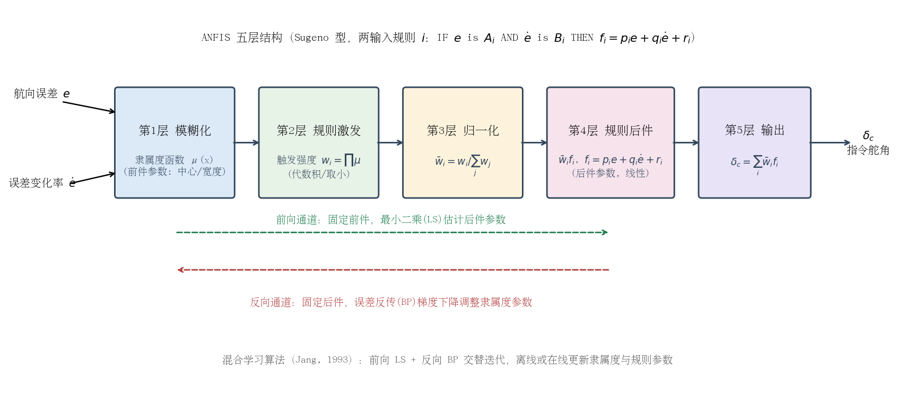

近三年该路线在船舶自动舵上的代表性进展：

- **Lee, Tzeng & Huang（2013）**：较早的 ANFIS 船舶转向自动舵，ANFIS 框架加条件整定（conditional tuning）方案，仿真验证（[*Marine Engineering Frontiers* 1(3): 53–62](https://www.academia.edu/27933110/)，引文见 [Pham & Han 2023 参考文献](https://www.mdpi.com/2077-1312/11/7/1262)）。
- **Pham & Han（2023，韩国庆尚国立大学）**：面向扰动环境的 ANFIS 自动舵，将神经网络与模糊逻辑结合以处理复杂动态与不确定性，在注入风浪扰动的仿真中与常规方案对比验证航向保持性能（[*JMSE* 11(7): 1262](https://www.mdpi.com/2077-1312/11/7/1262)，[原文 PDF](https://pdfs.semanticscholar.org/0af6/65af6356320a735fa85c70c4d2ff52d68a37.pdf)）。
- **Guo, Yang, Zhang & Han（2025）**：基于 MMG 三自由度操纵模型（经实船回转试验验证）的 ANFIS 航向控制器，**训练数据直接取自一个已整定线性控制器的输入输出样本**，再用 BP+LS 混合学习训练，在正常与恶劣海况下做仿真对比（[*JMSE* 13(3): 490](https://www.mdpi.com/2077-1312/13/3/490)，[摘要见 OUCI](https://ouci.dntb.gov.ua/works/le1Rowwl/)）。

从这批工作可以看出三个趋势：

1. **"以线性控制器为教师"成为主流训练范式**：先用极点配置/PID 等成熟方法生成覆盖各工况的（误差, 误差变化率 → 舵角）样本，ANFIS 先复现教师、再借助泛化能力在扰动工况下超越——这大幅降低了规则库设计门槛，也让 ANFIS 的行为有据可依（Guo 2025 明确采用该范式）。
2. **混合学习 + 群智能优化结合**：BP/LS 之外，隶属度参数用 PSO/GA 离线优化的做法增多；训练完成后网络前向计算量小，可在嵌入式平台实时部署。
3. **验证仍停留在仿真层面**：MMG 或 Nomoto 模型 + 风浪扰动注入是标准配置，**实船验证与稳定性证明双双缺位**——ANFIS 训练本身不含 Lyapunov 保证，其闭环稳定性论证与上节的经验型模糊控制处于同一境地，通常需外加监督层或限幅保护。

对本项目的意义：ANFIS 适合把 ESC 在线辨识与极点配置得到的"海况 × 船速 → 增益"调度知识**蒸馏**成连续可微的增益律，替代查表插值；但要注意训练数据的工况覆盖决定了泛化能力，未覆盖的高海况区间可能出现不可预期的外推行为，需配合限幅与回退逻辑使用。

### 工程优缺点

**优点**

- 不依赖精确模型：规则来自操舵经验，对 Nomoto $K$、$T$ 的大范围摄动（船速、装载变化）有天然鲁棒性；
- 实现成本低：$7\times7$ 规则表推理在 PLC/单片机上可实时运行，Tomera 已在 PLC 上实现并实船验证（[Polish Maritime Research, 2012](http://www.bg.pg.gda.pl/pmr/pdf/PMRes_2012_special1.pdf)）；
- 可解释、可审计：每条规则对应明确的操舵直觉，便于工程审查与渐进式改进；
- 与 PID 无缝兼容：监督型结构保留 PID 底层，可回退、可逐层启用。

**缺点**

- 纯经验模糊控制**缺乏系统性设计方法与稳定性证明**，规则库整定（隶属度参数、比例因子）仍靠试凑（稳定性分析路径见前文专节）；
- 自适应模糊（Yang & Ren 类）虽有 Lyapunov 保证，但结构复杂、计算量增加，且逼近误差需鲁棒项补偿，工程落地案例少；
- 规则与隶属度若针对平静海况整定，**高海况下波浪高频分量会经 $\dot e$ 通道放大为频繁操舵**——必须配合波浪滤波（限波器/卡尔曼滤波）使用，否则加剧舵机磨损；
- 性能上限受规则表分辨率约束，难以表达"按预测行为操舵"这类需要模型的策略；ANFIS 虽能自动学规则，但同样无稳定性证明且依赖训练数据覆盖度。

### 对本项目（PD + 增益调度 + ESC 在线调参）的借鉴点

1. **增益调度表的"模糊化"平滑**：本项目按海况 0–3 级 × 船速段做离散增益调度，可用模糊隶属度函数替代硬分区边界，使增益在海况/船速连续变化时平滑过渡，消除分区切换瞬态；规则表即可由现有调度表直接转化，改动量小、行为可预期。
2. **瞬态增益修正层**：在 ESC 辨识给出的极点配置基线增益之上，叠加一个以 $(e, \dot e)$ 为输入的小幅值模糊修正项 $\Delta K$，在大改向机动时临时提高微分作用抑制超调，在航向保持段压低增益减少操舵次数——与 ESC 的慢自适应形成"快/慢两层"。注意对 $\Delta K$ 限幅限速，满足增益调度的慢变约束（见稳定性专节）。
3. **波浪滤波与模糊监督的协同**：模糊监督层以 $\dot e$ 为输入，对波浪高频噪声敏感；本项目已有的滤波环节应放在模糊层之前，或改用滤波后的转向率 $r$ 作为输入，避免 3 级海况下增益被波浪调制而频繁抖动。
4. **作为 ESC 失效时的降级方案**：模糊规则库存储的是专家经验增益律，在辨识激励不足或参数发散时可作为安全的回退控制律，提升系统整体容错性。
5. **ANFIS 蒸馏调度知识**：可用 ESC+极点配置在各工况下生成的（工况, 误差动态 → 增益）数据离线训练一个小型 ANFIS，替代调度表+插值，获得平滑的连续增益律；上线前须对未覆盖工况做外推测试并加限幅。

### 参考资料

1. van Amerongen J., van Nauta Lemke H.R., van der Veen J.C.T. *An autopilot for ships designed with fuzzy sets*. Proc. 5th IFAC/IFIP Conf. on Digital Computer Applications to Process Control, The Hague, June 1977. 文献注：[EOLSS](https://www.eolss.net/sample-chapters/c18/E6-43-36-03.pdf)；[作者出版物列表](https://afscheid.vanamerongen.org/publicaties/)；[原文 PDF](https://afscheid.vanamerongen.org/publicaties/amerongen1977.pdf)
2. Roberts G.N., Sutton R., Zirilli A., Tiano A. *Intelligent ship autopilots — A historical perspective*. Mechatronics, 13(10): 1091–1103, 2003. DOI: 10.1016/S0957-4158(03)00044-8. https://www.sciencedirect.com/science/article/abs/pii/S0957415803000448
3. Yang Y., Zhou C., Ren J. *Model reference adaptive robust fuzzy control for ship steering autopilot with uncertain nonlinear systems*. Applied Soft Computing, 3(4): 305–316, 2003. DOI: 10.1016/j.asoc.2003.05.001（DOI 引文见[《船舶自动舵控制技术研究进展》参考文献 22](http://jckxjs.xml-journal.net/article/doi/10.3404/j.issn.1672-7649.2026.13.020)）
4. Yang Y., Ren J. *Adaptive fuzzy robust tracking controller design via small gain approach and its application*. IEEE Trans. Fuzzy Systems, 11(6): 783–795, 2003.（引文见 [JMSE 9(8):828 参考文献 4](https://www.mdpi.com/2077-1312/9/8/828)）
5. Sutton R., Roberts G.N., Taylor S.D. *Tuning fuzzy ship autopilots using artificial neural networks*. Trans. Inst. Measurement and Control, 19(2): 94–106, 1997.（引文见 [Springer](https://link.springer.com/article/10.1007/s40815-020-00880-3) 参考文献 4）
6. Tomera M. *Fuzzy Self-Tuning PID Controller for a Ship Autopilot*. In: Marine Navigation — Proc. 12th Int. Conf. on Marine Navigation and Safety of Sea Transportation (TransNav 2017), Gdynia, pp. 93–103, CRC Press/Balkema, 2017. DOI: 10.1201/9781315099132-9. https://www.taylorfrancis.com/chapters/edit/10.1201/9781315099132-9/fuzzy-self-tuning-pid-controller-ship-autopilot-tomera（引文亦见 [MDPI JMSE 13(5):851 综述参考文献 33](https://www.mdpi.com/2077-1312/13/5/851)）
7. Tomera M. 等. Blue Lady 训练船实船控制试验平台资料：[Waypoint Path Controller for Ships（含 Blue Lady 实船试验说明）](https://pdfs.semanticscholar.org/caa2/a32a0db292765a6264fa15c889ad326f35f1.pdf)；[Polish Maritime Research 2012](http://www.bg.pg.gda.pl/pmr/pdf/PMRes_2012_special1.pdf)
8. 张雪飞, 袁鹏, 谭俊哲, 等. 基于模糊PID的无人帆船航向控制方法. 《中国舰船研究》, 14(6): 15–21, 2019. DOI: 10.19693/j.issn.1673-3185.01518. https://www.ship-research.com/article/cstr/32390.14.j.issn.1673-3185.01518
9. Pham D.-A., Han S.-H. *Designing a Ship Autopilot System for Operation in a Disturbed Environment Using the Adaptive Neural Fuzzy Inference System*. JMSE, 11(7): 1262, 2023. DOI: 10.3390/jmse11071262. https://www.mdpi.com/2077-1312/11/7/1262
10. Cheng J., Yi J., Zhao D. *A New Fuzzy Autopilot for Way-point Tracking Control of Underactuated Ships*. WCCI 2006. http://congres.cran.univ-lorraine.fr/2006/WCCI_2006/data/pdffiles/papers/0357.pdf
11. *A Comprehensive Review of Ship Automatic Rudder Technology: Development, Challenges, and Prospects*. JMSE, 13(5): 851, 2025. https://www.mdpi.com/2077-1312/13/5/851
12. Fossen T.I. *Handbook of Marine Craft Hydrodynamics and Motion Control*. Wiley, 2011.（引文见 [Springer 章节](https://link.springer.com/chapter/10.1007/978-981-16-5912-6_55)）
13. Jang J.-S.R. *ANFIS: Adaptive-Network-Based Fuzzy Inference System*. IEEE Trans. Systems, Man, and Cybernetics, 23(3): 665–685, 1993. https://ieeexplore.ieee.org/document/256541
14. Lee S.-D., Tzeng C.-Y., Huang W.-W. *Ship steering autopilot based on ANFIS framework and conditional tuning scheme*. Marine Engineering Frontiers, 1(3): 53–62, 2013.（引文见 [Taylor & Francis 参考文献](https://www.tandfonline.com/doi/full/10.1080/20464177.2018.1550030) 与 [Pham & Han 2023](https://www.mdpi.com/2077-1312/11/7/1262)）
15. Guo Y., Yang R., Zhang Z., Han B. *ANFIS-Based Course Controller Using MMG Maneuvering Model*. JMSE, 13(3): 490, 2025. DOI: 10.3390/jmse13030490. https://www.mdpi.com/2077-1312/13/3/490
16. Shamma J.S., Athans M. *Analysis of gain scheduled control for nonlinear plants*. IEEE Trans. Automatic Control, 35(8): 898–907, 1990. 相关 MIT LIDS 报告（LPV 版分析）：[dspace.mit.edu](https://dspace.mit.edu/bitstream/handle/1721.1/3098/P-1830-19107298.pdf)
17. Leith D.J., Leithead W.E. *Survey of gain-scheduling analysis and design*. Int. J. Control, 73(11): 1001–1025, 2000. [预印本](https://www.hamilton.ie/publications/1001965764_link_19992.pdf)

---

## 神经网络自适应控制自动舵

### 动机与基本思想

船舶航向控制的经典模型——一阶/二阶 Nomoto 模型 $T\ddot{\psi}+\dot{\psi}=K\delta$（或 $T\dot{r}+r=K\delta$）——中的回转性指数 $K$ 与追随性指数 $T$ 并非常数：它们随航速、吃水/装载、水深变化，且受风浪流干扰作用而显著漂移；实际水动力还存在 $\alpha r^3$ 型非线性项与舵机饱和、速率限制、间隙等非光滑环节。固定增益 PID/PD 难以覆盖全部工况，而查表式增益调度只能覆盖预先枚举的工况点，工况表之外的组合（如"低航速 + 高海况 + 浅吃水"）仍是盲区。神经网络（NN）自适应控制的核心思想是：**利用神经网络的万能逼近能力，在线逼近模型中的未知非线性函数或等效干扰，再由 Lyapunov 方法同步设计控制律与权值自适应律，保证闭环信号一致最终有界（UUB）**。这一理论体系由 Ge S. S. 等人在《Stable Adaptive Neural Network Control》（Kluwer, 2001）中系统化（[参考文献](http://jase.tku.edu.tw/articles/jase-201706-20-2-03.pdf) 引述），并被大量移植到船舶航向/航迹控制中。

### 三类主流结构

#### （1）NN 自适应逆控制

直接逆控制的思路是训练一个神经网络逼近船舶操纵逆动力学 $\delta = f^{-1}(\psi, \dot{\psi}, \ddot{\psi}_{d})$，将其与参考模型串联，使"NN 逆模型 × 船舶正模型"近似为单位环节，输出即复现参考航向轨迹。权值训练通常采用**特化学习（specialized learning）**：以航向误差经船舶雅可比（或其符号/近似模型）反传更新权值，从而避免对精确逆模型的离线辨识。代表性工作是英国格拉斯哥大学 Unar 与 Murray-Smith 的神经网络船舶自动舵（*Int. J. Adaptive Control & Signal Processing*, 1999, 13(4): 203–218，DOI: 10.1002/(SICI)1099-1115(199906)13:4<203::AID-ACS544>3.0.CO;2-T，[格拉斯哥大学机构库条目](https://eprints.gla.ac.uk/66911/)）：该文考察了用于操舵控制的 RBF 网络（将一组针对不同工况设计的常规控制器特性融入单个网络）与用于船舶动力学建模的局部模型网络（local model network）。同一时期 Burns 与 Richter 提出人工神经网络自动舵并做了仿真验证（会议版 UKSS'93，期刊版 *Control Engineering Practice*, 1996, 4(3): 411–416，[参考文献引述](https://arxiv.org/pdf/2204.00757v1)）。土耳其学者 Alarçin 进一步将 NN 嵌入**内模控制（IMC）**结构：NN 正模型与 NN 逆模型并联构成内模回路，提升了模型失配下的鲁棒性——注意其应用对象是船舶**横摇减摇**而非航向控制（[J. Marine Science and Technology (NTOU), 2007, 15(2)](https://jmstt.ntou.edu.tw/cgi/viewcontent.cgi?article=2042&context=journal)）。近年还有将训练好的自适应神经模糊逆模型与分数阶 $PI^\lambda D^\mu$ 并联作为逆控制器的方案（[Li et al., Applied Sciences, 2022](https://www.mdpi.com/2076-3417/12/11/5604)）。

NN 逆控制结构简单、直观，但**逆模型在舵机饱和区不可导、在非最小相位/强干扰下训练可能发散**，闭环稳定性通常无法用严格 Lyapunov 方法证明，工程上多依赖离线训练 + 在线微调（fine-tuning）的保守策略。

#### （2）NN + 自适应反步法（adaptive backstepping with NN）

这是当前文献中最主流、稳定性证明最完备的一条路线。考虑带未知非线性项的 Norrbin/Nomoto 型模型：

$$T\ddot{\psi} + \dot{\psi} + \alpha \dot{\psi}^3 = K\delta + d(t)$$

定义航向误差面 $z_1 = \psi - \psi_d$，第一步反步取虚拟控制律

$$\alpha_1 = -c_1 z_1 + \dot{\psi}_d, \qquad z_2 = \dot{\psi} - \alpha_1$$

第二步中，系统不确定项（含未知水动力函数、$K/T$ 漂移引起的系数摄动与风浪等效干扰的集总项）$\Delta f(Z)$ 由 RBF 神经网络在线逼近：

$$\Delta f(Z) = W^{*\mathsf{T}} h(Z) + \varepsilon, \qquad \hat{f}(Z) = \hat{W}^{\mathsf{T}} h(Z)$$

其中 $h(Z)$ 为高斯基函数向量，$Z=[\psi, \dot{\psi}, \delta]^{\mathsf{T}}$ 为网络输入，$\varepsilon$ 为有界逼近误差。实际控制律取

$$\delta = \frac{1}{\hat{g}}\left(-\hat{f}(Z) - c_2 z_2 - z_1 + \dot{\alpha}_1\right)$$

权值自适应律由 Lyapunov 函数 $V=\frac{1}{2}z_1^2+\frac{1}{2}z_2^2+\frac{1}{2}\tilde{W}^{\mathsf{T}}\Gamma^{-1}\tilde{W}$ 反演得到，并加 $\sigma$-修正（泄漏项）防止权值漂移：

$$\dot{\hat{W}} = \Gamma\left(h(Z)\,z_2 - \sigma \hat{W}\right)$$

可证 $\dot{V} \le -c V + \mu$，即闭环所有信号一致最终有界，稳态误差可通过增大 $c_i$、减小 $\sigma$ 任意调小。为避免反步法对虚拟控制律反复求导引起的"微分爆炸"，李铁山、杜佳璐（大连海事大学）等引入**动态面控制（DSC）**：用一阶低通滤波器替代对 $\alpha_1$ 的解析求导，并采用**最少学习参数（MLP, minimal learning parameters）**技术——在线只调整一个标量权值范数估计而非全部网络权值——大幅减少在线计算量，利于实船实现（苗保彬、李铁山等，《[基于 DSC 和 MLP 的船舶航向跟踪控制](https://xb.dlmu.edu.cn/CN/Y2013/V39/I4/5)》，大连海事大学学报，2013）。刘洋、郭晨给出 RBF 网络自适应航向保持的完整非线性设计（《[船舶航向保持 RBF 神经网络自适应非线性控制](https://xb.dlmu.edu.cn/CN/Y2013/V39/I4/1)》，大连海事大学学报，2013）；Zhu、Du、Kao 进一步处理了输入饱和与输出约束下的鲁棒自适应 NN 航迹跟踪（[J. Franklin Institute, 2020, 357(13): 8591–8610](http://www.maritimejournal.cn/data/article/shhsdxxb/preview/pdf/20240203.pdf) 引述）。

#### （3）NN 观测器 / 逼近器处理不可测状态与时变海况

实船上转首角速度 $r$ 常无独立传感器或噪声很大，北京理工大学学报报道的**基于神经网络的自适应输出反馈航向控制**用 NN 逼近未知动态、以观测器重构 $r$，仅用航向角量测即实现跟踪，并给出 Lyapunov 稳定性证明（《[基于自适应输出反馈的船舶航向控制](https://journal.bit.edu.cn/zr/cn/article/pdf/preview/20110412.pdf)》，2011）。另一条路线是**神经网络扰动观测器（NDOB）**：用 NN 在线估计风浪流集总扰动并在控制律中前馈抵消，如基于 NN 扰动观测器的舵减摇/航向动态逆控制（[J. Marine Science and Technology, 2025](https://link.springer.com/article/10.1007/s00773-025-01099-3)）。此类"观测器 + 前馈"结构与工程上常用的扩张状态观测器（ESO）思路一致，对**时变海况**尤为关键：海况变化本质上表现为 $K/T$ 漂移与扰动谱变化，NN 逼近器将其作为"未知函数"在线学习，无需显式的海况分级与工况表。

### 代表性工作与人物谱系

- **van Amerongen（1982/1984，Delft）**：模型参考自适应舵（MRAS）奠基之作，*Automatica*, 20(1): 3–14（[DOI 引述](http://jase.tku.edu.tw/articles/jase-201706-20-2-03.pdf)），是 NN 自适应舵的前身。
- **杨盐生（1994，大连海事大学）**：国内最早的"神经网络自适应船舶自动操纵"工作之一（*Neural Network Adaptive Control for Ship Automatic Steering*，北京 International Symposium of Young Investigators on Information, Computer & Control, 1994: 231–236，[文献引述](http://jase.tku.edu.tw/articles/jase-201706-20-2-03.pdf)）。
- **Tzeng（C. Y. Tzeng，台湾海洋大学，1990s–2000s）**：反馈线性化舵、NN/模糊/H∞ 混合航向控制系列工作，多次在实船与仿真中验证（如 [JMSTT 内模控制文献](https://jmstt.ntou.edu.tw/cgi/viewcontent.cgi?article=2042&context=journal)引述其工作）。
- **张显库（大连海事大学）**：以闭环增益成形算法（CGSA）、Lyapunov 直接法非线性航向保持著称（《基于 Lyapunov 稳定性的船舶航向保持非线性控制》，西南交通大学学报，2010，[引文出处](https://xb.dlmu.edu.cn/CN/Y2013/V39/I4/1)），并出版教材《船舶运动控制》（国防工业出版社，2006）；其团队（邓雅洁等）将事件触发 + 模糊/NN 用于欠驱动船航迹跟踪（[Ocean Engineering, 2019, 186: 106122](http://www.maritimejournal.cn/data/article/shhsdxxb/preview/pdf/20240203.pdf) 引述）。
- **李铁山、杜佳璐、郭晨、卜仁祥等（大连海事大学）**：DSC+MLP、RBF 自适应反步、迭代滑模等系列，构成国内 NN 反步自动舵的主要谱系（[大连海事大学学报 2013(4)](https://xb.dlmu.edu.cn/CN/Y2013/V39/I4/5)）。
- **Le T. T.（2021）**：基于神经网络的船舶航向控制系统，*J. Marine Science and Technology*, 26: 963–972（[Springer](https://link.springer.com/article/10.1007/s00773-020-00783-w)），为近年 NN 舵的代表性研究论文（原始研究论文，非综述）。

### 稳定性证明思路（工程视角摘要）

NN 自适应反步法的证明套路固定，工程上可直接复用：

1. 构造误差面 $z_1, z_2$ 与 NN 权值误差 $\tilde{W} = \hat{W} - W^{*}$；
2. 取候选 Lyapunov 函数 $V=\frac{1}{2}z_1^2+\frac{1}{2}z_2^2+\frac{1}{2}\tilde{W}^{\mathsf{T}}\Gamma^{-1}\tilde{W}$；
3. 将自适应律设计为恰好对消 $\dot{V}$ 中含 $\tilde{W}$ 的项，剩余项用杨氏不等式放缩；
4. 得 $\dot{V}\le -cV+\mu$，即 **UUB**：跟踪误差收敛到以 $\sqrt{2\mu}$ 为半径的邻域，半径由逼近误差 $\varepsilon$、扰动上界与泄漏系数 $\sigma$ 决定。

需要注意，该结论保证的是"有界"而非"渐近收敛"，且**持续激励（PE）条件不满足时权值只保证有界、不保证收敛到真值**——这正是工程上必须加 $\sigma$-修正、死区或投影算子的原因。

### 持续激励（PE）困境与权值稳健化的工程措施

#### 为什么 PE 在保向工况下天然不满足

权值收敛到真值 $W^{*}$（而非仅仅有界）的充分条件是回归向量 $h(Z)$ 满足持续激励（PE）条件：存在 $\alpha_0, T_0>0$，使对任意 $t\ge 0$ 有

$$\int_{t}^{t+T_0} h(Z(\tau))\,h^{\mathsf T}(Z(\tau))\,\mathrm{d}\tau \;\succeq\; \alpha_0 I$$

（PE 与参数收敛关系的经典结论见 [Narendra & Annaswamy, *Int. J. Control*, 1987](https://www.tandfonline.com/doi/abs/10.1080/00207178708933715)；稳健化修正的系统论述见 [Ioannou & Sun, *Robust Adaptive Control*, 1996](http://www-bcf.usc.edu/~ioannou/RobustAdaptiveBook95pdf/Robust_Adaptive_Control.pdf)）。船舶保向（course keeping）恰恰是激励最贫乏的工况，原因有三：

- **回归量近似常值**：保向时 $\psi\approx\psi_d$、$r\approx 0$、舵角近似等于压舵偏置 $\delta\approx\delta_0$，故网络输入 $Z$ 近似常向量，$h(Z)$ 亦近似常向量，上式左端积分矩阵秩至多为 1，不可能对全部权值方向满足 $\succeq\alpha_0 I$——PE 结构性失败；
- **仅有的一点激励被主动滤除**：波浪诱导的高频艏摇分量本可充当激励源，但自动舵的波浪滤波器刻意将其挡在反馈回路之外（避免舵机跟随波频打舵、加剧磨损），进入自适应律的信号因而更加贫乏；
- **学习信号随误差收敛而消失**：梯度型自适应律由误差面 $z_2$ 驱动，$z_2\to 0$ 后权值更新趋零，网络"学不到真值，只剩漂移风险"。无 PE 时 Lyapunov 分析只保证 $\hat W$ 有界，$\hat W$ 可在满足 $\hat W^{\mathsf T}h(Z)\approx\Delta f(Z)$ 的权值流形上缓慢漂移；当工况或扰动谱变化时，漂移到流形远端的权值可能产生错误的瞬态前馈（参数突发，bursting），表现为长时间风平浪静后突然出现一次莫名的大舵角。

换言之，**"需要学习的时候学不动，不需要学习的时候在乱学"**是 NN 自适应舵在保向工况下的固有矛盾：UUB 结论兜底了闭环稳定性，但权值质量完全依赖下面的稳健化措施。

#### 权值投影、学习死区与软启动的工程形式

**（1）权值投影算子（projection）**：将权值约束在先验紧集 $\Omega_W=\{W:\|W\|\le M_W\}$ 内，$M_W$ 由离线辨识或水池试验给出的量级确定。标准形式为

$$
\dot{\hat W} = \begin{cases}
\Gamma h(Z)\,z_2, & \|\hat W\|<M_W \ \text{或}\ \bigl(\|\hat W\|=M_W \ \text{且}\ \hat W^{\mathsf T}h(Z)\,z_2\le 0\bigr) \\[6pt]
\Gamma h(Z)\,z_2-\Gamma\,\dfrac{\hat W\hat W^{\mathsf T}}{\|\hat W\|^2}\,h(Z)\,z_2, & \|\hat W\|=M_W \ \text{且}\ \hat W^{\mathsf T}h(Z)\,z_2>0
\end{cases}
$$

即权值到达约束球面且继续向外时，把更新量投影回切平面方向。离散实现等价于每步更新后做归一化截断 $\hat W\leftarrow\hat W\cdot\min\!\bigl(1,\,M_W/\|\hat W\|\bigr)$。投影不破坏 UUB 证明（投影只会减小 $\tilde W$ 方向的 Lyapunov 能量），并给出 $\|\hat W\|\le M_W$ 的硬保证——这正是面向船级社取证时"NN 输出最坏情况有界"的依据。

**（2）学习死区（dead zone）**：当误差小到与逼近误差、量测噪声同量级时冻结学习，防止把噪声学进权值。连续死区形式为

$$\dot{\hat W}=\Gamma\,D_\Delta(z_2)\,h(Z), \qquad D_\Delta(z)=\begin{cases}0, & |z|\le\Delta_0 \\ z-\Delta_0\,\mathrm{sgn}(z), & |z|>\Delta_0\end{cases}$$

死区宽度 $\Delta_0$ 应略大于逼近误差与噪声包络（工程上可按航向传感器噪声 $\pm3\sigma$ 折算为等效航向误差，$0.3\sim0.5^\circ$ 量级起步整定）；连续形式避免硬切换引起的抖振。死区与前文 $\sigma$-修正（泄漏项）互补：**死区管"误差小时不学"，泄漏管"学习时缓慢遗忘"**，二者叠加是船舶 NN 自适应文献中的标准配置。

**（3）软启动（soft start）**：解决上电初期权值未收敛、NN 前馈不可信的瞬态风险。NN 前馈经时变增益 $\kappa(t)$ 叠加到 PD 基础回路：

$$\delta=\delta_{\mathrm{PD}}+\kappa(t)\,\delta_{\mathrm{NN}}, \qquad \kappa(t)=\min\!\left(1,\ \frac{t-t_0}{T_s}\right)$$

- 斜坡时间 $T_s$ 取数十秒量级（覆盖若干次完整艏摇响应周期）；$\kappa$ 也可做成误差触发型——仅当 $|e|$ 连续小于阈值达 $N$ 秒（判定已进入保向段）后才开始上升；
- 权值以离线辨识/水池试验数据预训练结果初始化，或直接取 $\hat W_0=0$（零前馈、纯 PD），保证软启动期间闭环退化为可证明稳定的 PD 回路；
- $\delta_{\mathrm{NN}}$ 另加输出限幅与速率限制，任何时刻 NN 对舵角指令的贡献不超过预设份额（如 $\pm5^\circ$）。

**（4）与本项目 ESC 的对照**：ESC 通过主动注入正弦扰动**人为制造激励**，其参数收敛不依赖工况本身是否丰富——这正是"标量参数 + 主动激励"路线相对"高维权值 + 被动激励"路线在保向工况下的结构性优势；而上述投影、死区、软启动措施对本项目 ESC 的 $\hat K, \hat T$ 估计同样适用，可直接移植。

### 工程优缺点

**优点**

- 不依赖精确的 $K/T$ 先验值，能在线消化海况、航速、装载引起的模型漂移，理论上无需维护庞大的增益调度表；
- 反步/DSC 框架下稳定性可证（UUB），且 DSC 结构简单、可在普通嵌入式 MCU/DSP 上实现；
- NN 观测器/扰动观测器可减少对转首角速度传感器的依赖，并同时抑制慢变干扰（风流压差）与模型失配；
- 与现有 PD 回路天然兼容：NN 输出可作为前馈补偿项叠加在原 PD 舵角指令上，便于渐进式改造。

**缺点与落地难点**

- **瞬态风险**：上电初期权值未收敛，NN 输出可能产生较大错误前馈，需要权值限幅（投影算子）、输出限幅与"先 PD 后叠加"的软启动策略；
- **激励不足时学到错误模型**：船舶长时间直航时输入信号贫乏（不满足 PE），NN 可能把波浪高频分量或传感器偏置学进权值，需死区（误差小时冻结学习）+ 泄漏项；
- **验证与取证难**：NN 权值时变使传统频域裕度分析失效，船级社/IMO 对"学习型控制器"尚无成熟认证路径，工程上普遍采用"NN 仅作补偿、基础回路仍为可证明稳定的 PD/PID"的保底架构；
- **超参数敏感**：基函数中心/宽度、学习率 $\Gamma$、泄漏 $\sigma$ 需要针对船型整定，调参负担从"整定 PID 增益"转移为"整定 NN 超参数"，并不消失；
- **计算与实时性**：RBF 网络在低配单片机上可行，但大规模 MLP 的在线训练在资源受限舵机控制器上仍需谨慎评估。

### 与本项目（PD + 增益调度 + ESC 在线调参）的关联与借鉴

本项目当前方案为 PD + 海况/航速二维增益调度 + ESC 在线辨识 Nomoto $K/T$ 并极点配置。NN 自适应路线可在三个层面提供借鉴：

1. **ESC 的函数逼近升级**：ESC 目前辨识的是标量参数 $(K, T)$，隐含"Nomoto 结构正确"的假设。RBF 网络可看作 ESC 的推广——把"激励—响应"搜索目标从两个参数扩展为未知函数 $\Delta f(Z)$，从而吸收 Nomoto 模型未建模的非线性（如 $\alpha r^3$ 项、舵效非线性）。文献中的 NN 逼近器可直接替换/补充 ESC 的辨识环节。
2. **增益调度表的替代或兜底**：在调度表工况点之间，可用小型 RBF 网络（输入：航速、估计海况、转首角速度）插值/外推 PD 增益，减少表格维数灾难；调度表则作为 NN 失效时的保底。
3. **工程化经验的直接移植**：NN 文献中的软启动、权值投影、学习死区、$\sigma$-泄漏等措施，同样适用于本项目 ESC 调参的稳健化（ESC 也存在扰动幅值/频率整定与收敛性问题）；而本项目 ESC"只动两个物理参数、可解释性强"的优点，恰是 NN 方案取证困难的对照——推荐的落地形态是 **PD 基础回路 + ESC 参数级自适应 +（可选）NN 前馈补偿**的分层架构，而非端到端 NN 控制。

下图给出原理示意仿真（简化二阶 Nomoto 模型，数值仅为示意性量级，非实船数据）：海况突增（$K/T$ 漂移 + 风流/波浪干扰增强，$t=120\,\mathrm{s}$）后，固定增益 PD 因慢变干扰产生约 3–8°（均值约 5°）的持续航向偏差，而带在线学习前馈的自适应方案经短暂学习后把误差压回 1° 上下（均值不足 1°），且自适应权值保持有界收敛——这正是 NN/自适应前馈相对纯 PD 的核心价值区间。

### 参考资料

1. Unar M. A., Murray-Smith D. J. Automatic steering of ships using neural networks. *Int. J. Adaptive Control & Signal Processing*, 1999, 13(4): 203–218.（引文页：[JASE 期刊 PDF](http://jase.tku.edu.tw/articles/jase-201706-20-2-03.pdf)）
2. van Amerongen J. Adaptive steering of ships — a model reference approach. *Automatica*, 1984, 20(1): 3–14.（引文页：同上 [JASE PDF](http://jase.tku.edu.tw/articles/jase-201706-20-2-03.pdf)）
3. Burns R. S., Richter R. A neural network approach to the control of surface ships. *Control Engineering Practice*, 1996, 4(3): 411–416（早期会议版：Richter R., Burns R. S. An artificial neural network autopilot for small vessels. UKSS'93, 1993: 168–172；引文出处：[arXiv:2204.00757](https://arxiv.org/pdf/2204.00757v1)）
4. 苗保彬, 李铁山, 罗伟林, 等. 基于 DSC 和 MLP 的船舶航向跟踪控制. 大连海事大学学报, 2013, 39(4): 5–8. https://xb.dlmu.edu.cn/CN/Y2013/V39/I4/5
5. 刘洋, 郭晨. 船舶航向保持 RBF 神经网络自适应非线性控制. 大连海事大学学报, 2013, 39(4): 1–4. https://xb.dlmu.edu.cn/CN/Y2013/V39/I4/1
6. 张显库. 基于 Lyapunov 稳定性的船舶航向保持非线性控制. 西南交通大学学报, 2010, 45(1): 140–143.（引文页：同上 [大连海事大学学报](https://xb.dlmu.edu.cn/CN/Y2013/V39/I4/1)）
7. 基于自适应输出反馈的船舶航向控制. 北京理工大学学报, 2011. https://journal.bit.edu.cn/zr/cn/article/pdf/preview/20110412.pdf
8. Le T. T. Ship heading control system using neural network. *J. Marine Science and Technology*, 2021, 26: 963–972. https://link.springer.com/article/10.1007/s00773-020-00783-w
9. Alarçin F. Internal model control using neural network for ship roll stabilization. *J. Marine Science and Technology (NTOU)*, 2007, 15(2). https://jmstt.ntou.edu.tw/cgi/viewcontent.cgi?article=2042&context=journal
10. Zhu G. B., Du J. L., Kao Y. G. Robust adaptive neural trajectory tracking control of surface vessels under input and output constraints. *J. Franklin Institute*, 2020, 357(13): 8591–8610.（引文页：[上海海事大学学报 PDF](http://www.maritimejournal.cn/data/article/shhsdxxb/preview/pdf/20240203.pdf)）
11. Dynamic inverse control of ship rudder roll/yaw stabilization based on neural network disturbance observer. *J. Marine Science and Technology*, 2025. https://link.springer.com/article/10.1007/s00773-025-01099-3
12. Li G. et al. Fractional-order PIλDμ controller using adaptive neural fuzzy model for course control of underactuated ships. *Applied Sciences*, 2022, 12(11): 5604. https://www.mdpi.com/2076-3417/12/11/5604
13. Narendra K. S., Annaswamy A. M. Persistent excitation in adaptive systems. *Int. J. Control*, 1987, 45(1): 127–160. https://www.tandfonline.com/doi/abs/10.1080/00207178708933715
14. Ioannou P. A., Sun J. *Robust Adaptive Control*. Prentice-Hall, 1996（Dover 重印，2012；作者公开 PDF：http://www-bcf.usc.edu/~ioannou/RobustAdaptiveBook95pdf/Robust_Adaptive_Control.pdf ）

---

## 鲁棒自适应控制：L1 自适应与自适应滑模

本节调研两类"鲁棒自适应"控制思路在船舶航向/航迹控制中的应用：L1 自适应控制（L1 Adaptive Control, L1AC）与自适应滑模控制（Adaptive Sliding Mode Control, ASMC）。二者的共同点是**不依赖精确的在线参数辨识收敛**，而是通过结构性机制（低通滤波解耦 / 滑模不变性）在保证鲁棒性的前提下实现快速适应，正好切中传统 MRAC 与增益调度"适应快则鲁棒性差、鲁棒强则适应慢"的矛盾。

### 1. L1 自适应控制：原理与结构

#### 1.1 核心思想

L1 自适应控制由 Cao 与 Hovakimyan 于 2006 年提出（[ACC 2006 Part I](https://arxiv.org/html/2307.04030v1) 参考文献 [36]；系统理论见专著 [Hovakimyan & Cao, *L1 Adaptive Control Theory: Guaranteed Robustness with Fast Adaptation*, SIAM, 2010](https://www.mdpi.com/1996-1073/15/10/3602) 参考文献 [9]）。其关键洞察是：传统 MRAC 中提高自适应增益会同时把高频估计噪声注入控制通道，破坏鲁棒性；L1AC 在控制律中串入一个**低通滤波器 $C(s)$**，将"估计环"与"控制环"解耦——自适应增益可以取得任意大（仅受硬件计算速度限制）以实现快速估计，而控制信号带宽始终被 $C(s)$ 限制在执行机构可承受的范围内，鲁棒性由滤波器带宽保证（[NASA L1 技术报告](https://www.nasa.gov/wp-content/uploads/2019/10/moore_2013_phi_eternalflight_-_tagged.pdf)；[三菱重工技术综述](https://www.mhi.com/technology/review/sites/g/files/jwhtju2326/files/tr/pdf/e611/e611190.pdf)）。

#### 1.2 基本结构（以船舶艏摇为例）

考虑带匹配不确定性的艏摇通道（一阶 Nomoto 模型的状态空间形式）：

$$
\dot{x}(t) = A_m x(t) + b\big(\omega\, u(t) + \sigma(t, x)\big), \qquad x = [\psi,\ r]^\top
$$

其中 $A_m$ 为期望（参考）闭环动态，$\omega$ 为舵效增益不确定性（对应 $K$ 的摄动），$\sigma(t,x)$ 汇聚参数摄动与风浪流等效扰动。L1AC 由三部分组成：

1. **状态预测器**：
$$
\dot{\hat{x}}(t) = A_m \hat{x}(t) + b\big(\hat{\omega}(t) u(t) + \hat{\sigma}(t)\big), \qquad \hat{x}(0)=x(0)
$$

2. **自适应律**（分段常数律，按采样周期 $T_s$ 更新）：
$$
\hat{\sigma}(t) = -\Phi^{-1}(T_s)\, e^{A_m T_s}\, \tilde{x}(iT_s), \qquad \tilde{x} = \hat{x} - x
$$
也可用投影算子律 $\dot{\hat{\sigma}} = \Gamma\,\mathrm{Proj}(\hat{\sigma}, -\tilde{x}^\top P b)$，自适应增益 $\Gamma$ 可取得很大而不损伤鲁棒性。

3. **低通滤波控制律**：
$$
u(s) = -k\,D(s)\,\big(\hat{\omega}(s)u(s) + \hat{\sigma}(s) - k_g r(s)\big)\ \text{经}\ C(s)\ \text{限带}
$$
稳定性由 **L1 范数条件**保证：$\|G(s)\|_{\mathcal{L}_1} L < 1$，其中 $G(s)$ 为含滤波器的开环传函，$L$ 为不确定性 $\sigma$ 的 Lipschitz 常数界。该条件同时给出可量化的鲁棒裕度（时延裕度、增益裕度有闭式下界，见 [Cao & Hovakimyan, Stability Margins of L1 Adaptive Controller, ACC 2007](https://arxiv.org/html/2307.04030v1) 参考文献 [35]）。

*图 6-1 L1 自适应航向控制结构：状态预测器+自适应律（虚线）快速估计集总不确定性 $\hat\sigma$，补偿信号经低通滤波器 $C(s)$ 限带后叠加在基线 PD 控制输出上，实现适应性与鲁棒性的解耦。*

#### 1.3 在船舶控制中的代表性工作

| 工作 | 对象 | 要点 |
|---|---|---|
| [Xu, Oliveira & Guedes Soares (2021), *European Journal of Control* 58:357–372](https://www.sciencedirect.com/science/article/abs/pii/S0947358020300261) | 欠驱动水面船路径跟随 | L1 自适应 + 反步（backstepping）复合结构，利用"估计与控制解耦"特性处理海洋扰动与模型不确定性，被引 65 次（Semantic Scholar 统计，截至 2026-08-12），是船舶领域 L1AC 的代表作 |
| [Maruf et al. (2021), *IOP Conf. Ser.: Earth Environ. Sci.* 649, 012055](https://iopscience.iop.org/article/10.1088/1755-1315/649/1/012055) | 无人水面艇（USV） | 针对 USV 的 L1 自适应控制器，验证了"快速自适应而不失鲁棒性"，控制律中嵌入低通滤波器 |
| [三菱重工技术综述 Vol.61 No.1 (2024)](https://www.mhi.com/technology/review/sites/g/files/jwhtju2326/files/tr/pdf/e611/e611190.pdf) | AUV 姿态控制（纵摇/横摇/艏摇） | 将 L1 自适应控制器**前置挂接在既有 PID 姿态控制器之前**，即"增广（augmentation）"式改造，不推翻原有控制律——对工程升级极具参考价值；已用 6 自由度非线性模型 + ISSC 不规则波谱完成仿真验证（4 kn、近水面、有义波高 3.72 m 工况下纵摇/横摇/艏摇振荡峰值分别削减 41%/32%/46%），尚为仿真阶段结果 |
| [自适应 Nomoto 模型路径跟随（*J. Mar. Sci. Technol.*, 2018）](https://link.springer.com/article/10.1007/s00773-017-0518-y) | 船舶路径跟随 | 制导/控制子系统解耦，自适应 Nomoto 模型 + L1AC 在线辨识系统不确定性 |

此外，L1AC 在航空领域已有 NASA AirSTAR 飞行试验、Calspan Learjet 变稳机等实飞验证（见 [Xu et al. 2021 引文](https://ouci.dntb.gov.ua/en/works/42ORVoel/) 参考文献 [15]），工程成熟度在自适应控制家族中最高；eVTOL、无人直升机等文献也强调其"免去繁复增益调度"的优点（[MDPI Drones, 2024](https://www.mdpi.com/2504-446X/8/11/649/xml)；[MDPI Symmetry, 2021](https://www.mdpi.com/2073-8994/13/11/2125)）。

#### 1.4 L1 范数鲁棒条件的直观解释

稳定性条件 $\|G(s)\|_{\mathcal{L}_1} L < 1$ 初看抽象，其实质是一条**小增益定理（small-gain theorem）回路增益约束**，可以用三句话建立直觉：

1. **$\mathcal{L}_1$ 范数是什么**：对 LTI 系统 $G(s)$，$\|G\|_{\mathcal{L}_1} = \int_0^\infty |g(\tau)|\,d\tau$（$g$ 为脉冲响应），它恰好等于该系统对任意有界输入的诱导 $\mathcal{L}_\infty$ 增益——即"最坏情况下输出幅值是输入幅值的多少倍"，且这一界对任意波形（不限于正弦）都成立，这正是它比 $H_\infty$ 范数更适合处理"波形未知的不确定性信号"的原因（[Hovakimyan & Cao 专著，SIAM 2010](https://epubs.siam.org/doi/book/10.1137/1.9780898719367)）。
2. **回路里有两个"增益"相乘**：不确定性 $\sigma(t,x)$ 依赖状态 $x$，其 Lipschitz 常数 $L$ 是"$x$ 变化一个单位、$\sigma$ 最多变化 $L$ 个单位"的增益；而 $G(s)$ 是从 $\sigma$ 注入点出发、绕回路与滤波器 $C(s)$ 一圈、再回到 $x$ 的传递函数。两者首尾相接构成一个隐式反馈环，$\|G\|_{\mathcal{L}_1} L$ 就是这个环的总增益——小于 1 则任何不确定波形都不可能在环内自我放大，闭环鲁棒稳定。这与经典 Nyquist/增益裕度的"回路增益留折扣"思想完全同构，只是换成了对任意波形成立的 $\mathcal{L}_1$ 度量。
3. **滤波器带宽是唯一的"旋钮"**：$C(s)$ 带宽越窄，$\|G\|_{\mathcal{L}_1}$ 越小，允许的不确定性界 $L$ 越大（鲁棒性越强）；但 $C(s)$ 同时限制补偿信号的带宽——带宽窄了，快变扰动分量被滤掉，只能补偿其低频部分。L1AC 的全部设计折中就浓缩在这一个旋钮上：**估计环可以无限快，鲁棒性与补偿带宽的权衡全部交给 $C(s)$**。

对船舶航向回路的工程含义：波浪遭遇频率约 0.3–1 rad/s 决定了 $C(s)$ 截止频率的下界（再低就补偿不了波浪引起的等效舵效/阻尼摄动）；舵机带宽（典型 0.5–2 Hz 量级）与测量噪声决定其上界（再高就把舵机推向饱和并放大噪声）。时延的影响也在同一框架内量化：回路时延等效于抬高滤波器边缘处的有效回路增益，L1 理论给出时延裕度的闭式下界（[Cao & Hovakimyan, ACC 2007](https://arxiv.org/html/2307.04030v1) 参考文献 [35]），设计时应让"允许时延下界 > 采样周期 + 舵机响应延迟 + 通信延迟"留有 2 倍以上余量。

### 2. 自适应滑模控制（ASMC）

#### 2.1 滑模控制基础与自适应增益

对航向误差 $e = \psi - \psi_d$，取滑模面

$$
s = \dot{e} + \lambda e, \qquad \lambda > 0
$$

由一阶 Nomoto 模型 $T\dot{r} + r = K\delta + w$（$w$ 为风浪流等效扰动），等效控制 + 切换控制的舵角律为

$$
\delta = \underbrace{\frac{T}{K}\left(\ddot{\psi}_d - \lambda\dot{e} + \frac{r}{T}\right)}_{\text{等效控制}\ \delta_{eq}} \;-\; \underbrace{\frac{T}{K}\,\hat{\eta}\,\mathrm{sign}(s)}_{\text{切换项}}
$$

当 $s\dot{s} < 0$ 成立时状态被"吸附"到滑模面上，此后闭环动态由 $s=0$ 决定，**对满足匹配条件的参数摄动（$K, T$ 摄动）与扰动 $w$ 具有完全不变性**——这是 SMC 鲁棒性的来源（[Sliding mode 船舶航向控制综述引文](https://hrcak.srce.hr/file/325615)）。

传统 SMC 要求预知不确定性上界 $\eta \geq |w|_{\max} + \dots$，且上界越保守舵机负担越重。**自适应滑模**用在线自适应律估计该上界：

$$
\dot{\hat{\eta}} = \gamma\,|s|, \qquad \gamma > 0
$$

无需已知扰动界即可保证滑模到达；为避免增益只增不减的过估计，工程上常用"双层自适应（dual-layer）"或带泄漏项的改进律（[Shtessel et al., Super-twisting adaptive sliding mode control: a Lyapunov design, 2010](https://hal.science/hal-05240882v1/file/YBS2010.pdf)；[固定时间双层自适应船舶轨迹跟踪, 2023](https://pdf.hanspub.org/dsc20230200000_12233485.pdf)）。

#### 2.2 船舶应用代表性工作

- **[Liu (2018), *Polish Maritime Research*：波浪增速阻力导致船速损失下的自适应滑模保向控制](https://reference-global.com/2/v2/download/article/10.2478/pomr-2018-0128.pdf)**：针对波浪附加阻力引起船速变化、进而使 Nomoto $K/T$ 与舵机动态大幅摄动的问题，将未知有界不确定性合并后用 Lyapunov 直接法设计自适应律，在双舵船上仿真验证了时变波浪扰动 + 时变参数下的鲁棒保向性能。该场景与"最大海况适应性"问题高度同构。
- **[Perera & Guedes Soares (2012), *Ocean Engineering* 51:49–62：预滤波滑模船舶操舵控制](https://doi.org/10.1016/j.oceaneng.2012.04.014)**：基于二阶 Nomoto 模型的非线性操舵系统滑模控制，处理参数不确定性与未建模动态并抑制外部扰动。
- **[IFAC CAMS 2013：练习船"汐路丸（Shioji-Maru）"实船试验](https://www.sciencedirect.com/science/article/pii/S1474667016461355)**（Mizuno & Matsumoto，*IFAC Proceedings Volumes* 46(33):67–72，第 9 届 IFAC 船舶控制系统应用会议，大阪）：滑模自动操纵系统，用**增益调度 + 自适应增益调整**抑制输入抖振，目标航线由 Hermite 插值按最短时间操纵解生成；在多种工况的实船海试中，控制性能全面优于船上一贯使用的传统 PID——说明"SMC + 增益调度/自适应增益"的组合在实船上可行。
- **[超螺旋滑模 + ADP 自适应增益 + 时延估计的 MASS 控制（*Ocean Engineering*, 2021](https://www.sciencedirect.com/science/article/abs/pii/S0029801819306638)**）：针对海上自主水面船（MASS），用自适应增益超螺旋算法处理参数与非参数不确定性（含波浪、海流时变扰动），兼顾鲁棒性与抖振抑制。

#### 2.3 抖振问题与抑制手段

抖振（chattering）是 sign 函数不连续性 + 有限采样/执行器惯性引起的高频开关振荡，会加剧舵机磨损、激发未建模动态，是 SMC 工程化的首要障碍（[Kybernetika, 2005](https://www.kybernetika.cz/content/2005/5/601/paper.pdf)）。主流抑制手段：

1. **边界层法（Boundary Layer, Slotine）**：用饱和函数 $\mathrm{sat}(s/\phi)$ 替换 $\mathrm{sign}(s)$，在 $|s|<\phi$ 内连续插值。简单有效，但只能收敛到 $|s|\leq\phi$ 的残差集——边界层越宽控制越平滑、稳态精度越差，存在"平滑—精度"折中（[NTU 船舶 SMC 论文](https://scholars.lib.ntu.edu.tw/bitstreams/a89062e9-9b29-4c86-ae4b-35d9d2e7dc55/download)）。
2. **高阶滑模 / 超螺旋算法（Super-Twisting, Levant）**：
$$
\delta_{st} = -k_1 |s|^{1/2}\mathrm{sign}(s) + z, \qquad \dot{z} = -k_2\,\mathrm{sign}(s)
$$
不连续项只出现在 $\dot z$（即舵角速率）通道，**舵角本身连续**，在保持有限时间收敛与匹配扰动完全补偿的同时从机理上消除抖振，是目前船舶 SMC 文献的主流选择（[Levant 1993/1998 综述引述](https://livrepository.liverpool.ac.uk/3198071/1/201155893_Apr2026%20(002).pdf)；[Rivera et al., Super-Twisting Sliding Mode in Motion Control Systems](https://cdn.intechopen.com/pdfs/15216/InTech-Super_twisting_sliding_mode_in_motion_control_systems.pdf)）。配合自适应增益（$k_1, k_2$ 在线调整）可免知扰动上界（[Shtessel et al. 2010](https://hal.science/hal-05240882v1/file/YBS2010.pdf)）。
3. **与观测器/增益调度复合**：用扰动观测器（TDE、ESO）承担大部分扰动补偿，切换增益只需覆盖残差，可大幅降低抖振幅值（如前述 [Ocean Engineering 2021](https://www.sciencedirect.com/science/article/abs/pii/S0029801819306638) 的 TDE 方案；[Shioji-Maru 的增益调度方案](https://www.sciencedirect.com/science/article/pii/S1474667016461355)）。

图 6-2 为一阶 Nomoto 航向回路在 **$K$ 摄动 +60%、$T$ 摄动 +40% 且叠加浪流扰动**下的数值对比（切换增益固定、无增益调度）：三种滑模实现都能把航向收敛到目标值附近（鲁棒性相当），但舵角指令形态截然不同——sign 实现出现满幅 bang-bang 抖振，边界层实现平滑但滑模面存在稳态残差，超螺旋实现舵角连续且滑模面收敛最好。

*图 6-2 参数摄动与浪流扰动下三种滑模舵角律的对比（一阶 Nomoto 航向回路，舵限 ±35°）：上—航向阶跃响应；中—舵角指令局部放大，sign 抖振剧烈、边界层平滑、超螺旋连续；下—滑模面 $s$ 收敛过程。*

#### 2.4 超螺旋算法（STA）的离散化与嵌入式实现注意点

连续时间 STA"舵角连续、无抖振"的优点**并不会被数字实现自动继承**——离散化方式直接决定嵌入式部署的成败，这是船舶文献很少展开、但工程上最先踩到的坑。

**显式 Euler 离散化会引入数值抖振。** 将 $\dot z = -k_2\,\mathrm{sign}(s)$ 按显式 Euler 展开后，sign 项以零阶保持方式作用于整个采样周期：$s$ 一旦进入零邻域，控制量就在 $\pm k_2 T_s$ 量级间跳变，形成周期极限环。理论上收敛后 $|s|$ 残差为 $O(T_s)$ 量级（[Yan, Yu & Yu, *IEEE TAC* 66(6):2817–2824, 2021](https://arxiv.org/html/2209.03825v3) 参考文献 [3]），控制量抖振幅值正比于增益与 $T_s$ 的乘积——增益越大、采样越慢越糟，等于把连续 STA 的抖振抑制成果在数字域又丢了回去。

**隐式离散化（implicit / backward Euler）是目前的标准解法。** Brogliato、Polyakov 与 Efimov（[*IEEE TAC* 65(8):3707–3713, 2020](https://inria.hal.science/hal-02336599v1)）提出的隐式方案把下一步的 $\mathrm{sign}(s_{k+1})$ 当作待求量，解一个一步包含（one-step inclusion）。标量情形有**闭式解**，每步只需一次开方与几次比较：记 $A = s_k + T_s\,(d_k + z_k)$（$d_k$ 为本拍等效扰动/未控动态项），

$$
s_{k+1} = \begin{cases} 0, & |A| \le k_2 T_s^2 \\[4pt] \mathrm{sign}(A)\,y^2,\quad y = \dfrac{-k_1 T_s + \sqrt{k_1^2 T_s^2 + 4\big(|A| - k_2 T_s^2\big)}}{2}, & |A| > k_2 T_s^2 \end{cases}
$$

随后 $z_{k+1} = z_k - k_2 T_s\,\mathrm{sign}(s_{k+1})$，$u_{k+1} = -k_1\sqrt{|s_{k+1}|}\,\mathrm{sign}(s_{k+1}) + z_{k+1}$。该方案的收敛后残差为 $O(T_s^2)$，且控制量平滑、无需随 $T_s$ 增大而牺牲增益。图 6-3 的数值对比：同样 $T_s = 80$ ms 下，显式 Euler 收敛后 $|s|$ 峰值约 $1.7\times10^{-2}$ 且控制量明显毛刺，隐式方案残差约 $7\times10^{-4}$（缩小约 23 倍）、控制量平滑跟踪扰动补偿需求。

*图 6-3 超螺旋算法离散化方式对比（$\dot s = u + d(t)$，$d$ 为有界斜率扰动，$k_1=1.8,\ k_2=1.5$）：上—滑模面 $s$ 收敛过程及收敛后局部放大，显式 Euler（$T_s$=80 ms）出现数值极限环，隐式离散化残差小约 23 倍；下—控制量 $u$，隐式方案平滑无高频开关。*

**嵌入式实现清单（结合本项目舵机与控制器条件）：**

1. **计算量无忧**：标量 STA 隐式更新每拍仅一次开方运算，无三角函数、无矩阵求逆，定点 MCU 亦可承受；多维推广（多滑模面）才需要定点迭代 2–3 次求解包含。
2. **舵角饱和与抗积分饱和**：舵限 ±35° 饱和时 $z$ 通道（$\dot z = -k_2\mathrm{sign}(s)$）持续积分会造成 windup，恢复时反向超调。隐式框架下已有带执行器饱和的"条件化（conditioned）STA"严格解（[Seeber et al., arXiv:2406.16094, 2024](https://arxiv.org/abs/2406.16094)）；工程上至少应对 $z$ 加条件积分或限幅，并与舵角速率限制联动。
3. **采样周期选取**：隐式方案对 $T_s$ 不敏感，但 $T_s$ 仍须远小于扰动变化时间常数与期望的滑模到达时间。对本项目 25 kn 游艇，波浪扰动主导周期 3–10 s，控制周期 20–100 ms 均可满足；若用显式 Euler 则必须压低到 10 ms 级才能抑制数值抖振，白白增加算力负担。
4. **测量噪声通道**：$s = \dot e + \lambda e$ 中的艏摇角速度 $r$ 含罗经/IMU 噪声，会使 sign 在 $s\approx 0$ 处误切换；隐式方案对噪声更鲁棒但仍建议对 $r$ 做低通/跟踪微分器预处理，滤波带宽取波浪频率上限的 3–5 倍以限制相位滞后。若叠加自适应增益（Shtessel 律），应加泄漏项或死区，防止噪声把增益顶到投影上界。
5. **验收用例建议**：在 SIL/HIL 中固定 $T_s$ 与增益，先跑显式 Euler 复现数值抖振作为"反例基线"，再切换隐式方案对比 $|s|$ 残差与舵角速率统计，作为 STA 嵌入式实现的回归测试。

### 3. 与其他自适应方案的鲁棒性对比

| 维度 | MRAC（模型参考） | **L1 自适应** | **自适应滑模** | 本项目：PD + 增益调度 + ESC 在线辨识极点配置 |
|---|---|---|---|---|
| 适应速度 | 增益与鲁棒性耦合，快适应易振荡 | **任意快**（仅受算力限制），鲁棒性由滤波器保证 | 到达滑模面即生效，快 | 辨识收敛速度受激励条件限制，分钟级 |
| 鲁棒性机理 | 依赖持续激励与鲁棒修正（σ-mod 等） | L1 范数条件，**可量化裕度**（时延/增益裕度有下界） | 匹配不确定性**完全不变性**，但不匹配扰动（如艏摇测量噪声通道）无此保证 | 依赖辨识精度；辨识错误直接反映到极点配置，鲁棒性无显式保证 |
| 扰动类型 | 慢变参数 | 快变/突变参数与匹配扰动均可 | 匹配扰动、有界参数摄动 | 慢变工况（海况、船速段） |
| 瞬态性能保证 | 一般无 | **有**（闭环与参考系统误差界 ∝ 1/√Γ） | 有限时间到达 + 滑模阶段降阶动态 | 无显式瞬态保证 |
| 主要工程负担 | 鲁棒修正调参 | 滤波器 $C(s)$ 带宽设计（性能/鲁棒折中）；对时延敏感 | 抖振；对测量噪声敏感（$\dot e$ 需求） | 激励注入影响操舵平顺性；增益表维护 |
| 实船/实飞验证 | 早期自动舵（Norrbin/Aström 时代） | 航空实飞成熟；船舶以仿真为主、AUV 增广方案已完成工程仿真验证（三菱重工，尚无公开实船/样机数据） | Shioji-Maru 实船海试 | 本项目自研方案 |

要点小结：

- **L1AC 与自适应 SMC 处理的是"快变不确定性"**（突变风压、波浪引起的等效舵效/阻尼摄动、航速损失导致的 $K/T$ 漂移），而本项目 ESC 在线辨识面向的是"慢变工况"的精细调参——两者在时间尺度上互补而非互斥（[Liu 2018](https://reference-global.com/2/v2/download/article/10.2478/pomr-2018-0128.pdf) 正是把船速损失当作快变不确定性用 ASMC 处理）。
- MRAC 类方案（含本项目 ESC+极点配置）的性能上限取决于"模型对不对"；L1AC 与 SMC 则把不确定性当作有界信号直接压制，**对模型误差的容忍度更高**，代价分别是滤波器带宽折中与抖振/噪声敏感性。

### 4. 工程优缺点

**L1 自适应控制**

- 优点：快速自适应与鲁棒性解耦、瞬态与稳态性能有理论保证、可增广挂接在既有 PD/PID 控制器之前（三菱重工 AUV 方案证明该改造模式可行）、有望替代或精简增益调度表。
- 缺点：低通滤波器引入的相位滞后限制了对极高频扰动的补偿能力；对回路时延较敏感（时延裕度虽可量化但有限）；理论条件（L1 范数条件）到工程参数（滤波器带宽/阶次）的映射需要针对舵机带宽、采样率重新标定；船舶领域尚缺公开实船试验报告。

**自适应滑模控制**

- 优点：对匹配参数摄动与风浪流扰动的强不变性、结构简单（一阶 Nomoto 即可设计）、自适应增益免知扰动上界、已有实船海试先例（Shioji-Maru）。
- 缺点：抖振是必须正面处理的工程问题（边界层牺牲精度、超螺旋增加调参维度 $k_1, k_2$）；滑模面含 $\dot e$（即艏摇角速度 $r$），对罗经/IMU 噪声敏感，通常需配滤波器或观测器，而滤波相位滞后又会恶化抖振；不匹配扰动无不变性保证。

### 5. 对本项目（PD + 增益调度 + ESC）的借鉴点

1. **增广而非替换**：借鉴三菱重工 AUV 的做法，将 L1 自适应回路（或自适应滑模补偿项）作为**增广层**叠加在现有 PD 基线上——正常海况下增广输出近似为零，PD+增益调度+ESC 照常工作；遭遇超出增益表覆盖范围的突变工况（如 3 级海况上限附近的波浪增速阻力导致船速骤降、$K/T$ 漂移）时由增广层兜底。这与"最大海况适应性"的诉求直接对应。
2. **ESC 与 L1/ASMC 的时间尺度分工**：ESC 在线辨识继续负责分钟级的慢变工况精细调优（经济性/操舵量最优），L1AC 或 ASMC 负责秒级快变不确定性的鲁棒压制，二者频带不冲突；本项目已有的 $K/T$ 在线辨识结果可直接用作滑模等效控制 $\delta_{eq}$ 中的标称参数，比固定标称模型显著降低切换增益需求，从源头减轻抖振。
3. **抖振抑制经验可直接迁移**：本项目若在 ESC 激励注入或高海况下出现舵角高频抖动，可借鉴边界层/超螺旋的思路——把不连续作用移到舵角速率通道，或对补偿信号做低通限带（这正是 L1AC 的核心机制）。
4. **鲁棒性量化**：L1AC 的 L1 范数条件与裕度分析提供了一种把"自适应控制鲁棒性"写成可校验不等式的范式，可作为本项目论证最大海况适应边界（如 3 级海况下允许的最大 $K/T$ 漂移范围）的理论工具。
5. **优先级建议**：若只做一步鲁棒性增强，自适应超螺旋滑模的工程量最小（在现有 PD 输出上加一个连续补偿项即可，无需状态预测器），且船舶实船证据最充分；L1AC 理论保证更完备，适合作为中期升级方向。

### 参考资料

1. Hovakimyan N., Cao C. *L1 Adaptive Control Theory: Guaranteed Robustness with Fast Adaptation*. SIAM, 2010. https://epubs.siam.org/doi/book/10.1137/1.9780898719367 （引见 https://www.mdpi.com/1996-1073/15/10/3602 参考文献 [9]）
2. Cao C., Hovakimyan N. Design and Analysis of a Novel L1 Adaptive Controller, Part I/II. ACC 2006.（引见 https://arxiv.org/html/2307.04030v1 参考文献 [36]）
3. Cao C., Hovakimyan N. Stability Margins of L1 Adaptive Controller: Part II. ACC 2007.（引见 https://arxiv.org/html/2307.04030v1 参考文献 [35]）
4. Xu H., Oliveira P., Guedes Soares C. L1 adaptive backstepping control for path-following of underactuated marine surface ships. *European Journal of Control*, 58:357–372, 2021. https://www.sciencedirect.com/science/article/abs/pii/S0947358020300261 （DOI: 10.1016/j.ejcon.2020.08.003；Semantic Scholar 被引 65 次，截至 2026-08-12）
5. Maruf A. et al. L1 adaptive controller for unmanned surface vehicle. *IOP Conf. Ser.: Earth Environ. Sci.* 649, 012055, 2021. https://iopscience.iop.org/article/10.1088/1755-1315/649/1/012055
6. Nishida S., Yashiro Y., Eguchi K., Koshiro A. Adaptive Control of Autonomous Unmanned Vehicle in Presence of Environmental Variation（AUV 姿态控制的 L1 自适应增广设计：纵摇/横摇/艏摇，前置挂接既有 PID；仿真验证）. *Mitsubishi Heavy Industries Technical Review* Vol.61 No.1, March 2024. https://www.mhi.com/technology/review/sites/g/files/jwhtju2326/files/tr/pdf/e611/e611190.pdf
7. Adaptive Nomoto model used in the path following problem of ships. *J. Mar. Sci. Technol.*, 2018. https://www.x-mol.com/paper/1225052458260676608?adv= （期刊页 https://link.springer.com/article/10.1007/s00773-017-0518-y ）
8. NASA: L1 Adaptive Control 技术报告（AirSTAR 等飞行验证背景）. https://www.nasa.gov/wp-content/uploads/2019/10/moore_2013_phi_eternalflight_-_tagged.pdf
9. Liu Z. Adaptive sliding mode control for ship course keeping（船速损失与双舵船）. *Polish Maritime Research*, 2018. https://reference-global.com/2/v2/download/article/10.2478/pomr-2018-0128.pdf
10. Perera L.P., Guedes Soares C. Pre-filtered sliding mode control for nonlinear ship steering associated with disturbances. *Ocean Engineering* 51:49–62, 2012. https://doi.org/10.1016/j.oceaneng.2012.04.014
11. Mizuno N., Matsumoto S. Design and Evaluation of Simple Ship's Automatic Maneuvering System Using Sliding Mode Controller（Shioji-Maru 实船海试，SMC+增益调度+自适应增益）. *IFAC Proceedings Volumes* 46(33):67–72, 2013（9th IFAC CAMS, Osaka）. https://www.sciencedirect.com/science/article/pii/S1474667016461355
12. High performance super-twisting sliding mode control for a maritime autonomous surface ship (MASS) using ADP-based adaptive gains and time delay estimation. *Ocean Engineering*, 2021. https://www.sciencedirect.com/science/article/abs/pii/S0029801819306638
13. Shtessel Y., Moreno J.A., Plestan F., Fridman L.M., Poznyak A.S. Super-twisting adaptive sliding mode control: a Lyapunov design. *49th IEEE Conference on Decision and Control (CDC)*, pp. 5109–5113, 2010. https://hal.science/hal-05240882v1/file/YBS2010.pdf
14. Levant A. 高阶滑模与超螺旋算法（SOSM 消除抖振机理综述）. https://livrepository.liverpool.ac.uk/3198071/1/201155893_Apr2026%20(002).pdf
15. Rivera J. et al. Super-Twisting Sliding Mode in Motion Control Systems. InTech, 2011. https://cdn.intechopen.com/pdfs/15216/InTech-Super_twisting_sliding_mode_in_motion_control_systems.pdf
16. Slotine 边界层法在船舶 SMC 中的应用与"平滑—精度"折中分析（NTU）. https://scholars.lib.ntu.edu.tw/bitstreams/a89062e9-9b29-4c86-ae4b-35d9d2e7dc55/download
17. 船舶航向滑模控制文献综述（含自适应分层滑模等）. https://hrcak.srce.hr/file/325615
18. 固定时间滑模 + 双层自适应律的船舶轨迹跟踪（增益随扰动动态调整以降抖振）. https://pdf.hanspub.org/dsc20230200000_12233485.pdf
19. ITTC 推荐规程：基于 Nomoto 一阶模型的航向控制与 Z 形试验辨识. https://www.ittc.info/media/11888/75-02-07-021.pdf
20. Brogliato B., Polyakov A., Efimov D. The implicit discretization of the super-twisting sliding-mode control algorithm. *IEEE Transactions on Automatic Control* 65(8):3707–3713, 2020. https://inria.hal.science/hal-02336599v1
21. Seeber R. et al. Proper implicit discretization of the super-twisting controller—without and with actuator saturation（含执行器饱和的条件化 STA 隐式离散化）. arXiv:2406.16094, 2024. https://arxiv.org/abs/2406.16094
22. Yan Y., Yu S., Yu X. Euler's discretization effect on a sliding-mode control system with supertwisting algorithm（显式 Euler 离散化残差 O(T_s) 分析）. *IEEE Transactions on Automatic Control* 66(6):2817–2824, 2021.（引见 https://arxiv.org/html/2209.03825v3 参考文献 [3]）

---

## 强化学习与数据驱动自适应自动舵

### 1. 算法原理

强化学习（Reinforcement Learning, RL）将船舶航向/航迹控制建模为马尔可夫决策过程（MDP）：智能体（舵控策略）在每个控制周期观测状态 $s_t$（航向误差 $\psi_e$、转艏角速度 $r$、舵角 $\delta$、船速 $U$、海况特征等），输出动作 $a_t$（舵角指令 $\delta_c$），并从环境获得奖励 $r_t$（通常取航向误差、舵角/舵速惩罚的加权和），目标是最大化折扣累积回报：

$$J(\pi) = \mathbb{E}_{\pi}\left[\sum_{t=0}^{\infty} \gamma^{t} r(s_t, a_t)\right], \qquad \gamma \in (0,1)$$

其理论基础是 Bellman 最优方程：

$$Q^{*}(s,a) = \mathbb{E}\left[r(s,a) + \gamma \max_{a'} Q^{*}(s',a')\right]$$

船舶控制的动作空间连续（舵角），因此研究主流是连续控制算法，可分为两类：

- **确定性策略梯度类（off-policy）**：DDPG（Deep Deterministic Policy Gradient，[Lillicrap et al., 2015](https://arxiv.org/abs/1509.02971)）用 Actor 网络 $\pi_\theta(s)$ 直接输出舵角，Critic 网络 $Q_\phi(s,a)$ 评估动作价值，Actor 沿确定性策略梯度上升：

$$\nabla_{\theta} J \approx \mathbb{E}_{s \sim \mathcal{D}}\left[\left.\nabla_{a} Q_{\phi}(s,a)\right|_{a=\pi_{\theta}(s)} \nabla_{\theta} \pi_{\theta}(s)\right]$$

- **TD3**（Twin Delayed DDPG，[Fujimoto et al., 2018](https://arxiv.org/abs/1802.09477)）针对 DDPG 的 Q 值过估计与训练不稳定问题，引入双 Critic 取小、Actor 延迟更新、目标策略平滑正则化：

$$y = r + \gamma \min_{i=1,2} Q_{\phi'_{i}}\big(s',\; \pi_{\theta'}(s') + \epsilon\big), \qquad \epsilon \sim \mathrm{clip}\big(\mathcal{N}(0,\sigma),\, -c,\, c\big)$$

- **SAC**（Soft Actor–Critic，[Haarnoja et al., 2018](https://arxiv.org/abs/1801.01290)）在回报中加入策略熵项，鼓励探索的同时提高鲁棒性，是目前连续控制中样本效率与稳定性综合表现最好的 model-free 算法之一：

$$J(\pi) = \sum_{t} \mathbb{E}_{(s_t,a_t)\sim \pi}\left[r(s_t,a_t) + \alpha\, \mathcal{H}\big(\pi(\cdot|s_t)\big)\right]$$

- **PPO**（Proximal Policy Optimization，[Schulman et al., 2017](https://arxiv.org/abs/1707.06347)）是 on-policy 随机策略算法，通过截断重要性采样比约束策略更新步长，训练稳定但样本效率低于 off-policy 算法：

$$L^{\mathrm{CLIP}}(\theta) = \mathbb{E}_{t}\left[\min\big(\rho_t \hat{A}_t,\; \mathrm{clip}(\rho_t,\, 1-\varepsilon,\, 1+\varepsilon)\hat{A}_t\big)\right], \qquad \rho_t = \frac{\pi_\theta(a_t|s_t)}{\pi_{\theta_{\mathrm{old}}}(a_t|s_t)}$$

在船舶自动舵语境下，被控对象通常取一阶/二阶 Nomoto 模型 $T\dot{r} + r = K\delta$（或其非线性扩展）叠加风浪扰动；RL 智能体不需要知道 $K, T$，而是通过与（仿真或真实）环境的交互直接学习状态到舵角的映射。典型的工程化架构如图 1 所示：Actor–Critic 智能体输出舵角指令，经安全监督层（舵角/舵速限幅、CBF 或回退 PD）后驱动舵机，传统控制回路作为热启动与兜底。

**图 1　强化学习自动舵典型架构（Actor–Critic + 安全监督层 + 传统控制兜底）**

### 2. 在船舶自动舵中的典型应用与代表性工作

RL 用于船舶航向/航迹控制的研究自 2016 年前后兴起，大致沿"路径跟随 → 变工况鲁棒化 → 样本效率 → 真船验证"的路线演进：

| 代表性工作 | 年代 | 算法 | 任务与贡献 |
|---|---|---|---|
| Shen & Guo（上海海事大学） | 2016 | Actor–Critic（MLP 网络） | 欠驱动船路径跟随的早期 RL 尝试（ICIST 2016，见 [arXiv 引用页](https://arxiv.org/pdf/2203.00368)） |
| Martinsen & Lekkas（NTNU） | 2018 | DDPG | [直线路径跟随](https://doi.org/10.1016/j.ifacol.2018.09.502)（IFAC CAMS）；[曲线路径跟随，三种船型 + 海流](https://doi.org/10.1109/OCEANS.2018.8604829)（OCEANS 2018），并证明迁移学习可显著加速训练（用直线路径策略热启动曲线路径训练，收敛"快得多"且性能无差别，见 [NTNU Open 原文结论](https://ntnuopen.ntnu.no/ntnu-xmlui/bitstream/handle/11250/2596760/OCEANS_2018__Curved_Path_Following_with_Deep_Reinforcement_Learning__Results_from_Three_Vessel_Models%20(1).pdf?sequence=4)）；提出抑制舵角抖动的奖励函数设计 |
| Martinsen, Lekkas, Gros 等（NTNU） | 2020 | DRL | [变工况 USV 轨迹跟踪](https://pmc.ncbi.nlm.nih.gov/articles/PMC7806118/)（Frontiers in Robotics and AI），在负载/航速变化下验证 RL 控制器的适应性 |
| Cui, Osaki, Matsubara（奈良先端科学技术大学院大学 / FURUNO） | 2019–2021 | GP model-based RL + MPC（SPMPC） | [面向真船的样本高效自动舵](https://arxiv.org/abs/1901.07905)（IROS 2019），[期刊版见 J. Field Robotics](https://onlinelibrary.wiley.com/doi/full/10.1002/rob.21990)：用高斯过程在线学习动力学模型并嵌入 MPC 闭环，**真尺船（7.93 m 日产 JoyFisher 25，单机，GPS/航速/航向/风速传感器）仅以 10 次随机 rollout 初始化 GP 模型 + 10 次 RL rollout（合计约 600 步样本）即学会自动舵任务**，是 RL 真船落地的标志性工作 |
| Qin 等 | 2022 | DRL + ADRC | [DRL 自抗扰航向控制](https://www.sciencedirect.com/science/article/abs/pii/S0925231221015812)（Neurocomputing），RL 在线整定 ADRC 参数，属"RL + 传统控制"混合路线 |
| Sivaraj 等 | 2022–2023 | DQN / PPO / DDPG / TD3 / SAC | [DQN 数据驱动航向控制与路径跟随（静水与波浪，KVLCC2）](https://www.sciencedirect.com/science/article/abs/pii/S0029801822011489)；[三种 off-policy（DDPG/TD3/SAC）与一种 on-policy（PPO）DRL 控制器在静水与波浪中路径跟随的对比](https://www.sciencedirect.com/science/article/abs/pii/S0029801823019911)（Ocean Engineering），是算法选型的重要对比基准 |
| Greep 等（MARIN、伊斯坦布尔理工大学等） | 2025 | 样本高效 RL | [波浪中航向保持的样本高效 RL](https://www.sciencedirect.com/science/article/abs/pii/S0952197624020074)（Engineering Applications of Artificial Intelligence），系统对比 model-free 与 model-based RL 智能体并与 LQR 基线比较，直接针对"波浪扰动下减少训练样本"这一痛点 |
| Yoshioka, Hashimoto, Matsuda（大阪公立大学等） | 2026 | 改进 DDPG | [实船测量线跟踪操船支援系统](https://www.mdpi.com/2673-4052/7/1/16)（MDPI Automation）：在研究船 TAKAMARU 丸（29.5 m）上实测，发现 DDPG 习得策略存在左右不对称、舵令跳变剧烈等问题，并提出对称约束网络、动作变化惩罚与情境自适应平滑（SAPS）加以修正——是少见的真实船舶 DRL 实验报告 |

此外，ITTC（国际船模试验池会议）第 29 届[论文集](https://ittc.info/media/10938/volume-i.pdf)据称已将"机器学习自动舵"列为专门议题，并指出 DRL 控制器"无需训练数据和数学模型的先验知识、具备自学习能力"（该表述与"无需训练数据"在字面上与 RL 依赖交互数据的事实相悖，**待核实**）。

### 3. Model-free 与 Model-based 的对比

| 维度 | Model-free RL（DDPG/TD3/PPO/SAC） | Model-based RL（GP/MBPO/SPMPC 等） |
|---|---|---|
| 是否用模型 | 不用；直接从交互数据学策略/价值 | 在线或离线学习动力学模型（如 GP），用于规划（MPC）或生成虚拟样本 |
| 样本效率 | 低：通常需 $10^3\sim10^4$ 回合级交互，真船难以承受 | 高：[Cui 2021](https://onlinelibrary.wiley.com/doi/full/10.1002/rob.21990) 真船约 20 次 rollout（约 600 步样本）即收敛 |
| 渐近性能 | 高（策略容量大，可逼近复杂非线性最优策略） | 受模型精度限制，模型失配会成为性能瓶颈 |
| 稳定性分析 | 一般无闭环稳定性证明，依赖奖励塑形与经验调参 | 可与 MPC/Lyapunov 框架结合给出稳定保证（如 [Berkenkamp et al., NeurIPS 2017](https://arxiv.org/abs/1705.08551) 的带稳定保证 MBRL，被 [Cui 2021](https://onlinelibrary.wiley.com/doi/full/10.1002/rob.21990) 引用为该方向基础） |
| 工程实现 | 框架成熟（Stable-Baselines3 等），但超参敏感 | 需额外实现模型学习与不确定性管理，复杂度高 |

两者的样本效率差异如图 2 定性所示：model-based RL 的收敛样本量比 model-free 低 1–2 个数量级，是"真船可负担"与"仅仿真可承受"的分水岭；本项目的 ESC 在线调参本质上是一种极低维（2–3 个参数）的在线无模型优化，样本代价介于两者之间，但可适应的自由度也最小。

**图 2　Model-free 与 Model-based RL 样本效率对比（定性示意，非实测数据）**

### 4. 样本效率与 sim-to-real 问题

Model-free DRL 在船舶控制中的最大工程障碍是**样本效率与 sim-to-real 鸿沟**：

- **样本效率**：DDPG/TD3/SAC 在仿真中通常需要数千回合才能收敛（[Sivaraj 2023](https://www.sciencedirect.com/science/article/abs/pii/S0029801823019911) 的对比实验即在此量级），真船每回合耗时分钟级且存在安全风险，直接在线训练不可行。对策包括：off-policy 经验回放复用数据、迁移学习（[Martinsen & Lekkas 2018](https://doi.org/10.1109/OCEANS.2018.8604829) 用直线跟随策略热启动曲线跟随，收敛"显著更快"）、模仿学习预训练、以及改用 model-based 路线（[Cui 2021](https://onlinelibrary.wiley.com/doi/full/10.1002/rob.21990)、[Greep 2025](https://www.sciencedirect.com/science/article/abs/pii/S0952197624020074)）。
- **sim-to-real**：仿真训练的部署依赖域随机化（domain randomization，随机化水动力系数、海况、传感器噪声）与课程学习（curriculum learning，扰动强度渐进增加）。[MDPI J. Mar. Sci. Eng. 2025 的 ASV 避碰研究](https://www.mdpi.com/2077-1312/13/9/1727)表明，加入域随机化+课程学习的 Sim2Real 训练后，策略在最复杂测试场景（Stage 3）成功率达 93.2%，比未做 Sim2Real 的 TD3 基线（86.4%）高约 7 个百分点，比经典 PID+VO 方法（74.0%）高约 19 个百分点；该研究同时发现仅用域随机化、不用课程学习的智能体在 7 万回合内无法收敛，说明课程学习是稳定训练的必要条件。但 [Yoshioka 2026](https://www.mdpi.com/2673-4052/7/1/16) 的实船实验也揭示了仿真难以预见的真实现象（如习得策略的左右舵不对称），说明"仿真训练 + 实船小规模在线微调"仍是必要流程。

### 5. 在线安全探索与稳定保障

RL 的探索噪声直接作用于舵角，在线训练时必须解决安全问题，主流手段有三类：

1. **安全强化学习（Safe RL）**：将舵角、转艏角速度、横倾等约束写成 CMDP（约束 MDP）或用控制障碍函数（CBF）构造安全过滤器，把 RL 输出投影到安全集——CBF+RL 的系统性综述见 [arXiv:2404.16879](https://arxiv.org/html/2404.16879v1)，AUV 上已有 RL+QP 安全过滤器的轨迹跟踪验证（[Li et al., 2025](https://www.mdpi.com/2504-446X/9/1/65)）。
2. **稳定保证的 MBRL**：以 Lyapunov 方法约束策略更新区域，保证闭环稳定（[Berkenkamp et al., NeurIPS 2017](https://arxiv.org/abs/1705.08551)）。
3. **RL + 传统控制混合**：不让 RL 直接打舵，而是让 RL 在线调整 PD/PID/ADRC 的增益或补偿量，底层保留有稳定性结论的线性控制器，并设置监督切换逻辑（性能恶化即回退基线控制器）。船舶方向的实例包括 [Qin et al. 2022 的 DRL-ADRC 航向控制](https://www.sciencedirect.com/science/article/abs/pii/S0925231221015812)；航空领域同类思路（RL 外环策略 + 在线残差动力学预测补偿扰动，Crazyflie 实机验证）见 [arXiv:2605.16015](https://arxiv.org/html/2605.16015v1)。混合架构是当前工程界最认可的路径——RL 的收益体现在"自适应调参"，而不是"取代反馈控制律"。

#### 补充：Safe RL 前沿——CPO/RCPO 与 CBF+RL 在船舶控制中的最新工作

安全强化学习的形式化框架是约束 MDP（CMDP）：在主回报之外定义约束代价 $c_i(s,a)$（碰撞风险、横倾角、舵角/舵速超限、舵机能耗等），要求折扣约束代价不超过阈值 $d_i$：

$$J_{c_i}(\pi) = \mathbb{E}_{\pi}\left[\sum_{t=0}^{\infty} \gamma^{t} c_i(s_t,a_t)\right] \le d_i$$

主流求解路线分"训练期约束"与"部署期过滤"两类：

- **约束策略优化（训练期）**：CPO（Constrained Policy Optimization，[Achiam et al., ICML 2017](https://arxiv.org/abs/1705.10528)）在信赖域内求解带约束的策略更新，理论上保证每次迭代近似满足约束，但需二阶近似、实现复杂；RCPO（Reward Constrained Policy Optimization，[Tessler et al., ICLR 2019](https://arxiv.org/abs/1805.11028)）用拉格朗日松弛把约束转化为在线自适应的惩罚权重，可直接嫁接到 PPO/SAC 等成熟算法上（即 PPO/SAC-Lagrangian 变体），是工程上最常用的 CMDP 解法。
- **CBF 安全过滤（部署期）**：不改动训练过程，在策略输出后串联一个 CBF-QP 安全过滤器，对 RL 动作做"最小修改"投影到安全集：

$$u^{*}(x) = \arg\min_{u}\ \tfrac{1}{2}\|u - a_{RL}\|^2 \qquad \text{s.t.}\quad \dot{B}(x) + \alpha\big(B(x)\big) \ge 0,\ \ u\in\mathcal{U}$$

其中 $B(x)$ 为（指数）控制障碍函数，$\mathcal{U}$ 为舵角/舵速物理限幅。RL 学到的动力学不确定性估计还可注入 CBF/CLF 约束项中在线补偿模型失配（系统综述见 [arXiv:2404.16879](https://arxiv.org/html/2404.16879v1)）。

船舶与海洋机器人方向 2022 年以来的代表性工作：

| 工作 | 年份 | 方法 | 内容 |
|---|---|---|---|
| Heiberg et al.（NTNU/SINTEF 等） | 2022 | 风险敏感 DRL | [COLREGs 的风险化 DRL 实现](https://doi.org/10.1016/j.neunet.2022.04.008)（Neural Networks 152:17–33），把碰撞风险显式写入状态与奖励设计，USV 避碰 |
| Krasowski 等 | 2024 | 可证明规则合规的 Safe RL | [开阔海面上可证明交通规则合规的安全 RL](https://arxiv.org/abs/2402.08502)，用时序逻辑形式化 COLREGs 并结合动作屏蔽（action masking）将 RL 动作限制在经过验证的规则合规集合内，训练与部署全程零碰撞、零违规 |
| Wang et al.（利物浦约翰摩尔斯大学等） | 2024 | 安全分层 RL（RA-SHRL） | [COLREGs 约束的 MASS 风险感知避碰决策](https://doi.org/10.1016/j.knosys.2024.112205)（Knowledge-Based Systems 300:112205），风险与可靠性双 Critic + 分层结构，面向多船会遇场景 |
| von Ellenrieder & Camurri | 2024 | relaxed CBF（非 RL，可作安全层） | [欠驱动 USV 最近安全接近的 relaxed CBF 控制](https://ieeexplore.ieee.org/document/10639539)（IEEE J. Ocean. Eng. 49(4)），backstepping + 松弛 CBF，提供可直接叠加在 RL 策略之后的解析安全层 |
| Li et al. | 2025 | RL-CBF-CLF-QP | [TD3 在线学习 CBF/CLF 约束中的模型不确定性项，QP 求解安全控制输入](https://www.mdpi.com/2504-446X/9/1/65)（Drones 9(1):65），BlueROV2 AUV 轨迹跟踪仿真验证，不确定性补偿后既避免冒进也缓解过度保守 |

三层防护的总体架构如图 3 所示：训练期用 CPO/RCPO 把安全代价写进 CMDP，部署期用 CBF-QP 对 RL 输出做实时投影，最外层保留"回退传统控制器"的监督切换——这与本项目"PD + ESC 兜底"的架构天然兼容。

**图 3　船舶安全强化学习的三层防护架构（训练期 CMDP 约束 + 部署期 CBF-QP 过滤 + 传统控制回退）**

对本项目的直接启示：若未来在仿真中训练 RL 辅助策略，可将舵角、舵速、最大横摇/横倾约束写成 CBF-QP 安全过滤器套在 RL 输出之后（$B(x)$ 只需基于名义 Nomoto 模型构造，维度低、QP 可实时求解）；训练期用 RCPO 式拉格朗日惩罚把"舵机能耗、最大舵速"写进约束而非手工调奖励权重，可减少奖励塑形的试错成本。

### 6. 与本项目 ESC 在线调参的异同

本项目现行方案为 PD + 增益调度（海况 0–3 级 × 船速段）+ ESC 在线自动调参（Nomoto $K/T$ 在线辨识 + 极点配置基线）。ESC（极值搜索）通过注入小幅正弦扰动 $\theta(t)=\hat{\theta}(t)+a\sin\omega t$ 并解调代价函数响应，在线估计代价对参数的梯度：

$$\dot{\hat{\theta}} = -k\, \xi(t), \qquad \xi \approx \frac{\partial J}{\partial \theta}\bigg|_{\hat{\theta}}$$

其闭环稳定性由 Krstić–Wang 的平均化+奇异摄动理论严格保证（[Krstić & Wang, Automatica 2000](https://doi.org/10.1016/S0005-1098(00)00010-3)），工程综述见 [CEAS EuroGNC 2022](https://eurognc.ceas.org/archive/EuroGNC2022/pdf/CEAS-GNC-2022-001.pdf)，PID/PI 参数的 ESC 整定亦有成熟先例（[UCSD 课程复现报告](https://flyingv.ucsd.edu/smoura/files/ME569.pdf)）。与 RL 对比：

| 维度 | ESC 在线调参（本项目） | 强化学习 |
|---|---|---|
| 优化对象 | 低维连续参数（$K_P, K_D$ 等 2–3 维） | 高维策略（神经网络数千~百万参数） |
| 探索方式 | 确定性小幅正弦扰动，幅度可控、谱已知 | 随机探索噪声，真船上有安全风险 |
| 稳定/收敛保证 | 有（平均化+奇异摄动，局部指数稳定） | 一般无；需 CBF/Lyapunov 等额外机制 |
| 样本代价 | 极低（在线连续运行即收敛） | model-free 极高，model-based 中等 |
| 表达能力 | 只能调到给定结构（PD）内的最优 | 可学到非线性、前馈、浪频滤波等超出 PD 结构的策略 |
| 可解释性/认证 | 好，参数物理意义明确 | 差，黑箱策略难以通过船级社认证 |

二者在数学上同属"无模型在线优化"：ESC 可视为**单点、局部梯度、低维的确定性策略搜索**；RL 则是**全局、高维的随机策略搜索**。ESC 的天花板是控制器结构本身（PD 结构内最优），RL 的天花板是样本与安全问题。

### 7. 对本项目的借鉴点

1. **结构保守、调度/补偿层学习**：借鉴"RL 调增益而非直接打舵"的混合路线（[Qin 2022](https://www.sciencedirect.com/science/article/abs/pii/S0925231221015812)），可将现有增益调度表视为 RL/数据驱动方法的"动作空间"，用离线 RL 在仿真中优化调度表数值，而底层 PD 与 ESC 兜底逻辑不变——风险最小、可认证性最好。
2. **辨识结果反哺仿真**：ESC 在线辨识的 Nomoto $K/T$ 可直接用于校准 RL 训练用仿真器，缩小 sim-to-real 鸿沟；反过来，高保真仿真 + 域随机化训练的 RL 策略可作为 ESC 调参的初值与性能上限参照。
3. **样本效率路线选型**：若未来引入 RL，优先 model-based（GP/SPMPC 式，[Cui 2021](https://onlinelibrary.wiley.com/doi/full/10.1002/rob.21990)）或"仿真预训练 + 实船微调"，避免 model-free 直接在线训练；安全层必须包含舵角/舵速限幅与回退到现行 PD+ESC 方案的监督切换。
4. **奖励设计即海况适应性设计**：Martinsen 的防舵抖动奖励、浪频滤波惩罚项可直接移植为本项目 ESC 代价函数的补充项（舵机能耗、横摇耦合惩罚），无需引入完整 RL 框架即可受益。

### 8. 参考资料

1. Lillicrap et al., 2015, [Continuous Control with Deep Reinforcement Learning (DDPG)](https://arxiv.org/abs/1509.02971)
2. Fujimoto et al., 2018, [Addressing Function Approximation Error in Actor-Critic Methods (TD3)](https://arxiv.org/abs/1802.09477)
3. Haarnoja et al., 2018, [Soft Actor-Critic: Off-Policy Maximum Entropy Deep RL](https://arxiv.org/abs/1801.01290)
4. Schulman et al., 2017, [Proximal Policy Optimization Algorithms (PPO)](https://arxiv.org/abs/1707.06347)
5. Martinsen & Lekkas, 2018, [Straight-Path Following for Underactuated Marine Vessels using Deep RL](https://doi.org/10.1016/j.ifacol.2018.09.502)（IFAC-PapersOnLine 51(29):329–334, CAMS 2018）
6. Martinsen & Lekkas, 2018, [Curved Path Following with Deep RL: Results from Three Vessel Models](https://doi.org/10.1109/OCEANS.2018.8604829)（OCEANS 2018 MTS/IEEE Charleston）
7. Martinsen et al., 2020, [Reinforcement Learning-Based Tracking Control of USVs in Varying Operational Conditions](https://pmc.ncbi.nlm.nih.gov/articles/PMC7806118/)
8. Cui, Osaki & Matsubara, 2019, [Reinforcement Learning Boat Autopilot: A Sample-efficient and Model Predictive Control based Approach (SPMPC)](https://arxiv.org/abs/1901.07905)（IROS 2019）；期刊版：2021, [Autonomous boat driving system using sample-efficient model predictive control-based reinforcement learning approach](https://onlinelibrary.wiley.com/doi/full/10.1002/rob.21990)（J. Field Robotics 38(2):331–354）
9. Qin et al., 2022, [Deep reinforcement learning based active disturbance rejection control for ship course control](https://www.sciencedirect.com/science/article/abs/pii/S0925231221015812)（Neurocomputing 484:99–108）
10. Sivaraj et al., 2022, [Data driven control based on Deep Q-Network algorithm for heading control and path following of a ship in calm water and waves](https://www.sciencedirect.com/science/article/abs/pii/S0029801822011489)（Ocean Engineering 259, 111802）；2023, [On the performance of different Deep Reinforcement Learning based controllers for the path-following of a ship](https://www.sciencedirect.com/science/article/abs/pii/S0029801823019911)（Ocean Engineering 286, 115607）
11. Greep et al., 2025, [Ship course-keeping in waves using sample-efficient reinforcement learning](https://www.sciencedirect.com/science/article/abs/pii/S0952197624020074)（Engineering Applications of Artificial Intelligence 141, 109848）
12. Yoshioka, Hashimoto & Matsuda, 2026, [Human-Navigable Ship-Handling Support Using Improved Deep Deterministic Policy Gradient for Survey Line Tracking](https://www.mdpi.com/2673-4052/7/1/16)（Automation 7(1):16）
13. ITTC, [Proceedings of the 29th ITTC, Vol. I（机器学习自动舵议题，表述待核实）](https://ittc.info/media/10938/volume-i.pdf)
14. [Learning Control Barrier Functions and their application in RL: A Survey](https://arxiv.org/html/2404.16879v1)；Li et al., 2025, [Safety-Enhanced RL for AUV Trajectory Tracking](https://www.mdpi.com/2504-446X/9/1/65)
15. Berkenkamp et al., 2017, [Safe Model-based Reinforcement Learning with Stability Guarantees](https://arxiv.org/abs/1705.08551)（NeurIPS 2017）
16. [Robust Collision Avoidance for ASVs Using DRL with Sim2Real Methods (域随机化+课程学习)](https://www.mdpi.com/2077-1312/13/9/1727)（J. Mar. Sci. Eng. 13(9):1727, 2025）
17. Krstić & Wang, 2000, [Stability of extremum seeking feedback for general nonlinear dynamic systems](https://doi.org/10.1016/S0005-1098(00)00010-3)（Automatica 36(4):595–601）；ESC 工程综述：[CEAS EuroGNC 2022](https://eurognc.ceas.org/archive/EuroGNC2022/pdf/CEAS-GNC-2022-001.pdf)；PID 的 ESC 整定：[UCSD ME569 报告](https://flyingv.ucsd.edu/smoura/files/ME569.pdf)
18. Achiam et al., 2017, [Constrained Policy Optimization (CPO)](https://arxiv.org/abs/1705.10528)（ICML 2017）；Tessler et al., 2018, [Reward Constrained Policy Optimization (RCPO)](https://arxiv.org/abs/1805.11028)（ICLR 2019）
19. Heiberg et al., 2022, [Risk-based implementation of COLREGs for autonomous surface vehicles using DRL](https://doi.org/10.1016/j.neunet.2022.04.008)（Neural Networks 152:17–33）；Krasowski et al., 2024, [Provable Traffic Rule Compliance in Safe RL on the Open Sea](https://arxiv.org/abs/2402.08502)；Wang et al., 2024, [COLREGs-constrained safe RL for MASS collision avoidance (RA-SHRL)](https://doi.org/10.1016/j.knosys.2024.112205)（Knowledge-Based Systems 300:112205）
20. von Ellenrieder & Camurri, 2024, [Relaxed Control Barrier Function Based Control for Closest Approach by Underactuated USVs](https://ieeexplore.ieee.org/document/10639539)（IEEE J. Ocean. Eng. 49(4)）

---

## 最大海况下的适应性分析

本章是全文的核心分析章节：先统一海况等级的度量口径，再从扰动机理出发分析高海况对自动舵各环节的影响，最后逐类评估各自适应算法（MRAC / STR / 增益调度 PID / 模糊 / NN / L1 / 滑模 / RL）在最大海况下的可行性，给出"算法 × 海况"对比表和面向本项目（25 kn 游艇，PD + 增益调度 + ESC 在线调参）的工程建议。

### 海况等级标准与本项目刻度

#### WMO / Douglas 海况分级

国际通用的海况度量是世界气象组织（WMO）采纳的 Douglas 海况标尺（WMO Code 3700），以有义波高 $H_{1/3}$（最高三分之一波的平均波高）分 0–9 共十级 [1][2]：

| 海况等级 | 描述 | 有义波高 $H_{1/3}$ (m) |
|---|---|---|
| 0 | 无浪（Calm, glassy） | 0 |
| 1 | 微浪（Calm, rippled） | 0–0.1 |
| 2 | 小浪（Smooth, wavelets） | 0.1–0.5 |
| 3 | 轻浪（Slight） | 0.5–1.25 |
| 4 | 中浪（Moderate） | 1.25–2.5 |
| 5 | 大浪（Rough） | 2.5–4.0 |
| 6 | 巨浪（Very rough） | 4.0–6.0 |
| 7 | 狂浪（High） | 6.0–9.0 |
| 8 | 狂涛（Very high） | 9.0–14.0 |
| 9 | 怒涛（Phenomenal） | >14.0 |

需要注意三点：其一，WMO 电码规则（WMO-No. 306）规定船舶一旦报告了有义波高即不再报告海况码，且 Code 3700 本身注明"描述术语优先、波高数值仅供观测参考"，因为海况码不描述波陡、周期、波向与涌浪成分——工程设计应直接使用波谱参数（$H_{1/3}$、谱峰周期、浪向）而非海况码 [1]；其二，对自动舵真正起作用的是**遭遇谱**（encounter spectrum），即波谱经船速与波向多普勒频移后的形式，遭遇频率 $\omega_e = \omega - \frac{\omega^2 U}{g}\cos\chi$（$\chi$ 为浪向角，迎浪时谱峰向高频移动、随浪时向低频移动）[3]；其三，有义波高只是统计量，单波可显著大于 $H_{1/3}$。

#### ITTC 推荐波谱与遭遇谱计算

海况码只给出 $H_{1/3}$ 一个数，而自动舵的滤波器设计、仿真验证都需要完整的波谱形状。ITTC 推荐的标准做法是按工况选用两类解析谱 [28]：

**Pierson–Moskowitz（PM）谱**——充分发展风浪（风时、风区足够长），原始单参数形式以 19.5 m 高度风速 $V$ 为参数：

$$
S(\omega) = \frac{0.0081\,g^2}{\omega^5}\exp\!\left[-0.74\left(\frac{g}{\omega V}\right)^{4}\right]
$$

工程上更常用 ITTC/ISSC 双参数形式（以 $H_{1/3}$ 与平均周期 $T_1 = 2\pi m_0/m_1$ 为参数）：

$$
S(\omega) = \frac{A}{\omega^5}\exp\!\left(-\frac{B}{\omega^4}\right),\qquad A = \frac{173\,H_{1/3}^2}{T_1^4},\quad B = \frac{691}{T_1^4}
$$

其中谱矩 $m_n = \int_0^\infty \omega^n S(\omega)\,\mathrm{d}\omega$，有义波高 $H_{1/3} = 4\sqrt{m_0}$。

**JONSWAP 谱**——风区受限（近岸、风正在增强）的发展中浪，在 PM 谱上乘峰升因子，谱峰显著变尖变高：

$$
S_J(\omega) = A_\gamma\, S_{PM}(\omega)\,\gamma^{\exp\!\left[-\frac{(\omega-\omega_p)^2}{2\sigma^2\omega_p^2}\right]},\qquad
\sigma=\begin{cases}0.07 & \omega\le\omega_p\\ 0.09 & \omega>\omega_p\end{cases}
$$

$\gamma$ 为峰升因子（无实测时取典型值 3.3），$A_\gamma$ 为保持总能量 $m_0$ 不变的归一化因子。同样的 $H_{1/3}$ 下，JONSWAP 的谱峰更高更窄，意味着波浪能量更集中、对滤波器中心频率的失配更敏感。

**遭遇谱**：波频 $\omega$ 与遭遇频率 $\omega_e$ 的映射为

$$
\omega_e = \left|\omega - \frac{\omega^2 U}{g}\cos\chi\right|,\qquad
S_e(\omega_e) = \frac{S(\omega)}{\left|1 - \dfrac{2\omega U}{g}\cos\chi\right|}
$$

迎浪（$\chi=180°$）时映射单调、谱峰移向高频，与操纵频段的间隔反而拉大；横浪（$\chi=90°$）无频移；**随浪（$\chi=0°$）时映射非单调**，在 $\omega = g/(2U)$ 处折叠，高频波分量的遭遇频率被压回低频甚至为零（船速追上波速），叠加雅可比因子的放大，波频能量直接进入艏摇操纵频段——这是随浪工况航向保持困难、且波浪滤波难以奏效的频域解释。对本项目 $U=25$ kn（12.86 m/s），折叠点在 $\omega \approx 0.38$ rad/s，海况 4 的谱峰（$\omega_p \approx 0.8$–1.0 rad/s）已处于折叠区上方，随浪航行时谱峰能量被压到 $\omega_e < 0.3$ rad/s 的操纵频段内（图 8-1 右）。

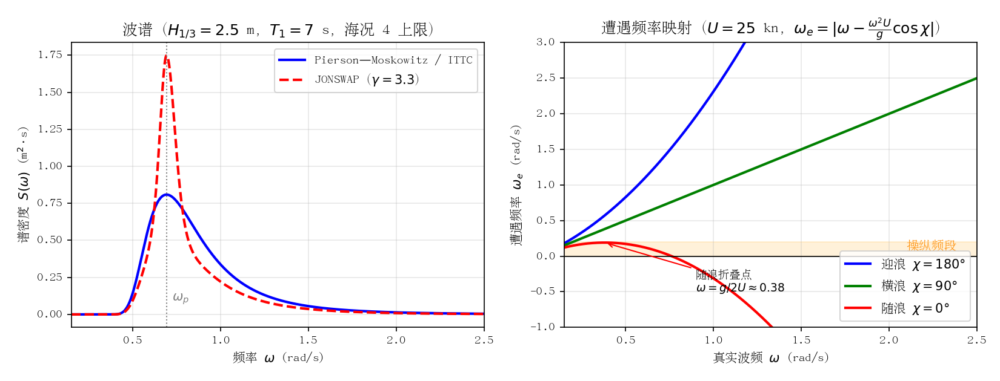

图 8-1：左为 PM/ITTC 与 JONSWAP 谱对比（$H_{1/3}=2.5$ m、$T_1=7$ s）；右为 25 kn 下三种浪向的遭遇频率映射，随浪曲线在 $\omega=g/2U$ 处折叠，波频能量被压入操纵频段（橙色区）。

#### 本项目内部刻度

本项目增益调度采用内部海况刻度 **0..3 级**（× 船速段），大致对应 WMO 海况 0–3（$H_{1/3} \le 1.25$ m）这一"轻浪及以下"的标称工作域。对 25 kn 级别的游艇而言，海况 4–5（$H_{1/3}$ 1.25–4 m）已是常规运营中可能遭遇的上限，应作为"最大海况"分析目标；海况 ≥6 对小型游艇通常意味着停航或极端避险工况，自动舵的任务从"精确航向保持"退化为"安全降级"。图 8-2 给出分级、浪高与主要影响的对应关系。

### 高海况对自动舵的影响机理

#### 一阶波浪力与二阶慢漂力

波浪对船体的作用在势流理论下分为两级 [4][5]：

- **一阶波浪力**：与波幅同阶的线性振荡力，频率在遭遇频率 $\omega_e$ 附近（对游艇典型 0.3–1.5 rad/s），均值为零。它产生高频的艏摇振荡 $\psi_{WF}$，叠加在低频操纵运动 $\psi_{LF}$ 上，即量测 $\psi_m = \psi_{LF} + \psi_{WF} + v$（$v$ 为量测噪声）。一阶分量**不应该**进入反馈回路——舵无法抵消波频振荡，硬要跟只会徒增舵机活动量。
- **二阶慢漂力**：与波幅**平方**成正比的平均/慢变漂力与漂转力矩（$F \propto H_{1/3}^2$）[5][6]，叠加风、流的低频力矩，是航向稳态偏差的主要来源。它必须由积分作用或低频补偿来抵消。

常用建模是把一阶艏摇写成二阶波频振子（SNAME/Fossen 模型）：

$$
H_{w}(s) = \frac{K_w s}{s^2 + 2\lambda\omega_0 s + \omega_0^2}
$$

其中 $\omega_0$ 为遭遇谱峰频率、$\lambda$ 为阻尼系数，$K_w$ 随 $H_{1/3}$ 增大 [4]。海况升高时 $K_w$ 增大且 $\omega_0$ 漂移，固定参数的滤波器会失配。

#### 波浪滤波的必要性

若一阶波频分量进入反馈，舵机会以波频往复打舵：舵效为零、能耗与磨损剧增，且可能激发执行器饱和与极限环。因此自 1970 年代起，波浪滤波（wave filtering）就是自动舵的标准组件 [4][7]：

- **Kalman 滤波**：把波频振子增广进状态方程，在线分离 $\psi_{LF}$ 与 $\psi_{WF}$（Balchen、Grimble 等的 LQG 自动舵，1976–1980）[4]；
- **陷波器（notch filter）**：在 $\omega_e$ 处开陷波点，$P_n(s) = \dfrac{s^2 + 2\zeta\omega_n s + \omega_n^2}{(s+\omega_n)^2}$，结构简单、可与自适应律联合证明全局收敛（Lauvdal & Fossen, 1998）[8]；
- **死区/低通**：商用舵常用的低成本手段。

高海况下的关键难点是 $\omega_e$ 随海况、航速、浪向变化，需要**在线遭遇频率跟踪**；且陷波器在低频段引入相位滞后，海况越高所需滤波越强，对低频操纵带宽的侵蚀越严重——这是"滤波强度 vs 操纵响应"的根本权衡 [4][8]。

#### 舵机饱和与舵速限制

舵机存在两类硬约束：舵角限幅与舵速限制。SOLAS II-1/29.3.2 对主操舵装置的要求是：船舶在最深航海吃水、以最大前进营运航速航行时，舵能从一舷 35° 转到另一舷 35°，且同样条件下从一舷 35° 转到另一舷 30° 不超过 28 s [9]。28 s 是**最差工况下的法规合规上限**，对应平均舵速约 2.3°/s（65°/28 s）——这是下限而非典型值，实际商船舵机通常更快，游艇舵机更快，但 2–3°/s 至 10°/s 量级仍是常见区间。高海况下控制需求舵角大、极性翻转频繁，舵速限制使实际舵角滞后于舵令，相当于在回路中引入随幅值增大的相位滞后——大信号下相位裕度急剧下降，是波浪中振荡发散的常见诱因 [10]。自适应算法若无视饱和，辨识器会把"舵没到"误判为"舵效下降"而错误增大增益；Lauvdal & Fossen 的输入误差方案之所以对饱和鲁棒，正是因为辨识器使用的是**实际（饱和后）舵角** [8]。

#### 舵机磨损与打舵频率

舵机寿命与打舵次数、总行程强相关。波浪滤波的本质目标之一就是减少"无效舵"，商用自动舵普遍以舵机活动量（rudder activity）作为性能指标的约束项；模糊自动舵的鼻祖工作（van Amerongen 等）即以"噪声环境下显著减少打舵次数"为主要卖点 [11]。高海况下若增益过高，舵机持续高频小幅打舵，液压泵与换向阀磨损加剧，这也是"降增益保硬件"的工程理由。

#### 非线性舵效：大舵角失速

舵升力系数随舵角非线性增长，普通舵在 35–45° 附近失速（stall），升力不再增加而阻力剧增，故多数船舶把舵角限幅设在 ±35° [12]。且失速角随来流状态变化：艇体伴流、螺旋桨尾流与漂角都会移动实际失速点（有帆艇舵组件 CFD 研究表明失速角随工况在 15–35° 间变化）[13]。高海况下控制器若频繁把舵打到限幅区，实际获得的转艏力矩低于线性模型预测，等效增益 $K$ 随舵角**下降**，与 ESC 辨识所用的 Nomoto 线性假设直接冲突。

#### 低速大漂角

高海况常伴降速航行。船速 $U$ 下降时 Nomoto 增益 $K \propto U$（时间常数 $T \propto 1/U$ 变化更复杂），舵效减弱；同时风与二阶漂力的相对权重上升，船以大漂角（leeway angle）航行，舵的有效来流角为舵角与漂角之差，进一步压缩可用舵效裕度 [14]。低速 + 大浪 + 大漂角是自动舵最恶劣的组合工况。

#### 舵减摇（RRS）与航向保持的耦合影响

高海况下横摇往往比艏摇更危及安全与舒适性，而舵恰好同时是横摇执行器：舵力作用点位于船舶重心之下，打舵产生艏摇力矩的同时必然产生横摇力矩，舵减摇（rudder roll stabilization, RRS）即利用这一耦合，在自动舵上叠加横摇反馈，文献报告的减摇效果可达 30–60%（van Amerongen、van der Klugt 与 van Nauta Lemke 的 Automatica 经典工作及其后丹麦实船系列）[29][30]。但在最大海况下，RRS 与航向保持之间存在三组直接耦合冲突：

1. **频段与舵速冲突**：横摇固有频率显著高于艏摇操纵频率，RRS 要求舵在横摇频段快速往复（文献中 RRS 舵机舵速需求常达 10–20°/s 量级），而航向保持只需低频慢舵；两者叠加在**同一台舵机的舵速限制**上，舵速饱和时 RRS 分量与航向分量互相"抢占"舵程，且饱和诱发的相位滞后对两者都是失稳诱因（Lauvdal & Fossen 专门研究过输入速率饱和下的 RRS 增益调度）[30]。
2. **横摇–艏摇模型耦合**：横摇通过 $K$、$T$ 参数摄动与附加横漂力矩改变艏摇动态，RRS 减摇的同时会改变自动舵看到的"被控对象"；Blanke & Christensen 的鲁棒性分析表明，忽视横摇–艏摇耦合设计的 RRS 自动舵在某些浪向下会恶化航向保持 [30]。
3. **波浪滤波冲突**：RRS 需要横摇频率处的运动信息通过，航向保持恰恰要求把该频段的一阶波浪分量滤掉——两者的滤波需求直接矛盾，必须按频率分离通道设计。

对本项目（小型游艇、舵速有限、横摇阻尼大）而言，舵的横摇力臂与舵面积都小，RRS 潜力有限，不建议在最大海况下主动叠加 RRS 功能；但**被动耦合依然存在**——大横摇通过参数摄动影响 $K/T$ 辨识，ESC 调参与极点配置基线设计时应把横摇诱导的模型摄动计入不确定性。RRS 的详细分析、与本项目的适配性评估见第 10 章（舵减摇专题）。

### 各自适应算法在最大海况下的可行性分析

总体框架见图 8-3：波浪滤波器在量测端剔除一阶分量，鲁棒化机制（dead-zone、泄漏项、海况自适应增益、抗饱和）保护自适应律，海况估计器在线修正滤波器中心频率与增益，超阈值时触发降速/降级保护。

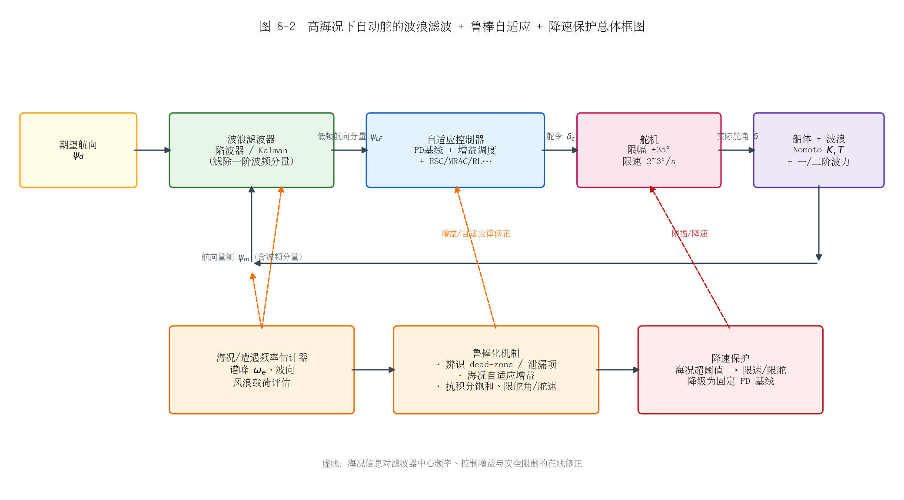

#### MRAC（模型参考自适应）

**代表工作**：van Amerongen 等的 MRAC 自动舵（1970–80 年代，全状态反馈假设）[8]；Lauvdal & Fossen 的输入误差输出反馈 MRAC（1996–1998），只需艏向量测，并把陷波器、积分作用增广进被控对象，证明了包含观测器、参数更新律、陷波器与积分器在内的**全局收敛** [8][15]。

**风险点**：波浪激励是持续激励（PE）的"假信号"——自适应律会把波频振荡当作模型误差去拟合，造成参数漂移；舵饱和时输出误差型辨识给出错误估计；恶劣天气下甚至需要**关闭辨识**，此时失去积分作用会产生稳态误差 [8]。

**对策**：量测先过陷波器再进辨识器；采用输入误差方案并对饱和鲁棒；dead-zone（|误差|<阈值时冻结更新）、$\sigma$-泄漏项防止无 PE 时漂移；即使参数冻结也保留显式积分通道 [8]。

**结论**：配合波浪滤波与鲁棒化修正后，海况 4–5 可行；是无滤波裸奔时最先失效的算法之一。

#### STR（自校正调节器）

**代表工作**：Källström 等的油轮自校正自动舵（1979，含速度调度 + 保向 STR + 转向调节器，实船试验）[16]；Åström 学派的 LQG/最小方差自校正系列。

**风险点**：在线递推最小二乘（RLS）的协方差阵在波浪主导的频段被波频能量"污染"，$K$、$T$ 估计发散或飘向无意义值；高海况下信噪比恶化（有用操纵信号反而被大浪淹没）；协方差风up（covariance wind-up）后在参数真实变化时反而失去跟踪能力。

**对策**：与 MRAC 相同的滤波 + dead-zone + 协方差泄漏/遗忘因子下限；海况超阈值时冻结辨识、退回调度表中的保守参数。

**结论**：海况 0–3 表现优异；海况 4–5 必须冻结或强鲁棒化，否则估计器先于控制器失效。

#### 增益调度 PID（本项目基线）

**代表工作**：商用自动舵的事实标准；Källström 方案中的速度调度即其雏形 [16]；Fossen 教材中的 weather-dependent gain scheduling [4]。

**风险点**：调度表只覆盖标称域（本项目 0..3 级），海况 4–5 时外插失效——调度点之外的增益无任何保证；调度变量（海况估计）本身有误差时，增益可能在调度面边界抖动。

**对策**：扩展调度域并用仿真/HIL 在边界海况下验证；调度变量加滞回与速率限制；保守方向取"宁低勿高"（低增益最坏是响应慢，高增益最坏是饱和振荡）。

**结论**：结构最简单、行为最可预测，是高海况下的**安全兜底方案**；但固定表格无法主动适应，性能次优。

#### 模糊控制

**代表工作**：van Amerongen 等的首个模糊自动舵（1977，两输入五语言变量，噪声环境下打舵次数显著少于 PID）[11]；Sutton 的自组织模糊控制器（SOC）[17]；Tiano/Sutton 的自适应模糊航迹保持 [18]。

**风险点**：规则库来自人工经验，而舵手经验恰恰集中在常见海况——最大海况恰是规则库覆盖最差的区域；自适应模糊（调隶属度/比例因子）与 STR 有同样的"被波浪误导"问题；缺乏系统的稳定性证明手段。

**对策**：规则库按海况分组调度（"海况"作为清晰化前提变量）；输出限幅；与 PD 基线并行监督切换。

**结论**：海况 0–3 鲁棒性好、打舵少；最大海况下取决于规则库覆盖度，工程上可接受但需针对性设计。

#### 神经网络（NN）

**代表工作**：双 EKF 训练 NN 的舵-横摇联合稳定（2019）[19]；NN 逼近不确定项与滑模/backstepping 复合的各类方案。

**风险点**：泛化是最大软肋——训练数据不可能覆盖最大海况分布，外插区域输出不可预测；在线学习律同样会被波频分量误导；离线训练则依赖仿真波况的真实性。

**对策**：NN 只作"补偿项"叠加在可证明稳定的基线上，并限幅；在线学习加 dead-zone 与参数投影；训练集强制覆盖高海况工况（域随机化）。

**结论**：不宜单独承担最大海况任务；作为基线补偿器可用，但验证成本高。

#### L1 自适应

**代表工作**：Hovakimyan & Cao 的 L1 架构（2010），核心是在自适应律与控制输入之间插入**低通滤波器**，把"快自适应"与"鲁棒性"解耦——自适应可以很快，但进入控制通道的只有低频分量 [20][21]；据 L1 理论提出者 Hovakimyan 的报告，该架构已商用于 Raymarine Evolution 系列船用自动舵 [22]（厂商未公开算法细节，此说法目前仅见学术侧来源），并在丹麦皇家海军无人艇上实艇验证 [23]。

**风险点**：低通滤波器带宽选择是与波浪滤波的同一权衡——带宽过高放进波频分量，过低牺牲响应；本质上 L1 补偿的是低频不确定项（二阶漂力、参数摄动），对一阶波频仍需前置波浪滤波。

**对策**：与遭遇频率自适应的陷波/Kalman 前置滤波串联；低通带宽按海况调度。

**结论**：结构上天然契合"自适应 + 波浪滤波"分层，是文献中商用化最成功的高海况自适应方案，海况 4–5 可行性好。

#### 滑模控制（SMC）

**代表工作**：Liu 等的自适应滑模自动舵（2018，对时变波浪扰动与参数摄动鲁棒）[24]；各类抖振抑制改进（边界层、扰动观测器 + 低切换增益）[25]。

**风险点**：**抖振与舵机磨损直接冲突**——高频切换控制信号在高海况下被大浪进一步激励，对液压舵机是灾难；边界层法牺牲精度换平滑，边界层宽度需随海况调整；大扰动需要高切换增益，高增益又加剧抖振，形成恶性循环。

**对策**：边界层/饱和函数替代符号函数；扰动观测器补偿大扰动、切换增益只负责残余 [25]；输出经速率限制再送舵机。

**结论**：鲁棒性理论最好，但抖振的工程代价在高海况下被放大；必须与舵机活动量约束联合设计，海况 4–5 谨慎可行。

#### 强化学习（RL）

**代表工作**：MARIN 的波浪中航向保持 RL 智能体（model-free 与 model-based 对比，样本效率分析，2024）[26][27]；大量 DRL 航迹跟踪仿真研究。

**风险点**：与 NN 同源且更甚——策略在训练分布外的行为无保证，最大海况恰是分布外；在线探索在实船高海况下不可接受；奖励设计若不显式惩罚舵机活动量，策略会学成"高频打舵型"，加剧磨损。

**对策**：纯离线训练 + 域随机化（海况、浪向、船速全随机）；部署时冻结策略并外套监督层（限舵角/舵速、异常切换 PD 基线）；奖励中加入舵活动量与饱和惩罚项。

**结论**：研究活跃但工程成熟度最低；最大海况下只能作为经充分验证的固定策略使用，不适合在线自适应。

### "算法 × 海况"可行性对比表

可行性分四档：● 良好（可作为主用方案）；◐ 可行但需专门鲁棒化设计；○ 勉强/仅作降级备份；✗ 不可行。

| 算法 | 海况 0–2（标称） | 海况 3（设计上限） | 海况 4–5（最大海况） | 海况 ≥6 | 关键前提 |
|---|---|---|---|---|---|
| 增益调度 PID | ● | ● | ◐（扩展调度域 + 滞回） | ○（固定保守增益兜底） | 调度域覆盖、海况估计可靠 |
| MRAC | ● | ◐ | ◐（陷波 + 输入误差 + dead-zone）[8] | ✗（冻结参数转固定控制） | 波浪滤波先行，饱和角进辨识器 |
| STR | ● | ◐ | ◐（冻结辨识 + 协方差保护）[16] | ✗ | 防协方差风up、防波频污染 |
| 模糊 | ● | ◐ | ◐（规则库须覆盖高海况）[11] | ○ | 规则库按海况分组 |
| NN | ● | ◐ | ○（外插无保证） | ✗ | 仅作限幅补偿项 |
| L1 自适应 | ● | ● | ●（低通解耦 + 前置波滤）[22][23] | ○ | 低通带宽按海况调度 |
| 滑模 SMC | ● | ◐ | ◐（边界层 + 扰动观测器）[24][25] | ✗ | 抖振抑制与舵机活动量约束 |
| RL | ◐ | ◐ | ○（固定策略 + 监督层）[26] | ✗ | 离线域随机化训练，禁在线探索 |

### 对本项目（PD + 增益调度 + ESC）的借鉴

1. **补波浪滤波是第一优先级**。本项目当前方案未见专门的波浪滤波环节，而文献共识是：无论控制器多先进，一阶波频分量必须先于反馈与辨识被滤除 [4][8]。建议为 ESC 的 Nomoto $K/T$ 辨识输入与 PD 反馈分别增加陷波器（中心频率由遭遇频率估计器在线设定），这是所有后续自适应机制能在海况 3 以上正常工作的前提。
2. **ESC 辨识器需要"高海况保护三件套"**：dead-zone（航向误差能量低于阈值时冻结更新）、泄漏项（防参数漂移）、以及**使用实际舵角而非舵令**作为辨识输入（对舵饱和鲁棒，这是 Lauvdal & Fossen 方案的关键经验 [8]）。ESC 的激励抖动频率应避开遭遇谱峰，否则抖动本身会被波浪响应淹没、梯度估计失真。
3. **增益调度域应显式外推到海况 4–5 并设兜底**：内部 0..3 级之上增加"超阈值"处理逻辑——海况估计超上限时冻结 ESC、切换到预存的保守 PD 参数、限制舵角/舵速并建议降速（图 8-3 的降速保护支路）。
4. **舵机约束要进入控制与辨识两级**：舵速限制（2–3°/s 量级）造成的相位滞后应在极点配置基线的带宽设计中显式留裕度——"闭环带宽低于舵速限制等效带宽的 1/3–1/5"是常用工程经验值（待核实，未见明确文献出处；可核实的替代依据是 Fossen 教材要求设计时显式检验闭环对舵幅值/速率饱和的鲁棒性 [4]）；抗积分饱和与舵角软限幅（避开 35° 失速区）应为标配 [9][12]。
5. **若未来升级自适应方案，L1 架构是最贴合的路径**：它在商用船用自动舵（Raymarine Evolution）上验证了"快自适应 + 低通滤波"的分层思路 [22]，与本项目"ESC 慢调参 + PD 基线"的时间尺度分离思想同构，迁移成本低。

### 参考资料

1. [WMO Marine Frequently Asked Questions（海况码与波高建议）](https://community.wmo.int/site/knowledge-hub/programmes-and-initiatives/marine-services/frequently-asked-questions)
2. [WMO Code Table 3700 海况分级官方表（NOAA NODC 镜像）](https://www.nodc.noaa.gov/gtspp/document/codetbls/wmocodes/table3700.html)
3. [Fossen, A nonlinear unified state-space model for ship maneuvering and control in a seaway (2005)](https://www.fossen.biz/publications/2005%20Fossen%20IJBC.pdf)
4. [Fossen, High performance ship autopilot with wave filter (1993)](https://www.fossen.biz/publications/1993%20Fossen%20SCSS.pdf)
5. [Söding, Wave drift force and moment in deep and shallow water (2025)——二阶漂力 ∝ 波幅平方](https://www.mdpi.com/2077-1312/13/1/64)
6. [一阶振荡运动与二阶平均漂力/艏摇力矩综述（arXiv）](https://arxiv.org/html/2401.03254v2)
7. [Kalman 滤波抑制一阶波浪扰动的自动舵应用（Mathematics, MDPI）](https://pure.port.ac.uk/ws/portalfiles/portal/80428585/mathematics-11-03554.pdf)
8. [Lauvdal & Fossen, Robust adaptive ship autopilot with wave filter and integral action (1998)](https://www.fossen.biz/publications/1998%20Lauvdal%20and%20Fossen%20IJACSP.pdf)
9. [SOLAS II-1/29.3.2 操舵装置要求（最深吃水+最大营运航速下 35°→对侧 30° ≤ 28 s）](https://www.imorules.com/GUID-CF547534-23B3-4162-8415-6C806370E406.html)
10. [ENSTA 课程资料：现代自动舵组成与状态估计](https://www.ensta-paris.fr/sites/default/files/fichiers/Bibliotheque/compendium_extraits_basse_definition.pdf)
11. [智能船舶自动舵历史综述（Roberts 2003，含 van Amerongen 模糊舵）](https://www.sciencedirect.com/science/article/abs/pii/S0957415803000448)
12. [ScienceDirect Topics: Rudder——典型失速角 35–45°，舵角限幅 35°](https://www.sciencedirect.com/topics/engineering/rudder)
13. [470 帆船舵组件失速角随航速变化的 CFD 研究](https://www.mdpi.com/2504-3900/49/1/134)
14. [斜流 + 大舵角耦合下舵水动力性能研究（漂角主导工况）](https://www.mdpi.com/2077-1312/13/11/2140)
15. [Lauvdal & Fossen, A globally stable autopilot with wave filter using only yaw angle measurements (1996)](https://www.mic-journal.no/ABS/MIC-1996-2-4/)
16. [Källström et al., Adaptive autopilots for steering of large tankers（速度调度 + STR 实船方案）](https://lucris.lub.lu.se/ws/files/4680687/8777572.pdf)
17. [Plymouth 大学：自组织模糊自动舵（SOC）](https://researchportal.plymouth.ac.uk/en/studentTheses/a-self-organising-fuzzy-logic-autopilot-for-small-vessels/)
18. [Tiano/Sutton 等，Adaptive fuzzy ship autopilot for track-keeping](https://www.sciencedirect.com/science/article/pii/S0967066102000096)
19. [双 EKF 训练神经网络的舵-横摇联合稳定（JMSA, 2019）](https://link.springer.com/article/10.1007/s11804-019-00111-8)
20. [L1 自适应控制原理（状态预测器 + 低通滤波）](https://hal-lirmm.ccsd.cnrs.fr/lirmm-03818536v1/document)
21. [L1 adaptive backstepping 欠驱动船舶路径跟踪](https://www.sciencedirect.com/science/article/abs/pii/S0947358020300261)
22. [Hovakimyan 报告：L1 控制已商用于 Raymarine Evolution 自动舵](https://scriptedonachip.com/downloads/Papers/L1Adaptive.pdf)
23. [丹麦皇家海军无人艇 L1 自动舵案例报道](https://mechse.illinois.edu/news/nasa-funding-hovakimyans-work-safer-aviation)
24. [Liu, Adaptive sliding mode control for ship autopilot（对时变波浪扰动鲁棒）](https://reference-global.com/2/v2/download/article/10.2478/pomr-2018-0128.pdf)
25. [滑模 + 扰动观测器降切换增益抑制抖振（ROV 案例）](https://rgu-repository.worktribe.com/preview/1625120/MOTOI%202022%20Sliding%20mode%20control.pdf)
26. [MARIN：波浪中航向保持的强化学习](https://www.marin.nl/en/research/artificial-intelligence-applications/ship-course-keeping-in-waves-using-reinforcement-learning)
27. [波浪中航向保持的样本高效 RL（Eng. Appl. AI, 2024）](https://dl.acm.org/doi/10.1016/j.engappai.2024.109848)
28. [ITTC 推荐规程 7.5-02-07-01.2：水池波浪建模（PM/JONSWAP 谱与参数）](https://www.ittc.info/media/9697/75-02-07-012.pdf)
29. [van Amerongen, van der Klugt & van Nauta Lemke, Rudder Roll Stabilization for Ships（Automatica, 1990）](https://www.sciencedirect.com/science/article/pii/000510989090039B)
30. [舵减摇与航向保持的时间尺度分解综述（含 Blanke & Christensen 1993 鲁棒性分析、Lauvdal & Fossen 舵速饱和 RRS 增益调度）](https://www.mdpi.com/2077-1312/9/9/1024)

---

## 航迹/路径跟踪中的自适应控制（航迹舵）

前八章讨论的是**航向层**问题：给定艏向设定值 $\psi_d$，如何让船又快又省地跟上。本章把视野抬高一层到**航迹层**（track keeping / path following）：给定一条由航路点串起来的计划航线，如何让船的位置贴着这条线走。这是商用"航迹舵"（track control system）的功能定位——IMO 早在 1998 年就为其颁布了专门的性能标准（MSC.74(69) 附件 2，适用船速上限 30 kn，恰好覆盖本项目 25 kn 游艇）[1]。对本项目而言，本章是"当前仅航向闭环"到"全航迹自动舵"之间的技术桥梁：结论先行——**制导-控制分层结构下，现有航向环（PD + 增益调度 + ESC）原样保留为内环，外环加一个 LOS 制导器即可获得航迹保持能力**，这是文献与工业界共同验证过的最低风险演进路径。

### 制导-控制分层结构（guidance–control）

船舶运动控制普遍采用三层级联结构（Fossen 教材称之为 guidance–navigation–control, GNC）[2]：

- **规划层**：离线或在线生成计划航线，通常是一串航路点 $WP_1,\dots,WP_N$ 及相邻点间的直线段（leg），转折点处按预设转弯半径或回转率过渡；
- **制导层（guidance）**：根据当前船位与路径的几何关系，计算期望艏向 $\psi_d$（或期望航迹向 $\chi_d$）与期望航速 $U_d$，输出给控制层。LOS（line-of-sight，视线）制导是该层的事实标准；
- **控制层**：航向自动舵，跟踪 $\psi_d$——这正是本项目已建成的部分。

分层之所以可行，依赖**时间尺度分离**：制导环的带宽必须显著低于航向环带宽（工程上取 1/3–1/5 以下），这样分析内环时可把 $\psi_d$ 当作慢变参考，分析外环时可把内环近似为理想跟踪（$\psi=\psi_d$），整体稳定性再按级联系统（cascade）严格证明 [3][4]。IMO 航迹控制性能标准也默认了这一架构：标准要求航迹控制系统在位置传感器失效时**自动降级为航向控制**并以当前艏向为设定值 [1]——即航向环被明确定义为航迹环的安全兜底。

需要强调欠驱动（underactuation）约束：常规单体船只有螺旋桨（纵荡）与舵（转艏）两个控制输入，横荡方向没有直接控制力。因此航迹环**不能直接对横向偏差施加控制力**，只能通过调整艏向让对地速度矢量慢慢转回航线——这就是"制导律输出艏向参考、而不是横向力"的根本原因，也是侧滑角（sideslip）问题成为航迹保持核心难点的根源 [4][5]。

### LOS 制导律及其自适应变体

#### 比例 LOS（PLOS）与前视距离

LOS 制导模仿有经验舵手的操船直觉：在路径上取船位投影点前方一段"前视距离" $\Delta$ 处的 LOS 点，令船艏指向它（图 9-1）。对切向角为 $\gamma_p$ 的直线路径，横向偏差为 $y_e$ 时 [4][6]：

$$\psi_d=\gamma_p+\arctan\!\left(-\frac{y_e}{\Delta}\right)$$

*图 9-1 LOS 制导几何：制导律由横向偏差 $y_e$ 与前视距离 $\Delta$ 生成期望艏向 $\psi_d$；风、流使艏向 $\psi$ 与对水航迹向 $\chi$ 之间出现侧滑角 $\beta=\chi-\psi$，这是横偏稳态误差的来源。*

该律的源头可追溯到 Healey & Lienard 1993 年用于 AUV 的滑模+LOS 工作 [7]，船舶情形的系统表述见 Fossen, Breivik & Skjetne（2003）[5] 与 Breivik & Fossen（2005）的 2D/3D 制导原理 [8]。Fossen & Pettersen（2014）证明了比例 LOS 制导律的**一致半全局指数稳定（USGES）**——注意横偏动力学中的正弦项带来固有的"增益随横偏增大而饱和"特性，全局指数稳定在结构上不可能达到，USGES 已是最强结论 [6]。

前视距离 $\Delta$ 是 LOS 唯一的整定参数，作用相当于外环比例增益的倒数：$\Delta$ 小则收敛快但超调大、艏向指令抖动剧烈；$\Delta$ 大则平滑但贴线慢。工程经验取 $\Delta\approx(1.5\sim3)\,L_{pp}$ 量级；Lekkas & Fossen（2012）提出**时变前视距离**：横偏大时用大 $\Delta$ 平滑接近、接近路径后收缩 $\Delta$ 加快消除残余偏差，兼顾两段性能 [9]。这本质上是"以误差为调度变量的增益调度"，与本项目航向环的海况×船速调度在思想上同构。

#### 侧滑角问题与 ILOS

比例 LOS 有一个结构性缺陷：横偏动力学为 $\dot y_e = U\sin(\psi-\gamma_p+\beta)$，其中 $\beta=\operatorname{atan2}(v,u)$ 是侧滑角 [3]。定常风、流造成的漂流力使船以非零 $\beta$ 航行，而船横向无控制力、只能靠艏向补偿，于是 PLOS 的稳态横偏不为零：

$$y_e^{ss}\approx\Delta\tan\beta$$

对 25 kn 游艇，$\beta=5°$、$\Delta=60$ m 时稳态横偏约 5.2 m——在开阔水域可接受，但在狭水道或桥区已不可容忍（图 9-2 蓝线）。

**积分 LOS（ILOS）**由 Børhaug, Pavlov & Pettersen（2008）提出：在制导律中加入横偏积分项，等效于在外环嵌入一个"自动压差角"，可证明在定常不可约流下横偏全局 $\kappa$-指数收敛到零 [10]：

$$\psi_d=\gamma_p+\arctan\!\left(-\frac{y_e+y_{int}}{\Delta}\right),\qquad \dot y_{int}=\frac{\kappa\,\Delta\, U\,y_e}{\Delta^2+(y_e+y_{int})^2}$$

Caharija 等（2016）给出了 ILOS 迄今最完整的"理论-仿真-海试"三合一验证：在 NTNU 的 Charlie 双体 USV（特隆赫姆港）与 CNR 的 USV（第勒尼安海）上完成多组实船试验，证明 ILOS 在真实海流、风浪下能把横偏压到米级，而纯比例 LOS 残留明显稳态偏差 [11]。这是航迹舵自适应外环**最有分量的实船证据**。

#### 自适应 LOS：在线估计侧滑角（AILOS/ALOS）

Fossen, Pettersen & Galeazzi（2015）换了一个视角：不引入显式积分器，而把未知侧滑角 $\beta$ 当作慢变未知参数，用参数自适应律在线估计并直接补偿 [3]：

$$\psi_d=\gamma_p+\arctan\!\left(-\frac{y_e}{\Delta}-\hat\beta\right),\qquad \dot{\hat\beta}=\gamma\,\frac{U\Delta}{\sqrt{\Delta^2+(y_e+\Delta\hat\beta)^2}}\,y_e$$

该文证明了 $(y_e,\tilde\beta)=(0,0)$ 的 USGES——估计误差指数收敛到零，强于 ILOS 原来的 $\kappa$-指数结果；并指出**参数自适应律在结构上就是一种积分作用**，故该律又称"自适应积分 LOS（AILOS）"。它适用于 Dubins 路径（直线+圆弧），与本项目航线"直航道段+定半径转向"的形态一致。Fossen & Lekkas（2015/2017）进一步给出直接式与间接式两种自适应积分 LOS 方案，间接式用扰动观测器显式估计流速，具有全局 $\kappa$-指数稳定性 [12]；Fossen（2023）将其整理为面向飞行器与船舶的统一 ALOS 制导律并给出 USGES 证明 [13]。图 9-2 的运动学仿真（25 kn、$\Delta=60$ m、$\beta=5°$ 定常侧滑）直观展示了三者的差别：PLOS 残留 $\Delta\tan\beta$ 稳态偏差，ILOS 与 AILOS 均收敛到零，AILOS 的 $\hat\beta$ 在数十秒内收敛到真值。

*图 9-2 定常侧滑（$\beta=5°$）下三种 LOS 制导律的横偏收敛与 AILOS 的侧滑角在线估计（简化运动学仿真，$U=25$ kn，$\Delta=60$ m，航向回路一阶滞后 $\tau=2$ s；生成脚本 `figs/make_fig_09.py`）。PLOS 稳态偏差 $\approx\Delta\tan\beta$；ILOS/AILOS 消除稳态偏差但引入超调，积分/自适应增益越大超调越明显，工程上需折中。*

#### ELOS：基于扩展状态观测器的 LOS

以 Liu, Wang & Peng 为代表的 ELOS（ESO-based LOS）路线用**扩展状态观测器**在线估计纵荡/横荡速度（或等效集总扰动），无需横荡速度量测即可解算并精确补偿侧滑角 [14]。与 AILOS 相比：AILOS 把 $\beta$ 当**常值参数**（自适应律天然带低通特性，只能跟踪慢变），ELOS 把 $\beta$（或流速）当**状态**处理，可跟踪快变侧滑，代价是观测器带宽整定更敏感、对量测噪声更挑剔。二者与 ILOS 的谱系关系及更多变体（双曲正切 LOS、向量场制导、预测 LOS 等）见 Gu 等的 LOS 综述 [15]。

### 欠驱动路径跟踪控制与侧滑角估计路线对比

若不愿采用分层结构，也可以在 Serret–Frenet 路径坐标系下做一体化欠驱动控制设计（backstepping、滑模、动态面等），直接输出舵角——理论工具成熟（Breivik & Fossen 2005 [8]、Lekkas & Fossen 曲线路径 ILOS [16]），但失去了"外环可独立于内环验证、内环可作安全兜底"的工程优势，且控制器与具体船型动力学强耦合。对本项目这种已有成熟航向环的情形，分层结构几乎是唯一合理选择。

侧滑角 $\beta$ 的获取有三条工程路线，按可靠性排序：

| 路线 | 原理 | 优点 | 局限 |
|---|---|---|---|
| 直接量测 | GNSS 航迹向 COG 减罗经艏向：$\hat\beta=\chi_{COG}-\psi$（低速时 COG 不可用） | 零模型依赖、实现最简 | GNSS 失效即失效；波频振荡需滤波 |
| 状态观测器 | ESO/Kalman 估计 $u,v$ 或流速（ELOS 路线 [14]；Fossen 2022 用 EKF 从 GNSS 位置估计 SOG/COG [17]） | 可跟踪快变侧滑 | 带宽整定敏感、依赖模型结构 |
| 参数自适应 | AILOS/ALOS 把 $\beta$ 当慢变参数 [3][13] | 无量测要求、有 USGES 证明 | 只能跟踪慢变；转弯段 $\beta$ 突变需重新收敛 |

注意一个常被忽视的事实：在 25 kn 下 $\beta$ 通常只有几度（Fossen 等指出正常航行侧滑角典型小于 5° [3]），但 $\Delta\tan\beta$ 的杠杆效应把几度侧滑放大成米级横偏——所以"艇小、流弱就不用补偿侧滑"的直觉是错的。

### 代表性文献与海试/工程证据

| 作者/机构 | 年代 | 文献/系统 | 一句话贡献 | 验证方式 |
|---|---|---|---|---|
| Healey & Lienard | 1993 | IEEE JOE 18(3) [7] | LOS 制导 + 滑模控制用于 AUV 的奠基工作 | 仿真 |
| Fossen, Breivik & Skjetne | 2003 | IFAC MCMC [5] | 欠驱动船舶 LOS 路径跟踪的系统表述 | 仿真 |
| Breivik & Fossen | 2005 | IEEE CDC [8] | 2D/3D 基于制导的路径跟踪统一原理 | 理论 |
| Børhaug, Pavlov & Pettersen | 2008 | IEEE CDC [10] | ILOS：积分作用对抗定常海流 | 理论+仿真 |
| Lekkas & Fossen | 2012 | IFAC CAMS [9] | 时变前视距离（自适应 $\Delta$） | 仿真 |
| Fossen & Pettersen | 2014 | *Automatica* [6] | 比例 LOS 的 USGES 严格证明 | 理论 |
| Lekkas & Fossen | 2014 | IEEE TCST [16] | 曲线路径 ILOS（单调 Hermite 样条参数化） | 理论+仿真 |
| Fossen, Pettersen & Galeazzi | 2015 | IEEE TCST [3] | AILOS：自适应侧滑补偿，USGES | 理论+案例仿真 |
| Fossen & Lekkas | 2015/2017 | *Int. J. Adapt. Control Signal Process.* [12] | 直接/间接自适应积分 LOS，扰动观测器估流 | 理论+仿真 |
| Caharija, Pettersen 等 | 2016 | IEEE TCST [11] | ILOS 理论-仿真-海试三合一验证（Charlie USV 等） | **海试** |
| Liu, Wang & Peng | 2017 | IEEE JOE [14] | ELOS：ESO 精确侧滑补偿，无需速度量测 | 理论+仿真 |
| Fossen | 2023 | IEEE TCST [13] | 统一 ALOS 制导律，USGES | 理论+仿真 |
| Gu, Wang, Peng, Wang & Han | 2023 | IEEE TSMC: Systems [15] | LOS 制导谱系综述（截至 2022 的变体全景） | 综述 |

工程与法规层面的证据同样充分：

- **IMO 标准化**：MSC.74(69) 附件 2《航迹控制系统性能标准》把航迹舵定义为"使船舶自动保持在计划航迹上"的设备，明确规定了横偏报警（cross track alarm）、换向提前提示、转向点确认、定位/罗经双源监测、以及**位置传感器失效时自动降级为航向控制**等全套安全逻辑 [1]——商用航迹舵（ECDIS 航线 + 自动舵联动）据此已成为商船标配，说明"制导外环 + 航向内环"架构经过了大范围工业检验。
- **自主船实船数据**：特隆赫姆峡湾自主船试验区（NAVISP 项目）公布的自动舵航段横偏统计显示，实船自主航行横偏均值约 1.4–11.3 m（不同航段差异主要来自风、流方向与航线的夹角）[18]——这正是"无流补偿时横偏量级"的真实写照，也印证了侧滑补偿的必要性。

### 对本项目（当前仅航向层闭环）的演进路径建议

本项目现状：航向环 PD + 海况×船速增益调度 + ESC 在线调参，Nomoto $K/T$ 在线辨识 + 极点配置基线。向航迹舵演进建议分四步，每步都不破坏已有航向环：

1. **第一步：PLOS 外环（最小可行航迹舵）**。接入 GNSS 位置与航路点管理（NMEA 0183 的 RTE/WPL 语句即可），按 $\psi_d=\gamma_p+\arctan(-y_e/\Delta)$ 生成期望艏向送给现有航向环。25 kn（12.86 m/s）下建议 $\Delta$ 初值 60–100 m（约 4–7 倍船长），制导环带宽压到航向环的 1/3 以下。此步已能消除 90% 的人工修正工作量，风险最低。
2. **第二步：ILOS 抗流 + 航路点切换逻辑**。在开阔水域试航确认 PLOS 稳定后加积分项，并补 IMO 标准要求的配套逻辑：横偏限值报警、转向点提前提示与确认、定半径转向过渡。注意 ILOS 给 $\psi_d$ 加的是慢变偏置，**不向航向环注入激励**，因此与 ESC 的 $K/T$ 辨识天然兼容（区别于高频抖动的 ESC 激励本身）；但积分项必须配抗饱和，横偏过大时冻结积分防止 wind-up 后的深冲。
3. **第三步：侧滑角估计的冗余配置**。主用 GNSS COG−艏向直接解算 $\beta$（最廉价可靠），AILOS 自适应估计作为 GNSS 降级时的备份通道；位置与 COG 量测先经波浪滤波（见第 8 章陷波器/Kalman 滤波讨论）再进制导环，否则一阶波频位置振荡会被外环当成横偏去"跟"，徒增舵机活动量。
4. **第四步：安全降级与验证程序**。对照 MSC.74(69) 落实降级链：GNSS 失效→冻结外环、切回纯航向保持（以当前艏向为设定值）；罗经失效→保舵角报警。验证程序参照 Caharija 等的做法 [11]：先在仿真（可用 NTNU 开源 MSS 工具箱 [19]）中注入定常流/风浪验证横偏收敛，再湖试、再海试，逐级放大 $\Delta$ 扫描与 $\beta$ 工况。

一个与第 8 章结论的衔接提醒：航迹层同样存在"最大海况退化"问题——海况 4–5 时位置量测的波频成分增大、低速大漂角工况下 $\beta$ 变大且时变，AILOS 的"慢变 $\beta$"假设被削弱，此时应放大 $\Delta$、降低制导环带宽甚至临时切回航向保持，把"贴线精度"目标降级为"安全航行"目标，与航向环的高海况降级策略保持一致。

### 参考资料

1. [IMO Resolution MSC.74(69) Annex 2：Recommendation on Performance Standards for Track Control Systems (1998)](https://wwwcdn.imo.org/localresources/en/KnowledgeCentre/IndexofIMOResolutions/MSCResolutions/MSC.74(69).pdf)
2. [Fossen, Handbook of Marine Craft Hydrodynamics and Motion Control (2021 第 2 版)](https://www.fossen.biz/publications/)
3. [Fossen, Pettersen & Galeazzi, Line-of-Sight Path Following for Dubins Paths with Adaptive Sideslip Compensation of Drift Forces, IEEE TCST 23(2):820–827 (2015)](https://www.fossen.biz/publications/2015%20Fossen%20et%20al%20TCST.pdf)，[doi:10.1109/TCST.2014.2338354](https://doi.org/10.1109/TCST.2014.2338354)
4. [欠驱动船舶制导-控制分层结构综述（Ocean Eng. 2019，引言部分）](https://www.sciencedirect.com/science/article/abs/pii/S0029801818308357)
5. [Fossen, Breivik & Skjetne, Line-of-sight path following of underactuated marine craft, IFAC MCMC (2003)（文献库条目）](https://www.fossen.biz/publications/)
6. [Fossen & Pettersen, On uniform semiglobal exponential stability (USGES) of proportional line-of-sight guidance laws, Automatica 50(11):2912–2917 (2014)，doi:10.1016/j.automatica.2014.10.018](https://doi.org/10.1016/j.automatica.2014.10.018)
7. [Healey & Lienard 滑模+LOS AUV 制导（1993）（参考文献页证实出处）](https://link.springer.com/content/pdf/10.1007/s11804-023-00338-6.pdf)
8. [Breivik & Fossen, Principles of guidance-based path following in 2D and 3D, IEEE CDC (2005)（arXiv 2505.08344 参考文献页证实出处）](https://arxiv.org/pdf/2505.08344)
9. [Lekkas & Fossen, A time-varying lookahead distance guidance law for path following, IFAC-PapersOnLine 45(27):398–403 (2012)（J. Marine Science and Technology 参考文献页证实出处）](https://link.springer.com/content/pdf/10.1007/s00773-025-01055-1.pdf)
10. [Børhaug, Pavlov & Pettersen, Integral LOS control for path following of underactuated marine surface vessels in the presence of constant ocean currents, IEEE CDC:4984–4991 (2008)，doi:10.1109/CDC.2008.4739352](https://doi.org/10.1109/CDC.2008.4739352)
11. [Caharija et al., Integral line-of-sight guidance and control of underactuated marine vehicles: Theory, simulations, and experiments, IEEE TCST 24(5):1623–1642 (2016)，doi:10.1109/TCST.2015.2504838](https://doi.org/10.1109/TCST.2015.2504838)
12. [Fossen & Lekkas, Direct and indirect adaptive integral line-of-sight path-following controllers for marine craft exposed to ocean currents, IJACSP 31(4):445–463，doi:10.1002/acs.2550](https://doi.org/10.1002/acs.2550)
13. [Fossen, An adaptive line-of-sight (ALOS) guidance law for path following of aircraft and marine craft, IEEE TCST 31(6):2887–2894 (2023)，doi:10.1109/TCST.2023.3259819](https://doi.org/10.1109/TCST.2023.3259819)
14. [Liu, Wang & Peng, ESO-based line-of-sight guidance law for path following of underactuated marine surface vehicles with exact sideslip compensation, IEEE JOE 42(2):477–487 (2017)（Sensors 2024 改进 ELOS 论文及其参考文献页）](https://www.mdpi.com/1424-8220/24/16/5384)
15. [Gu, Wang, Peng, Wang & Han, Advances in line-of-sight guidance for path following of autonomous marine vehicles: An overview, IEEE TSMC: Systems 53(1):12–28 (2023)（Nature Communications Engineering 参考文献页证实出处）](https://www.nature.com/articles/s44172-025-00521-3)
16. [Lekkas & Fossen, Integral LOS path following for curved paths based on a monotone cubic Hermite spline parametrization, IEEE TCST 22(6):2287–2301 (2014)，doi:10.1109/TCST.2014.2306774](https://doi.org/10.1109/TCST.2014.2306774)
17. [Fossen, Line-of-sight path-following control utilizing an extended Kalman filter for estimation of speed and course over ground from GNSS positions, JMST 27:806–813 (2022)，doi:10.1007/s00773-022-00872-y](https://doi.org/10.1007/s00773-022-00872-y)
18. [ESA NAVISP：Trondheimsfjorden 自主船试验区验证报告（自动舵航段横偏统计：均值 1.4–11.3 m）](https://navisp.esa.int/uploads/files/project_documents/NAVISP3-005_FINAL_PRESENTATION_v2.pdf?v=573969)
19. [Fossen & Perez, Marine Systems Simulator (MSS) 开源工具箱](https://github.com/cybergalactic/MSS)

---

## 舵减摇与航向-横摇联合自适应控制

舵减摇（Rudder Roll Stabilization, RRS）利用同一副舵在执行航向保持的同时产生横摇稳定力矩，实现"一舵两用"：在低频段舵用于艏摇/航向控制，在横摇固有频率附近舵用于横摇阻尼。该技术自 1970 年代提出以来，已在荷兰皇家海军 M 级护卫舰、美国海岸警卫队巡逻舰、丹麦海军 SF300 级等多型实船上验证，对不宜或不便安装减摇鳍的高速舰艇与游艇具有特别的吸引力——25 kn 级游艇舵效随速度平方增长，恰好是 RRS 最有利的工况。本章先梳理舵-横摇耦合机理与频带分离条件，再按年代梳理代表性文献，进而讨论参数摄动下的自适应 RRS 设计、与航向保持的冲突权衡、高海况限制，最后给出对本项目（PD + 增益调度 + ESC 在线调参 + 极点配置基线）的具体结合建议。

### 舵减摇原理

#### 舵-横摇耦合机理

舵在水下产生的侧向升力 $Y_\delta$ 作用点位于重心（CG）下方，垂向距离为 $l_r$（舵压心到重心的力臂），因此舵力同时产生艏摇力矩 $N_\delta$ 与横摇力矩 $K_\delta = -l_r Y_\delta$。回转中的横倾（turn heel）即这一耦合的直接表现。线性化后，舵角到横摇角与艏摇角的通道可写成：

$$\frac{\varphi(s)}{\delta(s)}=\frac{K_{\varphi\delta}(1+T_z s)}{(1+T_4 s)(s^2+2\zeta_\varphi\omega_\varphi s+\omega_\varphi^2)},\qquad \frac{\psi(s)}{\delta(s)}=\frac{K(1+T_3 s)}{s(1+T_1 s)(1+T_2 s)}$$

其中 $\omega_\varphi$ 为横摇固有频率、$\zeta_\varphi$ 为横摇阻尼比（裸船体典型仅 0.05–0.15，这是横摇在遭遇频率共振时幅值剧增的原因）。RRS 的本质是：在 $\omega_\varphi$ 附近用舵提供**人工横摇阻尼**（反馈 $\varphi$、$\dot\varphi$），等效提高 $\zeta_\varphi$；而在远低于 $\omega_\varphi$ 的频段，舵仍按常规方式控制艏向。

#### 非最小相位特性

舵-横摇传递函数通常含**右半平面零点**（上式中 $T_z<0$，或由横荡-艏摇-横摇三自由度耦合产生）：打舵瞬间，舵力的横摇分量先使船向"错误方向"横倾，随后回转诱导的横倾才反向建立。van der Klugt 的博士论文系统分析了这一非最小相位特性，它是 RRS 可达性能的根本限制——按 Freudenberg–Looze 型灵敏度积分约束，右半平面零点限制了横摇反馈通道可用的带宽与灵敏度峰值，减摇效果存在与舵机速率饱和共同决定的**理论上限**，这一认识在 Perez & Blanke 2012 的综述中被概括为"实船装船后普遍观察到减摇效果存在上限"的解释 [1][6]。

#### 频率条件与舵机带宽要求

RRS 可行的前提是**频带分离**（图 10-1）：艏摇/航向控制的闭环带宽必须显著低于横摇固有频率，使两条通道近似解耦：

$$\omega_{yaw}\ \ll\ \omega_\varphi\ \lesssim\ \omega_e\ <\ \omega_{servo}$$

其中 $\omega_e$ 为波浪遭遇频率（横摇激励的主要能量所在），$\omega_{servo}$ 为舵机伺服带宽。van der Klugt 给出了可工程化检验的量化准则（1990，*Naval Engineers Journal*，"The Dutch Solution"）[5]：舵机二阶模型自然频率 $\omega_0 \ge 10\,\omega_\varphi$，大信号回路极点 $\ge 5\,\omega_\varphi$，伺服带宽 $B = 0.64\,\omega_0 \ge 6.4\,\omega_\varphi$，调节时间 $T_s = 0.4\,T_\varphi$，-3 dB 处相滞不超过 65°；舵速方面，其所针对的护卫舰要求**最大舵速不低于 15°/s**，且舵速低于该值时减摇能力显著下降、高于该值后边际收益很小 [5]。这组数据同时说明：RRS 对舵机是硬指标要求，舵机选型必须在设计早期就按减摇工况校核，而不能沿用常规航向自动舵的舵机规范。

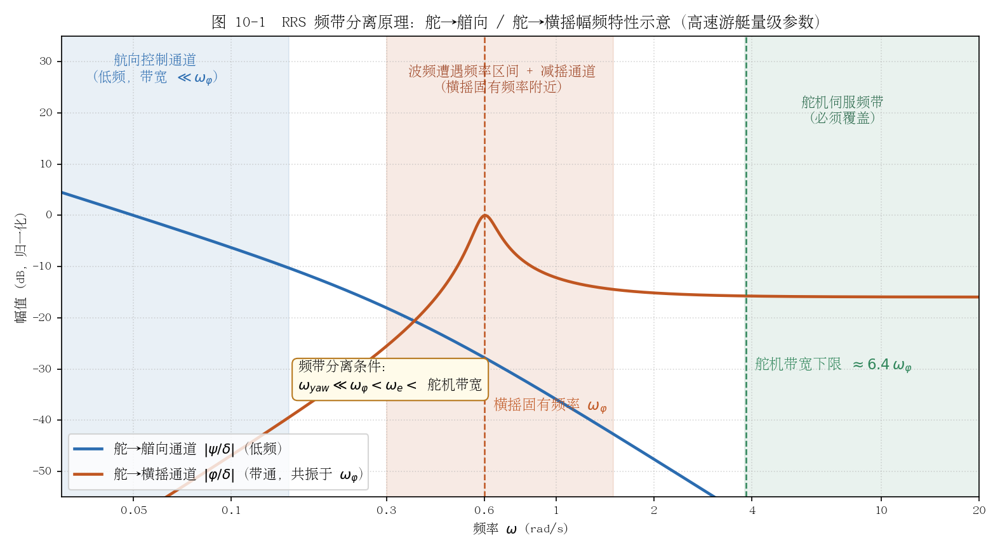

*图 10-1 RRS 频带分离原理示意：舵→艏向通道呈低频特性，航向控制带宽必须远低于横摇固有频率 $\omega_\varphi$；舵→横摇通道在 $\omega_\varphi$ 处共振，减摇反馈作用于该频段（与波频遭遇频率区间重叠）；舵机伺服带宽须覆盖 $6.4\,\omega_\varphi$ 以上（van der Klugt 1990 准则）。参数为高速游艇量级示意。*

#### 为何高速船更适合 RRS

三点原因：其一，舵升力 $\propto U^2$，单位舵角产生的横摇力矩随航速平方增长，高速时舵的"减摇效能"远大于低速——25 kn 游艇的舵效横摇力矩是同尺度排水量船低速时的数倍；其二，高速船的横摇固有频率相对较高（船体小、初稳性高大），与艏摇控制带宽的频带分离更容易满足；其三，高速时遭遇频率 $\omega_e = \omega - \frac{\omega^2 U}{g}\cos\chi$ 整体上移，横摇共振区与低频操纵区的重叠更小。反过来，低速船舵效弱、横摇周期长且与操纵时间尺度接近，RRS 往往力不从心——这也是 RRS 实船成功案例集中于军舰、巡逻舰与高速船的原因 [1][4]。

### 代表性工作与文献脉络

RRS 的概念验证始于 1970 年代（Cowley & Lambert 1972、Lloyd 1975，均在 SCSS 会议发表），1980 年代在荷兰（TU Delft/特文特大学）、美国（DTNSRDC）、瑞典（SSPA）三条线上完成实船验证，1990 年代进入鲁棒性与性能极限分析阶段，2000 年后由 Fossen 教材与 Perez & Blanke 综述完成理论收束。

| 作者/机构 | 年代 | 系统/文献 | 一句话贡献 |
|---|---|---|---|
| Cowley & Lambert（英国） | 1972 | 3rd SCSS, Bath | 首次提出"以舵兼作横摇稳定器"概念 [6] |
| Lloyd | 1975 | 4th SCSS, Den Helder | 舵减摇的早期系统性分析 [6] |
| Baitis, Woolaver & Beck（美 DTNSRDC） | 1980/1983 | DTNSRDC 报告；*Naval Engineers Journal* 95(3):267–282 | 美国海岸警卫队巡逻舰与护卫舰 RRS，被称为"首次成功的实船试验" [7][1] |
| van Amerongen, van der Klugt, Pieffers | 1984 | 7th SCSS, Bath | 8 m 自航船模 + 实船试验的荷兰 RRS 系统验证 [1] |
| van Amerongen & van Nauta Lemke | 1986 | ACC, pp. 237–242 | 自适应性能指标（adaptive criterion）LQG 型 RRS 控制器 [8] |
| van der Klugt（TU Delft） | 1987 | 博士论文 *Rudder Roll Stabilization*（192 页） | 非最小相位分析、舵机设计要求推导、自适应高通滤波器、ASSA 舵减摇自动舵设计 [3][5] |
| Källström, Wessel, Sjölander（SSPA） | 1988 | SNAME STAR Symposium, pp. 67–76 | 瑞典实船试验：RRS 对多型船特别是军舰可实现有效减摇 [9] |
| van Amerongen, van der Klugt, van Nauta Lemke | 1990 | *Automatica* 26(4):679–690 | RRS 奠基性文献：LQG + 自适应加权 + AGC 防舵速饱和，仿真-船模-护卫舰海试全链条验证，减摇可达减摇鳍水平，促成荷兰 M 级护卫舰采用 RRS [1][2] |
| Blanke, Haals & Andreasen（丹麦） | 1989 | IFAC CAMS'89, Lyngby | 丹麦舵减摇实船经验 [10] |
| Roberts & Braham（英国） | 1990 | 9th SCSS (SCSS'90), Bethesda | 军舰舵-鳍联合横摇稳定（integrated rudder and fins） [11] |
| Blanke & Christensen | 1993 | 10th SCSS (SCSS'93), Ottawa, pp. A.93–A.119 | 指出横荡-艏摇-横摇耦合是 RRS 自动舵鲁棒性恶化的主因，须以解耦/滤波设计处理 [10] |
| Oda, Ohtsu & Hotta（日本） | 1996 | *Control Engineering Practice* 4(3):351–358 | 基于多元自回归模型的统计分析与自校正型 RRS 设计 [12] |
| Roberts, Sharif, Sutton & Agarwal | 1997 | *IEE Proc. Control Theory Appl.* 144(2) | 鲁棒控制方法设计军舰操舵-稳定联合系统 [13] |
| Fossen（NTNU） | 2011/2021 | *Handbook of Marine Craft Hydrodynamics and Motion Control*（Wiley） | 教材收束：第 1 版 §13、第 2 版 §16.1.7 "Optimal Rudder-Roll Damping Systems" 案例研究 [14] |
| Perez & Blanke | 2012 | *Annual Reviews in Control* 36(1):129–147 | 船舶横摇阻尼控制权威综述：舵速与非最小相位决定 RRS 性能上限，含丹麦海军 SF300 实船数据 [6] |

横向规律：RRS 的实船证据链在 1990 年代即已闭合（荷、美、瑞典、丹麦、英国均有装船记录），其工程定位是**减摇鳍的低成本替代/补充**而非全新执行器；学术重心随后转向性能极限（非最小相位 + 舵速饱和）与鲁棒性（耦合、参数摄动），这正是"自适应 RRS"问题的来源。

### 自适应 RRS

#### 参数摄动下的增益自适应

舵-横摇通道的增益 $\propto U^2$、横摇固有频率与阻尼随载况（GM、吃水）变化，波浪遭遇频率随海况/浪向/航速漂移——固定参数 RRS 控制器离开设计点后性能迅速恶化。文献中的自适应手段主要有四类：

1. **自适应性能指标 LQG**（van Amerongen & van Nauta Lemke 1986 [8]、van Amerongen et al. 1990 [1]）：性能指标 $J$ 中横摇项与艏摇项的加权因子按实测横摇/艏摇响应在线调整——横摇能量大时自动把控制重心移向减摇，海况平静时自动退出减摇模式以省电省舵机；其 MRAS 状态观测器继承自 van Amerongen 的模型参考自适应自动舵（1982/1984）[15]。这是"自校正"思想在 RRS 上最早也最完整的实船化实现。
2. **自校正/统计辨识型**（Oda, Ohtsu & Hotta 1996 [12]）：用多元自回归（AR）模型在线辨识浪-船响应，据此统计地设计/更新 RRS 控制器，属辨识-控制分离的自校正路线。
3. **L1 自适应**：Breu & Fossen（2011）将 L1 自适应与极值搜索（ESC）用于横摇参数共振的稳定化 [16]——与本项目 ESC 在线调参的技术路线直接同源，说明"L1/ESC 类自适应 + 横摇通道"的组合在文献中已有先例。
4. **鲁棒/神经网络自适应**：如双 EKF 训练 NN 的舵-横摇联合稳定、NN 鲁棒自适应 RRS（Zhu et al. 2023 [17]）等，近年仿真研究活跃，但实船验证记录少。

#### 频带分离的滤波器实现

工程上频带分离靠滤波器组落实（van Amerongen et al. 1990 [1]、Fossen 教材 [14]）：

- **横摇反馈通道**：横摇角信号经**高通/带通滤波器**（截止频率低于且靠近 $\omega_\varphi$）后进入减摇反馈，剔除回转诱导的低频横倾分量——否则减摇回路会对抗正常回转横倾，与航向通道打架；van der Klugt 采用**自适应高通滤波器**，截止频率随航速/海况在线调整 [3][5]。
- **航向通道**：艏向信号经低通/陷波（notch）滤波，剔除 $\omega_\varphi$ 与遭遇频率处的波频分量——与第 8 章波浪滤波的要求完全一致，RRS 自动舵的航向通道就是一台常规波浪滤波自动舵。
- **增益调度结合**：舵-横摇通道增益按 $U^2$ 标度律随航速调度，加权因子按海况调度，滤波器截止/中心频率随 $\omega_\varphi$ 与遭遇频率估计在线调整——"调度管已知规律（航速）、自适应管未知漂移（海况、载况）"的分工与第 3 章结论一致。

### 与航向保持的冲突及权衡

RRS 与航向保持复用同一执行器，冲突体现在三个方面：

- **舵机磨损与活动量**：减摇通道以横摇固有频率往复打舵，舵机活动量显著高于纯航向保持工况；舵机必须按减摇工况重新校核（15°/s 级舵速、高带宽伺服）[5]，否则速率饱和引入的相位滞后会同时恶化减摇与航向性能。van Amerongen et al. 为此设计了专利的 Automatic Gain Controller（AGC）：检测到舵速接近饱和时自动压低减摇回路增益，避免饱和相位滞后破坏闭环 [1]。
- **LQ 权重权衡**：联合性能指标可写为 $J = \int\left(\psi_e^2 + q_\varphi\varphi^2 + \lambda\delta^2\right)dt$，减摇权重 $q_\varphi$ 与舵动惩罚 $\lambda$ 此消彼长：$q_\varphi$ 大则减摇好但舵动剧增、航向误差略增；van Amerongen et al. 的自适应加权方案宣称"高海况下最大减摇、低海况自动退出，且航向保持性能几乎不恶化" [1]。
- **量化效果**：一手文献中的权威结论是定性的——van Amerongen et al. 1990 实测"RRS 减摇能力可达到常规减摇鳍的水平" [1]；Perez & Blanke 2012 确认多艘实船装船后减摇存在由非最小相位与舵速饱和决定的上限 [6]。**"典型 30–60% 横摇幅值削减"这一区间在二手文献中广泛流传，但未能核实到一手出处**，本文将其作为量级参考而非引用数据；舵使用率上升与航向误差增大的具体百分比同样未能从一手来源核实。图 10-2 的示意仿真（二阶横摇模型、舵速限 10°/s）给出约 47% 的横摇 RMS 削减，仅作机理演示。

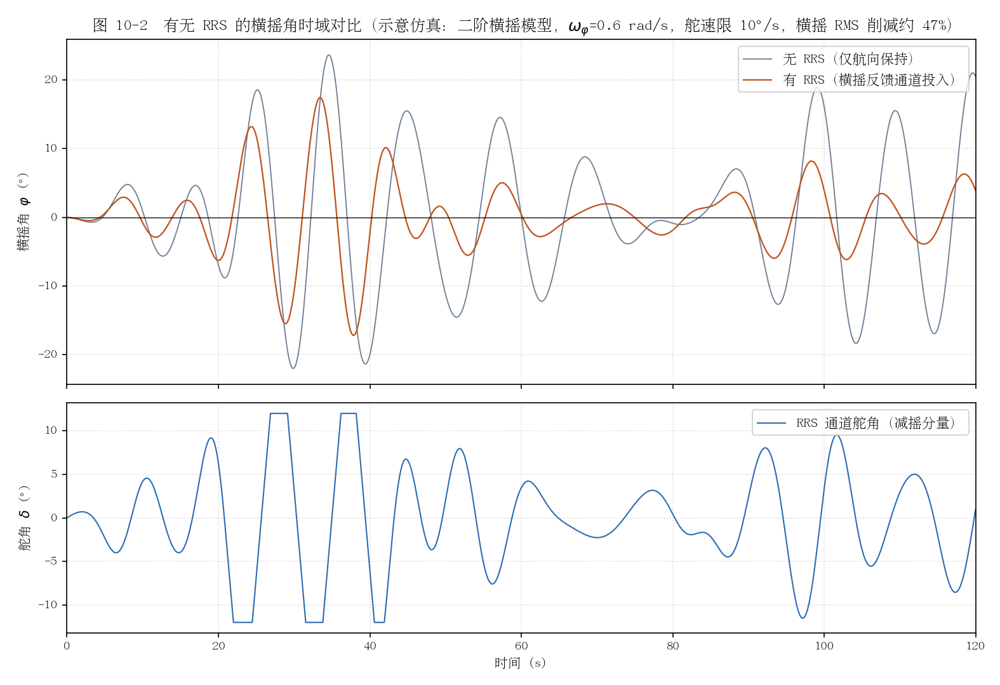

*图 10-2 有无 RRS 的横摇角时域对比（示意仿真）：简化二阶横摇模型（$\omega_\varphi=0.6$ rad/s，$\zeta_\varphi=0.07$），波浪激励为遭遇频率附近窄带谱；RRS 通道为 $\varphi$/$\dot\varphi$ 反馈，含舵角限幅 ±12°、舵速限制 10°/s。横摇 RMS 削减约 47%，代价是舵机以横摇频率持续往复（下图）。*

### 高海况下的效果与限制

- **遭遇频率与横摇固有频率错开**：RRS 的减摇机制是在 $\omega_\varphi$ 附近提供阻尼，当遭遇谱峰显著偏离 $\omega_\varphi$（如随浪航行 $\omega_e$ 大幅下移、或涌浪主导的远场浪），横摇响应峰值移出减摇通道的有效频段，效果下降；这也是自适应高通滤波器/遭遇频率跟踪的必要性来源 [3][5]。
- **舵机速率饱和成为瓶颈**：海况升高 → 所需减摇舵角与舵速同步增大 → 舵速饱和 → 相位滞后 → 减摇性能非线性恶化甚至闭环失稳风险。van der Klugt 的舵速-减摇曲线显示低于要求舵速时减摇能力显著下降 [5]；AGC 类增益回退机制是必需的安全兜底 [1]。
- **非线性横摇**：参数激励横摇（parametric roll，随浪/尾斜浪中 GM 时变引发，$\omega_e \approx 2\omega_\varphi$）不服从线性阻尼模型，常规 RRS 对其抑制能力有限；Breu & Fossen 2011 用 L1 自适应 + ESC 专门处理该工况 [16]。大角度横摇下横摇-艏摇-纵摇耦合非线性增强，线性化 RRS 设计假设失效。
- **与第 8 章结论的衔接**：高海况下航向通道本身已要求"降增益、强滤波、防饱和"，叠加减摇通道后舵机活动量预算更紧张——RRS 的投入决策应与海况估计联动，超阈值时优先保航向、退出减摇。

### 对本项目的适用性分析

**结论：本项目是 RRS 的良好对象，建议作为二期功能纳入架构，但舵机带宽/舵速指标必须先校核。**

有利因素：25 kn 高速下舵效横摇力矩 $\propto U^2$，减摇效能充裕；游艇以横摇舒适性为核心指标，RRS 直接命中需求；小艇横摇固有频率高，与艏摇控制带宽的频带分离容易满足；无需加装减摇鳍/陀螺，成本与舱容代价为零（仅控制软件 + 舵机校核）。

约束与风险：小艇 $\omega_\varphi$ 高（0.5–0.9 rad/s 量级）意味着舵机带宽要求 $\ge 6.4\,\omega_\varphi \approx 3.2$–$5.8$ rad/s、舵速要求 10–20°/s 量级 [5]——须核实本项目舵机实测指标，这是 RRS 可行性的第一判定条件；横摇角/角速度量测需新增（IMU 垂荡/横摇轴向输出或倾角传感器）。

与现有架构（PD + 海况×船速增益调度 + ESC 在线调参 + 极点配置）的结合建议：

1. **增加独立横摇反馈通道**：在现有 PD 航向回路之外并联 $\delta_{rrs} = -(k_1\varphi_{HP} + k_2\dot\varphi_{HP})$ 通道，$\varphi_{HP}$ 为带通滤波（通带覆盖 $\omega_\varphi \pm 40\%$，如 0.35–0.85 rad/s）后的横摇角；总舵令 $\delta = \delta_{heading} + \delta_{rrs}$ 后统一过舵角/舵速限幅。此二通道结构与 van Amerongen et al. 1990 的滤波器组方案同构 [1]，对现有代码侵入最小。
2. **航向通道补陷波**：按第 8 章建议为 PD 反馈与 ESC 辨识输入增加 $\omega_\varphi$/遭遇频率处的陷波器，保证减摇通道打舵引起的高频艏摇响应不污染航向回路与 K/T 辨识。
3. **增益调度扩展**：减摇通道增益按 $U^2$ 标度律随船速调度（与现有 Nomoto $K=K'U/L$ 调度同一框架）；海况调度维度增加"减摇权重"——海况 0–1 退出减摇（省舵机）、2–3 投入、超上限回退增益保航向，即 van Amerongen 自适应加权思想的查表实现 [1][8]。
4. **AGC 式饱和保护**：监测舵速利用率，接近饱和时按比例压低 $\delta_{rrs}$ 增益（而非简单限幅舵令），避免速率饱和相位滞后恶化航向回路 [1]。
5. **ESC 的角色**：ESC 继续负责航向通道 Nomoto $K/T$ 辨识与极点配置基线；减摇通道的 $k_1, k_2$ 初期按 $\omega_\varphi$ 解析整定（提供目标附加阻尼比 $\zeta_{add}$），后续可用 Breu & Fossen 2011 已验证的"ESC 调横摇通道参数"路线做在线优化 [16]——与本项目 ESC 技术栈完全同源。
6. **验证路径**：先仿真（二阶横摇 + Nomoto 艏摇耦合模型，本章图 10-2 即最小可行模型），再水池/实艇按"仅航向 → 航向+减摇"对比试验，指标为横摇 RMS 削减率、舵机活动量增量与航向误差增量三项联合考核。

### 参考资料

1. [van Amerongen, van der Klugt & van Nauta Lemke, "Rudder roll stabilization for ships", Automatica 26(4):679–690, 1990（全文 PDF）](https://afscheid.vanamerongen.org/publicaties/amerongen1990.pdf)（DOI: [10.1016/0005-1098(90)90045-J](https://doi.org/10.1016/0005-1098(90)90045-J)）
2. [特文特大学机构库著录：Rudder roll stabilization for ships](https://research.utwente.nl/en/publications/rudder-roll-stabilization-for-ships/)
3. [van Amerongen 主页：指导博士论文列表（van der Klugt, Rudder Roll Stabilization, TU Delft, 1987）](https://vanamerongen.org/?main=publications)
4. [Roberts, "A note on the applicability of rudder roll stabilization for ships", ACC 1993（Perez《Ship Motion Control》参考文献页确认）](https://link.springer.com/content/pdf/10.1007/1-84628-157-1.pdf)
5. [van der Klugt, "Rudder Roll Stabilization: The Dutch Solution", Naval Engineers Journal, 1990（舵机带宽/舵速量化准则，全文 PDF）](https://www.pkmarine.nl/wp-content/uploads/2016/12/PK-Marine-900500-Naval-Engineers-Journal-RRS-The-Dutch-Solution-1.pdf)
6. [Perez & Blanke, "Ship roll damping control", Annual Reviews in Control 36(1):129–147, 2012](https://doi.org/10.1016/j.arcontrol.2012.03.010)
7. [Baitis, Woolaver & Beck, "Rudder Roll Stabilization for Coast Guard Cutters and Frigates", Naval Engineers Journal 95(3):267–282, 1983](https://onlinelibrary.wiley.com/doi/abs/10.1111/j.1559-3584.1983.tb01644.x)
8. [van Amerongen & van Nauta Lemke, "Rudder Roll Stabilization: Controller Design Based on an Adaptive Criterion", ACC 1986（NASA ADS 著录）](https://ui.adsabs.harvard.edu/abs/1986acc..conf...48V/abstract)
9. [Källström, Wessel & Sjölander, "Roll Reduction by Rudder Control", SNAME STAR Symposium 1988（TRID 著录）](https://trid.trb.org/View/400657)
10. [Blanke & Christensen, "Rudder-Roll Damping Autopilot Robustness to Sway-Yaw-Roll Couplings", SCSS'93（奥尔堡大学机构库全文）](https://vbn.aau.dk/ws/files/72604842/P93_4026_v11c.pdf)
11. [Wiley《Handbook of Marine Craft Hydrodynamics and Motion Control》参考文献页（Roberts & Braham, SCSS'90 著录）](https://onlinelibrary.wiley.com/doi/10.1002/9781119994138.refs)
12. [Oda, Ohtsu & Hotta, "Statistical analysis and design of a rudder roll stabilization system", Control Engineering Practice 4(3):351–358, 1996](https://www.sciencedirect.com/science/article/pii/0967066196000123)
13. [NTNU（IFAC 论文集参考文献页：Roberts et al., IEE Proc. CTA 144(2), 1997 著录）](https://skoge.folk.ntnu.no/prost/proceedings/ifac11-proceedings/data/html/papers/3670.pdf)
14. [Fossen 教材第 2 版（Wiley-VCH 官方目录页，§16.1.7 Optimal Rudder-roll Damping 案例）](https://www.wiley-vch.de/de/fachgebiete/ingenieurwesen/handbook-of-marine-craft-hydrodynamics-and-motion-control-978-1-119-57505-4)
15. [van Amerongen 博士论文：Adaptive Steering of Ships — A Model Reference Approach, 1982（全文 PDF）](https://afscheid.vanamerongen.org/publicaties/1982/amerongen1982.pdf)
16. [Breu & Fossen, "L1 Adaptive and Extremum Seeking Control Applied to Roll Parametric Resonance", IEEE MSC 2011（全文 PDF）](https://www.fossen.biz/publications/2011%20Breu%20and%20Fossen%20ICCA.pdf)
17. [Zhu et al., "Robust adaptive rudder roll stabilization control based on neural network", Chinese Journal of Ship Research, 2023](https://www.ship-research.com/en/article/Y2023/I3/86)

---

## 自适应与学习型 MPC 在船舶运动控制

### 1. 船舶航向/航迹 MPC 基础

模型预测控制（Model Predictive Control, MPC）在每个采样时刻 $t_k$，以当前状态估计 $\hat{x}(t_k)$ 为初值，在线求解一个有限时域开环最优控制问题：

$$
\min_{\boldsymbol{\delta}(\cdot)}\; \sum_{i=0}^{N-1}\Big(\|\psi(t_k+i)-\psi_d\|_Q^2 + \lambda\|\delta(t_k+i)\|_R^2 + \mu\|\Delta\delta(t_k+i)\|_S^2\Big)
$$

$$
\text{s.t.}\quad \dot{x}=f(x,\delta,w),\qquad |\delta|\le\delta_{\max},\qquad |\dot{\delta}|\le\dot{\delta}_{\max},
$$

只执行最优序列的第一个舵角指令，下一采样时刻用新量测重新求解（滚动时域）。预测模型 $f(\cdot)$ 通常取 Nomoto 一阶/二阶模型 $T\dot r+r=K\delta$、3 自由度操纵模型（surge–sway–yaw）或其非线性扩展；$w$ 为风浪流扰动。相对 PID/PD 类自动舵，MPC 的本质优势有两点：**约束被显式写进优化问题**（舵角/舵速饱和在指令生成阶段即被整形，而不是事后限幅截断），以及**代价函数可直接嵌入操舵附加阻力、舵机能耗等物理目标**（与第 2 章 GMV/LQG 的损失函数一脉相承）。

工程上普遍采用"LOS 导引 + MPC 执行"的分层结构：上层视线（LOS）导引把航迹跟踪转化为期望航向 $\psi_d$，下层 MPC 只需完成航向跟踪，避免了在预测时域内同时处理位置与航向的高维问题。代表性基础工作包括：

- **Oh & Sun（2010）**：[LOS-MPC 欠驱动水面船航迹跟踪](https://doi.org/10.1016/j.oceaneng.2009.10.008)（Ocean Engineering），用 LOS 导引律生成航向参考、MPC 在舵角/舵速约束下跟踪，是船舶 LOS-MPC 分层框架的奠基性论文；
- **Li et al.（2009）**：在 MPC 中同时考虑舵角与横摇约束的航迹跟踪（引自 [Xu et al., 2023](https://www.sciencedirect.com/science/article/abs/pii/S0029801822027032) 引言）；
- **Sandeepkumar et al.（2022）**：[统一操纵模型 + NMPC 的规则波航迹跟踪](https://www.sciencedirect.com/science/article/abs/pii/S0029801821014864)（Ocean Engineering），在规则波中对比 NMPC 与 PID，并做了水池模型试验验证——是"波浪中 NMPC"少见的实验证据；
- **He et al.（2023）**：[经水池模型试验验证的航迹跟踪 MPC](https://www.vliz.be/imisdocs/publications/98/393698.pdf)（Ocean Engineering，论文全文见 VLIZ 库），针对预定义航迹点与代价插值简化在线优化，进一步降低计算负担。

这些工作确立了船舶 MPC 的基本范式：低维航向回路用线性 MPC/QP 即可，航迹/避碰/动力定位等非线性多约束任务才需要 NMPC/SQP。

### 2. 自适应 MPC：在线辨识 + 重规划，与 STR 的关系

**自适应 MPC** 在第 1 节的框架上增加一条学习支路：用递推辨识（RLS/FFRLS、EKF 联合估计等）在线刷新预测模型的参数（如 Nomoto $K$、$T$ 或水动力导数），再按**确定性等价**原则把最新估计代入预测模型重新求解优化问题。其架构如图 1 所示。

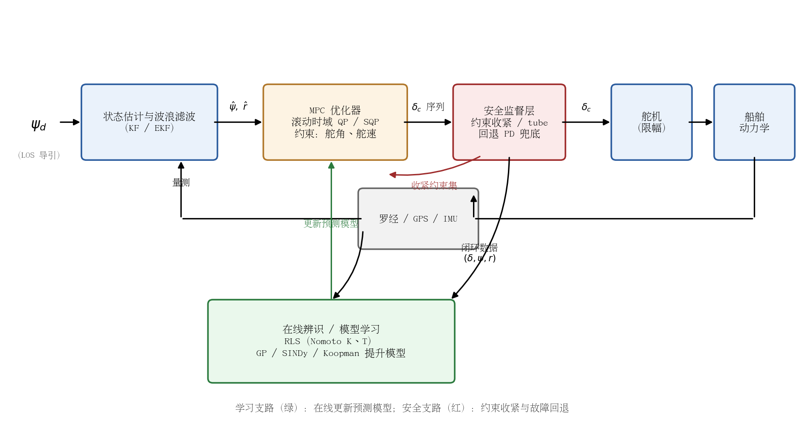

**图 1　自适应与学习型 MPC 自动舵典型架构（在线辨识/学习更新预测模型 + 滚动时域优化 + 安全监督层）**

从控制理论谱系看，自适应 MPC 就是**自校正调节器（STR，见第 2 章）的直接后裔与"现代约束版"**：二者共享"在线辨识 + 确定性等价 + 每拍重设计控制器"的骨架，差别仅在于控制器综合环节——STR 解 Diophantine/Riccati 方程得到固定结构反馈律，自适应 MPC 则在每次采样时重新求解一个带约束的有限时域优化问题。因此 Åström–Källström 时代的自适应自动舵，若把最小方差设计方程换成在线 QP，在概念上就是今天的自适应 MPC。近年代表性工作：

- **Huang et al.（2026）**：[FFRLS-MPC：带遗忘因子 RLS + MPC 的鲁棒航向保持](https://pubmed.ncbi.nlm.nih.gov/42260025/)（Scientific Reports），FFRLS 实时辨识操纵模型关键参数，扰动效应被吸收为参数的自适应变化；在静水与风-浪-流扰动仿真中相比 PID 与鲁棒自适应 MPC 基线，响应更快、稳态误差更小——是"STR 骨架 + MPC 综合"思路的近期完整实现；
- **Dai et al.（2020）**：自适应 EKF-FMPC（Fast MPC）轨迹跟踪，用 EKF 在线补偿未建模不确定性（引自 [Xu et al., 2023](https://www.sciencedirect.com/science/article/abs/pii/S0029801822027032) 引言）；
- **Liu et al.（2019）**：在线 LS-SVM 辨识 + MPC 的自适应航迹跟踪（同上引言）。

自适应 MPC 的理论短板也与 STR 相同：确定性等价忽略了估计不确定性与控制之间的耦合（对偶控制问题），持续激励条件难以在闭环中严格保证，因此**闭环稳定性证明普遍缺失**，工程上要靠监督切换与约束收紧来弥补。

### 3. 学习型与数据驱动 MPC

当航速、载况、海况变化超出低维参数模型的表达能力时，研究界转向用机器学习模型做 MPC 的预测器。系统性综述见 [Hewing et al., 2020, Learning-Based MPC（Annual Review of Control, Robotics, and Autonomous Systems）](https://doi.org/10.1146/annurev-control-090419-075625)。三条主流路线：

**（a）GP-MPC（高斯过程）**。GP 给出预测均值与方差，方差可直接用于约束收紧（"越不确定越保守"），天然适配安全控制。船舶方向的标志性工作是第 7 章已详述的大阪大学 SPMPC（[Cui et al., 2021, J. Field Robotics](https://onlinelibrary.wiley.com/doi/full/10.1002/rob.21990)）：GP 在线学习动力学 + MPC 规划，**真尺船数十次试验学会自动舵**，是 learning-MPC 真船落地的最强证据。纯数据驱动方向，[Xu et al.（2023, Ocean Engineering）](https://www.sciencedirect.com/science/article/abs/pii/S0029801822027032) 用相似度稀疏 GP 建立无先验结构的非参数操纵模型，结合 LOS 把航迹跟踪降为航向跟踪，在 MSS 集装箱船模型（含量测噪声与环境扰动）上验证了航向控制与航点跟随；GP 学习类 MPC 的教程式入门见 [arXiv:2404.03689](https://arxiv.org/html/2404.03689v1)。

**（b）Koopman-MPC**。Koopman 算子理论把非线性动力学升维（lifting）为高维线性系统，[Korda & Mezić（2018, Automatica）](https://mgroup.me.ucsb.edu/sites/default/files/publications/koopmanmpc.pdf) 证明提升后的线性预测器可直接嵌入线性 MPC——即"非线性对象、线性 QP 求解"，计算量与线性 MPC 相当。船舶/水下方向已有应用探索，如 [Xia et al.（2025, Ocean Engineering）](https://www.sciencedirect.com/science/article/abs/pii/S0029801825024849) 的 ROV Koopman 鲁棒 MPC（KORMPC）轨迹跟踪。局限在于升维字典（观测函数）靠人工选取或深度学习，外推性与物理可解释性有限。

**（c）SINDy-MPC（稀疏辨识）**。SINDy（[Brunton et al., 2016, PNAS](https://www.pnas.org/doi/10.1073/pnas.1517384113)）从候选函数库中稀疏回归出显式微分方程，SINDYc 扩展到含控系统；[Kaiser et al.（2018, Proc. R. Soc. A）](https://arxiv.org/pdf/1711.05501) 证明 SINDy 模型可在**低数据极限**下支撑 MPC。对船舶场景，SINDy 的吸引力在于：以 Nomoto/Abkowitz 水动力项为候选库，辨识结果直接是物理可解释的操纵方程（如自动"发现" $r^3$、$v|r|$ 等非线性项），而非黑箱。目前船舶 SINDy-MPC 仍处早期，未见实船报道。

**（d）Tube-based 鲁棒 MPC 处理波浪扰动**。波浪对航向回路是有界加性扰动，tube MPC（[Mayne, Seron & Raković, 2005, Automatica](https://doi.org/10.1016/j.automatica.2005.01.011)）把闭环分解为"标称轨迹优化 + 误差反馈管（tube）"：对标称系统求解 MPC，同时用鲁棒不变集收紧约束，保证实际轨迹始终落在标称轨迹周围的管道内。船舶方向的代表是 [Nascimento et al.（KTH/ABB，2018）](https://search.abb.com/library/Download.aspx?DocumentID=9AKK107991A2057&LanguageCode=en&DocumentPartId=&Action=Launch) 的动力定位 tube-MPC：线性化船舶模型 + LMI 综合鲁棒不变集 + Pontryagin 差集收紧约束，在执行器饱和与有界环境扰动下保证约束满足。更早的 Li & Sun（2011）扰动补偿 MPC 则走"扰动观测器 + MPC"路线抑制风浪扰动（引自 [Xu et al., 2023](https://www.sciencedirect.com/science/article/abs/pii/S0029801822027032) 引言）。

四条路线的定位对比：

| 路线 | 预测模型 | 不确定性量化 | 计算代价 | 船舶应用成熟度 |
|---|---|---|---|---|
| 自适应 MPC（RLS） | 参数化（Nomoto 等） | 无（确定性等价） | 极低 | 中：仿真充分，实船少 |
| GP-MPC | 非参数（均值+方差） | 有（方差收紧约束） | 中（需稀疏化） | 高：真尺船验证（Cui 2021） |
| Koopman-MPC | 升维线性模型 | 弱 | 低（线性 QP） | 低：ROV 仿真/初步实验 |
| SINDy-MPC | 显式稀疏方程 | 弱 | 低 | 很低：尚无船舶实例 |
| Tube/鲁棒 MPC | 任意标称模型 | 有（不变集） | 低~中 | 中：DP 仿真验证 |

### 4. 实时性与嵌入式实现：25 kn 游艇控制周期

对本项目 25 kn（约 12.9 m/s）游艇做量级估算：船长数十米量级时 Nomoto 时间常数 $T$ 为秒级，航向回路带宽低，**航向控制采样周期取 50–100 ms（10–20 Hz）已非常充裕**；预测时域取 $3\sim5$ 倍 $T$（约 10–20 s）、离散步数 $N=20\sim40$ 即可覆盖机动动态。此时 QP 规模仅几十个决策变量，实时性完全不是瓶颈：

- **QP 求解器**：HPIPM（[Frison & Diehl, 2020](https://arxiv.org/pdf/2003.02547v2)）对这类小规模部分凝聚 QP 的求解时间**稳定在 1 ms 以下**；qpOASES（[Ferreau et al., 2014](https://doi.org/10.1007/s12532-014-0071-1)，参数化有效集、支持暖启动）与 OSQP（[Stellato et al., 2020](https://doi.org/10.1007/s12532-020-00179-2)，ADMM）在同类规模上为毫秒级；
- **NMPC 框架**：acados（[Verschueren et al., 2021](https://publications.syscop.de/Verschueren2021.pdf)）采用实时迭代（RTI）方案——每个采样周期只执行一次 SQP 迭代，把大部分计算挪到反馈到达前完成，无人机等非线性平台上单次迭代约 0.1–数 ms；
- **真正的计算大头是学习模型推理**而非优化：非稀疏 GP 推理随训练样本数 $O(n^2)\sim O(n^3)$ 增长，数百样本即达十毫秒级，必须稀疏化（诱导点/相似度剪枝，Xu et al. 2023 正是为此引入稀疏 GP）；Koopman 与 SINDy 模型的推理只是矩阵乘法，代价可忽略。

图 2 给出各环节的耗时量级与控制周期预算的对比：对 2–3 状态的航向 MPC，QP 求解仅占 20 Hz 控制周期的 **1–2%**，即使叠加稀疏 GP 推理也不足 10%。换言之，**25 kn 游艇的慢动态 + 现代嵌入式求解器，使"嵌入式算不动 MPC"这一传统顾虑在本应用量级上不成立**；真正的门槛在于辨识/学习模块的鲁棒性、监督逻辑与认证成本。

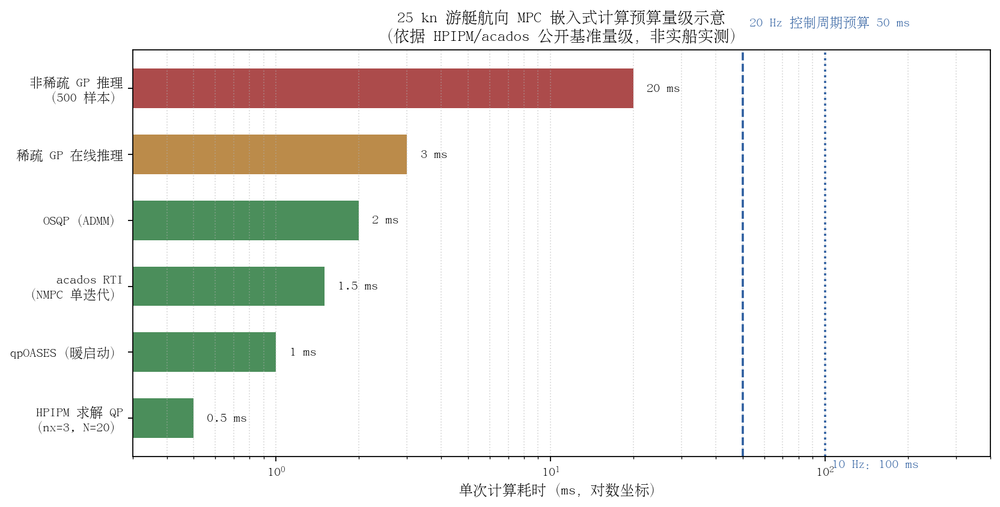

**图 2　25 kn 游艇航向 MPC 各环节计算耗时量级与控制周期预算对比（依据 HPIPM/acados 公开基准量级，示意非实测）**

### 5. 代表性文献与实船证据

| 工作 | 年代 | 方法 | 平台与验证级别 |
|---|---|---|---|
| Oh & Sun | 2010 | LOS-MPC | 仿真（欠驱动水面船模型） |
| Li & Sun | 2011 | 扰动补偿 MPC | 仿真（航向控制） |
| Nascimento et al.（KTH/ABB） | 2018 | Tube-MPC | 仿真（DP 船） |
| Cui et al.（大阪大学） | 2019–2021 | GP model-based RL + MPC（SPMPC） | **真尺船实验**（数十次试验收敛） |
| Sandeepkumar et al. | 2022 | NMPC（规则波） | 仿真 + **水池模型试验** |
| Martinsen et al.（NTNU） | 2022 | RL 在线调参 MPC | **USV 实验**（引自 [Xu et al. 2023](https://www.sciencedirect.com/science/article/abs/pii/S0029801822027032) 引言） |
| He et al. | 2023 | 航迹跟踪 MPC | **水池模型试验验证** |
| Xu et al. | 2023 | 稀疏 GP-NMPC | 高保真仿真（MSS 集装箱船 + 噪声扰动） |
| Xia et al. | 2025 | Koopman 鲁棒 MPC | 仿真（ROV） |
| Huang et al. | 2026 | FFRLS-MPC 自适应 | 仿真（风-浪-流扰动） |

可以看出：**船舶 MPC 的实船证据链整体偏薄**——最高级别的证据是大阪大学的真尺船 SPMPC 与少量水池模型试验，全尺度商船的 MPC 自动舵在公开文献中未见报道；自适应 MPC 与 Koopman/SINDy-MPC 目前基本停留在仿真阶段。这与第 2 章 KADPIL 时代自适应自动舵"130 余次实船试验、商用化运营"的证据强度形成鲜明反差，也说明 MPC 类方法的主要瓶颈不在性能，而在**工程化与认证**。

### 6. 与本项目 ESC + 极点配置方案的对比定位

本项目现行方案（PD + 海况×船速增益调度 + ESC 在线调参，Nomoto $K/T$ 在线辨识 + 极点配置基线）与自适应/学习型 MPC 的关系，可精确表述为：**极点配置 + 辨识相当于自适应 MPC 的"单步、无约束、线性二次型"特例**——LQ 极点配置本身就是一个无限时域无约束 MPC 的闭式解；MPC 把它推广到多步预测与显式约束，ESC 则把"重设计"环节换成了不依赖模型的在线参数优化。

| 维度 | ESC + 极点配置（本项目） | 自适应/学习型 MPC |
|---|---|---|
| 预测能力 | 无显式预测（反馈 + 极点） | 多步预测，可预整形指令 |
| 约束处理 | 事后限幅截断 | 优化问题内显式处理舵角/舵速/横摇 |
| 在线计算 | 微秒级（查表 + 递推） | 毫秒级 QP/SQP + 学习推理 |
| 稳定性保证 | 有（极点配置 + ESC 平均化理论） | 自适应 MPC 普遍缺失；tube/鲁棒 MPC 有 |
| 模型依赖 | Nomoto $K/T$ 即可 | 线性 MPC 同级；学习路线需更多数据 |
| 认证与调试 | 结构简单、参数物理意义明确 | 优化器与学习模块调试成本高，船级社认证无先例 |
| 收益场景 | 航向保持已接近结构内最优 | 大舵角机动、强约束、多目标（能耗+精度）权衡 |

对本项目的借鉴点：

1. **辨识成果直接复用**：现有在线辨识的 Nomoto $K/T$ 就是线性 MPC 的预测模型，可在仿真中低成本搭建"辨识 + 线性 MPC"原型，量化"显式约束处理 + 多步预测"相对现行 PD 限幅方案的实际收益（预期主要在大舵角转向与海况切换瞬态，而非静水定常航向保持），再决定是否值得工程化；
2. **约束收紧/tube 思想下沉到现有方案**：tube MPC 的"按扰动界收紧约束"思想可低成本移植为 ESC 扰动幅度与舵角限幅值随海况估计自适应收紧/放宽的调度规则，无需引入完整 MPC；
3. **学习路线选型**：若未来引入学习组件，优先 GP-MPC/SPMPC 式"小数据 + 不确定性量化"路线（真船证据最强），Koopman/SINDy 适合作为离线模型发现工具补充辨识候选结构；model-free RL 式的高样本路线（见第 7 章）不适合在线直接训练；
4. **算力结论**：图 2 的量级分析表明嵌入式实时性不是否决项，决策变量应聚焦在收益是否覆盖调试与认证成本。

### 7. 参考资料

1. Oh & Sun, 2010, [Path following of underactuated marine surface vessels using line-of-sight based model predictive control](https://doi.org/10.1016/j.oceaneng.2009.10.008)
2. Sandeepkumar et al., 2022, [A unified ship manoeuvring model with a nonlinear model predictive controller for path following in regular waves](https://www.sciencedirect.com/science/article/abs/pii/S0029801821014864)
3. Huang et al., 2026, [FFRLS-MPC: An adaptive model predictive control method for robust ship course keeping](https://pubmed.ncbi.nlm.nih.gov/42260025/)（Scientific Reports）
4. Xu et al., 2023, [Data-driven model predictive control for ships with Gaussian process](https://www.sciencedirect.com/science/article/abs/pii/S0029801822027032)（Ocean Engineering）
5. Cui et al., 2021, [Autonomous boat driving system using sample-efficient MPC-based reinforcement learning](https://onlinelibrary.wiley.com/doi/full/10.1002/rob.21990)（J. Field Robotics）；预印本 [arXiv:1901.07905](https://arxiv.org/abs/1901.07905)
6. Hewing et al., 2020, [Learning-Based Model Predictive Control: Toward Safe Learning in Control](https://doi.org/10.1146/annurev-control-090419-075625)；GP-MPC 教程：[arXiv:2404.03689](https://arxiv.org/html/2404.03689v1)
7. Korda & Mezić, 2018, [Linear predictors for nonlinear dynamical systems: Koopman operator meets model predictive control](https://mgroup.me.ucsb.edu/sites/default/files/publications/koopmanmpc.pdf)（Automatica）
8. Xia et al., 2025, [Trajectory tracking control of work-class ROVs using KORMPC strategy](https://www.sciencedirect.com/science/article/abs/pii/S0029801825024849)
9. Brunton et al., 2016, [Discovering governing equations from data by sparse identification of nonlinear dynamical systems (SINDy)](https://www.pnas.org/doi/10.1073/pnas.1517384113)；Kaiser et al., 2018, [Sparse identification of nonlinear dynamics for model predictive control in the low-data limit](https://arxiv.org/pdf/1711.05501)
10. Mayne, Seron & Raković, 2005, [Robust model predictive control of constrained linear systems with bounded disturbances](https://doi.org/10.1016/j.automatica.2005.01.011)（Automatica，tube MPC 奠基论文）
11. Nascimento et al.（KTH/ABB）, 2018, [Tube-based model predictive control for dynamic positioning of marine vessels](https://search.abb.com/library/Download.aspx?DocumentID=9AKK107991A2057&LanguageCode=en&DocumentPartId=&Action=Launch)
12. Frison & Diehl, 2020, [HPIPM: a high-performance quadratic programming framework for model predictive control](https://arxiv.org/pdf/2003.02547v2)；Ferreau et al., 2014, [qpOASES](https://doi.org/10.1007/s12532-014-0071-1)；Stellato et al., 2020, [OSQP](https://doi.org/10.1007/s12532-020-00179-2)；Verschueren et al., 2021, [acados: a modular open-source framework for fast embedded optimal control](https://publications.syscop.de/Verschueren2021.pdf)

---

## 自适应自动舵的验证与确认方法

前述各章分析的是"算法能不能控"，本章回答"如何证明它可控"：自适应算法的参数随工况在线变化，传统"一组标称工况 + 几次试航"的验证方式覆盖不了其行为空间，必须建立分层、统计化、贯穿全生命周期的验证与确认（V&V）体系。本章先给出 SIL→HIL→水池→实船的四级验证层级，再剖析 HIL 仿真器的构成与蒙特卡洛鲁棒性验证方法，然后梳理 IMO 与船级社（CCS/DNV）的相关要求，最后讨论自适应算法特有的验证难题与对策，并对本项目（PD + 海况×船速增益调度 + ESC 在线调参）的 HIL 验证体系给出具体建议。

### 验证层级：SIL → HIL → 水池 → 实船

船舶控制系统的验证遵循 V 模型：左侧逐级设计分解，右侧逐级集成验证，每层验证结论回溯修订对应层级的设计产物（图 12-1）。四个验证层级的定位与分工如下：

- **SIL（软件在环）**：控制算法以纯软件形式与非实时仿真模型闭环运行。目标是验证算法逻辑正确性——状态机切换、增益调度插值、ESC 收敛行为、限幅与保护逻辑；优势是可超实时批量运行，适合工况扫描与长历时统计。SIL 暴露不了实时性问题（任务超时、通信抖动、数值舍入在定点目标机上的影响）。
- **HIL（硬件在环）**：真实控制器（目标硬件 + 实时代码）通过真实 I/O 接口接入实时仿真器，仿真器以定步长实时求解船舶与环境模型。这是**软件功能与故障处理能力验证的核心层级**：可安全注入传感器故障、舵机故障、通信中断等危险工况，复现"虚拟试航"。MTS 动力定位委员会的技术文件把 HIL 明确定义为"用船舶专用仿真器对计算机软件进行测试与验证……在船舶建造完成前进行彻底的功能与故障测试"的过程 [9]；DNV 也将其作为控制系统软件第三方验证的标准手段，并建议**每次软件更新后重新进行 HIL 测试** [7]。
- **水池试验**：在拖曳水池/耐波性水池中用缩尺模型验证控制-水动力耦合效应，特别是 HIL 模型中简化掉的成分：非线性波浪力、舵-桨-船体干扰、大幅运动下的舵效变化。对自适应算法的价值在于校核仿真模型本身（模型确认），而非逐条测试软件。
- **实船试航**：最终确认环节。按 IMO MSC.137(76)，操纵性符合性可以"模型试验/仿真预报 + 实船试验验证"的方式证明，标准试航机动包括回转试验、10°/10° 与 20°/20° Z 形试验、全速倒车停船试验，且允许设计阶段用数学模型预报、实船试验校核 [4]。对自动舵则需在限海况下逐步放开：先在低海况验证保向精度与改向超调，再逐级提高海况与机动幅度。

层级设计的基本原则是**缺陷前移**：SIL 几乎零成本，HIL 成本中等但能覆盖危险工况，水池与实船成本高昂且不可复现——因此绝大多数缺陷必须在 SIL/HIL 阶段暴露，后两级只做确认而非排错。

### HIL 仿真器构成

一套自动舵 HIL 仿真器由被测对象（DUT）与实时仿真器两部分构成（图 12-2）。被测对象是运行在目标硬件上的真实控制器及其 I/O 接口（NMEA 0183/2000、CAN、模拟量）；实时仿真器是被控对象与环境的数字孪生，包含四类核心模型 [7][9]：

1. **船舶动力学模型**：3/4/6 自由度操纵运动模型。对本项目，最小可用配置是二阶 Nomoto 模型（$K$、$T$ 按航速/装载调度，叠加非线性项 $T\dot r + r + \alpha r^3 = K\delta$）；用于高海况验证时应升级含横摇耦合的 4 自由度模型，并纳入舵效非线性（大舵角失速，见第 8 章）。模型参数须有溯源性：由系统辨识（本项目 ESC/Z 形试验数据）、水池试验或 CFD 求得，并用独立工况数据做模型确认。
2. **波浪/风/流扰动模型**：波浪采用 ITTC/JONSWAP 谱生成一阶波频力（二阶波频振子模型 $H_w(s)=K_w s/(s^2+2\lambda\omega_0 s+\omega_0^2)$）与正比于 $H_{1/3}^2$ 的二阶慢漂力/力矩；关键细节是**遭遇频率变换** $\omega_e = \omega - \frac{\omega^2 U}{g}\cos\chi$——同一海况在不同航速、浪向下对控制系统的激励完全不同，这正是波浪滤波与自适应律压力测试的核心变量（机理见第 8 章）。风用平均风 + 阵风谱，流用慢变漂移模型。
3. **舵机模型**：伺服动态（一阶/二阶滞后）、舵角饱和（±35°）、舵速限制、机械间隙，以及故障模式——卡舵、液压泵失效、舵角反馈丢失。舵机模型保真度直接决定"饱和-辨识失配"这类自适应特有故障能否在 HIL 中暴露。
4. **传感器模型**：罗经/IMU/计程仪的噪声、量化、延迟、漂移与丢包特性，并支持故障注入（输出冻结、跳变、缓慢漂移）——MSC.64(67) 要求自动舵对传感器失效给出报警 [1]，这些报警逻辑只能在带故障注入的 HIL 上验证。

此外还需要**实时调度与 I/O 板卡**（保证模型求解与接口时钟同步，步长抖动会污染控制器微分项）和**测试管理与评估层**（场景库管理、故障注入脚本、蒙特卡洛批跑、指标统计与自动判读）。DNV 的 HIL 实践强调两点值得借鉴：一是"黑盒"测试——测试方无需知道控制器内部代码，只通过接口激励与响应判读，适合第三方验证 [7]；二是 HIL 仿真器本身必须先用实船/水池数据做确认，否则"用错误模型验证正确控制器"得出的是虚假信心 [9][13]。

### 蒙特卡洛鲁棒性验证

自适应系统的行为空间是"工况 × 参数轨迹"的乘积，少量设计点试验无法覆盖。工程惯例是蒙特卡洛批跑：对不确定量按分布随机抽样，批量闭环仿真，统计性能指标分布与失效概率。航空领域已将其作为自适应控制律验证的标准收尾手段——例如 Citation X 自适应自动舵在 64 个代表性巡航点验证后，仍要求以蒙特卡洛仿真对气动参数、执行器动态、传感器不确定性与扰动做系统统计评估 [14]。

对本项目，随机化维度至少应包括：

- **对象不确定性**：Nomoto $K$、$T$ 在辨识真值 ±30% 内抽样（覆盖辨识误差与装载变化），附加非线性项系数摄动；
- **环境不确定性**：海况（$H_{1/3}$、谱峰周期）、浪向、风速风向、流，覆盖内部 0..3 级标称域并外推至海况 4–5；
- **初始条件与任务**：初始航向偏差、改向幅度（5°–60°）、改向时机与波浪相位的相对关系；
- **故障注入**：传感器噪声方差放大、丢包率、舵速降级（模拟液压老化）；
- **自适应机制的特有变量**：ESC 激励幅值/频率、海况估计误差与延迟——海况估计错一档时调度增益是否仍安全。

判读指标分两类：**安全指标**（最大航向偏差、最大舵角/舵速、饱和时间占比、失稳发散次数——一票否决）与**性能指标**（保向精度 RMS、改向超调、舵机活动量、能耗）。统计口径必须给置信区间而非点估计：若 $n$ 次独立试验零失效，则失效概率 $p$ 的 95% 置信上界约为 $3/n$（"三西格玛法则"的零失效形式，即 $1-(1-p)^n \ge 0.95$）——要声明 $p<10^{-3}$ 需约 3000 次无失效试验。这一量级只有 SIL（超实时）+ HIL（实时但可并行多实例）组合才能负担，也再次说明蒙特卡洛的主战场是 SIL/HIL 而非实船。DNV 在自主航行系统验证中推荐的正是这条路线：以数字孪生为载体的场景化、统计化仿真验证，实船试验只保留少量关键场景做最终确认 [13]。

### IMO 与船级社相关要求

#### IMO MSC.64(67) Annex 3：航向控制系统性能标准

IMO 对自动舵的现行性能标准是 MSC.64(67) 附件 3《航向控制系统性能标准建议案》（1996 年通过，替代 A.342(IX)，适用于 1999 年 1 月 1 日后安装的设备）[1]。与本项目直接相关的条款：

- **3.1 适应性**："航向控制系统应能**手动或自动**适应不同航速、气象与装载条件下船舶的操舵特性"——IMO 标准从 1996 年起就明确容纳自动适应（自适应）方案，本项目 ESC 在线调参在法规框架内；
- **3.3 舵角限制**：自动模式下必须提供舵角限制手段，并在达到限幅时给出指示；
- **3.4 允许艏摇（permitted yaw）**：必须防止正常艏摇引起舵的不必要动作——这是"波浪滤波/死区"要求的法规出处，直接对应第 8 章的波浪滤波分析；
- **3.6 限制超调**：改向至预设航向不得有显著超调；
- **4 切换**：自动/手动切换须能在舵处于任何位置时以单一操作在 3 秒内完成，且自动舵任何故障下均可切回手动；手动切自动时以实际航向为预设航向；
- **6 报警**：电源故障、偏航报警（off-heading alarm）、航向监视器（双罗经时比对独立航向源）、传感器状态指示（外部传感器输入缺失时给出指示）；
- **7.2 / 8.2**：若不具备自动调整功能则必须提供手动气象调节手段；**当控制参数随航速自动调整时，必须接入航速信息源**——对本项目"船速×海况增益调度"而言，航速输入的失效模式（丢信号、错误值）就成为法规关注的验证点。

配套的试验方法是 ISO 11674《船舶与海上技术——航向控制系统》，规定符合 MSC.64(67) Annex 3 的最低操作、功能与性能要求、试验方法及判定准则，其性能试验允许使用基于螺旋桨推进 + 常规舵船模的仿真器 [2]；若扩展到航迹控制，则对应 MSC.74(69) Annex 2 与 IEC 62065（航迹控制系统的操作与性能要求、试验方法及所需试验结果）[3]。

#### 舵机与操纵性试验

- **操舵装置**：SOLAS 对主操舵装置的要求为船舶以最大营运航速前进时，舵自一舷 35° 转至另一舷 30° 不超过 28 s [6]——这是舵机模型舵速上限的法规基线，也是试航舵机试验的必测项；
- **操纵性标准**：MSC.137(76) 规定回转试验（进距 ≤4.5L、战术直径 ≤5L）、10°/10° Z 形试验第一超越角随 $L/V$ 分档（10°/20°/插值）、20°/20° Z 形第一超越角 ≤25°、停船冲程 ≤15L 等衡准，并明确允许"设计阶段模型预报 + 实船试验校核"的符合性证明路径 [4]，MSC/Circ.1053 给出解释性细则。自动舵验证中的 Z 形试验应与这些衡准挂钩，但注意 MSC.137(76) 适用 100 m 以上船舶，对 25 kn 游艇属自愿采用的设计参考而非强制要求。

#### DNV：HIL 测试制度化与对自适应/AI 软件的保证框架

DNV 是船舶控制软件验证制度化的推动者：2014 年收购 NTNU 孵化的 Marine Cybernetics（首家把 HIL 测试引入海事行业的第三方公司），理由是"越来越多严重事故由软件问题引起，不能只靠硬件检验" [8]。其现行做法对自适应软件的启示有三层 [7][10][11]：

1. **HIL 测试作为标准服务**：覆盖 DP、操舵/推进等控制系统，强调功能与故障处理的系统测试、黑盒第三方验证、以及**软件更新后回归 HIL 测试**——后一点对"参数在线变化"的自适应系统尤为关键；
2. **新技术资格确认（TQ）**：DNV-RP-A203 为无现成规范可依的新技术提供基于风险与证据链的资格确认流程 [10]——自适应/学习型控制器在船级社眼中即属此类；
3. **AI 系统保证**：DNV-RP-0671（Assurance of AI-enabled systems，2023）把 AI/数据驱动组件的审定组织为"保证案例（assurance case）"：用结构化论证把"系统安全"的顶层主张连接到可验证的证据（测试结果、仿真场景、鲁棒性检查、监控日志），并要求保证是**持续的**——模型更新、数据漂移、工况变化后须更新证据、重新评估 [11]。

#### CCS：智能船舶规范与智能航行检验指南

CCS《智能船舶规范》对申请智能航行功能标志的船舶要求提交自主航行设计方案（含自主控制方案）、感知系统图纸等供批准，智能航行相关系统与设备须经 CCS 型式认可及产品检验，自主航行系统须满足《钢质海船入级规范》对 **III 类计算机系统**的要求 [5]；配套的《智能航行系统检验指南》进一步对智能航行系统（含自主航行与辅助航行）的开发、应用、**测试验证**与实船应用提出具体技术要求 [12]。对本项目级别的"自适应自动舵"（属辅助航行/增强控制而非自主航行），CCS 路径同样以"图纸审查 + 型式认可（含软件评估）+ 实船试验"为主线，自适应/自学习功能按 III 类计算机系统的软件评估对待，核心关注点是失效安全与降级逻辑。

**小结两家态度**：船级社并不排斥自适应控制——IMO 性能标准早已为"自动适应"留出位置；但自适应功能越复杂，举证责任越重：需要用保证案例把"参数会变"这一事实转化为"变化有界、越界有监控、失控有兜底"的可审计证据链。这与第 8 章的技术结论（自适应必须配包线保护与兜底基线）在法规层面是同构的。

### 自适应算法特有的验证难题与对策

#### 难题一：非确定性与不可复现

固定参数控制器在相同初始条件下行为可复现；自适应控制器的参数是历史的函数，同一试验场景在不同运行时刻（参数已收敛/未收敛/刚经历扰动）表现不同，单次试验通过不代表再次通过。ESC 还有随机性来源（激励相位、噪声驱动的梯度估计）。**对策**：①把"自适应状态"纳入测试初始条件——试验矩阵必须显式区分"冷启动（标称参数）""稳态收敛后""辨识中途"三种入口；②蒙特卡洛统计判读替代单次通过判据；③全程记录参数轨迹日志，使任何失效可回放复现（输入序列 + 初始参数即可重演）。

#### 难题二：回归测试基线漂移

传统回归测试以"输出与基线逐点一致"判通过；自适应系统的合法行为是一个分布，算法改进（如 ESC 增益调整）会使整个参数轨迹改变，基线对比要么频繁误报、要么被迫放宽到失去意义。**对策**：①回归判据从"轨迹一致"改为"**包络一致**"——安全指标（最大偏差、饱和时间）不退化，性能指标分布不劣化（如 RMS 航向误差的 95% 分位数不高于基线版本）；②维护**数字孪生回归平台**：模型确认后的仿真器作为永久回归资产，每次软件/参数变更自动重跑场景库——这正是 DNV 建议"软件更新后重测 HIL"的工程化形态 [7]，也是 DNV 数字孪生保证实践（RP-A204）的思路 [13]；③版本冻结：上船版本冻结参数边界与保护逻辑，新算法先在"影子模式"（平行运行但不接舵）下积累实船数据，再切换。

#### 难题三：理论保证与工程实现的鸿沟

自适应律的稳定性证明建立在理想假设上（无饱和、无延迟、PE 条件满足），实船全部不成立；而"证明不了"不等于"不安全"。**对策是分三层补足**：

1. **包线保护（运行时保证）**：在自适应控制器之外套一层与算法无关的监督层——舵角/舵速/航向偏差硬限幅、异常检测（参数漂移速率、误差能量超阈值）与无条件回退到固定增益 PD 兜底。这就是 Simplex/运行时保证（Runtime Assurance）架构："用简单控制复杂"——经过验证的简单安全控制器随时接管未经完全验证的高性能控制器 [15]。第 8 章"增益调度 PID 作安全兜底"的结论在此落地为架构要求；
2. **运行时监控**：在线监控辨识量（$\hat K$、$\hat T$ 及其置信度）、海况估计、舵机活动量，一方面触发降级逻辑，另一方面持续积累保证案例所需的运行证据（对应 DNV-RP-0671 的持续保证要求 [11]）；
3. **数字孪生回归**：见上，保证"每次变更后全场景库重测"在经济上可行。

### 对本项目 HIL 验证体系的建议

结合本项目现状（PD + 海况×船速增益调度 + ESC 在线调参，Nomoto $K/T$ 在线辨识 + 极点配置基线），建议按以下优先级建设：

1. **先 SIL 后 HIL，模型从简但接口从真**。SIL 阶段用二阶 Nomoto + 波频振子 + 二阶慢漂的简化模型即可完成算法逻辑与长历时统计验证；HIL 阶段的必要性不在于模型更精细，而在于**真实硬件、真实接口、真实故障**——优先把舵机饱和/舵速限制、罗经故障注入、航速源失效（MSC.64(67) §8.2 的法规关注点 [1]）做实，而不是追求高阶水动力。
2. **场景库结构化，按"标称域 + 外推域 + 故障域"三层组织**。标称域覆盖内部海况 0..3 级 × 全船速段；外推域覆盖海况 4–5（检验第 8 章建议的冻结/兜底逻辑是否被正确触发）；故障域覆盖传感器、舵机、通信三类失效模式。每个场景标注预期行为（性能指标 / 安全指标 / 应触发的保护动作），支持自动判读。
3. **蒙特卡洛嵌入 SIL 流水线**。随机化 $K/T$（±30%）、海况参数、浪向、初始条件与海况估计误差；对安全指标采用零失效置信上界口径（$p < 3/n$），对性能指标报告分位数。重点蒙特卡洛对象是 ESC：验证"海况突变 → 辨识漂移 → 包线保护接管 → 恢复"全链路在统计意义下不漏失。
4. **把 MSC.64(67) Annex 3 条款直接转成验收用例**：3 s 内手动接管、舵角限幅指示、偏航报警、传感器缺失指示、手动切自动时接管实际航向——这些是法规字面要求，应逐条对应 HIL 测试用例并保留证据 [1]。
5. **建立"版本-证据"台账**：每次软件或参数表变更，自动触发数字孪生回归（场景库全量重跑），产出可审计的对比报告（安全包络不退化、性能分位数不劣化）。这套台账既是工程资产，也是未来面对 CCS 型式认可或 DNV 式保证案例审查时的证据主体 [5][11]。

### 参考资料

1. [IMO Resolution MSC.64(67) Annex 3：Recommendation on Performance Standards for Heading Control Systems（官方 PDF）](https://wwwcdn.imo.org/localresources/en/KnowledgeCentre/IndexofIMOResolutions/MSCResolutions/MSC.64(67).pdf)
2. [ISO 11674:2019 Ships and marine technology — Heading control systems（标准预览，含仿真器性能试验说明）](https://cdn.standards.iteh.ai/samples/68748/142d0270f3304da1accb24f578edb07c/ISO-11674-2019.pdf)
3. [IEC 62065:2014 航迹控制系统——操作与性能要求、试验方法及所需试验结果（对应 MSC.74(69) Annex 2）](https://webstore.ansi.org/standards/iec/iec62065eden2014)
4. [IMO Resolution MSC.137(76)：Standards for Ship Manoeuvrability（官方 PDF，含 Z 形/回转/停船试验衡准与模型预报符合性路径）](https://wwwcdn.imo.org/localresources/en/KnowledgeCentre/IndexofIMOResolutions/MSCResolutions/MSC.137(76).pdf)
5. [CCS《智能船舶规范》（智能航行功能标志、图纸审查、III 类计算机系统要求）](https://www.ccs.org.cn/ccswz/file/download?fileid=202312061011848316)
6. [SOLAS 操舵装置要求（35°→30° ≤ 28 s）](https://www.amnautical.com/blogs/the-mariners-blog/understanding-steering-gear-ships)
7. [DNV：HIL testing of marine systems（控制系统软件 HIL 验证服务，软件更新后重测建议）](https://www.dnv.us/services/hil-testing-of-marine-systems-83385/)
8. [DNV GL 收购 Marine Cybernetics（HIL 测试引入海事行业的缘起）](https://drillingcontractor.org/dnv-acquires-marine-cybernetics-28958)
9. [MTS DP 委员会 TECHOP (D-08)：SOFTWARE TESTING（HIL 定义、船舶专用仿真器构成、虚拟试航）](https://dynamic-positioning.com/files_mailing/TECHOP%20(D-08%20-%20Rev1%20-%20Jan21)%20SOFTWARE%20TESTING.pdf)
10. [DNV-RP-A203：Technology Qualification（新技术资格确认推荐做法）](https://www.dnv.us/services/technology-qualification-4779/)
11. [DNV 报告引述 DNV-RP-0671《Assurance of AI-enabled systems》(2023) 与 AMLAS 方法（AI 保证案例、持续保证）](https://www.havtil.no/contentassets/ef58508a2e4641aebba4091811795020/dnv-2024-1519-state-of-the-art-for-responsible-use-of-artificial-intelligence-in-the-petroleum-sector.pdf)
12. [CCS《智能航行系统检验指南》（智能航行系统开发、应用、测试验证技术要求）](https://www.ccs.org.cn/ccswz/file/download?fileid=202304200483843827)
13. [Pedersen et al., Towards simulation-based verification of autonomous navigation systems（DNV 数字孪生场景化仿真验证路线，Ocean Engineering 2020）](https://www.sciencedirect.com/science/article/abs/pii/S092575352030196X)
14. [Adaptive Autopilot Design and Implementation for Cessna Citation X（64 工况验证 + 蒙特卡洛鲁棒性评估的航空实践，Aerospace 2026）](https://www.mdpi.com/2226-4310/13/4/318)
15. [Mehmood et al., The Black-Box Simplex Architecture for Runtime Assurance of Autonomous CPS（运行时保证/兜底切换架构）](https://arxiv.org/pdf/2102.12981)

---

## 相关产品与专利

本章汇总与船舶自动舵自适应控制直接相关的公开专利，并给出"公司 — 产品 — 专利"的对应关系。检索覆盖 Google Patents、Espacenet/EPO publication server、FreePatentsOnline 及厂商官方资料；**每件专利均逐页打开核实**（公开号、申请人、年份与摘要一致才收录），检索不到可核实条目的厂商如实标注"未检出"，不凑数。专利法律状态与同族关系以官方数据库（USPTO/EPO/JPO/CNIPA）为准，本章信息仅供技术调研参考。

### 公司 — 产品 — 专利映射总览

| 公司 | 代表产品 | 已核实专利（择要） | 对应本文主题 |
|------|---------|------------------|-------------|
| Sperry Marine（Sperry Rand → Northrop Grumman） | NAVIPILOT 4000/4500N（self-tuning fully adaptive） | US4074648A（1978，性能指标 J 寻优自适应）、US4692868A（1987，迭代增益搜索）、US4799163A（1989，海况自适应）、US3604907A / EP0277737A2（weather adjustment 谱系） | 自适应 PID / 海况自适应（第 3、8 章） |
| Raytheon Anschütz | NautoPilot 5000/NX（ECOnomy 模式） | US3517285A（1970，历史谱系）、US5179905A（1993，按横摇频率自适应微分阻尼）、US5331558A（1994，自适应死区）；近代 ECO 功能未检出公开专利 | 波浪滤波 / 节能（第 8 章） |
| Kongsberg（原 Simrad） | K-Bridge Autopilot（"self-adapting"） | 自适应操舵算法未检出可核实专利（疑以商业秘密保护）；NO20141217A1（允许艏向域 + 松弛 DP 能耗最小化） | 节能 / 第 3 章 |
| Tokyo Keiki（东京计器） | PR-9000（NCT 自适应、ACE 节能） | US3505577A（1970，恶劣海况自动降灵敏度，ECO 模式鼻祖）、US3739251A（1973，自动气象调节）、EP4116186A1（Gate Rudder 模式切换）；NCT 算法本身未检出公开专利 | 海况自适应 / 节能（第 3、8 章） |
| 横河电子机器（YDK，横河电机系） | PT500A / PT900A（BNAAC） | JP2011042284A、JP2014136509A（批量区间更新 AR 模型 + 最优增益，与 BNAAC 官方原理逐点对应）、JP2008230484A（AR 模型航向保持）、JP3751239B2（舵减摇） | STR/自校正（第 2 章）、舵减摇（第 10 章） |
| Furuno（古野电气） | NavPilot 系列（self-learning / Fantum Feedback） | US9725151B2（免舵角反馈）、US11383813B2（基于 K/T 的前馈转向）、US9340270B2（大风浪防蛇行发散）、JP6513677B2（表层流/风在线估计）、JP2019196103A（燃費最优旋回） | 自适应 PID / 海况自适应 / 节能 |
| Garmin | GHP/Reactor（Shadow Drive，10-K 明确 "patented"） | US20190204837A1（舵轮脱开）、US12632049（2026，按船动力学与风流条件的路径级自适应 + 避碰） | 自适应 PID / 航迹（第 3、9 章） |
| 荷兰谱系（VRH/Imtech） | ASSA 自适应操舵减摇自动舵（M 级/F124 护卫舰） | EP0129287B1（van der Klugt & van Amerongen，1984 申请） | MRAC / 舵减摇（第 1、10 章） |
| 美国海军（NSWCCD） | 舰载 RRS 系统 | US4380206A / US4388889A / US4398486A（Baitis & Woolaver，统计变增益 = 海况自适应 RRS） | 舵减摇（第 10 章） |
| ABB（Fossen 谱系） | WOPC 气象最优定位 | WO2000034837A1（发明人 Thor I. Fossen） | 海况自适应（第 8 章） |
| Honeywell / Siemens / Q-Tagg | DP / 推进控制 | US3867712A（1975，自适应陷波波浪滤波）、EP2587321A1（2013，差分进化在线辨识波频模型）、CN103813958B（推进-横摇联合控制） | 波浪滤波（第 8 章） |
| 海兰信 | SCS 操舵仪（上市文件列明的核心专利） | CN101281409A/B（双 CAN 冗余自动操舵仪） | 系统架构 |
| 中国高校/研究所（大连海事、哈工程、上海海事、中船 707 所等） | 多为算法专利，未见对应商用产品 | CN101615000A（闭环增益成形+神经网络逆）、CN100589055C（递归模糊神经网络+滑模）、CN110703605A/B（自适应模糊最优）、CN116699995A（GESO 海浪滤波 ILQG）、CN113031614B（复合优化节油）、CN114879671B（RL-MPC 航迹跟踪）、CN118605188B（CNN 整定 LQR）等 | 模糊 / NN / 滑模 / RL / 节能（第 4–7 章） |
| 三菱重工 / 三菱造船 / 商船三井 | 入出港操纵支援 | JPS59184099A（1984，恶劣海况自动调设定航向）、JPS62143795A（节能多位置操舵，三菱重工+横河）、JP7804271B2（DRL 入出港操纵，已授权）、WO2024248067A1（MOL 操船规则推定） | 海况自适应 / 节能 / RL（第 7、8 章） |

### 检索方法与可信度说明

- **核实途径**：每件专利至少经一个官方/准官方全文源（Google Patents 专利页、EPO publication server 授权文本、FreePatentsOnline 著录页、patentimages 扫描扉页）逐页核实；核实途径在各项下注明。
- **负面发现同样记录**：Kongsberg/Simrad、Anschütz 近代产品、东京计器 NCT、JRC、丹麦 Blanke 谱系、韩国 Avikus/三星重工均未检出可核实的自适应操舵算法公开专利——合理的解释是核心算法多以商业秘密保护，公开专利更多落在系统架构、模式切换与外围功能上。这些厂商仅有官方产品宣称佐证（见各小节）。
- **高校专利与产品脱节是普遍现象**：中国高校/研究所专利算法覆盖最全（模糊、NN、滑模、LQG、RL 均有），但除海兰信 SCS 外均未对应商用产品；欧美日厂商则相反——产品有明确自适应功能宣称，专利却多在早期或外围。
- **历史谱系的看点**：从 Sperry 1957–1978 的 weather adjustment 与 J 寻优专利，到东京计器 1967 年"海况恶劣自动降灵敏度"，再到 YDK 的 BNAAC（自校正思想的产品化）与 Garmin 2026 年的路径级自适应——专利谱系与本文第 1–3 章的学术谱系（MRAC→STR→增益调度+自适应 PID）完全同构，互相印证。

以下按专利域分节列出明细。
### 欧美老牌厂商专利（Sperry Marine / Raytheon Anschütz / Kongsberg-Simrad / Garmin）

本节覆盖欧美老牌厂商——Sperry Marine（Sperry Rand → Sperry Corp → Litton Marine → Northrop Grumman Sperry Marine 谱系，NAVIPILOT 系列）、Raytheon Anschütz（NautoPilot / PilotStar 系列，含 Anschütz & Co 的历史专利）、Kongsberg（原 Simrad / Robertson 自动舵线，K-Bridge Autopilot）、Garmin（GHP / Reactor 系列，Shadow Drive）——在船舶自动舵/操舵自适应控制方向的已公开专利。核实方式：逐条打开 Google Patents 专利页核实（公开号、申请人、申请/公开日期、摘要、法律状态以页面为准）；检索期间 Google Patents 对直接访问持续限流（HTTP 503），部分条目经 r.jina.ai 阅读代理打开同一 Google Patents 页面核实；US12632049 因授权时间很新、Google Patents 尚未收录，改用 Justia 专利页与 USPTO 官方公报（Official Gazette）交叉核实。

#### 专利清单

| 公开号/授权号 | 名称 | 申请人 | 申请/公开年份 | 对应商用产品 | 对应算法/主题 |
|---|---|---|---|---|---|
| US3517285A | Electrical automatic pilot for rudder-controlled vehicles, particularly for ships | Anschütz & Co GmbH（页面所列当前受让人为 Raytheon Anschuetz GmbH） | 1968 申请（优先权 1967，DE）/ 1970 授权 | 未见明确对应型号（Anschütz 操舵仪历史谱系，PilotStar/NautoPilot 的前身） | 历史谱系：电气式自动操舵仪（模拟 PID 时代），证明 Anschütz 自动舵专利谱系可追溯到 1960 年代 |
| US4074648A | Adaptive autopilot for marine vessels | Sperry Rand Corp.（后归 Litton Marine Systems） | 1976 申请 / 1978 授权 | Sperry 自适应自动舵谱系源头（ADG / SRP 系列，具体型号不可考） | 增益调度 + 节能：以性能指标 J（航向误差平方 + 舵令平方，含船速平方加权）寻优的自动增益控制（AGC）；保向/转向双回路切换；转向增益按船速平方反比调度 |
| US4692868A（同族 EP0189248B1、JPS61169392A、DE3675953D1） | Adaptive autopilot | Sperry Corp. | 1985 申请 / 1987 授权 | Sperry ADG 3000VT Adaptive Digital Gyropilot（推断对应） | 海况自适应 + 节能：三模式迭代步进增益寻优（以 RMS 航向误差为判据，在保持航向控制前提下搜索最小船体+舵阻力点），无需先验船舶模型——自校正思想的早期工程化 |
| US4799163A | Autopilot with adaptive weather adjustment for marine vessels | Sperry Marine Inc. | 1987 申请 / 1989 授权 | Sperry 自动舵的自动气象调节（weather）功能（对应 NAVIPILOT 前身产品的 weather setting） | 海况自适应：根据实测艏摇统计量自动调整增益/天气设定，替代人工 weather 档位 |
| US5179905A | Adaptive autopilot | Raytheon Co.（Raytheon Marine，后并入 Raytheon Anschütz） | 1991 申请 / 1993 授权 | Raytheon 商用船自动舵（PilotStar 谱系，具体型号未见对应） | 波浪滤波 / 海况自适应增益：保向用 PID、转向用 PD；微分（阻尼）项增益按船舶横摇频率自适应——顶浪（横摇频率超阈值）时将微分项置零，避免无效操舵与舵机磨损 |
| US5331558A | Autopilot having an adaptive deadband feature | Raytheon Co. | 1991 申请（与 US5179905A 同优先权日）/ 1994 授权 | 同上（Raytheon / PilotStar 谱系） | 波浪滤波 / 节能：自适应死区——按最大允许航向误差、最大允许角速度、船速计算四组死区值并做冗余表决，另一路死区补偿计程仪/罗经/横摇传感器噪声，减少无效操舵 |
| US20190204837A1（同族含 US10073453B2 等授权件） | Autopilot features for marine navigation | Garmin Switzerland GmbH | 2016 优先权 / 2019 公开 | Garmin GHP 10/20、Reactor 系列的 Shadow Drive（舵轮转动自动脱开自动舵） | 人机接管安全（非控制律本身）：舵柄运动量传感器无线发送至船上网络，操舵量超过脱开阈值时自动舵暂时脱开、人工接管——Garmin 年报中"patented Shadow Drive"的对应专利族 |
| US12632049（申请公开号 US20230195118A1） | Autonomous marine autopilot system | Garmin International, Inc. | 2022 申请（临时申请 2021）/ 2026 授权 | 未见明确对应产品（方向对应 Garmin Auto Guidance 自动航线与自动靠泊功能） | 自主航行 / 海况自适应路径控制：基于海图与众包数据生成路径，按船舶动力学与风、流条件沿路径控制，传感器探测并分类碍航物后实时更新轨迹避碰 |

#### 要点观察

- **Sperry 谱系是"自适应自动舵"专利化的起点**：US4074648A（1978）把"以性能指标寻优的自动增益调整"写入专利，比 van Amerongen 的 MRAC 自适应舵论文（1980 年代初）更早，且明确以"减少推进损失（节油）"为目标；US4692868A 进一步去掉对船舶模型的先验要求（RMS 误差驱动的迭代增益搜索），US4799163A 则把人工 weather 档位自动化。三者与当代 NAVIPILOT 4000/4500N 宣称的"self-tuning, fully adaptive heading control"一脉相承（见产品-功能对照）。
- **Raytheon（含后来的 Raytheon Anschütz）1990 年代专利聚焦"减少无效操舵"**：US5179905A 按横摇频率自适应调整微分阻尼（顶浪置零微分项），US5331558A 做自适应死区——本质都是波浪频率段操舵抑制（波浪滤波的工程实现），与 Anschütz 现行 NautoPilot 5000NX Economy Mode 宣称的"滤除因船体惯性无法修正的对称艏摇运动、不纠正"高度对应。
- **Anschütz 自有专利谱系（Anschütz & Co GmbH）可核实条目早至 1968 年**（US3517285A，Google Patents 页面所列当前受让人即为 Raytheon Anschuetz GmbH，直接印证品牌传承）；但 NautoPilot 系列近代自适应算法（NP 5000/5300/5500 的"fully adaptive"宣称）未检索到可核实的对应公开专利——其算法细节可能以商业秘密形式保护。
- **Kongsberg / Simrad（Robertson）**：本轮检索未能找到 Kongsberg Maritime 或 Simrad/Robertson 名下与"自适应操舵/航向控制算法"直接对应且可核实的公开专利条目。Simrad 的自动舵历史极早（1951/1952 年世界首台渔船自动舵 AP1），Kongsberg K-Bridge Autopilot 官方宣称"self-adapting……'learns' how the vessel reacts to different rudder commands"（见下），属自适应（学习式）操舵的官方表述，但对应专利未检出。Navico（Simrad 母公司）与 Garmin 2015–2018 年的专利诉讼涉及 sonar 与 Auto Guidance 专利，说明两家的专利布局集中在航线引导而非操舵控制律。
- **Garmin 的自动舵专利面向游艇市场**：Shadow Drive 族（US20190204837A1）解决"自动舵与人工操舵冲突"的安全接管问题；US12632049（2026 授权）把自动舵扩展到自主路径规划与避碰，控制量考虑"船舶动力学与风、流条件"，属环境自适应的路径级控制，而非舵角环的自适应控制律。

#### 产品-功能对照（厂商官方宣称）

- **Sperry Marine NAVIPILOT 4000**（NauticExpo 产品样本，已核实）：宣称 "capable of tuning itself to adapt automatically to the ship's load characteristics and weather conditions"（Fully self-tuning, adaptive heading control；可按海况手动选择操舵策略；节油）。
- **Sperry Marine NAVIPILOT 4500N**（2022 年发布，MarineLink/Smart Maritime Network 报道，已核实）："networked, self-tuning, fully adaptive heading control system"，能针对单船单航次的 squat、纵倾、装载调整舵控制，并实时适应燃油消耗引起的纵倾变化与船舶老化等长期行为变化。
- **Raytheon Anschütz NautoPilot 5000NX**（2023 年发布，Riviera Maritime Media 报道，已核实）：Economy Mode "permanently monitors the actual yawing movements of the vessel, depending on load and sea conditions. Symmetrical movements, as well as movements that cannot be corrected due to the inertial behavior of the ship, are filtered out and not corrected"——与 US5179905A/US5331558A 的波浪段抑制思想一致；另有 Course Control（COG 航迹+漂移补偿）与双舵 toe angle 节能功能。NP 5300/5500 官方定位为 "fully adaptive autopilot"。
- **Kongsberg K-Bridge Autopilot**（Kongsberg 官方数据单，已核实）："self-adapting, automated track and heading controller……'learns' how the vessel reacts to different rudder commands and adapts its steering commands accordingly"，即学习式自适应操舵的官方宣称；Kongsberg 官网 K-Nav 页面进一步说明该学习主要在海试/安装配置阶段进行。
- **Simrad 自动舵谱系**（Simrad AP70/AP80 产品样本，已核实）：宣称传承自 1951 年世界首台渔船自动舵 AP1，"over 60 years of experience in the autosteering business"。
- **Garmin Shadow Drive**（Garmin 10-K 年报（SEC 存档）与 GHP 20 产品页，已核实）："patented Shadow Drive™ technology, which automatically disengages the autopilot if the helm is turned"——对应 US20190204837A1 专利族。

#### 来源链接

- [US3517285A Electrical automatic pilot for rudder-controlled vehicles（Anschütz & Co）— Google Patents](https://patents.google.com/patent/US3517285A/en)
- [US4074648A Adaptive autopilot for marine vessels（Sperry Rand）— Google Patents](https://patents.google.com/patent/US4074648A/en)
- [US4692868A Adaptive autopilot（Sperry Corp）— Google Patents](https://patents.google.com/patent/US4692868A/en)
- [EP0189248B1 Adaptive autopilot & method of heading keeping（Sperry，US4692868A 同族）— Google Patents](https://patents.google.com/patent/EP0189248B1/en)
- [US4799163A Autopilot with adaptive weather adjustment（Sperry Marine）— Google Patents](https://patents.google.com/patent/US4799163A/en)
- [US5179905A Adaptive autopilot（Raytheon）— Google Patents](https://patents.google.com/patent/US5179905A/en)
- [US5331558A Autopilot having an adaptive deadband feature（Raytheon）— Google Patents](https://patents.google.com/patent/US5331558A/en)
- [US20190204837A1 Autopilot features for marine navigation（Garmin，Shadow Drive 族）— Google Patents](https://patents.google.com/patent/US20190204837A1/en)
- [US12632049 Autonomous marine autopilot system（Garmin）— Justia Patents](https://patents.justia.com/patent/12632049)
- [USPTO Official Gazette 专利权人索引（Singh/Helms/Ellebrecht → Garmin，US12632049 交叉核实）](https://patentsgazette.uspto.gov/week20/OG/patentee/alphaS_Utility.html)
- [Sperry NAVIPILOT 4000 产品样本（self-tuning adaptive）— NauticExpo](https://pdf.nauticexpo.com/pdf/sperry-marine/marine-autopilot-navipilot-4000/25551-77437.html)
- [Sperry Marine 发布 NAVIPILOT 4500N 自整定自适应自动舵（2022）— MarineLink](https://www.marinelink.com/news/sperry-marine-debuts-selftuning-autopilot-499246)
- [Raytheon Anschütz 发布 NautoPilot 5000NX 节能自动舵（2023）— Riviera Maritime Media](https://www.rivieramm.com/news-content-hub/news-content-hub/raytheon-anschutz-launches-fuel-saving-autopilot-system-74553)
- [Kongsberg K-Bridge Autopilot 官方数据单（self-adapting / learns）](https://www.kongsbergmaritime.com/contentassets/52c907fdef4f4cffafbf86fcebc46434/308695e---autopilot.pdf)
- [Kongsberg 官网 K-Nav 页面（自动舵海试学习机制说明）](https://www.kongsbergmaritime.com/products/bridge-systems-and-control-centres/navigation-systems/k-nav/)
- [Simrad AP70/AP80 产品样本（AP1 1951 年首台渔船自动舵）](https://www.mackaycomm.com/wp-content/uploads/2021/08/SimradPro_AP70-80_Brochure_0911_Mackayv01MR.pdf)
- [Garmin 10-K 年报（patented Shadow Drive 表述）— SEC](https://www.sec.gov/Archives/edgar/data/1121788/000095017024047315/grmn-ars-20231230.pdf)
- [Navico 与 Garmin 专利纠纷和解（2018）— Sail World](https://www.sailworldcruising.com/news/201863/Navico-and-Garmin-resolve-patent-disputes)
### 日本厂商专利（Tokyo Keiki / YOKOGAWA / Furuno / JRC）

本节覆盖日本厂商——东京计器（Tokyo Keiki，PR 系列自动舵）、横河（YOKOGAWA，原横河电机/横河北辰电机，现 YDK Technologies，PT 系列自动舵与 BNAAC 自适应操舵）、古野电气（Furuno，NavPilot 系列）、日本无线（JRC）——在船舶自动舵/操舵自适应控制方向的已公开专利。核实方式：US/EP 条目逐页打开 Google Patents 核实（公开号、申请人、日期、法律状态以页面为准）；JP 条目因检索期间 Google Patents 持续限流（HTTP 503），改为逐页打开 FreePatentsOnline 的 JPO 著录页核实申请人、申请/公开日期与摘要。

#### 专利清单

| 公开号/授权号 | 名称 | 申请人 | 申请/公开年份 | 对应商用产品 | 对应算法/主题 |
|---|---|---|---|---|---|
| US3739251A | Marine autopilot system | Tokyo Keiki Co., Ltd.（东京计器） | 1971 申请（优先权 1970）/ 1973 授权 | PR 系列早期自动舵（自动气象调节功能的源头，具体型号不可考） | 海况自适应：根据外扰自动设定限幅电平（自动 weather setting），抑制无效高频操舵以节能、减少舵机磨损 |
| US4336594A | Automatic steering apparatus for ships | Tokyo Keiki Co., Ltd.（东京计器） | 1978 申请（优先权 1977，JPS60277B2）/ 1982 授权 | 未见明确对应产品 | 非线性补偿：小航向偏差区提高补偿增益，抑制肥大型船"异常现象"导致的航向不稳定（狩猎抑制） |
| EP4116186A1（同族 WO2021177213A1、JPWO2021177213A1） | Steering device | Tokyo Keiki Inc.（东京计器） | 2021 申请（优先权 2020）/ 2023 公开（EP 已撤回，JP 同族有效中） | 面向 Gate Rudder 双舵板船的操舵装置，未见具体产品型号 | 操舵模式切换：按转首角速度/对水速度/电子海图区域切换双舵板平行（节能优先）与内倾（舵效优先）模式 |
| JPS62143795A | Automatic steering system for vessel（船舶自动操舵系统） | 三菱重工 + 横河電機（Yokogawa Electric） | 1985 申请 / 1987 公开 | 未见对应产品 | 节能操舵：多位置（multiposition）控制形式驱动舵机，以最小操舵频度稳定操舵、抑制 hunting |
| JP3751239B2（公开号 JP2003-104291A） | 自動操舵装置及び自動操舵方法 | 横河電子機器（Yokogawa Denshikiki，现 YDK Technologies） | 2001 申请 / 2006 授权 | PT 系列自适应自动舵的减摇功能（具体型号未公开） | 舵减摇（RRS）：控制型多元自回归模型（被控量=横摇角速度+航向偏差，操作量=舵角）+ 外扰适应，兼顾航向保持与横摇抑制 |
| JP2008230484A | 自動操舵装置及び自動操舵方法 | 横河電子機器（YDK） | 2007 申请 / 2008 公开 | PT500A 系列（航向变动抑制型，推断对应） | 控制型 AR 模型 + 最优操舵量（LQG/自校正调节器谱系）；设虚拟设定航向测量航迹偏差并自动修正固定偏差 |
| JP2011042284A（申请号 JP2009-192384） | 自動操舵装置及び自動操舵方法 | 横河電子機器（YDK） | 2009 申请 / 2011 公开 | PT900A 的 BNAAC（Batch Noise Adaptive Autopilot Controller） | 海况自适应/节能：按"批量区间"（batch section）周期更新船体运动模型与控制增益，区间内以更短控制周期运算指令舵角，抑制多余操舵——与 BNAAC 的官方原理描述（持续更新船舶参数以反映气象海况变化）一致 |
| JP2014136509A（申请号 JP2013-006345） | 自動操舵装置 | 横河電子機器（YDK） | 2013 申请 / 2014 公开 | PT900A / BNAAC（推断对应） | 节能自适应：基于预先获取的运动性能与航行中取得的外扰特性，将船体运动模型辨识为控制型多元 AR 模型，用最优控制增益输出舵角指令，减少外扰引起的无效操舵 |
| US4768153A | Automatic pilot system | Furuno Electric Co., Ltd.（古野电气） | 1985 申请（优先权 1984）/ 1988 授权 | 未见明确对应型号（Loran C/Omega 时代产品） | 航迹保持前身：电子导航接收机实测船位与罗经推算船位比较，自动求出风流压差/罗经误差修正角并修正航向 |
| US9725151B2 | Automatic steering device and automatic steering method | Furuno Electric Co., Ltd.（古野电气） | 2013 申请（优先权 2012）/ 2017 授权 | NavPilot 300（Fantum Feedback 免舵角反馈安装） | 免舵角传感器的脉冲式操舵：记忆上次指令舵角、按目标舵角变化量脉冲驱动；支持增益自动调整的自适应 PD 控制 |
| US11383813B2 | Automatic steering device, automatic steering method and automatic steering program | Furuno Electric Co., Ltd.（古野电气） | 2019 申请（优先权 2018）/ 2022 授权 | NavPilot 系列 NAV 模式/航线转向（推断对应） | 航线转向跟踪：基于船体响应（追随性 T、旋回性 K）推算船前方中间航路点并提前计算指令舵角，使船舶更准确沿折线航线转向（前馈+反馈） |

#### 要点观察

- **横河系（YDK）专利是大津（Ohtsu）学派的直接产业化**：JP2008230484A、JP2011042284A、JP2014136509A 均以"控制型自回归（AR）模型 + 最优控制增益"为核心，即 Ohtsu 等 1979 年 *Automatica* 论文确立的随机模型/LQG 路线的专利化形态；JP2011042284A 的"按批量区间更新模型与增益"与 BNAAC（Batch Noise Adaptive Autopilot Controller）的官方原理说明逐点对应，可视为 BNAAC 的核心专利。JP3751239B2 则把同一 AR 模型框架扩展到舵减摇。学术侧另有 Arie 等 1986 年 IEEE Control Systems Magazine 论文记载 NKK 与横河北辰电机联合开发的自适应操舵系统（保向用 hill-climbing、转向用 MRAC），但该系统的对应专利未能在公开库中核实到条目。
- **东京计器的专利谱系**从 1970 年代的自动气象调节（海况自适应限幅，US3739251A）、1980 年代肥大型船非线性补偿（US4336594A），演进到当前 PR-9000 的 NCT 自适应控制与 ACE 航线控制；近年专利（EP4116186A1 族）转向新舵型（Gate Rudder）的操舵模式切换。NCT/ACE 的具体算法细节未见对应公开专利（检索期间未找到可核实的 NCT 专利条目）。
- **古野的专利面向游艇/渔船小型舵机市场**：免舵角反馈（Fantum Feedback，US9725151B2）、自适应学习参数、基于船体响应的转向跟踪（US11383813B2），与其 NavPilot 产品宣称的"self-learning, adaptive software algorithm"直接呼应。
- **JRC（日本无线）**：本轮检索未找到 JRC 名下与"自适应操舵/航向控制算法"直接对应且可核实的公开专利。JRC 的自动舵/航迹控制更多体现为 ECDIS 与外部自动舵（如横河/YDK 自动舵）联动的 Track Control System 集成方案（见 JRC JMR-7230-S 手册中"将 Autopilot 操舵模式切换为 NAVI 模式（e.g. YOKOGAWA A/P）"的操作流程），而非自有控制算法专利。

#### 产品-功能对照（厂商官方宣称）

- **Tokyo Keiki PR-9000**（官网产品页，已核实）：选装的 Adaptive Control（NCT : Notable Control Technology）"自动计算适应船舶操纵运动特性与外部影响的合适设定，使船舶'自适应'，显著减少波浪等外部影响导致的多余舵动作，实现节能航行"；另有选装 Route Control（ACE : Advanced Control for Ecology，直线航路控制，自动计算潮流等外扰并实施最佳舵控制）与 TCS（Track Control System，与 ECDIS 联动的航迹保持并自动修正漂移）。2024 年 ACE（Straight Leg Course Control）获日本海事协会 ClassNK"Innovation Endorsement"认证。
- **YDK（横河電子機器）PT900A / BNAAC**（川崎汽船 2010 年新闻稿，已核实）：BNAAC "通过持续监测并反映气象、海况变化来随时更新船舶参数，而原系统只反映初始参数设定"；K Line 与 YDK 用营运散货船试验，确认约 1% 的 CO₂ 减排（节油）。PT900 系列分 PT900A（自适应，标配 BNAAC）与 PT900D（PID）两型。
- **Furuno NavPilot 系列**（Furuno USA 官网 NavPilot 700 产品页，已核实）：宣称"self-learning and adaptive software algorithm……航行中动态调整船速、纵倾、吃水、潮流、风、死区、气象等关键参数并持续优化存入系统存储器"；Fantum Feedback "使舷外机/尾机安装不再需要物理舵角反馈单元，同时提供增强的操舵控制"（与 US9725151B2 对应）。NavPilot 300 在 Furuno USA 产品目录中直接标注为 "Adaptive Autopilot"。
- **JRC**：未检索到 JRC 自动舵产品的"自适应控制"官方宣称；其公开资料强调 JAN 系列自动舵与 ECDIS 的 TCS 集成（见上）。

#### 来源链接

- [US3739251A Marine autopilot system（东京计器）— Google Patents](https://patents.google.com/patent/US3739251A/en)
- [US4336594A Automatic steering apparatus for ships（东京计器）— Google Patents](https://patents.google.com/patent/US4336594A/en)
- [EP4116186A1 Steering device（东京计器）— Google Patents](https://patents.google.com/patent/EP4116186A1/en)
- [JPS62143795A 船舶自动操舵系统（三菱重工+横河電機）— FreePatentsOnline](https://www.freepatentsonline.com/JPS62143795A.html)
- [JP3751239B2 自動操舵装置及び自動操舵方法（横河電子機器，舵减摇）— FreePatentsOnline](https://www.freepatentsonline.com/JP3751239B2.html)
- [JP2008230484A 自動操舵装置及び自動操舵方法（横河電子機器）— FreePatentsOnline](https://www.freepatentsonline.com/JP2008230484A.html)
- [JP2011042284A 自動操舵装置及び自動操舵方法（横河電子機器，BNAAC 对应）— FreePatentsOnline](https://www.freepatentsonline.com/JP2011042284A.html)
- [JP2014136509A 自動操舵装置（横河電子機器）— FreePatentsOnline](https://www.freepatentsonline.com/JP2014136509A.html)
- [US4768153A Automatic pilot system（古野电气）— Google Patents](https://patents.google.com/patent/US4768153A/en)
- [US9725151B2 Automatic steering device and automatic steering method（古野电气）— Google Patents](https://patents.google.com/patent/US9725151B2/en)
- [US11383813B2 Automatic steering device, method and program（古野电气）— Google Patents](https://patents.google.com/patent/US11383813B2/en)
- [Tokyo Keiki PR-9000 Autopilot 官方产品页（NCT/ACE/TCS 功能说明）](https://www.tokyokeiki.jp/e/products/detail.html?pdid=273)
- [Tokyo Keiki 新闻：Straight Leg Course Control（ACE）获 ClassNK Innovation Endorsement](https://www.tokyokeiki.jp/e/topics.html?itemid=676&dispmid=1125)
- [川崎汽船新闻稿：YDK BNAAC 最新航向控制系统扩大装船（约 1% CO₂ 减排）](https://www.kline.co.jp/en/news/other/other1641459226107681229.html)
- [Furuno USA NavPilot 700 官方产品页（self-learning adaptive algorithm / Fantum Feedback）](https://www.furunousa.com/en/products/navpilot_700)
- [Arie et al., "An adaptive steering system for a ship"（NKK+横河北辰，IEEE CSM 1986）— NASA/ADS](https://ui.adsabs.harvard.edu/abs/1986ICSyM...6....3A/abstract)
### 波浪滤波与海况自适应相关专利（Sperry / Honeywell / ABB-Fossen / Siemens / Kongsberg / Furuno / 三菱重工）

本节覆盖"波浪滤波（wave filtering）"与"海况自适应（sea-state / weather adaptation）"两条技术线上的已公开专利：含 DP 动力定位波浪滤波谱系（Honeywell → Siemens → Kongsberg）、Sperry 系自适应气象调节自动舵谱系、Fossen/NTNU 的气象最优定位（WOPC）专利，以及商用自动舵的恶劣天气操舵逻辑。核实方式：检索期间 Google Patents 对本机 IP 持续限流（HTTP 503 反滥用页），US/JP 条目改为逐页打开 FreePatentsOnline 著录页与全文页核实标题、受让人、申请/公开日期与说明书正文；EP 条目直接打开 EPO publication-server 官方公布文本 PDF 核实；NO 条目打开 patentimages.storage.googleapis.com 上挪威专利局（Patentstyret）官方扫描扉页核实。无法打开页面核实的候选条目（如 Tokimec JPH0443840B2、Sperry US2796576A）已按要求丢弃，未列入。

#### 专利清单

| 公开号/授权号 | 名称 | 申请人 | 申请/公开年份 | 对应商用产品 | 对应算法/主题 |
|---|---|---|---|---|---|
| US3604907A | Steering command computer for navigable craft | Sperry Rand Corp. | 1970 申请 / 1971 授权 | Sperry 早期自动舵的 Weather Adjustment（气象调节）功能（具体型号不可考） | 海况自适应：按海况设定艏摇阈值的双增益（高/低增益 5:1）操舵计算机，艏摇区内低增益减少无效舵动作与舵机磨损、越限后高增益快速回航——手动 weather adjust 的专利形态 |
| US3867712A | Adaptive filter | Honeywell Inc. | 1972 申请 / 1975 授权 | Honeywell 早期 DP 动力定位系统（1970 年代钻井船定位，推断对应） | 波浪滤波：两级中心频率可变的串联陷波滤波器，谱分析输出信号并按"三段频带功率各占 1/3"算法在线调整陷波频率，跟踪海浪谱中心频率与带宽变化——自适应（谱跟踪）陷波波浪滤波 |
| US4074648A | Adaptive autopilot for marine vessels | Sperry Rand Corp. | 1976 申请 / 1978 授权 | Sperry 自适应自动舵谱系（→ 后续 NAVIPILOT 系列，谱系推断） | 海况自适应增益：以性能指标 J=λ/U²·ψe²+δo²（计及船速的艏摇-舵角加权平方和）为目标，AGC 寻优控制器自动调节保向回路比例/微分增益，随风浪、航速变化保持近似临界阻尼并最小化推进损失（节能） |
| JPS59184099A | 船舶の自動操舵装置（Auto pilot device for ship） | 三菱重工業（Mitsubishi Heavy Industries） | 1983 申请 / 1984 公开 | 未见对应产品 | 海况自适应：由真风向运算单元与相对风向偏置设定单元给出"相对风向保持既定舷角"的设定航向，与固定航向设定可切换——恶劣海况下按风/浪向自动调整航向以防横摇加剧与倾覆 |
| EP0277737A2（优先权 US 07/010,861） | Autopilot with adaptive weather adjustment for marine vessels | Sperry Marine Inc. | 1988 申请（优先权 1987）/ 1988 公开 | Sperry Marine 自适应自动舵谱系（→ 现今 NAVIPILOT 4500N 的 self-adaptive 宣称，谱系推断） | 海况自适应增益调度：将 RMS 艏摇与瞬时艏摇分别与多档艏摇增量比较，自动选择对应增益控制信号并取最高者——把 US3604907A 的手动 weather adjust 全自动化的直接后继专利 |
| WO2000034837A1 | A method for automatic positioning of a vessel | ABB Industri AS（挪威；发明人 Thor I. Fossen） | 1999 申请（NO 优先权 1998）/ 2000 公开 | 未见对应产品（NTNU CyberShip I 水池模型试验验证；Fossen 个人简历页自述持有该 weather-optimal positioning 专利） | 海况自适应 / 节能（WOPC 气象最优定位）：无需测量风流浪即可使船舶绕移动圆心收敛到艏向对准平均环境合力的最小能耗姿态（摆锤比拟），即 DP 的自动 weather-vaning；为 Fossen & Strand 2001 年 *Automatica* WOPC 论文的专利形态 |
| EP2587321A1 | Wave filtering using differential evolution for dynamic positioning systems | Siemens AG（发明人 Tu Duc Nguyen） | 2011 申请 / 2013 公开 | 未见明确对应产品（西门子船舶 DP/电力推进业务） | 波浪滤波：用差分进化（DE）优化算法在线辨识测量信号中高频一阶波频（WF）分量与低频（LF）分量的幅值/频率/相位参数（二阶波频模型），剔除 WF 分量后将滤波信号送 DP 反馈回路 |
| US9340270B2 | Nautical automatic steering device, automatic steering method, and non-transitory computer-readable medium storing automatic steering program | Furuno Electric Co., Ltd.（古野电气） | 2014 申请（JP 优先权 2013）/ 2016 授权 | NavPilot 系列（推断对应） | 海况自适应 / 恶劣天气操舵：检测转首角速度反转时机自动发出"操舵停止"指令锁定舵角，角速度过零时"操舵重启"——抑制大风浪中航向偏差大幅摆动时过舵引发的蛇行发散，稳定保向并减少油耗 |
| NO20141217A1 | Minimering av kraftforbruk for automatisk styrte fartøy utsatt for eksterne forstyrrelser（受外部扰动自动操舵船舶的能耗最小化） | Kongsberg Maritime AS（发明人 Morten Breivik、Vincenzo Calabrò） | 2014 申请 / 2016 公开 | 未见公开对应产品（概念与 K-Pos DP 的 weather-vaning/能耗优化功能相近） | 海况自适应 / 节能：根据外部扰动信息在允许艏向域 Ψ 内计算并跟踪船舶最优艏向，同时在允许位置域 P 内做松弛 DP 定位/循迹，降低低频环境力能耗与高频扰动造成的执行器磨损——自动舵/DP 统一的"松弛约束+最优艏向"方案 |

#### 要点观察

- **海况自适应增益的 Sperry 谱系清晰可循**：US3604907A（1971，手动 weather adjust 阈值+双增益）→ US4074648A（1978，性能指标 J 寻优的全自动增益适应）→ EP0277737A2（1988，RMS 艏摇分档自动 weather adjustment），三件构成商用自动舵"气象调节"从手动到自适应的完整专利链，与今日 Sperry NAVIPILOT 4500N 官网"self-adaptive / 减少舵动作以节油"的宣称一脉相承。
- **DP 波浪滤波专利呈现"谱跟踪"主线**：Honeywell US3867712A（1975）已是按海浪谱实时调整陷波频率的自适应波浪滤波器；Siemens EP2587321A1（2013）改用群体智能优化（差分进化）辨识波频模型参数——两者与 Fossen 谱系的"波浪模型参数自适应（Hassani/Sørensen 极大似然自适应波浪滤波）"学术路线技术上同族。
- **Fossen/NTNU 谱系在本域的核心专利是 WOPC**（WO2000034837A1，ABB Industri 申请）：本质是"不测环境力、靠闭环收敛到最小能耗艏向"的海况自适应定位；Kongsberg NO20141217A1（2014）可视为同一思想在"允许艏向域+允许位置域"松弛约束下的工程化演进。
- **商用舵的"恶劣天气模式"确有专利支撑**：Furuno US9340270B2 的"角速度反转→停舵、过零→复舵"逻辑即是消费/商用级自动舵 rough-weather 稳定化的专利实例；三菱 JPS59184099A 则是更早期的"按风向自动调整设定航向"思路。
- **与本文其他节的交叉**：东京计器 US3739251A（1973，自动 weather setting 限幅电平，海况自适应的早期代表）已收录于 `02_japan.md`，本节不再重复；哈尔滨工程大学的 WOPC 类中国专利（CN104199464B 等）与 DP 波频模型参数估计专利（CN105867122B 等）见 `06_china.md`。
- **未能核实而丢弃的条目**：Tokimec JPH0443840B2（艏摇信号估计海况并调整操舵，Google Patents 限流无法打开、FreePatentsOnline 无该号映射）；Sperry US2796576A（1957，带 Weather Adjustment 旋钮的机动自动舵，FreePatentsOnline 仅余分类号残页）。宁缺毋滥，均未列入清单。

#### 产品-功能对照（厂商官方宣称）

- **Sperry Marine NAVIPILOT 4500N**（官网 Total Steering System 产品页，已核实）：宣称 NAVIPILOT 4500N 为 "adaptive autopilot that reduces fuel consumption by minimising rudder movements"（自适应自动舵，通过最小化舵动作降低油耗）；Riviera 报道（SAL 新船 IBS 交付）称其为 "self-adaptive NaviPilot 4500N autopilot, which dynamically adjusts to vessel characteristics and changing conditions"。与 US4074648A/EP0277737A2 的自适应增益谱系呼应。
- **Raytheon Anschütz NautoPilot 5000 / 5000 NX**（NP5000 NX 官方样本 PDF + NauticExpo 官方目录页，已核实）：ECOnomy Mode 即自适应模式——"自动舵持续监测船舶随载荷与海况变化的实际艏摇运动，识别并滤除周期性（对称）运动和因船舶惯性无法修正的运动，不予操舵修正"，一键减少舵动作实现持续节油；NP5000 目录页原文 "In Economy mode the intelligent adaptivity of NP 5000 analyses the yawing movements of the vessel"。属于典型的海况自适应波浪滤波商用宣称。
- **Kongsberg K-Pos DP**（K-Pos 操作手册 301027/C，经 PDFCOFFEE 镜像核实；K-Pos 官方样本见 NauticExpo 目录页）：扩展卡尔曼滤波器"根据噪声水平与量测更新率对艏向/位置量测做最优自适应滤波"，模型不确定性随时间降低、"the process is adaptive"——即 DP 内嵌的自适应波浪滤波宣称；与 NO20141217A1 的能耗优化艏向控制同属 K-Pos 技术语境。
- **Furuno NavPilot 系列**：NavPilot 700 官方页宣称 "self-learning and adaptive software algorithm"（详见 `02_japan.md` 的对照条目）；US9340270B2 的恶劣天气操舵停止/重启逻辑与该系列的自学习自适应软件定位一致（推断对应）。

#### 来源链接

- [US3604907A Steering command computer for navigable craft（Sperry Rand）— FreePatentsOnline](https://www.freepatentsonline.com/3604907.html)
- [US3867712A Adaptive filter（Honeywell，DP 自适应陷波波浪滤波）— FreePatentsOnline](https://www.freepatentsonline.com/3867712.html)
- [US4074648A Adaptive autopilot for marine vessels（Sperry Rand）— FreePatentsOnline](https://www.freepatentsonline.com/4074648.html)
- [JPS59184099A 船舶の自動操舵装置（三菱重工）— FreePatentsOnline](https://www.freepatentsonline.com/JPS59184099.html)
- [EP0277737A2 Autopilot with adaptive weather adjustment for marine vessels（Sperry Marine）— EPO 公布文本 PDF](https://data.epo.org/publication-server/rest/v1.0/publication-dates/19880810/patents/EP0277737NWA2/document.pdf)
- [WO2000034837A1 A method for automatic positioning of a vessel（ABB Industri / Fossen，WOPC）— FreePatentsOnline](https://www.freepatentsonline.com/WO2000034837A1.html)
- [Fossen 个人简历页（自述持有 weather-optimal positioning 专利）](https://fossen.biz/)
- [EP2587321A1 Wave filtering using differential evolution for dynamic positioning systems（Siemens）— FreePatentsOnline](https://www.freepatentsonline.com/EP2587321.html)
- [US9340270B2 Nautical automatic steering device（Furuno）— FreePatentsOnline](https://www.freepatentsonline.com/9340270.html)
- [NO20141217A1（Kongsberg Maritime，自动操舵船舶能耗最小化）— 挪威专利局扫描扉页 PDF（patentimages）](https://patentimages.storage.googleapis.com/0f/80/1b/9484f3085a778e/NO20141217A1.pdf)
- [Sperry Marine 官网：Total Steering System（NAVIPILOT 4500N adaptive autopilot 宣称）](https://www.sperrymarine.com/solutions/autopilot/total-steering-system/)
- [Anschütz NautoPilot 5000 NX 官方样本 PDF（ECOnomy Mode 自适应宣称）](https://aegeanel.com/wp-content/uploads/2023/03/brochure-np-5000-nx.pdf)
- [NauticExpo：Anschütz NautoPilot 5000 官方目录页（Economy mode intelligent adaptivity）](https://pdf.nauticexpo.com/pdf/anschuetz/nautopilot-5000/30676-122589.html)
- [Riviera：Raytheon Anschütz 发布 NautoPilot 5000NX（economy mode 按载荷与海况监测艏摇）](https://www.rivieramm.com/news-content-hub/news-content-hub/raytheon-anschutz-launches-fuel-saving-autopilot-system-74553)
- [Kongsberg K-Pos DP (OS) 操作手册镜像（EKF 自适应噪声/波浪滤波章节）](https://pdfcoffee.com/kongsberg-k-pos-dp-os-dynamic-positioning-system-operator-manual-pdf-free.html)
- [NauticExpo：Kongsberg K-Pos Dynamic Positioning 官方样本目录页](https://pdf.nauticexpo.com/pdf/kongsberg-maritime/kongsberg-k-pos-dynamic-positioning/31233-38087.html)
### 舵减摇与联合控制专利（RRS：美国海军 / 荷兰 van Amerongen 谱系 / 德国 B+V 谱系 / 商用 RRS）

本节覆盖"舵减摇（Rudder Roll Stabilization, RRS）与操舵-减摇联合控制"专利域：van Amerongen / van der Klugt 荷兰（代尔夫特理工 → Van Rietschoten & Houwens → Imtech）谱系、Blanke 丹麦谱系、美国海军 DTNSRDC 谱系（Baitis/Woolaver）、德国 Blohm+Voss 液压舵机谱系，以及商用 RRS 功能（Imtech ASSA、B+V Industries SIMPLEX-COMPACT、Becker Marine Systems RRS）对应的专利。核实方式：US 条目逐页打开 Google Patents 或 FreePatentsOnline 核实（公开号、申请人、日期以页面为准）；EP 条目经 EPO publication server 打开授权文本 PDF 核实；CN 条目打开授权公告文本首页（图像页）核实著录项目。**检索期间 Google Patents 多次持续限流（HTTP 503），部分条目改用 FPO / EPO / CNIPA 文本核实。**日本厂商的舵减摇专利（横河 YDK JP3751239B2）见 `02_japan.md`，本节不重复。

#### 专利清单

| 公开号/授权号 | 名称 | 申请人 | 申请/公开年份 | 对应商用产品 | 对应算法/主题 |
|---|---|---|---|---|---|
| US4380206A | Ship roll stabilization system | 美国海军部长（发明人 A.E. Baitis, D.A. Woolaver，DTNSRDC） | 1981 申请 / 1983 授权 | 美国海军 RRS 舰载系统（CG/FFG 级海试，未见商用产品） | 舵减摇+联合控制：横摇角速度反馈叠加舵令（velocity control, δ=K·φ̇），增益 K 按近期横摇统计量实时计算，使舵速率逼近但不越过饱和限值——典型的"海况自适应变增益"思想（增益调度/海况自适应） |
| US4388889A | Electrical actuator for ship roll stabilization | 美国海军部长（Woolaver, Baitis, Nigon） | 1981 申请 / 1983 授权 | 同上（US4380206A 的电子执行器分案，申请号 06/248389 与之互引） | 海况自适应增益电路：rate gain circuit 按前一时间窗统计平均横摇角速度自适应确定增益，防止舵速率饱和失稳 |
| US4398486A | Mechanical actuation device for ship roll stabilization | 美国海军部长（Woolaver, Baitis） | 1981 申请 / 1983 授权 | 同上（机械执行机构分案，申请号 06/247485 与 US4380206A 互引） | 舵减摇执行机构：RRS 操舵支路与常规操舵支路的离合/解耦机械执行装置 |
| EP0129287B1（申请号 84200833.6，优先权 NL8302077；A1 公开 1984-12-27） | Control System | Van Rietschoten & Houwens Elektrotechnische Maatschappij B.V.（鹿特丹；发明人 P.G.M. van der Klugt, J. van Amerongen） | 1983 优先权 / 1984 申请 / 1987 授权 | VRH（后并入 Imtech）RRS 自动舵 → Imtech ASSA（Adaptive Steering and Stabilising Autopilot，荷兰 M 级/LCF、德国 F124 护卫舰） | 自适应增益控制：处理器比较控制信号变化率与执行器允许最大变化率，超限时暂时按超限程度反比降低放大系数——即"舵机速率受限下的抗饱和自适应增益"，是荷兰 RRS 控制算法的核心专利（van Amerongen 个人主页专利清单与该申请号逐一吻合，并称同时在美国、日本申请） |
| US4919064A（同族 DE3322505A1、EP0129810B1、JPS6012395A、KR910005300B1） | Hydraulic system for ship rudder roll stabilization and steering | Blohm & Voss GmbH（现权利人 SKF Marine GmbH） | 1983 优先权（DE）/ 1990 授权（US） | B+V Industries SIMPLEX-COMPACT® RRS 用 Rotary Vane 舵机；Becker Marine Systems RRS 联合方案 | 舵减摇液压系统：恒流量泵+蓄能器支持 45°/s 级高速转舵、比例阀按操舵指令与减摇信号控制流量/方向、负载补偿抑制波浪对舵的扰动；非减摇时切换常规操舵泵组。JPS6012395A 即该族的日本公开（舵減揺 特許的直接对应） |
| US8567331B2（公开 US20100147204A1） | Rudder roll stabilization by nonlinear dynamic compensation | University of Wyoming（发明人 J.F. O'Brien） | 2009 申请 / 2013 授权（已因费用失效） | 未见对应产品 | 舵减摇抗饱和非线性控制：高阶 Nyquist 稳定回路 + 多路反馈非线性动态补偿（NDC），按 Popov 判据保证舵角/舵速率饱和下绝对稳定，宣称较 PD 型 RRS 提升 20–40% 减摇率 |
| CN103813958B（同族 WO2013039445A1，PCT/SE2012/050955，优先权 SE1130084-5） | 用于防止和衰减船的横摇的方法 | Q-TAGG 研发公司（Q-Tagg R&D AB，瑞典韦斯特罗斯） | 2011 优先权 / 2012 PCT 申请 / 2017 CN 授权 | Q-Tagg 推进控制系统 / DEGO 柴油机调速器（官方宣称以自动推进控制降低油耗） | 推进-横摇联合控制/节能：承认主机调速器会经螺旋桨转速对横倾角变化做出响应、进而放大参数横摇；通过改造调速器对横倾的响应抑制临界横摇起因，同时减少推进发动机燃料损耗与维护 |

#### 要点观察

- **三大 RRS 谱系的专利形态差异明显**：美国海军谱系（US4380206A 族 3 件，1981–1983）把"海况自适应"做成了统计变增益电路——增益随近期横摇统计量自适应、以舵速率饱和为硬约束，是 RRS 领域最早的"海况自适应"专利化表达；荷兰谱系（EP0129287B1，VRH/Imtech，1983–1987）把核心放在"执行器速率受限下的自适应增益"，对应 van der Klugt 1987 年代尔夫特博士论文与 van Amerongen 等的自适应 RRS 算法（MRAC/LQG 学派），并经 Imtech 产品化为 ASSA；德国 B+V 谱系（US4919064A 族，1983–1990）专利的是液压执行侧（高速舵机），控制算法专利归属荷兰/Imtech 一侧——商用 RRS 的"专利护城河"正是 BVI 舵机专利 + Imtech 算法专利的组合，Becker/BVI/Imtech 三方联合 RRS 宣传册对此有明确时间线记载（1984 年 BVI"用舵稳定船舶的方法"专利、1985 年 Imtech"控制算法核心部分"专利）。
- **丹麦谱系（Blanke/DTU）未检索到可核实的专利**：Blanke 团队的 RRS 成果以论文形式公开（Blanke, Haals & Andreasen, "Rudder roll damping autopilot experience in Denmark", CAMS'89；Blanke & Christensen, SCSS 1993），未见对应公开专利条目；本轮检索未找到 Blanke 本人或丹麦厂商名下的 RRS 专利，该谱系呈"学术公开、无专利"形态（宁缺毋滥，不列入清单）。
- **商用 RRS 的自适应宣称集中在海军市场**：Imtech ASSA 在荷兰 M 级护卫舰海试中"无需调参（no tuning required）"、"在恶劣天气下完全可用、能很好适应航速与航向变化"、减摇率最高约 60%（Becker 联合宣传册引荷兰皇家海军报告 SB8749），是"自适应 RRS"最明确的商用产品-功能证据链。
- **非舵类联合控制的边界样本**：Q-Tagg 的 CN103813958B/WO2013039445 用主机调速器抑制参数横摇并节油，属于"推进-运动联合控制"，与舵减摇同属"复用既有执行器减摇"思路，且直接面向商船节能场景，对 25 kn 游艇项目的"操舵-减摇-节能一体化"设计有参考价值。
- **舵减摇与游艇的相关性提示**：上述专利几乎全部面向军舰/商船（RRS 要求 10–20°/s 以上舵速与快速舵机）；25 kn 游艇尺度的 RRS 未见可核实的专门专利，游艇市场减摇专利集中于减摇鳍/陀螺（不属于本专利域）。

#### 产品-功能对照（厂商官方宣称）

- **Becker Marine Systems / B+V Industrietechnik / Imtech Marine & Offshore 联合 RRS 方案**（Becker 官网宣传册，已核实）：RRS 发展时间线明确列出"1984 B+V Industrietechnik 用舵稳定船舶方法专利""1985 Imtech 控制算法核心部分专利""1985 SIMPLEX-COMPACT® RRS 用 Rotary Vane 舵机设计投产""1986 RRS 控制算法在 MARIN 验证""1988–1993 装 8 艘荷兰 M 级护卫舰""1990 ASSA 海试无需调参""1999–2002 装德国 F124 与荷兰 LCF""2004 入选德国 K130 轻护舰"；宣称 M 级海试"测得最高约 60% 减摇，ASSA 在恶劣天气下完全可用、能很好适应航速与航向变化，横摇-操舵下航速不下降"。
- **SKF（Blohm+Voss Industries 后续权利人）**（SKF Evolution 官方文章，已核实）：SIMPLEX-COMPACT 产品线"包括伸缩/非伸缩减摇鳍与舵减摇系统（rudder roll stabilization systems）"，证实 B+V 专利谱系延续为在售商用 RRS 功能。
- **Imtech ASSA**（同上 Becker 宣传册）：Adaptive Steering and Stabilising Autopilot "将航向保持与减摇控制信号合成为一个复杂控制系统，舵与舵机同时完成操舵与稳定两项功能"。
- **Q-Tagg**（官网产品页，已核实）：定位为"marine green tech company，通过自动化推进控制系统降低船舶油耗"，DEGO 为可用于船用推进/发电的柴油机调速器——与 CN103813958B 所述"经调速器抑制横摇并降油耗"的技术路线一致。

#### 来源链接

- [US4380206A Ship roll stabilization system（美国海军，Baitis & Woolaver）— Google Patents](https://patents.google.com/patent/US4380206A/en)
- [US4388889A Electrical actuator for ship roll stabilization（美国海军）— FreePatentsOnline](https://www.freepatentsonline.com/4388889.html)
- [US4398486A Mechanical actuation device for ship roll stabilization（美国海军）— FreePatentsOnline](https://www.freepatentsonline.com/4398486.html)
- [EP0129287B1 Control System（Van Rietschoten & Houwens，van der Klugt & van Amerongen）— EPO publication server 授权文本 PDF](https://data.epo.org/publication-server/rest/v1.2/patents/EP0129287NWB1/document.pdf)
- [US4919064A Hydraulic system for ship rudder roll stabilization and steering（Blohm & Voss；含 DE/EP/JP/KR 同族列表）— Google Patents](https://patents.google.com/patent/US4919064A/en)
- [US20100147204A1 / US8567331B2 Rudder roll stabilization by nonlinear dynamic compensation（University of Wyoming, O'Brien）— Google Patents](https://patents.google.com/patent/US20100147204A1/en)
- [CN103813958B 用于防止和衰减船的横摇的方法（Q-TAGG）— 授权公告文本 PDF（patentimages）](https://patentimages.storage.googleapis.com/ec/ac/d9/6183a42812ada9/CN103813958B.pdf)
- [Becker Marine Systems：RUDDER ROLL STABILIZATION 联合宣传册（BVI/Imtech/Becker，含专利时间线与 ASSA 海试宣称）](https://login.becker-marine-systems.com/05_downloads/zzpdf/product_pdf/rrs_imagefolder.pdf)
- [Job van Amerongen 个人主页著作/专利清单（EP 申请 84200833.6，并称在美国、日本同时申请）](https://vanamerongen.org/?main=publications)
- [SKF Evolution：Building a global marine business（SIMPLEX-COMPACT 含 RRS 系统）](https://evolution.skf.com/us/building-a-global-marine-business/)
- [Q-Tagg 官网产品页（DEGO 调速器/推进控制，节油宣称）](https://qtagg.com/products/)
- [van der Klugt, "Rudder Roll Stabilization in Hr.Ms. Karel Doorman"（参考文献第 13 条即 European Patent no. 0129287）— IMarEST](https://library.imarest.org/record/8529/files/v33b2p12a.pdf)
- [Blanke, Haals & Andreasen, "Rudder Roll Damping Autopilot Experience in Denmark"（CAMS'89，丹麦谱系学术公开）— Aalborg University VBN](https://vbn.aau.dk/ws/files/72604842/P93_4026_v11c.pdf)
### 节能/生态操舵与 AI 操舵专利

本节覆盖"节能/生态操舵（ECO autopilot）"与"AI/机器学习操舵"两个方向的已公开专利，申请人横跨日、中、欧（含一件美国授权的早期经典专利）。所有条目均已在 Google Patents 逐页打开核实（标题、申请人、日期、法律事件以页面信息为准；个别日本授权文本的著录项取自 Google Patents 检索元数据并与全文内容交叉确认）。需要说明：检索中未找到 Anschütz（Raytheon Anschütz）针对 ECOnomy 模式的授权专利（其公开专利仅见 1970 年代早期电气自动舵），也未找到 Yokogawa（横河）的船舶节能自动舵专利——横河并不生产商船自动舵，日本节能自动舵的代表厂商为东京计器（Tokyo Keiki）。因此这两家以"产品-功能对照"形式呈现。

#### 专利清单

| 公开号/授权号 | 名称 | 申请人 | 申请/公开年份 | 对应商用产品 | 对应算法/主题 |
|---|---|---|---|---|---|
| US3505577A | Adaptive control for ship steering whereby system is less sensitive in rough sea（海况恶劣时降低灵敏度的船舶操舵自适应控制） | Tokyo Keiki Co Ltd（东京计器，发明人 Yoichi Hirokawa） | 1967 申请 / 1970 授权（已过期失效） | Tokyo Keiki PR 系列自动舵的技术源头；现行 PR-9000 的 ACE（Advanced Control for Ecology）功能与其思想一脉相承（见"产品-功能对照"） | 海况自适应/节能：按单位时间操舵次数自动调节操舵响应灵敏度，大浪中降低操舵频度——当代 ECO 模式的鼻祖方案 |
| JP6513677B2（中国同族 CN106660613B） | 船舶特性推定装置、及び自動操舵装置（船舶特性推定装置及自动操舵装置） | 古野電気株式会社（Furuno Electric） | 2015 申请 / 已授权（B2） | 未见对应产品（古野面向渔船/游艇的 NavPilot 系列自动舵未公开宣称采用该方案） | 海况自适应：在线估计表层流速度矢量与风力特性（风压差对船速的影响），将外扰估计前馈引入自动操舵，实现"海況に応じた素早い操舵" |
| JP2019196103A | 自動操舵装置、自動操舵方法および自動操舵プログラム（自动操舵装置、方法及程序） | 古野電気株式会社 | 2018 申请 / 2019 公开 | 未见对应产品 | 节能：自动生成使船舶燃費与乘坐舒适性更优的旋回航路（转向轨迹优化），由自动舵跟踪执行 |
| CN113031614B | 一种远洋船舶航向控制复合优化节油方法 | 上海海事大学 | 2021 申请 / 2022 授权 | 未见对应产品 | 节能航向控制：针对自动舵频繁操舵导致"S 形"航迹、增加阻力与油耗的问题，做航向保持的复合优化节油控制 |
| JP7804271B2（A 公开号 JP2023040453A） | 操縦パターン特定装置、制御装置、操縦パターン特定方法及びプログラム（操纵模式确定装置、控制装置、方法及程序） | 三菱造船株式会社 | 2021 申请 / 已授权（B2） | 未见对应产品（属三菱造船自动操船/自主航行研发线） | RL（深度强化学习）：以与实船操纵特性等价的虚拟船离线训练 DRL 模型，用于入出港航路跟踪，输出推进器/侧推/舵角的自动操纵模式 |
| CN114879671B | 一种基于强化学习 MPC 的无人艇轨迹跟踪控制方法 | 哈尔滨工程大学 | 2022 申请 / 已授权（B） | 未见对应产品（无人艇/USV） | RL + MPC：强化学习与模型预测控制结合的轨迹跟踪控制 |
| WO2024248067A1 | 航海支援システム（Navigation assistance system，航海支援系统） | 株式会社商船三井（Mitsui O.S.K. Lines, MOL） | 2024 申请 / 2024 公开 | 商船三井自动运航（自主航行）研发项目（未指向具体商品化产品） | AI 操船决策：内置规则推定逻辑，根据本船数据、目标物数据与周围态势生成局面认知数据，推定应适用的操船规则（COLREG 类避碰决策支持，属 AI 操舵的上层决策环节而非控制律本身） |

#### 要点观察

- **ECO 操舵的专利谱系很短、产品宣称远大于专利布局**。节能自动舵的核心卖点（降低舵机活动频度、海况自适应降灵敏度）在专利文献中可追溯到 1970 年东京计器的 US3505577A，此后厂商（Anschütz、Tokyo Keiki）多以商业秘密/算法细节不公开的方式实现 ECO 模式，公开授权专利稀缺。Anschütz 公司名下可检索到的自动舵专利均为 1968–1970 年代的电气自动舵（US3517285A、US3660743A），未见针对 ECOnomy 模式或 Toe Angle 功能的公开专利。
- **"YOKOGAWA 节能自动舵"未获证实**。横河电机（Yokogawa）无商船自动舵产品线，检索未发现其名下节能操舵专利；日本市场节能自动舵代表为东京计器 PR-9000 的 ACE 功能。若调研文档其他章节提到"YOKOGAWA 节能"，建议修正为 Tokyo Keiki。
- **AI/RL 操舵专利 2021 年后集中出现，且以"决策/特定场景"为主**：三菱造船的深度强化学习入出港跟踪（JP7804271B2，明确记载用虚拟船离线训练 DRL）、商船三井的操船规则推定（WO2024248067A1）都避开了"全程航向保持控制律"这一经典自动舵领域，聚焦靠离泊、避碰决策等高价值场景；中国高校（哈工程）则出现 RL+MPC 混合方案（CN114879671B）。
- **古野電気的路线是"外扰在线估计 + 前馈操舵"**（JP6513677B2）与"燃費最优转向轨迹"（JP2019196103A），属于海况自适应与节能的工程化中间路线，未见其采用神经网络/RL。
- **法律状态提示**：US3505577A 早已过期（可自由参考）；其余条目以 Google Patents 页面标注为准（授权有效或公开审中），非法律意见。

#### 产品-功能对照（厂商官方/公开宣称）

- **Anschütz NautoPilot 5000 NX — ECOnomy 模式**：官方宣称 ECO 模式下自动舵持续监测船舶实际艏摇运动（随载况与海况变化），滤除对称性艏摇和因船舶惯性无法修正的运动而不予纠偏，从而减少舵机活动实现持续节油；另有 Course Control（对地航迹控制、自动补偿流压差）与双舵船 Toe Angle（双舵错角）功能。经销商与行业媒体资料宣称 ECO 模式节油可达约 5%。对应主题：海况自适应 + 节能（波浪滤波思想的工程实现）。
- **Tokyo Keiki PR-9000 — ACE（Advanced Control for Ecology）**：官方样本宣称 ACE 功能通过最小化不必要的舵运动提供显著能效；其天气调节采用双增益法（dual gain）替代传统死区法，在提高航向保持性的同时减少能量损失。对应主题：海况自适应 + 节能，与 US3505577A 的技术路线一脉相承。
- **HD Hyundai Avikus HiNAS 2.0 / HiNAS Control**：官方宣称 AI 识别天气、浪高与周边船舶后实时控制操舵，2022 年 PRISM COURAGE 跨洋自主航行试验报告节油约 7%（温室气体减排约 5%），后续宣称 VLOC 船型节油超 10%；HiNAS Control 已获 DNV 型式认可。对应主题：AI/机器学习操舵（强化学习自动靠泊为其公开宣称的技术之一）。未检索到 Avikus/HD 现代名下可核实的对应授权专利，故仅列产品宣称。
- **商船三井（MOL）自动运航项目**：WO2024248067A1 对应其自动运航研发中的"规则推定"环节；MOL 公开发布中多次提到与古野、东京计器等合作的自主航行实证，未见具体商品化操舵产品。

#### 检索说明与困难

- Google Patents 正文检索接口在本轮检索中多次触发限流（HTTP 503），日文专利的著录项（申请人、日期）部分取自 Google Patents 检索元数据并经全文内容交叉确认；Espacenet 页面为 JS 渲染无法直接抓取，未作为核实来源。
- 厂商节能功能（Anschütz ECOnomy、Tokyo Keiki ACE）在专利数据库中无对应授权专利可核实，已按"宁缺毋滥"原则不虚构专利号，仅以产品宣称对照呈现。
- 韩国（三星重工、HD 现代/Avikus）RL 操舵专利检索未获可核实条目；搜索结果集中于新闻报道与产品宣称，未收录。

#### 来源链接

专利页（Google Patents）：

- [US3505577A Adaptive control for ship steering whereby system is less sensitive in rough sea（Tokyo Keiki）](https://patents.google.com/patent/US3505577A/en)
- [JP6513677B2 船舶特性推定装置、及び自動操舵装置（古野電気）](https://patents.google.com/patent/JP6513677B2/en)
- [JP2019196103A 自動操舵装置、自動操舵方法および自動操舵プログラム（古野電気）](https://patents.google.com/patent/JP2019196103A/en)
- [CN113031614B 远洋船舶航向控制复合优化节油方法（上海海事大学）](https://patents.google.com/patent/CN113031614B/en)
- [JP7804271B2 操縦パターン特定装置、制御装置、操縦パターン特定方法及びプログラム（三菱造船）](https://patents.google.com/patent/JP7804271B2/en)
- [CN114879671B 基于强化学习MPC的无人艇轨迹跟踪控制方法（哈尔滨工程大学）](https://patents.google.com/patent/CN114879671B/en)
- [WO2024248067A1 航海支援システム（商船三井）](https://patents.google.com/patent/WO2024248067A1/en)

产品宣称：

- [Anschütz 官方：NautoPilot 5000 NX（ECOnomy mode / Toe Angle）](https://kiosk.anschuetz.com/gyro-steering-dive-in/gyro-steering/autopilots/nautopilot-5000-nx)
- [MarineLink：Raytheon Anschütz Launches NautoPilot 5000NX（ECO 模式原理描述）](https://www.marinelink.com/news/raytheon-anschtz-launches-nautopilot-nx-502199)
- [SOLAS Index：NautoPilot 5000 NX（ECOnomy 节油约 5% 宣称）](https://solasindex.com/products/raytheon-anschuetz/nautopilot-5000-nx/)
- [Tokyo Keiki PR-9000 样本（ACE 功能，NauticExpo 目录页）](https://pdf.nauticexpo.com/pdf/tokio-keiki/pr-9000/30608-88165.html)
- [Mackay：Tokyo Keiki A.C.E. Route Tracking Course-Control for PR-9000（节油 1–1.5% 宣称）](https://www.mackaycomm.com/products/navigation/autopilot/tokyo-keiki-a-c-e-route-track-control-for-pr-6000-autopilots-copy/)
- [HD Hyundai：Avikus HiNAS 2.0 跨洋自主航行（节油约 7% 宣称）](https://esg.hd.com/en/news/601)
- [Korea JoongAng Daily：Avikus HiNAS Control 获 DNV 型式认可](https://www.koreajoongangdaily.com/business/hd-hyundais-avikus-wins-global-certification-for-autonomous-navigation/12567791)
### 中国专利与厂商

本节覆盖中国申请人（高校、研究所、厂商）在船舶自动舵/操舵自适应控制方向的已公开专利。所有条目均已在 Google Patents 逐页核实（公开号、申请人、日期、法律状态以页面信息为准）。

#### 专利清单

| 公开号/授权号 | 名称 | 申请人 | 申请/公开年份 | 对应商用产品 | 对应算法/主题 |
|---|---|---|---|---|---|
| CN101281409A（授权 CN101281409B，即 ZL200810106195.2） | 自动操舵仪 | 北京海兰信数据科技股份有限公司 | 2008 申请 / 2008 公开，2012 授权 | 海兰信 SCS 自动操舵仪（见下方"产品-功能对照"） | 系统架构（双 CAN 冗余网络自动舵），非控制算法本身 |
| CN100589055C（申请号 200810064256.3） | 基于递归模糊神经网络的水下潜器空间变结构控制方法 | 哈尔滨工程大学 | 2008 申请 / 2010 授权（已因未缴年费失效） | 未见对应产品 | NN（递归模糊神经网络 RFNN）+ 滑模变结构；RFNN 实时调整滑模增益、抑制抖振 |
| CN101615000A（申请号 200910012146） | 航海模拟器用鲁棒自适应自动舵控制算法 | 大连海事大学（张显库团队） | 2009 申请 / 2009 公开 | 未见对应产品（应用于航海模拟器） | 鲁棒自适应 + NN：闭环增益成形（简化 H∞）鲁棒控制 + 神经网络在线逆模型训练；性能指标含舵角/转首速率加权（节能导向） |
| CN107918393A（授权 CN107918393B） | 基于深度置信网络的船舶自动舵 | 江汉大学 | 2017 申请 / 2018 公开，2019 授权（已失效） | 未见对应产品 | NN/深度学习：DBN（RBM 逐层训练 + BP 微调）根据风、浪、流环境信息直接输出舵角 |
| CN110703605A（授权 CN110703605B） | 一种面向智能船舶自动舵系统的自适应模糊最优控制方法及系统 | 大连海事大学（李铁山团队） | 2019 申请 / 2020 公开，2022 授权 | 未见对应产品（以"育鲲"轮模型仿真验证） | 模糊 + 自适应：模糊状态观测器解决航向角速率不可测的输出反馈问题，降低能耗与舵机磨损 |
| CN112947445A（授权 CN112947445B） | 一种采用冗余通信的分布式自适应船舶航迹保持系统 | 大连海事大学（张国庆、张显库等） | 2021 申请 / 2021 公开，2024 授权 | 未见对应产品（经"育鲲"轮半实物仿真与 INAC-II 无人艇实船试验验证） | 自适应航迹舵系统：分布式航迹/航向保持、双 CAN 冗余通信、鲁棒自适应航迹保持算法 |
| CN113253720B（申请号 202110411253.8） | 一种船舶航向控制方法及系统 | 上海中船船舶设计技术国家工程研究中心有限公司（中船集团） | 2021 申请 / 2023 授权 | 未见对应产品 | 逆最优控制：针对参数未知/有扰动场景设计自适应逆最优控制器，目标为航向精度与操舵能耗综合最优（节能） |
| CN116699995A（申请号 202310731003.1） | 一种船舶自适应舵航迹保持积分最优控制方法及系统 | 哈尔滨工程大学 | 2023 申请 / 2023 公开（审中） | 未见对应产品 | LQG 最优 + 波浪滤波：GESO（高斯扩张状态观测器）滤除海浪与传感器高频干扰 + ILQR 积分最优控制，减少操舵次数、降低能耗 |
| CN118605188B（申请号 202411082539.6） | 参数自适应的水下航行器航向最优控制方法、系统及产品 | 中国船舶集团第七〇七研究所（九江分部） | 2024 申请 / 2024 授权 | 未见对应产品 | NN + 最优控制（LQR）：卷积神经网络根据航速自适应生成 LQR 的 Q/R 权重矩阵，免人工整定 |

#### 要点观察

- **高校主导算法专利**：大连海事大学（张显库、李铁山两个团队）与哈尔滨工程大学是国内船舶自动舵自适应/智能控制专利最集中的申请人，覆盖鲁棒自适应、模糊、神经网络、滑模、LQG 等方向，与本文档前述算法章节基本一一对应，但绝大多数停留在仿真与教学试验船验证阶段，未见直接商用产品。
- **厂商专利偏系统架构而非算法**：海兰信的自动操舵仪发明专利（CN101281409B 及同族 ZL200810106188.2）保护的是双 CAN 网络冗余架构与主控热备份，而非自适应控制律；其上市文件宣称 SCS 操舵仪采用"ARM+DSP 双核并行运算"以支持"大运算量的智能航迹控制算法"（见下）。
- **中船集团体系**：检索到的相关专利来自上海中船船舶设计技术国家工程研究中心（逆最优航向控制，节能导向）和 707 所九江分部（CNN 自适应 LQR 权重的水下航行器航向控制）；未检索到 716 所、系统工程研究院在自动舵自适应控制方向的公开专利。
- **新诺北斗、武汉理工大学、上海船舶运输科学研究所**：在本轮检索中未找到与"自适应操舵/航向控制算法"直接对应且可核实的公开专利（武汉理工大学的船舶控制专利集中于无人艇 MPC 航速/路径跟踪方向，与本章主题相关性不足，未收录）。
- **法律状态提示**：CN100589055C、CN101281409B、CN107918393B 已因未缴年费失效（技术方案进入公有领域，可自由参考）；其余为授权有效或审中状态（以 Google Patents 页面标注为准，非法律意见）。

#### 产品-功能对照（厂商官方宣称）

- **海兰信 SCS 自动操舵仪**：公司创业板上市文件披露，SCS 操舵仪核心技术为"ARM 和 DSP 双核控制并行运算技术"（自主研发、已获发明专利），宣称"目前国内国际自动舵普遍采用单核系统……无法应用大运算量的智能航迹控制算法"，并称其为"国内首家申请该技术自动舵的中国船级社认证企业"。上市文件列明的两项"自动操舵仪"发明专利（ZL200810106195.2、ZL200810106188.2，均 2008-05-09 申请）与 CN101281409B 对应。注意：官方宣称侧重硬件算力与系统架构，未公开具体自适应控制算法细节。

#### 来源链接

- [CN101281409A 自动操舵仪（海兰信）— Google Patents](https://patents.google.com/patent/CN101281409A/zh)
- [CN100589055C 基于递归模糊神经网络的水下潜器空间变结构控制方法（哈尔滨工程大学）— Google Patents](https://patents.google.com/patent/CN100589055C/zh)
- [CN101615000A 航海模拟器用鲁棒自适应自动舵控制算法（大连海事大学）— Google Patents](https://patents.google.com/patent/CN101615000A/zh)
- [CN107918393A 基于深度置信网络的船舶自动舵（江汉大学）— Google Patents](https://patents.google.com/patent/CN107918393A/zh)
- [CN110703605A 面向智能船舶自动舵系统的自适应模糊最优控制方法及系统（大连海事大学）— Google Patents](https://patents.google.com/patent/CN110703605A/zh)
- [CN112947445A 采用冗余通信的分布式自适应船舶航迹保持系统（大连海事大学）— Google Patents](https://patents.google.com/patent/CN112947445A/zh)
- [CN113253720B 一种船舶航向控制方法及系统（上海中船船舶设计技术国家工程研究中心）— Google Patents](https://patents.google.com/patent/CN113253720B/zh)
- [CN116699995A 船舶自适应舵航迹保持积分最优控制方法及系统（哈尔滨工程大学）— Google Patents](https://patents.google.com/patent/CN116699995A/zh)
- [CN118605188B 参数自适应的水下航行器航向最优控制方法、系统及产品（中船 707 所九江分部）— Google Patents](https://patents.google.com/patent/CN118605188B/zh)
- [北京海兰信首次公开发行股票并在创业板上市招股说明书（SCS 操舵仪核心技术与专利清单）](http://pdf.dfcfw.com/pdf/H2_AN201202290004530558_1.pdf)
- [海兰信创业板公开发行可转换公司债券募集说明书（专利号清单：ZL200810106195.2 等）](http://reportdocs.static.szse.cn/UpFiles/rasinfodisc/RAS_000172E2767CB33FE262D08756BDCD3F.pdf)

---

## 结论与对本项目的建议

综合八类算法的调研与第八章的最大海况适应性分析，形成以下结论。

### 总体结论

1. **自适应自动舵不是前沿探索，而是经过 50 年实船验证的成熟工程方向**。从 1974 年 KADPIL 商用化到今天 Kongsberg/Anschütz/Raymarine 的在役产品，"增益调度管快变量（船速）、自适应管慢变量（载况/海况）"的分层分工是行业共识结构。本项目的"海况×船速调度表 + ESC 在线调参"与该结构同构，技术路线正确。
2. **恶劣海况恰是自适应收益最大的工况**（KADPIL 2 在 8 级风下节油增益 1.4%，远高于和风的 0.5%），但同时也是自适应算法失效风险最高的工况——收益与风险同源：波浪激励既提供了辨识信号，也会误导自适应律。
3. **高海况三要素先于算法选型**：波浪滤波（Kalman/陷波，滤除一阶波频分量）、舵机硬约束感知（带宽裕度 3–5 倍、用实际舵角做辨识）、海况超阈值降级逻辑（冻结自适应、切保守增益、限舵降速）。任何自适应算法缺了这三样都不能在最大海况下安全运行。

### 对本项目（auto_rudder）的分层建议

按投入产出排序：

| 优先级 | 改进项 | 依据 |
|--------|--------|------|
| P0 | 增加航向/转向率**波浪滤波**（陷波或 Kalman），滤波后再进 PD、辨识器与 ESC | 第八章：当前方案缺此环节，是最大短板 |
| P0 | ESC **高海况保护三件套**：dead-zone 冻结、泄漏项防漂移、激励频率避开遭遇谱峰；辨识改用实际舵角 | Lauvdal & Fossen 1998 的关键经验 |
| P1 | 海况超阈值逻辑：冻结 ESC、切换保守 PD 基线、限舵/降速提示；将调度域从 0–3 级显式扩展到海况 4–5 并纳入 HIL 验证 | 第八章 §设计建议 |
| P1 | ESC 代价函数从"航向误差最小"升级为操舵阻力增量型 $J=E[\psi_e^2+\lambda\delta^2]$（$\lambda\approx1/12$） | Källström/Norrbin 附加阻力推导 |
| P2 | 用模糊隶属度或小型 NN 平滑调度表分区边界；监控 K/T 辨识残差白性防有偏 | 第四章；KADPIL "RLS+LQ 有偏"教训 |
| P3 | （中期）叠加自适应增广层兜底：自适应超螺旋滑模（工程量最小、实船证据最充分）或 L1 自适应（理论保证最完备） | 第六章 |
| P3 | （远期）RL/数据驱动仅用于离线优化调度表或监督下在线调增益，不直接打舵；ESC 辨识的 K/T 反哺 RL 训练仿真器 | 第七章 |

### 各算法在最大海况下的最终判定

- **可直接采用**：增益调度 PID（扩展调度域后）、L1 自适应、（边界层化/超螺旋化的）自适应滑模；
- **配齐保护与滤波后可用**：MRAC、STR/LQG、模糊自适应；
- **仅作辅助**：NN 自适应（限幅补偿层）、RL（离线或监督模式）；
- **海况 ≥6**：所有算法统一进入安全降级模式，目标是保船不保精度。

---

*本文档由多智能体并行调研生成，章节片段存于 `sections/`，图源文件存于 `figs/`；各章节末尾附有完整参考资料列表。*

---

