# 分层流程图

## 01 / 项目总体架构

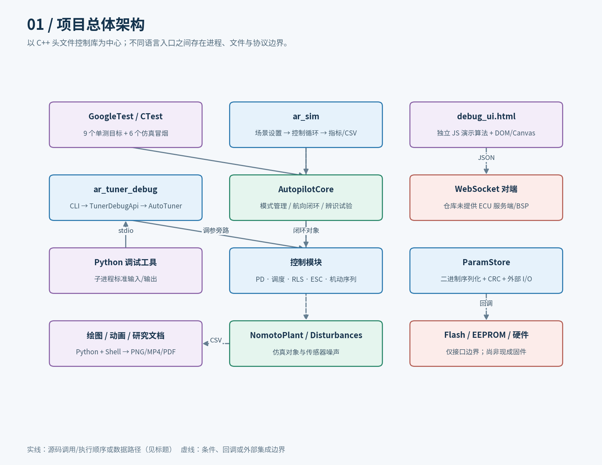

[SVG 源图](figures/01_overview.svg)

## 02 / AutopilotCore::step 模式分派

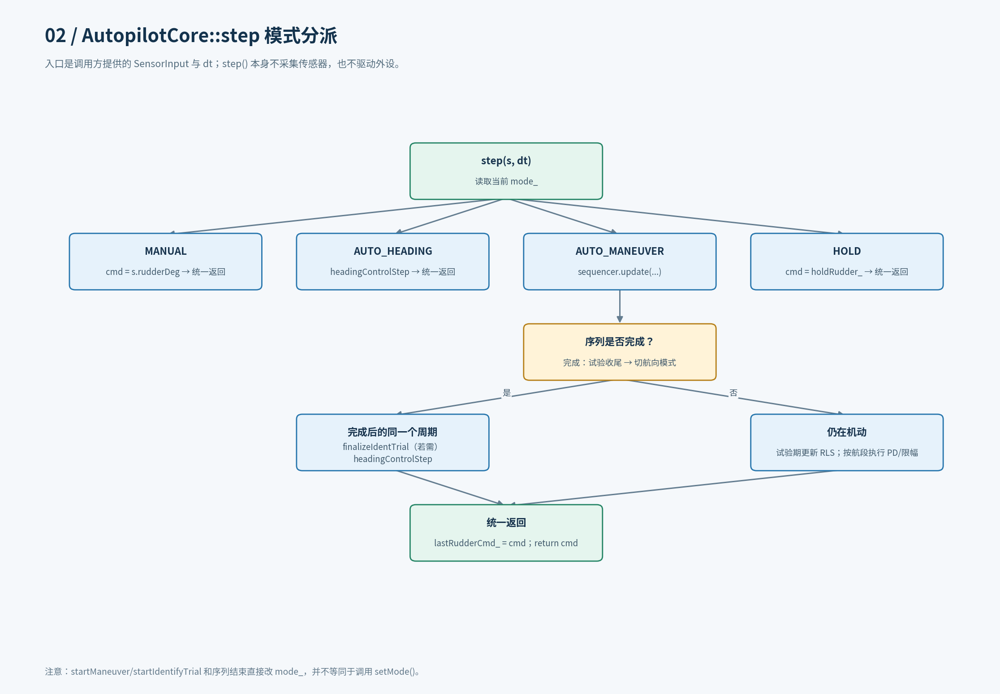

[SVG 源图](figures/02_core_modes.svg)

## 03 / 一个航向控制周期的真实顺序

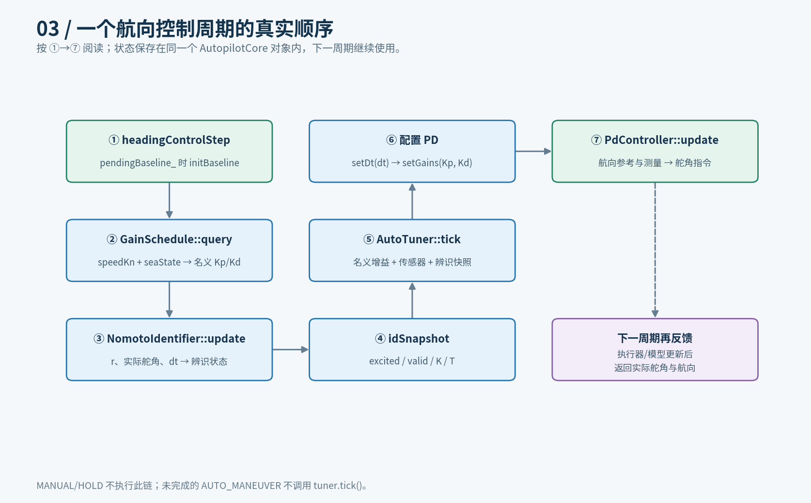

[SVG 源图](figures/03_heading_sequence.svg)

## 04 / PD、增益调度与角度工具

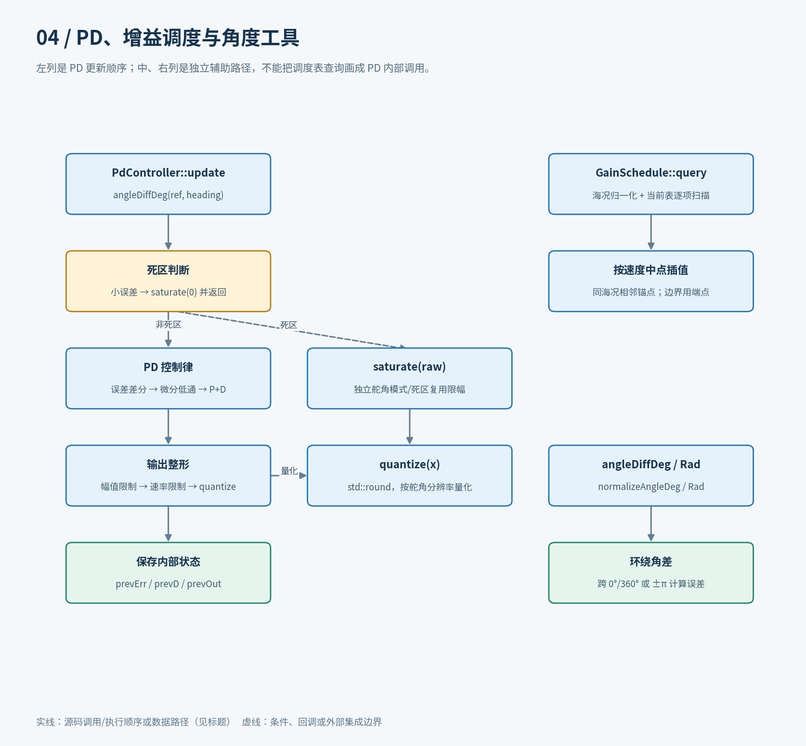

[SVG 源图](figures/04_pd_schedule.svg)

## 05 / NomotoIdentifier::update

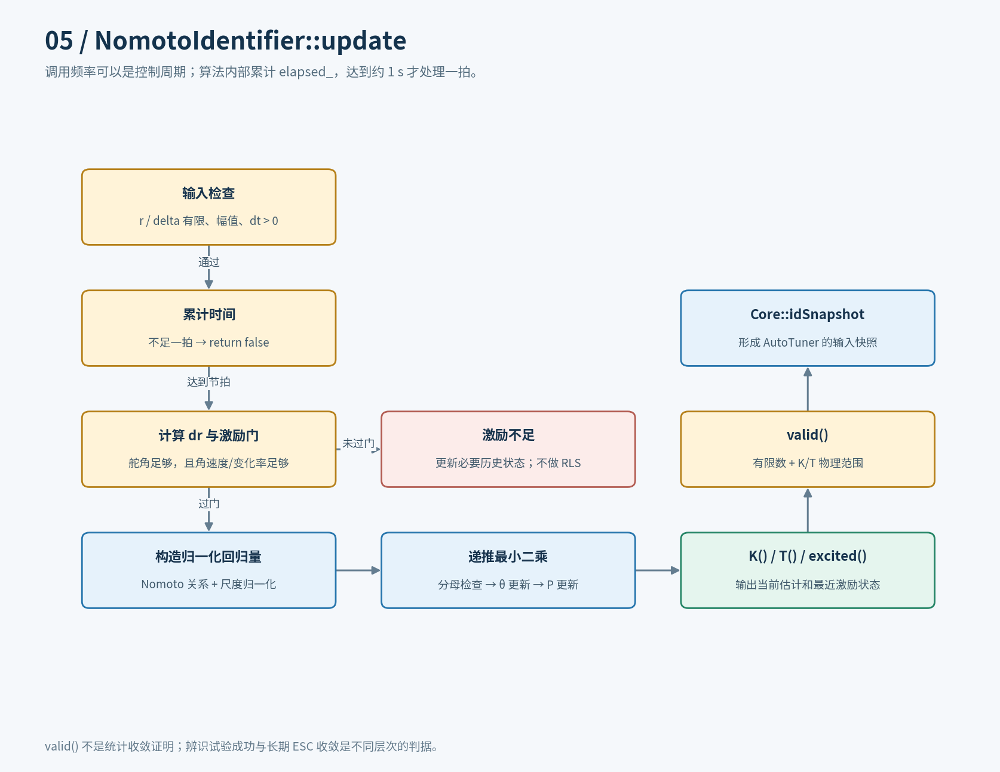

[SVG 源图](figures/05_rls.svg)

## 06 / AutoTuner::tick 总流程

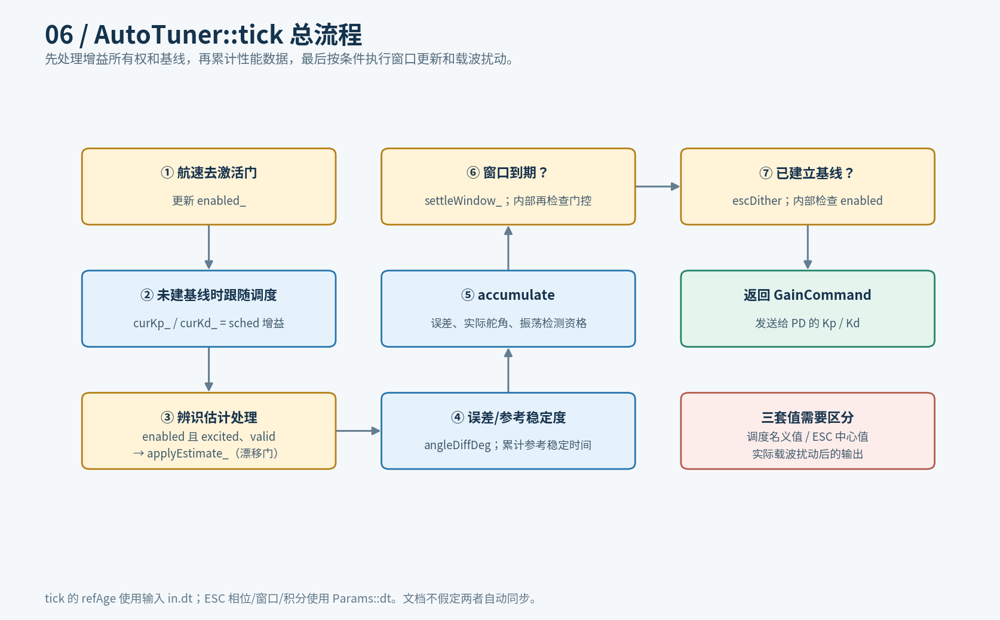

[SVG 源图](figures/06_tuner_tick.svg)

## 07 / 建立基线、重基线与恢复

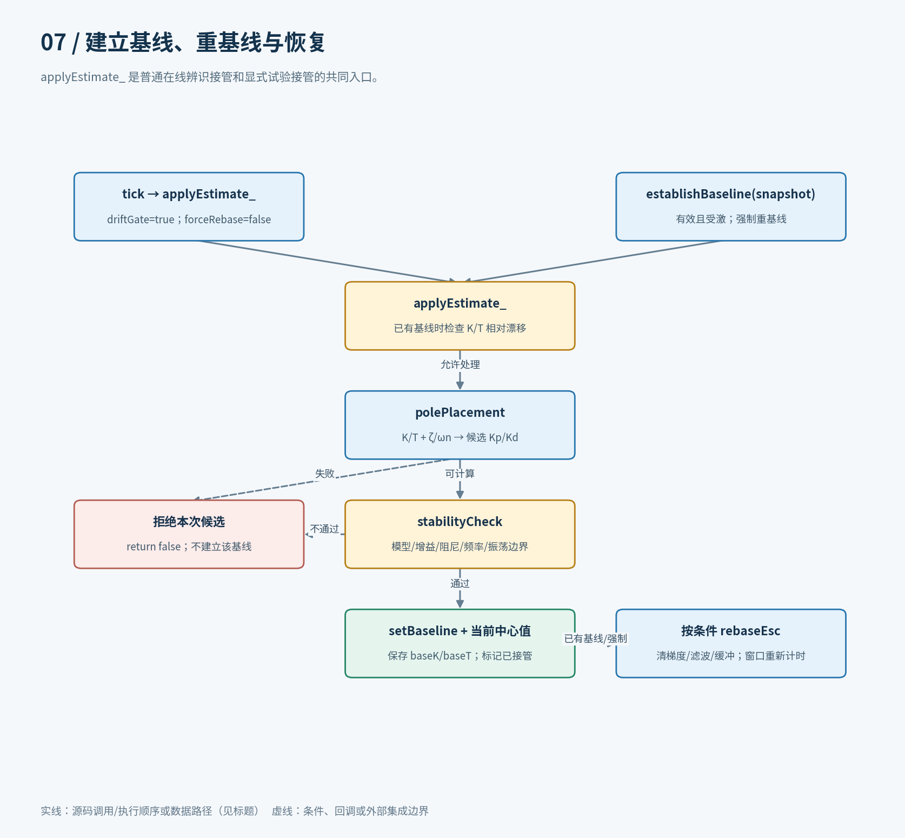

[SVG 源图](figures/07_baseline.svg)

## 08 / ESC：逐样本通道与窗口通道

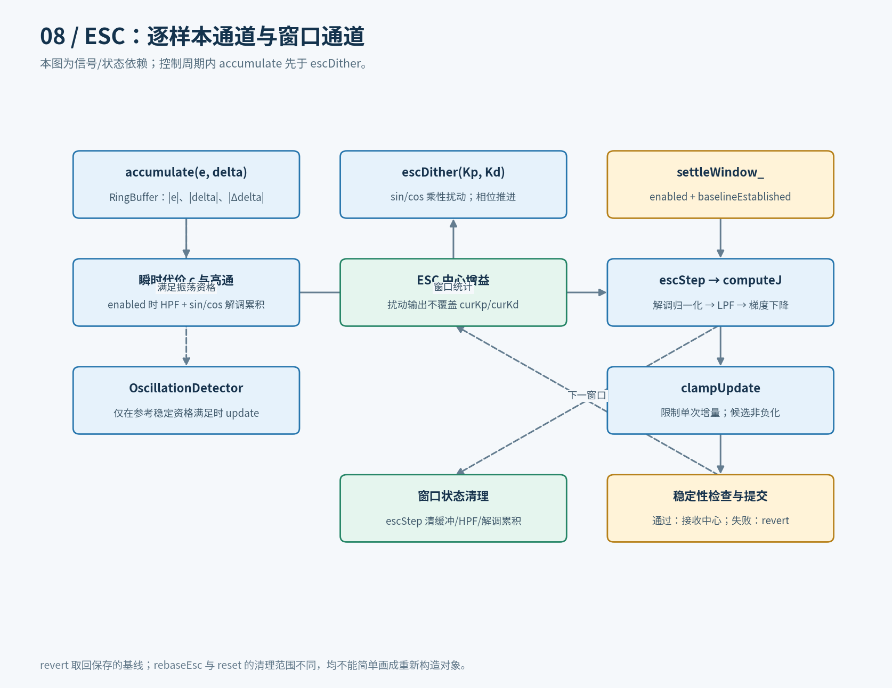

[SVG 源图](figures/08_esc.svg)

## 09 / 机动序列与辨识试验

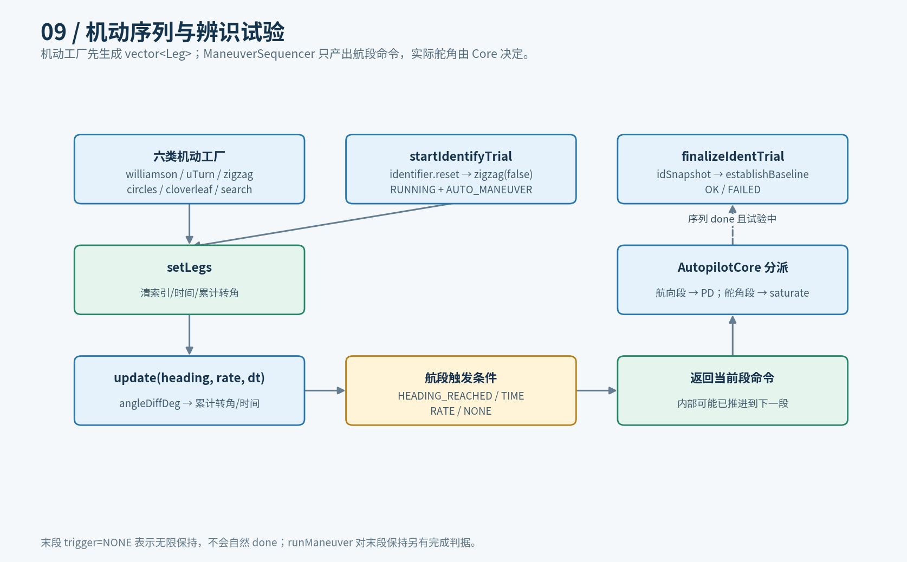

[SVG 源图](figures/09_maneuver.svg)

## 10 / 参数保存与加载：实际调用顺序

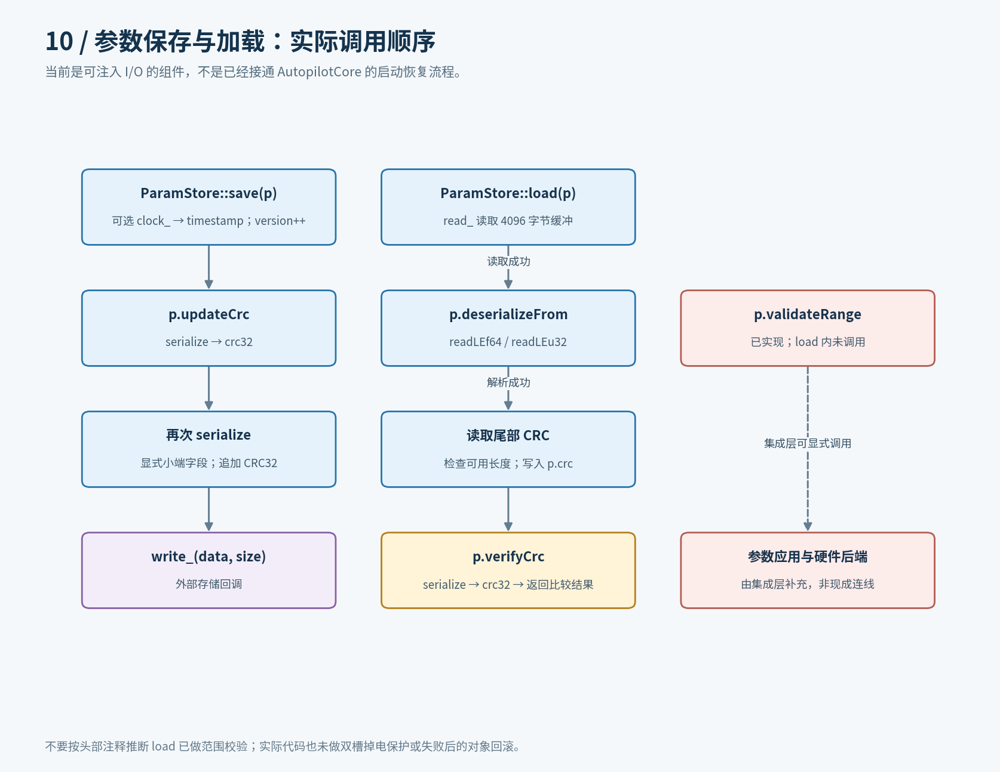

[SVG 源图](figures/10_storage.svg)

## 11 / 仿真主入口与闭环数据

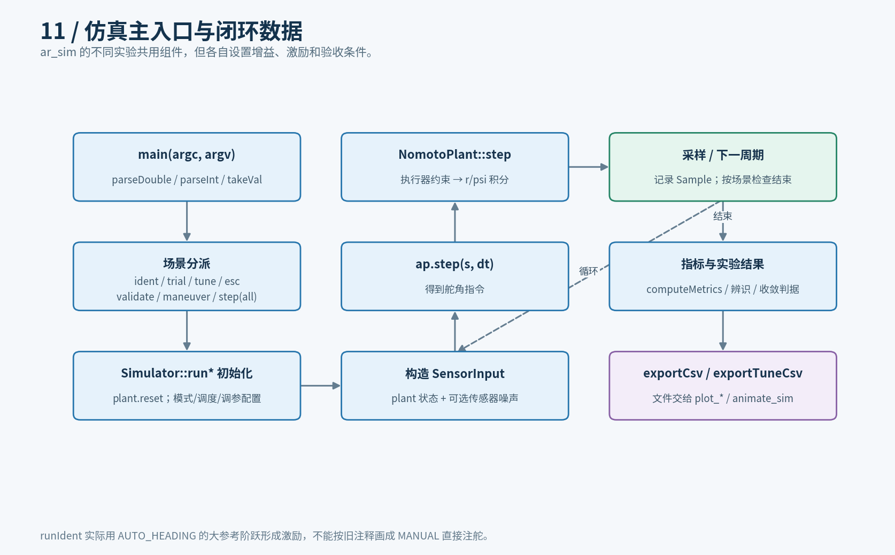

[SVG 源图](figures/11_sim.svg)

## 12 / 调试接口、CLI 与监视器

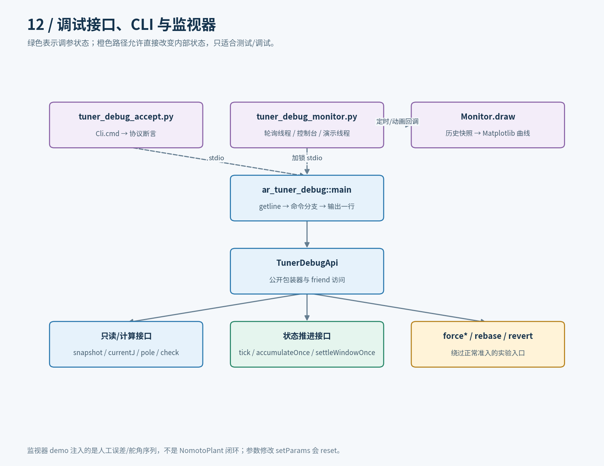

[SVG 源图](figures/12_debug.svg)

## 13 / 网页调试界面：事件调用链

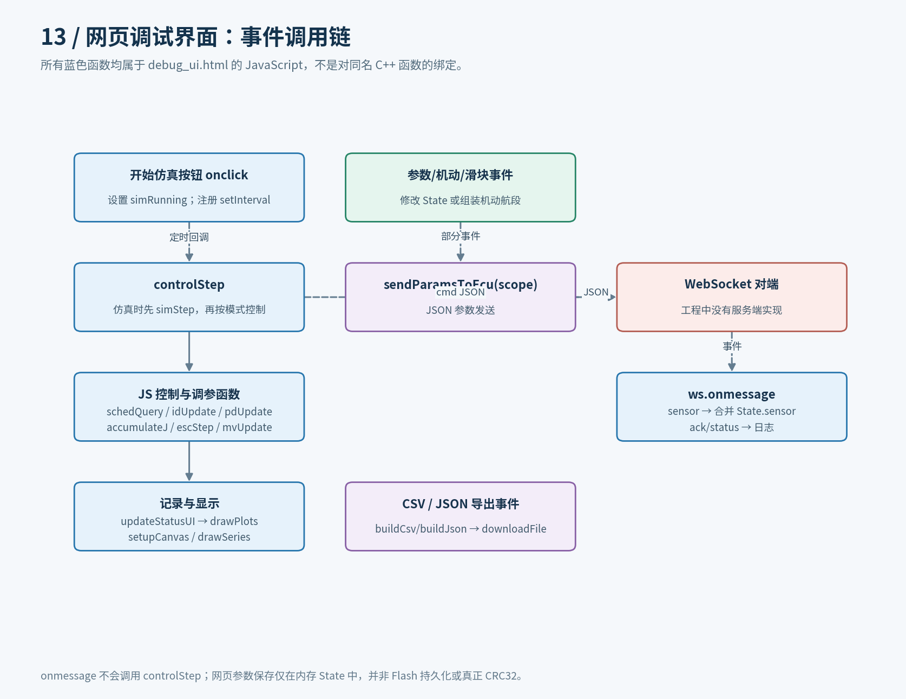

[SVG 源图](figures/13_ui.svg)

## 14 / 测试、离线绘图与文档工具

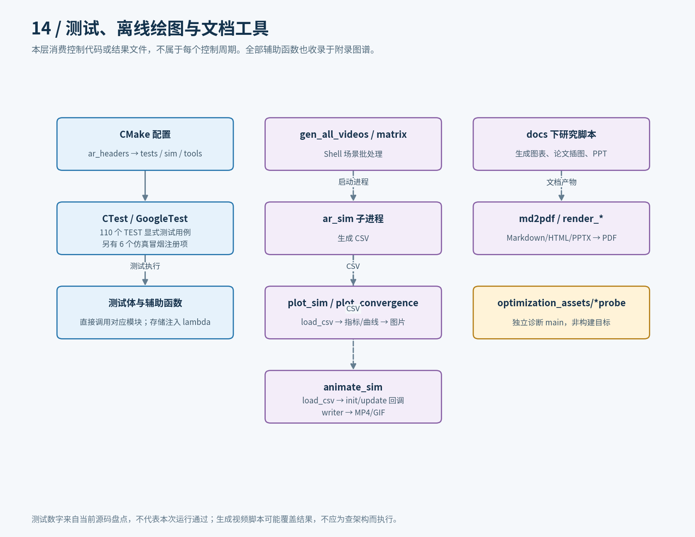

[SVG 源图](figures/14_tools_tests.svg)
