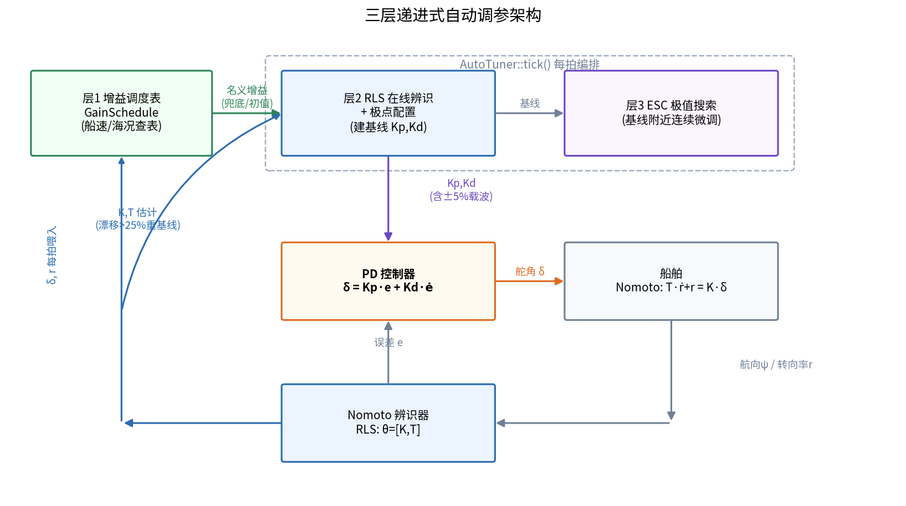
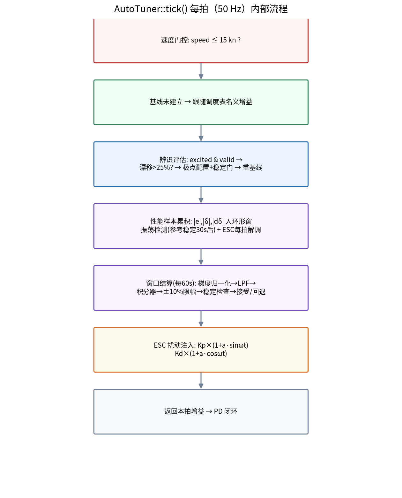
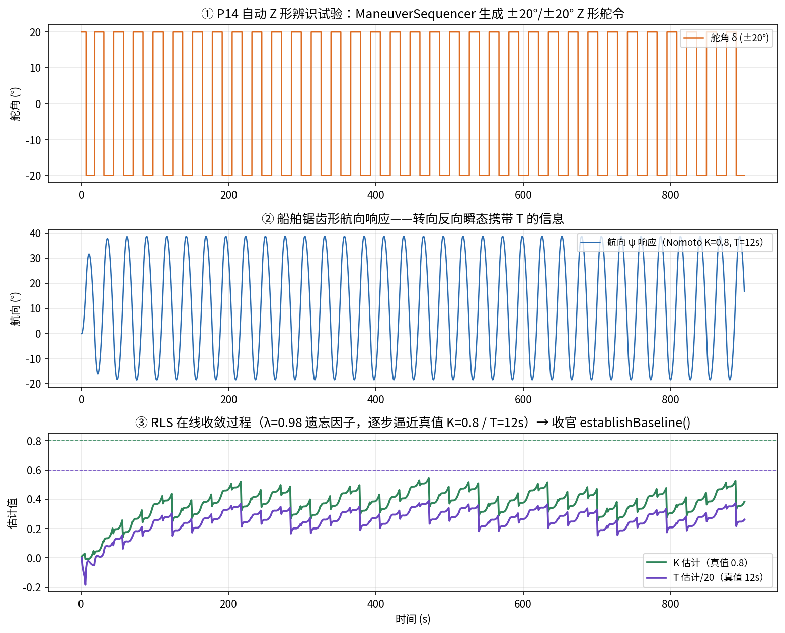
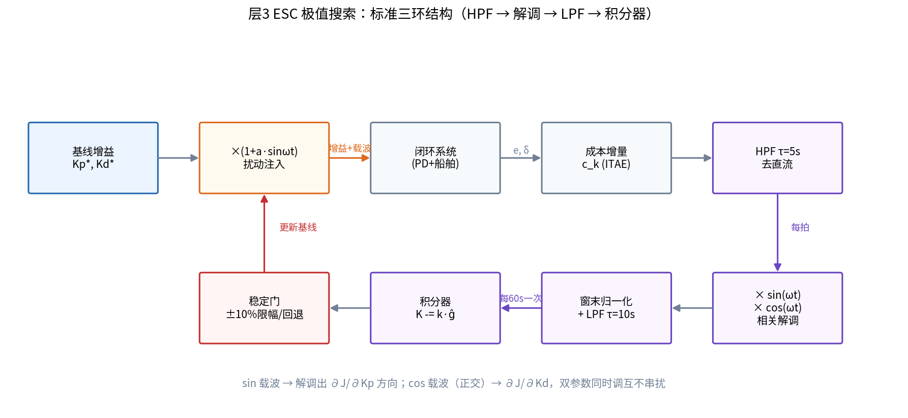

# 自动调参流程图文详解

> 对象工程：`control/`（自动舵控制算法，C++ 头文件库）
> 核心源码：`control/include/auto_tuner.hpp`、`nomoto_identifier.hpp`、`autopilot_core.hpp`
> 配图脚本：`docs/auto_tuning/gen_figures.py`（`python3 gen_figures.py` 可重新生成全部插图）

## 1. 总体架构：三层递进式调参

这套自动舵的增益调参不是单一算法，而是**三层由粗到细、由离线到在线**的结构：

| 层 | 机制 | 源码 | 作用 |
|---|---|---|---|
| 层1 | 增益调度表（查表） | `gain_schedule.hpp` | 按船速/海况给出先验名义增益，兜底 |
| 层2 | RLS 在线辨识 + 极点配置 | `nomoto_identifier.hpp` + `auto_tuner.hpp` | 辨识 Nomoto 模型参数 K、T，解析算出增益，建立"基线" |
| 层3 | ESC 极值搜索 | `auto_tuner.hpp` | 在基线附近注入微小正弦扰动，实测性能梯度，连续微调 |



设计直觉：**调度表保证"不会太差"；辨识+极点配置把增益一次性拉到理论最优点附近（基线）；ESC 再在基线周围做无模型精细寻优**——因为真实船舶和 Nomoto 一阶模型总有偏差，解析解不可能就是最优点。

## 2. 每拍数据流（50 Hz 主循环）

入口是 `AutopilotCore::headingControlStep()`（`autopilot_core.hpp:151`），每个控制周期做四件事：

```
调度表查询 → 喂辨识器 → tuner.tick() → 转发增益给 PD 闭环
```

1. `schedule_.query(speedKn, seaState, Kp, Kd)` —— 查层1名义增益（只是"参考值"，是否采用由调参器决定）
2. `identifier_.update(rudder, rate, dt)` —— 每拍喂辨识器（内部自降频，攒满 1 秒才做一次 RLS 拍）
3. `tuner_.tick({...})` —— 调参器综合所有信息，返回本拍应施加的增益
4. `pd_.setGains(g.Kp, g.Kd); pd_.update(...)` —— PD 控制器用这组增益算舵角

真正的编排逻辑全部收在 `AutoTuner::tick()`（`auto_tuner.hpp:150`）内部：



## 3. 层2：辨识 + 极点配置如何建立基线

### 3.1 基本原理：Nomoto 模型与辨识的回归化

船舶航向保持回路中，艏摇动力学用 **Nomoto 一阶模型**近似：舵角 $\delta$ 是输入，转向率 $r = \dot{\psi}$ 是输出：

$$
T\,\dot{r} + r = K\,\delta
$$

其中 $K$ 是**旋回性指数**（单位舵角产生的稳态转向率，$\mathrm{s^{-1}/deg}$ 量级），$T$ 是**追随性指数**（转向惯性时间常数，s）。对 $\delta$ 取拉氏变换得传递函数：

$$
\frac{r(s)}{\delta(s)} = \frac{K}{Ts + 1}
$$

要做参数估计，需要把微分方程改写成**线性回归形式**。对 $\dot r$ 用后向差分 $\dot r_k \approx (r_k - r_{k-1})/\Delta t$ 离散化：

$$
T\cdot\frac{r_k - r_{k-1}}{\Delta t} + r_k = K\,\delta_k
\;\;\Longrightarrow\;\;
r_k = K\,\delta_k - T\cdot\frac{r_k - r_{k-1}}{\Delta t}
$$

记转向加速度差分项 $dr_k = (r_k - r_{k-1})/\Delta t$，则上式是标准的线性回归 $y_k = \varphi_k^\mathsf{T}\theta$：

$$
y_k = r_k, \qquad
\varphi_k = \left[\,\delta_k,\; -dr_k\,\right]^\mathsf{T}, \qquad
\theta = \left[\,K,\; T\,\right]^\mathsf{T}
$$

$K$、$T$ 以**线性参数**形式出现，可以直接套最小二乘。这正对应 `nomoto_identifier.hpp:4` 的注释与 `update()` 的实现（实际代码对 $\varphi$ 做了归一化，见 §3.2）。

**可辨识性直觉**：稳态直航时 $dr \approx 0$，回归量第二维消失，只有 $r = K\delta$ 一个方程，$T$ 不可辨识——**只有转向反向（$r$ 过零）附近的 $dr$ 瞬态才携带 $T$ 的信息**。这就是为什么激励门控要专门保留高 $dr$ 瞬态（`nomoto_identifier.hpp:64-65`），也是 Z 形试验的设计依据。

### 3.2 基本原理：带遗忘因子的递推最小二乘（RLS）

船舶的 $K$、$T$ 会随航速、载况、水深缓慢变化，需要**在线、带遗忘**的估计。定义指数加权最小二乘目标：

$$
J_{LS}(\theta) = \sum_{i=1}^{k} \lambda^{k-i}\left(y_i - \varphi_i^\mathsf{T}\theta\right)^2,
\qquad 0 < \lambda \le 1
$$

$\lambda$ 为**遗忘因子**（本工程取 0.98）：旧样本权重按 $\lambda$ 几何衰减，估计能跟踪慢时变参数。对该目标递推求解，得到标准 RLS 三件套（`nomoto_identifier.hpp:79-106` 逐行对应）：

$$
\text{增益：}\quad g_k = \frac{P_{k-1}\varphi_k}{\lambda + \varphi_k^\mathsf{T} P_{k-1}\varphi_k}
$$

$$
\text{残差：}\quad e_k = y_k - \varphi_k^\mathsf{T}\theta_{k-1}
$$

$$
\text{更新：}\quad \theta_k = \theta_{k-1} + g_k e_k,
\qquad
P_k = \frac{1}{\lambda}\left(P_{k-1} - g_k\varphi_k^\mathsf{T}P_{k-1}\right)
$$

直觉解读：$g_k$ 是"本拍新信息的权重"——协方差 $P$ 越大（越不确定）、回归量方向越新，增益越大；$\theta$ 沿"预测错了多少"（残差 $e_k$）的方向修正。

工程上的四个关键处理：

- **自降频**：`update()` 可 50 Hz 任意频率调用，内部攒满 `beatSec=1s` 才做一次 RLS 拍，差分 $\Delta t$ 用真实间隔自测——减轻 ECU 负担，保证差分信噪比（`nomoto_identifier.hpp:57-61`）。
- **激励门控**：仅当 $|\delta| > 3°$ 且（$|r| > 0.5°/s$ 或 $|dr| > 0.2°/s²$）才更新，无信息样本不污染 $\theta$。
- **归一化**：$\delta$（几十度量级）与 $dr$（1 度量级）差两个数量级，直接回归会使 $P$ 矩阵病态，故取 $\varphi = [\delta/50,\; -dr/1]$，估计再反归一化：$K = \theta_0/50,\; T = \theta_1/1$。
- **物理合理性检查**：$\hat K \in (0,2]$、$\hat T \in [1,60]\,\mathrm{s}$ 才算 valid（`nomoto_identifier.hpp:119`）。另有 $P$ 对角元下限 $10^{-3}$ 防协方差塌陷，保持长期自适应能力。

### 3.3 Z 形辨识试验（P14）

除正常航行中的渐进辨识外，工程还提供主动试验路径：`startIdentifyTrial()` 自动执行 Z 形机动（±20° 舵 / ±20° 航向，4 循环，由 `ManeuverSequencer::zigzag` 生成），机动期间密集喂辨识器，收官时调 `establishBaseline()` 一次性建基线：



上图为复现仿真：① Z 形舵令；② 船舶锯齿形航向响应——**转向反向的瞬态携带 $T$ 的信息**（稳态段只能定 $K$）；③ RLS 估计逐步逼近真值（每次反舵的锯齿状修正正是 $dr$ 瞬态对 $T$ 估计的校正）。

### 3.4 基本原理：极点配置推导

辨识得到 $K$、$T$ 后，层2 用**极点配置**解析反解 PD 增益。推导如下。

被控对象（舵角 → 航向）由 Nomoto 模型加上积分环节 $\dot{\psi} = r$ 构成：

$$
\frac{\psi(s)}{\delta(s)} = \frac{K}{s(Ts+1)}
$$

控制器为 PD（忽略微分滤波、死区、限幅等实现细节）：$u(s) = (K_p + K_d\,s)\,e(s)$，$e = \psi_{ref} - \psi$。闭环特征方程：

$$
1 + (K_p + K_d\,s)\cdot\frac{K}{s(Ts+1)} = 0
\;\;\Longrightarrow\;\;
Ts^2 + (1 + K K_d)\,s + K K_p = 0
$$

化为首一形式：

$$
s^2 + \frac{1 + K K_d}{T}\,s + \frac{K K_p}{T} = 0
$$

与期望二阶标准形 $s^2 + 2\zeta\omega_n s + \omega_n^2 = 0$ 逐项对照系数：

$$
\omega_n^2 = \frac{K K_p}{T},
\qquad
2\zeta\omega_n = \frac{1 + K K_d}{T}
$$

反解即得 `polePlacement()`（`auto_tuner.hpp:228`）的两条公式：

$$
\boxed{\;K_p = \frac{\omega_n^2\,T}{K},
\qquad
K_d = \frac{2\zeta\omega_n T - 1}{K}\;}
$$

默认目标 $\zeta = 0.85$（小超调、快稳定）、$\omega_n = 0.2\ \mathrm{rad/s}$。注意 $K_d$ 的实现要 clamp 到 $\ge 0$：当 $2\zeta\omega_n T < 1$（小 $T$ 快船）公式给出负值，负 $K_d$ 与阻尼项符号相反，会放大振荡。

`stabilityCheck()`（`auto_tuner.hpp:241`）用的正是上式的**正向形式**——给定任意 $(K_p, K_d)$ 反解闭环极点参数：

$$
\omega_n = \sqrt{\frac{K_p K}{T}},
\qquad
\zeta = \frac{1 + K_d K}{2\sqrt{T K_p K}}
$$

并要求 $\zeta \ge 0.6$、$\omega_n \le 0.5\ \mathrm{rad/s}$，这就是稳定门的代数判据来源。

### 3.5 漂移门控：什么时候重算基线

不是每拍辨识更新都重算极点配置。`applyEstimate_()`（`auto_tuner.hpp:308`）设有 25% 漂移阈值：

- 新 $K$/$T$ 估计相对**建基线时**的 $K$/$T$ 漂移 ≤ 25% → 不动基线，交给 ESC 自己微调；
- 漂移 > 25% → 船况/航速真的变了，显式重基线，同时**清零 ESC 积分器**（`rebaseEsc()`）——旧梯度是围绕旧增益、旧模型测得的，不能施加到新基线上。

## 4. 层3：ESC 极值搜索（本工程最精巧的部分）

ESC（Extremum Seeking Control，极值搜索控制）是**无模型在线优化**：不需要知道 $J$ 对增益的解析梯度，通过"注入扰动 → 观测性能变化 → 相关解调"估出梯度方向，沿负梯度走。

### 4.1 性能指标 J

`computeJ()`（`auto_tuner.hpp:214`）定义 ITAE 型成本：

$$
J = \int_0^{T_w} \Big( t\,|e(t)| + w_U\,|\delta(t)| + w_{Du}\,|\dot\delta(t)| \Big)\,dt
$$

- $t|e|$：ITAE（时间乘绝对误差积分），误差的权重随时间线性增长，重罚收敛慢、鼓励快速镇定；
- $w_U|\delta|$：舵机能耗惩罚（$w_U = 0.01$）；
- $w_{Du}|\dot\delta|$：舵角变化率惩罚（$w_{Du} = 0.005$，保护舵机、抑制抖振）。

### 4.2 基本原理：摄动 ESC 的梯度估计推导

为什么"乘以载波再平均"能估出梯度？推导如下。设被调参数（增益）为 $\theta$，性能 $J(\theta)$ 在最优点 $\theta^\ast$ 附近光滑，取二阶泰勒展开：

$$
J(\theta) \approx J^\ast + \tfrac{1}{2}J''(\theta^\ast)\,(\theta - \theta^\ast)^2
$$

给参数叠加正弦摄动 $\theta(t) = \bar\theta + a\sin\omega t$，代入：

$$
J(t) \approx \Big[ J^\ast + \tfrac{1}{2}J''(\bar\theta - \theta^\ast)^2 \Big] + \Big[ J''(\bar\theta-\theta^\ast)\,a\sin\omega t \Big] + \Big[ \tfrac{1}{4}J''a^2(1-\cos 2\omega t) \Big]
$$

三个方括号项依次为：**直流/慢变项**、**基波（梯度信息）**、**二倍频谐波**。信号链逐级作用：

1. **高通（HPF）**：滤掉直流/慢变项，输出 $\approx J''(\bar\theta-\theta^\ast)\,a\sin\omega t$（谐波远小于基波，忽略）；
2. **乘以同相载波（解调）**：

$$
y_{hpf}\cdot\sin\omega t \approx aJ''(\bar\theta-\theta^\ast)\sin^2\omega t
= \frac{aJ''(\bar\theta-\theta^\ast)}{2}\big(1 - \cos 2\omega t\big)
$$

3. **低通/窗口平均**：$\cos 2\omega t$ 被平均掉，$\overline{\sin^2} = 1/2$，得

$$
\overline{y_{hpf}\sin\omega t} \approx \frac{a}{2}J''(\bar\theta-\theta^\ast)
= \frac{a}{2}\cdot\frac{\partial J}{\partial \theta}\bigg|_{\bar\theta}
$$

即**解调平均值正比于当前点的梯度**。这解释了代码中归一化系数 $\hat g = \frac{2}{aN}\sum y_k\sin\omega t_k$（`auto_tuner.hpp:401-405`）里 2 和 $a$ 的由来——恰好把 $\frac{a}{2}$ 归一掉。

4. **积分器**：$\bar\theta \leftarrow \bar\theta - k\,\hat g$。若 $\bar\theta > \theta^\ast$（最低点右侧），$\hat g > 0$，$\bar\theta$ 左移；反之右移——自动爬向谷底。

**双参数同时调**：$K_p$ 载波取 $\sin\omega t$、$K_d$ 取 $\cos\omega t$，由正交性 $\overline{\sin\omega t\cos\omega t} = 0$，两路解调互不串扰，一次扰动同时估出 $\partial J/\partial K_p$ 与 $\partial J/\partial K_d$。

**时间尺度三分离**是 ESC 成立的前提：

$$
\text{闭环动态（秒级）} \;\ll\; \text{载波 } 1/\omega \text{（百秒级）} \;\ll\; \text{积分器适应（多窗口）}
$$

载波必须慢到闭环能"跟上"扰动（否则 $J$ 来不及响应，梯度信号衰减），又要快到船况漂移之前完成估计。本工程 $\omega = 0.05\ \mathrm{rad/s}$（周期约 126 s）、窗口 60 s，正是按这个权衡取的。

### 4.3 标准三环结构的工程实现

经典摄动式 ESC 的信号链 **HPF → 解调 → LPF → 积分器**，本工程一个不少：



1. **扰动注入**（`escDither`，`auto_tuner.hpp:382`）：每拍（50 Hz）把增益乘上载波
   ```
   Kp *= 1 + a·sin(ωt)
   Kd *= 1 + a·cos(ωt)     a=5%, ω=0.05 rad/s
   ```
   扰动只存在于输出给 PD 的增益里，不持久化到 `curKp_`。

2. **因果解调**（`accumulate`，`auto_tuner.hpp:354`）：每拍计算成本增量 $c_k$（与 computeJ 被积函数一致），一阶高通去直流（后向欧拉离散，$\alpha_H = \tau_H/(\tau_H + dt)$，$\tau_H = 5\,\mathrm{s}$），再乘 sin/cos 载波累加：
   ```
   demodKpSum += hpf(c_k) · sin(ωt_k)
   demodKdSum += hpf(c_k) · cos(ωt_k)
   ```

3. **窗口结算**（`escStep`，`auto_tuner.hpp:395`）：每 60 秒（3000 拍）结算一次：
   - 归一化 $\hat g = 2\sum(y_k\cdot载波)/(aN)$ 得梯度估计；
   - LPF 平滑（系数按窗口周期折算：$\alpha_L = T_w/(\tau_L + T_w)$，$\tau_L = 10\,\mathrm{s}$）；
   - 积分器 $\theta \leftarrow \theta - k\hat g$ 梯度下降（$k = 0.02$）；
   - 单次更新 ≤ 旧值 10%（并有绝对下限 $10^{-3}$，防止旧值为 0 时比例上限锁死更新）；
   - 清空本窗样本，下一窗从零开始（非重叠窗）。

### 4.4 数值演示

下图用与 `auto_tuner.hpp` 完全相同的算法链做的 Python 复现演示（载波频率调高以便单窗可视化）：未知成本曲面 $J(K_p)$ 的最优点在 1.3，ESC 从 $K_p = 2.0$ 出发，**不看曲面、只靠扰动-解调估梯度**，约 6 个窗口（6 分钟）收敛到最优点：


- ① 橙点为 ESC 在（对它不可见的）成本曲面上的爬行轨迹；
- ② 增益每 60 s 窗口更新一次，步长被 10% 限幅钳制，平滑逼近 1.3；
- ③ 窗口内实际施加的增益 = 基线 × (1 + 5%·sinωt)；
- ④ 解调+LPF 后的梯度估计：$K_p$ 高于最优时 $\hat g > 0$（该减），接近最优时 $\hat g \to 0$——与 §4.2 推导的符号关系完全一致。

### 4.5 P11 整改的教训（源码注释里最有价值的一段）

`auto_tuner.hpp:8-12` 记录了旧实现的致命 bug：扰动实际没注入（窗口内增益恒定），且 HPF/LPF 系数按 dt=0.02s 设计却用在 60 秒才来一个的样本上，梯度被衰减 2~3 个数量级——**调参结果与初值逐位相同，ESC 完全没在干活**。

对照 §4.2 的推导可以看清两类错误的本质：

- **不注入扰动**：$J(t)$ 里没有基波分量，解调输出恒为零，"梯度"没有因果来源；
- **滤波器时基用错**：HPF 设计于拍级 $dt$、LPF 设计于窗口级 $T_w$，混用后 $\alpha$ 偏离设计值几个数量级，梯度信号在滤波环节被衰减殆尽。

这是 ESC 工程化的经典陷阱：三个环节运行在**不同时间尺度**（扰动/解调在每拍，LPF 在窗口末），滤波器系数必须用各自环节的真实采样周期计算。

## 5. 安全机制：四道防线与生命周期

自动改增益是危险操作，工程上层层设防：

1. **稳定门**（`stabilityCheck`，`auto_tuner.hpp:241`）：任何新增益被接受前，按 §3.4 的正向公式反解闭环 $\zeta$、$\omega_n$，要求 $\zeta \ge 0.6$、$\omega_n \le 0.5\ \mathrm{rad/s}$、振荡幅值 ≤ 5°，全过才放行；
2. **回退**（`settleWindow_`，`auto_tuner.hpp:333`）：ESC 窗口更新后稳定门不过 → `revert()` 恢复基线——基线永远是"已验证安全"的锚点；
3. **振荡检测**（`OscillationDetector`，`auto_tuner.hpp:257`）：基于航向误差过零点测峰-峰幅值，且**航向参考稳定满 30 秒后才喂入**——参考机动期间的误差摆动是指令响应而非闭环振荡，混入会误判；
4. **速度门控**：船速 > 15 kn 时调参整体去激活。


生命周期要点：

- **两条建基线路径**：在线渐进（漂移超阈值自动重基线）与 Z 形试验收官（`establishBaseline()`，不做漂移检查，osc 以 0 传入由 $\zeta$/$\omega_n$ 代数条件把关）；
- **模式切换**：切到 MANUAL/HOLD 时 `suspend()`——清掉全部测量状态（窗口样本、解调累积、HPF、梯度）但**保留基线增益与基线 $K$/$T$**，避免手动操舵的旧数据混进下一窗口，回来又能从基线无缝续上；
- **重基线必清 ESC 积分器**：陈旧梯度不能跨基线使用。

## 6. 设计经验总结

1. **三层结构各司其职**：先验表兜底 → 模型解析解快速到位 → 无模型寻优吃掉模型误差，比单层方法既快又稳。
2. **增益所有权必须唯一**：P11/P12/P14 的 bug 全诞生在编排逻辑散在调用方的时代（调度表每拍覆盖 ESC 增益、计数器两边各一份）。R1 整改把节拍、窗口、门控、所有权全部收进 `AutoTuner`，对外只剩 `tick()` / `establishBaseline()` / `suspend()` 三个动作。
3. **ESC 的时间尺度陷阱**：每个滤波器用各自环节的真实采样周期；扰动必须真实注入被调参数。
4. **测量门控与算法同等重要**：激励门控、振荡门控、速度门控——知道"什么时候数据不可信"是工程化的核心。

## 7. 延伸阅读

- 单元测试：`control/tests/test_auto_tuner.cpp`（上述各机制的行为断言）、`control/tests/test_nomoto_identifier.cpp`
- 设计文档：`control/控制算法开发文档.md` §3.9~§3.10、`control/控制算法代码说明文档.md`
- 仿真验证：`control/sim/simulator.hpp` + `control/tests/test_autopilot_core.cpp`
