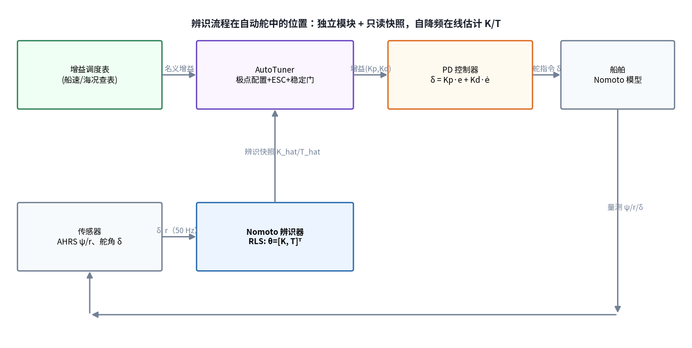
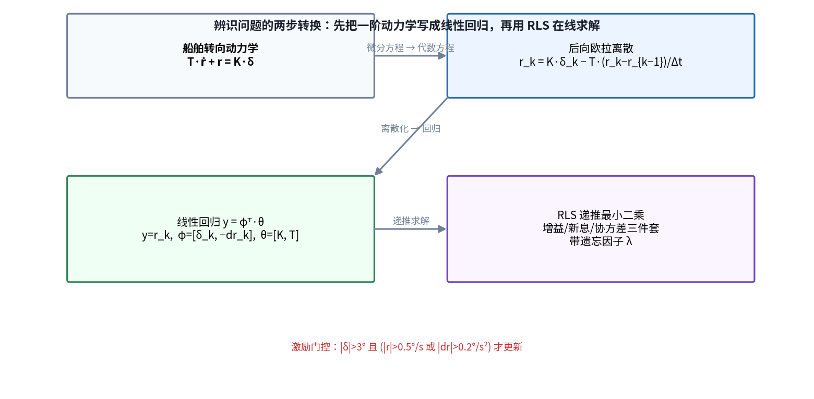
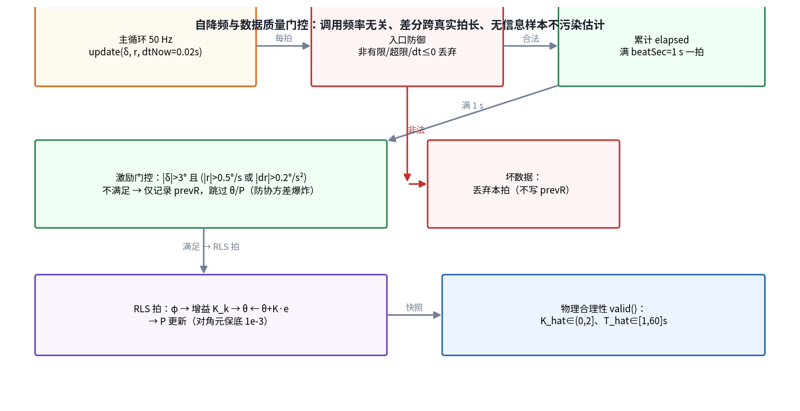
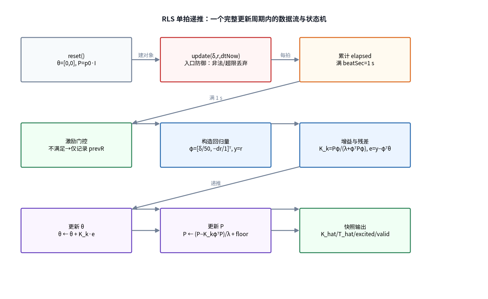
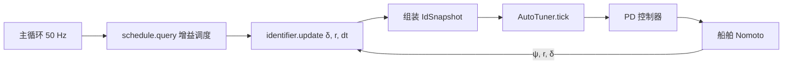
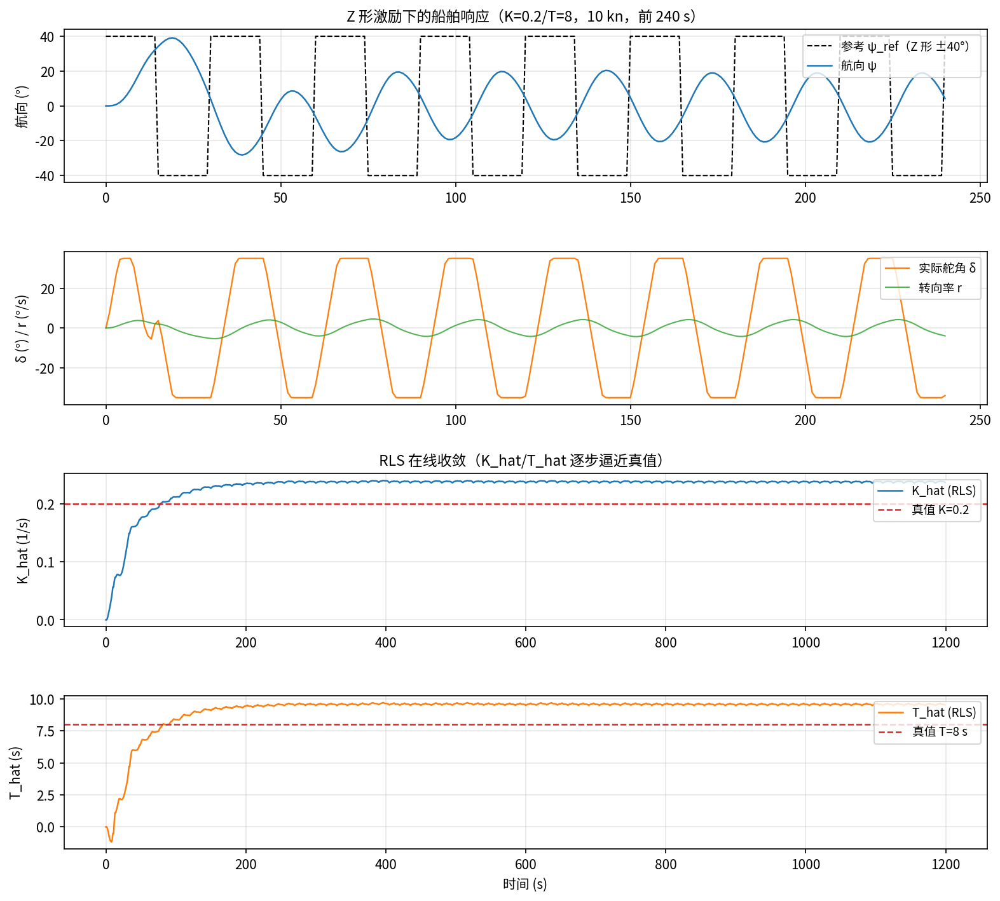
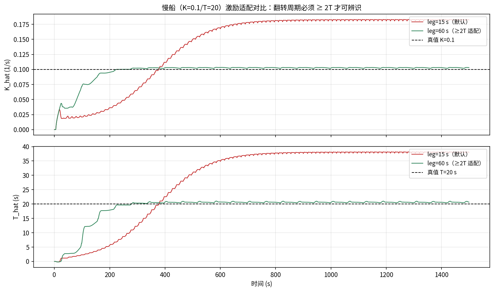

# 辨识流程原理推导与工作流程

> 对象工程：`control/`（自动舵控制算法，C++ 头文件库）
> 核心源码：`control/include/nomoto_identifier.hpp`、`auto_tuner.hpp`、`autopilot_core.hpp`
> 配套仿真：`control/sim/simulator.hpp`（`runIdent` / `runIdentTrial` / `runTuneConvergence`）
> 配图脚本：`docs/auto_tuning/gen_ident_figures.py`
> 版本日期：2026-08-06

## 1. 辨识流程在自动舵中的位置

自动舵的自动调参采用"调度表 → 模型辨识 → 极值搜索"三层结构。**辨识流程**承担最关键的模型层：从舵角 δ 与转首率 r 的实测数据中，在线估计 Nomoto 一阶模型的两个参数——旋回性指数 K 与追随性指数 T。估计结果经只读快照（`IdSnapshot`）交给 `AutoTuner`，后者用极点配置把 $\hat K$/$\hat T$ 换算成 PD 增益基线，再交由 ESC 在线微调。

设计要点：辨识器保持**独立模块**，`AutopilotCore` 每拍喂数据并组装快照，`AutoTuner` 不持有辨识器——模块边界清晰，单测可以分别驱动。

## 2. 被辨识对象：Nomoto 一阶模型

### 2.1 模型方程

船舶艏摇动力学常用 Nomoto 一阶模型近似：舵角 $\delta$ 是输入，转向率 $r=\dot\psi$ 是输出：

$$
T\,\dot r + r = K\,\delta
$$

其中：

| 参数 | 名称 | 物理含义 | 量纲 | 典型范围 |
|---|---|---|---|---|
| $K$ | 旋回性指数 | 单位舵角产生的稳态转向率 | $\mathrm{s^{-1}}$ | $(0, 2]$ |
| $T$ | 追随性指数 | 转向惯性的时间常数 | $\mathrm{s}$ | $[1, 60]$ |

对 $\delta$ 取拉氏变换（零初值），得到一阶惯性环节：

$$
\frac{r(s)}{\delta(s)} = \frac{K}{Ts+1}
$$

加上航向积分环节 $\dot\psi = r$，舵角到航向的传递函数为：

$$
\frac{\psi(s)}{\delta(s)} = \frac{K}{s\,(Ts+1)}
$$

### 2.2 为什么要辨识 K/T

K 与 T 随船速、载况、水深、风浪状态缓慢变化。增益调度表只能给出"先验名义值"，而极点配置公式：

$$
K_p = \frac{\omega_n^2\,\hat T}{\hat K}, \qquad
K_d = \frac{2\zeta\omega_n\,\hat T - 1}{\hat K}
$$

依赖准确的 $\hat K$、$\hat T$。因此需要在线辨识持续跟踪模型参数——这正是辨识流程的工程价值。

## 3. 原理推导（一）：从微分方程到线性回归

### 3.1 后向欧拉离散

对 $\dot r$ 采用后向差分近似（$\Delta t$ 为采样间隔）：

$$
\dot r_k \approx \frac{r_k - r_{k-1}}{\Delta t}
$$

代入 Nomoto 方程：

$$
T\,\frac{r_k - r_{k-1}}{\Delta t} + r_k = K\,\delta_k
$$

移项整理成"输出 = 回归量 × 参数"的形式：

$$
r_k = K\,\delta_k - T\,\frac{r_k - r_{k-1}}{\Delta t}
$$

记转向加速度差分项 $dr_k = (r_k - r_{k-1})/\Delta t$，则上式是一个标准线性回归：

$$
y_k = \varphi_k^{\mathsf T}\,\theta
$$

其中：

$$
y_k = r_k, \qquad \varphi_k = \begin{bmatrix} \delta_k \\ -dr_k \end{bmatrix}, \qquad \theta = \begin{bmatrix} K \\ T \end{bmatrix}
$$

**关键点**：K、T 以线性参数形式出现，可以直接套最小二乘类算法，无需非线性优化。

### 3.2 可辨识性：为什么 T 依赖瞬态

稳态直航时 $dr \approx 0$，回归量第二维消失，只剩：

$$
r_k = K\,\delta_k
$$

此时只能定出 K（稳态增益），T 完全不可辨识。**T 的信息只藏在转向反向（r 过零）附近的高 $dr$ 瞬态里**。这就是激励门控要专门保留高 $dr$ 样本、Z 形试验要反复"换舵"的设计依据。

## 4. 原理推导（二）：带遗忘因子的 RLS

### 4.1 优化目标

船舶参数慢变，希望"旧数据逐渐遗忘、新数据主导"。定义指数加权最小二乘目标：

$$
J_{LS}(\theta) = \sum_{i=1}^{k} \lambda^{\,k-i}\,\bigl(y_i - \varphi_i^{\mathsf T}\theta\bigr)^2,
\qquad 0 < \lambda \le 1
$$

$\lambda$ 为遗忘因子（本工程取 0.98）：第 $i$ 个样本的权重为 $\lambda^{k-i}$，越旧衰减越厉害。

### 4.2 批处理正规方程（推导的起点）

> 为让递推公式"有根"，先回顾离线最小二乘。为简化符号，本小节先取 $\lambda=1$（不遗忘），递推式在第 4.4 节再补回遗忘因子。

对 $J_{LS}$ 求梯度并置零：

$$
\frac{\partial J_{LS}}{\partial \theta}
= -2\sum_{i=1}^{k}\varphi_i\,\bigl(y_i - \varphi_i^{\mathsf T}\theta\bigr) = 0
$$

展开得正规方程：

$$
\Bigl(\sum_{i=1}^{k}\varphi_i\varphi_i^{\mathsf T}\Bigr)\theta
= \sum_{i=1}^{k}\varphi_i\,y_i
$$

记信息矩阵 $R_k = \sum_{i=1}^{k}\varphi_i\varphi_i^{\mathsf T}$、互相关向量 $Q_k = \sum_{i=1}^{k}\varphi_i y_i$，则：

$$
\theta_k = R_k^{-1}\,Q_k
$$

### 4.3 递推化：新样本只做增量修正

第 $k$ 步与第 $k-1$ 步的关系为：

$$
R_k = R_{k-1} + \varphi_k\varphi_k^{\mathsf T}, \qquad
Q_k = Q_{k-1} + \varphi_k\,y_k
$$

直接对 $R_k$ 求逆代价高，使用**矩阵求逆引理**（Sherman–Morrison–Woodbury）：

$$
\bigl(A + uu^{\mathsf T}\bigr)^{-1}
= A^{-1} - \frac{A^{-1}uu^{\mathsf T}A^{-1}}{1 + u^{\mathsf T}A^{-1}u}
$$

令 $P_k = R_k^{-1}$、$u = \varphi_k$、$A = R_{k-1}$，得：

$$
P_k = P_{k-1} - \frac{P_{k-1}\,\varphi_k\varphi_k^{\mathsf T}P_{k-1}}
{1 + \varphi_k^{\mathsf T}P_{k-1}\varphi_k}
$$

定义**卡尔曼增益**：

$$
g_k = \frac{P_{k-1}\,\varphi_k}{1 + \varphi_k^{\mathsf T}P_{k-1}\varphi_k}
$$

则协方差更新可简写为：

$$
P_k = P_{k-1} - g_k\,\varphi_k^{\mathsf T}P_{k-1}
$$

参数更新由 $\theta_k = P_k Q_k$ 展开：

$$
\begin{aligned} \theta_k &= (P_{k-1} - g_k\varphi_k^{\mathsf T}P_{k-1})(Q_{k-1} + \varphi_k y_k) \\ &= P_{k-1}Q_{k-1} + P_{k-1}\varphi_k y_k - g_k\varphi_k^{\mathsf T}P_{k-1}Q_{k-1} - g_k\varphi_k^{\mathsf T}P_{k-1}\varphi_k y_k \end{aligned}
$$

注意到 $\theta_{k-1} = P_{k-1}Q_{k-1}$ 且 $g_k = P_{k-1}\varphi_k\,/(1 + \varphi_k^{\mathsf T}P_{k-1}\varphi_k)$，代入整理：

$$
\theta_k = \theta_{k-1} + g_k\Bigl(y_k - \varphi_k^{\mathsf T}\theta_{k-1}\Bigr)
$$

其中 $e_k = y_k - \varphi_k^{\mathsf T}\theta_{k-1}$ 是**新息（残差）**。于是得到标准 RLS 三件套：

$$
\boxed{\; \begin{aligned} g_k &= \frac{P_{k-1}\,\varphi_k}{\lambda + \varphi_k^{\mathsf T}P_{k-1}\varphi_k} \\[2mm] e_k &= y_k - \varphi_k^{\mathsf T}\theta_{k-1} \\[2mm] \theta_k &= \theta_{k-1} + g_k\,e_k \\[2mm] P_k &= \frac{1}{\lambda}\Bigl(P_{k-1} - g_k\,\varphi_k^{\mathsf T}P_{k-1}\Bigr) \end{aligned} \;}
$$

### 4.4 遗忘因子 $\lambda$ 的落点

回到第 4.1 节的目标函数，$\lambda$ 使信息矩阵变成：

$$
R_k = \lambda R_{k-1} + \varphi_k\varphi_k^{\mathsf T}
$$

即旧信息整体乘 $\lambda$ 衰减。递推式中对应两处：

- 增益分母出现 $\lambda$：$g_k = \dfrac{P_{k-1}\varphi_k}{\lambda + \varphi_k^{\mathsf T}P_{k-1}\varphi_k}$；
- 协方差更新乘 $1/\lambda$：$P_k = \dfrac{1}{\lambda}\bigl(P_{k-1} - g_k\varphi_k^{\mathsf T}P_{k-1}\bigr)$。

直觉：$g_k$ 是"本拍新信息的权重"——$P$ 越大（越不确定）、回归量方向越新，$g_k$ 越大；$\theta$ 沿"预测错了多少"（$e_k$）的方向修正。$\lambda=0.98$ 时，约 34 个样本后旧权重衰减到 50%（$0.98^{34}\approx0.50$），兼顾跟踪速度与噪声抑制。

### 4.5 归一化：消除量级病态

$\delta$ 是几十度量级，$dr$ 通常 1 度量级，直接回归会让 $P$ 矩阵条件数恶化。实现中做尺度归一化：

$$
\varphi_k = \begin{bmatrix} \delta_k / 50 \\ -dr_k / 1 \end{bmatrix}
$$

估计结果再反归一化：

$$
K = \theta_0 / 50, \qquad T = \theta_1 / 1
$$

这样两个回归量都是 O(1)，$P$ 矩阵保持良态。

## 5. 工程化设计：让 RLS 在实船上可靠

### 5.1 自降频（self-decimation）

主循环 50 Hz 调用 `update(δ, r, dtNow)`，但 RLS 拍固定在 1 s 一次（`beatSec`）。模块内部累计真实间隔 `elapsed`，满 1 s 才递推一次；差分 $\Delta t$ 取**两次 RLS 拍之间的真实间隔**（自测），与调用频率无关。这同时解决了两件事：减轻 ECU 负担、保证差分信噪比。

### 5.2 激励门控

$$
\text{更新条件：}\quad |\delta| > 3° \ \wedge\ \bigl(|r| > 0.5°/s \ \vee\ |dr| > 0.2°/s^2\bigr)
$$

原因有二：

1. **防协方差爆炸**：直航时 $\varphi \approx 0$，若仍更新，$P \leftarrow P/\lambda$ 每拍放大 2%，重新激励时 $\theta$ 会剧烈跳变；
2. **保可辨识性**：只有高 $dr$ 瞬态（反舵过零附近）才携带 T 的信息，门控把它们筛出来。

### 5.3 坏数据防御

入口对每次调用做范围与有限性检查：非有限值、$|\delta|>35°$、$|r|>30°/s$、$dt\le0$ 一律丢弃，且**被拒绝的拍不写 `prevR_`**——否则毛刺会成为下一拍差分锚点，经门控进入回归后永久毒化 θ/P。

### 5.4 物理合理性检查

估计结果必须满足：

$$
K \in (0, 2], \qquad T \in [1, 60]\,\mathrm{s}
$$

越界即 `valid()=false`，调参器不会把该结果送入极点配置（保守拒绝）。

## 6. 工作流程梳理

### 6.1 RLS 单拍状态机

每次 `update()` 调用经历：入口防御 → 累计节拍 → 激励门控 → 构造回归量 → 计算增益与残差 → 更新 θ/P → 输出快照。被拒路径（未满拍、未激励、非法输入）不触碰 θ/P。

### 6.2 每拍数据流（生产主循环）

### 6.3 辨识结果的两条应用路径

辨识快照不是"每拍都生效"，而是经两条受控路径进入调参器：

1. **tick 周期评估**：每拍检查快照，$\hat K$/$\hat T$ 相对基线漂移 ≤25% 时交给 ESC 自治（不动基线）；漂移超阈值才显式重基线并重锚 ESC（P12）。
2. **Z 形辨识试验收官**（P14）：`startIdentifyTrial(dz, phiz, cycles)` 自动执行 Z 形机动，期间密集喂辨识器；机动结束调 `establishBaseline()` 一次性评估并建基线（不做漂移检查，osc 以 0 把关）。

两条路径共享同一评估实现 `applyEstimate_()`：极点配置 → 稳定门（ζ≥0.6、ωn≤0.5 rad/s、振荡≤5°）→ 建立/重锚基线。

### 6.4 收敛性验证（仿真数据）

以下数据来自 `ar_sim --tune`（Z 形 ±40°/15 s 参考，50 Hz 闭环，K=0.2/T=8、10 kn）：

判据与结果：

| 判据 | 阈值 | 结果 |
|---|---|---|
| $\hat K$ 偏差 | ≤ 25% | +18.2%（有效收敛） |
| $\hat T$ 偏差 | ≤ 25% | +18.5%（有效收敛） |
| 物理合理 | `valid()=true` | 通过 |
| 基线建立 | `baselineEstablished()=true` | t=13 s 建立 |

### 6.5 边界：慢船激励适配

辨识的可辨识性受激励时间尺度约束：Z 形翻转周期必须覆盖船的时间常数（建议 ≥ 2T）。K=0.1/T=20 的慢船，默认 15 s 翻转只让船停留在初始瞬态，$\hat K$/$\hat T$ 系统性偏大（+81%/+89%）；放大到 60 s 后误差降至 +3%/+3%。

该案例同时说明稳定门的作用：早期基线质量差导致振荡幅值超限时，稳定门按设计**阻断**重基线/ESC，不会把危险增益施加到船上。

## 7. 代码位置速查

| 环节 | 位置 | 关键符号 |
|---|---|---|
| Nomoto 离散与回归 | `nomoto_identifier.hpp` | `φ=[δ/50, -dr/1]^T` |
| RLS 递推 | `nomoto_identifier.hpp` | `theta_[2]`、`P_[2][2]`、`lambda=0.98` |
| 自降频 | `nomoto_identifier.hpp` | `elapsed_`、`beatSec` |
| 激励门控 | `nomoto_identifier.hpp` | `deltaMin/rMin/drMin` |
| 物理合理性 | `nomoto_identifier.hpp` | `valid()` |
| 快照 | `auto_tuner.hpp` | `IdSnapshot{excited,valid,K,T}` |
| 漂移门/重基线 | `auto_tuner.hpp` | `kReBaselineTol=0.25` |
| 极点配置 | `auto_tuner.hpp` | `polePlacement()` |
| Z 形试验 | `autopilot_core.hpp` | `startIdentifyTrial()`、`establishBaseline()` |
| 仿真与数据 | `simulator.hpp` | `runIdent/runIdentTrial/runTuneConvergence` |

## 8. 局限与后续

1. **激励依赖**：辨识质量强依赖激励设计（幅值、翻转周期、循环数），慢船需按 T 缩放（≥2T）；自适应激励（按当前 $\hat T$ 调整 leg）可作为后续项；
2. **参数慢变跟踪**：λ=0.98 的跟踪带宽有限，剧烈工况切换（如航速突变 >2 kn）建议显式触发重基线；
3. **噪声敏感**：当前实现没有对量测做滤波，高海况下可评估输入预滤波（如对 r 做一阶低通）后再喂 RLS；
4. **单模型假设**：Nomoto 一阶模型对低频艏摇拟合良好，高频横荡/耦合模态不在本模型覆盖范围。

## 9. 参考

- `CONTEXT.md`（领域术语：Nomoto 模型、辨识试验、基线、重锚）
- `docs/auto_tuning/自动调参流程图文详解.md`（三层调参总览）
- `control/控制算法开发文档.md` §5（辨识开发）、§6（自动优化）
- `docs/auto_tuning/自动调参测试用例.md`（辨识用例 U01~U06）
