LA-UR-22-32122
已录用稿件

# 极值搜索百年：综述

原文 "100 years of extremum seeking: A survey"，Alexander Scheinker，Automatica 161 (2024) 111481，DOI: 10.1016/j.automatica.2023.111481（CC BY 4.0 开放获取，本文为中文翻译版）

由作者与洛斯阿拉莫斯国家实验室提供（2024-06-19）。
发表于：Automatica
出版版本 DOI：10.1016/j.automatica.2023.111481
记录永久链接：
https://permalink.lanl.gov/object/view?what=info:lanl-repo/lareport/LA-UR-22-32122

洛斯阿拉莫斯国家实验室是一家平权行动/机会均等的雇主，由 Triad National Security, LLC 根据美国能源部国家核安全管理局的合同 89233218CNA000001 运营。出版商通过批准本文，承认美国政府保留以非独占、免版税的方式出版或复制本贡献的已出版形式、或允许他人出于美国政府目的如此行事的许可。洛斯阿拉莫斯国家实验室要求出版商将本文标识为在美国能源部支持下完成的工作。洛斯阿拉莫斯国家实验室坚决支持学术自由与研究人员发表成果的权利；然而，作为机构，实验室并不认可出版物的观点，也不保证其技术上的正确性。

---

目录列表见 ScienceDirect

Automatica
期刊主页：www.elsevier.com/locate/automatica

综述论文

# 极值搜索百年：综述

Alexander Scheinker
美国洛斯阿拉莫斯国家实验室应用电动力学组，Los Alamos NM 87544, USA

## 文章信息

文章历史：
2021 年 4 月 2 日收稿
2023 年 7 月 19 日收到修改稿
2023 年 11 月 29 日录用
在线发表时间 xxxx

**关键词**：极值搜索（ES）

## 摘要

极值搜索（ES）是对未知动态系统进行优化与镇定的一种强有力方法，也是控制理论中一个活跃的研究领域。本文综述了 ES 算法的近期发展。ES 从 1922 年 Leblanc 论文中一项简单而巧妙的工程发明起步，历经 2000 年 Krstić 和 Wang 给出首个一般性稳定性分析的突破性工作，发展到最近众多针对广泛一般动态系统证明收敛性的分析结果。本综述全面概述了：已获得 ES 镇定与优化结果的各类动态系统、证明收敛性的各种分析方法，以及 ES 在工业界与科学实验室中众多实际应用的概况。

由 Elsevier Ltd. 出版。本文为 CC BY 许可下的开放获取文章（http://creativecommons.org/licenses/by/4.0/）。

## 1. 引言

许多现实世界的控制问题，要求基于可测量但解析上未知的输出函数，对时变且不确定的动态系统进行性能优化。这类系统的例子包括：在不可预测的天气条件下运行的太阳能板与风电场的最大功率跟踪、必须补偿不可预测且不断变化的路面状况的防抱死制动、需求随时间变化的大型计算机服务器集群中的功率管理、变化环境中的自主编队控制与避碰，以及粒子加速器中带电粒子束的控制与优化。

通过跟踪输出函数的极值来优化动态系统性能的问题称为极值搜索（ES）。ES 是一个一般性问题，多年来已发展出许多方法，包括非线性规划（Teel & Popovic, 2001）等众所周知的成熟方法。此外还发展了各种自适应 ES 方法，它们利用含未知参数的系统模型知识，通过使用状态而非目标函数测量来优化系统性能（Adetola & Guay, 2006, 2007; DeHaan & Guay, 2005; Favache, Dochain, Perrier, & Guay, 2008; Guay, Dochain, Perrier, & Hudon, 2007; Guay & Zhang, 2003）。

✩ 本工作得到洛斯阿拉莫斯国家实验室"实验室定向研究与发展（LDRD）计划定向研究（DR）项目"的支持，项目名称为"基于自适应机器学习的带电粒子束控制与诊断"，项目编号 20220074DR。本文内容未曾在任何会议上发表。本文经编辑 Sonia Martinez 推荐以修改稿形式发表。
电子邮箱：ascheink@lanl.gov。

在本综述中，我们聚焦于一种扰动驱动的极值搜索优化与控制方法。该方法至今已有约 100 年历史，最早由 Leblanc 在 1922 年的论文（Leblanc, 1922）中提出。在其论文中，Leblanc 报告了一种维持从输电线路向有轨电车进行最大功率传输的新方法。Leblanc 的论文描述了一项精巧的工程设计，但没有对该方案的动力学进行数学分析。最终，Leblanc 这一简单方法成为对动态系统的未知输出函数进行最大化或最小化的流行工具。

各种 ES 方法运用了广泛的高等数学与控制理论方法，包括奇异摄动理论、随机微积分、微分几何、非线性摄动与平均化理论、希尔伯特空间中的弱收敛，以及偏微分方程。在综述 ES 领域众多最新的前沿进展之前，我们先给出一个简要描述，为所有 ES 方法提供作为基础的直观理解。

考虑一个解析上未知的函数 $h(x)$，我们希望找到其最大值。假设 $h(x)$ 在点 $x^\star$ 附近收敛于其泰勒级数：

$$h(x) = \sum_{n=0}^{\infty} \frac{h^{(n)}(x^\star)}{n!} (x - x^\star)^n . \tag{1}$$

假设在 $x = x^\star$ 处存在一个局部极大值，使得 $h'(x^\star) = 0$ 且 $h''(x^\star) < 0$。我们考虑 $x^\star$ 的一个小邻域，在其中泰勒级数可以被精确地近似为二次函数：

$$h(x) \approx h(x^\star) + \frac{h''(x^\star)}{2} (x - x^\star)^2 . \tag{2}$$

Leblanc 简单而有效的优化方案自 20 世纪 40 年代起在俄罗斯引起关注（Kazakevich, 1943, 1944），在美国则于 20 世纪 50 年代被引入（Blackman, 1962; Draper & Li, 1951; Tsien, 1954），用于内燃机性能的优化。在 20 世纪 50 和 60 年代，该算法被不断改进，其在特定问题上的性能也得到了分析（Meerkov, 1967; Morosanov, 1957; Obabkov, 1967; Ostrovsky, 1957），但严格的性能与设计分析尚未出现。1971 年，针对某一特定系统进行了基于李雅普诺夫的稳定性分析（Luxat & Lees, 1971），但一般性的稳定性证明要到 30 年后才到来。

2000 年，Krstić 和 Wang（2000）通过优雅地结合平均化与奇异摄动技术，首次完成了极值搜索方法的一般性稳定性分析。Krstić 和 Wang 的工作重新激发了人们对该领域的兴趣。自 2000 年以来，极值搜索方法作为一种实时的、不基于模型的优化方法，取得了重要的理论进展（Ariyur & Krstić, 2003; Choi, Krstić, Ariyur, & Lee, 2002; Rotea, 2000），并被推广到半全局收敛（Tan, Nešić, & Mareels, 2006）。2012 年，一种直接将 ES 用作反馈控制器的方法被提出，用于镇定控制方向未知的开环不稳定时变动态系统，并基于解析上未知的含噪输出函数优化其性能（Scheinker, 2012; Scheinker & Krstić, 2012a）。在过去 20 年中，大量关于一般性不断提高的系统的各类 ES 方法的工作相继发表。尽管过去已有若干 ES 综述（Åström & Wittenmark, 1995a, 1995b; Scheinker & Krstić, 2017; Tan, Moase, Manzie, Nešić, & Mareels, 2010; Zhang & Ordóñez, 2011），本综述试图涵盖这一快速发展领域中最新的理论与应用进展。

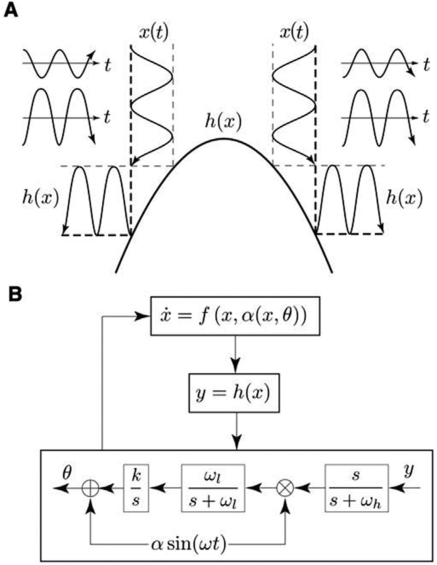
图 1：搜索 $h(x)$ 最大值机制的直观示意图，图中还展示了在极值点附近 $h(x) \approx -x^2$ 的情形（A）。取决于 $x(t) > x^\star$ 还是 $x(t) < x^\star$，受扰函数 $h(x(t))$ 的值将与扰动信号同相或反相。（B）给出了 Krstić 和 Wang（2000）针对一般非线性动态系统优化的 ES 结构。

为了说明 ES 机理，我们从点 $x_0 = x^\star + \delta$（$\delta > 0$）出发，以一个小的扰动幅度 $\alpha$ 对信号施加抖动。带抖动信号的动力学为：

$$x(t) = x_0 + \alpha \sin(\omega t) = x^\star + \delta + \alpha \sin(\omega t), \tag{3}$$

将其代入式(2)，把 $h(x)$ 近似为：

$$h(x^\star) + \frac{h''(x^\star)}{2} \left( \delta^2 + 2\delta\alpha \sin(\omega t) + \alpha^2 \sin^2(\omega t) \right) . \tag{4}$$

若对式(4)进行滤波以去除非振荡项（例如，可以通过平均化再减去其平均值来实现），然后再乘以相同的抖动频率 $\sin(\omega t)$，所得信号为（忽略相移）：

$$\delta\alpha h''(x^\star) \sin^2(\omega t) + h''(x^\star) \alpha^2 \sin^3(\omega t)/2 .$$

接下来对该信号进行低通滤波，或直接积分，使得 $\sin^2(\omega t)$ 平均为 $1/2$，而 $\sin^3(\omega t)$ 平均为 $0$。最后，将该信号乘以一个增益因子 $k$，用于控制 ES 算法的收敛速度，得到：

$$\frac{k\alpha\delta}{2} h''(x^\star) < 0, \tag{5}$$

它起到比例反馈的作用，将 $x(t) > x^\star$ 沿负方向推回 $x^\star$。同样的论证也适用于起始点 $x(t) < x^\star$ 的情形。该过程的直观示意图见图 1A。对于如下形式的动态系统：

$$\dot{x} = f(x, u), \quad u = \alpha(x, \theta), \quad y = h(x), \tag{6}$$

该方法可通过调节控制参数 $\theta$（该参数对已有的镇定控制器进行参数化，如图 1B 所示）来寻找未知输出函数 $h(x)$ 的最优稳态值。尽管如上所述寻找未知函数 $h(x)$ 最优值背后的直觉是清晰的，但对该方法的分析以及对其针对式(6)这类非线性系统输出函数收敛性的解析证明是一个极具挑战性的问题，耗费了大约 80 年才得以解决。

### 1.1. 组织结构

图 2 展示了本文所综述的 ES 方法的一个不完整的宏观视图以及它们之间的关系。本综述分为若干节，各节突出 ES 研究的不同领域，并大体上沿着图 2 所示的时间线展开。我们从经典 ES 方法开始，在第 2–5 节综述各种扩展与改进。第 6–11 节综述各类镇定型 ES 及其推广。从第 12 节开始，综述回到经典形式的 ES，之后展示经典 ES 与镇定型 ES 之间的交叉领域。下面更详细地描述各节安排。

第 2 节概述了各种 ES 发展，其中大多数只对 ES 方法的原始形式做了轻微修改，采用标准的系统假设，并通过平均化与奇异摄动理论相结合的经典方法来证明 ES 稳定性。该节还讨论了若干扩展，例如穿越局部极小值、多单元系统以及分布在网络上的系统。第 3 节聚焦于博弈中的 ES，包括非合作博弈中的纳什均衡搜索、智能体群体的合作博弈、用于多约束优化问题的多种群博弈，以及用于寻找 Pareto 最优解集的多目标 ES。第 4 节聚焦于基于牛顿的 ES、向高阶导数的推广以及多变量牛顿 ES——这些方法增加了 ES 方案的复杂度，但也能带来更快的收敛。第 5 节聚焦于 ES 的随机方法。

第 6 节介绍了一种新的方法：将高频 ES 用作未知开环不稳定系统的镇定反馈，同时实现控制与优化。第 7 节聚焦于李括号平均化，这是研究将 ES 直接用作反馈控制器的系统动力学的一种强大技术。第 8 节介绍了一种新的有界 ES 形式，以及一种弱极限平均化方法——它是李括号平均化技术向非周期、不连续和不可微抖动信号的推广。第 9 节介绍了一类一般性的 ES 控制器族，第 6–8 节中的许多控制器都是其特例。第 10 节描述了一种反馈 ES 的比例积分形式，具有改进的收敛性质。第 11 节综述了镇定型 ES 的有限时间镇定性质。

第 12 节将 ES 扩展到偏微分方程（PDE）的研究。第 13 节描述了混杂（hybrid）ES 方案，第 14 节将这些技术扩展到有限时间牛顿 ES。第 15 节综述了具有安全保证（如避碰与安全屏障函数）的 ES，涵盖经典与镇定型两类 ES 技术。第 16 节讨论了用 ES 方法自适应调节生成式深度神经网络低维潜在空间、以使其能够应用于时变系统的工作。第 17 节总结理论性 ES 技术，第 18 节讨论专利，第 19 节对应用进行广泛概述。

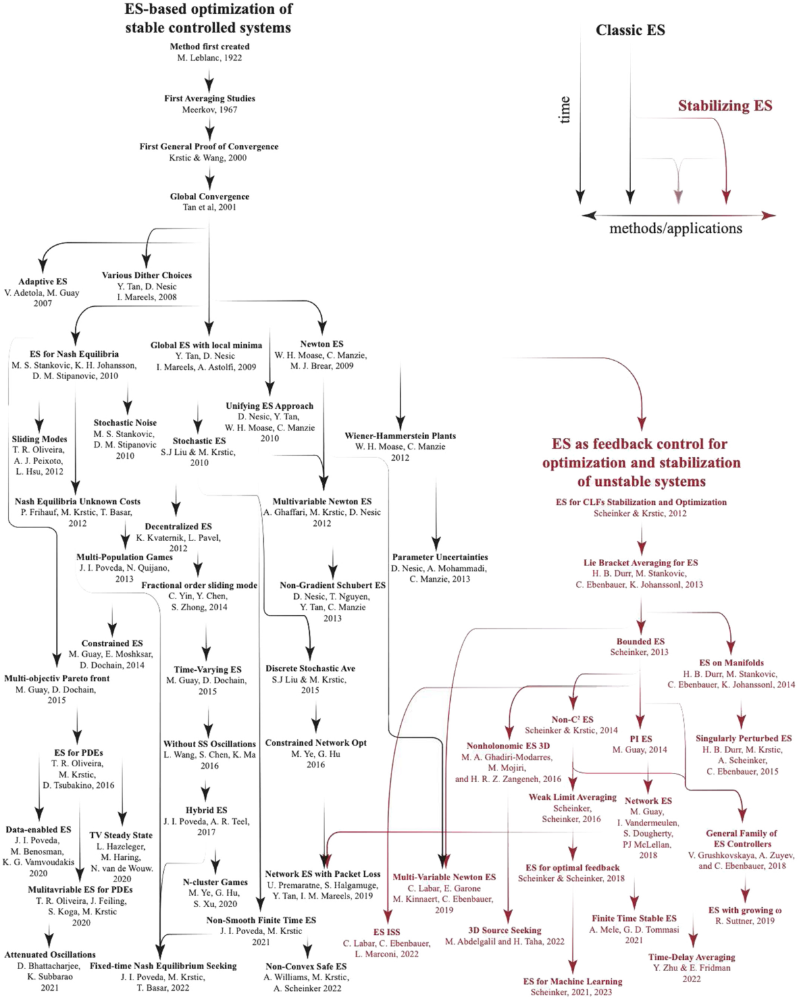
图 2：右上角的小图给出了 ES 演化的宏观概览：ES 已分裂为两大类，而近年来这两类又开始融合并相互交流思想与方法。图的其余部分展示了更详细的视图，给出 ES 研究中的主要发展与分岔，本综述将对此进行更详细的讨论。

## 2. 经典 ES 发展

极值搜索（ES）最初的稳定性分析由 Krstić 和 Wang (2000) 针对图 1 所示的构型完成。其目标是最大化如下未知动态系统的、解析形式未知的输出函数 $h(x)$ 的稳定稳态输出：

$$\dot{x} = f(x, u), \qquad y = h(x), \tag{7}$$

其中 $x \in \mathbb{R}^n$，$u \in \mathbb{R}$，$f : \mathbb{R}^n \times \mathbb{R} \to \mathbb{R}^n$，$y : \mathbb{R}^n \to \mathbb{R}$，且控制器 $u$ 由标量参数 $\theta$ 参数化：

$$u = \alpha(x, \theta). \tag{8}$$

当时需要以下假设。

**假设 1.** 存在光滑函数 $l : \mathbb{R} \to \mathbb{R}^n$，使得

$$f(x, \alpha(x, \theta)) = 0 \quad \text{当且仅当} \quad x = l(\theta). \tag{9}$$

**假设 2.** 对每个 $\theta \in \mathbb{R}$，系统 (7)、(8) 的平衡点 $x = l(\theta)$ 是局部指数稳定的，且其衰减常数与超调常数关于 $\theta$ 一致。

这两个假设保证系统是闭环稳定的，并且给定控制参数 $\theta$ 的任意选择，都存在一个指数稳定的平衡点。关于输出函数 $h(x)$ 最大值的存在性，还需再作一个假设。

**假设 3.** 存在 $\theta^* \in \mathbb{R}$，使得

$$(h \circ l)'(\theta^*) = 0, \qquad (h \circ l)''(\theta^*) < 0. \tag{10}$$

图 3 以一个二维 $(x_1, x_2)$ 动态系统为例，直观展示了假设 1–3 的含义：该系统具有稳定平衡点 $l(\theta)$，其输出函数 $y = h(x_1, x_2)$ 在 $\theta^*$ 处取得最大值。

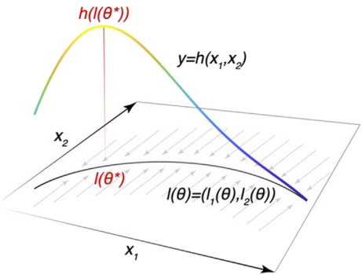
图 3：本图以一个二维系统为例描述了假设 1–3 的含义。$(x_1, x_2)$ 平面中的浅灰色流线表示由 $l(\theta)$ 参数化的平衡点的指数稳定性，在 $\theta^\star$ 处存在最大值。对于任意给定的 $\theta$ 值，奇异摄动理论假设系统快速收敛到曲线 $l(\theta)$，然后 ES 沿着 $l(\theta)$ 缓慢地找到最大值。

动态 ES 系统写为

$$\dot{x} = f\left(x, \alpha\left(x, \hat{\theta} + a \sin \omega t\right)\right), \tag{11}$$

$$\dot{\hat{\theta}} = k \xi, \tag{12}$$

$$\dot{\xi} = -\omega_L \xi + \omega_L \left(y - \eta\right) a \sin(\omega t), \tag{13}$$

$$\dot{\eta} = -\omega_H \eta + \omega_H y, \tag{14}$$

其中抖动频率 $\omega$ 任意小，积分器增益选取为 $k = \omega \delta K$，$\delta$ 同样很小且 $K > 0$。定义坐标

$$\tilde{\theta} = \hat{\theta} - \theta^*, \tag{15}$$

$$\tilde{\eta} = \eta - h(l(\theta^*)), \tag{16}$$

动态 ES 系统便被重写为两部分，其中一部分的演化相对另一部分可以任意慢。系统快慢部分的分离取决于 $|\delta|, |\omega| \ll 1$ 的选取。这一点可以通过考察时间尺度 $\tau = \omega t$ 下的动力学看出：

$$\frac{d}{d\tau} \begin{bmatrix} \tilde{\theta} \\ \xi \\ \tilde{\eta} \end{bmatrix} = \delta \begin{bmatrix} K \xi \\ -\omega_L' \xi + \omega_L' \left(h(x) - h(l(\theta^*)) - \tilde{\eta}\right) a \sin \tau \\ -\omega_H' \tilde{\eta} + \omega_H' \left(h(x) - h(l(\theta^*))\right) \end{bmatrix}.$$

收敛性的证明通过考虑闭环动力学

$$\frac{dx}{d\tau} = \frac{1}{\omega} f\left(x, \alpha\left(x, \theta^* + \tilde{\theta} + a \sin \tau\right)\right)$$

来完成。随后结合平均化（averaging）与奇异摄动（singular perturbation）技术分析慢动力学与快动力学。当 $\omega \to 0$ 时，快系统被冻结在其平衡点 $x = l(\theta^* + \tilde{\theta} + a \sin \tau)$，将其代入慢系统；对该慢系统，平均化分析证明了指数稳定平衡点的存在性 (Krstić & Wang, 2000)。最终结果由下述定理总结。

**定理 1.** 考虑假设 1–3 下的系统 (11)–(14)。存在围绕点 $(x, \hat{\theta}, \xi, \eta) = (l(\theta^*), \theta^*, 0, h \circ l(\theta^*))$ 的一个初始条件球域，以及常数 $\bar{\omega}$、$\bar{\delta}$ 和 $\bar{a}$，使得对所有 $\omega \in (0, \bar{\omega})$、$\delta \in (0, \bar{\delta})$、$a \in (0, \bar{a})$，解 $(x(t), \hat{\theta}(t), \xi(t), \eta(t))$ 指数收敛到该点的 $O(\omega + \delta + a)$ 邻域。进一步，$y(t)$ 收敛到 $h \circ l(\theta^*)$ 的 $O(\omega + \delta + a)$ 邻域。

定理 1 及相关的假设 1–3 已在大量工作中以稍加修改的形式得到应用。上述方法被用于非完整独轮车模型的源搜索研究 (Zhang, Arnold, Ghods, Siranosian, & Krstić, 2007)，其中自旋车辆的速度 $v$ 基于 ES 方案进行调节，其运动方程为

$$\dot{x} = v \cos(\omega_0 t), \qquad \dot{y} = v \sin(\omega_0 t), \tag{17}$$

用于最大化最大值位置未知的二次函数。随后这些结果被研究推广到力驱动的质点，并表明即使对中度不稳定的系统，ES 也能找到最大值并跟踪缓慢变化的轨迹 (Zhang, Siranosian, & Krstić, 2007)。针对正弦波、方波和三角波抖动信号，已有工作从收敛速度、收敛域和精度等方面比较了 ES 方案的各种抖动信号选择 (Tan, Nešić, & Mareels, 2008)。已有研究表明，上述方法能够处理随机加性测量噪声 (Stanković & Stipanović, 2010)；还发展了面向多智能体系统的去中心化 ES 方法，该方法使用数值梯度估计方法而非正弦扰动 (Kvaternik & Pavel, 2011, 2012a, 2012b)。该方法还被应用于采用高频抖动信号的 Weiner–Hammerstein 被控对象 (Moase & Manzie, 2012) 和 Hammerstein 被控对象 (Moase & Manzie, 2011)；针对标准型（normal form）系统发展了滑模方法 (Oliveira, Peixoto, & Hsu, 2012)，以及事件触发 ES (Poveda & Teel, 2017b)。

ES 方案穿越局部极小值的能力也得到了研究。研究表明，对一类特殊系统，若抖动幅度 $\alpha$ 充分大，ES 将越过局部极小值，并在 $\alpha(t)$ 按照动态更新律 $\dot{\alpha} = -\omega \delta \epsilon\, g(\alpha)$ 向零减小时最终停在全局最小值处，其中 $\omega$、$\delta$、$\epsilon$ 和 $g(\alpha)$ 必须被恰当地设计 (Tan, Nešić, Mareels, & Astolfi, 2009)。作为非局部 ES 的一个简单例子，考虑如下带有基于 ES 的优化器的动态系统，其抖动幅度 $a(t)$ 从 $a(0) = 3.0$ 开始，随后指数衰减：

$$\begin{aligned} \dot{x}_1 &= x_1 + x_2, \\ \dot{x}_2 &= x_2 + u, \\ u &= -x_1 + 4x_2 + \theta + a \sin(\omega t), \\ \dot{\theta} &= \omega \delta\, y(x_1, x_2) \sin(\omega t), \\ \dot{a} &= -\omega \delta \epsilon\, a, \end{aligned} \tag{18}$$

其中被最大化的输出函数为

$$y = -(x_1 + 3x_2)^4 + \frac{8}{15}(x_1 + 3x_2)^3 + \frac{5}{6}(x_1 + 3x_2)^2 + 10.$$

将上述系统的仿真与采用固定抖动信号 $a = 1$ 的同一系统进行比较。输出函数 $y$ 具有一个局部最大值，采用固定小抖动幅度的 ES 会陷入其中，而抖动幅度衰减的 ES 则穿过局部最大值并找到全局最大值，如图 4 所示。

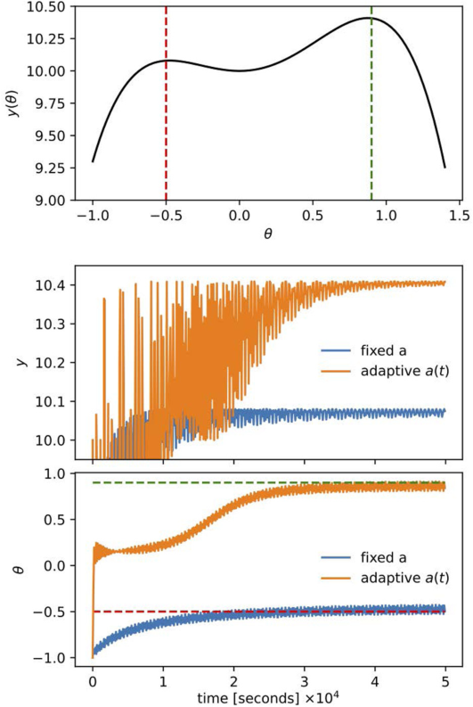

图 4：上图显示函数 $y$，它具有一个局部最大值和一个全局最大值。中图显示有无自适应抖动幅度两种情况下代价函数的演化。下图显示参数 $\theta$ 向其局部或全局最大化值的收敛。

这种方法的一个局限在于时变系统：一旦抖动幅度衰减完毕，若最优点发生变化，ES 将不再响应。针对可能包含局部极小值的紧集上的 ES，另一种非梯度方法被发展起来，它针对已知 Lipschitz 常数的系统，将 ES 与局部 Schubert 搜索算法相结合 (Nešić, Nguyen, Tan, & Manzie, 2013)。

ES 方法还被发展到带采样数据的多单元系统 (Khong, Nešić, Tan, & Manzie, 2013)；时变 ES 方法也得到了研究，其中通过在收敛过程中对 ES 控制器进行自适应修正，使抖动信号选择的影响最小化 (Guay, 2014; Guay & Dochain, 2015b)，并减弱稳态振荡 (Bhattacharjee & Subbarao, 2021)。约束系统通过在代价函数中加入障碍函数来处理 (Guay, Moshksar, & Dochain, 2015)。面向非线性系统的 ES 版本已采用分数阶滑模发展起来 (Yin, Chen, & Zhong, 2014)；还发展了一种无稳态振荡的 ES 形式 (Wang, Chen, & Ma, 2016)，以及用于约束网络优化的 ES (Ye & Hu, 2016)。

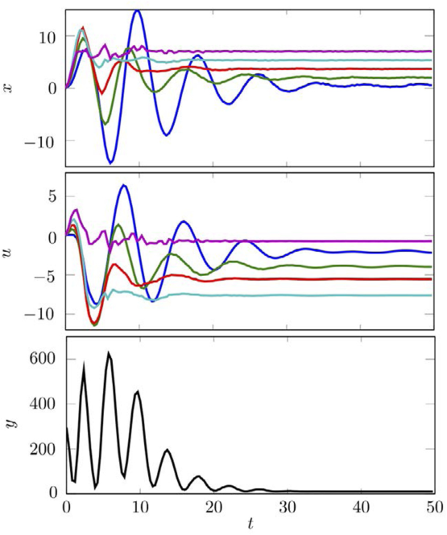

图 5：网络化 ES 智能体的收敛。来源：图改编自 Guay, Vandermeulen, Dougherty, and McLellan (2018)。

近期，数据使能 ES（data-enabled ES）得到了研究：其中引入用于存储记录数据的记忆机制，使得优化过程中能够利用信息丰富的数据集，从而不再需要标准 ES 算法所需的持续激励的时变激励抖动信号 (Poveda, Benosman, & Vamvoudakis, 2021)。数据使能 ES 针对如下形式的系统进行研究：

$$\dot{x} = f(x, u), \qquad y = h(x, u), \qquad \phi(u) = h(l(u), u), \tag{19}$$

其中 $\phi(u)$ 需要被最小化。解析形式未知的函数 $\phi(u)$ 被参数化为基函数的线性组合：

$$\phi(u) = \sum_{i=1}^{p} b_i(u) w_i + \epsilon(u), \tag{20}$$

其中 $\epsilon(u)$ 为近似误差。该方法的思路是在一个紧集上将该表示拟合到 $\phi$，以定位其最小值。

针对周期时变输出优化的 ES 由 Haring, van de Wouw 和 Nešić (2013) 提出，所针对的系统形式为

$$\dot{x} = f(x, \alpha(x, \theta), \theta, w(t)), \qquad y = h(x, w(t)), \tag{21}$$

其中 $w(t)$ 是周期信号，其周期 $T_w$ 已知。这里，上述标准 ES 假设 1 被推广为：存在一个二次可微映射 $M(\theta, w(t))$，使得对任意固定的 $\theta$，存在轨迹 $\bar{x}_{\theta,w}(t) = M(\theta, w(t))$，系统的轨迹自然收敛于该轨迹。对此类系统证明了半全局实用渐近稳定性。在该方法中，采用如下形式的性能泛函：

$$L_p(y_d(t)) = \left( \frac{1}{T_w} \int_{t - T_w}^{t} |y(\tau)|^p \, d\tau \right)^{1/p}. \tag{22}$$

将式(22)乘以扰动信号 $\sin(\omega[t-\phi])$，并通过一个在 ES 抖动信号一个周期上的滑动平均滤波器：

$$e(t) = \frac{\omega}{a\pi}\int_{t-\frac{2\pi}{\omega}}^{t} L_p(y_d(\tau))\sin(\omega[\tau-\phi])\,d\tau, \tag{23}$$

其结果是对未知函数梯度的更好估计，并且由于抖动信号的谐波被移除，相比经典 ES 优化更快。该方法对具有稳态振荡的系统（如简谐振子）有效：

$$\ddot{x} = -\omega_0^2 x - b(\theta)\dot{x} + w(t), \tag{24}$$

其中目标是寻找最优的 $\theta^\star$，使未知阻尼项 $b(\theta)$ 最小化，$w(t)$ 是周期性外部扰动，最优输出是幅值最大的正弦信号。以上述示例系统(24)可以看出这种滑动平均方法相比上文所述标准低通滤波器 ES 方法的优点。当代价函数中加入高频项 $x_2 = \dot{x}_1 = \dot{x}$ 时，低通滤波器版本的 ES 无法收敛，而滑动平均滤波方法能够处理这种情况，如图 6 所示。

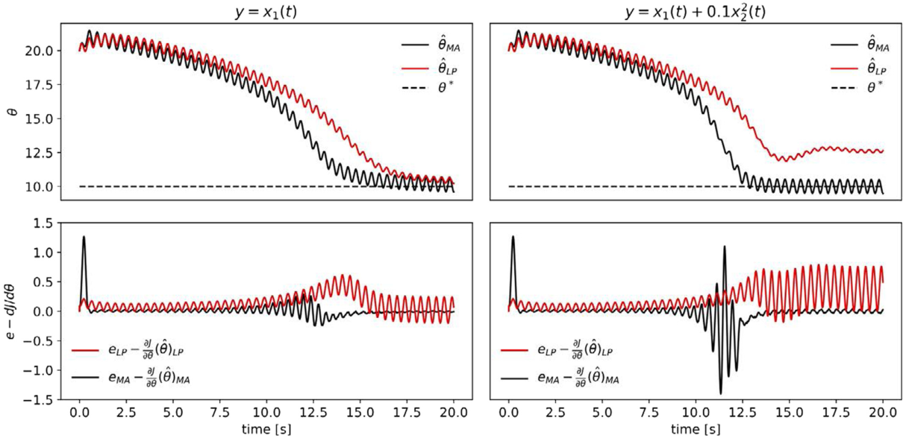

图 6：左列：经典低通滤波版 ES 的 $\hat{\theta}_{LP}$ 与滑动平均估计 $\hat{\theta}_{MA}$ 收敛到 $\theta$ 最优值的对比。两者都收敛到最优值，滑动平均方法略好的性能可由更准确的导数估计来解释。右列：一旦在代价函数中加入小的高频项 $0.1x_2^2 = 0.1\dot{x}_1$，低通滤波 ES 只能收敛到最优值的邻域内，而滑动平均方法能更有效地滤除高频扰动。

另一种针对非线性系统时变稳态响应优化的方法由 Hazeleger, Haring 和 van de Wouw (2020) 采取，所针对的系统形式为

$$\dot{x} = f(x, u, w(t)), \qquad y = g(x, u, w(t)), \tag{25}$$

其中 $y$ 是测得的输出函数，$w$ 表示必须有界、但不假设为周期的扰动。

还有一些方法将系统知识融入优化之中，这对已有控制器、结构已知但参数未知的稳定系统很有用，系统形式为

$$\dot{x} = f(x, \theta, u), \qquad y = Q(\theta, x), \tag{26}$$

其中函数 $f$ 已知，但参数 $\theta$ 和输出函数 $y$ 未知 (Nesic, Mohammadi, & Manzie, 2012)。还发展了一种多参数 ES 方法，用于模型参数不确定性的在线估计，所针对的系统形式为

$$\dot{x} = f(x) + \Delta f(x, t) + g(x) u, \qquad y = h(x), \tag{27}$$

其中 $\Delta f(x, t)$ 是加性模型不确定性 (Benosman, Farahmand, & Xia, 2019)。

经典 ES 算法还被研究用于具有固定初始条件的离散可重复系统的开环 LQR 控制，系统形式为

$$x_{k+1} = A_k x_k + B_k u_k, \qquad y_k = C_k x_k, \tag{28}$$

在有限时域 $N$ 上，目标是寻找最小化代价函数的开环控制步骤序列 $\{u_k\}_{k=0}^{N-1}$：

$$J = \sum_{k=0}^{N-1} \left( x_k^\top Q_k x_k + u_k^\top R_k u_k \right), \tag{29}$$

其中 $A_k$、$B_k$ 以及 $J$ 的解析形式均未知 (Frihauf, Krstić, & Başar, 2013)。在该方法中，系统反复从固定初始条件重新初始化，多变量 ES 调节一系列控制步骤以最小化 $J$。

还针对非完整移动机器人导航的三维环境源搜索发展了一种创新的基于 ES 的方法 (Matveev, Hoy, & Savkin, 2014)。
## 3. 博弈中的 ES

对于上述 ES 方法，将方法扩展到多参数系统很容易处理：只需为每个参数施加不同频率的抖动，即可在高维空间中实现梯度下降，且对所得分析只需做很小的改动。除了这种高维 ES 方法之外，大量工作致力于研究多参数 ES，其中以更复杂的结构研究各调节参数之间的关系，例如合作博弈，或在博弈信息有限的非合作博弈中进行纳什均衡搜索。

第一种此类方法由 Stanković, Johansson, and Stipanović (2010) 研究，用于移动传感器网络中的分布式纳什均衡搜索，其中智能体仅基于含噪声的局部代价函数测量来生成动作。在该设置中，智能体自身及其他玩家的代价的动作与结构参数均未知。每个玩家使用自己本地的 ES 回路，其抖动频率 $\omega_i$ 与所有其他智能体使用的频率不同。这种离散 ES 设置如图 7 所示，其中每个 2D 玩家的坐标为 $(x_i, y_i) \in \mathbb{R}^2$，$u_{-i}$ 表示邻域集合 $\mathcal{N}_i$ 内所有其他玩家的动作。

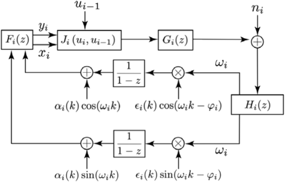

图 7：纳什均衡搜索的离散时间 ES 方案。

在该设置中，$\mathcal{N}_i$ 内所有相邻智能体具有不同的抖动频率 $\omega_j \neq \omega_i$，$G_i(z)$ 是低通滤波器，$H_i(z)$ 是高通滤波器，$n$ 是测量噪声。整个设置的动态为

$$w_i(k) = H_i(z)\left[G_i(z)\left[J_i(u_i(k), u_{-i}(k))\right] + n_i(k)\right], \tag{30}$$

$$u_i(k) = u_0^i(k) + F_i(z)\left[\frac{1}{1-z}\,\xi_i(k)\right], \tag{31}$$

$$\xi_i(k) = \epsilon_i(k) C_i(k) w_i(k), \tag{32}$$

并且系统几乎必然收敛到纳什均衡 $u^*$，在该点处

$$\left[\nabla_1 J_1(u^*)^T, \ \ldots, \ \nabla_N J_N(u^*)^T\right] = 0. \tag{33}$$

类似的方法后来由 Frihauf, Krstić, and Basar (2011) 针对连续系统进行了研究。还研究了一种固定时间纳什均衡搜索方法 (Poveda, Krstić, & Başar, 2022)，以及 N 集群非合作博弈中的纳什均衡搜索 (Ye, Hu, & Xu, 2020)。

ES 方法还被发展用于智能体群体的合作博弈，例如风力涡轮机的分布式控制，以最大化风电场的功率捕获 (Menon & Baras, 2014)。在该方法中，$n$ 个智能体组成的群体中索引为 $i$ 的每个智能体都可以访问自己的私有效用函数 $f_i(u)$，该函数可依赖于所有智能体采取的集体动作 $u = (u_1, \ldots, u_n)$。效用函数被假定为解析上未知，且每个智能体只能访问自己的效用函数。多智能体系统的目标是优化福利函数，即所有个体效用函数之和：

$$W(u) = \sum_{i=1}^{n} f_i(u). \tag{34}$$

智能体运行动态平均一致性算法，使一致性输出跟踪 $W(u)$。智能体之间通过无向、连通的通信图交换信息，每个智能体运行 ES 回路的一部分，使得智能体 $i$ 的动作在平均意义下为

$$\dot{u}_i \approx -\frac{\partial W(u)}{\partial u_i}, \tag{35}$$

从而收敛到 $W(u)$ 的局部极小点的任意小邻域内。

还针对多群体博弈发展了一类极值搜索控制器，用于求解多智能体动态系统上的多约束优化问题 (Poveda & Quijano, 2013)。在该设置中，智能体集群通过依赖于所有其他智能体状态的不同代价函数相互作用。任一单个集群的智能体试图同时最大化其共同的代价函数，该函数解析上未知，仅能通过测量获得。此类问题的一个数值示例以两个互联微电网的形式给出，每个微电网都试图利用本地发电机满足自身的电力需求。

该工作考虑群体集合 $\mathcal{P} = \{1, \ldots, M\}$ 和社会策略集合 $\mathcal{H} = \{1, \ldots, N\}$，其中群体 $j \in \mathcal{P}$ 使用的策略集合为 $\mathcal{H}_j \subset \mathcal{H}$。在任意时刻 $t$，$p_{ij}(t) \geq 0$ 表示第 $j$ 个群体中采用第 $i$ 个策略的个体数量。与第 $j$ 个群体相关联的实体总数为 $\sum_{i\in\mathcal{H}_j} p_{ij}(t) = P_j(t)$，与第 $i$ 个策略相关联的实体数量为 $\sum_{j\in\mathcal{P}_i} p_{ij}(t) = S_i(t)$。整个社会中的实体总数则为 $\sum_{j\in\mathcal{P}}\sum_{i\in\mathcal{H}_j} p_{ij} = T$。作者考虑两种类型的社会状态：(1) 对每个群体 $j \in \mathcal{P}$ 关于 $P_j$ 归一化；(2) 对每个策略 $i \in \mathcal{H}$ 关于 $S_i$ 归一化。

对第一种情形，状态定义为 $y_{ij}(t) = \frac{p_{ij}(t)}{P_j Y_j}$，它定义了第 $j$ 个群体中采用第 $i$ 个策略的实体比例，其中 $Y_j \in \mathbb{R}_{>0}$，且假定 $P_j$ 对每个 $j \in \mathcal{P}$ 为常数。在此设置下，第 $j$ 个群体的社会状态定义为 $y_j(t)$，整体社会状态为 $[y_1(t)^T, \ldots, y_M(t)^T]^T$。作者考虑如下形式的状态动态：

$$\dot{y}_{ij} = \beta_j y_{ij}\left(f_{ij}(y) - \frac{1}{Y_j}\sum_{i \in \mathcal{H}_j} y_{ij} f_{ij}(y)\right), \tag{36}$$

其中 $\beta_j > 0$，函数 $f_{ij}$ 表示社会中第 $j$ 个群体实施第 $i$ 个策略的那部分实体所感知的收益。通过利用有趣的微分几何论证，作者展示了动态(36)如何与关于每个群体 $j \in \mathcal{P}$ 的势函数 $J_j$ 的梯度系统相关联。他们考虑的 ES 问题之一是针对 $\Omega$ 个智能体的系统，目标是最大化 $J_i(x, \theta)$，其中 $x$ 表示智能体状态，每个智能体的内部动态为 $\dot{\theta}_{ij} = g_{ij}(x, \theta)$，$\theta \in \mathbb{R}^\Omega$。作者在 $\tau = \bar{\omega}t$ 时间尺度上为第 $j$ 个集群的第 $i$ 个智能体提出如下 ES 动态：

$$\bar{\omega}\frac{\partial \theta_{ij}}{\partial \tau} = g_{ij}(\hat{x} + a\mu(\tau), \theta), \tag{37}$$

$$\frac{\partial \hat{x}_{ij}}{\partial \tau} = 2\epsilon\,\hat{x}_{ij}\left(\frac{J_j(x,\theta)\mu_{ij}(\tau)}{X_j}\sum_{k \in \mathcal{H}_j}\hat{x}_{kj} + C \cdots - \frac{1}{X_j}\sum_{k \in \mathcal{H}_j}\left[\hat{x}_{kj} J_j(\theta)\mu_{kj}(\tau) + C\right]\right), \tag{38}$$

其中 $\hat{x}_{ij} = x_{ij} - a\mu_{ij}(t)$，$\mu_{ij}(t)$ 是抖动信号，定义为 $\sin(\bar{\omega}\omega_{ij})$，各 $\omega_{ij}$ 互不相同，$k = 2\epsilon\bar{\omega}$ 是所有智能体的自适应增益。作者证明，通过适当调节参数 $\bar{\omega}$、$\epsilon$、$a$ 和 $C$，可以使系统半全局实用渐近稳定。

作为最后一个例子，我们考虑一种针对不确定非线性系统的实时多目标 ES 控制器，它保证收敛到最优解 Pareto 集合中的点 (Guay & Dochain, 2015a)。这种形式的 ES 针对的是必须兼顾多个相互竞争目标的各种设计目标的工程问题。所研究的非线性系统形式为

$$\frac{dx}{dt} = f(x, u), \qquad y = h(x), \tag{39}$$

其中 $x \in \mathbb{R}^n$ 是状态变量向量，控制输入 $u$ 在紧凸集 $\mathcal{U} \subset \mathbb{R}^p$ 中取值，$y = h(x) \in \mathbb{R}^m$ 是要最小化的向量值未知函数。采用通常的 ES 假设，例如 $f(x,u)$ 和 $h(x)$ 是光滑函数，并且存在由 $n$ 维向量 $\pi(u)$ 给出的平衡（稳态）映射，使得 $f(\pi(u), u) = 0$，平衡代价函数为 $y = h(\pi(u)) = l(u)$，且平衡流形 $x = \pi(u)$ 关于 $u$ 一致地局部指数稳定，$\forall u \in \mathcal{U}$。

给定权重向量 $\lambda$，作者证明可以通过求解如下最小化问题来计算 Pareto 曲线上的元素：

$$\min_{\lambda} \left\|\lambda^T \nabla_u l(u)\right\|^2, \tag{40}$$

约束条件为

$$\lambda_i \geq 0, \quad i = 1, \ldots, m, \qquad \sum_{i=1}^{m} \lambda_i = 1, \tag{41}$$

并且该问题等价于如下无约束优化问题：

$$\min_{\beta} \left\|\lambda(\beta)^T \nabla_u l(u)\right\|^2, \tag{42}$$

其中 $\lambda_m(\beta) = \prod_{i=1}^{m-1} \cos^2(\beta_i)$ 是对 $\lambda_i$ 的一种参数化，可用梯度下降算法求解，得到作为 $\beta$ 的函数的 $\lambda^T \nabla_u$ 的最小平方范数元素，在此基础上，通过对输入 $u$ 的简单梯度更新即可找到 Pareto 最优解。然后将这两个梯度下降动态组合为如下控制器：

$$\dot{\beta} = -k\frac{\partial \lambda(\beta)^T}{\partial \beta}\nabla_u l(u)\nabla_u l(u)^T \lambda(\beta), \tag{43}$$

$$\dot{u} = -\epsilon_2 k \nabla_u l(u)^T \lambda(\beta), \qquad \epsilon_2 > 0. \tag{44}$$

在实践中，通常希望定义一个与多个目标之间特定折衷相关联的特定最优解。假设这样的解已知并定义为 $y^*$，则上述控制器修改为

$$\dot{\beta} = -Mk\frac{\partial \lambda(\beta)^T}{\partial \beta}\nabla_u l(u)\nabla_u l(u)^T \lambda(\beta), \tag{45}$$

$$\dot{u} = -Mk\nabla_u l(u)^T \lambda(\beta) - k\nabla_u l(u)^T \left[l(u) - y^*\right], \tag{46}$$

其中 $M > 0$。

现在针对解析上未知的函数 $l(u)$ 开发 ES 部分，为其未知梯度构建时变估计。考虑动态

$$\frac{dy}{dt} = \frac{\partial l}{\partial u}^T \frac{du}{dt}, \tag{47}$$

对每个输出函数 $y_i$，未知梯度定义为 $\theta_i(t) = \frac{\partial l_i}{\partial u}$，于是

$$\frac{dy}{dt} = \theta_i(t)^T \frac{du}{dt}, \tag{48}$$

然后由如下动态定义 $y_i$ 的估计 $\hat{y}_i$：

$$\frac{d\hat{y}_i}{dt} = \dot{u}^T\hat{\theta}_i + Ke_i + c_i^T\dot{\hat{\theta}}_i, \tag{49}$$

其中 $K > 0$ 是设计变量，$e_i = y_i - \hat{y}_i$ 是估计误差，时变向量 $c_i(t)$ 的动态为

$$\frac{dc_i^T}{dt} = -Kc_i^T + \dot{u}^T. \tag{50}$$

随后开发了一种参数估计更新方法，保证参数估计的收敛性。

对于 $p \times m$ 的参数估计矩阵 $\hat{\Theta} = [\hat{\theta}_1, \ldots, \hat{\theta}_m]^T$ 和 Pareto 解的权重向量 $\lambda = [\lambda_1, \ldots, \lambda_m]^T$，所提出的 ES 控制器为

$$\frac{du}{dt} = -\epsilon_2 k\sum_{i=1}^{m}\left[\lambda_i + \epsilon_1(y_i - y_i^*)\right]\hat{\theta}_i + d(t) = \epsilon_2\left(-k\hat{\Theta}\lambda + \epsilon_1(y - y^*)\right) + d(t), \tag{51}$$

$$\frac{d\beta}{dt} = -k\sum_{i=1}^{m}\frac{\partial \lambda_i(\beta)}{\partial \beta}\,\hat{\theta}_i^{T}\sum_{i=1}^{m}\lambda_i\hat{\theta}_i = -k\frac{\partial \lambda^{T}}{\partial \beta}\hat{\Theta}^{T}\hat{\Theta}\lambda, \tag{52}$$

其中 $d(t)$ 是有界抖动信号向量，$k > 0$ 是选定的增益，$\epsilon_1 > 0$ 是时间尺度分离参数。

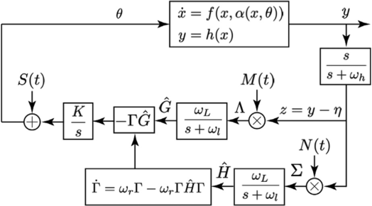

图 8：用于多变量系统的基于牛顿的 ES，要求初始条件 $\Gamma(0) < 0$。

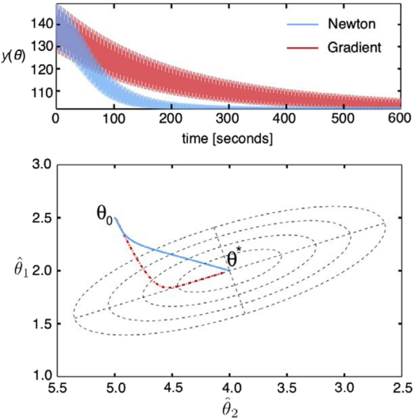

图 9：二维系统经由基于牛顿的 ES 方法实现收敛的示例，与标准 ES 方法的对比。

来源：图改编自 Ghaffari, Krstić, and Nešić (2012) 的仿真结果部分。
## 4. 基于牛顿的 ES

ES 的另一项重要扩展是基于牛顿的方法的提出。平均化分析表明，极值搜索方法通过持续跟随被最大化或被最小化函数的未知梯度而收敛。这使得算法的收敛速度在局部依赖于函数的曲率。收敛速度与曲率成正比这一点，可由 Moase, Manzie, and Brear (2009) 的下述例子清楚地展示：一个带有调谐参数 $\theta$ 的 ES 装置被不断调节，以最小化输出函数 $y$，其平均化 ES 动力学为

$$\dot{\bar{\theta}} = -k \hat{y}', \tag{53}$$

其中 $\hat{y}'$ 是 $dy/d\theta$ 在局部极小点 $\theta^*$ 附近的估计，在该点 $y'(\theta^*) = y'_* = 0$。我们可以在 $\theta^*$ 附近对 $y'$ 和 $y''$ 作泰勒展开：

$$y'(\theta - \theta^*) = (\theta - \theta^*) y''_* + \mathcal{O}(\theta^2), \tag{54}$$

$$y''(\theta - \theta^*) = y''_* + \mathcal{O}(\theta), \tag{55}$$

$$\frac{y'(\theta - \theta^*)}{y''(\theta - \theta^*)} \sim (\theta - \theta^*). \tag{56}$$

因此，通过引入与牛顿速率 $y'/y''$ 成正比的局部 ES 收敛，即可消除收敛速率对曲率的依赖。这类类牛顿 ES 方法由 Moase et al. (2009) 以及 Moase, Manzie, and Brear (2010) 提出，并由 Nesić, Tan, Moase, and Manzie (2010) 推广到更高阶导数的情形。

使用牛顿方法提升收敛速率的代价是复杂度的增加。为了应用类牛顿 ES 方案，除了通常使用的 $y'$ 的估计之外，还需要估计 $y''$。Moase et al. (2009, 2010) 引入的方法是：在 ES 抖动信号 $\theta = \theta_0 + a\sin(\omega_\theta t)$ 下，考虑被控对象输出 $y$ 的二阶泰勒展开

$$y = y_0 + y'_0 a\sin(\omega_\theta t) + \frac{1}{2} y''_0 a^2 \sin^2(\omega_\theta t) + h(\theta_0, a, t), \tag{57}$$

其中 $h(\theta_0, a, t)$ 包含 $a$ 的三阶及更高阶项。该被控对象输出可表示为矩阵形式的动态系统：

$$y = Cx + h(\theta_0, a, t), \tag{58}$$

$$\frac{dx}{dt} = \omega_\theta A x + \frac{\partial x}{\partial \theta_0}\frac{\partial \theta_0}{\partial t} + \frac{\partial x}{\partial a}\frac{\partial a}{\partial t}, \tag{59}$$

其中 $C = (1\ 1\ 0\ 0\ -1/4)$，

$$x = \begin{bmatrix} y_0 + \frac{1}{4} a^2 y''_0 \\ y'_0 a S_1 \\ y'_0 a C_1 \\ y''_0 a^2 S_2 \\ y''_0 a^2 C_2 \end{bmatrix}, \quad A = \begin{bmatrix} 0 & 0 & 0 & 0 & 0 \\ 0 & 0 & 1 & 0 & 0 \\ 0 & -1 & 0 & 0 & 0 \\ 0 & 0 & 0 & 0 & 2 \\ 0 & 0 & 0 & -2 & 0 \end{bmatrix}, \tag{60}$$

$S_n = \sin(n\omega_\theta t)$，$C_n = \cos(n\omega_\theta t)$。随后，系统 (59) 由如下状态空间观测器进行动态估计：

$$\hat{y} = C\hat{x}, \tag{61}$$

$$\frac{d\hat{x}}{dt} = \omega_\theta A \hat{x} + \omega_\theta L(y - \hat{y}), \tag{62}$$

其中 $L \in \mathbb{R}^5$ 为增益向量，$y'_0$ 与 $y''_0$ 的估计由下式给出：

$$a\hat{y}'_0 = C'\hat{x}, \quad C' = (0\ S_1\ C_1\ 0\ 0), \tag{63}$$

$$a^2\hat{y}''_0 = C''\hat{x}, \quad C'' = (0\ 0\ 0\ S_2\ C_2). \tag{64}$$

见图 9。

基于牛顿的方法后来被推广到如下形式的多输入单输出（MISO）非线性动态系统：

$$\dot{x} = f(x, u), \quad y = h(x), \tag{65}$$

其中 $x \in \mathbb{R}^n$，$u \in \mathbb{R}^m$，$y \in \mathbb{R}$（Ghaffari et al., 2012）。多变量 ES 方法需要典型的 ES 假设：存在已知的光滑控制律 $u = \alpha(x, \theta)$，使得闭环系统 $\dot{x} = f(x, \alpha(x, \theta))$ 具有一组由光滑函数 $l(\theta)$ 参数化的平衡点；对每个 $\theta$ 值，平衡点 $x = l(\theta)$ 关于 $\theta$ 一致局部指数稳定；并且存在 $\theta^* \in \mathbb{R}^n$ 使得 $h(l(\theta^*)) = 0$，且二阶导数 Hessian 矩阵 $H$ 负定。

多变量牛顿 ES 工作利用 Nesić et al. (2010) 的方法求出 Hessian 矩阵 $H$ 的估计 $\hat{H}$，然后借助 Riccati 方程求其逆。考虑滤波器动力学

$$\dot{\mathcal{H}} = -\omega_r \mathcal{H} + \omega_r \hat{H}, \tag{66}$$

其状态收敛到 $\hat{H}$。若记 $\Gamma = \mathcal{H}^{-1}$，则 $\dot{\Gamma} = -\Gamma\dot{\mathcal{H}}\Gamma$ 的动力学可写为

$$\dot{\Gamma} = \omega_r \Gamma - \omega_r \Gamma \hat{H} \Gamma, \tag{67}$$

其平衡点为 $\Gamma^* = 0_{n\times n}$ 和 $\Gamma^* = \hat{H}^{-1}$，其中零平衡点在 $\omega_r > 0$ 时不稳定。即使 $\hat{H}$ 接近奇异或其逆不定，这种 Hessian 逆的动态估计仍是鲁棒的。该方法随后估计 $\hat{H}$ 并估计其逆 $\Gamma$，借此可将 Hessian 的影响从 ES 动力学中移除，从而可以通过增益矩阵 $K$ 来指定期望的收敛速率。

整体的多变量牛顿 ES 结构如图 8 所示，其动力学为

$$\begin{aligned}
\dot{x} &= f\left(x, \alpha\left(x, \theta^* + \tilde{\theta} + S(t)\right)\right) \\
\dot{\tilde{\theta}} &= -K\left(\tilde{\Gamma} + H^{-1}\right)\hat{G} \\
\dot{\hat{G}} &= -\omega_l \hat{G} + \omega_l\left(y - h \circ l(\theta^*) - \tilde{\eta}\right)M(t) \\
\dot{\tilde{\Gamma}} &= -\omega_r\left(\tilde{\Gamma} + H^{-1}\right)\left(I - \left(\tilde{\hat{H}} + H\right)\left(\tilde{\Gamma} + H^{-1}\right)\right) \\
\dot{\tilde{\hat{H}}} &= -\omega_l \tilde{\hat{H}} - \omega_l H + \omega_l\left(y - h \circ l(\theta^*) - \tilde{\eta}\right)N(t) \\
\dot{\tilde{\eta}} &= -\omega_h \tilde{\eta} + \omega_h\left(y - h \circ l(\theta^*)\right),
\end{aligned} \tag{68}$$

其中 $\tilde{\theta} = \hat{\theta} - \theta^*$，$\theta = \hat{\theta} + S(t)$，$\tilde{\eta} = \eta - h \circ l(\theta^*)$，$\tilde{\Gamma} = \Gamma - H^{-1}$，$\tilde{\hat{H}} = \hat{H} - H$，且

$$\dot{\eta} = -\omega_h \eta + \omega_h y. \tag{69}$$

## 5. 随机 ES

针对随机系统的 ES 方法也得到了发展：首先证明一般性的随机平均化结果，再将其应用于利用随机抖动信号的 ES 方法（Liu & Krstić, 2010, 2012）。随机 ES 方法的主要动机之一是：由于存在大幅随机跳跃的可能性，系统有机会逃离局部极小值，从而可能产生一条找到全局极小值的轨迹（见图 10）。

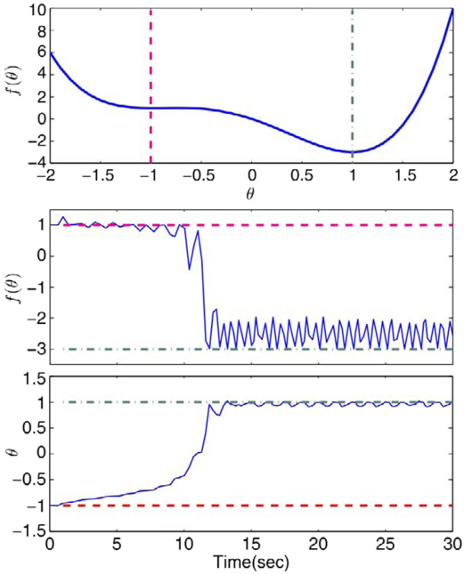

图 10：随机 ES 逃离局部极小值的例子。来源：图改编自 Liu and Krstić (2012)。

在 Liu and Krstić (2010, 2012) 中，作者考虑了如下形式的系统：

$$\frac{dX_t^\epsilon}{dt} = a\left(X_t^\epsilon, Y_{t/\epsilon}\right), \tag{70}$$

其中 $X_t^\epsilon$ 是概率空间 $(\Omega, \mathcal{F}, P)$ 上的连续马尔可夫过程，$a(x, y)$ 是 $(x, y)$ 的连续函数，且对任意 $x \in \mathbb{R}^n$ 都是 $y$ 的有界函数，并关于 $x \in \mathbb{R}^n$ 满足 Lipschitz 条件：对任意紧集 $D \subset \mathbb{R}^n$，存在常数 $k_D$，使得对所有 $y$ 和任意 $x_1, x_2 \in D$，都有

$$|a(x_1, y) - a(x_2, y)| < k_D |x_1 - x_2|. \tag{71}$$

对于此类系统，作者提出的随机 ES 激励信号之一是单位圆上的布朗运动 $(Y_t, t \geq 0)$：

$$Y_t = e^{jW_t} = [\cos(W_t), \sin(W_t)]^T, \tag{72}$$

它是如下随机微分方程组的解：

$$dY_t = -\frac{1}{2} Y_t\, dt + B Y_t\, dW_t, \quad B = \begin{bmatrix} 0 & -1 \\ 1 & 0 \end{bmatrix}, \tag{73}$$

其中 $W_t$ 是标准一维布朗运动。利用单位圆上的布朗运动是指数遍历的这一事实——其不变分布 $\mu$ 由单位圆周 $T = \{(x, y) \in \mathbb{R}^2 \,|\, x^2 + y^2 = 1\}$ 上的均匀测度给出，使得对任意集合 $S \subset T$ 有 $\mu(S) = l(S)/2\pi$，其中 $l(S)$ 是 $S$ 的 Lebesgue 测度——作者证明：采用抖动信号 (72) 可使系统 (70) 产生如下形式的平均化动力学：

$$\frac{d\bar{X}_t}{dt} = \bar{a}(\bar{X}_t), \quad \bar{a}(x) = \int_{S_Y} a(x, y)\, \mu(dy). \tag{74}$$

为了研究稳定性，作者将系统 (70) 改写为

$$\frac{dX_t^\epsilon}{dt} = \bar{a}(X_t^\epsilon) + R\left(X_t^\epsilon, Y_{t/\epsilon}\right), \quad X_0^\epsilon = x, \tag{75}$$

其中 $R(X_t^\epsilon, Y_{t/\epsilon}) = a(X_t^\epsilon, Y_{t/\epsilon}) - \bar{a}(X_t^\epsilon)$，因此式 (75) 可视为平均化系统 (74) 的随机扰动，并假设 $\bar{a}(0) = 0$，即 $\bar{X}_t \equiv 0$ 是 (74) 的稳定解。作者随后建立了一个逼近定理，为其系统给出了轨迹接近性条件，确保对于任意小的 $\epsilon$，受扰系统与平均化系统的轨迹几乎必然且依概率地在任意长的时间内保持在任意 $\delta > 0$ 的范围之内，如他们的定理 1 所述：

对任意 $\delta > 0$，

$$\lim_{\epsilon \to 0} \inf\left\{t \geq 0 : \left|X_t^\epsilon - \bar{X}_t\right| > \delta\right\} = +\infty, \quad \text{a.s} \tag{76}$$

并且存在函数 $T(\epsilon) : (0, \epsilon_0) \to \mathbb{N}$，使得对任意 $\delta > 0$，

$$\lim_{\epsilon \to 0} P\left\{\sup_{0 \leq t \leq T(\epsilon)} \left|X_t^\epsilon - \bar{X}_t\right| > \delta\right\} = 0, \tag{77}$$

其中

$$\lim_{\epsilon \to 0} T(\epsilon) = +\infty. \tag{78}$$

见图 11。

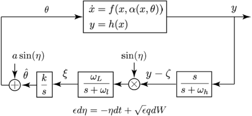

图 11：针对动态系统、使用白噪声的随机 ES 结构。

利用这种随机轨迹接近性性质，作者能够将平均化系统 (74) 的各种稳定性形式与原始系统 (70) 联系起来，其中最强的是一个指数稳定性结果：如果 (74) 的平衡点 $\bar{X}_t \equiv 0$ 是指数稳定的，那么它在随机扰动 $R(\cdot, Y_{t/\epsilon})$ 下是弱指数稳定的，即存在常数 $r > 0$、$c > 0$ 和 $\gamma > 0$，使得对任意范数不超过 $r$ 的初始条件和任意 $\delta > 0$，式 (70) 的解满足

$$\lim_{\epsilon \to 0} \inf\left\{t \geq 0 : \left|X_t^\epsilon\right| > c|x|e^{-\gamma t} + \delta\right\} = +\infty, \quad \text{a.s.} \tag{79}$$

以及有界性结果

$$\lim_{\epsilon \to 0} P\left\{\left|X_t^\epsilon\right| \leq c|x|e^{-\gamma t} + \delta,\ \forall t \in [0, T(\epsilon)]\right\} = 1. \tag{80}$$

有了这些随机平均化结果，作者接下来针对如下形式的一般非线性系统发展了他们的随机 ES 控制器：

$$\dot{x} = f(x, u), \quad y = h(x), \tag{81}$$

其中 $x \in \mathbb{R}^n$ 是状态，$u \in \mathbb{R}$ 是输入，$y \in \mathbb{R}$ 是解析上未知的输出函数。假设存在形如 $u = \alpha(x, \theta)$ 的光滑控制律，其由标量参数 $\theta$ 参数化。于是，用于寻找 $\theta$ 的最优值 $\theta^*$ 的随机 ES 更新律设计为

$$\theta = a\sin(\eta) + \hat{\theta}, \tag{82}$$

$$\frac{d\hat{\theta}}{dt} = k\xi, \tag{83}$$

$$\frac{d\xi}{dt} = -w_1 \xi + w_1 (y - \zeta)\sin(\eta), \tag{84}$$

$$\frac{d\zeta}{dt} = -w_2 \zeta + w_2 y, \tag{85}$$

$$\epsilon\, d\eta = -\eta\, dt + \sqrt{\epsilon}\, q\, dW, \tag{86}$$

这是系统 (11)–(14) 的随机对应版本，其中 $k > 0$、$w_1 > 0$、$w_2 > 0$、$\epsilon > 0$、$q > 0$ 是设计参数，$(W(t), t \geq 0)$ 是一维布朗运动。

随后，随机 ES 方法还被发展到离散实现（Liu & Krstić, 2015; Manzie & Krstić, 2009）、基于牛顿的随机 ES（Liu & Krstić, 2014），以及带时滞动态映射的随机 ES（Rušiti, Evangelisti, Oliveira, Gerdts, & Krstić, 2018）。

## 6. ES 作为具有未知时变控制方向系统的镇定反馈

2012 年，人们提出将极值搜索（ES）直接用作针对未知、不稳定且时变系统的镇定反馈，并最小化其解析未知的输出函数（Scheinker, 2012; Scheinker & Krstić, 2012b）。

这种发展基于 ES 的稳定化反馈的方法与镇定理论及控制李雅普诺夫函数（clf）理论相结合（Freeman & Kokotovic, 1996; Krstić & Deng, 1998; Krstić, Kokotovic, & Kanellakopoulos, 1995; Sepulchre, Jankovic, & Kokotovic, 2012; Sontag, 1989）。clf 技术与高频 ES 研究的结合，使得未知系统的镇定成为可能（Scheinker, 2012; Scheinker & Krstić, 2012a, 2012b），例如具有未知控制方向的系统（Mudgett & Morse, 1985; Nussbaum, 1983）；与其他方法（Ge, Yang, & Lee, 2008）不同，该方法允许未知控制增益矩阵 $B(t)$ 反复穿越零。将 ES 用作稳定化反馈的最初想法是针对开环不稳定系统提出的：

$$\dot{x} = ax + bu, \quad y = h(x, t), \tag{87}$$

其中 $a > 0$、$b$ 和 $h$ 均未知，如图 12 所示。

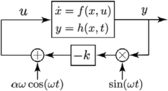

图 12：将 ES 用作优化器或稳定化反馈的结构，其中系统动力学被用作 ES 输入的天然积分器，如 Scheinker (2012) 所提出。

在镇定的情形下，所提出的反馈控制器定义为

$$u = \alpha\omega\cos(\omega t) - k\sin(\omega t) V(x), \tag{88}$$

其中 $y = V(x)$ 是式 (87) 的李雅普诺夫函数。对于 $y = x^2$，闭环动力学为

$$\dot{x} = ax + b\alpha\omega\cos(\omega t) - bk\sin(\omega t) x^2, \tag{89}$$

其中 $\alpha$ 可视为持续抖动的幅值，$k$ 为反馈增益，$\omega$ 必须足够大以保证稳定性——这与上述经典 ES 方法不同，在经典方法中 ES 抖动频率被要求取得很小。由式 (89) 可以清楚地看出，即使 $x(t)$ 接近零，形如 $b\alpha\sin(\omega t)$ 的持续抖动项仍将存在。为了研究稳定性，作变量代换

$$y(t) = x(t) - b\alpha\sin(\omega t), \tag{90}$$

即减去了持续振荡项。通过考虑时间尺度 $\tau = \omega t$，系统动力学可改写为

$$\frac{dy}{d\tau} = \frac{1}{\omega}\left(ay + ab\alpha\sin(\tau) - y^2 bk\sin(\tau) - 2b^2 k\alpha y\sin^2(\tau) - b^3 k\alpha^2\sin^3(\tau)\right), \tag{91}$$

当 $\omega$ 很大时，它可以与平均化系统

$$\frac{d\bar{y}}{d\tau} = \left(a - k\alpha b^2\right)\bar{y} \tag{92}$$

联系起来。由式 (92) 可以立即看出这种基于 ES 的反馈方法的优势：未知控制方向 $b$ 在平均化动力学中以平方形式出现。因此，只需保证 $k\alpha > a/b^2$，即可在不论 $b$ 的符号如何的情况下实现镇定，因为这确保了平均化系统 (92) 的原点是指数稳定的。轨迹 $x(t)$ 随后指数收敛到原点周围一个任意小的邻域，其大小与 $\alpha$ 和 $1/\omega$ 成正比，其解的形式为
$$x(t) \to b\alpha \sin(\omega t) + O(1/\omega) . \tag{93}$$

该结果可概括为如下定理。

**定理 2.** 考虑系统 (87)、(88) 与紧集 $K \subset \mathbb{R}$，若 $k\alpha > a/b^2$，则存在 $\omega^* > 0$，使得对所有 $\omega > \omega^*$ 以及所有 $x(0) \in K$，有

$$x(t) = e^{(a - k\alpha b^2) t}\, x(0) + b\alpha \sin(\omega t) + O(1/\omega) \quad \forall t . \tag{94}$$

对于更一般的时变系统

$$\dot{x} = a(t) x + b(t) u , \tag{95}$$

$$u = \alpha \omega \cos(\omega t) - k \sin(\omega t) V(x, t) , \tag{96}$$

进行与上述类似的分析，可得如下形式的平均系统

$$\frac{d\bar{y}}{d\tau} = a(t) \bar{y} - \frac{k\alpha}{2}\, b^2(t)\, \frac{\partial V(\bar{y}, t)}{\partial \bar{y}} , \tag{97}$$

它同时最小化 $V(x, t)$ 并镇定其最小值所在的位置。函数 $V(x, t)$ 既可以是选定的李雅普诺夫型函数，也可以是待最小化的解析未知输出函数。我们在 $a(t) \equiv 1$ 以及 $b(t) = 1$ 和 $b(t) = \cos(\omega t)$ 等若干种选择下对动态 (95)、(96) 进行了仿真，以最小化若干种形式的 $V(x, t)$，包括简单的时不变形式 $V = x^2$，以及时变形式 $V(x, t) = (x(t) - r(t))^2$，其中 $r(t) = \exp(-10(t - 0.75)^2)$。在图 13 中，针对 $b(t)$ 与 $r(t)$ 的每种选择，我们展示了增大 $k$ 与 $\omega$ 如何改善收敛性。

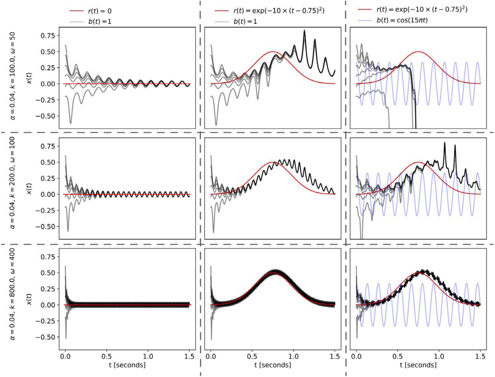
图 13：对于取 $a(t) \equiv 1$ 的不稳定系统 (96)，展示了 $x(t)$ 在多种初始条件下收敛到被跟踪轨迹 $r(t)$ 的小邻域。各列给出不同形式的 $r(t)$ 与 $b(t)$ 下的结果，各行给出不同 $k$、$\omega$ 取值下的结果。随着抖动频率 $\omega$ 与 ES 增益 $k$ 增大，在控制方向 $b(t)$ 快速时变的情况下克服不稳定性并跟踪时变轨迹的能力也随之提高。右列中的蓝色曲线为 $b(t)$ 的缩小版本，用以展示其相对于系统动态的时变速率。（关于本图题中颜色引用的解释，请读者参阅本文的网络版。）

基于 ES 的反馈控制器已被开发用于镇定种类广泛的时变向量值线性与非线性系统（Scheinker & Krstić, 2012a），其收敛性证明采用了李括号平均化方法，该方法将在下一节概述。将 ES 用作反馈控制器以最小化类李雅普诺夫函数、从而实现镇定的含义概括于图 14。例如，考虑可能开环不稳定的向量值非线性系统

$$\dot{x} = f(x, t) + g(x, t) u , \quad y = V(x, t) , \tag{98}$$

其中 $x \in \mathbb{R}^n$，$V(x, t)$ 或者是用户为实现镇定而选取的函数（李雅普诺夫型函数），或者是如经典 ES 应用中那样待最小化的、解析未知的系统可测输出函数。无论哪种情形，施加基于 ES 的反馈控制器

$$u = \sqrt{\omega}\, \left[ \alpha \cos(\omega t) - k \sin(\omega t) V(x, t) \right] , \tag{99}$$

都会得到如下形式的平均闭环动态

$$\dot{\bar{x}} = f(\bar{x}, t) - \frac{k\alpha}{2}\, g(\bar{x}, t) g^T(\bar{x}, t) \nabla_{\bar{x}} V(\bar{x}, t) = f(\bar{x}, t) - \frac{k\alpha}{2}\, g(\bar{x}, t) \left( L_g V(\bar{x}, t) \right)^T , \tag{100}$$

其中 $L_g V = \nabla_{\bar{x}} V g$。注意，在平均动态中，控制方向矩阵现在呈 $g(\bar{x}, t) g^T(\bar{x}, t) \geq 0$ 的形式，因此即使控制方向未知且时变，系统也能被镇定。

式(100) 的形式促使我们对将要设计基于 ES 镇定反馈的系统提出两个假设。

**假设 4（强 $L_g V$-可镇定性）.** 存在一个正定、径向无界、连续可微的函数 $V: \mathbb{R}^n \to \mathbb{R}^+$ 以及 $\beta > 0$，使得

$$L_f V - \beta \left( L_g V \right)^2 < 0 , \quad \forall x \neq 0 . \tag{101}$$

众所周知，形如 (98) 的连续时不变系统能够被在原点连续、在原点以外光滑的反馈所镇定，当且仅当存在一个具有适当"小控制性质"（scp）的控制李雅普诺夫函数（clf）（Sontag, 1989），其定义如下：

**定义 1.** 若对某个连续函数 $\alpha_c$ 有

$$L_g W = 0 \ \Longrightarrow\ L_f W < 0 ,$$

$$L_f W + L_g W\, \alpha_c < 0 , \quad \forall x \neq 0 ,$$

则称正定径向无界函数 $W$ 相对于形如 (98) 的系统具有小控制性质（scp）。

此外，若我们再作如下有界性假设，则上述 clf 结果可推广到形如 (98) 的时变系统（Albertini & Sontag, 1997）。

**假设 5.** 对任意紧集 $K$ 与 $r_1, r_2 > 0$，存在 $M_{r_1, r_2} > 0$，使得

$$\sup_{\substack{|x|_K \leq r_1 \\ d(u, 0) \leq r_2}} \left| f(x, t) + g(x, t) u \right| \leq M_{r_1, r_2} , \quad \forall t \in \mathbb{R} , \tag{102}$$

其中 $|x|_K$ 表示一个点到紧集 $K$ 的距离。

虽然假设 5 对任何具有连续动态的时不变系统都平凡地成立，但假设 4 比单纯的可镇定性限制更强。例如，对于系统

$$\dot{x} = x^3 + x^2 u , \tag{103}$$

它可以被简单的光滑反馈 $u = -2x$ 镇定，却不存在对某个 $\beta > 0$ 满足 (101) 的函数 $V$，而 $W = x^2/2$ 却是一个具有 scp 的 clf。

然而，对于任何这样的可镇定系统——其 clf $W$ 不仅满足 clf 条件 $L_g W = 0 \Rightarrow L_f W < 0$，还满足如下的强小控制性质（sscp）——假设 4 都成立：

$$\lim_{\epsilon \to 0}\, \max_{\substack{L_f W(x) > 0 \\ |x| = \epsilon}} \frac{L_f W(x)}{(L_g W(x))^2} < \infty . \tag{104}$$

对于满足 (104) 的系统，可以证明假设 4 对任意 $\beta \geq 1$ 都成立，为此构造新的 clf $V$ 为

$$V = \int_0^W \rho(r)\, dr , \tag{105}$$

其中

$$\rho(r) = 1 + 2 \sup_{x:\, V(x) \leq r} \frac{L_f V + \sqrt{(L_f V)^2 + (L_g V)^4}}{(L_g V)^2} . \tag{106}$$

因此，若系统具有带 sscp 的 clf，则它是强 $L_g V$-可镇定的；其逆亦真，因为注意到 (101) 蕴含：当 $x \neq 0$ 时，$L_g V = 0$ 蕴含 $L_f V < 0$，从而

$$\lim_{\epsilon \to 0}\, \max_{\substack{L_f V(x) > 0 \\ |x| = \epsilon}} \frac{L_f V(x)}{(L_g V(x))^2} < \beta < \infty . \tag{107}$$

可镇定性、假设 4、clf 的存在性以及 scp 与 sscp 性质之间的关系概括于图 14。

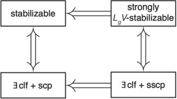
图 14：具有 sscp 的 clf 的存在性等价于系统是强 $L_g V$-可镇定的，而这又蕴含系统是可镇定的。由于可镇定性等价于具有 scp 的 clf 的存在性，故如图所示，具有 sscp 的 clf 的存在性蕴含具有 scp 的 clf 的存在性。来源：图改编自 Scheinker and Krstić (2012a)。

作为一个简单例子，我们考虑一个具有未知且快速时变控制方向向量 $b(t) = (\cos(20t), \sin(20t))$ 的二维开环不稳定系统

$$\begin{bmatrix} \dot{x}_1 \\ \dot{x}_2 \end{bmatrix} = \begin{bmatrix} 1.1 & 1.2 \\ -1.1 & 1 \end{bmatrix} \begin{bmatrix} x_1 \\ x_2 \end{bmatrix} + \begin{bmatrix} \cos(20t) \\ \sin(20t) \end{bmatrix} u , \tag{108}$$

注意该系统不稳定，极点为 $1.05 \pm 1.15i$。为了跟踪轨迹

$$r(t) = \left[ \cos(t/4),\, \sin(t/2) \right]^T , \tag{109}$$

我们定义误差 $e(t) = x(t) - r(t)$，并采用镇定 ES 反馈控制器

$$u = \alpha \sqrt{\omega} \cos(\omega t) - k \sqrt{\omega} \sin(\omega t)\, |e(t)|^2 . \tag{110}$$

该系统的轨迹如图 15 所示。

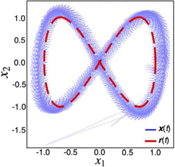
图 15：在初始瞬态之后，展示了利用 ES 作为镇定反馈控制器同时实现镇定与时变轨迹跟踪的效果。

这种镇定 ES 方法能够同时镇定开环不稳定系统并优化其解析未知的输出函数（Scheinker, 2013b）。

## 7. ES 的李括号平均化

对于高频反馈 ES 动态的研究，Dürr, Stanković, Ebenbauer, and Johansson (2013) 在平均化技术（Gurvits, 1992; Gurvits & Li, 1992; Kurzweil & Jarník, 1988; Sussmann, 1992; Sussmann & Liu, 1991）与半全局实用稳定性定理（Moreau & Aeyels, 2000）的基础上，建立了 ES 与李括号平均化之间的一个有趣联系。

在 Dürr, Stanković, Ebenbauer, and Johansson (2013) 中，作者考虑了如下形式的稳定 $T$ 周期系统

$$\dot{x} = \sum_{i=0}^{m} b_i(x, t)\, \sqrt{\omega}\, u_i(t, \omega t) , \quad u_0 \equiv 1/\sqrt{\omega} , \tag{111}$$

并证明了 (111) 的轨迹 $x(t)$ 可以与李括号平均系统

$$\dot{z} = \sum_{i=0,\, j=i+1} \left[ b_i(z, t),\, b_j(z, t) \right] \beta_{ij} \tag{112}$$

的轨迹联系起来，其中

$$\beta_{ij} = \frac{1}{T} \int_0^T u_j(t, \sigma) \int_0^{\sigma} u_i(t, \tau)\, d\tau\, d\sigma , \tag{113}$$

而各项 $[b_i, b_j]$ 是如下定义的李括号

$$[b_i, b_j] = \frac{d b_i}{dx} b_j - \frac{d b_j}{dx} b_i . \tag{114}$$

$z(t)$ 与 $x(t)$ 之间的关系是：只要 $\omega$ 取足够大的值，二者就可以在任意长的时间内保持任意接近。

**定理 3.** 对于任意有界集 $K$，若 (111) 的所有轨迹都有某个 $A > 0$ 为其解的界，则对任意 $T_f > 0$ 与任意 $\delta > 0$，存在 $\omega^*$，使得对所有 $\omega > \omega^*$，若 $z(t_0) = x(t_0)$，则下式成立：

$$|x(t) - z(t)| < \delta , \quad \forall t \in [t_0, t_0 + T_f] . \tag{115}$$

Dürr, Stanković, Ebenbauer, and Johansson (2013) 的方法是针对一个用于纳什均衡搜索的二维智能体系统设计的，智能体 $i \in 1, \ldots, N$ 的坐标为 $(x_i, y_i)$，其动态为

$$\begin{aligned}
\dot{x}_i &= c_i (r_i - e_i h_i)\, \sqrt{\omega_i} \sin(a_i \omega_i t - \varphi_i) + \alpha_i \sqrt{\omega_i} \cos(a_i \omega_i t) \\
\dot{y}_i &= -c_i (r_i - e_i h_i)\, \sqrt{\omega_i} \cos(a_i \omega_i t - \varphi_i) + \alpha_i \sqrt{\omega_i} \sin(a_i \omega_i t) \\
\dot{e}_i &= -e_i h_i + r_i ,
\end{aligned} \tag{116}$$
其中 $c_i > 0$、$h_i > 0$ 为设计参数，包括增益以及用于消除直流偏置的滤波器系数；$r_i$ 为效用函数；$e_i$ 是 $r_i$ 经过高通滤波器（其状态空间表示为 $s/(s+h_i)$）后的滤波版本；待最大化的势函数 $Q(x, y)$ 满足 $\nabla_{x_i, y_i} Q(x, y) = \nabla_{x_i, y_i} r_i(x, y)$。

式(116) 的李括号平均系统 (112) 为

$$\begin{aligned}
\dot{\bar{x}}_i &= \frac{1}{2}\Big( c_i \alpha_i \nabla_{\bar{x}_i} r_i(\bar{x}, \bar{y}) \cos(\varphi_i) + c_i \alpha_i \nabla_{\bar{y}_i} r_i(\bar{x}, \bar{y}) \sin(\varphi_i) \\
&\quad - c_i^2 \nabla_{\bar{y}_i} r_i(\bar{x}, \bar{y}) \cos(\varphi_i) \big( r_i(\bar{x}, \bar{y}) - \bar{e}_i h_i \big) \Big), \\
\dot{\bar{y}}_i &= \frac{1}{2}\Big( c_i \alpha_i \nabla_{\bar{y}_i} r_i(\bar{x}, \bar{y}) \cos(\varphi_i) - c_i \alpha_i \nabla_{\bar{x}_i} r_i(\bar{x}, \bar{y}) \sin(\varphi_i) \\
&\quad + c_i^2 \nabla_{\bar{x}_i} r_i(\bar{x}, \bar{y}) \cos(\varphi_i) \big( r_i(\bar{x}, \bar{y}) - \bar{e}_i h_i \big) \Big), \\
\dot{\bar{e}}_i &= -\bar{e}_i h_i + r_i,
\end{aligned} \tag{117}$$

可通过取 $V(\bar{x}, \bar{y}) = Q(x^*, y^*) - Q(\bar{x}, \bar{y})$ 的李雅普诺夫分析证明其收敛到 $Q$ 的最大值。$\omega = 100$ 时智能体动力学与其李括号平均轨迹接近程度的仿真结果如图 16 所示。

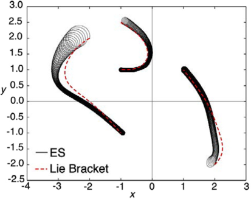
图 16：展示了各智能体的轨迹相对于其轨迹的李括号平均的关系。来源：图改编自 Dürr, Stanković, Ebenbauer, and Johansson (2013)。

基于李括号平均化的 ES 动态研究方法是一种强有力的方法，已被应用于种类繁多的系统，包括：子流形上的 ES（Dürr, Stanković, Johansson, & Ebenbauer, 2014）、带奇异摄动的 ES（Dürr, Krstić, Scheinker, & Ebenbauer, 2015, 2017）、增益调参（Benosman, 2016）、编队控制（Suttner & Sun, 2018）、避障（Grushkovskaya, Zuyev, & Ebenbauer, 2018b）、多智能体 ES（Poveda, Benosman, & Teel, 2017）、独轮车模型（Grushkovskaya, Michalowsky, Zuyev, May, & Ebenbauer, 2018）、非线性系统（Grushkovskaya & Ebenbauer, 2021）、带死区的系统（Shao, Teel, Tan, Liu, & Wang, 2019）、迭代学习控制（Khong, Nešić, & Krstić, 2016）、最大化映射灵敏度（Mills & Krstić, 2018）；此外还发展了基于牛顿的二阶李括号方法（Labar, Garone, Kinnaert, & Ebenbauer, 2019b），以及用于非完整系统的 ES（Suttner, 2020）。在 Labar, Ebenbauer, and Marconi (2022) 中，针对一类基于李括号平均的 ES 系统证明了类输入-状态稳定性（input-to-state-like）性质；在 Zhu and Fridman (2022) 中，发展了一种时滞平均化方法用于研究镇定 ES 动态；在 Michalowsky, Gharesifard, and Ebenbauer (2018) 中，利用李括号近似设计了一种分布式优化方法。

## 8. 有界 ES 与弱极限平均化

Scheinker (2013a) 发展了一种新的有界形式 ES：尽管作用于解析上未知、含噪且时变的函数，其反馈控制输出仍具有解析上可保证的界。这种有界形式的 ES 是针对如下形式的系统发展的

$$\dot{x} = f(x, t) + g(x, t) u, \quad y = h(x, t) + n(t), \tag{118}$$

其中 $f(x, t)$ 与 $g(x, t)$ 未知，系统可能开环不稳定，$y$ 是对解析未知函数 $h(x, t)$ 的含噪测量。此时的 ES 反馈控制器为

$$u = \sqrt{\alpha \omega} \cos(\omega t + ky), \tag{119}$$

闭环平均动力学为

$$\dot{\bar{x}} = f(\bar{x}, t) - \frac{k \alpha}{2} g(\bar{x}, t) g^T(\bar{x}, t) \nabla_{\bar{x}} h(\bar{x}, t). \tag{120}$$

在优化情形中，$h(x, t)$ 是待最小化的解析未知代价函数。在镇定情形中，$h(x, t)$ 可以选取，通过选取李雅普诺夫型函数（例如 $h = x^T x$）即可实现镇定。这一简单的有界 ES 结构如图 17 所示。

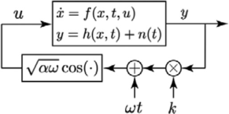
图 17：作为优化器或镇定反馈的有界 ES。

尽管对被优化函数 $h(x, t)$ 未假设任何界，有界 ES 的控制作用仍具有解析上可保证的界

$$|u| = \left| \sqrt{\alpha \omega} \cos(\omega t + ky) \right| \le \sqrt{\alpha \omega}, \tag{121}$$

这使得该算法特别适用于敏感系统的在线硬件（in-hardware）应用——在这类系统中，需要在优化解析未知且时变的代价函数的同时，对参数设置实施严格控制。最近，一组研究人员证实，海胆精子在寻找卵子时所利用的正是这一有界 ES 机制 (Abdelgalil, Aboelkassem, & Taha, 2022)。

Scheinker and Scheinker (2016) 将有界 ES 推广到更一般类别的系统，用于实现基于 ES 的向量值非线性时变系统镇定：这些系统不是周期的，其 ES 控制器也不是周期的、不可微，甚至不要求连续；其方法利用了来自泛函分析领域的一般弱极限平均化途径 (Conway, 1990)。我们先作简要回顾并给出一些定义。**黎曼–勒贝格引理（Riemann–Lebesgue Lemma）**：若 $f \in L^1(K)$，则

$$\lim_{\omega \to \infty} \int_K f(x) e^{-i \omega x}\, dx = 0. \tag{122}$$

称函数序列 $\{f_k\} \subset L^2[0, 1]$ 在 $L^2[0, 1]$ 中弱收敛于 $f$，记作 $f_k \rightharpoonup f$，若

$$\lim_{k \to \infty} \int_0^1 f_k(\tau) g(\tau)\, d\tau = \int_0^1 f(\tau) g(\tau)\, d\tau, \quad \forall g \in L^2[0, 1].$$

例如，应用黎曼–勒贝格引理可得

$$\cos(\omega t) \sin(\omega t) \rightharpoonup 0, \tag{123}$$

$$\cos^2(\omega t) \rightharpoonup \frac{1}{2}, \quad \sin^2(\omega t) \rightharpoonup \frac{1}{2}, \tag{124}$$

$$\cos(\omega_1 t) \cos(\omega_2 t) \rightharpoonup 0, \quad \forall\, \omega_1 \neq \omega_2, \tag{125}$$

$$\sin(\omega_1 t) \sin(\omega_2 t) \rightharpoonup 0, \quad \forall\, \omega_1 \neq \omega_2. \tag{126}$$

Scheinker and Scheinker (2016) 考虑了一般类别的向量值、时变、非线性系统

$$\dot{x} = f(x, t) + g(x, t) u(y, t), \quad y = \psi(x, t), \tag{127}$$

其中 $x \in \mathbb{R}^n$，函数 $f: \mathbb{R}^n \times \mathbb{R} \to \mathbb{R}^n$、$g: \mathbb{R}^n \times \mathbb{R} \to \mathbb{R}^{n \times n}$、$\psi: \mathbb{R}^n \times \mathbb{R} \to \mathbb{R}$ 均未知。

假设 $f$ 和 $g$ 关于 $x$ 二阶连续可微，并假设 $\psi(x, t)$ 的值 $y$ 可测量。控制器 $u$ 为

$$u(y, t) = \sum_{i=1}^{m} k_i(y, t) h_{i,\omega}(t), \quad k_i: \mathbb{R} \times \mathbb{R} \to \mathbb{R}^n, \tag{128}$$

其中函数 $k_i(y, t)$ 连续可微，函数 $h_{i,\omega}(t)$ 分段连续。系统 (127)、(128) 具有如下等价的闭环形式

$$\dot{x}(t) = f(x, t) + \sum_{i=1}^{m} b_i(x, t) h_{i,\omega}(t), \tag{129}$$

$$b_i(x, t) = g(x, t)\, k_i(\psi(x, t), t), \tag{130}$$

其中按下式定义的函数

$$H_{i,\omega}(t) = \int_{t_0}^{t} h_{i,\omega}(\tau)\, d\tau \tag{131}$$

满足一致极限与弱极限

$$\lim_{\omega \to \infty} H_{i,\omega}(t) = 0, \quad h_{i,\omega}(t) H_{j,\omega}(t) \rightharpoonup \lambda_{i,j}(t). \tag{132}$$

动力学 (129) 可以用如下弱极限平均动力学任意精确地逼近

$$\dot{\bar{x}} = f(\bar{x}, t) - \sum_{i \neq j = 1}^{m} \lambda_{i,j}(t) \frac{\partial b_i(\bar{x}, t)}{\partial \bar{x}} b_j(\bar{x}, t), \quad \bar{x}(0) = x(0). \tag{133}$$

稳定性结果由以下定理给出。

**定理 4.** 对于任意紧集 $K \subset \mathbb{R}^n$、任意 $t_0, T \in \mathbb{R}_{\ge 0}$ 以及任意 $\delta > 0$，存在 $\omega^\star$ 使得对每个 $\omega > \omega^\star$，(129) 与 (133) 的轨迹对所有 $t \in [t_0, t_0 + T]$ 满足 $\|x(t) - \bar{x}(t)\| < \delta$。因此，根据 Moreau and Aeyels (2000)，(133) 在 $K$ 上的一致渐近稳定性意味着 (129) 是 $\frac{1}{\omega}$-SPUAS 的。

该定理的表述用到以下稳定性定义。

**定义 2.** 考虑 $\epsilon = \frac{1}{\omega}$，并把 (127)、(128) 满足 $x(t_0) = x_0$ 的轨迹记为 $\varphi^\epsilon(t, t_0, x_0)$。若满足以下三个条件，则称 (127)、(128) 的一个平衡点为 $\epsilon$-SPUAS 的：

- **一致稳定性（Uniform Stability）**：对任意 $c_2 \in (0, \infty)$，存在 $c_1 \in (0, \infty)$ 与 $\hat{\epsilon} \in (0, \infty)$，使得对所有 $t_0 \in \mathbb{R}$、所有满足 $\|x_0\| < c_1$ 的 $x_0 \in \mathbb{R}^n$ 以及所有 $\epsilon \in (0, \hat{\epsilon})$，有

$$\|\varphi^\epsilon(t, t_0, x_0)\| < c_2 \quad \forall t \in [t_0, \infty). \tag{134}$$

- **一致有界性（Uniform Boundedness）**：对任意 $c_1 \in (0, \infty)$，存在 $c_2 \in (0, \infty)$ 与 $\hat{\epsilon} \in (0, \infty)$，使得对所有 $t_0 \in \mathbb{R}$、所有满足 $\|x_0\| < c_1$ 的 $x_0 \in \mathbb{R}^n$ 以及所有 $\epsilon \in (0, \hat{\epsilon})$，有

$$\|\varphi^\epsilon(t, t_0, x_0)\| < c_2 \quad \forall t \in [t_0, \infty). \tag{135}$$

- **全局一致吸引性（Global Uniform Attractivity）**：对任意 $c_1, c_2 \in (0, \infty)$，存在 $\bar{T} \in (0, \infty)$ 与 $\hat{\epsilon} \in (0, \infty)$，使得对所有 $t_0 \in \mathbb{R}$、所有满足 $\|x_0\| < c_1$ 的 $x_0 \in \mathbb{R}^n$ 以及所有 $\epsilon \in (0, \hat{\epsilon})$，有

$$\|\varphi^\epsilon(t, t_0, x_0)\| < c_2 \quad \forall t \in [t_0 + \bar{T}, \infty). \tag{136}$$

基于弱极限的 ES 方法已被研究用于不连续抖动信号 (Scheinker & Scheinker, 2016)、有界 ES (Scheinker & Krstić, 2014a)、倒立摆镇定 (Michalowsky & Ebenbauer, 2013)、非控制仿射系统 (Scheinker & Scheinker, 2018)，以及为未知系统生成最优反馈控制器 (Scheinker & Scheinker, 2021)。

作为弱极限平均化途径一般性的一个简单例子，考虑一个二维问题：对开环不稳定系统

$$\dot{x}_1 = x_1 + 0.75 x_2 + u_1 \tag{137}$$

$$\dot{x}_2 = 0.5 x_1 + 2 x_2 + u_2, \tag{138}$$

寻求解析未知输出函数 $y = h(x, t)$ 的最小值。该系统的开环特征值为 $\lambda = \{2.29, 0.71\} > 0$。除了使用两个不同的频率，我们还可以使用单一频率的 $\sin(\cdot)$ 与 $\cos(\cdot)$ 函数、带相移的方波、三角波、或带死区的方波，因为它们都满足在 $L^2[0, T]$ 中正交的上述要求。若选取抖动幅度使所有信号具有相等的平均功率，则所有抖动类型的平均动力学都相同，如图 18 所示。这一结果很有用，因为某些模拟系统更容易实现三角函数或三角波等连续信号，而数字系统通常以带有死区的不连续方式切换。

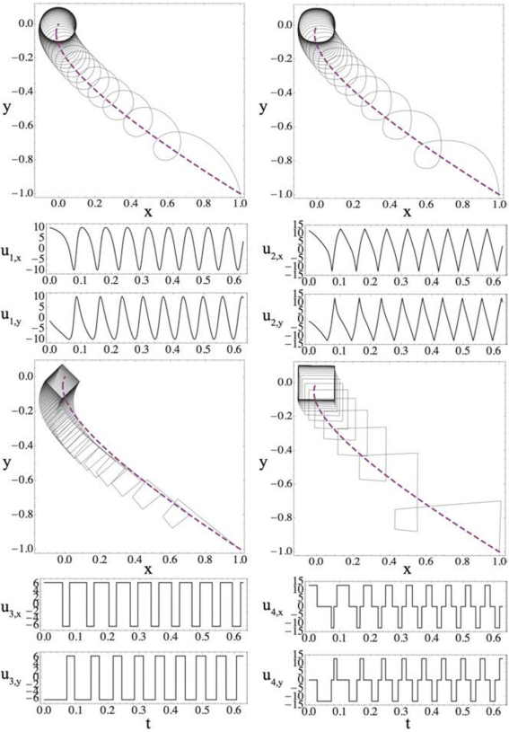
图 18：一族具有相同弱极限平均动力学的各种抖动信号。来源：图改编自 Scheinker and Scheinker (2016)。

为了直观理解简单的控制律 (119)，考虑一个不受外界影响的系统，只关心按 $\dot{x}_1 = u_1$、$\dot{x}_2 = u_2$ 进行的控制——这正是 ES 用于优化某个未知函数 $y = J(x, t)$ 时的典型设定。此时若施加 $\sin(\cdot)$ 与 $\cos(\cdot)$ 控制器，系统动力学为

$$\dot{x}_1 = \sqrt{\alpha \omega} \cos(\omega t + kJ) = v \cos(\theta), \tag{139}$$

$$\dot{x}_2 = \sqrt{\alpha \omega} \sin(\omega t + kJ) = v \sin(\theta), \tag{140}$$

这就是二维环境中以恒定速度 $v = \sqrt{\alpha \omega}$ 行驶的独轮车模型，其中 ES 用于控制航向角 $\theta(t) = \omega t + kJ$，如图 19 所示。

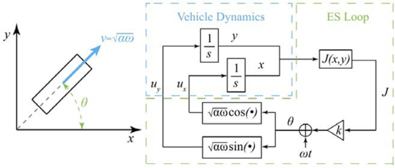
图 19：二维独轮车模型控制的有界 ES 结构。

收敛性背后的直觉来自对航向角 $\theta(t)$ 变化率的考察：

$$\begin{aligned}
\frac{d\theta}{dt} &= \omega + k \frac{dJ}{dt} = \omega + k \frac{\partial J}{\partial x_1} \dot{x}_1 + k \frac{\partial J}{\partial x_2} \dot{x}_2 \\
&= \omega + k \sqrt{\alpha \omega} \left[ \cos(\theta) \frac{\partial J}{\partial x_1} + \sin(\theta) \frac{\partial J}{\partial x_2} \right] \\
&= \omega + \underbrace{k v\, [\cos(\theta), \sin(\theta)] \cdot \nabla_x J}_{\text{角速度调制}},
\end{aligned} \tag{141}$$

它是载具速度与未知函数 $J$ 的梯度的点积。因此，当载具沿 $J$ 的负梯度方向朝最小值行驶时，转动减慢，载具花更多时间接近最小值；反之，若载具正在远离最小值，梯度为正，转动加快，载具远离最小值的时间更短。这类行为在图 18 中清晰可见。Ghadiri-Modarres, Mojiri, and Zangeneh (2016a) 修改了这一方案，在使载具以恒定角速度旋转的同时调节其前进速度。Grushkovskaya and Ebenbauer (2016) 将这一有界 ES 控制器应用于带拉格朗日测量的多智能体协同。

这一简单的二维载具控制 ES 结构此后在多篇文章中被推广到三维载具控制。Ghadiri-Modarres, Mojiri, and Zangeneh (2016b) 考虑了三维独轮车模型，并提出上述二维控制器的如下推广

$$\dot{x}_1 = V_0 \cos(\varphi) \cos(\theta), \tag{142}$$

$$\dot{x}_2 = V_0 \cos(\varphi) \sin(\theta), \tag{143}$$

$$\dot{x}_3 = V_0 \sin(\varphi), \tag{144}$$

$$\dot{\varphi} = \omega_\varphi - kh\eta, \tag{145}$$

$$\dot{\theta} = \omega_\theta - kh\eta, \tag{146}$$

$$\eta = \left[ \frac{s}{s + h} \right] J(x_1, x_2, x_3, t), \tag{147}$$

其中 $\varphi$ 与 $\theta$ 分别为载具的俯仰角与偏航角。该结构与一个仿真结果如图 20 所示。

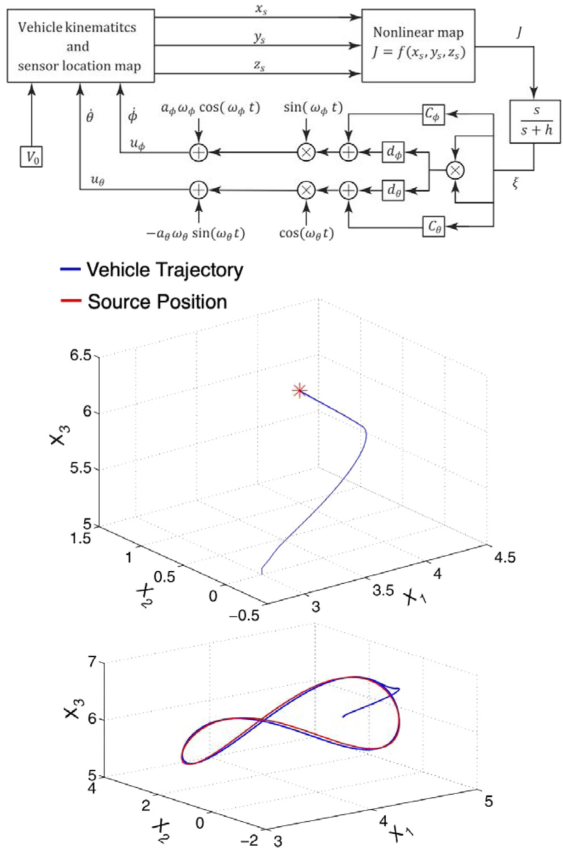
图 20：三维独轮车模型控制的有界 ES 结构与仿真示例。来源：图改编自 Ghadiri-Modarres et al. (2016a)。

Abdelgalil and Taha (2022) 考虑了三维独轮车模型，并提出上述二维控制器的另一种推广：他们利用微分几何技术与递归二阶平均化，为如下一般类别的系统给出了具有两个时间尺度的 ES 结构

$$\dot{x} = \sqrt{\omega} f_1(x, t, \sqrt{\omega} t, \omega t) + f_2(x, t, \sqrt{\omega} t, \omega t), \tag{148}$$

三维独轮车模型是其特例，其动力学为

$$\dot{x}_1 = (R \sqrt{2\omega} e_1)_1, \tag{149}$$

$$\dot{x}_2 = (R \sqrt{2\omega} e_1)_2, \tag{150}$$

$$\dot{x}_3 = (R \sqrt{2\omega} e_1)_3, \tag{151}$$

$$\dot{R} = R \Omega, \quad \Omega = \varphi e_1 + \theta e_3, \tag{152}$$

$$\mu \dot{z} = J(x) - z, \tag{153}$$

$$\theta = \omega - \dot{z}, \tag{154}$$

$$\varphi = 2 \alpha \sqrt{2\omega} \sin(\omega t - z + \pi/4), \tag{155}$$

其中 $e_i$ 为标准单位基向量，$\varphi$ 和 $\theta$ 是刚体的滚转角与偏航角，$R \in SO(3)$ 为旋转矩阵，$(R \sqrt{2\omega} e_1)_i$ 表示向量 $R \sqrt{2\omega} e_1$ 的第 $i$ 个分量。静态源定位以及轨迹跟踪的仿真结果如图 21 所示。

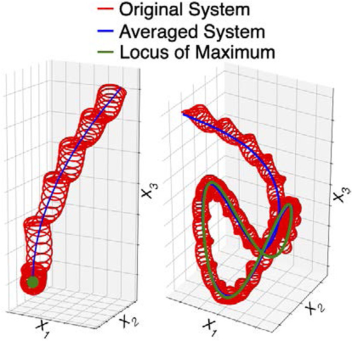
图 21：三维独轮车模型控制有界 ES 的仿真示例。来源：图改编自 Abdelgalil and Taha (2022)。

## 9. 一类通用的 ES 控制器

在 Scheinker 和 Krstić (2014b) 中，李括号平均化理论被推广到不可微系统，并应用于如下一般类别的 ES 控制器

$$u_r = \alpha \sqrt{\omega} \cos(\omega t) |x|^r - \frac{k}{1 - r} \sqrt{\omega} \sin(\omega t) |x|^{2 - r}, \tag{156}$$

其中 $x \in \mathbb{R}^n$。对这些不可微控制器的分析需要把李括号平均化与实用稳定性结果推广到在整个集合上不可微的函数。这类非 $C^2$ 控制器的主要优点在于：当 $r \neq 0, 2$ 时，整个高频振荡控制反馈在到达平衡点时完全消失。形如

$$\dot{x} = f(x, t) + g(x, t) u, \tag{157}$$

且 $u$ 取式(156) 的系统，其平均动力学为

$$\dot{\bar{x}} = f(\bar{x}, t) - k \alpha\, g(\bar{x}, t) g(\bar{x}, t)^T \bar{x}, \tag{158}$$

值得注意的是，它与 $r$ 的选取无关。

Scheinker (2013a) 与 Scheinker and Krstić (2014a, 2014b) 的研究促使人们寻找更大类别的生成向量场，用于构造镇定型 ES 控制器。Suttner and Dashkovskiy (2017) 引入了另一种形式的抖动函数，对输出函数具有已知最小值的系统保证指数稳定性。Grushkovskaya, Zuyev, and Ebenbauer (2018a) 针对形如

$$\dot{x} = F_1(J(x)) \sqrt{\omega} u_1(\omega t) + F_2(J(x)) \sqrt{\omega} u_2(\omega t), \tag{159}$$

的系统，证明了 Suttner and Dashkovskiy (2017) 与 Scheinker and Krstić (2014b) 的结果可以由如下定义的一般 ES 控制器族来描述

$$F_2(x) = -F_1(x) \int \frac{F_0(x)}{F_1^2(x)}\, dx, \tag{160}$$

式(159) 的李括号平均动力学为

$$\dot{\bar{x}} = -\beta_{2,1} \nabla J(\bar{x}) F_0(J(\bar{x})), \tag{161}$$

其中常数 $\beta_{2,1}$ 根据 $T$ 周期抖动信号 $u_1$、$u_2$ 定义为

$$\beta_{2,1} = \int_0^T \int_0^\sigma u_1(\sigma) u_2(\theta)\, d\theta\, d\sigma. \tag{162}$$

这一一般 ES 控制器族可用于生成具有良好性质的反馈，例如超调最小，以及控制作用逐渐消失、从而使系统得以稳定在平衡点，如图 22 所示。

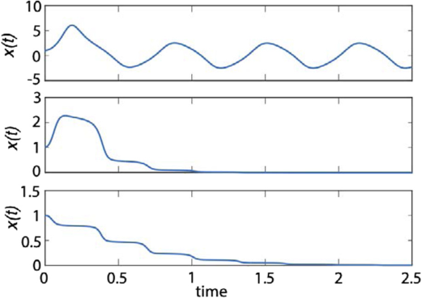
图 22：根据控制器参数的选择，可以设计出控制作用逐渐消失的控制器，使轨迹得以稳定在原点。来源：图改编自 Grushkovskaya et al. (2018a)。

标准 ES 方法依赖于存在某个足够小的 $\omega^*$，使得平均化与奇异摄动结果对所有 $\omega \in (0, \omega^*)$ 成立；而李括号平均化途径则依赖于存在某个足够大的 $\omega^*$，使得平均化结果对所有 $\omega > \omega^*$ 成立，且所需 $\omega^*$ 的实际值取决于所考虑的具体系统。Suttner (2019) 引入了一种 ES 形式，其中抖动信号的频率持续增大，从而保证相对于任何系统动力学都有足够大的 $\omega$。作者考虑了形如

$$\dot{x} = g_0(t, x) + \sum_{k=1}^{m} u_k g_k(t, x), \quad y = \psi(x), \tag{163}$$

的系统，并采用如下控制器

$$u_k = \frac{\sqrt{\omega_k}}{(z - y)^2} \sin\left(\omega_k \Omega + \frac{1}{z - y}\right), \tag{164}$$

$$\dot{z} = -(z - y), \quad \dot{\Omega} = \frac{1}{(z - y)^5}, \tag{165}$$

在某些假设下，这保证了渐近收敛到最优值，即当 $t \to \infty$ 时 $y(t) \to y^*$。该方法通过对系统(163)进行仿真来演示，其中

$$g_0(t) = (\sin(2t), \cos(t)) \tag{166}$$

$$g_1(x_1, x_2) = (\cos(x_1 + x_2), \sin(x_1 + x_2)), \tag{167}$$

$$g_2(x_1, x_2) = (-\sin(x_1 + x_2), \cos(x_1 + x_2)), \tag{168}$$

$$\psi(x_1, x_2) = (x_1 - 1)^2 + (x_2 - 1)^2 + 2018, \tag{169}$$

仿真结果如图 23 所示。

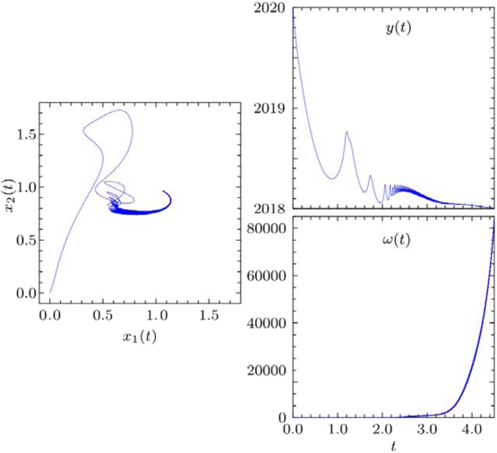
图 23：随着抖动频率不断增大，ES 渐近收敛的仿真示例。来源：图改编自 Suttner (2019)。

## 10. 比例积分 ES

针对镇定型 ES，还发展了两种比例积分方法（Guay, 2016; Guay & Dochain, 2017）。在这些方法中，实现优化的标准 ES 控制器被视为类 PI 控制中的积分项，并额外加入比例项，其目的是加快收敛和增强镇定效果。总体而言，这种双时间尺度方法可以带来收敛性质的改善。

在 Guay (2016) 中，假设被最小化的未知代价函数对时间的导数 $\dot{y}$ 可测量，系统动力学与控制器为

$$\dot{x} = f(x) + g(x)u, \quad y = h(x) \tag{170}$$

$$\dot{\hat{u}} = -\frac{1}{\alpha \tau_I} \dot{y} \sin(\omega t) \tag{171}$$

$$
\begin{aligned}
u &= \hat{u} - \frac{k}{\alpha} \dot{y} \sin(\omega t) + a \sin(\omega t) \\
&= \hat{u} + \frac{k}{\tau_I} \dot{\hat{u}} + a \sin(\omega t).
\end{aligned}
\tag{172}$$

在上述各式中，项 $-\frac{k}{\alpha} \dot{y} \sin(\omega t) + a \sin(\omega t)$ 起到快速比例反馈的作用，而 $\hat{u}$ 起到比例反馈的作用，这可以通过分部积分、把 $\hat{u}$ 重写为如下形式（取 $\hat{u}(0) = 0$）来更直接地看出

$$\hat{u}(t) = -\frac{1}{\alpha \tau_I} y(t) \sin(\omega t) + \frac{\omega}{\alpha \tau_I} \int_0^t y(\tau) \cos(\omega \tau) d\tau. \tag{173}$$

于是，闭环 PI-ES 系统(170)–(172)可以表示为图 24 所示的形式。

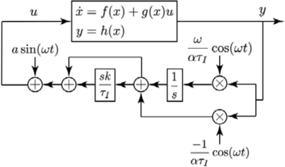
图 24：PI ES 作为优化器与镇定反馈。

一个清楚展示 PI-ES 结果优势的示例是如下系统

$$\dot{x} = -x + u, \quad y = 1 + 4(x - 1.2)^2, \tag{174}$$

其中 ES 反馈必须克服使原点稳定的 $-x$ 项，才能把 $x(t)$ 带到其最优值 1.2。将 PI 方案与标准 ES 方法进行对比的仿真结果如图 25 所示，从中可以明显看到 PI 方案稳定得更快，且超调小得多。

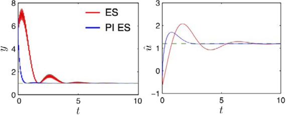
图 25：PI-ES 与 ES 的收敛对比。来源：图改编自 Guay (2016)。

在 Guay 和 Dochain (2017) 中，作者将他们的 PI-ES 结果推广到一种不需要直接获取代价函数导数 $\dot{y}$ 的方法，该导数改为通过动态方式近似。对于形式为

$$\dot{x} = f(x) + g(x)u, \quad y = h(x),$$

的动态系统，$\dot{y}$ 的动力学为

$$\dot{y} = L_f h + L_g h u, \tag{175}$$

且导数 $\dot{y}$ 可以参数化为

$$\dot{y} = \theta_0 + \theta_1 (u - \hat{u}) = \phi^T u, \tag{176}$$

其中 $\phi = [1, (u - \hat{u})^T]^T$，$\theta = [\theta_0, \theta_1^T]^T$。考虑误差信号 $e = y - \hat{y}$ 与 $\tilde{\theta} = \theta - \hat{\theta}$，建立如下预测器，将 $\dot{y}$ 估计为 $\dot{\hat{y}}$

$$\dot{\hat{y}} = \phi^T \hat{\theta} + K e + c^T \dot{\hat{\theta}}, \tag{177}$$

$$\dot{c} = -K c^T + \phi^T, \tag{178}$$

$$\dot{e} = \dot{\hat{u}}^T \tilde{\theta} - K e - c^T \dot{\hat{\theta}}, \tag{179}$$

其中 $e(0) = y(0) - \hat{y}(0)$。该预测器设置的完整细节见 Guay 和 Dochain (2017)，所得控制器为

$$u = -k_g \hat{\theta}_1 + \hat{u} + d(t), \tag{180}$$

$$\dot{\hat{u}} = -\frac{1}{\tau_I} \hat{\theta}_1, \tag{181}$$

其中抖动信号 $d(t)$ 满足持续激励条件，即存在 $\alpha_2, T > 0$ 使得

$$\int_t^{t+T} d(\tau) d^T(\tau) d\tau > \alpha_2 I, \quad \forall t. \tag{182}$$

对于与上述相同的系统，这种估计导数方法的收敛情况如图 26 所示。

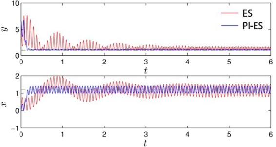
图 26：PI-ES 与 ES 的收敛对比。来源：图改编自 Guay 和 Dochain (2017)。

PI-ES 方法已被研究应用于分布在网络上的系统（Guay et al., 2018），其中考虑 $p$ 个智能体，每个智能体的动力学为

$$\dot{x}_i = f_i(x, \eta) + g_i(x, \eta) u_i \tag{183}$$

$$y_i = h_i(x), \tag{184}$$

其中 $\eta \in \mathbb{R}^q$ 是未知参数向量。总体目标是最小化总代价

$$J = \sum_{i=1}^{p} h_i(x) \tag{185}$$

而每个智能体只能访问其局部代价 $h_i(x)$ 以及其直接邻居的代价 $h_{i-1}(x)$ 和 $h_{i+1}(x)$，如图 27 所示。5 个网络化 ES 智能体收敛的一个例子如图 5 所示。该问题通过利用一种动态平均方法来估计总代价的平均值，然后对其应用 PI-ES 方法来解决（Guay, 2016; Guay & Dochain, 2017）。具有多个独立智能体的网络化控制系统，必须对信息传输速率和可用性的变化具有鲁棒性。因此，也有针对存在零星丢包的网络系统的 ES 研究，其中 ES 算法只需要传感器记录到变化时发出的通知，而不需要连续的完整传感器数据流（Premaratne, Halgamuge, Tan, & Mareels, 2019）。

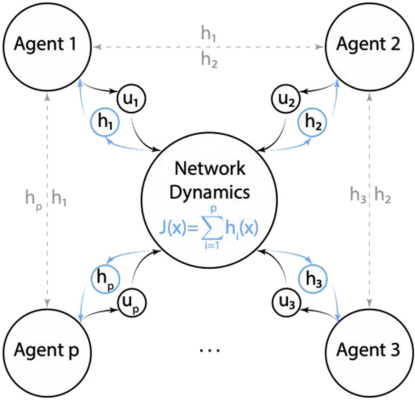
图 27：一组智能体与一个网络交互，每个智能体 $x_i$ 有自己的控制器 $u_i$，且只能访问自己的局部代价函数 $h_i(x)$ 以及其邻居的代价函数，目标是最小化未知的全局代价函数 $J(x)$。来源：图改编自 Guay et al. (2018)。

## 11. 有限时间镇定 ES

上文式(156)所述的非 $C^2$ ES 控制器具有一个有利的性质：当达到被镇定的平衡点时控制作用消失；它还有一个附加性质，即可以在紧集上指定（预设）有限时间镇定。例如，考虑开环不稳定系统

$$\dot{x} = x + u, \tag{186}$$

以及式(156)中控制器 $u_r$ 的两种选择

$$u_{r=0} = \alpha \sqrt{\omega} \cos(\omega t) - k \sqrt{\omega} \sin(\omega t) x^2, \tag{187}$$

$$u_{r=\frac{1}{2}} = \alpha \sqrt{\omega} \cos(\omega t) |x|^{\frac{1}{2}} - 2k \sqrt{\omega} \sin(\omega t) |x|^{\frac{3}{2}}, \tag{188}$$

它们给出相同的平均动力学

$$\dot{\bar{x}} = (1 - k\alpha) \bar{x} \implies \bar{x}(t) = e^{(1 - k\alpha) t} \bar{x}(0). \tag{189}$$

选择 $r = 0.5$ 的好处在于，我们得到了一个振荡逐渐消失的反馈控制器，使得一旦 $x(t)$ 到达 0，系统就能在有限时间内稳定到平衡点。我们可以估计这个有限的调节时间 $t_s$：它应当发生在振荡幅度与 $x(t)$ 大致处于相同量级之时，此时 $x(t)$ 的轨迹将摆过 0 并停止。为此，我们考虑 ES 振荡的一个周期 $t \in [t_s, t_s + \Delta t]$，其中 $\Delta t = \frac{2\pi}{\omega}$，在此期间 $x(t) \approx \bar{x}(t_s)$。在这段时间内，只考虑式(188)中占主导的第一项，对其积分可得振荡

$$t \in [t_s, t_s + \Delta t], \quad x(t) \approx \bar{x}(t_s) + \frac{\alpha}{\sqrt{\omega}} \cos(\omega t) \sqrt{|\bar{x}(t_s)|}. \tag{190}$$

该项只有当振荡与 $\bar{x}$ 量级相同时才能达到零，即

$$\sqrt{|\bar{x}(t_s)|} \approx \frac{\alpha}{\sqrt{\omega}} \implies |x(0)| e^{(1 - k\alpha) t_s / 2} \approx \frac{\alpha}{\sqrt{\omega}} \implies t_s \approx \frac{\ln\left(\dfrac{2\alpha}{\sqrt{\omega} |x(0)|}\right)}{1 - k\alpha}. \tag{191}$$

我们考虑 100 个在 $x(0) \in [-1, 1]$ 之间均匀分布的随机初始条件，取 $\omega = 300$，$\alpha = 0.5$，$k = 5$。由式(191)，这些轨迹的调节时间应为 $t_s \le 4.7$ 秒，图 28 证实所有轨迹都在约 4.5 秒内稳定下来。

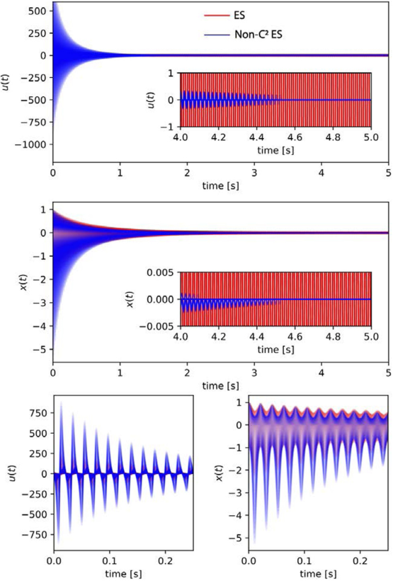
图 28：该图展示了采用 Scheinker 和 Krstić (2014b) 所提控制器时，系统(186)的轨迹与控制作用的演化过程。下方子图放大了演化的前 0.25 秒，图中的局部插图在垂直方向上放大，以显示有限时间的稳定过程。

另一种基于镇定型 ES 反馈的有限时间 ES 方法最近由 Mele, Tommasi, and Pironti (2021) 提出，作者针对开环不稳定动态系统开发了一种有限时间 ES 方法。作者采用如下关于有限时间可镇定性的定义（Amato et al., 2014）：

**定义 3.** 系统

$$\dot{x} = A(t) x(t), \quad x(t_0) = x_0, \tag{192}$$

称为关于 $(t_0, T, \Gamma(\cdot), R)$ 有限时间可镇定（FTS），当且仅当

$$x_0^T R x_0 \le 1 \implies x^T(t) \Gamma(t) x(t) < 1, \quad t \in [t_0, t_0 + T].$$

通过如下定义，FTS 条件可以推广到闭环系统：

**定义 4.** 系统

$$\dot{x} = A(t) x(t) + B(t) u(t), \quad u(t) = K(t) x(t), \tag{193}$$

称为关于 $(t_0, T, \Gamma(\cdot), R)$ 是 FTS 的，如果存在 $L(t)$、$Q(t)$ 使得

$$
\begin{aligned}
\dot{Q}(t) &\succ Q(t) A^T(t) + A(t) Q(t) + L^T(t) B^T(t) + B(t) L(t) \\
Q(t) &\prec \Gamma^{-1}(t), \quad t \in [t_0, t_0 + T] \\
Q(t_0) &\succ R^{-1}.
\end{aligned}$$

当系统对 $Q(t)$、$L(t)$ 是 FTS 时，有限时间镇定控制器的增益由

$$K(t) = L(t) Q^{-1}(t). \tag{194}$$

给出。作者考虑开环不稳定的时变系统，以及形式如下的镇定反馈控制器

$$\dot{x} = A(t) x + B(t) u, \tag{195}$$

$$u = \alpha \sqrt{\omega} \cos(\omega t) - k \sqrt{\omega} \sin(\omega t) x^T \Pi(t) x, \tag{196}$$

其李括号平均动力学（对足够大的 $\omega$）为

$$\dot{\bar{x}} = A(t) \bar{x} - k\alpha B(t) B^T(t) \Pi(t) \bar{x}. \tag{197}$$

系统(197)具有系统(193)的形式，于是其思路是设计 $\Pi(t)$，使得反馈控制增益 $-k\alpha B(t) B^T(t) \Pi(t)$ 将系统变为 FTS。实现这一点之后，还必须找到足够大的 $\omega$，使(195)、(196)与(197)的轨迹足够接近，从而使原来的强振荡系统满足 FTS 条件。为此，作者首先证明了如下引理，它允许根据原始轨迹（$x(t)$）与平均轨迹（$\bar{x}(t)$）之间的距离，把一个系统的 FTS 条件与另一个系统的 FTS 条件联系起来。

**引理 1.** 对于 $x(t), \bar{x}(t) \in \mathbb{R}^n$，给定 $\Delta > 0$，假设

$$|x(t) - \bar{x}(t)| < \Delta. \tag{198}$$

考虑两个关于时间的对称正定矩阵值函数 $\Gamma(t)$ 与 $\bar{\Gamma}(t)$，使得 $\forall t \in [t_0, t_0 + T]$

$$\bar{\Gamma}(t) = \frac{1}{r^2(t)} \Gamma(t). \tag{199}$$

如果在时间区间 $t \in [t_0, t_0 + T]$ 上 $\bar{x}^T(t) \bar{\Gamma}(t) \bar{x}(t) < 1$ 成立，则在同一时间区间上

$$x^T(t) \Gamma(t) x(t) < 1, \quad \forall r(t) \le 1 - \frac{\Delta}{\min_i \gamma_i(t)}, \tag{200}$$

其中 $\{1/\gamma_i^2(t)\}$ 是 $\Gamma(t)$ 在时刻 $t$ 的特征值。

该文的主要结果如下：

**定理 5.** 对于任意 $\Delta > 0$，选择足够大的 $\omega$，使得(195)–(197)的轨迹在 $t \in [t_0, t_0 + T]$ 上满足界 $|x(t) - \bar{x}(t)| < \Delta$。如果存在某个 $Q(t)$、$k$、$\alpha$ 与 $\Pi(t)$，使得

$$\dot{Q}(t) \succ Q(t) A(t) + A^T(t) Q(t) - k\alpha Q(t) \Pi(t) B(t) B^T(t) - k\alpha B(t) B^T(t) \Pi(t) Q(t), \quad \forall t \in [t_0, t_0 + T], \tag{201}$$

$$Q(t) \succ \bar{\Gamma}^{-1}(t), \quad \forall t \in [t_0, t_0 + T], \tag{202}$$

$$Q(t_0) \prec R^{-1}, \tag{203}$$

其中 $\bar{\Gamma}(t)$ 是引理 1 中定义的关于时间的矩阵值函数，且

$$r(t) \le 1 - \frac{\Delta}{\min_i \gamma_i(t)}, \tag{204}$$

则系统(195)、(196)关于 $(t_0, T, R, \Gamma(t))$ 是 FTS 的，且 $k$、$\alpha$ 与 $\Pi(t)$ 取相同的值。

此外，经过一番有趣的分析，作者对所需的 $\omega$ 量级给出了一个估计，用以保证界 $|x(t) - \bar{x}(t)| < \Delta$，这里所考虑的系统具有常数 $B(t) = B$。该界为

$$\omega \ge \left[ \frac{2(\alpha + k) |B| \eta}{\Delta} \right]^2, \tag{205}$$

其中
$$\eta = \max_t \left\| e^{\int_{t_0}^{t} |A(\tau) - k\alpha B B^T \Gamma(\tau)|\, d\tau} \right\|. \tag{206}$$

这一直观结果表明，最小抖动频率的平方根与轨迹之间的最大分离度 $\Delta$ 成反比，并与影响注入系统的扰动幅值的各项（$\alpha$、$k$、$|B|$）以及系统不稳定程度 $A(t)$ 的规模成正比。

FTS ES 的结果通过若干仿真进行了演示，其中包括对如下时变不稳定系统的镇定：

$$\begin{bmatrix} \dot{x}_1 \\ \dot{x}_2 \end{bmatrix} = \left(1 + \frac{t}{10}\right) \begin{bmatrix} 0.5 & -0.1 \\ 0 & -0.15 \end{bmatrix} \begin{bmatrix} x_1 \\ x_2 \end{bmatrix} u(t), \tag{207}$$

其中 $u(t)$ 由式(196) 给出，且

$$R = \begin{bmatrix} 6.25 & 0 \\ 0 & 9.375 \end{bmatrix}, \quad \Gamma(t) = \Gamma_0 e^{t/10}, \quad \Gamma_0 = \begin{bmatrix} 4 & 0 \\ 0 & 6 \end{bmatrix}. \tag{208}$$

5 个随机初始条件下的仿真结果如图 29 所示。

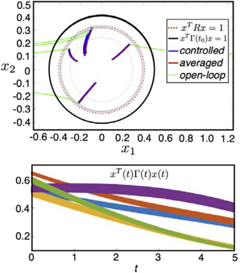
图 29：五个不同初始条件下 FTS ES 的仿真结果。来源：图改编自 Mele et al. (2021)。

## 12. 偏微分方程（PDE）的 ES

为了针对带时滞的系统发展 ES 方法，ES 分析被推广到由偏微分方程（PDE）支配的系统，其中时滞被建模为一个 PDE（Oliveira, Krstić, & Tsubakino, 2016）。

在 Oliveira et al. (2016) 中，作者考虑了带有调谐参数向量 $\theta = (\theta_1, \ldots, \theta_n)$ 的静态映射，这些参数对输出测量 $y = Q(\theta)$ 的影响在每个通道 $i$ 中具有各不相同的时滞 $(D_1, \ldots, D_n) > 0$。该时滞关系可概括为

$$y(t) = Q(\theta(t - D)) = e^{-Ds}\,[Q(\theta(t))], \tag{209}$$

考虑滞后调谐参数的动力学向量——它们是输入 $U_i$ 的滞后函数——由下式给出

$$\dot{\theta}(t - D) = \begin{bmatrix} U_1(t - D_1) \\ U_2(t - D_2) \\ \vdots \\ U_n(t - D_n) \end{bmatrix}, \tag{210}$$

这些滞后可以按照输运方程 PDE 表示为连续时间动力学：

$$\dot{\theta}_i(t - D_i) = u_i(0, t), \tag{211}$$

$$\partial_t u_i(x, t) = \partial_x u_i(x, t), \quad x \in [0, D_i], \tag{212}$$

$$u_i(D_i, t) = U_i(t), \quad i = 1, 2, \ldots, n, \tag{213}$$

其解为

$$u_i(x, t) = U_i(t + x - D_i). \tag{214}$$

然后，利用平均化理论、Lyapunov–Krasovskii 泛函分析以及反步变换对系统进行分析，以推导控制器

$$u_i(D_i, t) = \frac{c_i}{s + c_i} \left\{ -k_i \left[ z_i(t) + \int_0^{D_i} u_i(\sigma, t) d\sigma \right] \right\}, \tag{215}$$

其中 $c_i, k_i > 0$，且

$$z(t) = \Gamma(t) G(t), \tag{216}$$

其中 $\Gamma(t)$ 是 Riccati 微分方程的解，如上文基于牛顿的 ES 中所述，

$$\dot{\Gamma} = \omega_r \Gamma - \omega_r \Gamma \hat{H} \Gamma \tag{217}$$

该式给出了代价函数 Hessian 矩阵之逆的估计。矩阵 $G(t)$ 与施加于被测输出的抖动信号相关，即

$$G(t) = M(t) y(t), \tag{218}$$

$$M(t) = \left[ \frac{2}{a_1} \sin(\omega_1 t), \ldots, \frac{2}{a_n} \sin(\omega_n t) \right]^T. \tag{219}$$

整体设置如图 30 所示，其中

$$N(t) = \left[ a_1 \sin(\omega_1 (t + D_1)), \ldots, a_n \sin(\omega_n (t + D_n)) \right]^T. \tag{220}$$

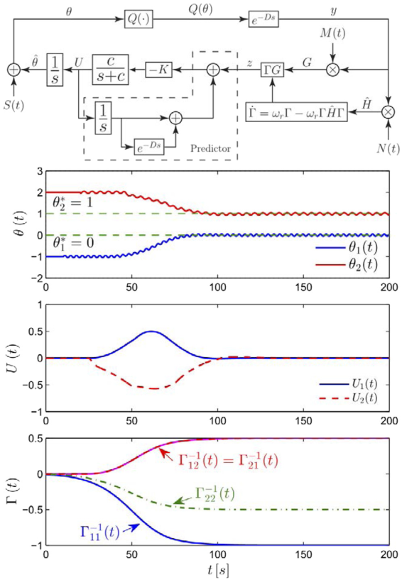

图 30：上：带时滞系统的牛顿 ES 设置。下：仿真收敛示例。（来源：图改编自 Oliveira et al. (2016)。）

上述 ES PDE 方法随后被推广到执行器动态由扩散 PDE 支配的静态映射的多变量 ES（Oliveira, Feiling, Koga, & Krstić, 2020）。对每个控制向量 $\theta_i$，作者假设其满足一个独立的热方程，使得被传播的执行器向量 $\Theta(t) \in \mathbb{R}^n$ 的动态为

$$\Theta_i(t) = \alpha_i(0, t), \quad \forall i \in \{1, 2, \ldots, n\} \tag{221}$$

$$\partial_t \alpha_i(x, t) = \partial_{xx} \alpha_i(x, t), \quad x \in (0, D_i) \tag{222}$$

$$\partial_t \alpha_i(0, t) = 0 \tag{223}$$

$$\alpha_i(D_i, t) = \theta_i(t) \tag{224}$$

其中 $\alpha_i : [0, D_i] \times \mathbb{R}_+ \to \mathbb{R}$，且每个域长度 $D_i$ 已知。系统式(221)–(224) 可解为

$$\alpha_i(x, t) = \mathcal{L}^{-1}\left[ \frac{\cosh(x\sqrt{s})}{\cosh(D_i\sqrt{s})} \right] * \theta_i(t), \tag{225}$$

其中 $\mathcal{L}^{-1}(\cdot)$ 表示逆拉普拉斯变换，$*$ 为卷积算子。

该关系被用来定义扩散算子 $\mathcal{D} = \mathrm{diag}\{\mathcal{D}_1, \ldots, \mathcal{D}_n\}$，其中

$$\mathcal{D}_i[\varphi(t)] = \mathcal{L}^{-1}\left[ \frac{1}{\cosh(D_i\sqrt{s})} \right] * \varphi(t), \quad \text{使得 } \Theta(t) = \mathcal{D}[\theta(t)]. \tag{226}$$

随后，作者定义了未知静态映射 $Q(\theta)$ 的标量测量 $y$ 与被传播输入式(221) 之间的关系：

$$y(t) = Q(\mathcal{D}[\theta(t)]) = Q(\Theta(t)), \quad \Theta(t) = [\Theta_1(t), \ldots, \Theta_n(t)]^T. \tag{227}$$

假设未知静态映射在极值点 $y^*$ 的邻域内是局部二次的，即

$$y(t) = Q(\Theta(t)) = y^* + \frac{1}{2}(\Theta(t) - \Theta^*)^T H (\Theta(t) - \Theta^*), \tag{228}$$

其中 Hessian 矩阵 $H = H^T < 0$ 未知。随后，作者采用与上文针对时滞系统所述类似的方法，发展了用于该系统优化的牛顿 ES 方法。整体闭环系统动态为

$$\dot{\theta}_i = u_i(0, t) \tag{229}$$

$$\partial_t u_i(x, t) = \partial_{xx} u_i(x, t), \quad x \in (0, D_i) \tag{230}$$

$$\partial_x u_i(0, t) = 0 \tag{231}$$

$$u_i(D_i, t) = -\frac{k_i c_i}{s + c_i} z_i(t) - \frac{k_i c_i}{s + c_i} \int_0^{D_i} (D_i - \sigma) u_i(\sigma, t)\, d\sigma, \tag{232}$$

整体设置如图 31 所示。

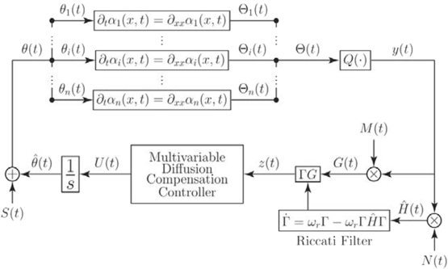

图 31：多变量 PDE 的牛顿 ES 设置。（来源：图改编自 Oliveira et al. (2020)。）

PDE ES 方法还被发展用于波动 PDE 补偿（Oliveira & Krstić, 2021）、带时滞系统的 ES（Oliveira et al., 2016; Rušiti, Oliveira, Krstić, & Gerdts, 2021）、带时变时滞系统的基于牛顿的 ES（Rušiti et al., 2021），以及执行动态由扩散 PDE 支配的静态映射（Feiling, Koga, Krstić, & Oliveira, 2018）。

## 13. 含动态包含的混合 ES

对于某些系统，引入在多种反馈律之间切换的混合控制器所带来的额外灵活性可能是有益的；而对另一些系统，由于其系统动态的结构，这种灵活性是必需的。鲁棒混合控制器已被发展用于在未知或对抗环境下运行的自主车辆，可同时实现避障与源搜索（Poveda, Benosman, Teel, & Sanfelice, 2021）；带加速与重置机制的优化混合 ES 控制器已被提出（Poveda & Li, 2021）；此外还发展了一种在光滑紧致流形上实现全局实用优化的混合 ES 方法（Strizic, Poveda, & Teel, 2017）。

一个通用框架已被建立，用于将 ES 的应用扩展到兼具连续时间与离散时间动态的混合系统（Poveda et al., 2018; Poveda & Teel, 2017a）。在 Poveda and Teel (2017a) 中，作者针对如下形式的集值混合动态系统（HDS）开发了控制器：

$$\dot{x} \in F(x), \quad x \in C, \tag{233}$$

$$x^+ \in G(x), \quad x \in D, \tag{234}$$

其中 $\dot{x} = dx/dt$，$x^+$ 对应 $x$ 在瞬时跳跃之后的取值，$F(x)$ 与 $G(x)$ 分别为流映射与跳跃映射。在该方法中，所涉及的动态系统不限于由 Lipschitz 微分方程支配的系统，而是被推广到由微分包含描述的系统——后者常用于分析不连续系统与切换系统。由于此类系统不保证具有唯一解，作者针对从紧致初始条件集出发涌现的所有动态寻找最优工作设定点。这类研究对实际应用尤其有用：在存在噪声、扰动与不确定性的场合，需要研究整组可能的初始条件与轨迹，而非单个平衡点。此类系统频繁出现在实际的优化与控制系统中，其形式包括切换系统、逻辑与基于事件的控制器、参数弱跳变的连续时间系统、基于监督的控制系统，以及具有切换通信拓扑的多智能体系统。HDS 系统式(233)、式(234) 用记号 $\mathcal{H} := \{C, F, D, G\}$ 表示。

在给出主要结果之前，需要若干定义。若对所有序列 $x_i \to x$ 与 $y_i \in M(x_i)$（满足 $y_i \to y$），均有 $y \in M(x)$，则称集值映射 $M$ 在 $x \in \mathbb{R}^m$ 处外半连续（OSC）。若存在 $x$ 的邻域 $U_x$ 使得 $M(U_x) \subset \mathbb{R}^n$ 有界，则称集值映射 $M$ 在 $x \in \mathbb{R}^m$ 处局部有界（LB）。给定集合 $\mathcal{X} \subset \mathbb{R}^m$，若由"当 $x \in \mathcal{X}$ 时取 $M(x)$、当 $x \notin \mathcal{X}$ 时取 $\emptyset$"定义的从 $\mathbb{R}^m$ 到 $\mathbb{R}^n$ 的集值映射在每个 $x \in \mathcal{X}$ 处均为 OSC 且 LB，则称映射 $M$ 相对于 $\mathcal{X}$ 为 OSC 且 LB。给定如上所述的混合系统 $\mathcal{H}$，以及紧致集 $\mathcal{A} \subset \mathbb{R}^n$。若存在一个 $\mathcal{KL}$ 类函数 $\beta$，使得 $\mathcal{H}$ 的任意最大解 $x$ 满足

$$|x(t, j)|_{\mathcal{A}} \leq \beta(|x(0, 0)|_{\mathcal{A}}, t + j), \quad \forall (t, j) \in \mathrm{dom}(x), \tag{235}$$

则称集合 $\mathcal{A}$ 对 $\mathcal{H}$ 是一致全局渐近稳定（UGAS）的。

作者考虑状态为 $\theta \in \mathbb{R}^m$、输入为 $u \in \mathbb{R}^n$、输出为 $y \in \mathbb{R}$ 的动态系统，由如下约束微分包含建模：

$$\dot{\theta} \in P(\theta, u), \quad (\theta, u) \in \Lambda_\theta \times \mathbb{U}, \quad J = \varphi(\theta, u), \tag{236}$$

其中 $P$ 为集值映射，$\varphi$ 为输出函数，$u$ 在闭集 $\mathbb{U} = \hat{\mathbb{U}} + \mathbb{B}$ 中演化，其中 $\hat{\mathbb{U}} \subset \mathbb{R}^n$。作出如下正则性假设。

**假设 6.** 集合 $\hat{\mathbb{U}}$ 是闭的。集值映射 $P(\cdot, \cdot)$ 相对于 $\mathbb{R}^m \times \mathbb{U}$ 是 OSC 且 LB 的，$\mathbb{R}^m \times \mathbb{U} \subset \mathrm{dom}(P)$，且对每个 $(\theta, u) \in \mathbb{R}^m \times \mathbb{U}$，$P(\theta, u)$ 是凸的。映射 $\varphi(\cdot, \cdot)$ 对两个自变量均连续。

**假设 7.** 存在一个相对于 $\mathbb{U}$ 为 OSC 且 LB 的集值映射 $H$，使得对每个 $\rho > 0$，紧致集 $\mathbb{M}_\rho := \{(\theta, u) : \theta \in H(u),\ u \in \mathbb{U} \cap \rho\mathbb{B}\}$ 对于受限 HDS $\mathcal{H}_{p_\rho} := \{\Lambda_\theta \times (\mathbb{U} \cap \rho\mathbb{B}), P \times 0, \emptyset, \emptyset\}$（其状态为 $[\theta^T, u^T]^T$）是 UGAS 的。

**假设 8.** 响应映射 $J : \mathbb{R}^n \to \mathbb{R}$ 是解析的，且存在一个最优的非空紧致集 $\mathcal{O} \subset \hat{\mathbb{U}}$，使得对所有 $u^* \in \mathcal{O}$ 与所有 $u \in \hat{\mathbb{U}} \setminus \mathcal{O}$，都有 $J(u^*) > J(u)$。

考虑一类时不变的、基于梯度的混合极值搜索控制器，其由状态为 $(\xi, \mu) \in \mathbb{R}^n \times \mathbb{R}^{2n}$ 的动态梯度估计器，以及整体状态为 $x_{u,z} := (\hat{u}, \hat{z}) \in \mathbb{R}^n \times \mathbb{R}^r$ 的混合学习机制组成；该控制器仅基于输出测量在线提取 $J$ 的梯度信息，从而将被控对象的输入调节到最优集 $\mathcal{O}$。混合 ES 的结构如图 32 所示，其中响应映射 $J$ 的梯度估计器的动态为

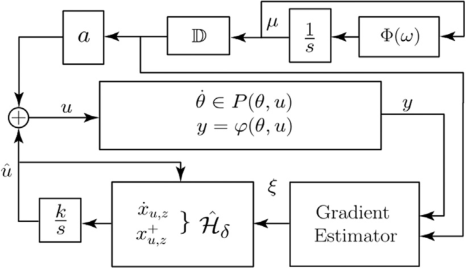

图 32：混合 ES 设置。（来源：图改编自 Poveda and Teel (2017a)。）

$$\dot{\xi} = -\omega_L \left( \xi - \frac{2}{a} y \cdot \mathbb{D}\mu \right), \tag{237}$$

$$\dot{\mu} = \Phi(\omega) \cdot \mu, \quad (\xi, \mu) \in \Lambda_\xi \times \mathbb{S}^n, \tag{238}$$

其中 $\mu = [\mu_1^T, \ldots, \mu_n^T]^T \in \mathbb{S}^n$，$\mu_i = [\mu_{i,1}, \mu_{i,2}]^T \in \mathbb{S}^1$，对所有 $i \in \{1, \ldots, n\}$；$\xi$ 在紧致集 $\Lambda_\xi = \lambda_\xi \mathbb{B} \subset \mathbb{R}^n$ 中演化，其中 $\lambda_\xi > 0$ 选取得足够大，以涵盖所有感兴趣的完整解；矩阵 $\mathbb{D} = [e_1, 0, e_2, 0, \ldots, e_i, \ldots, 0, e_n, 0]$ 为分块矩阵，其中 $0 \in \mathbb{R}^n$ 为零列向量，$e_i \in \mathbb{R}^n$ 为第 $i$ 维的单位基向量。以 $\omega$ 为参数的分块矩阵 $\Phi : \mathbb{R}^{2n} \to \mathbb{R}^{2n}$ 由下式给出：

$$\Phi(\omega) = \begin{bmatrix} \Omega(\omega_1) & 0 & \cdots & 0 \\ 0 & \Omega(\omega_2) & \cdots & 0 \\ \vdots & \vdots & \ddots & \vdots \\ 0 & 0 & \cdots & \Omega(\omega_n) \end{bmatrix}, \tag{239}$$

其中分块分量 $\Omega(\omega_i)$ 由下式给出：

$$\Omega(\omega_i) = \begin{bmatrix} 0 & \omega_i \\ -\omega_i & 0 \end{bmatrix}, \quad \forall i \in \{1, \ldots, n\}, \tag{240}$$

其中 $\omega = [\omega_1, \ldots, \omega_n]^T$，$\omega_i = \epsilon \cdot \kappa_i$，$\omega_L = \epsilon \cdot \bar{\omega}$，$(\epsilon, \bar{\omega}) \in \mathbb{R}^2_{>0}$，$\kappa_i$ 为有理数且满足 $\kappa_i \neq \kappa_j$，$(i, j) \in \{1, \ldots, n\}$。$u = \hat{u} + a\mathbb{D}\mu$，其中 $a \in (0, 1)$ 是可调的小参数，$\hat{u} \in \mathbb{R}^n$ 为辅助状态。与线性振荡器 $\dot{\mu} = \Phi(\omega) \cdot \mu$ 相关联的连续时间动态生成一组周期信号向量，其奇数分量由 $\mu_{i,1}(t) = \cos(\omega_i t)\mu_{2i-1}(0) + \sin(\omega_i t)\mu_{2i}(0)$ 给出，对每个 $i \in \{1, \ldots, n\}$。这些信号被注入闭环系统，以提取 $J$ 的梯度信息。

## 14. 有限时间牛顿 ES

在 Poveda and Krstić (2021) 中，上文针对基于混合 ES 的优化所发展的方法被用来建立新的 ES 方法，能够在预先指定的有限时间内（在半全局实用意义下）优化静态映射的解析未知输出函数。由于所考虑的系统是非 Lipschitz 连续的，作者考虑如下形式的系统：

$$x \in C, \quad \dot{x} = F(x), \tag{241}$$

其中 $x \in \mathbb{R}^n$ 为状态，$C \subset \mathrm{dom}(F)$ 为闭的流集，$F$ 为集值映射，且相对于 $C$ 是 OSC、LB 且凸值的。式(241) 的解是绝对连续函数 $x : \mathrm{dom}(x) \to \mathbb{R}^n$，满足：$x(0) \in C$；对所有 $t \in \mathrm{dom}(x)$ 有 $x(t) \in C$；且对几乎所有 $t \in \mathrm{dom}(x)$ 有 $\dot{x}(t) \in F(x(t))$。作者针对如下形式的动态系统建立其结果：

$$\dot{x} = f(x, u), \quad y = h(x, u), \tag{242}$$

其中 $f$ 局部 Lipschitz，$h$ 连续可微，且被控对象状态的工作空间 $\mathcal{S}$ 是闭且有界的。需要以下假设。

**假设 9.** 存在连续函数 $l_x : \mathbb{R}^n \to \mathbb{R}^p$，使得对每个紧致集 $K_u \subset \mathbb{R}^n$，受约束的动态系统 $(x, u) \in \mathcal{S} \times K_u$，$\dot{x} = f(x, u)$，$\dot{u} = 0$ 使紧致集 $\mathbb{M}_{K_u} = \{(x, u) \in \mathcal{S} \times K_u : x = l_x(u)\}$ 成为 UGAS。

**假设 10.** 考虑定义为 $\varphi(u) = h(l_x(u), u)$ 的响应映射，函数 $u \to \varphi(u)$ 二阶连续可微，且集合

$$A_\varphi = \arg\min_{u \in \mathbb{R}^n} \varphi(u),$$

非空且紧致。

如前一节所述，接下来的方法是仅利用输出测量 $y$，在对 $f$、$h$ 或 $\varphi$ 无解析知识的情况下，将输入 $u$ 调节向集合 $A_\varphi$。
这种类牛顿固定时间 ES 控制器定义如下（下文中 $\dot{x} = dx/d\tau$，其中 $\tau = \epsilon_0 t$）：

$$\dot{\hat{u}} = -k F_u(\hat{u}, \xi) \tag{243}$$

$$\dot{\xi}_1 = -\frac{1}{\epsilon_2}\left( \xi_1 F_H(y, \tilde{u}) \xi_1 - \xi_1 \right) \tag{244}$$

$$\dot{\xi}_2 = -\frac{1}{\epsilon_2}\left( \xi_2 - F_G(y, \tilde{\mu}) \right) \tag{245}$$

$$\dot{\mu} = -\frac{2\pi}{\epsilon_1} \mathcal{R}_\theta \tilde{\mu} \tag{246}$$

$$\dot{x} = \frac{1}{\epsilon_0} f(x, \hat{u} + a\tilde{\mu}) \tag{247}$$

$$\hat{u} = u - a \mathcal{D} \mu , \tag{248}$$

其中 $\mathcal{D} \in \mathbb{R}^{n \times 2n}$ 是把向量 $x = [x_1, x_2, \ldots, x_{2n}]^T \in \mathbb{R}^{2n}$ 映射为向量 $\tilde{x} = [x_1, x_3, \ldots, x_{2n-1}]^T$ 的矩阵，后者只保留 $x$ 的奇数分量；学习动态定义为

$$F_u(\hat{u}, \xi) = \xi_1 \left( \frac{\xi_2}{|\xi_2|^{\alpha_1}} + \frac{\xi_2}{|\xi_2|^{\alpha_2}} \right) , \tag{249}$$

当 $\xi_2 = 0$ 时取 $F_u = 0$，参数 $(\alpha_1, \alpha_2)$ 的选取需保证 $F_u$ 的连续性。关于其中所有常数取值的确定规则，请参阅原论文。有限时间牛顿 ES 的仿真结果如图 34 所示。

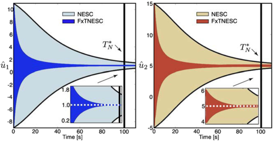
图 34：有限时间牛顿 ES 仿真实例。来源：图改编自 Poveda and Krstić (2021)。

有限时间牛顿 ES 的结构如图 33 所示。此后人们又发展了若干其他有限时间 ES 优化方法，包括面向未知映射的有限时间 ES（Guay & Benosman, 2021）、固定时间类牛顿 ES（Poveda & Krstić, 2020b）以及固定时间基于梯度的 ES（Poveda & Krstić, 2020a）。

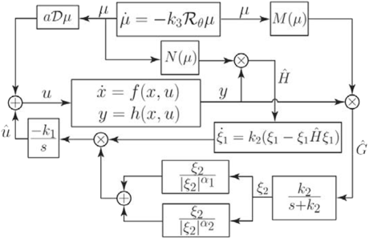
图 33：有限时间牛顿 ES 结构。来源：图改编自 Poveda and Krstić (2021)。

## 15. 安全 ES

在未知环境中进行约束优化时，人们常借助高斯过程（GP），从而能够以统计方式考量安全性。Berkenkamp, Schoellig, and Krause (2016) 描述了四旋翼控制器的安全优化，Sui, Gotovos, Burdick, and Krause (2015) 则给出了一种经由 GP 进行安全优化的一般方法。

人们已经发展了若干用 ES 求解约束优化问题的方法，例如 Guay et al. (2015)。他们改进的 ES 设计同样涉及对未知函数梯度的估计，并且其分析不借助经典的平均化与奇异摄动理论。在 Liao, Manzie, Chapman, and Alpcan (2019) 中，ES 与"边界追踪"（boundary tracing）相结合，其形式化基于取自非线性规划技术的概念。Poveda and Quijano (2015) 提出了基于 ES 的算法，受演化博弈论启发，可同时处理等式约束与不等式约束。人们还发展了一种带避障功能的鲁棒协调混合源搜索方法（Poveda, Benosman, Teel, & Sanfelice, 2021）。

Scheinker (2017) 针对角速度驱动的独轮车模型系统发展了一种非常简单的约束 ES 方法：各自主智能体仅根据含噪测量 $\hat{J} = J + n = J_0 + J_c + n$，试图最小化一个解析上未知的代价函数 $J$；其中 $J_0$ 是智能体试图最小化的未知源函数，$J_c$ 是一个解析上未知的碰撞避免函数，取决于与邻近智能体的接近程度。例如，每个智能体可以在其邻域内生成这样一个函数，比如一个最大值位于该智能体所在位置的高斯函数。从物理上看，这种信号可以是温度或电场强度等随距源距离自然衰减的量。为考虑一组 $N$ 个智能体，定义其坐标为 $x = (x_1, \ldots, x_N)$，其中 $x_i = (x_{i1}, x_{i2})$ 是每个智能体 $i$ 的二维坐标。此时动态为

$$\dot{x}_{i1} = \sqrt{\alpha\omega} \cos(\theta) , \quad \dot{x}_{i2} = \sqrt{\alpha_i \omega_i} \sin(\theta_i) , \tag{250}$$

$$\dot{\theta}_i = \omega_i + k_i \omega_i^2 \left( \hat{J}_i(x_i, t) - \eta_i \right) , \tag{251}$$

$$\dot{\eta}_i = -\omega_i^2 \left( \eta_i - \hat{J}_i(x, t) \right) , \tag{252}$$

$$\hat{J}_i = \underbrace{J_{i,0}(x, t)}_{\text{最小化}} + \underbrace{J_{i,c}(x, t)}_{\text{碰撞避免}} + \underbrace{n_i(t)}_{\text{噪声}} . \tag{253}$$

为简洁起见，图 35 以单个二维系统为例对此进行了概括。

例如，对于一个双智能体系统，目标可以是让每个智能体最小化各自解析上未知的代价函数，同时避免与另一智能体相撞，函数 $\hat{J}_i$ 取为

$$\hat{J}_1 = \underbrace{(x_{11} - 1)^2 + x_{12}^2}_{\text{最小化}} + \underbrace{k_p e^{-k_a \left( (x_{11}-x_{21})^2 + (x_{12}-x_{22})^2 \right)}}_{\text{碰撞避免}} + \underbrace{n_1(t)}_{\text{噪声}} ,$$

$$\hat{J}_2 = \underbrace{(x_{21} + 1)^2 + x_{22}^2}_{\text{最小化}} + \underbrace{k_p e^{-k_a \left( (x_{11}-x_{21})^2 + (x_{12}-x_{22})^2 \right)}}_{\text{碰撞避免}} + \underbrace{n_2(t)}_{\text{噪声}} .$$

对这样一个系统在启用（$k_p > 0$）与关闭（$k_p = 0$）碰撞避免功能时的仿真如图 35A、B 所示。

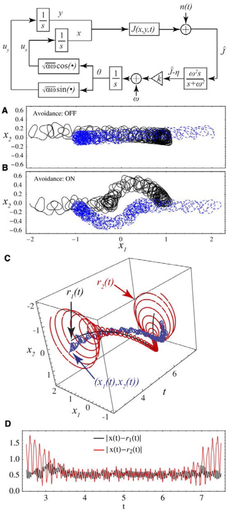
图 35：碰撞避免实例。碰撞避免关闭时（A）可以看到智能体相互碰撞，开启时（B）它们会自动改变轨迹以安全通过。可以看到蓝色智能体 $(x_1(t), x_2(t))$ 紧密跟踪 $r_1(t)$ 而不与其相撞，并且当第三个智能体 $r_2(t)$ 盘旋靠近 $r_1(t)$ 时，它会自动远离以避免与 $r_2(t)$ 相撞（C）。受控智能体与另外两个智能体之间始终保持非零距离（D）。（关于本图图题中颜色引用的解释，请读者参阅本文的网络版。）来源：改编自 Scheinker (2017)。

开启碰撞避免后，各条轨迹在趋向各自最小化值的过程中彼此避让。

一个更复杂的例子是考虑一个三智能体系统：受控智能体 $x(t) = (x_1(t), x_2(t))$ 必须跟踪位置未知的第二个智能体 $r_1(t) = (\cos(t), \sin(t))$，该跟踪仅基于对某个距离相关函数的测量，同时既要避免与被跟踪智能体相撞，也要避免与第三个未知智能体 $r_2(t)$ 相撞（对后者同样可以获得距离相关的测量）。在此情形下，受控智能体的动态是开环不稳定的，由

$$\dot{x}_1 = \frac{x_1^2(t)}{4} + \sqrt{\alpha\omega} \cos(\omega t) , \tag{254}$$

$$\dot{x}_2 = \frac{x_2^2(t)}{4} + \sqrt{\alpha\omega} \sin(\omega t) , \tag{255}$$

给出，而避让/最小化函数为

$$\hat{J}(x, t) = \underbrace{k_0 |x(t) - r_1(t)|^2}_{\text{最小化}} + \underbrace{k_1 e^{-\sigma |x(t)-r_1(t)|^2}}_{\text{碰撞避免}} + \underbrace{k_2 e^{-\sigma |x(t)-r_2(t)|^2}}_{\text{碰撞避免}} + \underbrace{n(t)}_{\text{噪声}} . \tag{256}$$

图 35C、D 演示了这种安全跟踪：当第三个智能体 $r_2(t)$ 盘旋靠近 $r_1(t)$ 时，可以看到受控智能体 $(x_1(t), x_2(t))$ 暂时远离被跟踪的智能体 $r_1(t)$，待 $r_2(t)$ 再次远去后恢复紧密跟踪。智能体之间距离的曲线表明，碰撞在任何时候都被避免了。

Labar, Garone, Kinnaert, and Ebenbauer (2019a) 提出了另一种约束 ES 方法，采用李括号形式体系加以描述。他们通过引入额外拉格朗日乘子状态的所谓"鞍点动力学"，来逼近约束优化问题的解。作者考虑如下约束优化问题

$$\min_{x \in \mathbb{R}^n} h(x) \quad \text{s.t.} \quad g(x) \le 0 , \tag{257}$$

其中 $h(x)$ 严格凸且属于 $C^2$，约束 $g(x)$ 为凸函数且同样属于 $C^2$。目标是驱使 $x(t)$ 趋向式(257)的解，同时保证

$$g(x(t)) \le \beta^{-1} , \quad \forall t \ge t_0 , \tag{258}$$

其中 $\beta \in \mathbb{R}_{>0}$ 是用户给定的值。为此，作者考虑集合 $\Omega = \{x \in \mathbb{R}^n : -\beta g(x) + 1 > 0\}$，并在其上使用改进的障碍函数 $L(x, \lambda) : \Omega \times \mathbb{R}_{>0} \to \mathbb{R}$，定义为

$$L(x, \lambda) = h(x) - \lambda \beta^{-1} \log\left( -\beta g(x) + 1 \right) . \tag{259}$$

直观地说，当 $g(x)$ 趋近 $\beta^{-1}$ 时 $L(x, \lambda)$ 趋于无穷大。$L(x, \lambda)$ 也可以看作是约束优化问题

$$\min_{x \in \mathbb{R}^n} h(x) \quad \text{s.t.} \quad \beta^{-1} \log(-\beta g(x) + 1) \ge 0 , \tag{260}$$

的拉格朗日函数，该问题与式(257)等价。按照 Dürr, Zeng, and Ebenbauer (2013) 的提议，式(260)的解可由如下动态实现：

$$\dot{x} = -\rho_x \nabla_x L(x, \lambda) , \tag{261}$$

$$\dot{\lambda} = \rho_\lambda \lambda \nabla_\lambda L(x, \lambda) = -\rho_\lambda \lambda \beta^{-1} \log(-\beta g(x) + 1) , \tag{262}$$

其中 $\rho_x > 0$ 且 $\rho_\lambda > 0$，并有如下结果。

**定理 6.** 令 $\Omega = \{x \in \mathbb{R}^n : -\beta g(x) + 1 > 0\}$。令 $S_L \subset \Omega \times \mathbb{R}_{\ge 0}$ 为 $L(x, \lambda)$ 的所有鞍点组成的集合。假设 $S_L$ 非空且紧。则对于式(261)、(262)所描述的系统，$S_L$ 在 $\Omega \times \mathbb{R}_{>0}$ 上是区域一致渐近稳定的。

接下来，考虑到容许值集合对用户而言是先验未知的，且当 $g(x) \ge \beta^{-1}$ 时 $\log(-\beta g(x) + 1)$ 没有定义，作者考虑了最小化动态式(261)、(262)的一个修改版本，即改用

$$\dot{x} = -\rho_x \left( \frac{-\beta g(x) + 1}{1 + (-\beta g(x) + 1)} \right)^2 \nabla_x L(x, \lambda) , \tag{263}$$

$$\dot{\lambda} = \rho_\lambda \lambda \left( \frac{-\beta g(x) + 1}{1 + (-\beta g(x) + 1)} \right)^2 \nabla_\lambda L(x, \lambda) , \tag{264}$$

其中 $\rho_x > 0$ 且 $\rho_\lambda > 0$。直观地说，对于新的动态式(263)、(264)，无论所估计的 $\nabla_x L(x, \lambda)$ 取何值，只要 $g(x_0) < \beta^{-1}$，就有 $g(x(t)) < \beta^{-1}$，$\forall t \ge t_0$。该方法保证了 $\nabla_\lambda L(x, \lambda) = -\beta^{-1} \log(-\beta g(x) + 1)$ 中的 $\log(-\beta g(x) + 1)$ 项始终有定义。这些结果可总结为：

**定理 7.** 令 $\Omega = \{x \in \mathbb{R}^n : -\beta g(x) + 1 > 0\}$。令 $S_L \subset \Omega \times \mathbb{R}_{\ge 0}$ 为 $L(x, \lambda)$ 的所有鞍点组成的集合。假设 $S_L$ 非空且紧。则对于式(263)、(264)所描述的系统，$S_L$ 在 $\Omega \times \mathbb{R}_{>0}$ 上是区域一致渐近稳定的。

最后，作者将该方法推广到优化函数 $h(x)$ 与障碍函数 $g(x)$ 均解析未知、仅能依赖其在线测量的系统。对于这些未知函数，梯度 $\nabla_x L(x, \lambda)$ 也是未知的，因此作者采用 Scheinker (2013a) 与 Scheinker and Krstić (2014a) 所发展的、如式(119)所示的有界 ES 方法，开发了有界 ES 版本。利用式(263)、(264)的这一有界 ES 版本，梯度可以在线实时估计。基于有界 ES 的动态为

$$\dot{x}_i = \frac{-\beta g(x) + 1}{1 + (-\beta g(x) + 1)} \sqrt{2 \rho_x \omega k_i} \cos\left( \mu k_i \omega t + L(x, \lambda) \right) ,$$

$$\dot{\lambda} = -\mu \rho_\lambda \lambda \left( \frac{-\beta g(x) + 1}{1 + (-\beta g(x) + 1)} \right)^2 \frac{\log(-\beta \gamma(\chi) + 1)}{\beta} ,$$

其中 $i \in \{1, 2, \ldots, n\}$，$\omega > 0$，$k_i \in \mathbb{Q}_{>0}$ 且当 $i \neq j$ 时 $k_i \neq k_j$；$\dot{x}_i$ 动态中的项 $\sqrt{2 \rho_x \omega k_i} \cos(\mu k_i \omega t + L(x, \lambda))$ 具有式(119)的形式，其中 $\omega_i = \mu k_i \omega$，$\alpha = \frac{2\rho_x}{\mu}$。可以证明，与上述有界 ES 动态相对应的李括号平均化系统正是式(263)、(264)。作者用一个例子演示了他们的方法，其中求解的约束优化问题为

$$\min_{x \in \mathbb{R}^2} h(x) = (x_1 - 4)^2 + x_2^2 + 96 , \quad \text{s.t.} \quad g(x) = x_1^2 + x_2^2 - 4 \le 0 , \tag{265}$$

并比较了为保证 $g(x(t)) \le \beta^{-1}$ 而分别取 $\beta = 0.5$ 与 $\beta = 2.0$ 时的结果。仿真结果如图 36 所示。

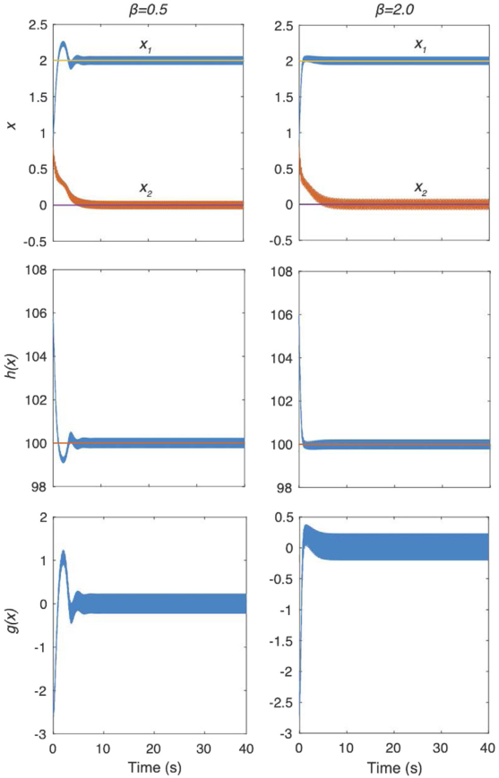
图 36：约束优化中的 ES 轨迹。来源：图改编自 Labar et al. (2019a)。

Williams, Krstić, and Scheinker (2022) 最近提出了另一种面向具有解析未知安全约束的系统的安全 ES 方法。作者考虑这样一类最小化问题：可以直接控制变量 $\theta(t)$，目标是最小化解析上未知的代价函数 $J(\theta)$，同时不越过由未知障碍函数的水平集 $h(\theta) = 0$ 所定义的未知安全约束边界。整个动态优化问题定义为

$$\dot{\theta} = u , \quad y = J(\theta) , \tag{266}$$

安全 ES 算法定义为

$$\begin{aligned}
\dot{\theta} &= -k G_J + \Gamma \max\nolimits_\delta \{k G_J^T G_h - c \eta_h\} G_h + S(t) , \\
\dot{G}_J &= -\omega_l G_J + \omega_l (J(\theta) - \eta_J) M(t) , \\
\dot{\eta}_J &= -\omega_h \eta_J + \omega_h J(\theta) , \\
\dot{G}_h &= -\omega_l G_h + \omega_l (h(\theta) - \eta_h) M(t) , \\
\dot{\eta}_h &= -\omega_h \eta_h + \omega_h h(\theta) , \\
\dot{\Gamma} &= \omega_l \Gamma \left( 1 - \Gamma \|G_h\|^2 \right) ,
\end{aligned} \tag{267}$$

其中扰动信号 $S$ 与解调信号 $M$ 为

$$S(t) = [a\omega_i \cos(\omega_i t), \ \ldots, \ a\omega_i \cos(\omega_n t)]^T , \quad M(t) = \left[ \frac{2}{a} \sin(\omega_i t), \ \ldots, \ \frac{2}{a} \sin(\omega_n t) \right]^T , \tag{268}$$

如图 37 所概括。

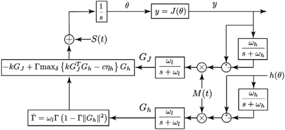
图 37：Williams et al. (2022) 所提方法的安全 ES 结构。

函数 $J, h : \mathbb{R}^n \mapsto \mathbb{R}$ 是定义在优化变量 $\theta$ 上的标量值函数。项 $(J(\theta) - \eta_J) M(t)$ 与 $(h(\theta) - \eta_h) M(t)$ 分别是借助滤波变量 $\eta_J$ 与 $\eta_h$ 得到的 $J$ 与 $h$ 的梯度估计，变量 $G_J$ 与 $G_h$ 则是这些估计经过滤波后的版本。$J$ 与 $h$ 的梯度估计并未直接送入 $\max_\delta$ 近似，因为在这种情况下进行平均化几乎是不可能的——时变项出现在非线性环节 $\max_\delta$ 的自变量内部。（非线性）Riccati 滤波器 $\Gamma$ 动态地计算 $1/G_h^2 > 0$。标准的取最大操作是非光滑的，因此用函数 $\max_\delta : \mathbb{R} \mapsto \mathbb{R}_{>0}$ 来逼近：

$$\max\nolimits_\delta \{x\} := \frac{1}{2} \left( x + \sqrt{x^2 + \delta} \right) \approx \max\{x, 0\} , \tag{269}$$

其中 $\delta > 0$ 是一个小参数。注意，对所有 $x \in \mathbb{R}$ 都有 $\max_\delta \{x\} > \max\{x, 0\}$。图 38 给出了该方法避开不安全区域的一个实例，并与不具备安全性的经典 ES 进行了对比。

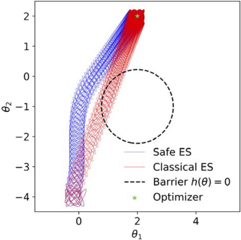
图 38：采用 Williams et al. (2022) 所提方法得到的安全 ES 轨迹，与求解同一问题的经典 ES 方法的对比。

这一安全 ES 方法最近被推广到具有半全局实用稳定性的情形（Williams, Krstić, & Scheinker, 2023），并已应用于高能带电粒子束的安全优化（Williams, Scheinker, Huang, Taylor, & Krstić, 2023）。

## 16. 自适应隐空间调节：使机器学习适用于时变系统的 ES

机器学习（ML）技术，尤其是深度卷积神经网络，在科学与工程的所有领域都日益流行。然而，标准 ML 方法所面临的一个主要挑战是时变系统问题，在 ML 社区中这被称为分布偏移（distribution shift）系统。如果一个系统或其初始条件随时间变化，那么先前为训练 ML 模型（如深度卷积神经网络）所收集的数据就不再能精确表示所要建模的动态系统。针对这一现象的典型解决方案是暴力重训练：一旦注意到足够大的误差，就收集一整套全新的数据来更新网络权重。对于人们关注的大多数复杂系统而言，这种解决方案是有问题的，因为反复收集新数据并重新训练网络非常耗时，而且需要进行会中断系统正常运行的测量。

例如，在大型粒子加速器设施中，详细的束流截面测量采用的是破坏性手段，如插入拦截带电粒子束的荧光屏，这会中断所有下游运行。此类测量通常只在罕见的专门实验时间内进行。对这类系统而言，反复重训练根本不可行。

最近，一种基于控制理论的动态解决方案被提出，用于解决初始条件分布偏移问题（Scheinker, 2021b）。作者考虑了这样一个问题，其中生成式编码器–解码器卷积神经网络（CNN）

……在极高维对象之间建立映射，例如输入–输出图像对——它们可以表示一个动态系统输入端与输出端的复杂分布：

$$\{X(t), x(t)\} \underset{\text{CNN}}{\longrightarrow} \hat{Y}(t) , \tag{270}$$

其中 $x(t) \in \mathbb{R}^n$ 可以是一个时变参数向量，$X(t) \in \mathbb{R}^{N_x \times N_x}$ 是以图像形式表示的时变初始条件，是维数极高的对象。例如，对于一幅 $256 \times 256$ 像素的图像，$N_x \times N_x = 256^2 = 65536$。输出为

$$\hat{Y}(t) = (\hat{y}_1(t), \ldots, \hat{y}_N(t)) \in \mathbb{R}^{N_y \times N_y \times N} , \tag{271}$$

即 $N$ 幅图像 $\hat{y}_n(t) \in \mathbb{R}^{N_y \times N_y}$ 的堆叠，它们是 CNN 对某个未知 $Y(t)$ 所生成的估计。

在 Scheinker (2021b) 中，作者考虑了如下情形：在初始训练之后便失去了对时变输入 $\{X(t), x(t)\}$ 的访问，目标是跟踪完全未知的 $Y(t)$，而可供在线测量的只是它的一个部分测量——单个投影 $y_n(t)$。该测量经由某个代价函数与 CNN 生成的版本进行比较，例如

$$J\left(y_n(t), \hat{y}_n(t), t\right) = \frac{1}{N_y} \sum_i \sum_j \left| y_n(i,j,t) - \hat{y}_n(i,j,t) \right|^2, \tag{272}$$

其思路是利用编码器–解码器 CNN 将图像压缩到极低维隐空间的惊人能力——在这个例子中，编码器–解码器网络的中间收缩为一个二维隐表示 $x_L(t) \in \mathbb{R}^2$，再由它生成输出 $\hat{Y}(t)$。ES 被用来在该低维隐空间中实时自适应地移动，针对未知且时变的输入 $\{X(t), x(t)\}$ 最小化式(272)，所采用的是有界稳定化 ES 反馈：

$$\hat{Y}(t) = F_{\mathrm{CNN}}\left(x_L(t)\right), \tag{273}$$

$$\dot{x}_{L,i}(t) = \alpha\sqrt{\omega_i}\cos\left(\omega_i t + k J\left(y_n(t), \hat{y}_n(t), t\right)\right), \tag{274}$$

如图 39 所示。

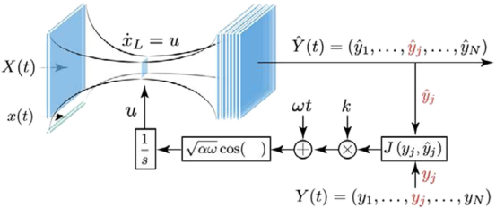
图 39：自适应机器学习结构：以 ES 作为反馈，调节由图像与向量输入组合 $\{x(t), X(t)\}$ 的低维潜在空间表示 $x_L(t)$，从而最小化代价函数 $J$——该函数将编码器–解码器生成式卷积神经网络输出 $\hat{y}_j(t)$ 的一个子集与测量值 $y_j(t)$ 进行比较。

最近，一项关于这种自适应隐空间调节方法的研究表明，在自编码器架构中引入基于 ES 的反馈，能够极大地提升基于神经网络的预测的鲁棒性，使其远超训练数据所覆盖的范围（Scheinker, Cropp, & Filippetto, 2023）。

该方法还被进一步扩展，发展出一个结合机器学习、在线物理模型以及基于 ES 的自适应调节的鲁棒框架，从而能够在初始束流条件时变以及粒子加速器部件时变的情况下，准确预测并跟踪带电粒子束的二维相空间分布（Scheinker, Cropp, Paiagua, & Filippetto, 2021）。ES 还被研究用于使更一般的 ML 适用于时变问题（Scheinker, 2021a），并已应用于三维相干衍射成像问题（Scheinker & Pokharel, 2020）。

## 17. ES 方法总结

针对动态系统，人们已经提出了一个庞大的、包含各种基于 ES 的控制器与优化方法的家族。图 40 给出了各种 ES 方法的一个不完全总结，展示了各 ES 版本的信号通路与结构设置，这些方法被大致划分为两个家族：（1）经典 ES 方法及其改进——通过调节控制参数，对一个事先已稳定的动态系统的解析未知输出函数进行优化；（2）基于 ES 的反馈稳定化与优化方法——其中动态系统不被假设为已受控，ES 扮演双重角色：既优化解析未知的输出函数，又迫使最优点成为动态系统的稳定平衡点（见表 1）。

从图 40 左列顶部开始，是经典 ES 算法，其首批解析证明由 Krstić and Wang (2000) 给出。沿左列向下，可以看到多年来对 ES 方法所做的各种修改与扩充，包括：随机版本、用于博弈的多智能体版本、基于牛顿的 ES 结构、牛顿方法向带时滞系统以及由一类 PDE 支配的系统的推广、有限时间牛顿 ES、面向连续运动与离散跳变相结合之动态的混合 ES 方案，以及安全 ES——其中 ES 动态在最小化解析未知输出函数的同时必须满足解析未知的边界约束。

从图 40 右列顶部开始，是最初在 Scheinker (2012) 中提出的基于 ES 的反馈控制算法。沿右列向下，可以看到基于 ES 的反馈方法的各种改进，包括有界形式的 ES、基于 PI 的 ES 反馈，以及与卷积神经网络耦合用于自适应隐空间调节的 ES。

正如上文所述，这两类 ES 方法都已被证明对极其广泛的应用（如下文所述）以及极其庞大的一类动态系统十分有用。每个 ES 方法家族也各有其优势。经典的基于 ES 的优化器家族历史更久、规模更大、变体更多。另一方面，规模较小的基于 ES 的反馈家族则有其自身优势，即允许 ES 直接充当反馈控制器，从而增加了灵活性：

$$\dot{x} = f(x, u, t), \qquad u = u_{\mathrm{ES}}(x, t), \tag{275}$$

而不必依赖某个特定控制器——该控制器会约束 ES 只能在控制函数内部修改某个参数：

$$\dot{x} = f(x, u, t), \qquad u = \alpha(x, \theta_{\mathrm{ES}}, t). \tag{276}$$

将基于 ES 的反馈直接用作控制器的一个可能优势是，它为寻找并跟踪未知最优点增添了灵活性——对于解析未知的系统，这样的最优点可能确实存在。

例如，若考虑典型的 ES 设置，通常存在一个预先设计的控制器 $\alpha(x, \theta, t)$，它保证存在一条光滑的输出稳态流形 $l$，使得系统平衡 $f(x, \alpha(x, \theta)) = 0$ 在 $x = l(\theta)$ 处达成，而 ES 动态在寻找某个 $J(x)$ 的最优值时沿这条流形演化。对于庞大而复杂、含有未知量的系统——这正是 ES 最能发挥作用的系统类型——某个其他控制器若能更完全地自由探索状态空间，就有可能实现比被约束在 $l(\theta)$ 上更优的工作点。图 41 展示了这样一个例子：在预先存在的控制器 $\alpha(x, \theta)$ 的强制约束下，经典 ES 方案迅速收敛到流形 $l(\theta)$ 并沿其演化，到达相对于 $l(\theta)$ 流形的全局最大值。而对于同一系统，当采用 ES 直接充当反馈的方法时，从相同的初始条件出发，它能够找到位于 $l(\theta)$ 约束之外的全局最大值。

表 1：图 40 所示各种 ES 方法就其应用对象系统所做假设的比较。每一列中，最一般/能力最强的 ES 方法以粗体标出。

**ES 方法与所需系统假设的比较**

| ES 方法 | 假设开环稳定 | 允许混合系统 | 允许时变系统 | 假设周期性时变 |
|---|---|---|---|---|
| 经典 ES (Krstić & Wang, 2000) | 是 | 否 | 否 | NA |
| 博弈用 ES (Stanković et al., 2010) | 是 | 否 | 否 | NA |
| 随机 ES (Liu & Krstić, 2012) | 是 | 否 | 否 | NA |
| 牛顿 ES (Nesić et al., 2010) | 是 | 否 | 否 | NA |
| 时滞牛顿 ES (Oliveira et al., 2016) | 是 | 否 | 否 | NA |
| PDE 牛顿 ES (Oliveira et al., 2020) | 是 | 否 | 否 | NA |
| 有限时间牛顿 ES (Poveda & Krstić, 2021) | 是 | 否 | 否 | NA |
| 安全 ES (Williams et al., 2022) | **否** | 否 | **是** | **是** |
| 混合 ES (Poveda et al., 2018) | 是 | **是** | 否 | NA |
| 稳定化 ES (Scheinker & Krstić, 2012a) | **否** | 否 | **是** | 否 |
| 有界 ES (Scheinker, 2013a) | **否** | 否 | **是** | 否 |
| PI ES (Guay & Dochain, 2017) | **否** | 否 | **是** | **是** |
| 自适应隐空间 ES (Scheinker, 2021b) | **否** | 否 | **是** | 否 |
## 18. 专利

如上所述，ES 的各种版本仍在不断增长，因为它是一个活跃的研究领域，它们适用于极其广泛的动力系统。此外，由于 ES 在设计上就适用于不确定系统，它已被广泛应用于学术研究之外的现实世界问题，包括科学研究与工业场景。值得注意的是，ES 对工业界产生了显著影响，这可以从 ES 相关专利的庞大数量与多样性中得到某种程度的量化。首先，当然还有 Leblanc 1922 年的原始论文，它读起来更像一份专利/设计方案而非典型的学术文章，目前已有 277 次引用 (Leblanc, 1922)。进而，在美国专利商标局（US Patent and Trademark Office）中以 "extremum" 和 "seeking" 两个词进行简单的公开检索，会返回 1919 条记录。为给出几个具体例子，在 Google Scholar 中检索 "extremum seeking patent" 会返回 9750 条结果（其中许多是文章而非专利）。这些结果按 Google 算法确定的"相关性"排序。如果逐一浏览这些专利，可以发现其中包括：用于调节建筑物进风量的 ES 应用 (Seem, 2010)；一种预测并稳定压缩机喘振的方法 (Krener & Krstić, 2000)；用于冷冻水机组控制 (Salsbury & House, 2019)；用于蒸汽压缩（制冷）(Burns, Guay, & Weiss, 2017)；用于射频（RF）阻抗匹配 (Burry, Radomski, Aung, & Klein, 2020)；以及用于编队飞行 (Ryan, 2018)。在下面的几节中，我们将详细介绍若干 ES 应用。

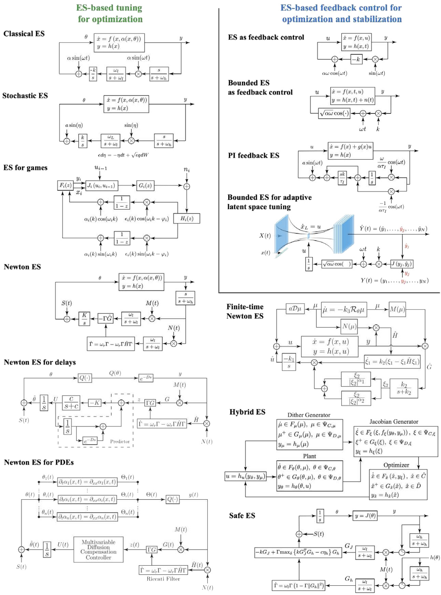
图 40：极值搜索动物园：本综述讨论的几种主要 ES 算法形式。

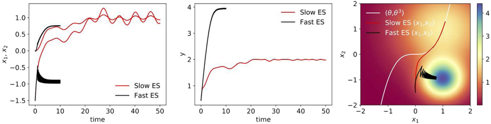
图 41：用 ES 寻找未知函数 $y(x_1, x_2)$ 的最大值。经典 ES（红）缓慢收敛到由预定控制结构决定的局部极大平衡点，而镇定 ES（黑）迅速找到全局最大值。（关于本图图例中颜色的解释，请读者参阅本文的网络版。）

## 19. 自主载具控制

自主水下航行器不需要操作员的输入，正被用于科学与商业勘探，包括海底测绘与化学浓度测绘，以及各种军事应用。针对此类系统，人们发展了极值搜索方法，用于在无 GPS 环境中引导航行器驶向源。在 Cochran et al. (2009) 与 Cochran and Krstić (2009) 中，作者以两种不同的方式对鱼的力学进行建模：三连杆鱼和 Joukowski 翼型，如图 42 所示。

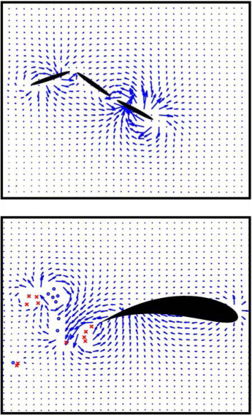
图 42：三连杆鱼（上）与 Joukowski 翼型（下）的鱼模型设置。
来源：改绘自 Cochran, Kanso, Kelly, Xiong, and Krstić (2009)。

对于 Cochran et al. (2009) 所考虑的两种鱼模型，其运动控制方程都是理想流体中刚体运动 Kirchhoff 方程的变体：

$$\frac{dL}{dt} + \Omega \times L = 0, \qquad \frac{dA}{dt} = k\left([U\ V]^T \times L\right) = 0, \tag{277}$$

其中 $L$ 和 $A$ 分别是体–流体系统的线动量与角动量，$U$、$V$ 和 $\Omega$ 是平移与转动速度。

对于图 42 所示的三连杆鱼模型，用于最大化解析形式未知的代价函数 $J$ 的 ES 控制律为

$$\dot{\theta}_1 = a\omega \sin(\omega t) - c\,\eta \cos(\omega t), \tag{278}$$

$$\dot{\theta}_2 = a\omega \cos(\omega t) + c\,\eta \cos(\omega t), \tag{279}$$

$$\eta = \frac{s}{s+h}[J]. \tag{280}$$

对于 Joukowski 翼型模型，所用的 ES 控制器为

$$\dot{\eta} = a\omega \cos(\omega t) + c\,\eta \sin(\omega t), \tag{281}$$

$$\eta = H(s)[J], \qquad H(s) = \left(\frac{s}{s+h}\right)^2. \tag{282}$$

结果表明，两种仿真鱼模型都能利用 ES 算法自主跟踪信号强度随距离衰减的源 $J(x, y, t)$，如图 43 所示。

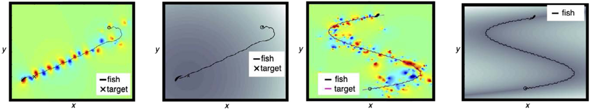
图 43：利用 ES 跟踪静止源与移动源的鱼模型。
来源：改绘自 Cochran et al. (2009)。

## 20. 主动流动控制

主动流动控制是一种利用流动不稳定性的方法，用以在宽广的运行条件范围内扩展飞机的运行区域，包括在很大迎角下提供额外升力。气流是高度随机且时变的过程，伴有各种环境扰动，需要非常鲁棒且快速的在线反馈，这使得 ES 成为非常有力的候选方法。ES 已被用于主动流动控制 (Becker, King, Petz, & Nitsche, 2007; Brunn, Henning, Nitsche, & King, 2008; Henning et al., 2008; Kim, Kasnakoglu, Serrani, & Samimy, 2009; King et al., 2006)，以及航空推进 (Moeck, Bothien, Paschereit, Gelbert, & King, 2007; Wiederhold et al., 2009)。在 Becker et al. (2007) 中，作者发展了一种多输入多输出（MIMO）ES 方法，通过主动控制脉冲式射流来控制流动分离，从而最大化机翼升力，如图 44 所示。在该 MIMO ES 设置中，所用的三个 ES 控制器 $(ES_1, ES_2, ES_3)$ 各自具有如下形式：

$$u_i = u_0 + a \sin(\omega t + \theta_i) + \hat{u}, \tag{283}$$

$$\hat{u} = K \int_0^t \eta(\tau)\, d\tau, \tag{284}$$

$$\eta(t) = \frac{\omega_l}{\omega_l + s}\, \xi \sin(\omega t + \theta_i), \tag{285}$$

$$\xi(t) = \frac{s}{s + \omega_h}\, y, \tag{286}$$

如图 44 所示，其中每个 $ES_i$ 使用相同频率的 ES 抖动信号，但 3 个控制器分别采用不同的相移 $\theta_i$。

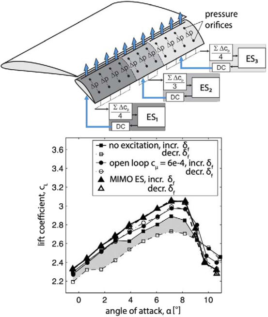
图 44：基于 MIMO ES 的翼型控制。
来源：改绘自 King et al. (2006)。

## 21. 等离子体控制

高能等离子体，例如托卡马克（Tokomak）反应堆内部产生的等离子体，是极其复杂、非常难以控制的动力系统，人们已为此发展了多种 ES 方法 (Centioli et al., 2008; Luo & Schuster, 2009; Ou et al., 2008)。最近，Dubbioso et al. (2022) 与 Tommasi, Dubbioso, Mele, and Pironti (2021) 设计了一种创新的基于卡尔曼滤波器的 ES 控制器用于等离子体控制。

基于卡尔曼滤波的 ES 设置如图 45 所示。所用的托卡马克等离子体模型基于 Grad–Shafranov 偏微分方程（PDE），在柱坐标下为

$$\Delta^* \psi = - f \frac{df}{d\psi} - \mu_0 r^2 \frac{dp}{d\psi}, \quad \text{在等离子体区域内}, \tag{287}$$

$$\Delta^* \psi = -\mu_0 r j_{ext}(r, z, t), \quad \text{在导体内}, \tag{288}$$

$$\Delta^* \psi = 0, \quad \text{在其他区域}, \tag{289}$$

其中 $\psi(r, z)$ 是每弧度的极向磁通，$\mu_0$ 是真空磁导率，$j_{ext}$ 是外部导体中的环向电流密度，$p$ 是动力学压强分布，$f$ 是极向电流函数分布，算子 $\Delta^*$ 定义为

$$\Delta^* = r \frac{\partial}{\partial r}\left(\frac{1}{\mu_r r} \frac{\partial \psi}{\partial r}\right) + \frac{\partial}{\partial z}\left(\frac{1}{\mu_r} \frac{\partial \psi}{\partial z}\right). \tag{290}$$

可以证明

$$j_{ext} = -\frac{\sigma}{r} \dot{\psi} + \frac{\sigma}{2\pi r} u, \tag{291}$$

其中 $u$ 是施加在线圈上的电压，$\sigma$ 是电导率，该方程在导体区域上积分。测量输出定义为

$$y = \left(\delta I_A^T\ \delta I_p\ \delta Z_c\right)^T, \tag{292}$$

其中 $\delta I_A$ 是各回路电流相对平衡值的偏差，$\delta I_p$ 是等离子体电流相对平衡值的偏差，$\delta Z_c$ 是等离子体质心垂直位置相对平衡值的偏差。该输入被送入卡尔曼滤波器，以生成关于不稳定等离子体状态的类李雅普诺夫函数 $V = \hat{x}^2$，并使用如下形式的基于镇定反馈的 ES 方法对其进行最小化：

$$u = \alpha \sqrt{\omega} \cos(\omega t) - k \sqrt{\omega} \sin(\omega t)\, V(\hat{x}), \tag{293}$$

如图 45(C) 所示。文中展示了多个等离子体镇定实例。在图 45 中，我们仅给出等离子体对两种不同扰动的响应：5 cm 的 VDE 和 MD，其中 VDE 指系统状态沿不稳定模态的瞬时运动，导致等离子体质心的垂直位移，MD 表示等离子体热能的损失。结果表明，该 ES 方法在很宽的条件范围内都极为鲁棒，图中各式编号（Equation numbers）对应论文中描述的等离子体特性。

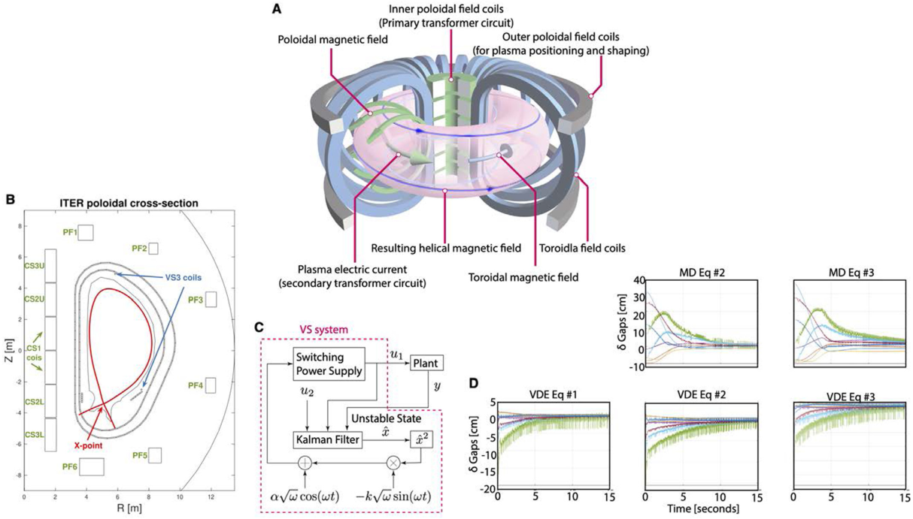
图 45：托卡马克基于卡尔曼滤波的 ES 控制器。
来源：改绘自 Dubbioso et al. (2022)。

## 22. 粒子加速器控制

粒子加速器是研究基础物理学、生物学与材料科学最强大的科学工具之一。大型加速器长达数公里，由数千个耦合部件组成，例如谐振射频（RF）电磁加速腔和磁铁，以及与之配套的电源与放大器。大量电磁部件的性能不断受到温度漂移、高压纹波和振动等环境扰动的影响；所有部件在亚微米尺度的精确对准上都面临不确定性；磁铁等部件还存在磁滞效应，这给控制参数（如电源电流）与被控变量（如聚焦带电粒子的磁场）之间的映射引入了不确定性。此外，带电粒子束本身也是时变的：典型束流由 $10^9$–$10^{14}$ 个独立粒子组成，其动力学由空间电荷力等复杂的集体效应支配。其结果是，加速器的某个可测输出函数（例如特定位置的束流电流监测器）是控制参数（如磁铁电源设定值）的解析形式未知的函数，并受一个不确定且时变的动力系统支配。

两个运行在不同时间尺度上的 ES 反馈已被用于欧洲核子研究中心（CERN）等离子体尾场加速器（AWAKE）的在线多目标优化，实现发射度与轨道的同步控制 (Scheinker et al., 2020)，如图 46(A) 所示。在 Scheinker et al. (2020) 中，一组被缓慢调节的 5 个 ES 参数是 2 个螺线管磁铁和 3 个四极磁铁，它们影响 AWAKE 束线电子–质子重叠区域处的电子束尺寸，记为

$$p_1 = (p_{11}, p_{12}, \ldots, p_{15}). \tag{294}$$

然而，由于束流并未完全对准，改变螺线管和四极磁铁不仅影响束流形状，也影响其轨迹。因此，另一组以 3 倍速率运行的 10 个 ES 参数控制下游的 10 个 $(x, y)$ 导向磁铁，记为

$$p_2 = (p_{21}, p_{22}, \ldots, p_{210}), \tag{295}$$

以在束流形状优化过程中保持束流在屏幕上居中。将全部 15 个被调 ES 参数记为 $p = (p_1, p_2)$，该多目标 ES 问题的形式为：

$$\min_p \{F(p, t)\} = \min_p \{f_1(p, t), f_2(p, t)\}, \tag{296}$$

$$f_1(p, t) = w_1 X_{RMSE}(p, t), \qquad f_2(p, t) = w_2 \sigma_{xy}(p, t), \tag{297}$$

其中 $X_{RMSE}$ 表示束流轨迹的均方根（RMS）误差，$\sigma_{xy}$ 是屏幕上 $(x, y)$ 束流尺寸的度量。

两个时间尺度的 ES 控制器定义为

$$\dot{p}_{1i} = \sqrt{\alpha_1 \omega_{1i}} \cos(\omega_{1i} t + k F(p, t)), \tag{298}$$

$$\dot{p}_{2i} = \sqrt{\alpha_2 \omega_{2i}} \cos(\omega_{2i} t + k F(p, t)), \tag{299}$$

其中两个时间尺度的 ES 抖动频率定义为

$$\omega_{1i} = \omega_0 r_{1i},\ r_{1i} \in \{1.0, \ldots, 1.75\},\ i = 1, \ldots, 5$$
$$\omega_{2i} = 3 \times \omega_0 r_{2i},\ r_{2i} \in \{1.0, \ldots, 1.75\},\ i = 1, \ldots, 10,$$

即初始的束流成形磁铁的运动远比下游的轨迹控制磁铁缓慢。

ES 已被用于在世界上两座最先进的自由电子激光（FEL）装置上最大化 FEL 脉冲能量：SLAC 国家加速器实验室的直线加速器相干光源（LCLS）和 DESY 实验室的欧洲 X 射线 FEL（EuXFEL）。如图 46(B) 所示，ES 在 4 分钟内自动将 EuXFEL 的平均光输出能量提高了一倍以上 (Scheinker et al., 2019)。

ES 还与基于机器学习的神经网络工具相结合，用于自动控制 LCLS FEL 电子束的 $(z, E)$ 纵向相空间，如图 46(C) 所示 (Scheinker, Edelen, Bohler, Emma, & Lutman, 2018)。

ES 在加速器调束方面的其他应用包括：加速器磁铁调节 (Scheinker, Pang, & Rybarcyk, 2013)、自适应电子束剖面预测 (Scheinker & Gessner, 2015)、时变共振控制 (Scheinker, 2016)、在 SLAC 的 SPEAR3 时变磁格中最小化束流振荡 (Scheinker, Huang, & Wu, 2017)，并且目前已在洛斯阿拉莫斯国家实验室的直线粒子加速器 LANSCE 上作为常规调束工具用于束流损失最小化 (Scheinker, Huang, & Taylor, 2021)。

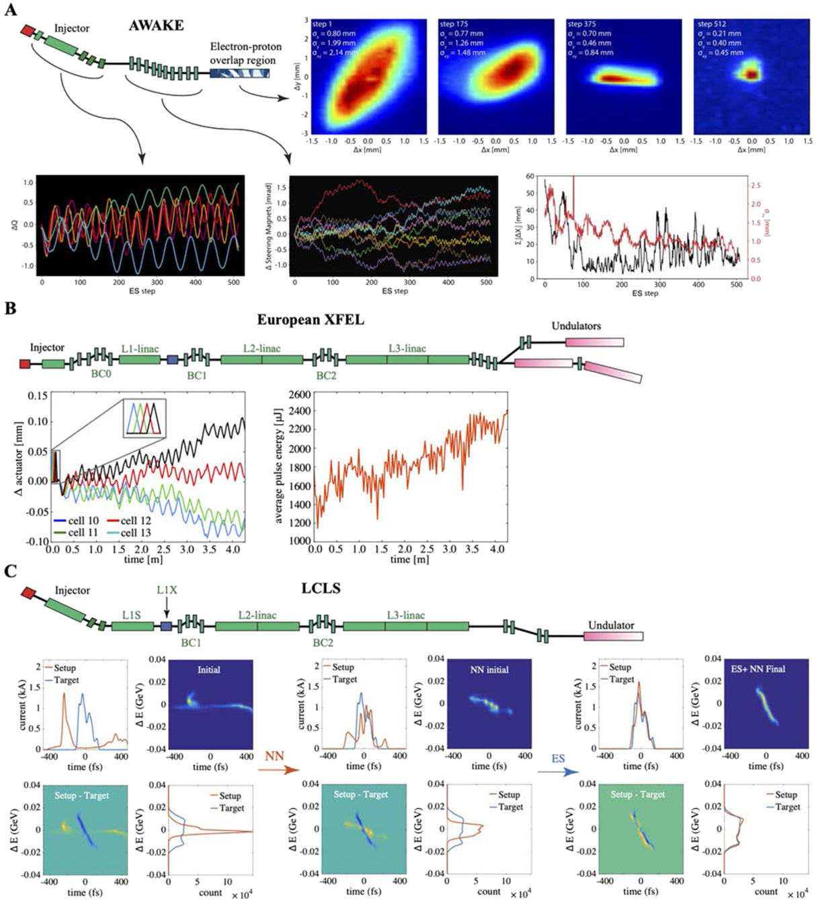
图 46：(A) 在 CERN 的 AWAKE 加速器上，两个 ES 回路同时以两个不同时间尺度运行，进行实时多目标优化（束流轨迹控制与发射度增长最小化）。(B) 在 DESY 的欧洲 X 射线自由电子激光上应用 ES 自动最大化脉冲能量。(C) 在 SLAC 国家加速器实验室的 LCLS 自由电子激光上，将 ES 与神经网络相结合，直接调节电子束的二维 $(z, E)$ 纵向相空间分布。

## 23. 最大功率点跟踪

将太阳能转化为电能的光伏发电机，其电流–电压与功率–电压特性强烈依赖于温度，如图 47(A) 所示，并随大气条件而变化。因此，最大功率点跟踪（MPPT）问题就成为一个自适应优化问题，ES 方法首次由 Leyva et al. (2006, 2011) 以及 Leyva, Artillan, Cabal, Estibals, and Alonso (2011) 应用于该问题。作者提出了一种基于 ES 的 MPPT 算法，通过调制开关模式功率变换器的占空比来自动调节阵列电压，从而高效提取光伏（PV）阵列的能量，同时保证在外部条件发生突然或快速变化时调节过程的稳定性。该 ES MPPT 装置如图 47(B) 所示。

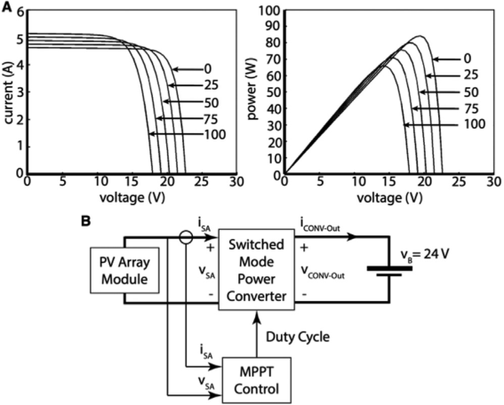
图 47：电压、电流、功率随温度（0 到 75 摄氏度）变化的关系。
来源：改绘自 Leyva et al. (2006)。

此外，还针对光伏功率优化开发了一种基于多变量牛顿 ES 的 MPPT 方法 (Ghaffari et al., 2014)。在该方法中，待最大化的功率 $P(D, t)$ 被视为开关脉冲持续时间 $D = [D_1, D_2, \ldots, D_n]^T$ 的函数，并假定它在最优脉冲持续时间点 $D^* = [D_1^*, D_2^*, \ldots, D_n^*]^T$ 处具有如下形式的泰勒级数展开：

$$P = P^* + \frac{1}{2}(\tilde{D} + Q(t))^T H (\tilde{D} + Q(t)) + R(\tilde{D} + Q(t)), \tag{300}$$

其中 $H$ 为未知的海森（Hessian）矩阵，$D = D^* + \tilde{D} + Q(t)$，$\tilde{D} = \hat{D} - D^*$ 为估计误差，$R$ 表示高阶项，$Q(t)$ 为 ES 抖动信号向量，其形式为

$$Q(t) = a[\sin(\omega_1 t), \ldots, \sin(\omega_n t)]^T, \tag{301}$$

其中 $\omega_i \neq \omega_j$。采用如下形式的扰动信号矩阵 $W$

$$W_{jj} = \frac{16}{a^2}\left(\sin^2(\omega_j t) - \frac{1}{2}\right), \qquad W_{jk} = \frac{4}{a^2}\sin(\omega_j t)\sin(\omega_k t), \quad j \neq k, \tag{302}$$

通过乘积

$$W(t)P_{ac} = \frac{1}{2}WQ^THQ + WQ^TH\tilde{D} + O(a) \tag{303}$$

中的第一项提取海森矩阵的估计，其中 $P_{ac}$ 为实测输出功率的交流分量；相应的估计器动态由式(304)–(306) 给出。

$$\dot{\tilde{D}} = -K_n \Gamma \hat{G}, \tag{304}$$

$$\dot{\Gamma} = \rho \Gamma - \rho \Gamma \hat{H} \Gamma, \tag{305}$$

$$\dot{\hat{G}} = -\omega_l \hat{G} + \omega_l M(t) P_{ac}(t), \tag{306}$$

其中 $M(t)$ 是 ES 扰动信号矩阵。基于牛顿 ES 的 MPPT 方法的性能与优势如图 48 所示。MPPT 是一个非常适合基于 ES 方法的重要问题，已有众多其他基于 ES 的方法对其进行了研究 (Bazzi & Krein, 2011; Bizon, 2016; Brunton, Rowley, Kulkarni, & Clarkson, 2009, 2010; Heydaridoostabad, Keypour, Khalghani, & Khooban, 2013; Li, Li, Seem, & Lei, 2011, 2015; Reisi, Moradi, & Jamasb, 2013; Yau & Wu, 2011)。

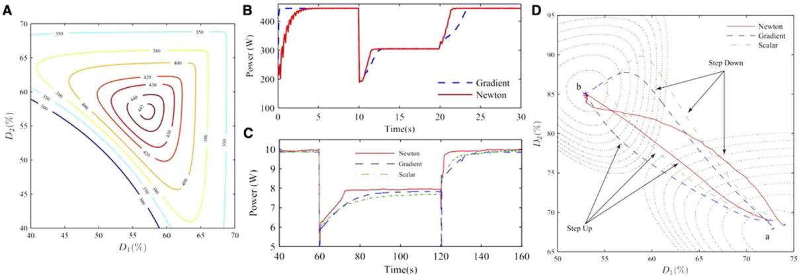
图 48：基于牛顿的 ES 实现 MPPT。图中给出了双脉冲装置 $D = [D_1, D_2]$ 下输出功率随脉冲持续时间的变化（A）。经过初始暂态后，基于牛顿的 ES 方法比单独的梯度方法具有更短的安定时间（B）。基于牛顿的 ES 对功率水平的快速变化表现出更优越的响应（C、D）。
来源：改绘自 Ghaffari, Krstić, and Seshagiri (2014)。

## 24. 生物反应器生长速率优化

ES 与神经网络的一种创新结合也被用于具有未知生长动力学的复杂非线性生物反应器系统的控制，以实现生物质生产速率最大化 (Guay et al., 2004)。作者考虑如下形式的微生物生长动力学

$$\dot{x} = \mu(s, x)x - ux, \tag{307}$$

$$\dot{s} = -k_1\mu(s, x)x + u(s_0 - s), \tag{308}$$

$$y = k_2\mu(x, s)x, \tag{309}$$

其中 $x, s \in \mathbb{R}_+$ 分别表示生物质浓度和底物浓度，$u \geq 0$ 为稀释率，$y$ 为反应产物的生产速率，$s_0$ 为进料中底物的浓度，$k_1, k_2 > 0$ 为产率系数。作者考虑了只有 $x$ 和 $s$ 可测、而 $y$ 无法用于测量与控制的情形。ES 控制器的目标是通过寻找最优稀释率 $u^*$ 来最大化稳态生产速率 $y^*$。

在这项工作中，依赖于底物的生长速率表达式 $\mu(x, s)$ 被认为是未知的，并用基于径向基函数（RBF）的神经网络对其进行逼近，给出如下形式的估计

$$\varphi(z) = W^{*T}S(z) + \mu_l(t), \tag{310}$$

其中 $W^*$ 未知，$\mu_l(t)$ 为神经网络误差，$S(z)$ 为 RBF 基函数向量

$$S(z) = [s_1(z), s_2(z), \ldots, s_l(z)]^T,$$

其元素为

$$s_i(z) = \exp\left[-\frac{(z - \varphi_i)^T(z - \varphi_i)}{\sigma_i^2}\right], \quad i = 1, 2, \ldots, l,$$

其中 $\varphi_i$ 为中心、$\sigma_i$ 为标准差。结果表明，无论是否在生物质和底物浓度测量中加入高斯测量噪声，该方法都表现得极为出色，如图 49 所示。

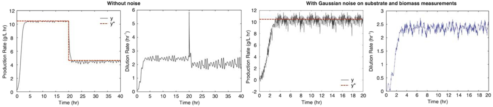
图 49：用于生物反应器优化的 ES，分别对应加入与不加入高斯测量噪声的情形。
来源：改绘自 Guay, Dochain, and Perrier (2004)。
## 25. 结论

上述一般性的 ES 方法已被证明对许多现实应用十分有效，还有许多方法与应用超出了本综述的范围，这里仅简要提及其中一部分。除已介绍的内容之外，ES 还被应用于：冷却系统 (Li, Li, & Seem, 2009; Li, Rotea, Chiu, Mongeau, & Paek, 2005)、风能 (Creaby, Li, & Seem, 2009)、光伏 (Lei, Li, Chen, & Seem, 2010)、人体健身器械 (Zhang, Dawson, Dixon, & Xian, 2006)、非等温连续搅拌釜反应器的控制优化 (Guay, Dochain, & Perrier, 2005)、降低机电气门执行器的撞击速度 (Peterson & Stefanopoulou, 2004)、用于热声不稳定性控制的类牛顿 ES (Moase et al., 2010)、电机转矩最大化 (Antonello, Carraro, & Zigliotto, 2013)、可变凸轮轴正时（CAM timing）发动机运行的优化 (Popovic, Jankovic, Magner, & Teel, 2006)、用于级联拉曼光学放大器 (Dower, Farrell, & Nesic, 2008)、用于交通拥堵控制的 ES (Yu, Koga, Oliveira, & Krstić, 2021)、GPS 拒止环境下的源定位 (Ghadiri-Modarres et al., 2016a)、用于最大化射频（RF）加热的 ES (Carnevale et al., 2009)、电磁执行器控制 (Benosman & Atınç, 2015)、高压变换器调制器优化 (Scheinker, Bland, Krstić, & Audia, 2013) 等；多目标 ES 已被用于矿物磨矿 (Lu, Krstić, Chai, & Fu, 2020)，采样数据 ES 已被用于约束优化 (Hazeleger, Nešić, & van de Wouw, 2022)。ES 研究领域十分活跃且正在持续壮大。

ES 方法的各种扩展与改进不断推广到更大的系统类别，并在实时控制、镇定与优化中不断找到新的应用。当前 ES 领域一些特别活跃的研究课题包括：有限时间收敛的进一步研究、面向偏微分方程（PDE）的 ES，以及将 ES 与机器学习相结合，以提高标准机器学习（ML）技术对时变系统和输入分布偏移的鲁棒性。本综述仅触及众多已发表成果的表面。仅从图 2 所列的少量主题即可清楚地看出，ES 方法在持续分化的同时也相互交叠。现有技术不断被推广到更大的系统类别，新技术也在不断发展。ES 是一个方法与应用都在持续增长的非常活跃的研究领域。

## 参考文献

Abdelgalil, M., Aboelkassem, Y., & Taha, H. (2022). Sea urchin sperm exploit extremum seeking control to find the egg. Physical Review E, 106(6), Article L062401.

Abdelgalil, M., & Taha, H. (2022). Recursive averaging with application to bio-inspired 3-D source seeking. IEEE Control Systems Letters, 6, 2816–2821.

Adetola, V., & Guay, M. (2006). Adaptive output feedback extremum seeking receding horizon control of linear systems. Journal of Process Control, 16(5), 521–533.

Adetola, V., & Guay, M. (2007). Parameter convergence in adaptive extremum-seeking control. Automatica, 43(1), 105–110.

Albertini, F., & Sontag, E. D. (1997). Control-Lyapunov functions for time-varying set stabilization. In 1997 European control conference (pp. 1999–2004). IEEE.

Amato, F., Ambrosino, R., Ariola, M., Cosentino, C., Tommasi, G. De, et al. (2014). Finite-time stability and control, volume 453. Springer.

Antonello, R., Carraro, M., & Zigliotto, M. (2013). Maximum-torque-per-ampere operation of anisotropic synchronous permanent-magnet motors based on extremum seeking control. IEEE Transactions on Industrial Electronics, 61(9), 5086–5093.

Ariyur, K. B., & Krstić, M. (2003). Real-time optimization by extremum-seeking control. Hoboken, NJ: John Wiley & Sons.

Åström, K. J., & Wittenmark, B. (1995a). Adaptive control. Reading, MA: Addison Wesley.

Åström, K. J., & Wittenmark, B. (1995b). A survey of adaptive control applications. In Proceedings of 1995 34th IEEE conference on decision and control, volume 1 (pp. 649–654). IEEE.

Bazzi, A. M., & Krein, P. T. (2011). Concerning ''Maximum power point tracking for photovoltaic optimization using ripple-based extremum seeking control''. IEEE Transactions on Power Electronics, 26(6), 1611–1612.

Becker, R., King, R., Petz, R., & Nitsche, W. (2007). Adaptive closed-loop separation control on a high-lift configuration using extremum seeking. AIAA journal, 45(6), 1382–1392.

Benosman, M. (2016). Multi-parametric extremum seeking-based iterative feedback gains tuning for nonlinear control. International Journal of Robust and Nonlinear Control, 26(18), 4035–4055.

Benosman, M., & Atınç, G. M. (2015). Extremum seeking-based adaptive control for electromagnetic actuators. International Journal of Control, 88(3), 517–530.

Benosman, M., Farahmand, A. M., & Xia, M. (2019). Learning-based iterative modular adaptive control for nonlinear systems. International Journal of Adaptive Control and Signal Processing, 33(2), 335–355.

Berkenkamp, F., Schoellig, A. P., & Krause, A. (2016). Safe controller optimization for quadrotors with Gaussian processes. In 2016 IEEE international conference on robotics and automation (pp. 491–496). IEEE.

Bhattacharjee, D., & Subbarao, K. (2021). Extremum seeking control with attenuated steady-state oscillations. Automatica, 125, Article 109432.

Bizon, N. (2016). Global maximum power point tracking (GMPPT) of photovoltaic array using the extremum seeking control (ESC): A review and a new GMPPT ESC scheme. Renewable and Sustainable Energy Reviews, 57, 524–539.

Blackman, P. F. (1962). Extremum-seeking regulators, In J. H. Westcott (Ed.), An exposition of adaptive control: Vol. 2, (1st ed.). (pp. 125–247). New York: Macmillan.

Brunn, A., Henning, L., Nitsche, W., & King, R. (2008). Application of slope-seeking to a generic car model for active drag control. In 26th AIAA applied aerodynamics conference (p. 6734).

Brunton, S. L., Rowley, C. W., Kulkarni, S. R., & Clarkson, C. (2009). Maximum power point tracking for photovoltaic optimization using extremum seeking. In 2009 34th IEEE photovoltaic specialists conference (pp. 000013–000016). IEEE.

Brunton, S. L., Rowley, C. W., Kulkarni, S. R., & Clarkson, C. (2010). Maximum power point tracking for photovoltaic optimization using ripple-based extremum seeking control. IEEE Transactions on Power Electronics, 25(10), 2531–2540.

Burns, D., Guay, M., & Weiss, W. (2017). Time-varying extremum seeking for controlling vapor compression systems. US Patent 9,625,274.

Burry, A. M., Radomski, A. T., Aung, T. O. E., & Klein, J. N. (2020). Extremum seeking control apparatus and method for automatic frequency tuning for RF impedance matching. US Patent 10,741,363.

Carnevale, D., Astolfi, A., Centioli, C., Podda, S., Vitale, V., & Zaccarian, L. (2009). A new extremum seeking technique and its application to maximize RF heating on FTU. Fusion Engineering and Design, 84(2–6), 554–558.

Centioli, C., Iannone, F., Mazza, G., Panella, M., Pangione, L., Podda, S., et al. (2008). Maximization of the lower hybrid power coupling in the Frascati Tokamak upgrade via extremum seeking. Control Engineering Practice, 16(12), 1468–1478.

Choi, J. Y., Krstić, M., Ariyur, K. B., & Lee, J. S. (2002). Extremum seeking control for discrete-time systems. IEEE Transactions on Automatic Control, 47(2), 318–323.

Cochran, J., Kanso, E., Kelly, S. D., Xiong, H., & Krstić, M. (2009). Source seeking for two nonholonomic models of fish locomotion. IEEE Transactions on Robotics, 25(5), 1166–1176.

Cochran, J., & Krstić, M. (2009). Nonholonomic source seeking with tuning of angular velocity. IEEE Transactions on Automatic Control, 54(4), 717–731.

Conway, J. B. (1990). A course in functional analysis, volume 96. New York, NY: Springer.

Creaby, J., Li, Y., & Seem, J. E. (2009). Maximizing wind turbine energy capture using multivariable extremum seeking control. Wind Engineering, 33(4), 361–387.

DeHaan, D., & Guay, M. (2005). Extremum-seeking control of state-constrained nonlinear systems. Automatica, 41(9), 1567–1574.

Dower, P. M., Farrell, P. M., & Nesic, D. (2008). Extremum seeking control of cascaded Raman optical amplifiers. IEEE Transactions on Control Systems Technology, 16(3), 396–407.

Draper, C. S., & Li, Y. Y. (1951). Principles of optimalizing control systems and an application to the internal combustion engine, In R. Oldenburger (Ed.), Optimal and self-optimizing control: Vol. 1, (1st ed.). Boston, MA: M.I.T. Press.

Dubbioso, S., di Grazia, L. E., Tommasi, G. De, Mattei, M., Mele, A., & Pironti, A. (2022). Vertical stabilization of tokamak plasmas via extremum seeking. IFAC Journal of Systems and Control, 21, Article 100203.

Dürr, H. B., Krstić, M., Scheinker, A., & Ebenbauer, C. (2015). Singularly perturbed lie bracket approximation. IEEE Transactions on Automatic Control, 60(12), 3287–3292.

Dürr, H. B., Krstić, M., Scheinker, A., & Ebenbauer, C. (2017). Extremum seeking for dynamic maps using Lie brackets and singular perturbations. Automatica, 83, 91–99.

Dürr, H. B., Stanković, M. S., Ebenbauer, C., & Johansson, K. H. (2013). Lie bracket approximation of extremum seeking systems. Automatica, 49(6), 1538–1552.

Dürr, H. B., Stanković, M. S., Johansson, K. H., & Ebenbauer, C. (2014). Extremum seeking on submanifolds in the Euclidian space. Automatica, 50(10), 2591–2596.

Dürr, H. B., Zeng, C., & Ebenbauer, C. (2013). Saddle point seeking for convex optimization problems. IFAC Proceedings Volumes, 46(23), 540–545.

Favache, A., Dochain, D., Perrier, M., & Guay, M. (2008). Extremum-seeking control of retention for a microparticulate system. The Canadian Journal of Chemical Engineering, 86(5), 815–827.

Feiling, J., Koga, S., Krstić, M., & Oliveira, T. R. (2018). Gradient extremum seeking for static maps with actuation dynamics governed by diffusion PDEs. Automatica, 95, 197–206.

Freeman, R., & Kokotovic, P. V. (1996). Robust nonlinear control design: State-space and Lyapunov techniques. Boston: Birkhauser.

Frihauf, P., Krstić, M., & Basar, T. (2011). Nash equilibrium seeking in noncooperative games. IEEE Transactions on Automatic Control, 57(5), 1192–1207.

Frihauf, P., Krstić, M., & Başar, T. (2013). Finite-horizon LQ control for unknown discrete-time linear systems via extremum seeking. European Journal of Control, 19(5), 399–407.

Ge, S. S., Yang, C., & Lee, T. H. (2008). Adaptive robust control of a class of nonlinear strict-feedback discrete-time systems with unknown control directions. Systems & Control Letters, 57(11), 888–895.

Ghadiri-Modarres, M. A., Mojiri, M., & Zangeneh, H. R. Z. (2016a). New schemes for GPS-denied source localization using a nonholonomic unicycle. IEEE Transactions on Control Systems Technology, 25(2), 720–727.

Ghadiri-Modarres, M. A., Mojiri, M., & Zangeneh, H. R. Z. (2016b). Nonholonomic source localization in 3-D environments without position measurement. IEEE Transactions on Automatic Control, 61(11), 3563–3567.

Ghaffari, A., Krstić, M., & Nešić, D. (2012). Multivariable Newton-based extremum seeking. Automatica, 48(8), 1759–1767.

Ghaffari, A., Krstić, M., & Seshagiri, S. (2014). Power optimization for photovoltaic microconverters using multivariable newton-based extremum seeking. IEEE Transactions on Control Systems Technology, 22(6), 2141–2149.

Grushkovskaya, V., & Ebenbauer, C. (2016). Multi-agent coordination with Lagrangian measurements. IFAC-PapersOnLine, 49(22), 115–120.

Grushkovskaya, V., & Ebenbauer, C. (2021). Extremum seeking control of nonlinear dynamic systems using Lie bracket approximations. International Journal of Adaptive Control and Signal Processing, 35(7), 1233–1255.

Grushkovskaya, V., Michalowsky, S., Zuyev, A., May, M., & Ebenbauer, C. (2018). A family of extremum seeking laws for a unicycle model with a moving target: Theoretical and experimental studies. In 2018 European control conference (pp. 1–6). IEEE.

Grushkovskaya, V., Zuyev, A., & Ebenbauer, C. (2018a). On a class of generating vector fields for the extremum seeking problem: Lie bracket approximation and stability properties. Automatica, 94, 151–160.

Grushkovskaya, V., Zuyev, A., & Ebenbauer, C. (2018b). On extremum seeking controllers based on the Lie bracket approximation in domains with obstacles. Proceedings in Applied Mathematics and Mechanics, 18(1), Article e201800298.

Guay, M. (2014). A time-varying extremum-seeking control approach for discrete-time systems. Journal of Process Control, 24(3), 98–112.

Guay, M. (2016). A perturbation-based proportional integral extremum-seeking control approach. IEEE Transactions on Automatic Control, 61(11), 3370–3381.

Guay, M., & Benosman, M. (2021). Finite-time extremum seeking control for a class of unknown static maps. International Journal of Adaptive Control and Signal Processing, 35(7), 1188–1201.

Guay, M., & Dochain, D. (2015a). A multi-objective extremum-seeking controller design technique. International Journal of Control, 88(1), 38–53.

Guay, M., & Dochain, D. (2015b). A time-varying extremum-seeking control approach. Automatica, 51, 356–363.

Guay, M., & Dochain, D. (2017). A proportional-integral extremum-seeking controller design technique. Automatica, 77, 61–67.

Guay, M., Dochain, D., & Perrier, M. (2004). Adaptive extremum seeking control of continuous stirred tank bioreactors with unknown growth kinetics. Automatica, 40(5), 881–888.

Guay, M., Dochain, D., & Perrier, M. (2005). Adaptive extremum-seeking control of nonisothermal continuous stirred tank reactors. Chemical Engineering Science, 60(13), 3671–3681.

Guay, M., Dochain, D., Perrier, M., & Hudon, N. (2007). Flatness-based extremum-seeking control over periodic orbits. IEEE Transactions on Automatic Control, 52(10), 2005–2012.

Guay, M., Moshksar, E., & Dochain, D. (2015). A constrained extremum-seeking control approach. International Journal of Robust and Nonlinear Control, 25(16), 3132–3153.

Guay, M., Vandermeulen, I., Dougherty, S., & McLellan, P. J. (2018). Distributed extremum-seeking control over networks of dynamically coupled unstable dynamic agents. Automatica, 93, 498–509.

Guay, M., & Zhang, T. (2003). Adaptive extremum seeking control of nonlinear dynamic systems with parametric uncertainties. Automatica, 39(7), 1283–1293.

Gurvits, L. (1992). Averaging approach to nonholonomic motion planning. In Proceedings 1992 IEEE international conference on robotics and automation (pp. 2541–2542). IEEE Computer Society.

Gurvits, L., & Li, Z. (1992). Smooth time-periodic solutions for nonholonomic motion planning, In Z. X. Li, & J. F. Canny (Eds.), Nonholonomic motion planning: Vol. 1, (1st ed.). Alphen aan den Rijn, Netherlands: Kluwer Academic Publishers.

Haring, M., van de Wouw, N., & Nešić, D. (2013). Extremum-seeking control for nonlinear systems with periodic steady-state outputs. Automatica, 49(6), 1883–1891.

Hazeleger, L., Haring, M., & van de Wouw, N. (2020). Extremum-seeking control for optimization of time-varying steady-state responses of nonlinear systems. Automatica, 119, Article 109068.

Hazeleger, L., Nešić, D., & van de Wouw, N. (2022). Sampled-data extremum-seeking framework for constrained optimization of nonlinear dynamical systems. Automatica, 142, Article 110415.

Henning, L., Becker, R., Feuerbach, G., Muminovic, R., King, R., Brunn, A., et al. (2008). Extensions of adaptive slope-seeking for active flow control. Proceedings of the Institution of Mechanical Engineers, Part I (Journal of Systems and Control Engineering), 222(5), 309–322.

Heydari-doostabad, H., Keypour, R., Khalghani, M. R., & Khooban, M. H. (2013). A new approach in MPPT for photovoltaic array based on extremum seeking control under uniform and non-uniform irradiances. Solar Energy, 94, 28–36.

Kazakevich, V. V. (1943). Technique of automatic control of different processes to maximum or to minimum. Avtorskoe svidetelstvo, (USSR Patent), (66335).

Kazakevich, V. V. (1944). On extremum seeking (Ph.D. thesis), Moscow High Technical University.

Khong, S. Z., Nešić, D., & Krstić, M. (2016). Iterative learning control based on extremum seeking. Automatica, 66, 238–245.

Khong, S. Z., Nešić, D., Tan, Y., & Manzie, C. (2013). Unified frameworks for sampled-data extremum seeking control: Global optimisation and multi-unit systems. Automatica, 49(9), 2720–2733.

Kim, K., Kasnakoglu, C., Serrani, A., & Samimy, M. (2009). Extremum-seeking control of subsonic cavity flow. AIAA journal, 47(1), 195–205.

King, R., Becker, R., Feuerbach, G., Henning, L., Petz, R., Nitsche, W., et al. (2006). Adaptive flow control using slope seeking. In 2006 14th Mediterranean conference on control and automation (pp. 1–6). IEEE.

Krener, A. J., & Krstić, M. (2000). Method and apparatus for predicting and stabilizing compressor stall. US Patent 6,098,010.

Krstić, M., & Deng, H. (1998). Stabilization of nonlinear uncertain systems. New York, NY: Springer.

Krstić, M., Kokotovic, P. V., & Kanellakopoulos, I. (1995). Nonlinear and adaptive control design. New York, NY: John Wiley & Sons, Inc.

Krstić, M., & Wang, H. H. (2000). Stability of extremum seeking feedback for general nonlinear dynamic systems. Automatica, 36(4), 595–602.

Kurzweil, J., & Jarník, J. (1988). Iterated Lie brackets in limit processes in ordinary differential equations. Results in Mathematics, 14, 125–137.

Kvaternik, K., & Pavel, L. (2011). Interconnection conditions for the stability of nonlinear sampled-data extremum seeking schemes. In 2011 50th IEEE conference on decision and control and European control conference (pp. 4448–4454). IEEE.

Kvaternik, K., & Pavel, L. (2012a). Analysis of decentralized extremum seeking schemes: Technical report, Toronto: Systems Control Group, University of Toronto.

Kvaternik, K., & Pavel, L. (2012b). An analytic framework for decentralized extremum seeking control. In 2012 American control conference (pp. 3371–3376). IEEE.

Labar, C., Ebenbauer, C., & Marconi, L. (2022). ISS-like properties in Lie-bracket approximations and application to extremum seeking. Automatica, 136, Article 110041.

Labar, C., Garone, E., Kinnaert, M., & Ebenbauer, C. (2019a). Constrained extremum seeking: A modified-barrier function approach. IFAC-PapersOnLine, 52(16), 694–699.

Labar, C., Garone, E., Kinnaert, M., & Ebenbauer, C. (2019b). Newton-based extremum seeking: A second-order Lie bracket approximation approach. Automatica, 105, 356–367.

Leblanc, M. (1922). Sur l'electrification des chemins de fer au moyen de courants alternatifs de frequence elevee. Revue Generale de l'Electricite, 12(8), 275–277.

Lei, P., Li, Y., Chen, Q., & Seem, J. E. (2010). Extremum seeking control based integration of MPPT and degradation detection for photovoltaic arrays. In Proceedings of the 2010 American control conference (pp. 3536–3541). IEEE.

Leyva, R., Alonso, C., Queinnec, I., Cid-Pastor, A., Lagrange, D., & Martinez-Salamero, L. (2006). MPPT of photovoltaic systems using extremum-seeking control. IEEE Transactions on Aerospace and Electronic Systems, 42(1), 249–258.

Leyva, R., Artillan, P., Cabal, C., Estibals, B., & Alonso, C. (2011). Dynamic performance of maximum power point tracking circuits using sinusoidal extremum seeking control for photovoltaic generation. International Journal of Electronics, 98(4), 529–542.

Leyva, R., Olalla, C., Zazo, H., Cabal, C., Cid-Pastor, A., Queinnec, I., et al. (2011). MPPT based on sinusoidal extremum-seeking control in PV generation. International Journal of Photoenergy, 2012.

Li, P., Li, Y., & Seem, J. E. (2009). Extremum seeking control for efficient and reliable operation of air-side economizers. In 2009 American control conference (pp. 20–25). IEEE.

Li, X., Li, Y., Seem, J. E., & Lei, P. (2011). Maximum power point tracking for photovoltaic systems using adaptive extremum seeking control. In Dynamic systems and control conference: Vol. 54754, (pp. 803–810).

Li, X., Li, Y., Seem, J. E., & Lei, P. (2015). Detection of internal resistance change for photovoltaic arrays using extremum-seeking control MPPT signals. IEEE Transactions on Control Systems Technology, 24(1), 325–333.

Li, Y., Rotea, M. A., Chiu, G. T.-C., Mongeau, L. G., & Paek, I.-S. (2005). Extremum seeking control of a tunable thermoacoustic cooler. IEEE Transactions on Control Systems Technology, 13(4), 527–536.

Liao, C.-K., Manzie, C., Chapman, A., & Alpcan, T. (2019). Constrained extremum seeking of a MIMO dynamic system. Automatica, 108, Article 108496.

Liu, S.-J., & Krstić, M. (2010). Stochastic averaging in continuous time and its applications to extremum seeking. IEEE Transactions on Automatic Control, 55(10), 2235–2250.

Liu, S.-J., & Krstić, M. (2012). Stochastic averaging and stochastic extremum seeking. Berlin, Germany: Springer Science & Business Media.

Liu, S.-J., & Krstić, M. (2014). Newton-based stochastic extremum seeking. Automatica, 50(3), 952–961.

Liu, S.-J., & Krstić, M. (2015). Stochastic averaging in discrete time and its applications to extremum seeking. IEEE Transactions on Automatic control, 61(1), 90–102.

Lu, X., Krstić, M., Chai, T., & Fu, J. (2020). Hardware-in-the-loop multiobjective extremum-seeking control of mineral grinding. IEEE Transactions on Control Systems Technology, 29(3), 961–971.

Luo, L., & Schuster, E. (2009). Mixing enhancement in 2D magnetohydrodynamic channel flow by extremum seeking boundary control. In 2009 American control conference (pp. 1530–1535). IEEE.

Luxat, J. C., & Lees, L. H. (1971). Stability of peak-holding control systems. IEEE Transactions on Industrial Electronics and Control Instrumentation, (1), 11–15.

Manzie, C., & Krstić, M. (2009). Extremum seeking with stochastic perturbations. IEEE Transactions on Automatic Control, 54(3), 580–585.

Matveev, A. S., Hoy, M. C., & Savkin, A. V. (2014). 3D environmental extremum seeking navigation of a nonholonomic mobile robot. Automatica, 50(7), 1802–1815.

Meerkov, S. M. (1967). Asymptotic methods for investigating a class of forced states in extremal systems. Automation and Remote Control, 28(12), 1916–1920.

Mele, A., Tommasi, G. De, & Pironti, A. (2021). Finite-time stabilization of linear systems with unknown control direction via extremum seeking. IEEE Transactions on Automatic Control, 67(10), 5594–5601.

Menon, A., & Baras, J. S. (2014). Collaborative extremum seeking for welfare optimization. In 53rd IEEE conference on decision and control (pp. 346–351). IEEE.

Michalowsky, S., & Ebenbauer, C. (2013). Swinging up the stephenson-Kapitza pendulum. In 52nd IEEE conference on decision and control (pp. 3981–3987). IEEE.

Michalowsky, S., Gharesifard, B., & Ebenbauer, C. (2018). On the Lie bracket approximation approach to distributed optimization: Extensions and limitations. In 2018 European control conference (pp. 119–124). IEEE.

Mills, G., & Krstić, M. (2018). Maximizing map sensitivity and higher derivatives via extremum seeking. IEEE Transactions on Automatic Control, 63(10), 3232–3247.

Moase, W. H., & Manzie, C. (2011). Semi-global stability analysis of observer-based extremum-seeking for Hammerstein plants. IEEE Transactions on Automatic Control, 57(7), 1685–1695.

Moase, W. H., & Manzie, C. (2012). Fast extremum-seeking for Wiener–Hammerstein plants. Automatica, 48(10), 2433–2443.

Moase, W. H., Manzie, C., & Brear, M. J. (2009). Newton-like extremum-seeking part I: Theory. In Proceedings of the 48h IEEE conference on decision and control held jointly with 2009 28th Chinese control conference (pp. 3839–3844). IEEE.

Moase, W. H., Manzie, C., & Brear, M. J. (2010). Newton-like extremum-seeking for the control of thermoacoustic instability. IEEE Transactions on Automatic Control, 55(9), 2094–2105.

Moeck, J., Bothien, M., Paschereit, C., Gelbert, G., & King, R. (2007). Two-parameter extremum seeking for control of thermoacoustic instabilities and characterization of linear growth. In 45th AIAA aerospace sciences meeting and exhibit (p. 1416).

Moreau, L., & Aeyels, D. (2000). Practical stability and stabilization. IEEE Transactions on Automatic Control, 45(8), 1554–1558.

Morosanov, I. S. (1957). Method of extremum control. Automatic and Remote Control, 18, 1077–1092.

Mudgett, D., & Morse, A. (1985). Adaptive stabilization of linear systems with unknown high-frequency gains. IEEE Transactions on Automatic Control, 30(6), 549–554.

Nesic, D., Mohammadi, A., & Manzie, C. (2012). A framework for extremum seeking control of systems with parameter uncertainties. IEEE Transactions on Automatic Control, 58(2), 435–448.

Nešić, D., Nguyen, T., Tan, Y., & Manzie, C. (2013). A non-gradient approach to global extremum seeking: An adaptation of the shubert algorithm. Automatica, 49(3), 809–815.

Nesić, D., Tan, Y., Moase, W. H., & Manzie, C. (2010). A unifying approach to extremum seeking: Adaptive schemes based on estimation of derivatives. In 49th IEEE conference on decision and control (pp. 4625–4630). IEEE.

Nussbaum, R. D. (1983). Some remarks on a conjecture in parameter adaptive control. Systems & Control Letters, 3(5), 243–246.

Obabkov, V. K. (1967). Theory of multichannel extremal control systems with sinusoidal probe signals. Automation and Remote Control, 28, 48–54.

Oliveira, T. R., Feiling, J., Koga, S., & Krstić, M. (2020). Multivariable extremum seeking for PDE dynamic systems. IEEE Transactions on Automatic Control, 65(11), 4949–4956.

Oliveira, T. R., & Krstić, M. (2021). Extremum seeking feedback with wave partial differential equation compensation. Journal of Dynamic Systems, Measurement, and Control, 143(4), Article 041002.

Oliveira, T. R., Krstić, M., & Tsubakino, D. (2016). Extremum seeking for static maps with delays. IEEE Transactions on Automatic Control, 62(4), 1911–1926.

Oliveira, T. R., Peixoto, A. J., & Hsu, L. (2012). Global real-time optimization by output-feedback extremum-seeking control with sliding modes. Journal of the Franklin Institute, 349(4), 1397–1415.

Ostrovsky, Y. I. (1957). Extremum regulation. Avtomatika i Telemekhanika, 18, 852–858.

Ou, Y., Xu, C., Schuster, E., Luce, T. C., Ferron, J. R., Walker, M. L., et al. (2008). Design and simulation of extremum-seeking open-loop optimal control of current profile in the DIII-D tokamak. Plasma Physics and Controlled Fusion, 50(11), Article 115001.

Peterson, K. S., & Stefanopoulou, A. G. (2004). Extremum seeking control for soft landing of an electromechanical valve actuator. Automatica, 40(6), 1063–1069.

Popovic, D., Jankovic, M., Magner, S., & Teel, A. R. (2006). Extremum seeking methods for optimization of variable cam timing engine operation. IEEE Transactions on Control Systems Technology, 14(3), 398–407.

Poveda, J. I., Benosman, M., & Teel, A. R. (2017). Distributed extremum seeking in multi-agent systems with arbitrary switching graphs. IFAC-PapersOnLine, 50(1), 735–740.

Poveda, J. I., Benosman, M., Teel, A. R., & Sanfelice, R. G. (2021). Robust coordinated hybrid source seeking with obstacle avoidance in multivehicle autonomous systems. IEEE Transactions on Automatic Control, 67(2), 706–721.

Poveda, J. I., Benosman, M., & Vamvoudakis, K. G. (2021). Data-enabled extremum seeking: A cooperative concurrent learning-based approach. International Journal of Adaptive Control and Signal Processing, 35(7), 1256–1284.

Poveda, J. I., & Krstić, M. (2020a). Fixed-time gradient-based extremum seeking. In 2020 American control conference (pp. 2838–2843). IEEE.

Poveda, J. I., & Krstić, M. (2020b). Fixed-time Newton-like extremum seeking. IFAC-PapersOnLine, 53(2), 5356–5361.

Poveda, J. I., & Krstić, M. (2021). Nonsmooth extremum seeking control with user-prescribed fixed-time convergence. IEEE Transactions on Automatic Control, 66(12), 6156–6163.

Poveda, J. I., Krstić, M., & Başar, T. (2022). Fixed-time Nash equilibrium seeking in time-varying networks. IEEE Transactions on Automatic Control, 68(4), 1954–1969.

Poveda, J. I., Kutadinata, R., Manzie, C., Nešić, D., Teel, A. R., & Liao, C-K. (2018). Hybrid extremum seeking for black-box optimization in hybrid plants: An analytical framework. In 2018 IEEE conference on decision and control (pp. 2235–2240). IEEE.

Poveda, J. I., & Li, N. (2021). Robust hybrid zero-order optimization algorithms with acceleration via averaging in time. Automatica, 123, Article 109361.

Poveda, J. I., & Quijano, N. (2013). Extremum seeking for multi-population games. In 52nd IEEE conference on decision and control (pp. 409–414). IEEE.

Poveda, J. I., & Quijano, N. (2015). Shahshahani gradient-like extremum seeking. Automatica, 58, 51–59.

Poveda, J. I., & Teel, A. R. (2017a). A framework for a class of hybrid extremum seeking controllers with dynamic inclusions. Automatica, 76, 113–126.

Poveda, J. I., & Teel, A. R. (2017b). A robust event-triggered approach for fast sampled-data extremization and learning. IEEE Transactions on Automatic Control, 62(10), 4949–4964.

Premaratne, U., Halgamuge, S., Tan, Y., & Mareels, I. M. Y. (2019). Extremum seeking control with sporadic packet transmission for networked control systems. IEEE Transactions on Control of Network Systems, 7(2), 758–769.

Reisi, A. R., Moradi, M. H., & Jamasb, S. (2013). Classification and comparison of maximum power point tracking techniques for photovoltaic system: A review. Renewable and Sustainable Energy Reviews, 19, 433–443.

Rotea, M. A. (2000). Analysis of multivariable extremum seeking algorithms. In Proceedings of the 2000 American control conference. ACC (IEEE Cat. No. 00CH36334), volume 1 (pp. 433–437). IEEE.

Rušiti, D., Evangelisti, G., Oliveira, T. R., Gerdts, M., & Krstić, M. (2018). Stochastic extremum seeking for dynamic maps with delays. IEEE Control Systems Letters, 3(1), 61–66.

Rušiti, D., Oliveira, T. R., Krstić, M., & Gerdts, M. (2021). Newton-based extremum seeking of higher-derivative maps with time-varying delays. International Journal of Adaptive Control and Signal Processing, 35(7), 1202–1216.

Ryan, J. J. (2018). Formation flight system extremum-seeking-control using blended performance parameters. US Patent 9,864,380.

Salsbury, T. I., & House, J. M. (2019). Extremum-seeking control system for a chilled water plant. US Patent 10,352,576.

Scheinker, A. (2012). Extremum seeking for stabilization. San Diego: University of California.

Scheinker, A. (2013a). Model independent beam tuning. In Proceedings of the 2013 international particle accelerator conference (pp. 12–17).

Scheinker, A. (2013b). Simultaneous stabilization and optimization of unknown, time-varying systems. In 2013 American control conference (pp. 2637–2642). IEEE.

Scheinker, A. (2016). Application of extremum seeking for time-varying systems to resonance control of RF cavities. IEEE Transactions on Control Systems Technology, 25(4), 1521–1528.

Scheinker, A. (2017). Bounded extremum seeking for angular velocity actuated control of nonholonomic unicycle. Optimal Control Applications & Methods, 38(4), 575–585.

Scheinker, A. (2021a). Adaptive machine learning for robust diagnostics and control of time-varying particle accelerator components and beams. Information, 12(4), 161.

Scheinker, A. (2021b). Adaptive machine learning for time-varying systems: Low dimensional latent space tuning. Journal of Instrumentation, 16(10), Article P10008.

Scheinker, A., Bland, M., Krstić, M., & Audia, J. (2013). Extremum seeking-based optimization of high voltage converter modulator rise-time. IEEE Transactions on Control Systems Technology, 22(1), 34–43.

Scheinker, A., Bohler, D., Tomin, S., Kammering, R., Zagorodnov, I., Schlarb, H., et al. (2019). Model-independent tuning for maximizing free electron laser pulse energy. Physical Review Accelerators and Beams, 22(8), Article 082802.

Scheinker, A., Cropp, F., & Filippetto, D. (2023). Adaptive autoencoder latent space tuning for more robust machine learning beyond the training set for six-dimensional phase space diagnostics of a time-varying ultrafast electron-diffraction compact accelerator. Physical Review E, 107(4), Article 045302.

Scheinker, A., Cropp, F., Paiagua, S., & Filippetto, D. (2021). An adaptive approach to machine learning for compact particle accelerators. Scientific Reports, 11(1), Article 19187.

Scheinker, A., Edelen, A., Bohler, D., Emma, C., & Lutman, A. (2018). Demonstration of model-independent control of the longitudinal phase space of electron beams in the linac-coherent light source with femtosecond resolution. Physical Review Letters, 121(4), Article 044801.

Scheinker, A., & Gessner, S. (2015). Adaptive method for electron bunch profile prediction. Physical Review Special Topics-Accelerators and Beams, 18(10), Article 102801.

Scheinker, A., Hirlaender, S., M.Velotti, F., Gessner, S., Porta, G. Z. Della, Kain, V., et al. (2020). Online multi-objective particle accelerator optimization of the AWAKE electron beam line for simultaneous emittance and orbit control. AIP Advances, 10(5).

Scheinker, A., Huang, E.-C., & Taylor, C. (2021). Extremum seeking-based control system for particle accelerator beam loss minimization. IEEE Transactions on Control Systems Technology, 30(5), 2261–2268.

Scheinker, A., Huang, X., & Wu, J. (2017). Minimization of betatron oscillations of electron beam injected into a time-varying lattice via extremum seeking. IEEE Transactions on Control Systems Technology, 26(1), 336–343.

Scheinker, A., & Krstić, M. (2012a). Minimum-seeking for CLFs: Universal semiglobally stabilizing feedback under unknown control directions. IEEE Transactions on Automatic Control, 58(5), 1107–1122.

Scheinker, A., & Krstić, M. (2012b). A universal extremum seeking-based stabilizer for unknown LTV systems with unknown control directions. In 2012 American control conference (pp. 1129–1136). IEEE.

Scheinker, A., & Krstić, M. (2014a). Extremum seeking with bounded update rates. Systems & Control Letters, 63, 25–31.

Scheinker, A., & Krstić, M. (2014b). Non-$C^2$ Lie bracket averaging for nonsmooth extremum seekers. Journal of Dynamic Systems, Measurement, and Control, 136(1), Article 011010.

Scheinker, A., & Krstić, M. (2017). Model-free stabilization by extremum seeking. Cham, Switzerland: Springer.

Scheinker, A., Pang, X., & Rybarcyk, L. (2013). Model-independent particle accelerator tuning. Physical Review Special Topics-Accelerators and Beams, 16(10), Article 102803.

Scheinker, A., & Pokharel, R. (2020). Adaptive 3D convolutional neural network-based reconstruction method for 3D coherent diffraction imaging. Journal of Applied Physics, 128(18).

Scheinker, A., & Scheinker, D. (2016). Bounded extremum seeking with discontinuous dithers. Automatica, 69, 250–257.

Scheinker, A., & Scheinker, D. (2018). Constrained extremum seeking stabilization of systems not affine in control. International Journal of Robust and Nonlinear Control, 28(2), 568–581.

Scheinker, A., & Scheinker, D. (2021). Extremum seeking for optimal control problems with unknown time-varying systems and unknown objective functions. International Journal of Adaptive Control and Signal Processing, 35(7), 1143–1161.

Seem, J. E. (2010). Adaptive real-time optimization control. US Patent 7,827,813.

Sepulchre, R., Jankovic, M., & Kokotovic, P. V. (2012). Constructive nonlinear control. Berlin, Germany: Springer Science & Business Media.

Shao, G., Teel, A. R., Tan, Y., Liu, K.-Z., & Wang, R. (2019). Extremum seeking control with input dead-zone. IEEE Transactions on Automatic Control, 65(7), 3184–3190.

Sontag, E. D. (1989). A 'universal' construction of Artstein's theorem on nonlinear stabilization. Systems & Control Letters, 13(2), 117–123.

Stanković, M. S., Johansson, K. H., & Stipanović, D. M. (2010). Distributed seeking of Nash equilibria in mobile sensor networks. In 49th IEEE conference on decision and control (pp. 5598–5603). IEEE.

Stanković, M. S., & Stipanović, D. M. (2010). Extremum seeking under stochastic noise and applications to mobile sensors. Automatica, 46(8), 1243–1251.

Strizic, T., Poveda, J. I., & Teel, A. R. (2017). Hybrid gradient descent for robust global optimization on the circle. In 2017 IEEE 56th annual conference on decision and control (pp. 2985–2990). IEEE.

Sui, Y., Gotovos, A., Burdick, J., & Krause, A. (2015). Safe exploration for optimization with Gaussian processes. In International conference on machine learning (pp. 997–1005). PMLR.

Sussmann, H. J. (1992). New differential geometric methods in nonholonomic path finding. In Systems, models and feedback: theory and applications: Proceedings of a US-Italy workshop in honor of Professor Antonio Ruberti, Capri, 15–17, June 1992.

Sussmann, H. J., & Liu, W. (1991). Limits of highly oscillatory controls and the approximation of general paths by admissible trajectories. In [1991] Proceedings of the 30th IEEE conference on decision and control (pp. 437–442). IEEE.

Suttner, R. (2019). Extremum seeking control with an adaptive dither signal. Automatica, 101, 214–222.

Suttner, R. (2020). Extremum seeking control for a class of nonholonomic systems. SIAM Journal on Control and Optimization, 58(4), 2588–2615.

Suttner, R., & Dashkovskiy, S. (2017). Exponential stability for extremum seeking control systems. IFAC-PapersOnLine, 50(1), 15464–15470.

Suttner, R., & Sun, Z. (2018). Formation shape control based on distance measurements using Lie bracket approximations. SIAM Journal on Control and Optimization, 56(6), 4405–4433.

Tan, Y., Moase, W. H., Manzie, C., Nešić, D., & Mareels, I. M. Y. (2010). Extremum seeking from 1922 to 2010. In Proceedings of the 29th Chinese control conference (pp. 14–26). IEEE.

Tan, Y., Nešić, D., & Mareels, I. (2006). On non-local stability properties of extremum seeking control. Automatica, 42(6), 889–903.

Tan, Y., Nešić, D., & Mareels, I. (2008). On the choice of dither in extremum seeking systems: A case study. Automatica, 44(5), 1446–1450.

Tan, Y., Nešić, D., Mareels, I. M. Y., & Astolfi, A. (2009). On global extremum seeking in the presence of local extrema. Automatica, 45(1), 245–251.

Teel, A. R., & Popovic, D. (2001). Solving smooth and nonsmooth multivariable extremum seeking problems by the methods of nonlinear programming. In Proceedings of the 2001 American control conference. (Cat. No. 01CH37148), volume 3 (pp. 2394–2399). IEEE.

Tommasi, G. De, Dubbioso, S., Mele, A., & Pironti, A. (2021). Stabilizing elongated plasmas using extremum seeking: The ITER tokamak case study. In 2021 29th Mediterranean conference on control and automation (pp. 472–478). IEEE.

Tsien, H. S. (1954). Engineering cybernetics. New York, NY: The Macmillan Company.

Wang, L., Chen, S., & Ma, K. (2016). On stability and application of extremum seeking control without steady-state oscillation. Automatica, 68, 18–26.

Wiederhold, O., King, R., Noack, B., Neuhaus, L., Neise, W., Enghardt, L., et al. (2009). Extensions of extremum-seeking control to improve the aerodynamic performance of axial turbomachines. In 39th AIAA fluid dynamics conference (p. 4175).

Williams, A., Krstić, M., & Scheinker, A. (2022). Practically safe extremum seeking. In 2022 IEEE 61st conference on decision and control (pp. 1993–1998). IEEE.

Williams, A., Krstić, M., & Scheinker, A. (2023). Semi-global practical extremum seeking with practical safety. arXiv preprint arXiv:2309.15401.

Williams, A., Scheinker, A., Huang, E-C., Taylor, C., & Krstić, M. (2023). Experimental safe extremum seeking for accelerators. arXiv preprint arXiv:2308.15584.

Yau, H.-T., & Wu, C.-H. (2011). Comparison of extremum-seeking control techniques for maximum power point tracking in photovoltaic systems. Energies, 4(12), 2180–2195.

Ye, M., & Hu, G. (2016). Distributed extremum seeking for constrained networked optimization and its application to energy consumption control in smart grid. IEEE Transactions on Control Systems Technology, 24(6), 2048–2058.

Ye, M., Hu, G., & Xu, S. (2020). An extremum seeking-based approach for Nash equilibrium seeking in N-cluster noncooperative games. Automatica, 114, Article 108815.

Yin, C., Chen, Y., & Zhong, S.-M. (2014). Fractional-order sliding mode based extremum seeking control of a class of nonlinear systems. Automatica, 50(12), 3173–3181.

Yu, H., Koga, S., Oliveira, T. R., & Krstić, M. (2021). Extremum seeking for traffic congestion control with a downstream bottleneck. Journal of Dynamic Systems, Measurement, and Control, 143(3), Article 031007.

Zhang, C., Arnold, D., Ghods, N., Siranosian, A., & Krstić, M. (2007). Source seeking with non-holonomic unicycle without position measurement and with tuning of forward velocity. Systems & Control Letters, 56(3), 245–252.

Zhang, C., & Ordóñez, R. (2011). Extremum-seeking control and applications: A numerical optimization-based approach. Berlin, Germany: Springer Science & Business Media.

Zhang, C., Siranosian, A., & Krstić, M. (2007). Extremum seeking for moderately unstable systems and for autonomous vehicle target tracking without position measurements. Automatica, 43(10), 1832–1839.

Zhang, X. T., Dawson, D. M., Dixon, W. E., & Xian, B. (2006). Extremum-seeking nonlinear controllers for a human exercise machine. IEEE/ASME Transactions on Mechatronics, 11(2), 233–240.

Zhu, Y., & Fridman, E. (2022). Extremum seeking via a time-delay approach to averaging. Automatica, 135, Article 109965.

## 作者简介

Alexander Scheinker 于 2006 年在圣路易斯华盛顿大学（Washington University in St. Louis）获得数学与物理学本科学位，并分别于 2008 年和 2012 年在加州大学圣地亚哥分校获得数学硕士学位和控制理论博士学位。自 2011 年起，他一直在洛斯阿拉莫斯国家实验室担任专职研究员，现任应用电动力学（Applied Electrodynamics）组的自适应机器学习团队负责人。他的研究重点是将先进的控制理论与机器学习方法应用于电动力学，以及噪声大、解析形式未知的复杂时变系统的镇定与优化。他一直在开发 ES 算法、证明其稳定性性质，并将其应用于大型粒子加速器装置中强流带电粒子束的非侵入式诊断与控制。最近，他致力于将 ES 与三维卷积神经网络等深度学习方法相结合，以开发对存在分布偏移的时变系统具有鲁棒性的人工智能工具。Alexander 合作撰写了 20 多篇关于极值搜索理论与应用的期刊论文，以及专著《Model-Free Stabilization by Extremum Seeking》。
