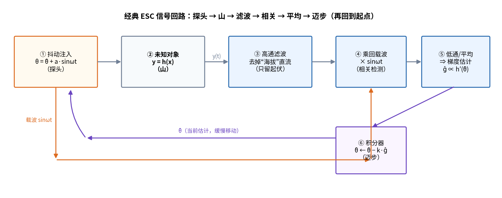
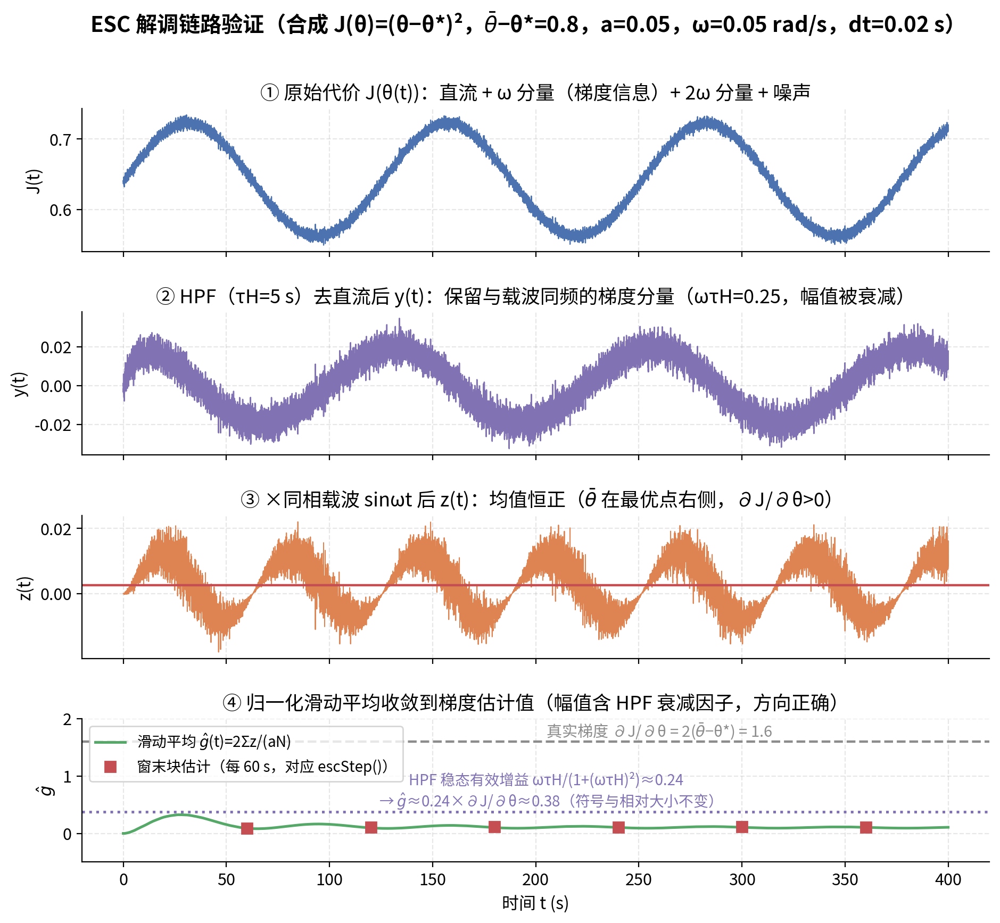
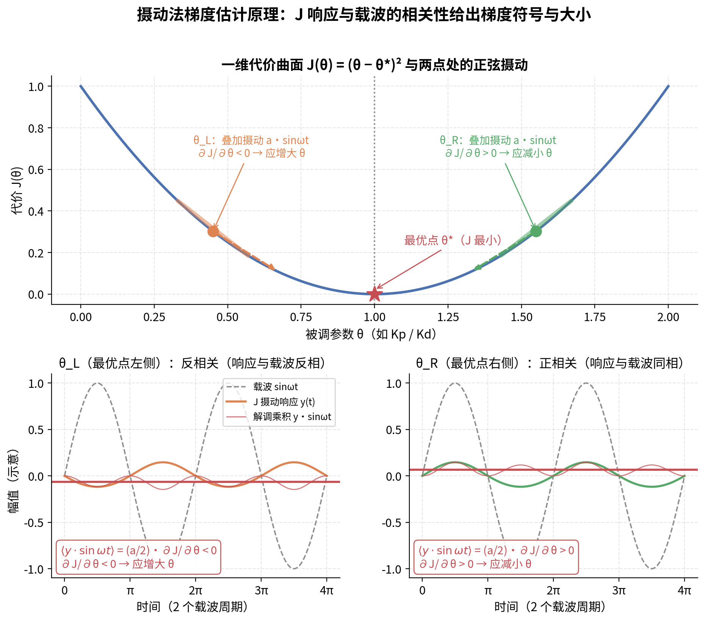
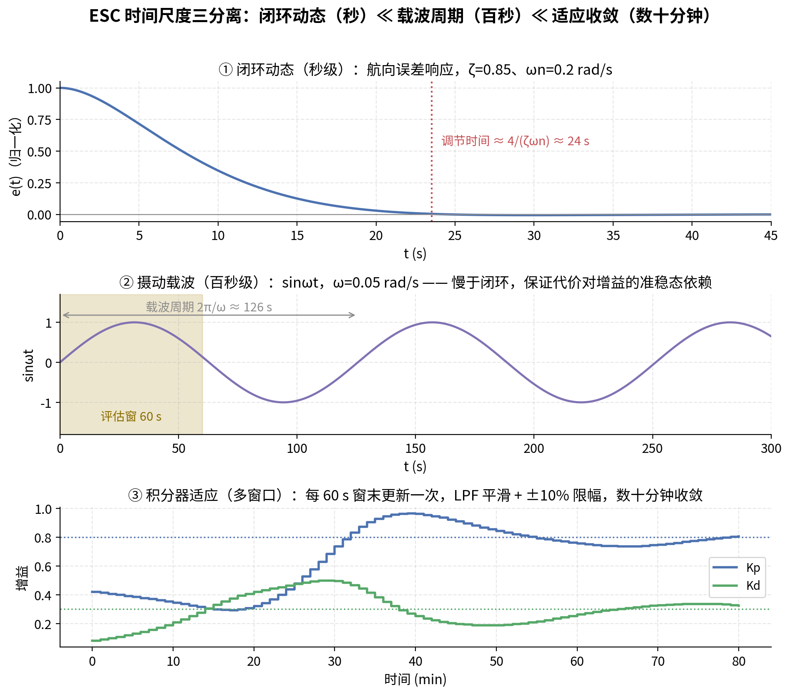
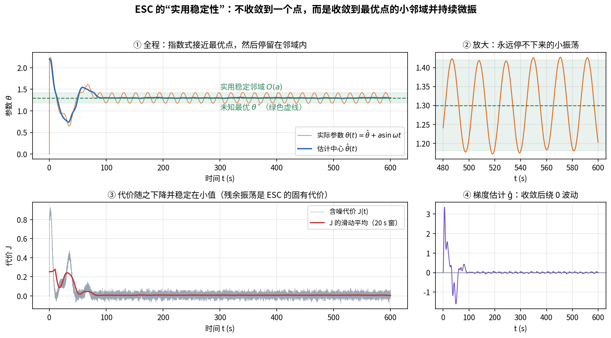
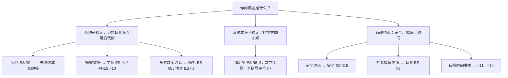
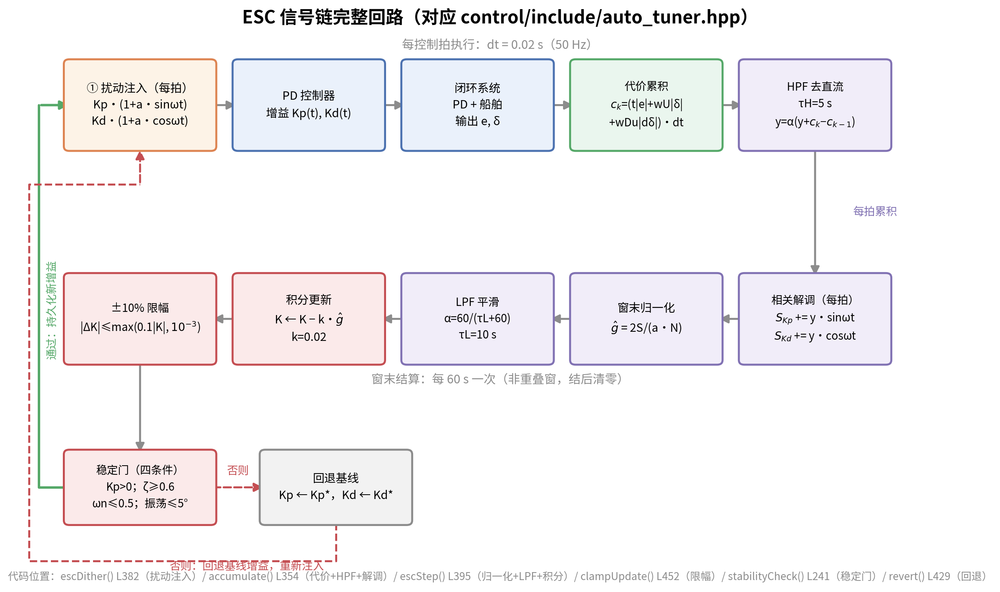
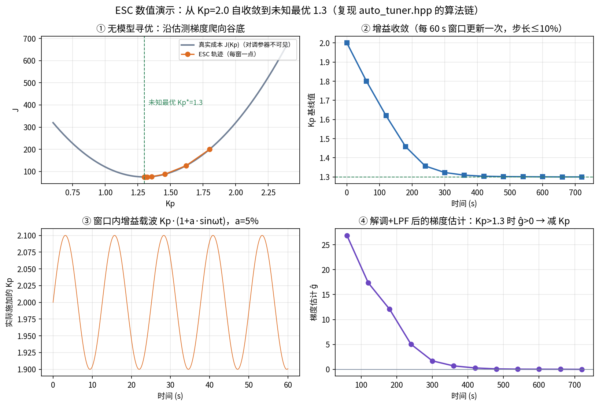
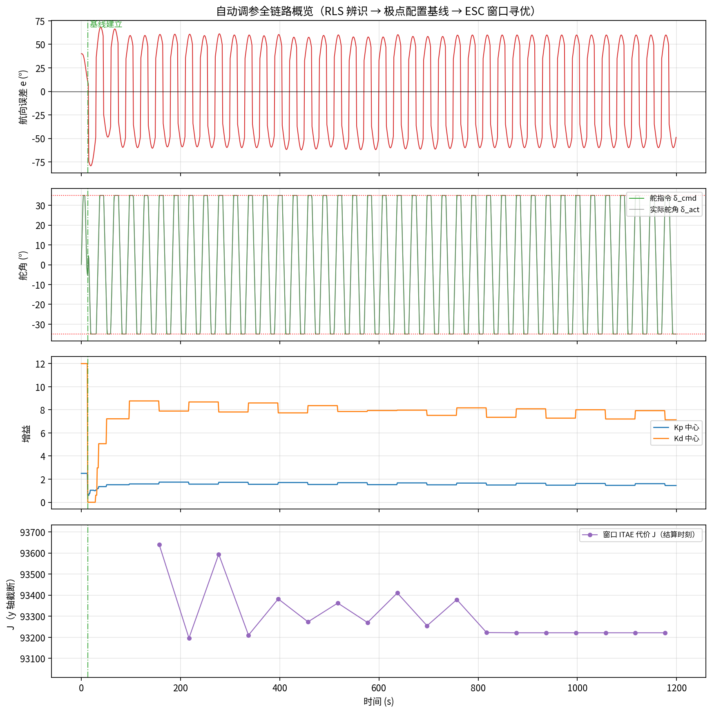

# ESC 深入浅出 —— 《极值搜索百年：综述》伴读指南

> **本文定位**：Alexander Scheinker 的综述 *"100 years of extremum seeking: A survey"*（Automatica 2024，[中文全文翻译](ESC综述_中文翻译.md)，[英文原文 PDF](esc_survey.pdf)）是该领域最全面的地图，但 40 页、310 个公式对初读者并不友好。本文是**先读的"缆车"**：用直觉和图把核心思想讲透，再告诉你综述各节怎么读。
>
> 阅读顺序建议：先读完本文（约 30 分钟），再按第 10 节的路线去读综述译文。文中"**综述 §N**"均指译文章节编号。
>
> 图片版权说明：综述原图（标注"综述图 N"）取自 CC BY 4.0 开放获取论文；其余配图（`assets/esc_*.png`）为本项目自绘，仿真脚本见 `docs/esc_paper_zh/gen_guide_figures.py` 与 `docs/auto_tuning/gen_figures.py`。

**目录**

- [1. 一句话版本：蒙眼爬山](#1-一句话版本蒙眼爬山)
- [2. 五分钟版本：五步循环](#2-五分钟版本五步循环)
- [3. 每个零件存在的理由](#3-每个零件存在的理由)
- [4. 一页纸数学：为什么这就是梯度下降](#4-一页纸数学为什么这就是梯度下降)
- [5. 三条时间尺度](#5-三条时间尺度)
- [6. "稳定"不是"停下"：实用稳定性](#6-稳定不是停下实用稳定性)
- [7. 百年简史](#7-百年简史)
- [8. 变体动物园](#8-变体动物园)
- [9. 回到本项目：自动舵上的 ESC](#9-回到本项目自动舵上的-esc)
- [10. 综述阅读路线](#10-综述阅读路线)

---

## 1. 一句话版本：蒙眼爬山

想象你站在一座大雾弥漫的沙丘上，要爬到最高点。你看不见地形（**没有地图 = 模型未知**），但手腕上有一块高度计（**可以测量输出 $y$**）。

ESC 的策略是：**一边走，一边小碎步地左右晃**。

- 如果高度计读数的变化和你左右晃动**同相**（往左晃高度就升），说明坡在左边——往左挪一点；
- 如果**反相**（往左晃高度反而降），说明坡在右边——往右挪一点；
- 到了山顶附近，怎么晃高度都几乎不变（坡度为零），你就在山顶来回小幅度溜达。

这就是极值搜索（Extremum Seeking）的全部直觉：**主动注入一个已知的小扰动（"晃动"），测量输出中与扰动同频的分量（"听高度计"），用二者的相关性判断梯度方向，然后朝上坡方向缓慢移动**。整个过程不需要知道山的形状 $h(x)$ 的解析式——这是它与一切基于模型的优化方法的本质区别。

对应的代价：你得永远晃下去（有界的小幅振荡），并且走得慢。第 6 节会讲这个代价的精确含义。

## 2. 五分钟版本：五步循环

把上面的比喻工程化，就得到经典 ESC 的信号回路。记住五个角色：**探头 → 山 → 滤波 → 相关 → 迈步**。

1. **探头（抖动注入）**：在当前估计 $\hat\theta$ 上叠加一个已知的小幅正弦 $a\sin\omega t$，实际作用到系统的参数是 $\theta(t) = \hat\theta + a\sin\omega t$。这是你在"主动试探"，不是被动等待。
2. **山（未知对象）**：被控对象 + 未知输出函数 $y = h(x)$。它是黑箱，但它必须是"准稳态"的——你晃一下，它来得及响应（第 5 节展开）。
3. **滤波（高通 HPF）**：高度计读数里"海拔 1000 米"这个直流分量会把"上下起伏 0.5 米"的梯度信息淹没，先用高通滤波器把直流去掉，只留下起伏。
4. **相关（乘回载波）**：把起伏信号**乘回**当初注入的载波 $\sin\omega t$。同相得正、反相得负——乘积的平均值就是梯度方向（和大小）。这是整个 ESC 的**核心机关**，通信里叫相敏检测/锁相放大。
5. **迈步（积分器）**：把梯度估计 $\hat g$ 送进积分器缓慢更新 $\hat\theta$。梯度只告诉你方向，积分器负责真的走过去。

然后回到第 1 步，循环往复。回路一旦闭合，$\hat\theta$ 就会自己爬到最优点附近。

## 3. 每个零件存在的理由

综述图 1（下图）给出了经典 ESC 的完整框图和直观机理。初看眼花缭乱，其实每个模块都对应一个"没有它就不行"的理由。

综述图 1（A：抖动引起的输出响应携带梯度方向信息；B：经典 ESC 框图——被控系统 + 高通 $s/(s+\omega_h)$ + 解调乘法器 + 低通 $\omega_l/(s+\omega_l)$ + 积分器 $k/s$）

| 零件 | 没有它会怎样 |
|---|---|
| 抖动信号 $a\sin\omega t$ | 不试探就永远不知道坡度——被动系统"需要学习的时候学不动"（无持续激励） |
| 高通滤波器 | 输出的直流分量（山的"海拔"）巨大，梯度信号（"起伏"）微小，不去直流则相关检测被淹没 |
| 乘法解调 $\times\sin\omega t$ | 这是提取"同相/反相"信息的唯一机关，输出平均值为 $(a/2)\,h'(\hat\theta)$，即梯度 |
| 低通滤波器 | 解调后信号含 $2\omega$ 高频纹波（$\sin^2$ 项），不平均掉会让积分器跟着抖 |
| 积分器 $k/s$ | 梯度只是方向，必须靠积分"迈步"才能收敛；增益 $k$ 决定爬行速度 |

再看一遍真实信号在链路里的样子（本项目仿真，参数与代码默认值一致）：

一个窗口内信号的四级形态：① 原始代价 $J(t)$ = 直流 + $\omega$ 分量（梯度信息藏在这里）+ $2\omega$ 分量 + 噪声；② 高通去直流后，只剩与载波同频的分量；③ 乘回载波后均值恒正——说明当前点在最优点右侧，应减小 $\theta$；④ 滑动平均收敛到梯度估计值，符号与相对大小都正确

## 4. 一页纸数学：为什么这就是梯度下降

这是全文唯一一段推导，只需要泰勒展开和一个三角函数平均值。设代价函数 $J(\theta)$ 在当前估计 $\hat\theta$ 附近光滑，注入抖动 $\theta = \hat\theta + a\sin\omega t$，则

$$
J(\theta) \approx J(\hat\theta) + a\sin\omega t \cdot J'(\hat\theta) + \frac{a^2}{2}\sin^2\omega t \cdot J''(\hat\theta) .
$$

高通滤波去掉第 1 项（直流）。乘回载波 $\sin\omega t$ 后取一个周期的平均（低通滤波），利用 $\langle\sin^2\rangle = 1/2$、$\langle\sin^3\rangle = 0$：

$$
\big\langle J(\theta)\cdot \sin\omega t \big\rangle \;=\; a\, J'(\hat\theta)\,\langle\sin^2\omega t\rangle + O(a^2) \;=\; \frac{a}{2}\,J'(\hat\theta) + O(a^2) .
$$

**乘积的平均值正比于梯度**——这就是解调环节的全部秘密。积分器 $\dot{\hat\theta} = -k\hat g$（归一化后 $\hat g = (2/a)\langle J\sin\omega t\rangle$）于是给出

$$
\dot{\hat\theta} = -k\, J'(\hat\theta),
$$

即**梯度下降**（求极大时取 $+k$，梯度上升）。下图把"同相/反相"的几何直觉画了出来：

在最优点左侧（$\partial J/\partial\theta < 0$），$J$ 的响应与载波**反相**，解调平均为负，应增大 $\theta$；在右侧则同相、平均为正，应减小 $\theta$——两侧的指令都指向谷底

**诚实声明**：上面推的是"平均化系统"的行为。严格地说，真实系统是含高频抖动的原始系统，要证明它的轨迹贴近平均系统、且平衡点继承了稳定性，需要平均化定理 + 奇异摄动两套工具——这正是 Krstić–Wang 2000 年的工作（综述 §2，定理 1），也是"ESC 直觉很简单、证明很难"的原因。这个证明等了 78 年（见第 7 节）。

## 5. 三条时间尺度

ESC 能成立，靠的是一个结构性前提：**快、中、慢三层动态必须错开**。

- **闭环动态最快**（秒级）：被控系统必须"跟得上"抖动，这样代价 $J$ 才能反映参数的准稳态依赖关系，而不是相位滞后；
- **抖动载波居中**（本项目约 126 秒一个周期）：太慢则调参迟缓，太快则对象来不及响应、测出来的"梯度"被动力学扭曲；
- **积分适应最慢**（数十分钟收敛）：积分器只跟踪梯度的慢变趋势，绝不跟随载波本身的起伏。

如果错序会发生什么：载波快过系统带宽 → HPF/解调测到的是对象的动力学相位而非静特性梯度；积分器快过载波 → $\hat\theta$ 跟着抖动信号跑，回路失稳。综述 §2 的假设 1–3 与 $\omega, \delta, a$ "充分小"的条件，数学上就是在保证这种尺度分离。

## 6. "稳定"不是"停下"：实用稳定性

ESC 的稳定性结论与常见控制不同：它**不收敛到一个点，而是收敛到最优点的一个小邻域，并在其中永远振荡**——术语叫**实用稳定性（practical stability）**，邻域大小为 $O(a + \omega + \delta)$ 量级（综述 §2 定理 1）。

① 估计中心 $\hat\theta$ 指数式逼近最优点后进入邻域；② 放大看：实际参数 $\theta(t)$ 永远保持幅度约 $a$ 的振荡——这是"持续试探"的固有代价；③ 代价 $J$ 随之降到小值；④ 梯度估计收敛后绕零波动

工程上的读法：

- **抖动幅值 $a$ 是灵敏度与稳态损失的权衡**：$a$ 大则梯度信号信噪比高、爬得快，但收敛后残余振荡大、平均代价抬高；$a$ 小则反之。本项目取 $a = 5\%$（相对摄动）。
- **"到了就减小抖动"是常见工程策略**：综述 §2 介绍了让幅值指数衰减的方案（$\dot\alpha = -\omega\delta\epsilon\alpha$，综述图 4），代价是时变环境下会"失明"——最优点移动后无法响应。本项目选择保持常值小幅抖动，正是为了保住对工况漂移的持续感知能力。
- **这不是缺陷而是设计选择**：残余振荡换取的是"永远知道梯度方向"的在线能力。

## 7. 百年简史

ESC 是"工程远远跑在理论前面"的典型案例：

综述图 2：ES 从 1922 年起的演化树——先分裂为"经典 ES（优化已稳定系统）"与"镇定型 ES（直接当反馈用）"两大类，近年又相互融合

- **1922**：法国工程师 Leblanc 为解决**有轨电车从输电线获取最大功率**的问题，发明了扰动式极值调节——只有精巧设计，没有任何数学分析（综述 §1）。
- **1940s–60s**：苏联（Kazakevich 1943 起）和美国（Draper & Li 1951；Tsien 钱学森 1954）分别把该方法用于内燃机优化，算法不断改进，但只有针对特定问题的分析。
- **1971**：首个基于李雅普诺夫的稳定性分析（Luxat & Lees），仅限特定系统。
- **2000**：**Krstić & Wang 给出首个一般性稳定性证明**（平均化 + 奇异摄动），领域复活（综述 §2）。
- **2012**：Scheinker 提出把 ES **直接用作反馈控制器**——对象本身可以不稳定、控制方向可以未知（综述 §6），ESC 从"优化器"升级为"控制器"。
- **2012 至今**：分支爆炸——牛顿型、随机型、有界型、有限时间、PDE、安全 ES、与机器学习结合……（综述 §3–16）。

## 8. 变体动物园

综述图 40（下图）把主要变体画在了一张图里。不要被吓到——**所有变体都是同一个五步循环的零件替换**：换探头（抖动信号）、换解调方式、换步进规则，或者把回路嵌进别的结构。

综述图 40：左列为"经典系"（优化已稳定系统），右列为"镇定型系"（ES 直接作反馈）；每个框图都仍是 探头→山→滤波→相关→迈步 的变形

| 变体（综述章节） | 一句话原理 | 解决的痛点 | 阅读难度 |
|---|---|---|---|
| 经典 ES（§2） | 本文第 2–4 节的全部内容 | 基准方案 | ★ |
| 博弈/纳什 ES（§3） | 每个玩家只听自己的"高度计"，互不通信 | 多智能体各自寻优 | ★★ |
| 牛顿 ES（§4） | 不只测坡度 $J'$，还测曲率 $J''$ 并除以它 | 收敛速度不再依赖未知曲率，更快更均匀 | ★★ |
| 随机 ES（§5） | 把正弦探头换成噪声探头 | 多变量时各通道天然不"串台" | ★★ |
| 镇定型 ES（§6–9） | 回路不再外挂在已稳定系统上，直接镇定不稳定系统 | 系统本身可以开环不稳定、控制方向未知 | ★★★ |
| 有界 ES（§8） | $u = \sqrt{\alpha\omega}\cos(\omega t + ky)$，控制量有解析上界 | 硬件上必须严格限制控制幅值 | ★★ |
| 比例积分 ES（§10） | 给积分器再加一路比例反馈 | 收敛更快、超调更小 | ★★ |
| 有限时间 ES（§11） | 用非光滑（非 $C^2$）反馈 | 在可预计的有限时间内收敛 | ★★★ |
| PDE 的 ES（§12） | 时滞/扩散被建模为 PDE 再做补偿 | 大时滞、分布参数系统 | ★★★★ |
| 安全 ES（§15） | 寻优同时满足安全约束（如避碰） | 探索过程不许"撞墙" | ★★★ |
| 隐空间调节（§16） | 用 ES 在线微调深度网络的低维隐变量 | 让训练好的神经网络适应时变系统 | ★★ |

按你的场景选入口：

## 9. 回到本项目：自动舵上的 ESC

本项目的自动舵调参器（`control/include/auto_tuner.hpp`）就是经典 ESC 的工程化版本。对着代码看，五步循环一个不少，但每一步都做了工程加固：

| 经典 ESC | 本项目实现（代码位置） | 为什么改 |
|---|---|---|
| 单参数 + 正弦载波 | $K_p$、$K_d$ **同时**调：$K_p$ 乘 $\sin\omega t$、$K_d$ 乘 $\cos\omega t$（`escDither()` L382） | 正交载波互不相关，一次试探测两个梯度，时间减半 |
| 瞬时输出 $h(x)$ | 60 s 窗口 ITAE 代价 $c_k = (t\vert e\vert  + w_u\vert \delta\vert  + w_{\dot u}\vert \dot\delta\vert )\,dt$ 累积（`accumulate()` L354） | 航向保持的真实目标是误差与操舵代价的积分，不是瞬时 map |
| 连续积分器 | 窗口末结算 + LPF 平滑 + **±10% 限幅**（`escStep()` L395、`clampUpdate()` L452） | 防止单窗噪声把增益推飞 |
| 无安全机制 | **稳定门**：$K_p>0$、$\zeta\ge0.6$、$\omega_n\le0.5$、振荡 $\le5°$，不过则回退基线（`stabilityCheck()` L241、`revert()` L429） | 辨识误差可能把闭环拖离设计点，必须有兜底 |
| 独立运行 | 三层架构的层 3：RLS 辨识 + 极点配置先建基线，ESC 只在基线邻域微调 | 平均化稳定性结论是**局部**的，全局粗调交给层 1/层 2 |

效果（数值演示，复现代码算法链）：$K_p$ 从 2.0 自收敛到未知最优 1.3，梯度估计随接近最优点而归零——

真实闭环仿真（RLS 辨识 → 极点配置基线 → ESC 窗口寻优全链路）：

更深入的推导与代码级流程见 `docs/ESC方案数学推导与算法实现详解.md`。

## 10. 综述阅读路线

读完全文后再打开综述，推荐路线：

- **必读（约 1 小时）**：§1 引言（历史与直觉，本文第 4、7 节的展开）→ §2 经典 ES 发展（假设 1–3 与定理 1，本文第 4 节的严格版）。
- **按兴趣选读**：用第 8 节的表格反查——每行都标了章节号和难度。
- **可放心跳过**：各节的收敛性证明细节（平均化/奇异摄动/李括号的技术部分），除非你要做理论工作；§12 PDE 部分需要泛函分析背景。
- **应用章节（§19–24）当故事读**：防抱死制动、光伏 MPPT、粒子加速器调束、生物反应器——看 ESC 在真实工业里怎么落地，对理解本项目的设计取舍很有帮助。
- **§17 的表 1 值得细看**：一张表对比所有变体的能力边界（是否要求开环稳定、是否需要模型、是否多变量），选型时直接查。

**术语速查**（译文统一译法）：

| 英文 | 中文 |
|---|---|
| extremum seeking (ES) | 极值搜索（ES） |
| dither signal | 抖动信号 |
| perturbation | 扰动 |
| averaging | 平均化 |
| singular perturbation | 奇异摄动 |
| demodulation | 解调 |
| practical stability | 实用稳定性 |
| Newton-based ES | 基于牛顿的 ES |
| Lie bracket averaging | 李括号平均化 |
| control Lyapunov function | 控制李雅普诺夫函数 |
| maximum power point tracking | 最大功率点跟踪（MPPT） |

---

**参考**

- 译文：`docs/esc_paper_zh/ESC综述_中文翻译.md`（PDF：`pdf_output/docs_esc_paper_zh_ESC综述_中文翻译.pdf`）
- 原文：Scheinker, A. "100 years of extremum seeking: A survey", *Automatica* 161 (2024) 111481, DOI: 10.1016/j.automatica.2023.111481（CC BY 4.0）
- 本项目 ESC 实现：`control/include/auto_tuner.hpp`；推导文档：`docs/ESC方案数学推导与算法实现详解.md`
