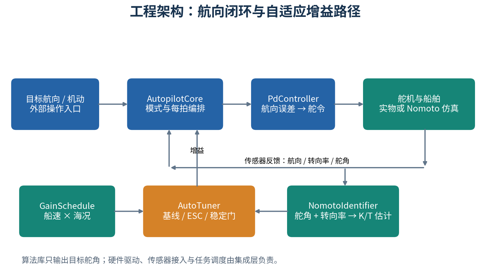
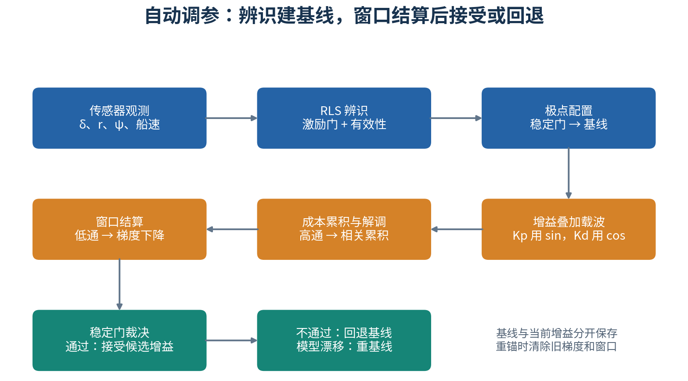
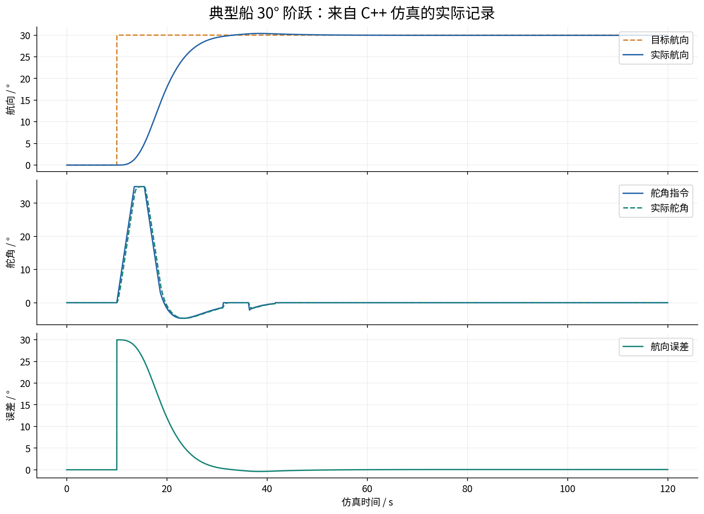
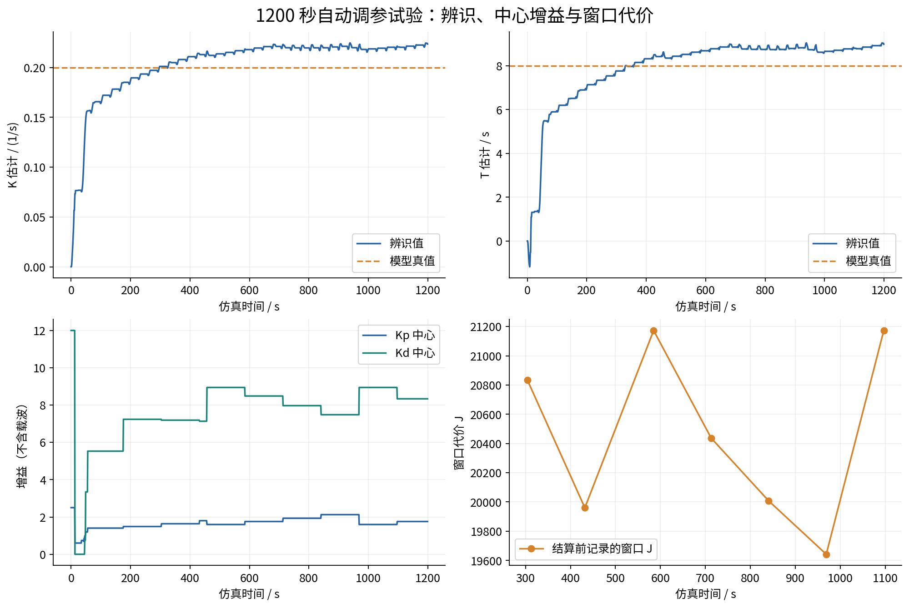

# auto_rudder 工程分析与中文说明

> 分析日期：2026-09-09；代码基点：`833d3c5`，结合当前工作区源码核对。本文面向工程接手、算法理解和仿真验证，包含 4 幅插图、模块索引、运行示例及本次实测结果。图中的曲线来自本次 C++ 仿真运行，不是实船试验数据。

## 1. 工程解决什么问题

`auto_rudder` 是一个船用自动舵工程。它接收目标航向以及传感器提供的实际航向、转向率、舵角、船速和海况，通过反馈控制计算目标舵角，使船舶保持航向或执行预置机动。

工程的主要特点是将常规 PD 控制与在线自适应组合起来：增益调度提供初始工作参数，RLS 辨识估计船舶的 Nomoto 模型参数，极点配置建立基线，ESC 再围绕工作增益做小幅调整。机动序列、仿真模型、参数存储和调试工具为这条控制链提供配套能力。

当前可编译主体位于 `control/`，采用 C++17 头文件算法库，通过 CMake 的 `ar_headers` 接口目标复用。仓库还包含大量设计文档、算法推导、研究材料和汇报文件；这些材料表达的设计范围可能大于已实现的软件范围。

**核心边界：控制闭环在航向层完成，唯一控制输出是目标舵角。** 当前核心输入没有经纬度、横向航迹误差或航路点序列，因此预置搜索、回转等机动不等同于带位置反馈的航迹保持。AHRS 接入、舵机驱动、ECU 通信服务与周期任务需要外部集成。

## 2. 总体架构与代码地图



*图 1：蓝色为控制主链，绿色为观测、调度与对象模型，橙色为自动调参。图中省略了存储和调试旁路。*

| 路径 / 模块 | 主要职责 | 阅读时关注的入口 |
| --- | --- | --- |
| [autopilot_core.hpp](../../control/include/autopilot_core.hpp) | 模式状态机、机动编排、每拍数据转发 | `step()`、`headingControlStep()` |
| [pd_controller.hpp](../../control/include/pd_controller.hpp) | 航向 PD、微分滤波、死区、舵角与舵速限制 | `update()`、`saturate()` |
| [gain_schedule.hpp](../../control/include/gain_schedule.hpp) | 船速与海况到名义增益的映射 | `query()`、`setTable()` |
| [nomoto_identifier.hpp](../../control/include/nomoto_identifier.hpp) | 在线 RLS 辨识、自降频、物理有效性检查 | `update()`、`valid()` |
| [auto_tuner.hpp](../../control/include/auto_tuner.hpp) | 极点配置、ESC、稳定门、回退和重锚 | `tick()`、`establishBaseline()`、`suspend()` |
| [maneuver_sequencer.hpp](../../control/include/maneuver_sequencer.hpp) | 通用航段与六种预置机动 | `Leg`、`update()`、各机动工厂函数 |
| [param_store.hpp](../../control/include/param_store.hpp) | 参数序列化、CRC32、范围检查和存储 IO 注入 | `ControlParams`、`ParamStore` |
| [tuner_debug_api.hpp](../../control/include/tuner_debug_api.hpp) | 调参器观测与单环节调试门面 | `snapshot()`、`settleWindowOnce()` |
| [sim/](../../control/sim/) | 舵机与船舶模型、场景执行、指标计算、CSV 导出 | `main.cpp`、`simulator.hpp` |
| [tests/](../../control/tests/) | 9 个 GoogleTest 源文件 | 控制、辨识、调参、集成等测试 |
| [tools/](../../control/tools/) | 命令行调试、验收、绘图和动画 | `ar_tuner_debug`、Python 脚本 |
| [ui/debug_ui.html](../../control/ui/debug_ui.html) | 浏览器调试界面与独立 JS 仿真 | 参数面板、Canvas 曲线、WebSocket 客户端 |

推荐阅读顺序为：`CONTEXT.md` → `AutopilotCore::step()` → PD → 辨识器 → `AutoTuner::tick()` → 仿真和测试。这样可以先理解数据如何流动，再进入算法细节。

## 3. 一拍控制是怎样完成的

### 3.1 输入、输出与时序

`SensorInput` 的五项输入分别是 `headingDeg`、`rateDegS`、`rudderDeg`、`speedKn`、`seaState`，单位为度、度/秒、度、节和内部海况等级 0～3。`step(s, dt)` 返回目标舵角，单位为度。

在 `AUTO_HEADING` 模式，一拍按以下顺序执行：

1. 必要时使用实际舵角初始化 PD 的输出限速基准。
2. 按船速与海况查询名义 `Kp/Kd`。
3. 把实际舵角、转向率和实际调用间隔送入辨识器。
4. 组装只读辨识快照 `IdSnapshot`，交给调参器 `tick()`。
5. 把返回的 `GainCommand` 和控制周期交给 PD。
6. 计算航向误差并输出经过约束的舵角指令。

默认控制周期为 0.02 s，即 50 Hz；RLS 默认每累计 1 s 才更新一次；ESC 默认每 60 s 结算一次。三个时间尺度分别对应快速操舵、模型学习与较慢的参数调整。

**集成时需要同步时基。** PD 使用传入的 `dt`，RLS 内部累计调用间隔；调参器的载波、滤波、成本和窗口拍数仍以 `AutoTuner::Params::dt` 为基准。只改变 `step()` 的 `dt` 不足以让所有调参环节自动适配新频率。

### 3.2 四种工作模式

| 模式 | 当前代码行为 | 进入或退出方式 |
| --- | --- | --- |
| `MANUAL` | 返回输入的实际舵角，相当于算法侧透传反馈 | 默认模式；外部通过 `setMode()` 切换 |
| `AUTO_HEADING` | 执行航向保持闭环与在线调参 | 设置模式与目标航向 |
| `AUTO_MANEUVER` | 执行航段；航向段走 PD，舵角段走限幅器 | `startManeuver()` 或 `startIdentifyTrial()` |
| `HOLD` | 冻结上一拍舵角指令 | `setMode(HOLD)` |

`HOLD` 保持的是舵令，不是自动保持航向；`MANUAL` 也没有独立的手轮指令输入，这部分由外部系统承担。机动结束后自动进入航向保持，目标设为完成时的实际航向，并在完成拍立即闭环计算。

通过 `setMode()` 切到手动或 HOLD 时会调用 `suspend()` 清理调参测量状态并保留基线。普通机动期间不调用调参器 `tick()`；显式辨识试验则在机动期间继续喂辨识器。不要把“不调用 tick”理解成所有启动入口都会执行同样的状态清理。

## 4. 航向控制与增益调度

### 4.1 PD 控制链

控制器先求最短角度差 `e = angleDiffDeg(目标航向, 实际航向)`，避免跨越 0°/360°时出现接近整周的误差。例如目标 1°、实际 359°，应向正方向修正约 2°。

控制律为 `δ_raw = Kp × e + Kd × filtered(de/dt)`。微分项来自航向误差差分，经一阶低通滤波；当前 PD 接口没有直接使用 AHRS 转向率作为微分项。转向率主要用于辨识和机动触发。

| 参数 | C++ 默认值 | 作用 |
| --- | --- | --- |
| `Kp / Kd` | 1.0 / 0.5 | 比例纠偏与动态阻尼；集成闭环会被调度或调参结果更新 |
| `dMax` | 35° | 舵角幅值限制 |
| `ddMax` | 10°/s | 相邻输出变化限制 |
| `deadzone` | 0.3° | 小误差时令目标舵角回中，仍经过舵速限制 |
| `tau` | 0.2 s | 微分低通时间常数 |
| `quant` | 0.1° | 输出量化步长 |
| `dt` | 0.02 s | 默认控制周期 |

输出处理顺序为舵角限幅、舵速限制、量化。默认每拍允许变化 0.2°，与 0.1° 量化相容；自定义周期和量化步长时应重新检查离散输出变化。PD 没有积分项，持续风偏下可能存在稳态航向偏置。

### 4.2 调度与增益所有权

默认表按船速段和海况保存名义增益。查询使用速度段的**中点**作为插值锚点，在相邻中点间线性插值；超出范围取首尾锚点值。它并非在 4、10、18 kn 的边界上直接跳变。

例如海况 0 的锚点是 2、7、14、21.5 kn，对应 `Kp` 为 2.0、1.5、1.2、1.0，`Kd` 为 0.8、0.6、0.5、0.4。自定义表应保持各海况行的速度顺序；查询按表顺序单次遍历完成插值，对每海况行数不再有额外上限。

基线未建立时，当前增益跟随名义调度值；基线建立后，增益归 `AutoTuner` 管理，避免 ESC 的调整下一拍又被调度表覆盖。应区分三组值：**名义调度增益、去载波的当前增益、实际施加到 PD 的含载波增益**。

## 5. 在线辨识与自动调参



*图 2：算法机制示意。实际 `tick()` 内先累积观测并处理窗口，再生成本拍输出载波。普通航向保持与显式 Z 形辨识试验通过不同入口建立基线。*

### 5.1 RLS：估计船舶转向特性

Nomoto 一阶模型为 `T × dr/dt + r = K × δ`。其中 `K` 表示舵角对转向率的增益，`T` 表示响应时间尺度。模型辨识使用实际舵角反馈，而非假定舵机立即执行了指令。

辨识器采用归一化回归：`φ = [δ/50, −(dr/dt)/1]`，观测量为 `r`，利用递推最小二乘更新参数，最后恢复物理量 `K̂/T̂`。默认遗忘因子为 0.98，协方差初值为 1.0。

只有 `|δ| > 3°`，且 `|r| > 0.5°/s` 或 `|dr/dt| > 0.2°/s²` 时才接受该次递推。直航小舵角通常缺少足够激励，不能只靠等待就保证辨识收敛。物理有效性要求 `0 < K̂ ≤ 2`、`1 ≤ T̂ ≤ 60 s` 且数值有限；这只是范围检查，不是统计置信度保证。

显式试验入口 `startIdentifyTrial()` 默认生成 ±20° 舵角、20° 转向阈值、4 个周期的 Z 形机动，并重置辨识器。机动结束后尝试建立基线，结果为 `OK` 或 `FAILED`；正常试验进度为 `NONE → RUNNING → OK/FAILED`。

### 5.2 极点配置：建立工作基线

忽略微分滤波、执行器滞后、限幅与量化时，Nomoto 模型和理想 PD 的闭环特征式为：

`T s² + (1 + K Kd) s + K Kp = 0`

与期望二阶系统匹配，可得到：

- `Kp = ωn² T / K`
- `Kd = max(0, (2 ζ ωn T − 1) / K)`

调参器默认目标阻尼比 `ζ = 0.85`、自然频率 `ωn = 0.20 rad/s`。例如 `K = 0.2、T = 8 s` 时得到 `Kp = 1.6、Kd = 8.6`。这些公式用于候选增益计算；实际受限、带滤波闭环的性能还需要仿真和试验验证。

候选值通过稳定门后形成基线。已有基线时，K 或 T 相对基线估计漂移超过约 25% 才尝试重基线，漂移分母设有下限；小幅变化交给 ESC。重锚清除旧梯度、解调状态和窗口样本，避免把旧工作点的信息施加给新工作点，载波相位保持连续。

### 5.3 ESC：围绕基线做小幅调整

ESC 为极值搜索，在实际施加的增益上加入小幅周期摄动：`Kp_out = Kp_center × (1 + a sin φ)`，`Kd_out = Kd_center × (1 + a cos φ)`。默认相对幅值 `a = 0.05`，角频率 `ω = 0.05 rad/s`，对应周期约 125.7 s，注意这里不是 0.05 Hz。

每拍先计算成本，经过高通滤波去掉慢变成分，再与 sin/cos 载波相关累积；窗末做归一化、低通平滑和梯度下降，然后限制单次更新幅度并经过稳定门。

当前实现的窗口代价可写为：

`J = Σ [t_i |e_i| + wU |δ_i| + wDu |δ_i − δ_(i−1)|] Δt`

默认 `wU = 0.01`、`wDu = 0.005`。第一项对持续误差施加时间权重，后两项分别惩罚操舵量与相邻拍舵角变化。最后一项在代码里是**舵角差值，没有除以 Δt**；它也没有测量电机电流或燃油消耗，因此不能直接解释成真实能耗或节油率。

### 5.4 稳定门、回退与速度门控

稳定门检查正比例增益、模型推算阻尼比不低于 0.6、自然频率不高于 0.5 rad/s，以及误差振荡峰峰值不超过 5°。振荡检测在目标航向不变满 30 s 后才喂入，目的是减少把指令响应当成自激振荡的情况。显式辨识试验收官建基线时，振荡项以 0 输入，主要依赖代数条件把关。

窗末候选增益通过稳定门则接受，否则回退到基线。**在线接受条件没有要求 J 必须低于上一窗**，因此代价不保证逐窗下降。默认单次更新限制为当前绝对值的 10%，同时有 0.001 的最小允许更新幅度，避免零增益永久无法移动。

船速大于 15 kn 时停止自动辨识评估、ESC 摄动和有效窗口更新；主核心仍可继续喂 RLS，航向控制也继续运行。若基线已经建立，则返回已有中心增益，而不是自动恢复按高速调度表取值。

## 6. 机动、参数存储与调试

### 6.1 机动由航段组成

每个 `Leg` 包含模式、目标值、触发条件、阈值与下一段索引。`HEADING` 段指定航向，`RUDDER` 段指定舵角；触发可依据累计航向变化、时间或转向率。累计航向变化按最短角度差逐拍累积，并检查方向，支持跨越 ±180° 的回转。

预置机动包括圆形回转、Williamson、U 形回转、Z 形、Cloverleaf 和搜索。它们复用同一个航段执行器，因此新增机动主要是组织航段数据。由于闭环没有位置输入，航段完成只说明相应角度、时间或转向率条件达成，不能直接推出实际地理轨迹精度。工具中的航向极坐标图也不应当作经纬度航迹图。

### 6.2 参数存储

`ControlParams` 保存舵角标定、Nomoto 参数、PD 增益、调度表及版本/时间戳等信息。代码逐字段进行小端序列化，以 CRC32 检查一致性，并在加载时做物理范围校验，避免结构体填充字节影响结果。

真正的 EEPROM/Flash 读写通过 IO 回调提供。该模块虽被核心头文件包含，但 `AutopilotCore` 没有自动加载或保存参数的流程；参数落盘和重新应用仍需要集成层显式连接。

### 6.3 两类调试工具

`ar_tuner_debug` 是直接包装 C++ `TunerDebugApi` 的逐行命令工具，输出 `OK/ERR` 和 `key=value`，适合脚本验收与单环节观测。`tuner_debug_monitor.py` 可通过管道驱动工具并绘制遥测曲线。这里运行的是工具进程内的调参器实例；连接已有实船进程还需要相应命令通道。

浏览器 `debug_ui.html` 提供参数编辑、Canvas 曲线、机动按钮和 WebSocket 客户端，并有独立 JS 仿真。当前 UI 仍保留辨识 `dt`、`p0=1e6` 等旧参数，而 C++ 已采用 `beatSec`、`p0=1.0` 和归一化回归，因此不能把界面演示当作当前 C++ 实现的等价验证。ECU 的 WebSocket 服务需要另外实现。

源码明确规定 `TunerDebugApi` 只用于调试与标定，`force*` 会绕过稳定门，不应接入正常航行控制回路。

## 7. 本次实际运行结果

### 7.1 典型船阶跃响应



*图 3：`step_typical` 场景，K=0.2、T=8 s，无扰动；数据见 [step.csv](data/step.csv)。仿真预装已知模型的极点配置增益 Kp=2.5、Kd=12，并关闭自动优化，因此这张图验证的是已整定 PD 闭环，不是未知船模从零自学习。*

本次输出的超调量为 **1.30%**，5% 调节时间为 **17.44 s**，稳态误差偏置为 **0.053°**，通过该场景判据。图中舵令与实际舵角之间存在执行器滞后，航向在转向率积分作用下逐步接近目标。

### 7.2 1200 秒自动调参试验



*图 4：`--tune --K 0.2 --T 8 --seconds 1200`；数据见 [tune.csv](data/tune.csv)。曲线展示的是实际记录，不能据此推出全工况收敛。*

| 观测项 | 本次结果 |
| --- | --- |
| 初次建立基线 | 约 13 s |
| 最终 K̂ / T̂ | 0.2231 / 8.9532 s |
| 相对模型真值偏差 | 约 +11.5% / +11.9% |
| 中心 Kp | 2.5000 → 1.8425 |
| 中心 Kd | 12.0000 → 8.2736 |
| 记录的结算窗口数 | 7 |
| 首窗 / 末窗 J | 20834.9 / 21173.2 |
| 程序结论 | `stable=1`、`converged=1` |

**如何理解“收敛”：** 该场景要求辨识偏差在 25% 内、已建立基线、有足够结算窗口、末 3 窗代价散布不超过 10%、末窗 J 不超过首窗的 1.02 倍，并满足数值有界检查。本次 J 上升约 **1.62%**，仍在 2% 容差内，因此通过；它没有证明成本净下降或找到最优增益。

试验也并非完全默认配置：初始调度增益来自已知 K/T；参考每 32 s 翻转（缺省按 max(4T, 4/(ζωn)) 自适应，本例即 4T=32 s），建立基线后幅值降低；窗口设为 128 s，载波每窗一周期，高低通时间常数均设为 64 s，振荡门限放宽到 20°，速度去激活阈值改为 100 kn。日志 J 取结算前采样值。

另一个解释限制是，调参器三个窗口缓冲各固定为 3000 点，在 0.02 s 周期下只能保存 60 s。128 s 实验窗口会覆盖早期成本样本，而解调累积计数仍可持续到窗末。因此图中 J 应理解为**当前缓冲与导出逻辑得到的代价**，不能当作完整 128 s 窗口的严格积分。

### 7.3 测试现状

本次先执行 `cmake --build control/build -j 4`，再运行现有测试。结果如下（数量为对当前套件复跑的结果；早期完整 CTest 记录见 [ctest.log](data/ctest.log)）。

| 验证 | 结果 | 说明 |
| --- | --- | --- |
| C++ 构建 | 成功 | 仿真、调试工具和测试目标均构建成功 |
| CTest 全集 | **115 / 117 通过** | 111 项 GoogleTest 均通过，6 项仿真测试中 2 项失败 |
| `sim_all` | 失败 | 慢船 K=0.1、T=20 s 调节时间 35.72 s，超过 30 s 门限 |
| `sim_validate` | 失败 | 慢船调节时间超限；典型船带扰动操舵频次 12 次/分，超过 6 次/分 |
| 调试接口验收脚本 | **49 PASS / 0 FAIL** | 9 个功能组的数值、状态和协议断言 |
| 单独 `--tune` 试验 | 通过其收敛判据 | 默认 CTest 列表没有注册这一项 |

性能判据还包括超调 ≤10%、稳态误差标准差 ≤1°、偏置 ≤1°；`--validate` 额外要求主机测得的单拍最长耗时小于 5000 μs。主机测时不能替代目标 ECU 上的最坏执行时间测量。本文记录现状，没有修改算法或放宽测试门限。

## 8. 如何构建和复现

以下命令均从仓库根目录执行，需要 C++17 编译器、CMake 3.14 及以上；测试通过 FetchContent 使用 GoogleTest v1.14.0，首次配置需要可用源码缓存或网络。

```bash
cmake -S control -B control/build -DCMAKE_BUILD_TYPE=Release
cmake --build control/build -j 4
ctest --test-dir control/build --output-on-failure
python3 control/tools/tuner_debug_accept.py --exe control/build/tools/ar_tuner_debug
```

仅构建仿真和调试工具、不下载测试依赖时，可使用独立构建目录：

```bash
cmake -S control -B /tmp/auto-rudder-overview-build -DAR_BUILD_TESTS=OFF
cmake --build /tmp/auto-rudder-overview-build -j 4
```

复现本文两组曲线：

```bash
mkdir -p docs/project_overview/data
control/build/sim/ar_sim --scenario step_typical --out docs/project_overview/data/step.csv
control/build/sim/ar_sim --tune --K 0.2 --T 8 --seconds 1200 --out docs/project_overview/data/tune.csv
python3 docs/project_overview/generate_figures.py
```

绘图需要 Python、NumPy、Matplotlib，中文字体使用 Noto Sans CJK SC。插图生成脚本与 CSV 一起保存，便于修改参数后重新出图。

其他入口包括 `ar_sim --list`、`--ident`、`--trial`、`--esc`、`--validate` 和 `--maneuver zigzag`。命令行调试可先启动 `control/build/tools/ar_tuner_debug`，输入 `pole 0.2 8` 检查极点配置，输入 `status` 查看快照。逐条命令以工具 `help` 为准。

最小集成示意：

```cpp
#include "autopilot_core.hpp"

ar::AutopilotCore autopilot;
// 初始化阶段
autopilot.setMode(ar::Mode::AUTO_HEADING);
autopilot.setHeadingRef(90.0);

// 周期任务内：传感器值及 dt 由集成层提供
ar::SensorInput sensor{heading, rate, rudder, speedKn, seaState};
double rudderCommand = autopilot.step(sensor, 0.02);
// 将 rudderCommand 发送给舵机接口
```

## 9. 工程判断与后续重点

工程已经形成可运行的“控制—辨识—调参—仿真—调试”链条。控制核心与 IO 分离，辨识器拥有自身节拍，调参器集中管理基线与增益所有权，便于独立验证。现有测试也覆盖了跨模式状态、回退、量化、辨识收官等关键行为。

从当前代码和本次结果看，后续应优先处理以下具体事项：

| 优先关注项 | 证据与影响 | 后续工作方向 |
| --- | --- | --- |
| 慢船与扰动场景性能 | 两项仿真测试失败 | 分析调节时间与操舵频次；保留现有门限作为回归依据 |
| 窗口容量与时基一致性 | 3000 点缓冲遇到 128 s 试验窗口；多处采用配置 dt | 明确支持的窗口/周期范围，统一成本累积语义 |
| 调参效果证据 | 收敛判据允许 J 小幅上升，初始增益使用模型真值 | 增加固定增益与 ESC 对照、模型失配和多扰动重复试验 |
| UI 与 C++ 一致性 | JS 仍使用旧辨识参数 | 同步参数协议，优先让 UI 观测真实 C++ 遥测 |
| ECU 集成 | IO 注入、通信服务、持久化应用未形成核心自动流程 | 明确传感器有效性、超时处理、任务调度和参数生效路径 |
| 模式生命周期 | `setMode()` 与机动启动入口清理路径不同 | 针对中途抢占和恢复明确增益及窗口状态语义 |

这些是基于当前实现的分析项，不代表已完成的修复。进一步算法推导可参考 [RLS 说明](../RLS方案数学推导与算法实现详解.md)、[ESC 说明](../ESC方案数学推导与算法实现详解.md) 和 [实船调试接口文档](../实船调试接口调用文档.md)；接口与默认值仍应以对应 C++ 源码为准。
