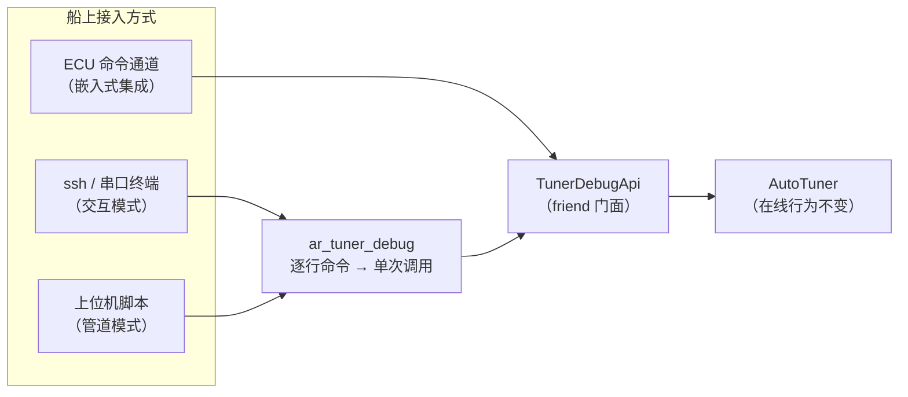

# 实船调试接口调用文档与使用说明

> 本文档是实船调试接口（`TunerDebugApi` + `ar_tuner_debug`）的完整参考与使用手册，面向随船调试工程师。内容：接口定位与安全约束、构建与接入、C++ API 参考、CLI 命令全表、典型调试场景的操作流程（cookbook）、故障排查。
>
> **事实来源**：`control/include/tuner_debug_api.hpp`（调试门面）、`control/tools/tuner_debug_cli.cpp`（命令行工具）、`control/tests/test_tuner_debug_api.cpp`（13 个行为用例）。被调对象的内部原理见 `docs/ESC代码函数实现流程.md`；稳定门条件详解见 `docs/ESC方案数学推导与算法实现详解.md` §3.10.7 与 `auto_tuner.hpp:241-254`。

**目录**

- [1. 接口定位与安全约束](#1-接口定位与安全约束)
- [2. 架构与接入方式](#2-架构与接入方式)
- [3. C++ API 参考](#3-c-api-参考)
- [4. CLI 命令全表](#4-cli-命令全表)
- [5. 典型调试场景操作流程](#5-典型调试场景操作流程)
- [6. 输出协议与脚本集成](#6-输出协议与脚本集成)
- [7. 故障排查](#7-故障排查)

---

## 1. 接口定位与安全约束

### 1.1 定位

调试接口解决一个问题：**实船调试时需要对自动调参器的单一环节做"激励-观测"，而不是只能跑完整 `tick()` 编排**。例如：

- 只验一算极点配置数值对不对（`polePlacement`）；
- 只打一拍载波，看执行器/增益链路响应（`ditherOnce`）；
- 只喂人工误差信号，看振荡检测器读数（`oscFeed`）；
- 只把当前窗口的代价 $J$ 读出来（`currentJ`）；
- 手动注入一组增益做执行器阶跃试验（`forceGains`）。

实现方式是门面（facade）模式：`TunerDebugApi` 持有 `AutoTuner` 引用，把其公有动作与私有机制**摊平为一一对应的独立方法**。除 `force*` 系列外，每个方法调用的就是在线路径的**同一个函数**，观测结果可代表在线行为（有测试锁定：`TickThroughApiMatchesDirectTick`）。

### 1.2 安全约束（实船必读）

| 约束 | 说明 |
|---|---|
| **不得接入航行控制回路** | 本接口仅供调试/标定。正常航行中增益只能来自 `tick()` 编排路径 |
| **`force*` 系列旁路稳定门** | `forceGains`/`forceBaseline` 写入的增益不经过 $\zeta/\omega_n$/振荡任何检查，调用方自行保证安全。建议仅在锚泊/低速/舵机监护下使用 |
| **`setParams` 会复位调参器** | 改任何参数都会清空基线与全部测量状态（`reset()` 语义），改完需重建基线 |
| **`forceBaseline` 的漂移判据副作用** | 它不记录 `baseK_/baseT_`（保持 0），此后漂移判据把任何估计视为超阈值、下一次评估恒重基线——方向是保守安全的，但需知情 |
| **单环节调用依赖门控** | `ditherOnce`/`accumulateOnce`/`escStepOnce`/`settleWindowOnce` 内部检查 `enabled_`，单独调试时需先 `forceEnabled(true)` |

---

## 2. 架构与接入方式



三种接入方式：

1. **交互终端**（船上现场）：直接运行 `ar_tuner_debug`，有横幅与 `> ` 提示符；
2. **上位机脚本**：`ar_tuner_debug < cmds.txt` 或管道驱动，自动识别非 TTY，输出纯净 `key=value`；
3. **嵌入式集成**：ECU 软件直接 `#include "tuner_debug_api.hpp"`，把命令通道（串口/以太网）收到的字符串解析后调用对应方法——门面无堆分配、无 IO，满足部署约束。

### 2.1 构建

```bash
cd control/build
cmake ..                          # AR_BUILD_TOOLS 默认 ON
make ar_tuner_debug               # 产出 build/tools/ar_tuner_debug
```

交叉编译随 ECU 工具链配置即可，工具仅依赖 `ar_headers`（header-only）与标准库。

### 2.2 快速验证（冒烟）

```bash
$ printf 'pole 0.2 8\nbaseline 0.2 8\nstatus\nquit\n' | ./tools/ar_tuner_debug
OK Kp=1.600000 Kd=8.600000
OK established=1
OK curKp=1.600000 curKd=8.600000 baseKp=1.600000 ... established=1 enabled=0 ...
```

---

## 3. C++ API 参考

`TunerDebugApi`（`control/include/tuner_debug_api.hpp`），构造：`TunerDebugApi api(tuner);`（`tuner` 为既有 `AutoTuner&`）。以下按功能组列出，**"在线等价"**列给出该方法对应的内部函数——相同即表示行为与在线路径逐字一致。

### 3.1 状态观测

| 方法 | 作用 | 在线等价 |
|---|---|---|
| `snapshot()` | 全量快照（见下表） | 只读投影 |
| `currentJ()` | 当前窗口 ITAE 代价 $J$ | `computeJ()` |
| `oscAmplitude()` | 实测振荡峰-峰幅值 (°) | `OscillationDetector::amplitude()` |

`Snapshot` 字段：

| 字段 | 含义 |
|---|---|
| `curKp/curKd` | 当前增益（不含载波） |
| `baselineKp/baselineKd` | 基线增益（回退目标） |
| `baseK/baseT` | 基线对应的 K/T 估计（漂移判据基准） |
| `baselineEstablished` / `enabled` | 基线标志 / 速度门控状态 |
| `escPhase` | 载波相位 (rad) |
| `gradKp/gradKd` | LPF 后的梯度估计 |
| `lastJ` | 上一窗口代价 |
| `hpfY` | HPF 当前输出 |
| `demodKpSum/demodKdSum/demodCount` | 本窗解调累积量与拍数 |
| `winCounter` / `windowSamples` | 本窗已过拍数 / 环形缓冲样本数 |
| `refAgeSec` | 航向参考未变累计时长 (s) |
| `oscAmplitude` | 实测振荡峰-峰幅值 (°) |

### 3.2 层 2：极点配置与稳定门（无状态）

| 方法 | 作用 | 在线等价 |
|---|---|---|
| `polePlacement(K,T,ζ,ωn,Kp&,Kd&)` | 解析反解 PD 增益，退化输入返回 false | `AutoTuner::polePlacement`（同一函数） |
| `stabilityCheck(K,T,Kp,Kd,osc)` | 稳定门四条件判定 | `stabilityCheck()`（同一函数） |

### 3.3 基线管理

| 方法 | 作用 | 在线等价 |
|---|---|---|
| `establishBaseline(K,T)` | 一次性建基线（试验收官语义：不查漂移、osc=0、恒重锚） | `establishBaseline()` |
| `evaluateEstimate(K,T,osc,driftGate,forceRebase)` | 辨识评估原语，两标志由调用方控制 | `applyEstimate_()` |

### 3.4 ESC 各环节

| 方法 | 作用 | 在线等价 | 前置 |
|---|---|---|---|
| `ditherOnce(Kp&,Kd&)` | 对给定增益打一拍 sin/cos 载波并推进相位 | `escDither()` | `enabled_` |
| `accumulateOnce(e,δ,oscEligible)` | 喂一拍样本：成本入窗 + 振荡检测（可门控）+ 因果解调 | `accumulate()` | 解调支路需 `enabled_` |
| `escStepOnce(Kp&,Kd&)` | 窗末梯度结算：归一化→LPF→梯度下降→限幅→清窗 | `escStep()` | `enabled_` |
| `settleWindowOnce(idValid,K,T)` | 窗末裁决：escStep→稳定门→接受/回退 | `settleWindow_()` | `enabled_` + 基线 |
| `clampUpdate(new,old)` | 单次更新限幅（无状态） | `clampUpdate()` | — |

### 3.5 振荡检测

| 方法 | 作用 |
|---|---|
| `oscFeed(e)` | 只喂一拍带符号误差给检测器 |
| `oscReset()` | 清零检测器（含历史峰） |
| `oscAmplitude()` | 读当前峰-峰估计 |

### 3.6 回退 / 重锚 / 生命周期 / 参数

| 方法 | 作用 | 在线等价 |
|---|---|---|
| `revertToBaseline(Kp&,Kd&)` | 取回基线增益 | `revert()` |
| `rebaseEsc()` | ESC 积分/测量状态重锚（留基线与载波相位） | `rebaseEsc()` |
| `tick(in)` | 跑一拍完整编排（含速度门控/漂移检查/窗口结算/载波） | `tick()`（同一函数） |
| `suspend()` / `reset()` | 模式挂起（清测量留基线）/ 全量复位 | 同名函数 |
| `params()` / `setParams(p)` | 参数读 / 写（写入即 `reset()`！） | 同名函数 |

### 3.7 强制注入（旁路稳定门，仅调试）

| 方法 | 作用 | 警示 |
|---|---|---|
| `forceGains(Kp,Kd)` | 直接改写当前增益，不动基线 | 不过稳定门 |
| `forceBaseline(Kp,Kd)` | 直接改写基线并置基线标志 | 不过极点配置与稳定门；漂移判据副作用见 §1.2 |
| `forceEscPhase(φ)` | 直接改写载波相位 | 载波同步试验用 |
| `forceGradient(gKp,gKd)` | 直接改写梯度积分器 | 积分器响应试验用 |
| `forceEnabled(en)` | 直接置速度门控标志 | 单环节调试前置 |

---

## 4. CLI 命令全表

`ar_tuner_debug`：每行一条命令，参数以空格分隔；成功输出 `OK ...`，失败输出 `ERR <原因>`。数值均为浮点（角度 °、角频率 rad/s、时间 s）。

### 4.1 观测

| 命令 | 参数 | 输出 | 说明 |
|---|---|---|---|
| `status` | — | 全量快照 key=value | 对应 `snapshot()` |
| `j` | — | `J=...` | 当前窗口 ITAE 代价 |
| `osc` | — | `osc=...` | 实测振荡峰-峰 (°) |
| `params` | — | 参数表 | — |
| `setparam` | `<名称> <值>` | OK / ERR 未知参数名 | 改单参数，**复位调参器**；可选名：`zeta wn escAmp escFreq escStep hpfTau lpfTau wU wDu maxUpdateFrac absMinUpdate zetaMin wnMax oscMax highSpeedKn windowSec dt` |

### 4.2 层 2 单功能

| 命令 | 参数 | 输出 | 说明 |
|---|---|---|---|
| `pole` | `<K> <T> [zeta wn]` | `Kp=... Kd=...` | ζ/ωn 缺省 0.85/0.20 |
| `check` | `<K> <T> <Kp> <Kd> <osc>` | `pass=0/1` | 稳定门四条件 |
| `baseline` | `<K> <T>` | `established=0/1` | 一次性建基线 |
| `eval` | `<K> <T> <osc> <driftGate> <forceRebase>` | `accepted=0/1` | 辨识评估原语，标志用 0/1 |

### 4.3 ESC 各环节

| 命令 | 参数 | 输出 | 说明 |
|---|---|---|---|
| `dither` | `<Kp> <Kd>` | 叠加载波后的 `Kp=... Kd=...` | 需先 `forceenabled 1` |
| `accum` | `<e_deg> <delta_deg> [oscOk]` | OK | oscOk 缺省 1 |
| `step` | `<Kp> <Kd>` | 结算后 `Kp=... Kd=...` | 需 `forceenabled 1` |
| `settle` | `[valid K T]` | 裁决后 `curKp=... curKd=...` | 缺省 `1 0.2 8` |
| `clamp` | `<new> <old>` | `value=...` | 限幅纯函数 |

### 4.4 振荡检测 / 生命周期 / 主流程 / 强制注入

| 命令 | 参数 | 说明 |
|---|---|---|
| `oscfeed` | `<e_deg>` | 喂一拍误差，回显当前 osc |
| `oscreset` | — | 清零检测器 |
| `revert` | — | 回显基线增益 |
| `rebase` | — | ESC 重锚（留基线） |
| `suspend` | — | 模式挂起 |
| `reset` | — | 全量复位 |
| `tick` | `<ref> <heading> <rudder> <speedKn> <dt> <sKp> <sKd> [exc valid K T]` | 一拍完整编排，回显本拍增益；辨识快照可缺省 |
| `forcegains` | `<Kp> <Kd>` | ⚠ 旁路稳定门 |
| `forcebase` | `<Kp> <Kd>` | ⚠ 旁路极点配置与稳定门 |
| `forcephase` | `<rad>` | 改写载波相位 |
| `forcegrad` | `<gKp> <gKd>` | 改写梯度积分器 |
| `forceenabled` | `<0\|1>` | 单环节调试前置 |
| `help` / `quit` | — | 帮助 / 退出 |

---

## 5. 典型调试场景操作流程

以下场景均给出脚本模式命令序列（可存为 `.txt` 直接管道执行），并标注**预期结果**与**判读规则**。

### 5.1 验收：极点配置与稳定门数值正确性

```
pole 0.2 8
pole 0.2 8 0.85 0.20
check 0.2 8 1.6 8.6 0
check 0.2 8 160 8.6 0
check 0.2 8 1.6 8.6 6
```

预期：`Kp=1.600000 Kd=8.600000`（与手算 $\omega_n^2T/K$、$(2\zeta\omega_nT-1)/K$ 一致）；三条 `check` 依次为 `pass=1`（标称）、`pass=0`（带宽超限）、`pass=0`（振荡超 5°）。任何不符 → 查 `AutoTuner::Params` 是否被注入过非默认值。

### 5.2 建基线并确认增益所有权

```
baseline 0.2 8
status
tick 10 9 1 12 0.02 9.9 9.9
status
```

预期：基线建立后 `curKp/curKd=1.6/8.6`；`tick` 传入调度值 9.9/9.9，但 `status` 中增益**不跟随**（基线建立后增益所有权归 ESC）。若跟随了 → 增益所有权被破坏（P12 回归），停船排查。

### 5.3 载波链路响应试验（单环节）

```
forceenabled 1
dither 1.6 8.6
dither 1.6 8.6
status
```

预期：相位从 0 起步，第一拍 `Kd` 变为 `8.6×1.05=9.03`、`Kp` 不变（sin0=0）；`status` 中 `phase` 逐拍递增 $\omega\cdot dt=0.001$。相位不递增 → `enabled_` 未打开。

### 5.4 振荡检测器标定

```
oscreset
oscfeed 2.0
oscfeed -2.0
oscfeed 2.0
oscfeed -2.0
osc
```

预期：人工方波 ±2° 喂入后，`osc` 读数收敛到峰-峰 4° 附近（起振立即取大、消失 0.9/0.1 衰减）。读数恒 0 → 检查是否喂的带符号误差而非绝对值。

### 5.5 手动推演一个 ESC 窗口

```
baseline 0.2 8
forceenabled 1
accum 1.0 2.0 1      ← 重复 N 拍（或用上位机循环喂实测 e/δ）
...
j
step 1.6 8.6
settle 1 0.2 8
status
```

预期：`j` 随拍数单调增长；`step` 返回的增益相对输入有微小移动（方向由梯度符号决定）；`settle` 后 `status` 中 `samples=0 demodN=0`（窗口已清），增益被持久化或回退。`step` 后增益**逐位不变** → P11 级故障（梯度链路断路），按 §7 排查。

### 5.6 稳定门兜底演示（回退路径）

```
baseline 0.2 8
forceenabled 1
forcegains 1000000 1000000
forcegrad 1000000 1000000
accum 1.0 1.0 1
settle 1 0.2 8
status
```

预期：`settle` 后 `curKp` 回到 1.6 附近——稳定门拦下荒谬增益并回退基线。若接受了 1e6 级增益 → 稳定门被旁路，**立即停用该软件版本**。

### 5.7 在线参数整定（改 ESC 参数）

```
setparam escAmp 0.08
setparam escStep 0.03
params
baseline 0.2 8        ← setParams 已复位，必须重建基线
```

预期：`params` 回显新值；每次 `setparam` 后基线清空（回显有警示）。**禁止**在自动航行中执行。

### 5.8 模式切换后的状态洁净性

```
baseline 0.2 8
forceenabled 1
accum 1.0 2.0 1
suspend
status
```

预期：`enabled=0`、`samples=0`、`win=0`，但 `established=1`、基线增益保留——手动操舵期间的旧测量不得混入下一窗口。

---

## 6. 输出协议与脚本集成

- **行协议**：每条命令一行输入，恰好一行输出（`help` 除外）；
- **成功**：`OK` 前缀 + 空格分隔的 `key=value`（无观测值时仅 `OK`）；
- **失败**：`ERR <原因>`（用法错误、未知命令、未知参数名）；
- **模式自适应**：stdin 为 TTY 时打印横幅与 `> ` 提示符；管道/重定向时纯协议输出，可直接 `awk`/`python` 解析。

上位机解析示例（Python）：

```python
import subprocess
p = subprocess.run(["./ar_tuner_debug"], input="pole 0.2 8\nquit\n",
                   capture_output=True, text=True)
line = p.stdout.strip().splitlines()[0]          # "OK Kp=1.600000 Kd=8.600000"
fields = dict(kv.split("=") for kv in line.split()[1:] if "=" in kv)
kp, kd = float(fields["Kp"]), float(fields["Kd"])
```

---

## 7. 故障排查

| 症状 | 可能原因 | 处置 |
|---|---|---|
| `dither`/`step` 后数值不动 | `enabled_=false`（速度门控或未 `forceenabled`） | 先 `forceenabled 1`；在线场景查船速是否 >15 kn |
| `step` 后增益逐位不变 | 梯度链路断路（P11 类）：窗口内没喂 `accum`、或注入-解调配对被改 | 确认先 `accum` 再 `step`；查 `escDither` :384-385 与 `accumulate` :373-374 的 sin/cos 配对 |
| `baseline` 返回 0 | K/T 退化（近零/非有限）或稳定门不过 | 用 `pole` 与 `check` 分别定位是哪一步拒绝 |
| `eval` 恒返回 0 | 漂移在 25% 阈值内（ESC 自治，属正常）或 osc 传值超限 | 换 `driftGate=0` 区分；查 `osc` 实测值 |
| `setparam` 后行为"全乱了" | 复位语义：基线与测量状态已清空 | 预期行为，重建基线即可 |
| `settle` 后增益回退 | 新候选增益未过稳定门（带宽/阻尼/实测振荡） | `check` 逐条代入定位违反的是哪条门 |
| 脚本输出混有 `> ` | 旧版本无 TTY 判断 | 升级本工具；或确认未在伪终端下运行 |

---

**交叉引用**：ESC 原理与数学推导 → `docs/ESC方案数学推导与算法实现详解.md`；逐函数实现与流程图 → `docs/ESC代码函数实现流程.md`；梯度计算细节 → `docs/ESC代价函数梯度计算详解.md`；行为用例（可作为更多调用范例）→ `control/tests/test_tuner_debug_api.cpp`。
