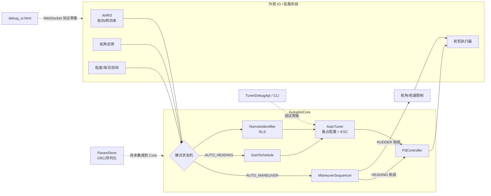
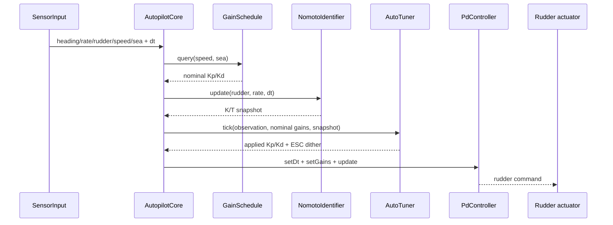
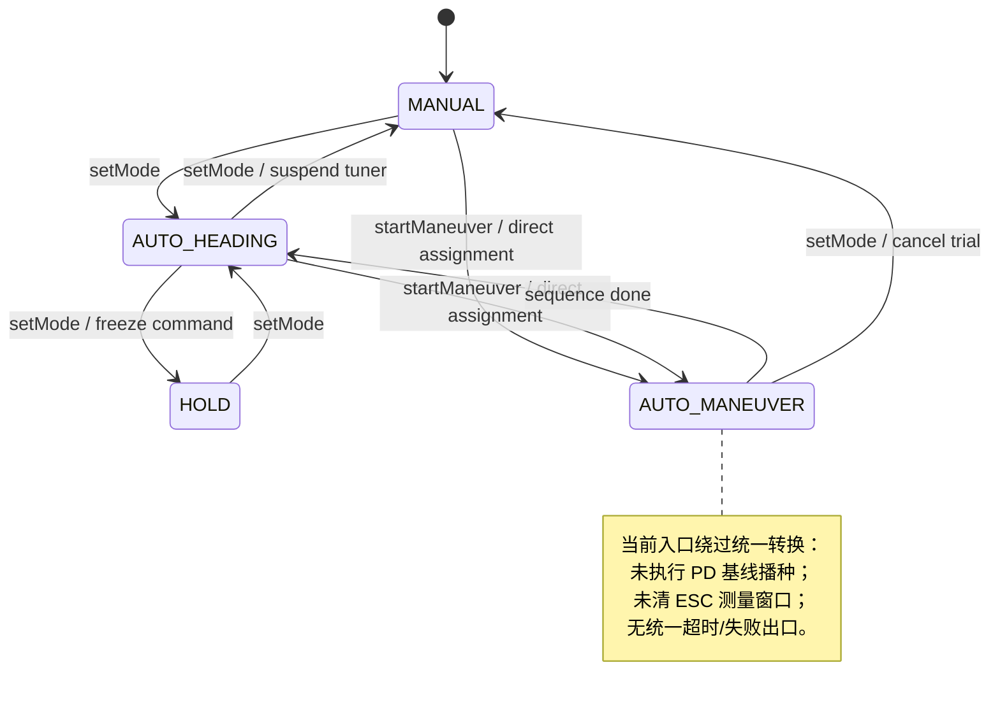
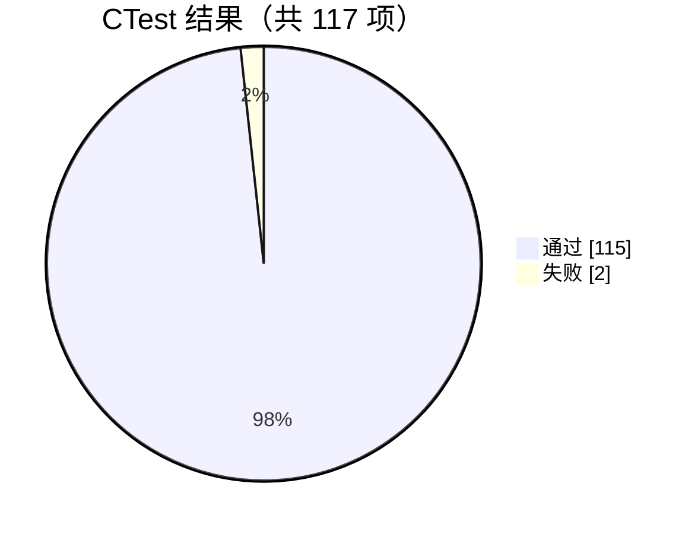
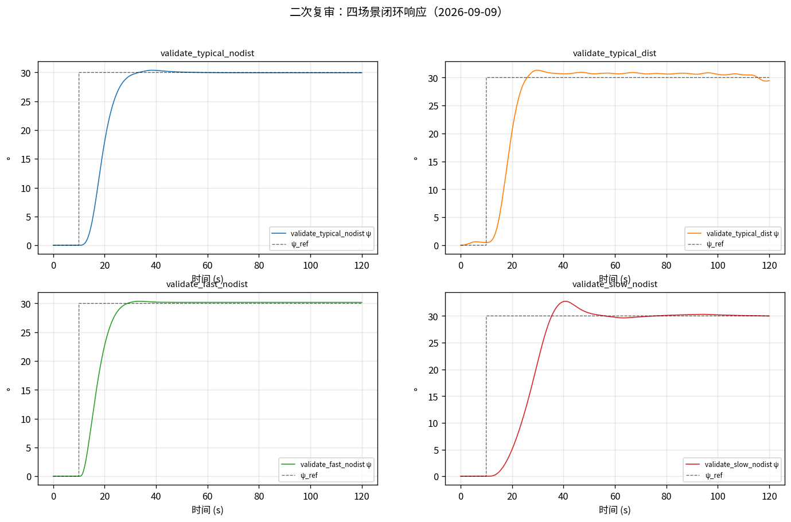
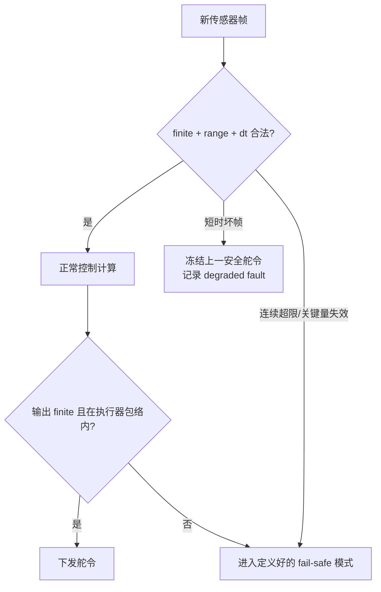
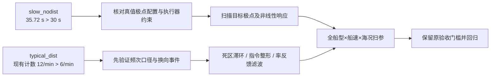
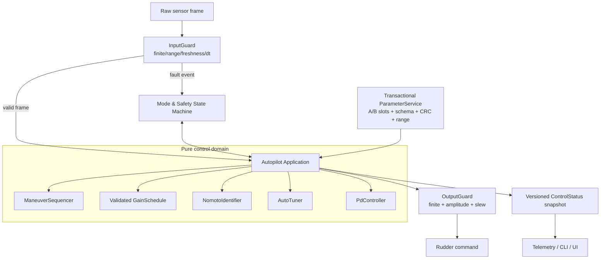
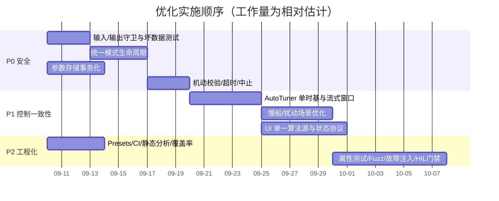
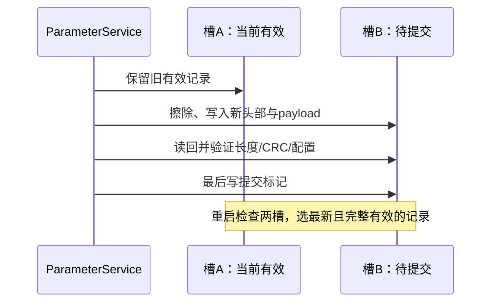

# auto_rudder 工程优化分析报告

> 分析日期：2026-09-09
>
> 分析基线：分支 `feat/tuner-debug-interface`，提交 `833d3c5` 加当前工作区变更
>
> 范围：`control/include`、`control/tests`、`control/sim`、`control/tools`、`control/ui`、构建配置与领域文档
>
> 方法：源码与调用关系审查、Release 构建、CTest 全量回归、ASan/UBSan 构建与回归、现有仿真曲线复核

> 修订：V2，2026-09-09 再次复审。新增内容见 §13～§15；同时修正 §3、§5、§6 的时基、仿真归因和构建建议。本报告是审查与改进建议，未实施生产代码修复。

阅读导航：[新增问题](#13-二次复审新增问题与复现证据) · [STM32-参数落地](#14-stm32-参数落地与资源预算) · [新增任务与验证结果](#15-二次复审任务与验证记录)。

## 1. 结论先行

本工程已经形成了较完整的自动舵算法原型：控制、增益调度、在线辨识、ESC 自动调参、机动序列、参数存储、仿真和调试工具边界基本清楚；核心模块拥有较多单元测试，控制周期内也已主动避免堆分配。

但它目前更接近“可验证的算法工程样机”，还不宜直接按实船生产软件放行。优先阻碍不是代码运行速度，而是四类安全与一致性问题：

1. 非有限传感器值或航向目标可让角度归一化陷入死循环，其他坏数据也可能传播为非有限舵令。
2. 机动和辨识试验直接改写模式，绕过统一的进入/退出动作，可能造成首拍舵令跳变、旧 ESC 窗口恢复和辨识差分跨模式污染。
3. 参数加载只校验 CRC，没有执行注释宣称的物理范围校验，而且失败时可能已改写调用者对象。
4. 当前全量回归仍有 2 个闭环仿真失败：慢船调节时间超标、扰动工况操舵频次超标。

二次复审进一步确认：PD 的末端量化可能突破约束或卡住输出，ESC 最终含载波增益可能不满足自身稳定门；仿真存在零步 PASS，Web UI 连接 ECU 时也没有隔离离线仿真指令。应把这些问题与原有 P0 项一并处理。当前参数存储仅有抽象和测试，尚未形成 STM32 上“持久化—重启—应用”的完整链路。

建议先完成 P0 安全闭环，再优化控制品质和工程化。不要通过放宽仿真门槛把红灯改绿；应先定位慢船增益与扰动抑制策略。

### 1.1 工程成熟度快照

| 维度 | 当前判断 | 主要依据 |
|---|---:|---|
| 模块划分 | 良好 | 算法层不直接依赖 IO，核心职责基本分离 |
| 单元验证 | 良好 | 111/111 单元测试通过 |
| 闭环性能 | 待改进 | 6 个仿真测试中 2 个失败 |
| 输入与故障安全 | 薄弱 | 核心入口缺少统一有限性、范围、时间戳校验 |
| 生命周期一致性 | 待改进 | 多条入口绕过 `setMode()`，暂停/恢复语义不完整 |
| 实时性 | 初步良好 | 当前仿真测得单拍远低于 5 ms，但尚非目标硬件 WCET |
| 可观测性 | 一般 | 有调试 API/CLI，但生产路径只返回一个舵角值 |
| 构建与 CI | 薄弱 | 无 Preset/CI/覆盖率/静态分析基线，ASan 首次构建需额外环境规避 |
| 文档 | 丰富但有漂移 | 原理文档充分；UI 与 C++ 默认值、算法已有明显不一致 |

## 2. 工程全景

### 2.1 代码规模与组成

本次统计排除构建目录、图片与 HTML 后，核心 C++/Python/Shell 约 7.0k 行：

| 区域 | 规模 | 职责 |
|---|---:|---|
| `control/include/*.hpp` | 1,709 行 | 生产算法与参数存储 |
| `control/tests/*.cpp` | 1,933 行 | 9 组 GoogleTest 单元/集成测试 |
| `control/sim/*` | 1,330 行 | Nomoto 被控对象、扰动、场景和指标 |
| `control/tools/*` | 1,987 行 | CLI、验收、监控、绘图和视频脚本 |
| `control/ui/debug_ui.html` | 单文件应用 | 浏览器调试、内置 JS 仿真与 ECU 协议草案 |

### 2.2 当前架构图



图中虚线很重要：`ParamStore` 目前是独立组件，并未真正接入 `AutopilotCore`；Web UI 也没有复用 C++ 算法，而是在 JavaScript 中维护了另一套实现。

### 2.3 AUTO_HEADING 每拍数据流



该主链路短而清楚，是现有设计最值得保留的部分。优化重点应放在入口守卫、状态转换和结果可观测性，不必推翻算法分层。

### 2.4 当前模式状态图及缺口



## 3. 构建与测试基线

### 3.1 实测结果

执行命令：

```bash
cmake --build control/build -j2
ctest --test-dir control/build --output-on-failure
```

结果：构建成功，115/117 通过，成功率 98.29%。其中 111 个 GoogleTest 用例全部通过，失败集中在 2 个闭环仿真入口。



| 测试层 | 结果 | 说明 |
|---|---:|---|
| 单元/核心集成 | 111/111 | 全部通过 |
| `sim_ident` | 通过 | 在线辨识链路 |
| `sim_esc` | 通过 | ESC 长期调参链路 |
| `sim_trial` | 通过 | 自动辨识试验 |
| `sim_maneuver_zigzag` | 通过 | Zigzag 机动 |
| `sim_all` | 失败 | `step_slow` 调节时间超标 |
| `sim_validate` | 失败 | `typical_dist` 操舵频次、`slow_nodist` 调节时间超标 |

关键数值：

| 场景 | 超调 | 调节时间 | 稳态 1σ | 偏置 | 操舵频次 | 判定 |
|---|---:|---:|---:|---:|---:|---:|
| typical, 无扰动 | 1.30% | 17.44 s | 0.000° | 0.053° | 0/min | PASS |
| fast, 无扰动 | 1.24% | 14.80 s | 0.000° | 0.183° | 0/min | PASS |
| slow, 无扰动 | 9.16% | **35.72 s** | 0.061° | 0.083° | 0/min | **FAIL** |
| typical, 有扰动 | 4.39% | 14.08 s | 0.422° | 0.291° | **12/min** | **FAIL** |

验收门槛定义在 [`Simulator::computeMetrics`](../control/sim/simulator.hpp#L747)：超调 ≤10%、调节时间 ≤30 s、稳态 1σ ≤1°、偏置 ≤1°、操舵频次 ≤6/min。

下面是二次复审使用当前可执行文件重新生成的四场景曲线。表中 12/min 是现有计数器的输出；它能使当前测试失败，但不能直接等同于实际舵机运动反转频次，详见 §13.4。



> 本图位于报告随附的 `docs/optimization_assets`，不再依赖被忽略的 `control/out`。生成命令与环境说明见[附件说明](optimization_assets/README.md)。图展示航向响应，不能单凭此图评估舵机磨损或 ESC 改善幅度。

### 3.2 Sanitizer 结果

前次复审中，现有 `control/build-asan` 同时启用了 AddressSanitizer 和 UndefinedBehaviorSanitizer。显式关闭 LeakSanitizer 后，构建和测试可运行，功能结果为 114/116，未观察到 ASan/UBSan 报错。该结果只覆盖当时执行的用例，不代表不存在未覆盖的错误；本次增加的数值反例使用主机普通构建验证。

前次直接执行 ASan 构建在 `gtest_discover_tests` 的构建后发现阶段失败，原因是 LeakSanitizer 在当时 ptrace 环境不可用。CTest 的 `ENVIRONMENT` 属性只作用于测试执行，不覆盖测试枚举。`DISCOVERY_MODE PRE_TEST` 只把枚举推迟到 CTest 开始时，并不会自动让该属性覆盖枚举子进程；受限环境仍需给启动 CTest/发现进程的父进程设置环境。普通 CI 应单独保留可运行的泄漏检查，不能全局永久关闭。

`DISCOVERY_MODE` 从 CMake 3.18 引入，而工程当前最低版本为 3.14；采用时需同步提高最低版本或提供兼容分支。依据：[CMake GoogleTest 文档](https://cmake.org/cmake/help/latest/module/GoogleTest.html)。

## 4. P0：放在所有性能优化之前

### P0-1 统一输入安全边界，保证任何坏数据都不会卡死或输出危险舵令

**证据**

- [`normalizeAngleDeg`](../control/include/angle_utils.hpp#L20) 和弧度版本使用 `while` 反复加减周期；输入为正负无穷时循环永不结束。
- [`setHeadingRef`](../control/include/autopilot_core.hpp#L60) 与 [`step`](../control/include/autopilot_core.hpp#L82) 没有统一校验。
- MANUAL 直接透传 `rudderDeg`；AUTO 路径会把非有限航向、舵角或 `dt` 传播到 RLS、ESC 和 PD 内部状态。
- `PdController::setDt()` 只拒绝 `dt <= 0`，但 NaN 会被静默拒绝、正无穷会被接受；其他参数也只校验了 `dt/quant`。

**影响**

传感器断线、驱动解析错误或上层协议传入 NaN/Inf 时，最坏结果不是单拍异常，而是控制线程永久阻塞或内部状态长期被污染。对自动舵而言这是放行阻断项。

**建议**

在 `AutopilotCore::step()` 最前面增加唯一的 `InputGuard`，统一检查有限性、物理范围和时间步范围。角度归一化改用 `std::remainder`/`std::fmod` 的常数时间实现，并明确非有限输入返回策略。输出端再做最后一道有限性与舵角/舵速夹紧。

建议把错误处理做成显式策略，而不是到处“猜一个默认值”：



**验收条件**

- 对每个输入字段分别注入 NaN、±Inf、越界值和异常 `dt`，`step()` 必须在限定时间内返回。
- 输出始终有限且满足舵角、舵速约束；故障原因可查询。
- 连续坏帧与单拍毛刺采用不同、文档化的降级策略。
- 对任意有限大角度，归一化为 O(1) 时间。

### P0-2 所有模式变化收口到一个状态转换函数

**证据**

- [`setMode()`](../control/include/autopilot_core.hpp#L41) 会重置 PD、取消辨识试验、按目标模式挂起调参器，并为 AUTO_HEADING 安排实际舵角基线。
- [`startManeuver()`](../control/include/autopilot_core.hpp#L63)、[`startIdentifyTrial()`](../control/include/autopilot_core.hpp#L72) 和机动完成路径直接写 `mode_`，没有复用这些进入/退出动作。
- 注释称机动期间辨识/ESC 保持挂起，但从 AUTO_HEADING 启动机动时没有调用 `AutoTuner::suspend()`；恢复后可能继续使用机动前的半个窗口。
- AUTO_MANEUVER 首拍未用实际舵角初始化 `PdController` 的舵速基线。若实际舵面为 10°、内部 `prevOut_` 为 0°，第一拍会从错误基准限速。

**建议**

建立 `transitionTo(nextMode, TransitionContext)`，所有公开入口和内部完成事件都只能通过它改变模式。上下文至少包含当前实际舵角、航向与时间。将动作明确分成：

- `onExit`：暂停 tuner/identifier、结算或丢弃窗口、记录退出原因；
- `onEnter`：播种舵角基线、设定目标航向、清空机动计时、确定辨识是否重置；
- `onAbort`：进入 HOLD 还是 MANUAL，由安全需求统一定义。

`NomotoIdentifier` 需要 `suspend()/resume(anchor)` 或等价接口。恢复时重置差分锚点和累计时间，但保留或明确清除参数估计，避免用模式切换前的 `prevR_` 计算恢复后的 `dr`。

**验收条件**

- 模式切换覆盖完整 N×N 转换表，并验证非法转换。
- 从任意实际舵角进入 AUTO_HEADING/AUTO_MANEUVER，首拍变化不超过 `ddMax × dt`。
- 自动 → 机动 → 自动后，ESC 不包含机动前的窗口样本；辨识差分不跨暂停区间。

### P0-3 参数持久化改为“有边界、校验后提交、写入原子化”

**证据**

- 文件头注释写明 load 后应做范围检查，但 [`ParamStore::load`](../control/include/param_store.hpp#L186) 最终只调用 `verifyCrc()`，没有调用 [`validateRange()`](../control/include/param_store.hpp#L116)。CRC 正确但物理值危险的参数可被接受。
- 反序列化直接写入调用者的 `ControlParams`；即使随后 CRC 失败，调用者对象也已被部分或全部覆盖。
- 调度表数量 `n` 在校验剩余长度前就 `reserve(n)`，损坏数据可触发异常大分配。
- `save()` 在底层写入成功前就递增版本并更新对象；写失败时内存状态与持久化状态不一致。
- 当前格式没有 magic、schema version、payload length，也没有双槽/掉电恢复语义。

**建议**

采用“两阶段加载”：先读固定头，校验 magic/schema/长度/行数上限；反序列化到临时对象；依次通过 CRC、字段范围、调度表结构校验；全部成功后再 move/assign 给调用者。保存采用 A/B 双槽或 journal：写新槽、读回校验、最后原子切换 active 标记。底层接口应返回实际读取长度，而不是总是假设 4096 字节有效。

调度表校验至少包括：数量上限、所有值有限、`speedMin < speedMax`、海况 0..3、增益非负且有上限、同海况速度段顺序与重叠规则。

**验收条件**

- CRC 错、截断、超大 `n`、未知 schema、危险物理值均失败，且输出对象逐字节不变。
- 模拟写一半/掉电后，重启能回到上一有效版本。
- `save()` 写失败不递增调用者可见版本。
- 对反序列化入口做 fuzz/property test，限制时间和最大内存。

### P0-4 机动和辨识试验必须可验证、可超时、可中止

**证据**

- [`ManeuverSequencer::setLegs`](../control/include/maneuver_sequencer.hpp#L26) 接受任意目标、阈值和 `next` 图，不验证有限性、方向、闭环或可达性。
- `update()` 会直接累加未经校验的 `dt`；HEADING/TIME 触发在错误符号、零阈值、传感器失效时可能立即误触发或永不触发。
- [`startIdentifyTrial`](../control/include/autopilot_core.hpp#L72) 不校验 `dz/phiz/cycles`，核心内部也没有试验总超时。仿真器的外层时长不能替代生产控制器的安全超时。

**建议**

为 `setLegs`/预置工厂返回 `Expected<Maneuver, Error>` 或至少 `bool + error code`；启动前验证参数和图结构。每个航段增加 `maxDurationSec`，整个机动增加总时限、进展监控与明确的 abort 状态。终端 `NONE` 保持段应显式标为 `terminalHold`，与意外卡死区分。

**验收条件**

- 拒绝非有限参数、无意义的零舵角/零触发阈值、非法时长、过大 cycles、非法 next、不可达段和意外环。负舵角和负航向阈值可表示合法左转，应按各预置机动的符号约定校验，不能一概拒绝。
- 航向或转向率冻结时能在规定时间内中止，并输出原因。
- 六类预置机动均有完成、超时、中止和传感器毛刺测试。

## 5. P1：改善控制一致性与闭环品质

### P1-1 消除 AutoTuner 双时基

[`AutoTuner::tick`](../control/include/auto_tuner.hpp#L150) 只用输入 `in.dt` 累计参考稳定时间，而窗口拍数、ITAE、HPF、载波相位都使用参数 `p_.dt`。实际控制周期变化或有抖动时，各子模块对“过去了多久”会产生不同理解。

固定容量 `WIN_N=3000` 又隐含 60 s × 50 Hz，需区分两种情况：只把实际调用频率改为 100 Hz、输入 `in.dt=.01`，而 `p_.dt` 仍为 `.02` 时，窗口仍是 3000 拍，却在真实 30 s 结算；若同时将 `p_.dt=.01`，60 s 窗口才变成 6000 拍，此时只保留最近 3000 点，且 `accumulate()` 使用的 `size()×dt` 时间权重会在缓冲满后停止增长。

这也影响现有仿真：`runEsc()`/`runTuneConvergence()` 令窗口为 `4×legSec`，典型船默认 `legSec=32 s`，即 128 s/6400 拍，已经超过 3000 点容量。因此窗口 J 是截断记录上的指标，不是注释所称的完整 128 s 积分。

建议让每拍算法统一使用经过边界校验的 `in.dt`，窗口按累计秒数结算。ITAE 和解调改为流式累加，不保留三条完整数组：当前三个 double 环形缓冲至少占 72,000 字节，且 `computeJ()` 在窗末产生 O(N) 单拍尖峰；这些量完全可以用若干累加器 O(1) 更新。若必须保留诊断曲线，把降采样遥测缓冲移出实时控制对象。

### P1-2 修正高速门控和参考稳定门的状态语义

- 高速时 `enabled_` 变为 false，但 `accumulate()` 仍先写窗口，`winCounter_` 也继续递增；重新降速后可能混入高速禁用期样本并提前结算。
- 参考稳定检测使用 double 精确不等比较。上游目标若有微小浮点抖动，30 s 稳定计时会一直被清零，振荡监控长期失效。

建议把速度门做成带滞环的状态机，禁用沿调用与 `suspend()` 相同的测量清理；重新启用从新窗口开始。参考变化使用角度容差与事件语义，例如 `abs(angleDiff) > refChangeThreshold`，并记录“为何不具备振荡判定资格”。

### P1-3 解决当前两项闭环失败



慢船场景超调仍在边界内，主要失败项是调节时间。二次核查发现，`runStep()` 默认和 `runValidation()` 均用模型真值 K/T 生成极点配置增益，并关闭 tuner；该失败不能直接归因于 `GainSchedule` 的默认表。应先分析 `wnTarget/zetaTarget` 与舵角限幅、舵速限制、滤波、死区之间的交互，再推导实际部署的调度策略。这里的真值模型是仿真预设，实船不能直接获得它。

扰动工况需先明确“频次”是左右换舵次数还是舵面运动反转次数，修复指标并用人工序列验证，之后再判断是否需要死区滞环、舵令整形或滤波。门槛数值保持可追溯；若统计口径变化，必须重新建立基线，不能把新旧数字直接比较。

建议增加以下矩阵：

| 维度 | 建议取值 |
|---|---|
| 船模 | K/T 边界、典型点及网格中间点 |
| 船速 | 每个调度中点、分段边界左右 ε、高速门上下沿 |
| 海况 | 0..3 全覆盖 |
| 采样周期 | 标称、±20% 固定偏差、随机 jitter、偶发长帧 |
| 故障 | 单拍 NaN、冻结、跳变、丢帧、舵角跟踪滞后 |
| 航向指令 | 正负阶跃、跨 ±180°、小指令、连续变更 |

### P1-4 消除 Web UI 与 C++ 的“双实现漂移”

[`debug_ui.html`](../control/ui/debug_ui.html#L419) 不是 C++ 算法的薄客户端，而是复制了一套 PD、调度、RLS、ESC 和稳定门。当前已经出现实质差异：

| 功能 | C++ 当前行为 | UI 当前行为 |
|---|---|---|
| PD 死区回中 | 经舵速限制逐步回中 | 直接把输出和状态置 0 |
| 增益调度 | 相邻速度段中点线性插值 | 命中区间后阶跃取值 |
| RLS | 自降频、归一化、`r 或 dr` 激励门、坏数据防御 | 每帧未归一化更新，仅按 `r` 门控 |
| ESC | 每拍载波、HPF、因果解调、窗末 LPF | 旧式窗末 `dJ × sin` 更新 |
| 极点配置 | 负 Kd 钳为 0，有限性检查 | 可返回负 Kd，检查较少 |
| 默认 PD | Kp=1.0, Kd=0.5 | Kp=1.5, Kd=0.6 |
| RLS P0 | 1.0 | 1e6 |

这会让浏览器演示结果无法代表生产算法。优先方案是让 UI 只负责输入、遥测和绘图，所有算法由同一个 C++ 后端执行；离线演示可将核心编译为 WebAssembly。若短期保留 JS 实现，至少建立由同一组 JSON golden vectors 驱动的 C++/JS 一致性测试，并在界面明显标注“教学仿真，非生产等价”。

### P1-5 增加生产级状态与故障可观测性

当前 `step()` 只返回 `double`，无法区分正常、降级、参数回退、输入拒绝、机动超时和辨识失败。建议保留无分配接口，但增加只读快照：

```cpp
struct ControlStatus {
    double rudderCmd;
    Mode mode;
    FaultBits faults;
    bool inputValid;
    bool tunerEnabled;
    bool baselineEstablished;
    double appliedKp, appliedKd;
    double Khat, That;
};
```

状态应区分瞬时事件和锁存故障，并通过版本化协议给 CLI/UI/ECU 使用。这样测试可以直接断言原因，现场也不必从“增益有没有变化”反推状态。

### P1-6 配置接口必须验证并返回结果

`GainSchedule::setTable()`、`NomotoIdentifier::setParams()` 和 `AutoTuner::setParams()` 都接受整组数据但不报告是否合法。部分非法值会导致除零、负滤波系数、超大窗口或 NaN 状态；`setTunerParams()` 还会隐式清除已建立基线。

建议所有配置采用同一模式：`validate()` → 生成不可变 `ValidatedConfig` → 在安全边界原子替换。区分“热更新且保留状态”和“重置算法状态”两个明确动作。调度查询不应对空表/缺海况静默返回魔法增益，而应返回状态并由上层选择经批准的 fallback。

## 6. P2：工程化与可维护性

### P2-1 建立可重复构建和 CI 门禁

当前没有根 README、`CMakePresets.json`、CI workflow、格式/静态分析或覆盖率配置。GoogleTest 只通过 FetchContent 拉取，首次离线构建依赖网络。

建议新增：

- `CMakePresets.json`：`dev-debug`、`release`、`asan-ubsan`、`coverage`；
- CI：GCC + Clang，Debug + Release，单元测试与仿真分组；
- `clang-format`、`clang-tidy` 或 cppcheck 的固定版本和最小规则集；
- 按 §3.2 同时解决 sanitizer 的枚举环境、实际测试环境及 CMake 版本兼容，`PRE_TEST` 仅决定枚举时机；
- 依赖锁定与离线方案，例如系统 GTest 优先、FetchContent 兜底；
- CI 中警告视为错误，本地保持可选；修复当前测试中的 dangling-else 警告。

### P2-2 扩充测试类型，而不只是增加示例用例

现有测试对正常路径覆盖不错，但需要补齐下列“性质”：

| 测试类型 | 目标性质 |
|---|---|
| Property test | 角度输出恒在约定区间；舵令恒满足幅值/速率；插值不产生非有限值 |
| Fuzz | 参数二进制解析永不越界、超额分配或部分提交 |
| 状态机模型测试 | 任意事件序列下模式、tuner、identifier 生命周期一致 |
| Differential test | C++ 与 UI/WASM 对相同输入逐拍一致 |
| Fault injection | 传感器冻结、丢帧、异常 dt、毛刺和恢复 |
| Long-run soak | 24 h 等效拍数下计数器、相位、RLS/ESC 保持有限 |
| WCET/分配测试 | 基线已建立且恰逢窗口结算的最坏拍，无堆分配且满足预算 |

CTest 目前只把 Zigzag 机动纳入入口级测试；Williamson、U-Turn、Circles、Cloverleaf、Search 应各有至少一个默认场景与一个超时/边界场景。

### P2-3 调整代码组织与依赖

- `AutopilotCore` 包含但未使用 `param_store.hpp` 和 `<algorithm>`，应清理；生产参数装载应由更高层 `ParameterService` 显式协调。
- `auto_tuner.hpp` 已超过 500 行，同时承载数学、状态机、环形缓存和调试友元。可拆成 `PolePlacement`、`OscillationMonitor`、`EscOptimizer` 与轻量编排器，避免单类私有状态过密。
- header-only 保留了易集成的优点。是否迁到 `.cpp` 应以实测编译时间、代码体积与分发边界为依据；当前没有数据证明拆文件能加快控制周期，不作为 STM32 性能优化的前置条件。
- `TunerDebugApi::force*` 会旁路稳定门。建议由 `AR_ENABLE_UNSAFE_DEBUG_API` 编译期开关隔离，Release 默认不编译，并在 ECU 接入层增加权限、物理联锁和审计日志。
- 明确线程模型：所有有状态对象仅允许控制线程访问；UI/通信线程通过消息或双缓冲快照交互。

### P2-4 文档和试验产物单一事实源

领域词汇表 `CONTEXT.md` 很有价值，应继续作为命名依据。但开发文档、代码说明、UI README 和源码默认值已存在漂移。建议：

- 参数元数据只定义一次，并生成 C++ 默认值、UI schema 和参数表文档；
- 测试数量与结果不要手工写死在长期文档中，由 CI 生成摘要；
- `control/out` 保持忽略，但每次发布把代表性曲线、CSV 摘要和构建信息归档到版本化 `docs/assets/releases/<version>`；
- 根 README 只提供项目定位、5 分钟构建、验证状态和文档索引，详细原理继续放在现有专题文档。

## 7. 建议的目标架构

无需引入重量级框架，可在现有结构上增加三个薄边界：输入守卫、统一模式管理、状态/故障快照。



建议依赖方向固定为：适配层 → 应用编排层 → 领域算法层；存储、WebSocket、文件和时钟都留在适配层。领域算法不得反向依赖调试/UI。

## 8. 分阶段实施路线图



工作可按以下合并顺序降低回归风险：

1. 先建立 CI 与当前红灯基线，保证每个改动都能被比较。
2. 输入守卫、模式状态机、参数事务化分别提交，均只改变安全语义。
3. 统一时基并改为流式统计，用 golden data 证明 ESC 数学行为保持一致。
4. 单独处理慢船和扰动工况，不与架构重构混在一个变更中。
5. 最后收敛 UI/协议、静态分析、覆盖率和发布文档。

## 9. 优化任务清单

| ID | 优先级 | 任务 | 主要文件 | 完成标志 |
|---|---|---|---|---|
| OPT-001 | P0 | 输入/输出守卫与 O(1) 角度归一化 | `angle_utils.hpp`, `autopilot_core.hpp` | 坏数据测试全过、无非有限舵令 |
| OPT-002 | P0 | 统一模式转换与模块 pause/resume | `autopilot_core.hpp`, `nomoto_identifier.hpp` | 全转换矩阵测试通过 |
| OPT-003 | P0 | 参数两阶段加载、范围/结构校验、原子保存 | `param_store.hpp` | 失败不改对象，掉电恢复测试通过 |
| OPT-004 | P0 | 机动合法性、超时与中止 | `maneuver_sequencer.hpp`, core | 六机动故障场景均有确定出口 |
| OPT-101 | P1 | AutoTuner 单时基、流式统计和速度门状态机 | `auto_tuner.hpp` | jitter 测试通过，实时对象显著缩小 |
| OPT-102 | P1 | 慢船与扰动闭环品质优化 | schedule/PD/sim | 指标语义核验后既有失败归零，新增用例全部通过 |
| OPT-103 | P1 | UI 改为薄客户端或 WASM 共核 | `control/ui`, adapter | golden vector 逐拍一致 |
| OPT-104 | P1 | 版本化 ControlStatus/FaultBits | core, CLI, UI | 失败原因可遥测、可断言 |
| OPT-201 | P2 | CMake Presets 与 CI 门禁 | CMake/CI | GCC/Clang/ASan/UBSan 全绿 |
| OPT-202 | P2 | Property/Fuzz/故障注入/长稳测试 | tests/sim | 自动化门禁覆盖安全性质 |
| OPT-203 | P2 | 参数 schema 与文档生成 | docs/UI/config | 默认值只有一个事实源 |

## 10. 建议的最终放行门槛

在进入 HIL 或海试前，至少满足：

- Release、Debug、ASan/UBSan 均 100% 通过；当前两个仿真红灯归零。
- 所有公开数值入口具备 NaN/Inf/范围测试，任何输入下输出有限且受舵角/舵速约束。
- 模式切换首拍无跳变，ESC/RLS 不跨不允许的生命周期复用测量状态。
- 参数加载失败不改变正在使用的配置；掉电写入可恢复到上一有效版本。
- 六类机动均有最大时限、可中止路径和传感器故障测试。
- 在“基线已建立 + ESC 窗口恰好结算”的最坏拍测量目标硬件 WCET，而非只测桌面平均值。
- 生产构建不包含 `force*` 调试旁路，或有不可绕过的编译期与运行期联锁。
- UI 与生产算法不再维护两份行为不同的实现。
- 每次候选发布归档参数版本、编译器/选项、测试摘要、仿真 CSV 和代表性曲线。

## 11. 可保留的优秀设计

优化不应掩盖当前工程已经做对的部分：

- `AutopilotCore` 只接收输入并返回舵令，未把硬件 IO 塞进算法类，便于仿真和 HIL。
- PD 已集中提供舵角、舵速和量化功能，并有相关基础测试；二次复审发现这些功能的组合边界仍存在漏洞，详见 §13.1。
- 增益调度已采用中点插值，避免速度段边界跳变，且查询路径无额外分配。
- Nomoto 辨识实现了自降频、回归量归一化、激励门和坏样本拒绝。
- AutoTuner 把极点配置、ESC、稳定门、回退和重锚收拢到同一所有者，方向正确。
- 参数格式采用显式小端序列化并排除结构体填充，优于直接写内存镜像。
- 仿真失败会返回非零退出码，已经具备成为 CI 质量门的基础。

因此推荐“围绕安全边界补齐工程闭环”，而不是重写控制算法。完成 P0 与 OPT-102 后，工程会从算法样机显著接近可进入 HIL 的候选版本。

## 12. 复现命令

```bash
# Release 构建与全量回归
cmake -S control -B control/build -DCMAKE_BUILD_TYPE=Release
cmake --build control/build -j2
ctest --test-dir control/build --output-on-failure

# 当前 ASan/UBSan 目录在受 ptrace 约束环境中的回归方式
LSAN_OPTIONS=detect_leaks=0:abort_on_error=0 \
ASAN_OPTIONS=detect_leaks=0:abort_on_error=0 \
cmake --build control/build-asan -j2

LSAN_OPTIONS=detect_leaks=0:abort_on_error=0 \
ASAN_OPTIONS=detect_leaks=0:abort_on_error=0 \
ctest --test-dir control/build-asan --output-on-failure
```

## 13. 二次复审新增问题与复现证据

本节覆盖第一版未发现的数值边界、验收有效性和工具联动问题。**实测**表示已在当前主机运行；**源码确认**表示依据明确控制流；**建议**表示尚未实现。复现程序保存在[控制边界探针](optimization_assets/control_review_probe.cpp)和[参数存储探针](optimization_assets/storage_review_probe.cpp)，输出当前行为，用于审查，不是以错误行为为标准的生产回归测试。

### 13.1 P0：量化会破坏限幅、限速和输出可达性

**实测与证据：** [`PdController::saturate`](../control/include/pd_controller.hpp#L45) 与 `update()` 都先限幅/限速，再 `round(v/quant)×quant`，并把量化后的结果保存为下一拍限速基准。

| 设置与输入 | 当前输出 | 问题 |
|---|---:|---|
| 默认限制，`dt=.016 s`，从 0 请求 10° | 首拍 0.2° | 超过 `10×.016=.16°/拍` |
| 默认限制，`dt=.004 s`，连续请求 10° | 1000 拍后仍为 0° | 每拍 0.04° 被舍入为 0，无法累积前进 |
| `dMax=34.96°`，放宽限速，请求 35° | 35° | 量化后突破舵角上限 |


**建议：** 将“可输出的量化格点”与“安全舵角/增量区间”一起计算；为不在格点上的物理上限采用向安全侧投影。尤其要明确 `ddMax×dt < quant` 时的契约：从一个格点移动到下一个格点已经超过严格逐拍速率约束，这时不可能同时保证格点输出、严格逐拍限速和持续移动。应调整配置/接口精度，或经需求评审采用带累计余量的平均速率定义。单纯在最后再 clamp 不能同时解决这三个要求。

**验收：** 扫描不同 `quant/(ddMax×dt)` 比例、非格点舵角上限和正反转，分别断言包络、进展及舍入策略；先定义可实现的配置域，再写不变量测试。

### 13.2 P1：微分状态在角度边界和死区存在不连续

**实测：** [`PdController::update`](../control/include/pd_controller.hpp#L68) 的误差已归一化，但微分直接使用 `(e-prevErr)/dt`（第 84 行）。隔离 D 项后，`ref=0°`、实际航向 `-179.9→+179.9°`，误差表示从 `+179.9→-179.9°`，计算出约 `-17990°/s` 的虚假导数并输出 `-35°`；按最短角变化处理时导数为 `+10°/s`。这与常见的 359°→0°附近误差测试不同。

同一函数在死区提前返回（第 71～75 行），没有更新 `prevDeriv_`。设置 `Kp=0,Kd=1,tau=.2,deadzone=.3` 并放宽限速，误差依次为 `1→5→连续1000拍0→.31°`，离开死区时仍输出 17.938°。若滤波器在死区持续衰减，此时 D 项约为 1.409°。

**建议与验收：** 明确误差连续化/跨背向边界策略，并让滤波状态在死区持续演进。可评估利用已有 `rateDegS` 做测量微分，以降低参考阶跃冲击，但这是控制律变更，必须独立验证。新增背向边界、长时间死区、出死区以及参考跳变测试，不能只验证舵角最终被 clamp。

### 13.3 P0/P1：稳定门和测量生命周期仍有缺口

**最终增益包络，P0，实测。** [`AutoTuner::tick`](../control/include/auto_tuner.hpp#L179) 在接受基线/窗口候选后才叠加 ESC 载波，最终 `GainCommand` 没有再次检查。仅把目标 `wn` 配置为当前允许上限 `.5`，输入 `K=.2,T=8`，基线建立成功；第二拍返回 `Kp=10.0004999999,Kd=30.449999275`，对应 `wn=.500012499842`。对这个返回值调用同一个 `stabilityCheck()` 得到 false。

这证明“检查通过”不覆盖最终施加的增益，不等于证明闭环已发散。建议给整个载波周期预留安全裕量，或对最终输出投影/校验；覆盖 `wnMax`、`zetaMin` 边界和完整载波周期。正常模式也需要独立的观测有效性与持续故障处置，而不能把候选增益检查当作完整安全监督器。

**振荡历史，P1，实测。** [`suspend()`](../control/include/auto_tuner.hpp#L199) 调用的 `rebaseEsc()` 清除窗口与梯度，但没有清理振荡检测器及参考稳定计时。测得 20°峰峰值后暂停，改变参考再恢复，`oscDetector().amplitude()` 仍为 20°；相同参考恢复也不重新等待完整稳定期。旧结果可以继续参与新阶段的基线/窗口接受判断。

建议为观测增加“有效、测量阶段、样本年龄”，明确暂停、参考变化和重锚时各状态的处理；新阶段未获得有效振荡观测时，不能把陈旧值或默认零当成新测量。

**RLS 坏帧时间，P1，实测。** [`NomotoIdentifier::update`](../control/include/nomoto_identifier.hpp#L49) 在累加 `elapsed_` 前拒绝坏测量。有效锚点 `r=0` 后，1 s 收到 NaN，再过 1 s 收到 `r=2`，当前代码按 1 s 而非真实的 2 s 求差分。即使一直处于 AUTO_HEADING 也能出现，不仅是模式切换问题。

建议区分“时间有效”和“测量有效”：有效时间推进，坏测量不写锚点；长缺口则重新播种锚点。验收应比较有坏帧但端点相同的轨迹与等效真实间隔轨迹，不能只检查最终没有 NaN。

### 13.4 P1：验收指标与场景有效性需独立验证

**频次口径，源码确认。** [`simulator.hpp:123`](../control/sim/simulator.hpp#L123) 只在相邻舵令直接异号且变化超过 0.1°时计数，再除以整个运行时长。

| 舵令序列 | 当前计数 | 实际遗漏 |
|---|---:|---|
| `+0.2,+0.1,0,-0.1,-0.2` | 0 | 经量化零点的左右换舵 |
| `+2,+3,+2` | 0 | 同侧舵面运动方向反转 |

需要先在需求中区分“左右换舵次数”和“执行器运动反转次数”。前者应保留最近非零符号，后者应基于实际舵角变化并加位移门槛/滞环；瞬态和稳态统计区间也要明确。独立指标单元测试比单纯增加更多船型更优先。

**无有效试验也可 PASS，实测。** 当前 [`SimResult::pass`](../control/sim/simulator.hpp#L29) 默认为 true，`computeMetrics()` 对空记录直接返回；CLI 未保证有效拍数和观察区间。

```bash
control/build/sim/ar_sim --scenario step_typical --seconds 0.001
# 0.001 < dt=.02，实际执行 0 拍，但所有指标为 0，ALL PASS，退出码 0。

control/build/sim/ar_sim --esc --leg 0.001
# legSteps=int(.001/.02)=0，后续取模引发 SIGFPE。
```

**建议与验收：** 拆分 `INVALID/PASS/FAIL`，解析层检查 finite、取整后的步数、时长上限及参数间关系；指标层必须确认实际执行阶跃、存在足够稳态样本且数值有效。拒绝零拍、无阶跃后数据、非法航段周期和非有限输入，统一返回稳定的非零退出码，避免把“没有测到异常”解释为通过。

### 13.5 P1：ESC 执行、平台稳定与性能改善是三个不同的证据层

**实测：** `ar_sim --esc --seconds 40` 返回 PASS，但当前默认航段为 32 s、ESC 窗口为 128 s，40 s 不足结算一次窗口。输出 `Khat=.0882,That=1.3988`（真值 `.2/8`）、`baseline=1,moved=1,stable=1`。

[`sim_esc` 的判断](../control/sim/main.cpp#L240) 只要求模型值物理有效、基线建立、最终增益相对初值移动及有界；`gainsMoved` 比较的还包含极点配置接管和载波。因此它无法单独证明辨识收敛或 ESC 中心增益被成功更新。

默认 `ar_sim --tune` 也已复跑：7 个记录窗口，`J=20834.9→21173.2`，增加约 1.62%，仍 `converged=1`。这是 [`runTuneConvergence`](../control/sim/simulator.hpp#L369) 允许 2% 不劣及平台条件的结果，不能称为性能改善；同时，§5 的缓冲截断会影响这些 J 的完整窗口语义。


**建议：** 先修正窗口指标，再新增 accepted/reverted window 计数和不含载波的中心增益记录。用相同模型、参考、噪声种子分别运行“冻结基线”和“开启 ESC”，比较完整区间的误差、舵角变化和性能指标，并报告劣化工况。把 `--tune` 加入 CTest，但用例名称与宣称应区分运行、平台和改善，不能仅改一个 PASS 名称。

### 13.6 P1：UI 离线仿真可进入 ECU 指令通道

**源码确认：** [`debug_ui.html:646`](../control/ui/debug_ui.html#L646) 按 `simRunning` 推进本地船模；第 697 行只要 WebSocket 已打开就发送本地算出的舵令；第 1017 行连接成功没有停止仿真计时器。触发顺序为“先启动仿真，再连接 ECU”。这与 README 中连接后自动旁路、仅显示 ECU 数据的说法不符。

仓库没有 ECU 接收端，因此这里确认的是客户端发送行为，未断言真实设备会执行。接入真实设备前，应将它提升为接口放行阻断项：显式区分 `OFFLINE_SIM/ECU_MONITOR/MAINTENANCE`，断开离线传感器与舵令发送路径。控制闭环归 MCU，UI 发送有版本和确认的参考/配置；断连、重连或切换时清理旧命令。

**验收：** 用 mock WebSocket 验证仿真运行中连接、设备监控中误点启动、断连重连等序列；离线数据不能生成设备舵令，收到传感器数据后也不能被本地仿真覆盖。

### 13.7 P2：调试监控与产物导出的协议不一致

**监控字段，源码确认并复核 CLI 输出：** [`tuner_debug_cli.cpp`](../control/tools/tuner_debug_cli.cpp#L77) 的 `status` 输出字段为 `phase`/`win`/`demodN`/`refAge`，而 [`tuner_debug_monitor.py`](../control/tools/tuner_debug_monitor.py#L50) 内部使用 `escPhase`/`winCounter`/`demodCount`/`refAgeSec`。初版监控器按内部名直接取值、缺字段回退 0.0，会把真实非零相位画成零；当前版本已用 `STATUS_ALIASES` 做别名映射，缺字段改用 NaN 而非 0.0，这一不一致已消解。剩余缺口：现有 49 项 CLI 验收仍不覆盖这个消费者契约，字段改名不会被任何自动化测试发现。

此外监控器按一条命令读一行响应，却允许转发多行 `help`，可能造成后续响应错位；读取还缺少超时。建议把字段 schema 固定下来并补 CLI→monitor 契约测试，给响应明确帧边界及请求 ID，缺失显示未知/错误。

**导出失败，实测。** [`exportCsv`](../control/sim/simulator.hpp#L147) 打不开文件仅打印警告并返回 void，上层继续打印“CSV 导出”，最终退出码只看控制指标。对不存在的输出目录，仿真可能报告 ALL PASS 并退出 0，却没有任何 CSV。

脚本已有 `set -e`，不能笼统称其忽略失败；实际问题是部分底层错误没有返回，或生成脚本把 `--validate` 的日志隐藏后直接退出。按文件存在跳过生成也会复用旧参数/旧代码的结果。

**验收：** 把场景 FAIL 与 IO/协议错误分开返回；请求导出但未成功写入必须非零退出。支持保存失败场景的数据再汇总失败，缓存附带参数与源码版本指纹。增加 CLI→monitor 契约测试及未知字段、多行响应、超时、无权限输出目录测试。

## 14. STM32 参数落地与资源预算

### 14.1 当前存储覆盖范围与应用缺口

截至本次审查，仓库未发现 STM32 BSP、链接脚本、芯片工具链配置或 Flash/EEPROM 的实际读写后端。`ParamStore` 的构造及保存/加载调用在单元测试中；不能把 UI 的“保存”按钮或 JSON 下发视作已落盘。

| 数据 | `ControlParams` 是否包含 | 当前运行时应用情况 |
|---|---|---|
| 舵角零位、左右标定值 | 是 | 未见 BSP 标定转换链路 |
| 最大舵速、Kp/Kd | 是 | Core 的 PD 为只读，缺正式配置应用入口 |
| 模型 K/T | 是 | 没有完整启动恢复及基线恢复接口 |
| 增益调度表 | 是 | 可手动 `scheduleMut().setTable()` |
| PD `dMax/deadzone/tau/quant/dt` | 否 | Core 内部默认值 |
| RLS 参数：遗忘因子、拍间隔、激励门、归一化尺度等 | 否 | Core 未公开正式整组配置入口 |
| AutoTuner/ESC 参数：滤波、窗口、载波、限制等 | 否 | 可 `setTunerParams()`，会重置 tuner |
| 学习到的已接受基线及其适用工况 | 无独立记录语义 | 不会自动持久化或恢复 |
| 瞬态窗口、滤波状态、差分锚点、载波相位 | 否 | 不宜在重启后盲目恢复 |

依据：[`ControlParams`](../control/include/param_store.hpp#L58)、[`AutopilotCore` 查询/配置接口](../control/include/autopilot_core.hpp#L138)。

**建议：** 将完整可配置参数、标定状态、经批准的学习结果、瞬态状态分开定义。增加 `exportConfig()/validateConfig()/applyConfig()` 及模型/标定有效标志：当前默认 `K=T=0` 使 `ControlParams{}.validateRange()` 返回 false，必须明确“未辨识”与“已知但非法”的区别，不能随意填入一组看似合法的 K/T。

应用应发生在控制周期边界，并记录已应用版本；持久化另记已保存版本。允许明确的“临时应用未保存”状态，重启测试要验证完整配置行为而不只是字节往返。

### 14.2 固定长度与回调语义的具体边界

**实测：** 现有包长度为 `80 + 36×调度表行数`，`load()` 固定读取 4096 字节，`save()` 没有限制：

| 行数 | 包长 | 保存 | 回读 |
|---:|---:|---|---|
| 111 | 4076 B | true | true |
| 112 | 4112 B | true | false |

因此现有布局最多回读 111 行（尚无新增包头）。无效行 `{speedMin=10,speedMax=0,seaState=99,Kp=NaN,Kd=-3}` 还会通过 `validateRange()`，因为该函数完全不遍历调度表。写回调返回 false 时，实测版本仍由 5 变 6，时间戳由 123 变 456，CRC 也改变。

建议读写共用容量契约，超限在修改对象和写存储之前拒绝。新增 magic/schema/长度后需重新计算容量；`version` 当前是提交序号，不能兼作格式版本。wire format 还需声明 `double` 为 8 字节 IEEE 754 binary64，跨端用固定字节样例验证。

[`WriteFn`](../control/include/param_store.hpp#L166) 收到的是 `save()` 局部 vector 的指针，回调返回后缓冲即销毁。当前约定应是同步完成，或后端先复制到自有缓冲；将来若 BSP 只启动异步 DMA 就返回，会出现失效指针。这是尚未实现后端的接口要求，当前没有已部署 DMA 故障证据。异步设计应显式拥有缓冲，区分“已接受请求”和“已持久化完成”。

### 14.3 YAML 可以使用，但需要把格式与存储介质分开

前面讨论中“YAML 需要文件系统”的表述过于绝对。YAML 是文本序列化表示，可以从内存或带长度的 Flash 文本块解析；只有需要目录、文件名等文件操作时才需要文件系统。依据：[YAML 1.2.2 的字符流与表示模型](https://yaml.org/spec/1.2.2/)。

针对当前工程，建议在 PC 端编辑 YAML 并做完整校验，在 MCU 端使用有界二进制记录。理由是可以复用已有编码思路，并集中控制解析资源和版本迁移；这是待实现的方案，当前没有 YAML 转换工具。


若确实在 MCU 直接解析 YAML，需先选定解析器并测量资源，限制字节数、结构深度和表行数；重复键、未知字段、非有限数字应有明确拒绝策略。限定 YAML 子集应写进格式规范。无论文本还是二进制，都要经过同一完整配置验证，CRC 只证明字节一致性，不能替代语义检查或消息来源验证。

### 14.4 Flash 布局、掉电恢复与实时性

具体 MCU、Flash 容量、擦除/编程粒度、bank 模式和升级布局尚未给定，因此本报告不指定物理地址。建议由链接脚本/BSP 保留参数区，并核验 bootloader/整片擦除策略不会意外删除标定值。

建议的 A/B 事务顺序：



提交标记必须满足目标 Flash 的编程/ECC/重复写约束，不能默认任意一个位都可再次修改；序号回绕、两个槽均失效和固件格式升级也需定义。ST 的 EEPROM 仿真方案提供多页管理、磨损均衡和复位恢复设计，可作为选定芯片后的参考，支持系列应以文档列表为准。[ST AN4894](https://www.st.com/resource/en/application_note/an4894-how-to-use-eeprom-emulation-on-stm32-mcus-stmicroelectronics.pdf)

把擦写放进低优先级任务并不自动保证控制不受阻塞：若关键代码/中断从正在擦写的同一 Flash bank 取指，仍可能停顿。需按具体型号检查 RWW 能力、bank 布局或完整 RAM 关键路径；持续操舵时不能仅凭“后台写入”认定实时安全。[ST AN4894 §4.8](https://www.st.com/resource/en/application_note/an4894-how-to-use-eeprom-emulation-on-stm32-mcus-stmicroelectronics.pdf)

仅在配置实际变化、明确保存或满足保存策略时写入，避免把每拍 RLS/ESC 更新直接写 Flash。先测目标板最坏擦写时间与控制 deadline，再确定允许的保存时机。

### 14.5 RAM 与计算预算应在目标构建上闭合

本次主机 `sizeof` 实测：

| 对象 | 主机对象大小 | 解读 |
|---|---:|---|
| `AutoTuner` | 72,392 B | 三个 3000 点 double 环占绝大部分 |
| `AutopilotCore` | 72,760 B | 已包含上述 tuner，不能再相加 |
| `ControlParams` | 104 B | 不含动态调度表和序列化缓冲 |
| `GainPoint` | 40 B | 内存对象有对齐；wire format 每行仅 36 B |

这些是本地主机 ABI 的对象大小，不是 STM32 SRAM 实测。栈、堆、任务栈、DMA 缓冲及序列化临时内存都需另计；不要直接在小容量 RTOS 任务栈上局部创建整个 Core。优先评估 §5 的流式统计，可消除约 72 kB 样本数组和窗末扫描，但必须保持窗口数学定义。

当前代码广泛使用 double、`sin/cos/sqrt/round`、vector 与 `std::function`。应在选定芯片、FPU ABI 和库配置后测量 map 文件、栈高水位、堆峰值、普通拍/辨识拍/ESC结算拍耗时；不应未经误差评估全局换成 float。配置分配与实时更新应有明确边界，并定义内存不足的返回语义。

交叉构建时，将主机 GoogleTest/绘图/CLI 与 MCU 固件目标分开。现有 `AR_BUILD_TESTS/SIM/TOOLS` 都默认 ON；MCU 构建需要关掉主机目标，再增加实际固件入口、工具链及链接脚本。仅把三个选项都关掉会只剩 INTERFACE 库，并不会产生 STM32 固件或证明头文件已交叉编译成功。

## 15. 二次复审任务与验证记录

### 15.1 新增任务与依赖

以下任务扩展 §9，不替换原有编号。优先级表示本工程审查建议；板卡时序、存储区和故障退出策略仍需实际需求确定。

| ID | 优先级 | 新增工作 | 可验收产出 |
|---|---|---|---|
| OPT-005 | P0 | PD 量化与输出包络联合设计 | §13.1 三个反例消失，配置可实现性有定义 |
| OPT-006 | P0 | 最终含载波增益覆盖稳定门 | 完整载波周期的实际 GainCommand 满足声明门限 |
| OPT-105 | P1 | PD 角度微分及死区滤波状态 | 背向边界与长死区测试通过 |
| OPT-106 | P1 | 测量时间/有效期生命周期 | 坏帧时间正确，旧振荡不跨阶段泄漏 |
| OPT-107 | P1 | 仿真 INVALID/指标定义/ESC 对照 | 零步不 PASS，短航段不崩溃，改善有对照 |
| OPT-108 | P1 | 完整配置导入导出及容量契约 | 最大记录往返、超限无副作用、重启恢复完整配置 |
| OPT-109 | P1 | UI 仿真/设备连接隔离 | mock 连接切换无离线舵令进入设备通道 |
| OPT-204 | P2 | CLI/monitor 与导出契约 | 缺字段/多行/超时/IO失败均可见且可判定 |
| OPT-205 | P1 | STM32 存储与实时适配 | 目标板容量、掉电、擦写干扰、栈/堆/周期证据齐全 |

实施依赖调整为：**输出边界与测量正确性 → 仿真判据修正 → 控制品质/ESC 对照 → 完整配置与目标板验证**。CI 可以从第一步同步建立。第一版甘特图只是示意工作量，不是已承诺交付日期；新增任务应重新估算。

### 15.2 本次实际执行与范围边界

| 验证 | 本次结果 | 能说明什么 |
|---|---|---|
| Release 增量构建 | 成功 | 当前主机目标可构建 |
| CTest 全量 | 115/117，单元 111/111 | 仍为原两项仿真入口失败 |
| CLI 验收 | 49 PASS / 0 FAIL | 既有 CLI 断言成立，不含完整 monitor/UI 契约 |
| 控制/存储独立探针 | 复现上述数值与容量反例 | 用例缺口已被具体输入证实 |
| `--esc --seconds 40` | 退出 0/PASS，未满一窗 | ESC 验收存在假阳性 |
| `--tune` | 退出 0，J 增约 1.62% | 平台/不劣条件成立，未证明改善 |
| 零步场景与过短 `--leg` | 零步 PASS / SIGFPE | 参数与结果有效性入口不足 |
| CSV 图重生成 | 成功 | 图与当前四场景运行对应 |

本次完成仓库目录与工程入口盘点，复审核心头文件、测试、仿真、工具/UI、构建和相关领域/优化文档。研究资料、历史 PDF/PPT 与原始 CSV 作为背景，不宣称逐篇验证其所有数学结论。未执行真实 MCU 交叉构建、Flash 掉电测试、HIL、海试或浏览器自动化；这些不能由桌面测试结果替代。

复现命令和附件见[optimization_assets/README.md](optimization_assets/README.md)。后续修复应把探针中的不变量转为正式测试，并刷新报告数值，而不是让故障示例永久保持原输出。
