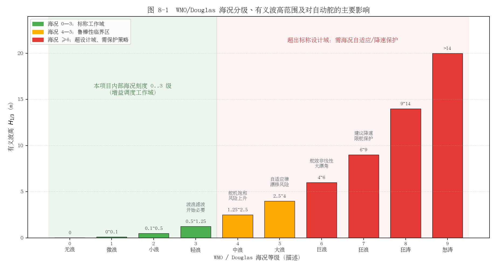
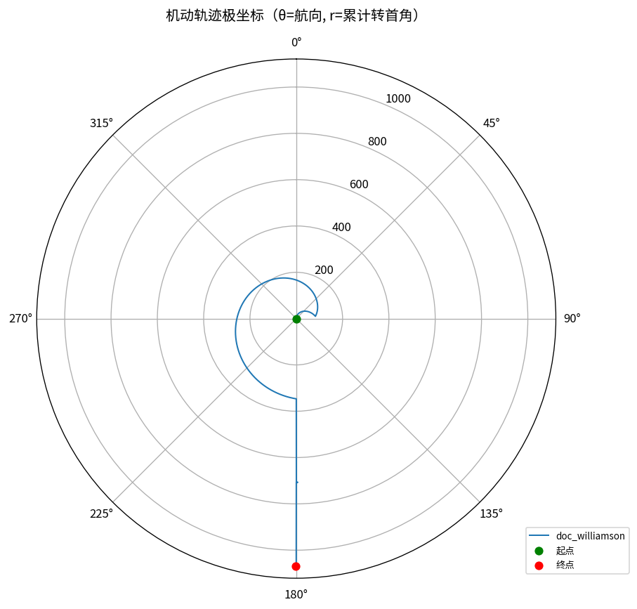
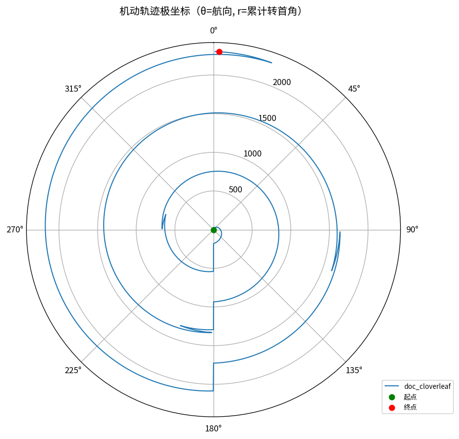
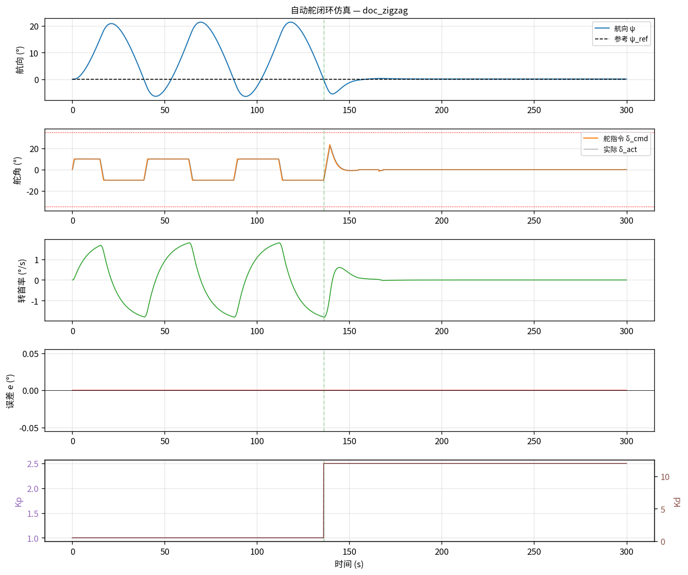
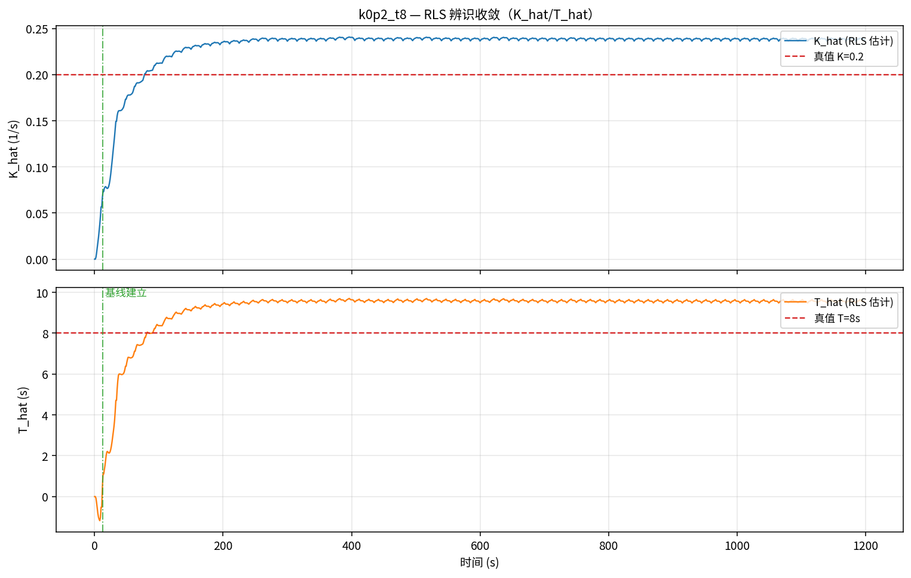
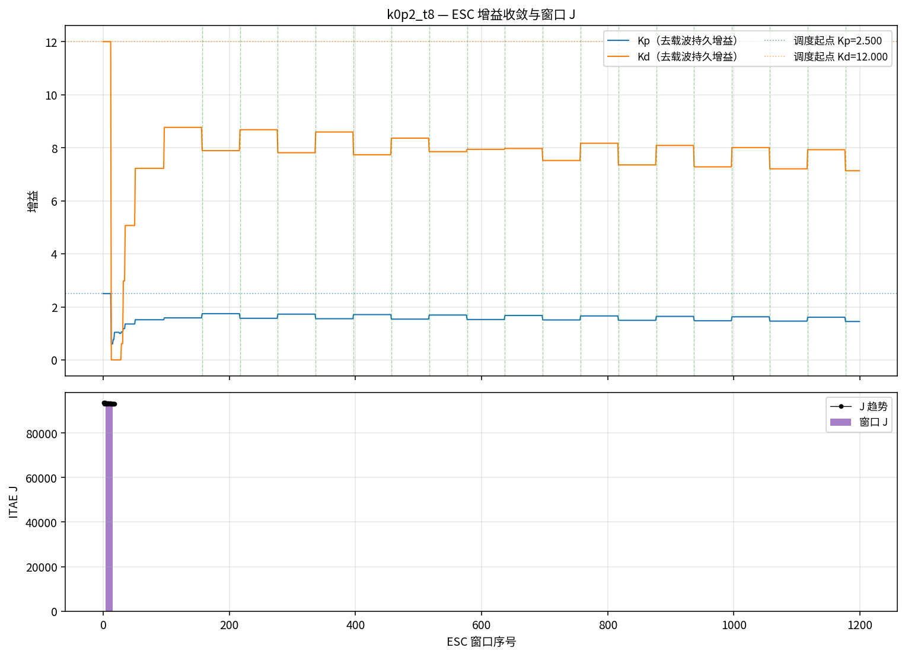

# 自动舵控制方案说明文档

> **文档定位**：面向工程师与项目协作者的控制方案总体说明，可直接粘贴至飞书文档（标题层级、表格、代码块均可被飞书识别）。
> **口径声明**：本文内容经代码（`control/include/`、`control/sim/`）与既有设计文档交叉核对整理；**凡文档与代码不一致处，以代码为准**，差异统一收录在附录 A。
> **版本**：V1.0（2026-08-19）
> **配图说明**：文中插图统一放在仓库 `assets/` 目录，以相对路径引用；导入/粘贴到飞书时请连同图片一并上传（飞书导入 Markdown 时会自动带出相对路径图片）。

## 目录

1. 方案总览
2. 控制思想：航向层闭环 + 四层调参
3. 系统架构
4. 核心控制算法
5. 在线辨识与极点配置建基线
6. ESC 极值搜索在线微调
7. 海况适应性分析
8. 机动序列与自动辨识试验
9. 仿真验证、测试与工具链
10. 典型使用流程
11. 术语表
12. 附录 A：代码 ↔ 文档不一致与待确认项
13. 附录 B：参考资料

---

## 一、方案总览

### 1.1 方案目标

本方案交付一套船用自动舵软件：**控制闭环在航向层完成，系统唯一输出为舵角指令 `δ_cmd`**。定位（GNSS）仅提供船速、位置等辅助信息，不参与控制律本身。

核心设计指标（仿真已验证达成）：

| 指标 | 目标值 | 备注 |
|------|--------|------|
| 航向控制精度 | ≤ ±1.0°（静水）/ ±2.0°（2 级海况），1σ | 海试验收项 |
| 阶跃超调 | ≤ 10% | 仿真实测 1.30%（30° 阶跃，K=0.2/T=8，10 kn，ar_sim 口径） |
| 5% 调节时间 | ≤ 30 s | 仿真实测 17.44 s（ar_sim 口径；plot_sim.py 独立重算为 27.44 s） |
| 操舵频次 | ≤ 6 次/min | 保护舵机 |
| 控制周期 | 100 ms（10 Hz） | 算法单拍实测峰值 < 5 ms |
| 舵角分辨率 | 0.1° | 输出量化 `quant=0.1` |

### 1.2 适用场景与边界

- **适用对象**：中小型船舶（游艇、渔船、科考船、USV 等），舵机功率 0.5~25 kN·m；设计算例取 25 kn 半滑行/滑行游艇（船长 12~18 m）。
- **功能范围**：航向保持（`AUTO_HEADING`）、6 种预置机动（`AUTO_MANEUVER`：circles / williamson / u-turn / zigzag / cloverleaf / search）、手动透传（`MANUAL`）与冻结保持（`HOLD`）；Nomoto 模型在线辨识与增益自动优化；一键自动 Z 形辨识试验。
- **明确边界**：
  - 航迹跟随（LOS）在可行性文档中有方案，但**当前代码未实装**；GNSS 在算法层只用于提供船速 `speedKn`。
  - 仅航向（无定位）降级工况下，cloverleaf / search 为开环机动，风流水致漂移不可消除（形态正确但图案不闭合）。
  - 船速 > 15 kn 时自动优化整体去激活（高速下辨识信噪比差），仅调度表增益生效。

---

## 二、控制思想：航向层闭环 + 四层调参

### 2.1 航向层闭环

被控对象按 Nomoto 一阶模型抽象：`T·ṙ + r = K·δ`（K 旋回性指数、T 追随性指数）。控制律为 PD：

```
e = angleDiffDeg(ψ_ref, ψ)            # 航向误差，归一化到 (-180°, 180°]
δ = Kp·e + Kd·ė                        # PD 控制律
```

微分带一阶低通抑制量测噪声：`ė_k = α·(e_k − e_{k−1})/dt + (1−α)·ė_{k−1}`，`α = 1/(1+τ/dt)`，`τ=0.2 s`。输出依次经过舵角限幅（±35°）、舵速限幅（10°/s）、量化（0.1°）后作为 `δ_cmd` 发出。

**为什么选 PD 而不要积分项**：低速/长时工况下积分项带来漂移与积分饱和风险；PD 结构简单、整定直观、对噪声敏感度低。代价是存在稳态误差（恒风下由稳态偏置指标 `essBias` 显式监控），设计上由定位层航迹闭环补偿（该闭环当前不在算法层）。

### 2.2 四层调参组合

船舶操纵性（Nomoto K/T）随船速、载荷、吃水、海况显著变化，固定增益无法全工况最优。四层机制各管一段时间尺度，组合覆盖"冷启动 → 粗适应 → 精调优"全过程：

| 层 | 机制 | 源码 | 时间尺度 | 解决什么 |
|----|------|------|----------|----------|
| 0 | **增益调度**：船速段×海况查表，段中点线性插值 | `gain_schedule.hpp` | 每拍（50 Hz） | 无基线时的名义增益，冷启动即可用，兜底 |
| 1 | **在线辨识**：带遗忘因子 RLS 估计 K̂/T̂ | `nomoto_identifier.hpp` | 1 s 一拍（自降频） | 跟踪模型参数慢变，无需人工干预 |
| 2 | **极点配置**：由 K̂/T̂ 反推增益建**基线** | `auto_tuner.hpp` | 事件驱动（辨识试验收官/漂移超阈/人工标定） | 一次性把增益锚到理论合理点 |
| 3 | **ESC 极值搜索**：扰动-解调式在线微调 | `auto_tuner.hpp` | 60 s 窗口结算 | 在基线附近按实测性能指标 J 持续寻优，吃掉模型误差 |

设计直觉：**调度表保证"不会太差"；辨识 + 极点配置把增益一次性拉到理论最优附近（基线）；ESC 在基线周围做无模型精细寻优**。


*图 2-1　四层调参总体架构：增益调度兜底 → RLS 辨识 + 极点配置建基线 → ESC 在线微调*

### 2.3 安全兜底（总述）

所有自动增益变更必须过"稳定门"（反算闭环 `ζ̂ ≥ 0.6`、`ω̂n ≤ 0.5 rad/s`、实测振荡峰-峰值 ≤ 5°、单次增益变化 ≤ 10%），任一不过即**回退**到基线；显式重基线时**重锚** ESC（清零积分/解调/窗口样本，旧梯度不得施加到新基线）。基线建立后增益归 `AutoTuner` 所有（增益所有权），不再被调度表每拍覆写。详见第六章。

---

## 三、系统架构

### 3.1 软件边界：纯算法层

`control/include/` 下 8 个头文件构成 **header-only、C++17、零第三方依赖、主循环零堆分配**的纯算法库，不含任何 IO：

- 传感器数据经 `SensorInput` 传入，舵角指令经返回值传出——对外仅暴露 `AutopilotCore::step(const SensorInput&, double dt) → 目标舵角` 单入口。
- EEPROM 读写、时间戳时钟经 `std::function` 注入（`ParamStore::ReadFn/WriteFn/ClockFn`）。
- 航向融合（AHRS 高频 + GNSS 校正）与传感器有效性判断在 BSP/融合层完成；GNSS 失锁等降级表现为上层切换模式，算法层不感知 GNSS 状态。

### 3.2 模块职责一览（control/include，namespace `ar`，无环依赖）

| 模块 | 文件 | 职责 |
|------|------|------|
| 核心集成 | `autopilot_core.hpp` | 唯一对外入口：模式状态机（MANUAL/AUTO_HEADING/AUTO_MANEUVER/HOLD）+ 机动编排 + 每拍转发 |
| PD 控制器 | `pd_controller.hpp` | 航向误差 → 舵角：PD 律 + 死区/微分低通/舵角限幅/舵速限幅/量化；`setGains()/setDt()` 轻量改参不清状态 |
| 增益调度 | `gain_schedule.hpp` | 按船速段×海况查名义 Kp/Kd（默认 14 行表），速度维段中点锚定线性插值，支持 `setTable()` 整表替换 |
| 在线辨识 | `nomoto_identifier.hpp` | Nomoto K/T 的 RLS 在线辨识（λ=0.98，回归量归一化，激励门限）；自降频——任意频率调用，内部满 `beatSec=1 s` 才做一拍 |
| 自动优化 | `auto_tuner.hpp` | 极点配置建基线 + ESC 微调 + 稳定门/回退/重锚；对外仅 `tick()/establishBaseline()/suspend()` 三个动作 |
| 机动序列 | `maneuver_sequencer.hpp` | 航段（`Leg`）状态机框架 + 6 种预置机动工厂函数 |
| 参数存储 | `param_store.hpp` | `ControlParams` 小端序列化 + CRC32 + 物理范围校验，读写经注入函数对接 EEPROM |
| 角度工具 | `angle_utils.hpp` | 角度归一化与最小带符号角差（消除 359°→1° 跳变），被 PD 与机动序列复用 |

### 3.3 关键接口签名

```cpp
struct SensorInput { double headingDeg, rateDegS, rudderDeg, speedKn; int seaState; };
double AutopilotCore::step(const SensorInput& s, double dt);   // 50 Hz 单入口 → δ_cmd

struct IdSnapshot  { bool excited; bool valid; double K, T; };  // 辨识只读投影
struct TunerInput  { headingRefDeg, headingDeg, rudderDeg, speedKn, dt,
                     schedKp, schedKd, IdSnapshot id };         // tick 每拍输入包
struct GainCommand { double Kp, Kd; };                          // 本拍增益（已含 ESC 载波）
GainCommand AutoTuner::tick(const TunerInput&);                 // 每拍单入口
bool AutoTuner::establishBaseline(const IdSnapshot&);           // 一次性建基线
void AutoTuner::suspend();                                      // 切出自动模式：清测量状态、保留基线
```

### 3.4 调用节拍

| 环节 | 节拍 | 备注 |
|------|------|------|
| `step()` / PD / 调度查询 | 20 ms（50 Hz） | 主循环 |
| `identifier.update()` | 20 ms 喂入，1 s 一 RLS 拍 | 自降频，差分 Δt 自测 |
| `tuner.tick()` | 20 ms | 内部自维护 60 s ESC 窗口拍数，满窗自结算 |
| `ParamStore::save/load` | 事件驱动 | 上电/标定完成/参数更新，不进主循环 |

### 3.5 整体数据流

主控制链路：

```
AHRS(ψ, r) ──┐
GNSS(船速) ──┼──> BSP 融合/校验 ──> SensorInput ──> AutopilotCore::step()
舵角反馈 δ ──┘                                        │ 按模式分支
                                                      ├─ AUTO_HEADING: 调度查询 → 调参器拍 → PD(ψ_ref, ψ)
                                                      ├─ AUTO_MANEUVER: 航段指令（HEADING 段走 PD / RUDDER 段经限幅直出）
                                                      ├─ MANUAL: 透传舵角反馈
                                                      └─ HOLD: 冻结上一拍舵角
                                                      ▼
                                              δ_cmd ──> 舵机驱动 ──> 本船 ──> (回到传感器)
```

辨识/调参旁路（`AUTO_HEADING` 每拍）：

```
SensorInput ──> NomotoIdentifier.update(δ, r, dt)     # 自降频，满 1 s 一拍
                     │ excited/valid/K/T
                     ▼
               IdSnapshot ──> AutoTuner.tick(TunerInput{…, 调度名义 Kp/Kd, id})
                                  │ 速度门控(>15 kn 停用) → 无基线跟随调度值
                                  │ → 周期辨识评估(漂移 ±25% 重锚) → ESC 窗口结算
                                  │ (稳定门/回退) → 载波注入
                                  ▼
                          GainCommand{Kp, Kd}(含载波) ──> pd.setGains() ──> PD 闭环
```

旁路另有两个人工/试验入口：自动辨识试验 `startIdentifyTrial(dz=20°, phiz=20°, cycles=4)`（见第八章）；人工标定经 `ParamStore` 固化参数并注入基线（优先级高于自动优化）。

### 3.6 部署形态

| 形态 | 载体 | 说明 |
|------|------|------|
| 实船 | ECU（推荐 STM32H7 级，双冗余为目标） | 算法库直接嵌入，BSP 定时回调保证 50 Hz 调用 `step()` |
| 闭环仿真（SIL） | `ar_sim`（`control/sim/`） | Nomoto 对象 + 舵机一阶惯性 + 风/浪/噪声扰动，确定性 LCG 可复现；跑的是实船同一份控制代码 |
| 单元测试 | CTest 单元测试套件（8 个 `test_*` 可执行，GoogleTest，共 90 用例） | Release + ASan 双工具链 |
| 调试界面 | `control/ui/debug_ui.html` | 单文件 Web 应用，算法为 C++ 的 JS 镜像，可内置仿真或经 WebSocket 连真实 ECU；**仅用于调试，实船控制必须走 C++ ECU** |
| 可视化工具 | `control/tools/plot_sim.py`、`animate_sim.py` 等 | CSV → 分析图 / 动画 / 收敛效果图 |

外部硬件依赖（非本仓库代码）：AHRS（RS-422/NMEA 0183 扩展，提供 ψ 与 r）、GNSS（RS-232，推荐双天线）、舵角编码器（CANopen DS406，12-bit）、舵机驱动（CAN 2.0B / 0~10 V 模拟量备份）、板载 EEPROM（参数固化，CRC32 校验）。

---

## 四、核心控制算法

### 4.1 每拍数据流（AUTO_HEADING）

`AutopilotCore::step()` 每拍执行 `headingControlStep()`，严格按以下顺序：

1. **首拍初始化**：切入 `AUTO_HEADING` 的第一拍，用实际舵角 `s.rudderDeg` 调 `pd_.initBaseline()` 初始化舵速限幅基准，避免舵令从 0° 爬升产生跳变（真实舵面并不在 0°）。
2. **增益调度查询**：`schedule_.query(speedKn, seaState, Kp, Kd)` 得本拍名义增益。
3. **喂辨识器**：`identifier_.update(s.rudderDeg, s.rateDegS, dt)` 每拍无条件喂入（用的是**实际舵角反馈**而非舵令，对舵饱和鲁棒）。
4. **调参器拍**：`tuner_.tick({...})` 返回本拍应施加的 `GainCommand`。
5. **下发增益**：`pd_.setDt(dt)` + `pd_.setGains(g.Kp, g.Kd)`——轻量接口，不清控制器内部状态。
6. **PD 闭环**：`pd_.update(headingRef_, s.headingDeg)` 输出本拍舵角指令。

### 4.2 PD 控制器（pd_controller.hpp）

- **误差 wrap**：`angleDiffDeg(ref, act)` 计算最小带符号差并归一化到 `(-180, 180]`；不做归一化时跨 0°/360° 边界舵令会反向打满。
- **微分来源**：不直接取 AHRS 转向率 r，而是对误差 e 差分后经一阶低通（`tau=0.2 s`）；首拍 `derivRaw=0`，避免启动微分冲击。
- **处理链**（固定顺序）：

| 环节 | 实现 | 默认值 |
|------|------|--------|
| 误差死区 | `\|e\| < deadzone` 时目标为 0，但经 `saturate(0.0)` 舵速限幅**平滑回中**，不瞬跳 | 0.3° |
| PD 控制律 | `out = Kp·e + Kd·deriv` | Kp=1.0，Kd=0.5 |
| 舵角限幅 | `±dMax` | ±35° |
| 舵速限幅 | 每拍增量 ≤ `ddMax·dt`（50 Hz 下 0.2°/拍），基准为上一拍输出 | 10°/s |
| 输出量化 | `round(v/quant)·quant` | 0.1° |

- **接口语义**：`setParams()` 全量设置并 `reset()` 清状态（非法 `dt`/`quant` 自动钳制，防除零产生 Inf/NaN）；`setGains()/setDt()` 不清状态，供每拍调用；`saturate()` 公开给机动 RUDDER 段复用，限幅基准连续推进。

### 4.3 模式状态机（AutopilotCore）

`enum class Mode { MANUAL, AUTO_HEADING, AUTO_MANEUVER, HOLD }`，上电默认 `MANUAL`。

| 模式 | 每拍行为 |
|------|----------|
| `MANUAL` | 透传舵角反馈：`rudderCmd = s.rudderDeg` |
| `AUTO_HEADING` | 航向保持闭环（PD + 增益调度 + 自动优化） |
| `AUTO_MANEUVER` | 机动航段执行：HEADING 段走 PD 闭环（含调度增益），RUDDER 段经 `pd_.saturate()` 限幅后直出 |
| `HOLD` | 冻结上一拍舵角指令（而非输出 0） |

**模式切换清理逻辑（`setMode()`）**：一律 `pd_.reset()` 并取消进行中的辨识试验；切出到 `MANUAL`/`HOLD` 时 `tuner_.suspend()`；切入 `HOLD` 冻结当前舵角；切入 `AUTO_HEADING` 置首拍基准初始化标记。机动完成拍不输出 0（那会绕过舵速限幅瞬跳），而是立即转 `AUTO_HEADING`、以当前航向为保持目标当拍闭环。

**`suspend()` 语义**：`AutoTuner` 唯一的模式生命周期钩子——清测量状态（ESC 窗口/解调/HPF/梯度全清零）、**保留基线增益**，切回自动模式后从原基线无缝续上。

### 4.4 增益调度表（gain_schedule.hpp）

表结构 `GainPoint{speedMin, speedMax, seaState, Kp, Kd}`，内置默认表（海况 0 与 1、2 与 3 数值相同）：

| 船速区间 | 海况 | Kp | Kd |
|----------|------|-----|-----|
| < 4 kn | 0~1 | 2.0 | 0.8 |
| 4~10 kn | 0~1 | 1.5 | 0.6 |
| 4~10 kn | 2~3 | 1.0 | 0.4 |
| 10~18 kn | 0~1 | 1.2 | 0.5 |
| 10~18 kn | 2~3 | 0.9 | 0.4 |
| 18~25 kn | 0~1 | 1.0 | 0.4 |
| 18~25 kn | 2~3 | 0.7 | 0.3 |

查询算法：**海况维精确匹配不插值**（越界钳到 0..3，查不到兜底 `Kp=1.0, Kd=0.5`）；**速度维段中点锚定线性插值**——名义增益锚在每段中点（默认表中点 2 / 7 / 14 / 21.5 kn），中点间线性插值，消除段切换处的增益跳变。整表可经 `setTable()` 替换。

### 4.5 每拍增益转发

`tick()` 内与本节相关的两个关键点：**速度门控**（`speedKn > 15 kn` 时调参整体去激活）；**基线未建立时跟随调度**（`GainCommand` 直通调度名义值，基线建立后增益归 `AutoTuner` 所有，不再被调度表覆写）。core 侧转发仅两行：`pd_.setDt(dt); pd_.setGains(g.Kp, g.Kd);`——`setGains` 不清 PD 内部状态，每拍更新增益不会扰动微分滤波与舵速限幅基准。当前增益（去载波）可经 `tuner().currentGains()` 只读观测。


*图 4-1　`AutoTuner::tick()` 每拍（50 Hz）内部编排流程：速度门控 → 基线跟随/辨识评估 → 窗口结算 → 载波注入*

---

## 五、在线辨识与极点配置建基线

### 5.1 Nomoto 模型与回归化

艏摇动力学用 Nomoto 一阶模型近似（舵角 δ 输入，转向率 r=ψ̇ 输出）：

```
T·ṙ + r = K·δ        →        r(s)/δ(s) = K / (T·s + 1)
```

- `K`：旋回性指数，物理合理范围 `(0, 2]`（`valid()` 强制）；`T`：追随性指数 (s)，合理范围 `[1, 60]`。
- 对 ṙ 取后向差分离散化，得标准线性回归：`r_k = K·δ_k − T·dr_k`，即 `y_k = r_k`，`φ_k = [δ_k, −dr_k]ᵀ`，`θ = [K, T]ᵀ`。

**可辨识性关键点**：稳态直航时 `dr≈0`，回归量第二维消失，只能定出 K——**T 的信息只藏在转向反向（r 过零）附近的高 dr 瞬态里**。这是激励门控保留高 dr 样本、以及 Z 形辨识试验反复换舵的设计依据。

### 5.2 RLS 递推（带遗忘因子）

遗忘因子 `lambda = 0.98`（约 34 拍后旧样本权重衰减到 50%）。标准 RLS 三件套：

```
增益  g_k = P·φ / (λ + φᵀPφ)
残差  e_k = y_k − φᵀθ
更新  θ ← θ + g_k·e_k；  P ← (1/λ)·(P − g_k·φᵀ·P)，对角元保底 pFloor=1e-3 防协方差塌陷
```

工程化处理：

| 机制 | 实现 | 参数 |
|---|---|---|
| 归一化 | `φ = [δ/50, −dr/1]`，估计反归一化，消除量级差导致的 P 矩阵病态 | `dScale=50.0`、`drScale=1.0` |
| 激励门控 | 仅当 `\|δ\|>3° 且 (\|r\|>0.5°/s 或 \|dr\|>0.2°/s²)` 才递推；直航 φ≈0 时更新会让 P 每拍放大 1/λ 导致协方差爆炸 | `deltaMin=3.0`、`rMin=0.5`、`drMin=0.2` |
| 坏数据防御 | 非有限值、`\|δ\|>35°`、`\|r\|>30°/s`、`dt≤0` 一律丢弃；**被拒的拍不写差分锚点**，否则毛刺永久毒化 θ/P | 硬编码阈值 |
| 物理合理性 | `K∈(0,2] 且 T∈[1,60]` 才 `valid()=true`，调参器保守拒绝越界估计 | `valid()` |

### 5.3 自降频与 IdSnapshot

- **自降频**：`update(δ, r, dtNow)` 可被任意频率调用（主循环 50 Hz），内部累计满 `beatSec = 1.0 s` 才做一次 RLS 拍；差分 Δt 取两次 RLS 拍之间的真实间隔自测，与调用频率无关。收益：减轻 ECU 负担、保证差分信噪比，并消除"调用频率一变差分即静默出错"的旧语义陷阱。
- **IdSnapshot**：辨识器是独立模块，`AutoTuner` 不持有它；core 每拍喂数据并组装只读投影 `{excited, valid, K, T}` 传入调参器。

辨识结果经两条受控路径进入调参器（共享同一评估实现）：

1. **tick 周期评估**：K̂/T̂ 相对建基线时的估计漂移 ≤ 25% 交给 ESC 自治；超阈值才显式重基线并重锚 ESC。
2. **辨识试验收官**：自动 Z 形机动结束后 `establishBaseline()` 一次性建基线——不做漂移检查，振荡条件以 0 传入由 ζ/ωn 代数条件把关（见第八章）。


*图 5-1　辨识结果的两种应用路径：tick 周期评估（漂移门 ±25%）与 Z 形试验收官一次性建基线*

### 5.4 极点配置建基线

闭环特征方程（Nomoto + PD）与标准二阶对照：

```
T·s² + (1 + K·Kd)·s + K·Kp = 0   ⇔   s² + 2ζωn·s + ωn² = 0
```

逐项反解得（**全仓库唯一定义在 `AutoTuner::polePlacement()`**，仿真装表等场景也应调此处）：

```
Kp = ωn²·T / K
Kd = (2ζ·ωn·T − 1) / K        # 负值 clamp 到 0（小 T 快船退化保护）
```

默认目标 `ζ=0.85`（小超调、快稳定）、`ωn=0.20 rad/s`。退化保护：`K/T` 非有限或 `|K|、|T| < 1e-6` 返回 false。

稳定门 `stabilityCheck()` 用同一组关系的**正向形式**反解任意 `(Kp, Kd)` 对应的闭环极点：

```
ωn = √(Kp·K/T),   ζ = (1 + Kd·K) / (2·√(T·Kp·K))
要求：Kp > 0，ζ ≥ 0.6，ωn ≤ 0.5 rad/s，实测振荡峰-峰值 ≤ 5°
```

### 5.5 参数持久化（param_store.hpp）

`ControlParams` 与 EEPROM 区块对应：A 舵角标定（`rudderZero/rudderLeft/rudderRight`、`ddotMax`）、B 模型参数（`K`、`T`）、C PD 增益（`Kp`、`Kd`）、D 增益调度表，外加元信息（`version`、`timestamp`、`crc`）。

关键机制：逐字段显式**小端序列化**（消除结构体填充字节依赖）；**CRC32**（IEEE 0xEDB88320）追加在 payload 末尾；`save()` 自动填时间戳、`version += 1`；`load()` 先 CRC 校验再 `validateRange()` 物理范围检查（与辨识/调参侧的合理性边界一致）。

---

## 六、ESC 极值搜索在线微调

### 6.1 为什么需要 ESC

极点配置的解析解建立在 Nomoto 一阶模型上，而真实船舶与模型总有偏差——解析解只是"理论最优点附近"，不是最优点本身。ESC（Extremum Seeking Control，极值搜索控制）不依赖模型精度，直接在被控对象上**实测**性能对增益的梯度，把模型误差"吃掉"。

### 6.2 原理推导：扰动–解调式极值搜索

**物理直觉**：不看成本曲面，用"探针"轻轻晃动增益（±5% 正弦载波），观测性能指标 J 的"回声"——J 与载波同相起伏说明增益偏高，反相则偏低，相关输出趋零则已在谷底。"乘以同相载波再平均"本质是一台锁相放大器，把含梯度信息的基波分量从直流和谐波中检出来，然后沿负梯度走一步。

**数学流程（四步）**：设单参数 θ，J(θ) 在最优点 θ* 附近光滑，取二阶泰勒展开并叠加摄动 `θ(t) = θ̄ + a·sin ωt`：

```
J(t) ≈ [J* + ½J''(θ̄−θ*)²]          ← 直流/慢变项
     + [J''(θ̄−θ*)·a·sin ωt]          ← 基波（含梯度信息）
     + [¼J''a²(1 − cos 2ωt)]         ← 二倍频谐波
```

1. **高通去直流**：HPF 滤掉第一项，输出 `≈ J''(θ̄−θ*)·a·sin ωt`；
2. **乘以同相载波（解调）**：`y·sin ωt = (a/2)·J''(θ̄−θ*)·(1 − cos 2ωt)`；
3. **窗口平均**：`cos 2ωt` 被平均掉、`sin²` 均值为 1/2，得 `mean ≈ (a/2)·∂J/∂θ`——解调平均值正比于当前点梯度。代码归一化系数 `ĝ = 2·Σ(y·载波)/(a·N)` 中的 2 和 a 恰好把这个 `a/2` 归一掉；
4. **积分器更新**：`θ̄ ← θ̄ − η·ĝ`，自动爬向 J 谷底。

**双参数同时调**：Kp 用 sin 载波、Kd 用 cos 载波，由正交性 `mean(sin·cos)=0`，两路解调互不串扰，一次扰动同时估出 `∂J/∂Kp` 与 `∂J/∂Kd`。

**收敛前提——时间尺度三分离**：闭环动态（秒级）≪ 载波周期（百秒级）≪ 积分器适应（多窗口）。理论背书是 Krstić–Wang 平均化 + 奇异摄动稳定性证明（局部指数稳定）。本工程默认 `ω = escFreq = 0.05 rad/s`（周期约 126 s）、窗口 60 s（该默认值与窗口长度的张力见附录 A）。


*图 6-1　ESC 数值演示：成本曲面爬坡、增益沿负梯度收敛、载波摄动与梯度估计*

### 6.3 代价函数：ITAE + 操舵惩罚

```
J = ∫₀^Tw ( t·|e(t)| + wU·|δ(t)| + wDu·|Δδ(t)| ) dt
Tw = 60 s（windowSec），wU = 0.01（舵角/能耗），wDu = 0.005（舵角变动，抑抖振护舵机）
```

`t·|e|` 为 ITAE 时间加权，重罚收敛慢、鼓励快速镇定。样本存编译期容量环形缓冲（60 s × 50 Hz，主循环零堆分配）；窗口**非重叠**，结算后清零。

### 6.4 工程实现：信号链逐环节对应

| 环节 | 公式 | 参数 |
|---|---|---|
| 扰动注入（每拍） | `Kp_out=Kp·(1+a·sinφ)`，`Kd_out=Kd·(1+a·cosφ)`，`φ+=ω·dt` | `escAmp=5%`，`escFreq=0.05 rad/s` |
| 成本增量（每拍） | `c_k=(t_k·\|e_k\|+wU·\|δ_k\|+wDu·\|Δδ_k\|)·dt` | 与 computeJ 被积函数一致 |
| 高通去直流（每拍） | `y=αH·(y+c_k−c_{k−1})`，`αH=τH/(τH+dt)` | `escHPFtau=5 s` |
| 因果解调（每拍） | `S_Kp+=y·sinφ`，`S_Kd+=y·cosφ` | 与本拍注入载波同相相关 |
| 梯度归一化（窗末） | `ĝ = 2·S/(a·N)` | ≈ ∂J/∂（增益相对摄动） |
| 梯度低通（窗末） | `grad←(1−αL)·grad+αL·ĝ`，`αL=Tw/(τL+Tw)` | `escLPFtau=10 s`，**系数按窗口周期算** |
| 积分更新（窗末） | `K ← K − η·grad` | `escStep=0.02`（固定步长） |
| 更新限幅 | `\|ΔK\| ≤ max(\|K_old\|·10%, 1e-3)` | 绝对下限防 `Kd=0` 被比例上限永久锁死 |

工程要点：扰动只存在于输出给 PD 的增益中，**不持久化**（`curKp_/curKd_` 保存去载波的中心增益）。**P11 整改教训**：旧实现扰动未真实注入（窗内增益恒定，"梯度"没有因果来源），且按 `dt=0.02 s` 设计的滤波系数被用在 60 s 才来一个的样本上，梯度衰减 2~3 个数量级，调参结果与初值逐位相同——结论是 ESC 各环节运行在不同时间尺度，**滤波器系数必须用各自环节的真实采样周期计算**。


*图 6-2　ESC 信号链：扰动注入 → 高通去直流 → 因果解调 → 窗口结算（归一化/LPF/积分/限幅）→ 稳定门*

### 6.5 安全机制：四道防线

自动改增益是危险操作，一切增益变更必须过四道防线：

1. **四条件稳定门**（`stabilityCheck()`）：用辨识快照 K̂/T̂ 反解闭环特征——`ωn ≤ 0.5 rad/s`、`ζ ≥ 0.6`、`Kp > 0` 且 K/T 非退化、实测振荡峰-峰值 ≤ 5°，全过才放行；辨识快照无效时保守拒绝。
2. **回退**：窗口结算不过门则增益恢复到基线——基线永远是"已验证安全"的锚点。
3. **振荡检测**：航向误差过零结算峰-峰幅值（保守取大 + 平滑衰减），且**航向参考稳定满 30 s 后才喂入**——机动期间的误差摆动是指令响应而非闭环振荡。
4. **速度门控**：船速 > 15 kn 调参整体去激活，仅调度表/辨识运行。

生命周期配套：**漂移重基线**——K̂/T̂ 相对基线漂移 ≤ 25% 时不动基线、ESC 自治；超阈值说明船况真变，重新极点配置 + 过稳定门 + **重锚**（ESC 积分器/解调/窗口样本全清零，旧梯度不得施加到新基线；载波相位刻意保留防重锚拍突跳）。**挂起**：切到 MANUAL/HOLD 时清测量状态、保留基线。


*图 6-3　基线生命周期：建立 → ESC 微调 →（漂移重基线 / 结算回退 / 挂起保留），四道安全防线全程把关*

### 6.6 为什么从基线出发微调，而不是全量在线寻优

方案选型的核心决策，理由有五：

1. **ESC 的数学定位就是局部方法**：梯度估计来自最优点邻域的二阶泰勒展开，只在 θ̄ 接近 θ* 时成立；把搜索空间压到基线小邻域恰好匹配其能力边界。
2. **基线是"已验证安全"的锚点**：由极点配置解析建立、经稳定门背书；全量寻优在参数空间大部分区域没有安全性背书，回退机制也无从依附。
3. **时间尺度代价不可承受**：ESC 收敛以分钟计（仿真典型船 1200 s 跑 18 个窗口收敛）；全量搜索意味着在大参数空间逐步爬行，实船不可接受。
4. **与工业界 50 年分工共识同构**：自 KADPIL（1974）以来，"增益调度管快变量（船速）、自适应管慢变量（海况/载况残余失配）"就是商用自动舵的行业结构（Kongsberg/Anschütz/Raymarine 在役产品沿用）。
5. **激励主动性绕开被动学习的死穴**：保向工况激励贫乏是一切被动自适应的死穴（"需要学习的时候学不动"）；ESC 主动注入扰动，结构性绕开持续激励（PE）问题。

### 6.7 当前实现的已知限制（诚实清单）

- 无显式收敛停机判据——靠稳定门 + 回退兜底，外部以 J 平台判收敛；
- 固定步长 `escStep=0.02`（无自适应步长）；梯度 LPF 平滑很弱；
- 梯度估计量纲为"J 对增益相对摄动"，更新律却做绝对加法——工程近似，由相对限幅兜底；
- 扰动注入影响操舵平顺性；收敛分钟级；辨识误差直接传导到极点配置（仿真中辨识误差 +18% 量级仍收敛）；
- 慢船（T=20）工况下 ESC 被稳定门按预期阻断、钉在安全增益——保守行为符合设计；
- 文档已声明未实现项：`ζ/ωn` 船速分段（当前单组 0.85/0.20）、回退缓存深度 3（当前单组基线）、代价函数升级为操舵附加阻力型 `J=E[ψ_e²+λδ²]`（节能口径，P1 建议）。

---

## 七、海况适应性分析

### 7.1 海况刻度与工作域

- 本项目增益调度采用内部海况刻度 **0..3 级**，大致对应 WMO 0–3（有义波高 `H₁/₃ ≤ 1.25 m`，"轻浪及以下"）标称工作域；
- 对 25 kn 级游艇，**海况 4–5（`H₁/₃` 1.25–4 m）是常规运营可能遭遇的上限**，作为"最大海况"分析目标；**海况 ≥6 时任务从"精确航向保持"退化为"安全降级"**——保船不保精度；
- 对自动舵真正起作用的是**遭遇谱** `ωe = |ω − (ω²U/g)·cosχ|`：随浪时映射非单调、在 `ω=g/(2U)` 处折叠——25 kn 下折叠点 ≈ 0.38 rad/s，海况 4 的谱峰能量被压回操纵频段，这是随浪航向保持困难、波浪滤波难以奏效的频域解释。



*图 7-1　WMO/Douglas 海况刻度与本项目工作域（0–3 标称）/ 保护域（4–5 需降级链）*


*图 7-2　波谱与遭遇频率映射：随浪时谱峰能量在 ω=g/(2U) 处折叠回操纵频段*

### 7.2 高海况扰动机理

| 机理 | 内容 | 对本方案的冲击 |
|---|---|---|
| 一阶波浪力 | 波幅同阶线性振荡力（游艇典型 0.3–1.5 rad/s），均值零 | 不应进入反馈——舵无法抵消波频振荡，硬跟只会舵机空转磨损；进入辨识/ESC 则成"假激励" |
| 二阶慢漂力 | 与波幅**平方**成正比的慢变漂力/漂转力矩，叠加大风/流 | 航向稳态偏差主源；本方案 PD 故意无积分，靠航迹闭环补偿 |
| 舵机硬约束 | 舵角限幅 ±35°、舵速限制 | 大信号下实际舵角滞后舵令，等效相位滞后侵蚀稳定裕度；大舵角失速区等效 K 随舵角下降，与 Nomoto 线性假设冲突 |
| 低速大漂角 | 高海况常伴降速：`K ∝ U` 舵效减弱，风与漂力相对权重上升 | 低速+大浪+大漂角是最恶劣组合工况 |

### 7.3 各海况下的能力边界

| 海况 | 本方案状态 | 能力边界 |
|---|---|---|
| 0–2（标称） | 调度表 + 辨识 + 基线 + ESC 全链路工作 | 设计指标达成域（静水 ±1°、2 级海况 ±2°/1σ）；仿真 1200 s 全链路收敛试验验证（`--tune`，J 93639.7→93221.2，末 3 窗散布 ≤10%，converged=1） |
| 3（内部刻度上限） | 全链路可工作，ESC 梯度信噪比下降 | 调度域边界；调研建议补波浪滤波后才稳妥 |
| 4–5（最大海况） | **当前缺波浪滤波是最大短板**：波频分量淹没 ESC 激励抖动、梯度失真；调度表外插无保证 | 需配齐保护后才可行：冻结 ESC、切保守 PD 基线、限舵/降速提示（降级链，P1 建议，当前未实现） |
| ≥6 | 一切算法统一安全降级 | 超出设计目标，保船不保精度 |

### 7.4 已落地的保护与已识别的短板

已落地：辨识器输入用**实际舵角反馈**而非舵令（对舵饱和鲁棒的关键经验，Lauvdal & Fossen 1998）；速度门控、振荡门控、稳定门/回退构成现有安全网。

已识别短板（按优先级）：

- **P0 补波浪滤波**（陷波或 Kalman）：`control/include/` 当前无任何波浪滤波环节，一阶波频分量先于反馈与辨识被滤除是所有自适应机制在海况 3 以上正常工作的前提；
- **P0 ESC 高海况保护三件套**：dead-zone（误差能量低于阈值冻结更新）、泄漏项（防漂移）、激励频率避开遭遇谱峰；
- **P1 海况超阈值降级链**：调度域显式扩展到海况 4–5，超上限时冻结 ESC、切预存保守 PD 参数、限舵/降速提示，并纳入 HIL 验证。

### 7.5 选型结论：为什么是 ESC

调研覆盖 MRAC / STR·LQG / 自适应 PID·增益调度 / 模糊 / NN / L1·滑模 / RL / MPC 等谱系，结论：**"ESC 与 50 年工程共识同构、方向正确"**。四条决定性理由：

1. **与工业界带宽分离分工同构**（见 6.6 第 4 条）；恶劣海况恰是自适应收益最大工况（KADPIL 2 在 8 级风下节油增益 1.4%，高于和风的 0.5%）；
2. **可解释、可认证**：ESC 只动 K/T、Kp/Kd 少量物理参数，有平均化稳定性理论背书，参数可限幅、可监控——相对 NN/RL 的取证困难是决定性工程优势；IMO MSC.64(67) 自 1996 年起即在性能标准中容纳"自动适应"方案；
3. **激励主动性**：结构性绕开被动自适应的 PE 死穴；
4. **数学定位清晰、样本代价极低**：不需要 RL 的海量试错；天花板明确（只能在 PD 结构内寻优），风险边界也明确。


*图 7-3　自适应自动舵节油收益的实船文献数据（KADPIL 系列 0.3%~1.4%，恶劣海况收益更高）*

对照落选方案：MRAC/STR 需陷波 + 鲁棒化修正才可达海况 4–5；NN/RL 分布外无保证、实船在线探索不可接受；滑模抖振与舵机磨损直接冲突；L1 自适应是文献中商用化最成功的高海况方案（Raymarine Evolution），与本方案时间尺度分离思想同构——**若未来升级自适应方案，L1 是迁移成本最低的路径**。

---

## 八、机动序列与自动辨识试验

### 8.1 机动概念

机动统一抽象为**预置航段序列**：每个机动 = 一串航段（Leg），由机动编排器按触发条件逐段推进。设计前提是**仅航向、无定位**的降级工况——机动必须能由"航向角触发 + 航向变化率"实现，不依赖绝对位置。

可行性结论：

| 类别 | 机动 | 说明 |
|---|---|---|
| 闭环可行（4 类） | Circles / Williamson / U-Turn / Zigzag | 纯航向触发即可正确完成 |
| 开环可行（2 类） | Cloverleaf / Search | 无位置闭合，漂移不可消除，形态正确但图案不闭合 |
| 不可行 | Orbit 绕点 | 需位置闭环，未实现 |

### 8.2 六种预置机动

| 机动 | 工厂函数（缺省参数） | 段数 | 模式组合 | 用途 |
|---|---|---|---|---|
| Circles 绕圈 | `circles(dCmd=15, totalDeg=360)` | 1 | RUDDER | 回转试验；恒舵角等效恒转向率 |
| Williamson 威廉逊掉头 | `williamson(psi0, dMax=25)` | 3 | RUDDER×2 + HEADING | **人落水紧急返点机动**，本就为"仅罗经"场景设计 |
| U-Turn U 型掉头 | `uTurn(psi0, right=true, dMax=25)` | 2 | RUDDER + HEADING | 单次 180° 掉头，方向由 `right` 指定 |
| Zigzag Z 字形 | `zigzag(psi0, dz=10, phiz=10, N=5, returnToStart=false)` | 2N（+1 保持段） | RUDDER（+HEADING） | 操纵性 Z 形试验；**兼作辨识激励发生器** |
| Cloverleaf 三叶草 | `cloverleaf(psi0, tLeg=30, dMax=20)` | 8 | RUDDER 转向 + HEADING 直航 | 4×(转向 270° + 直航)，开环 |
| Search 搜索 | `search(psi0, t0=30, dt=10, cycles=6, dMax=20)` | 2×cycles | HEADING 直航 + RUDDER 转向 | 扩张方搜，边长逐次递增，每边后右转 90°，开环 |

关键实现要点：

- **Williamson**：`+dMax` 至累计 `+60°` → `-dMax` 至累计 `-180°` → HEADING 保持 `ψ0+180°`。缺省 `dMax=25°` 而非满舵 35°，留出段间超调的修正裕量。
- **Cloverleaf**：四个转向段**必须同向**（`dMax` 符号决定旋向），总航向变化 4×270°=1080° 净回 ψ0，图案几何闭合。
- **历史缺陷整改（P7）**：旧实现 Cloverleaf/Search 转向段用 HEADING 模式 + 270°/90° 阈值，但 PD 走最短路径（+270° 等价 −90°），阈值永不满足、序列卡死；整改为转向段一律 RUDDER 恒舵角，达累计角度后切 HEADING 段收尾。
- **Circles**：当前以单段 RUDDER 恒舵角等效转向率闭环（Nomoto 稳态下恒舵角即恒转向率）；若海试圆度不佳，预留升级为转向率外环。



*图 8-1　Williamson 掉头仿真（300 s，10 kn）：满舵转 60° 后反舵，终点稳定在反航向 180°（极坐标编码：极角=瞬时航向、半径=累计转首角）*



*图 8-2　Cloverleaf 三叶草仿真（480 s）：四个同向 270° 旋回 + 直航段，累计转首 1080° 净回初始航向*

### 8.3 航段 Leg 结构与触发

```cpp
struct Leg {
    enum class Mode { HEADING, RUDDER };
    enum class Trigger { HEADING_REACHED, TIME, RATE, NONE };
    Mode     mode;       // HEADING: PD 跟踪目标航向 / RUDDER: 固定舵角
    double   target;     // HEADING: 目标航向(deg) / RUDDER: 目标舵角(deg)
    Trigger  trigger;    // 切段触发条件
    double   threshold;  // HEADING_REACHED: 累计航向变化(deg) / TIME: 时长(s) / RATE: 转向率(deg/s)
    int      next;       // 下一段索引，-1 表示序列结束
};
```

| Trigger | 判定式 | 适用 | 注意 |
|---|---|---|---|
| `HEADING_REACHED` | `cumHeading·threshold ≥ threshold²`（方向敏感） | 转向段 | **阈值带符号，须与本段舵向一致** |
| `TIME` | `legElapsed ≥ threshold` | 直航定时段 | 精度受控制周期粒度限制 |
| `RATE` | `abs(rateAct) ≤ threshold` | 转向率衰减收尾段 | 阈值建议 ≥ 0.5°/s，防噪声永不触发 |
| `NONE` | 永不触发 | 末段长期保持 | 由操作员或上层退出 |

方向敏感判定（P12 整改）的意义：旧逻辑无方向——反舵后船舶因惯性仍沿旧转向顺漂，累计量继续按旧方向增长，会在真正反向之前把航段"预触发"。

编排器每拍做三件事：累计状态量（`cumHeading += angleDiffDeg(ψ_k, ψ_{k−1})`，可正确表达超一圈语义；要求调用周期 ≥ 10 Hz）→ 判定触发 → 输出当前段指令。RUDDER 段**不旁路安全限幅**——经 `pd_.saturate()` 施加幅值/舵速限幅。

### 8.4 P14 自动 Z 形辨识试验

把传统的 Z 形操纵性试验**全自动化**：一键发起，自动执行 Z 形机动，机动中在线辨识 K̂/T̂，收官自动经极点配置建立基线增益，无需人工标定介入。

```cpp
void startIdentifyTrial(double dz = 20.0, double phiz = 20.0, int cycles = 4);
enum class IdentTrialState { NONE, RUNNING, OK, FAILED };
```

流程：

1. **发起**：辨识器 `reset()` 清空历史；装载 Z 形序列（2×cycles 段 ±dz 交替、±phiz 触发）；切入 `AUTO_MANEUVER`。
2. **机动中辨识**：试验期间每拍喂辨识器（自降频，满 1 s 一拍 RLS）；试验显式发起，**不受速度门控影响**。
3. **收官建基线**：序列完成当拍 `establishBaseline(idSnapshot())`——前置条件 `excited && valid`（否则保持原增益、FAILED）；极点配置 → 稳定检查 → 设基线；与 tick 周期评估共享内部路径，但不做漂移检查、振荡以 0 把关、恒重锚 ESC。
4. **善后**：无论成败，当拍转 `AUTO_HEADING` 保持当前航向；基线建立后 ESC 可从该基线继续微调。
5. **取消/抢占**：切模式取消试验；普通机动抢占试验。

**仿真实测（`ar_sim --trial`）**：从未标定增益 (1.0/0.5) 冷启动，**PASS**——K̂=0.2067（+3.4%）、T̂=8.13（+1.6%）、175 s 完成并应用增益（Kp≈1.6、Kd≈8.6，即 ζ=0.85/ωn=0.2 的极点配置结果）。



*图 8-3　Z 形机动仿真时序：交替打舵、锯齿航向响应；试验结束当拍自动转回航向闭环并应用极点配置增益（图中 Kp/Kd 阶跃可见）*


*图 8-4　Z 形辨识试验中的 RLS 在线收敛：K̂/T̂ 随激励拍数逼近真值*

---

## 九、仿真验证、测试与工具链

### 9.1 仿真器架构（control/sim/）

纯桌面 50 Hz 闭环 runner，**跑的就是实船同一份控制代码**（经 `ar_headers` INTERFACE 目标引入头文件），不是算法副本：

- **被控对象 `NomotoPlant`**：`T·ṙ + r = K·δ_eff`（扰动折算为等效舵角叠加输入端）；舵机建模为一阶惯性（τ=0.3 s）+ 舵速限幅 10°/s + 舵角限幅 ±35°；默认船参 K=0.2、T=8.0 s；显式欧拉积分。
- **扰动模型 `Disturbances`**：恒值风致（等效舵角，海况 1 基准 2.0°）、波浪（0.1 Hz 正弦等效舵角，基准 1.0°）、量测噪声（ψ σ=0.2°、r σ=0.1°/s）；幅值统一按海况缩放（sea 0=×0、1=×1、2=×2、3=×3）；自带 LCG（seed=12345）保证跨平台确定性复现。
- **运行器 `Simulator`**：固定 `dt=0.02 s`，每拍组装 `SensorInput` → `ap.step()` → `plant.step()` → 记录。

内置运行模式覆盖完整验证梯度：

| 命令 | 场景 | PASS 判据 |
|------|------|-----------|
| `--scenario/--all` | 航向阶跃（典型/快/慢三船型 30° 阶跃） | 指标达标（见下表） |
| `--ident` | RLS 闭环辨识（Z 形激励） | 辨识 valid 且 \|ΔK\|<0.05、\|ΔT\|<2.0 |
| `--trial` | P14 自动 Z 形辨识试验（冷启动） | 收官应用成功且 K/T 误差 ≤ 25% |
| `--esc` | ESC 长期场景 | 辨识 valid + 基线建立 + 增益移动 >1% + 数值有界（防假阳性） |
| `--tune` | 全链路调参收敛试验（默认 1200 s） | 基线建立 + ≥4 窗口末 3 窗 J 散布 ≤10% + 末窗 J ≤ 首窗×1.02 + K̂/T̂ 偏差 ≤25% |
| `--maneuver <name>` | 六机动形态 | 序列真实执行完毕 + 数值有限 + `maxRudder ≤ 36°` |
| `--validate` | 全验证矩阵 + 实时性 | 4 个 case 指标达标且单拍耗时 < 5 ms |

阶跃类指标阈值：超调 ≤ 10%（符号感知）、5% 调节时间 ≤ 30 s、稳态误差 1σ ≤ 1.0°、稳态偏置 ≤ 1.0°（暴露 PD 无积分在恒风下的系统偏置）、操舵频次 ≤ 6 次/min。退出码语义：任一 FAIL → 非零退出，可直接进 CI。


*图 9-1　30° 阶跃响应仿真（典型船 K=0.2/T=8，10 kn，无扰动）：超调 1.30%、5% 调节时间 17.44 s（ar_sim 口径；plot_sim 独立重算为 27.44 s）、稳态误差≈0*

全链路调参收敛试验（`--tune`，典型船 1200 s）实测三连图：



*图 9-2　RLS 辨识收敛：K̂/T̂ 逼近真值，竖线为基线建立时刻*



*图 9-3　ESC 窗口微调：去载波中心增益自调度起点逐步收敛，每条竖线为一个 60 s 窗口结算*


*图 9-4　全链路总览：航向/舵角/误差/含载波增益/辨识估计的完整时间线*

### 9.2 构建与运行

```bash
cd control
cmake -B build -DCMAKE_BUILD_TYPE=Release     # 选项：AR_BUILD_TESTS / AR_BUILD_SIM 默认 ON
cmake --build build -j

./build/sim/ar_sim --scenario step_typical --out out/step.csv
./build/sim/ar_sim --all / --ident / --trial / --esc / --tune
./build/sim/ar_sim --maneuver zigzag
./build/sim/ar_sim --validate                 # 全验证矩阵
# 覆盖参数：--K --T --speed --sea(0-3) --seconds --leg --dist --out
```

CTest 冒烟：`sim_all`、`sim_validate`、`sim_ident`、`sim_esc`、`sim_trial`、`sim_maneuver_zigzag`。

### 9.3 单元测试覆盖（control/tests/，共 90 用例 / 8 文件，全部 PASS）

| 测试文件 | 用例数 | 覆盖要点 |
|----------|--------|----------|
| `test_angle_utils.cpp` | 7 | 归一化边界（±180、跨 360°折叠）、跨零最小带符号差、度/弧度一致性 |
| `test_pd_controller.cpp` | 12 | 跨零误差、死区平滑回中、舵角/舵速限幅、首拍无微分冲击、量化、低通衰减、`setGains` 保状态、非法 dt/quant 防护 |
| `test_gain_schedule.cpp` | 7 | 段中点名义值、交界插值连续、海况命中/钳位、超程/负速兜底 |
| `test_nomoto_identifier.cpp` | 9 | Z 形激励收敛、任意调用频率自降频、激励门、越界/NaN 样本防御、物理合理性、极点配置（退化/负 Kd 钳制/命中目标 ζωn） |
| `test_auto_tuner.cpp` | 17 | 极点配置、稳定门四条件、振荡检测、环形缓冲零堆分配、载波真实调制、更新限幅/回退/重锚、ESC 端到端把 Kp 调向最优 |
| `test_maneuver_sequencer.cpp` | 14 | 各机动段结构、触发器行为（含方向敏感）、三叶草几何自洽与理想船闭合 |
| `test_param_store.cpp` | 7 | 序列化往返、CRC 检错、范围校验、小端可移植、版本/时间戳 |
| `test_autopilot_core.cpp` | 17 | 模式机与切换清理、HOLD 冻结、速度门控、机动集成（完成回 AUTO_HEADING、HEADING 段调度增益）、增益所有权、振荡回退、P14 端到端 |

### 9.4 Python 工具链（control/tools/）

依赖 `matplotlib`、`numpy`（视频需 `ffmpeg`）；脚本自动检测 CJK 字体避免中文乱码。

- `plot_sim.py`：CSV → 5 子图分析图（航向/舵角/转向率/误差/增益），支持多文件叠加、`--metrics` 指标表、`--polar` 机动极坐标轨迹（零度朝北、顺时针，航海习惯）。
- `animate_sim.py`：CSV → 时间演化动画（mp4/gif），可选极坐标轨迹。
- `plot_convergence.py`：`--tune` 收敛 CSV → RLS 逼近图 / 增益轨迹 + 窗口 J 图 / 全链路概览图。
- `gen_all_videos.sh` / `gen_maneuver_matrix.sh`：批量出视频（后者为 3 船型 × 6 机动 × 2 干扰 = 36 个视频的全工况矩阵）。

### 9.5 调试上位机（control/ui/debug_ui.html）

单文件 Web 应用（无第三方依赖），浏览器直接打开；内部 JS 实现与 C++ 模块一一对应，**仅用于调试，不可用于实船控制**。

- 功能：模式切换与航向目标、参数面板 4 标签（PD/调度/辨识/优化）、三路实时曲线（航向/舵角/误差与转向率）、机动触发 7 按钮、自动优化面板（K̂/T̂/J/ζ̂/ω̂n + 启用/ESC 一步/回退基线）、参数存储、CSV/JSON 导出。
- 双模式运行：**独立运行**（内置 Nomoto 仿真器，默认 K=0.18、T=8.5）；**对接真实 ECU**（WebSocket，默认 `ws://localhost:8080`，连接后内置仿真自动旁路；协议含 `cmd`/`sensor`/`set_params`/`params_ack`/`status` 消息）。

---

## 十、典型使用流程

### 10.1 实船/仿真冷启动全流程

1. **上电**：默认 `MANUAL` 模式，舵角透传；`ParamStore::load()` 恢复已固化参数（有基线则直接可用）。
2. **切入自动**：`setMode(AUTO_HEADING)` + 设定 `headingRef`——基线未建立时增益跟随调度表名义值，冷启动即可用。
3. **一键辨识试验（建议）**：`startIdentifyTrial()`——自动 Z 形机动（约 3 分钟），机动中辨识 K̂/T̂，收官自动建基线（仿真实测误差 <4%）。
4. **自动优化**：基线建立后 ESC 每 60 s 窗口微调增益，全程受稳定门/回退/速度门控保护；船况漂移 >25% 自动重基线重锚。
5. **参数固化**：标定/调参结果经 `ParamStore::save()` 落 EEPROM（CRC32 + 版本号），下次上电直接恢复。

### 10.2 开发调试工作流

```bash
# 算法改动后：单元测试 + 仿真回归
cd control && cmake --build build -j && ctest --test-dir build
./build/sim/ar_sim --validate                       # 全验证矩阵 + 实时性
./build/sim/ar_sim --tune --K 0.2 --T 8 --seconds 1200 --out out/tune.csv
python3 tools/plot_convergence.py out/tune.csv --trueK 0.2 --trueT 8 -o out/figures
# 交互调试：浏览器打开 control/ui/debug_ui.html（内置仿真或 WebSocket 连 ECU）
```

---

## 十一、术语表

| 术语 | 含义 |
|------|------|
| **自动舵（Autopilot）** | 本系统：船用航向保持与机动控制软件，控制闭环在航向层完成 |
| **航向（heading, ψ）** | 艏向角 (°)；`headingRef` 为目标航向 |
| **舵角（rudder, δ）** | 舵面角 (°)；`δ_cmd` 为舵角指令，系统唯一输出 |
| **转向率（rate, r）** | 艏向角速度 (°/s)，来自 AHRS |
| **海况（sea state）** | 0..3 级，增益调度与扰动强度的输入 |
| **Nomoto 模型（K/T）** | 船舶转向一阶模型 `T·ṙ + r = K·δ`；K=旋回性指数，T=追随性指数 |
| **增益调度** | 按船速段×海况查名义 Kp/Kd，段中点线性插值 |
| **极点配置** | 由 K̂/T̂ 反推 Kp/Kd：`Kp=ωn²T/K, Kd=(2ζωnT−1)/K`，唯一定义在 `AutoTuner::polePlacement` |
| **ESC（极值搜索）** | 扰动-解调式在线调参：载波注入 → 因果解调 → 梯度下降 |
| **基线（baseline）** | 经极点配置建立、由稳定门背书的工作增益；ESC 从基线出发微调 |
| **重锚（rebase）** | 显式重基线时清零 ESC 积分/解调/窗口样本，旧梯度不得施加到新基线 |
| **回退（revert）** | 窗口结算未过稳定门时增益恢复到基线 |
| **增益所有权** | 基线建立后增益归 AutoTuner 所有（ESC 微调+载波），不再每拍被调度表覆写 |
| **机动（maneuver）** | 预置航段序列（circles/williamson/u-turn/zigzag/cloverleaf/search） |
| **航段（Leg）** | 机动的最小单元：模式（HEADING/RUDDER）+ 目标 + 触发条件 + next |
| **辨识试验（ident trial）** | 自动 Z 形试验：机动中辨识，收官自动建基线 |
| **`tick()`** | `AutoTuner` 的每拍单入口：输入观测与调度名义增益，返回本拍应施加的增益 |
| **`TunerInput` / `GainCommand`** | `tick()` 的每拍输入包 / 返回的本拍增益（已含 ESC 载波） |
| **`IdSnapshot`** | 辨识快照：辨识器当前估计的只读投影 `{excited, valid, K, T}` |
| **`establishBaseline()`** | 一次性评估并建基线（辨识试验收官/人工标定注入） |
| **`suspend()`** | 唯一的模式生命周期钩子：切出自动模式时清测量状态、保留基线 |
| **自降频** | `NomotoIdentifier::update()` 可任意频率调用，内部满 `beatSec`（1 s）才做 RLS 拍 |

---

## 附录 A：代码 ↔ 文档不一致与待确认项

> 引用本文数据前请核对本表。标注"以代码为准"的条目，正文已按代码行为撰写。

| # | 事项 | 文档口径 | 代码实际 | 处理建议 |
|---|------|----------|----------|----------|
| 1 | 控制周期 | 定位与控制设计文档 §1.3 写 100 ms/10 Hz | 50 Hz（`dt=0.02`） | 以代码为准，§1.3 疑为旧值 |
| 2 | LOS 航迹跟随 | 可行性文档 §4.6 有方案 | 未实装 | 待确认归属上层还是后续迭代 |
| 3 | ζ/ωn 分速段 | 设计 §3.10.4 有分段表 | 仅单组 `ζ=0.85/ωn=0.20` | 开发文档列为后续项 |
| 4 | 回退缓存深度 | 设计 §3.10.7 要求 3 组 | 单组基线 | 已知差距 |
| 5 | 辨识试验 Z 形参数 | 设计 §3.9.4 人工 Z 形 ±10°/10°×3~5 | `startIdentifyTrial` 默认 ±20°/20°×4（自动试验取更大激励）；另注意各场景取值不同：工厂缺省 10/10/5、`--maneuver` 用 10/15/3、`--tune` 激励 leg 缺省 15 s | 引用时注意上下文 |
| 6 | EEPROM 区块映射 | 可行性 §5.6（含磁补偿、航向偏置） | `ControlParams` 区块 A~D（舵角标定/模型/增益/调度表） | 磁补偿与航向偏置疑归感知/融合层 |
| 7 | AHRS 数据周期 | 设计 §5.4 按 100 Hz、可行性 §8.2.1 按 10 Hz | —（算法层不感知） | 待确认硬件口径 |
| 8 | 辨识激励门限 | 设计 §3.10.3 仅 `\|δ\|>3° 且 \|r\|>0.5°/s` | 另有或条件 `\|dr\|>0.2°/s²`（保留过零瞬态以辨识 T） | 以代码为准，开发文档已同步 |
| 9 | 死区行为表述 | 代码说明文档 §3.2 写"输出 0" | `saturate(0.0)` 平滑回中（不瞬跳） | 以代码为准 |
| 10 | ESC 载波频率默认值评价 | 工程总体分析 §3.9 称 `escFreq=0.05`（周期 126 s）与 60 s 窗口有张力、"更像占位符"；自动调参图文详解 §4.2 称"正是按权衡取的" | 默认 `escFreq=0.05 rad/s`、`windowSec=60 s`（单窗不足一个载波周期，梯度靠 LPF 跨窗平滑） | 两文档评价相反，引用时注意 |
| 11 | `wDu` 量纲 | 文档符号 `\|δ̇\|` | 代码乘每拍 `\|Δδ\|`（未除 dt） | 机制意图一致，表述以代码为准 |
| 12 | 机动中"辨识/ESC 挂起"措辞 | 代码注释称"保持挂起" | 实际是机动分支不调用 `tuner_.tick()`，非显式 `suspend()` | 措辞与机制有出入 |
| 13 | HOLD 冻结取值 | `setMode()` 中 `dt > 0 ? lastRudderCmd_ : 0.0` | dt 恒正，`: 0.0` 分支不可达 | 疑历史防护残留 |
| 14 | Circles 机动形式 | 设计 §4.3 为转向率闭环 `r_cmd=3°/s` | 恒舵角等效（缺省 +15°） | 开发文档已声明简化合理，设计文档未同步 |
| 15 | U-Turn 完成判据 | 设计 §4.5 要求 `\|e\|<1°` 持续 2 s | 末段 NONE 触发长期保持，判据未见实现 | 待确认由上层还是算法层实现 |
| 16 | 仿真极点配置目标 | — | 仿真 M1 验证用 `ωn=0.25`，生产/P14 用 `ωn=0.20` | 有意区分，引用数值需说明上下文 |
| 17 | 调试 UI 字段 | UI 辨识参数仍带 `dt` 字段 | R1 已删除 `NomotoIdentifier::Params.dt`（改自降频）；UI `escFreq` 量纲与 C++ 角频率语义疑似不一致 | 待确认 ECU 端兼容性 |
| 18 | CTest 覆盖 | — | `--tune` 与 5/6 种机动未注册 ctest（仅手动/脚本跑） | 待确认是否有意控制 CI 时长 |
| 19 | `search()` 形参名 | — | 形参 `dt`（边长时长增量 s）与控制周期同名易混 | 建议后续改名 |
| 20 | `ParamStore::load()` 缓冲 | — | 固定读 4096 字节上限，要求注入的 ReadFn 能返回满缓冲数据 | BSP 适配约束，集成时注意 |

---

## 附录 B：参考资料

仓库内文档：

- 《软件设计与架构文档》（根目录）——顶层架构、接口与指标
- 《自动舵定位与控制设计文档》（根目录）——控制律与机动设计
- 《自动舵设计技术可行性分析文档》（根目录）——硬件选型与可行性
- `control/控制算法代码说明文档.md`、`control/控制算法开发文档.md`——模块级实现说明与开发记录（含 P1~P14 整改沿革）
- `docs/工程总体分析与ESC方案原理.md`——ESC 原理推导与工程分析
- `docs/auto_tuning/`（辨识流程原理推导、自动调参流程图文详解、测试用例）
- `docs/adaptive_autopilot_research/`——自适应算法调研与最大海况适应性分析（14 章）
- `CONTEXT.md`——领域术语统一语言

代码入口：

- 算法库：`control/include/`（8 个头文件，header-only）
- 仿真：`control/sim/`；测试：`control/tests/`（90 用例）；工具：`control/tools/`；调试 UI：`control/ui/debug_ui.html`

---

*本文档由代码与既有设计文档交叉核对整理生成（2026-08-19）。若后续代码演进导致内容过时，请以代码为准并更新本文。*
