# 自动舵控制系统 软件设计与架构文档

> **文档编号**：AR-DOC-2026-003
> **版本**：V1.0
> **编制日期**：2026-07-31
> **密级**：内部公开
> **适用范围**：`auto_rudder` 项目全部软件代码（算法库、仿真、测试、工具、调试界面）

---

## 目录

1. [概述](#1-概述)
2. [总体架构设计](#2-总体架构设计)
3. [核心算法模块设计](#3-核心算法模块设计)
4. [核心流程设计](#4-核心流程设计)
5. [接口设计](#5-接口设计)
6. [数据与参数设计](#6-数据与参数设计)
7. [仿真与验证设计](#7-仿真与验证设计)
8. [工具链与调试设计](#8-工具链与调试设计)
9. [非功能设计](#9-非功能设计)
10. [构建与部署](#10-构建与部署)

---

## 1. 概述

### 1.1 文档目的

本文档描述 `auto_rudder` 项目的**软件架构与代码设计**，从实现角度说明系统的模块划分、依赖关系、核心算法实现、关键流程、接口约定、仿真验证体系与工程化工具链，作为代码维护、二次开发与评审的权威参考。

### 1.2 系统定位

本项目实现船用**自动舵（Autopilot）**的航向保持与机动控制软件，采用 **PD（比例-微分）航向控制律**，配合增益调度、模型在线辨识与参数自动优化。定位（GNSS）仅作为辅助信息；软件输入（`SensorInput`）仅含艏向、转向率、舵角反馈、船速、海况五要素，不含 GNSS/位置量——控制闭环完全在航向层完成，定位信息不进入本软件的数据面。

### 1.3 设计原则

| 原则 | 说明 |
|------|------|
| **纯算法层** | 算法代码为 header-only，不含任何 IO；传感器读取、舵机输出、存储介质由外部（BSP/ECU）注入 |
| **确定性** | 全部浮点计算可复现；仿真扰动使用确定性 LCG，不依赖 `<random>` |
| **ECU 友好** | 每拍热路径（PD/辨识/AutoTuner）无堆分配——ESC 窗口用固定环形数组（RingBuffer），C++17；仅配置型容器（调度表、机动航段、参数序列化缓冲）使用 std::vector，分配发生在上电/整表替换时，不在控制节拍内 |
| **接口最小化** | 每拍数据面仅 SensorInput 结构体 + step() 单入口；模式与任务经少量显式命令注入（setMode()/setHeadingRef()/startManeuver()/startIdentifyTrial()），存储与时钟 IO 由外部注入 |
| **安全优先** | 输入范围校验、物理合理性校验、增益更新限幅、稳定性监控与回退 |
| **固定节拍** | 控制闭环按 50 Hz 设计（dt=0.02 s 为 PD/AutoTuner/仿真器的统一默认时基）；每拍 dt 由调用方传入，辨识器内部自降频与调用频率解耦 |

---

## 2. 总体架构设计

### 2.1 软件总体架构

整个仓库按"算法 → 仿真 → 测试 → 工具 → 界面"五层组织，算法库为核心，其他部分均围绕其构建：

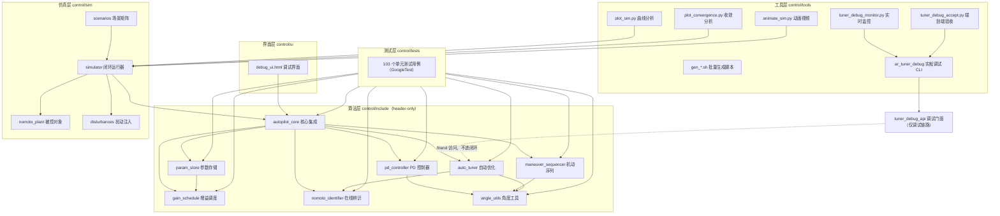

**主要功能模块图**（仅算法层与外部 IO 边界，箭头为数据流方向；仿真/测试/工具/界面层见上图，此处不展开）：

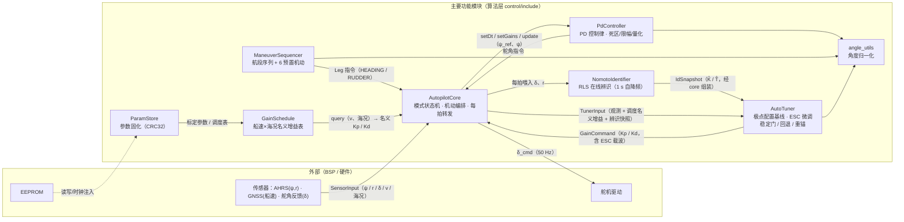

### 2.2 软件分层架构

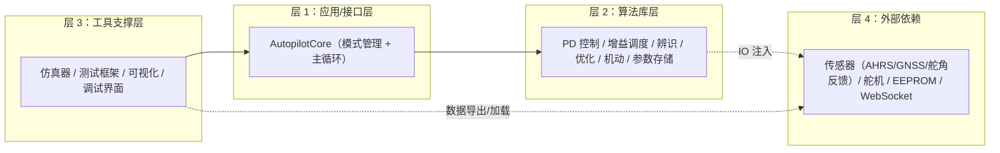

> 注：本图为逻辑分层；`AutopilotCore` 物理上与其余七个模块同在 `control/include/`。

### 2.3 目录结构

```
auto_rudder/
├── 自动舵定位与控制设计文档.md        # 需求/算法设计文档
├── 自动舵设计技术可行性分析文档.md    # 可行性分析文档
├── 自动舵控制方案说明文档.md          # 控制方案总体说明文档
├── 软件设计与架构文档.md              # 本文档
├── CONTEXT.md                         # 单上下文领域文档
├── AGENTS.md                          # Agent 协作约定
├── docs/                              # 专题调研与领域文档（auto_tuning/ 等）
├── assets/                            # 文档插图（架构图、曲线、轨迹 PNG）
├── md2pdf.py                          # Markdown → PDF 转换脚本
└── control/
    ├── CMakeLists.txt                 # 顶层构建脚本
    ├── include/                       # ★ 算法库（header-only，9 个头文件）
    │   ├── angle_utils.hpp
    │   ├── pd_controller.hpp
    │   ├── gain_schedule.hpp
    │   ├── nomoto_identifier.hpp
    │   ├── auto_tuner.hpp
    │   ├── maneuver_sequencer.hpp
    │   ├── param_store.hpp
    │   ├── autopilot_core.hpp
    │   └── tuner_debug_api.hpp        # 实船调试门面（仅调试链路，见 §8.3）
    ├── sim/                           # 闭环仿真（ar_sim 可执行文件）
    ├── tests/                         # GoogleTest 单元测试（9 个独立可执行目标，共 103 用例）
    ├── tools/                         # Python 可视化工具 + 实船调试工具（C++ CLI / Python 监控与验收）
    ├── ui/                            # Web 调试界面
    ├── 控制算法代码说明文档.md         # 模块级代码说明文档
    ├── 控制算法开发文档.md             # 模块级开发文档
    ├── build/                         # CMake 构建产物（被 .gitignore 忽略）
    ├── build-asan/                    # ASan/UBSan 构建产物（被 .gitignore 忽略）
    └── out/                           # 仿真 CSV/图片输出（被 .gitignore 忽略）
```

### 2.4 模块清单

| 模块 | 文件 | 类型 | 职责 |
|------|------|------|------|
| 角度工具 | `angle_utils.hpp` | header-only | 角度归一化、最小角差 |
| PD 控制器 | `pd_controller.hpp` | header-only | 航向误差→舵角：控制律、限幅、死区、滤波、量化 |
| 增益调度 | `gain_schedule.hpp` | header-only | 按船速/海况查询 Kp/Kd，段中点线性插值 |
| 模型辨识 | `nomoto_identifier.hpp` | header-only | Nomoto 一阶模型 RLS 在线辨识（R1：自降频，可任意频率喂入） |
| 自动优化 | `auto_tuner.hpp` | header-only | 极点配置 + ESC 性能寻优 + 稳定性监控（R1：编排内收，对外仅 tick/establishBaseline/suspend） |
| 机动序列 | `maneuver_sequencer.hpp` | header-only | 航段序列框架 + 6 种预置机动 |
| 参数存储 | `param_store.hpp` | header-only | 参数序列化、CRC32、范围校验、读写注入 |
| 核心集成 | `autopilot_core.hpp` | header-only | 模式状态机 + 机动编排 + 每拍转发（R1：调参编排收进 AutoTuner） |
| 实船调试接口 | `tuner_debug_api.hpp` | header-only | AutoTuner 内部机制的逐函数调试门面（friend 访问，仅调试链路，见 §8.3） |
| 仿真器 | `sim/simulator.hpp` | 头文件 | 闭环 runner、指标计算、CSV 导出 |
| 被控对象 | `sim/nomoto_plant.hpp` | 头文件 | Nomoto 模型 + 舵机一阶惯性 + 物理限幅 |
| 扰动模型 | `sim/disturbances.hpp` | 头文件 | 恒值风、波浪、量测噪声（按海况缩放） |
| 场景定义 | `sim/scenarios.hpp` | 头文件 | 验证矩阵、辨识/ESC/机动/验证场景 |
| 仿真入口 | `sim/main.cpp` | 可执行 | `ar_sim` 命令行执行器 |
| 调试命令行 | `tools/tuner_debug_cli.cpp` | 可执行 | `ar_tuner_debug`：逐行命令驱动 TunerDebugApi（OK/ERR + key=value 输出） |
| 调试监控/验收 | `tools/tuner_debug_monitor.py`、`tuner_debug_accept.py` | 脚本 | 状态实时监控 / 端到端功能验收（9 组 49 项断言） |
| 单元测试 | `tests/test_*.cpp`（9 个） | 可执行 | 103 个测试用例 |

---

## 3. 核心算法模块设计

### 3.1 模块依赖关系

所有算法模块都位于 `namespace ar` 下，无环依赖：

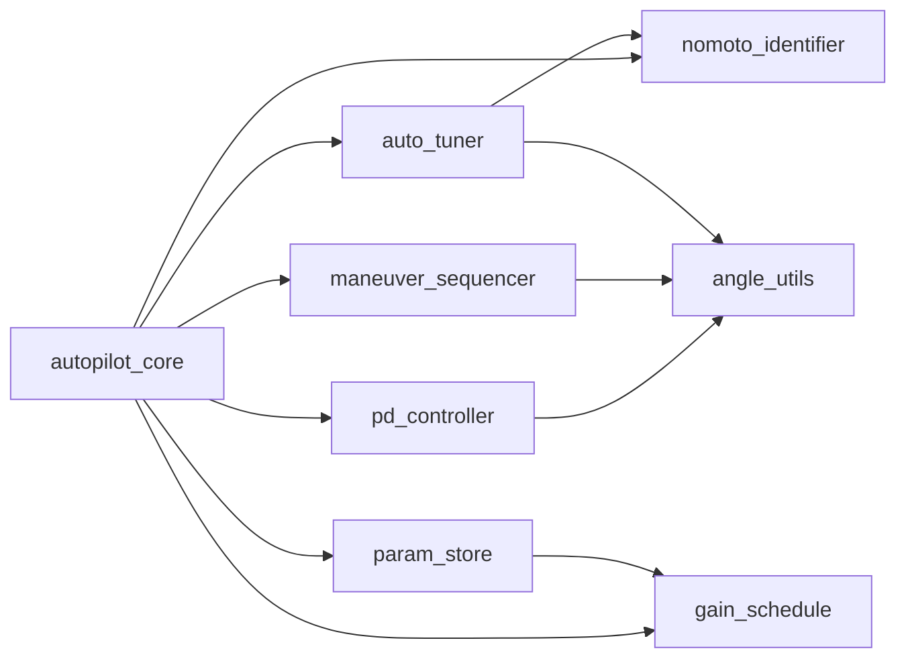

### 3.2 角度工具（angle_utils）

提供两个核心原语，被 PD 控制器与机动序列复用：

- `normalizeAngleRad / normalizeAngleDeg`：将角度归一化到 $(-\pi,\pi]$ 与 $(-180,180]$
- `angleDiffRad / angleDiffDeg`：计算**最小带符号角差** $\text{ref}-\text{act}$，消除 359°→1° 跳变问题

另导出换算常量 `PI`、`DEG2RAD`、`RAD2DEG` 供各模块复用。

### 3.3 PD 航向控制器（pd_controller）

#### 控制律

$$\delta = K_p \cdot e + K_d \cdot \frac{de}{dt}, \quad e = \text{angleDiffDeg}(\psi_{ref}, \psi_{act})$$

不引入积分项，避免低速/长时漂移与积分饱和问题；依靠位置反馈实现航迹闭环。

#### 处理流程

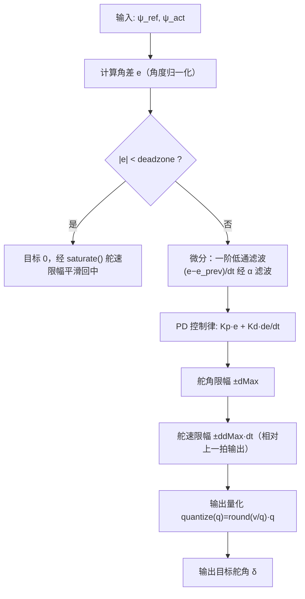

#### 关键参数

| 参数 | 默认值 | 含义 |
|------|--------|------|
| `Kp` / `Kd` | 1.0 / 0.5 | 比例 / 微分增益 |
| `dMax` | 35° | 舵角限幅 |
| `ddMax` | 10°/s | 舵速限幅 |
| `deadzone` | 0.3° | 误差死区 |
| `tau` | 0.2 s | 微分滤波时间常数 |
| `quant` | 0.1° | 输出量化步长 |
| `dt` | 0.02 s | 控制周期（50 Hz） |

设计要点：

- **P1 整改**：`setGains()/setDt()` 轻量更新参数且**不重置内部状态**，供增益调度每周期调用，避免状态清空造成输出跳变。
- `saturate()` 公开限幅工具：机动序列 RUDDER 段复用，且推进 `prevOut_` 基准保证舵速限幅连续。
- `initBaseline(actualRudder)`：上电/切模式时以实际舵角初始化基准，避免从 0 爬升跳变。
- **P11 防护**：`setParams()` 整表替换会清空内部状态，并将 `dt/quant ≤ 0` 钳到下限 1e-3；`setDt()` 拒绝非法 dt。首拍微分项强制为 0，避免冷启动微分冲击。

### 3.4 增益调度（gain_schedule）

按**船速分段 × 海况**查询名义增益，速度维在**段中点**间线性插值，消除段切换跳变：

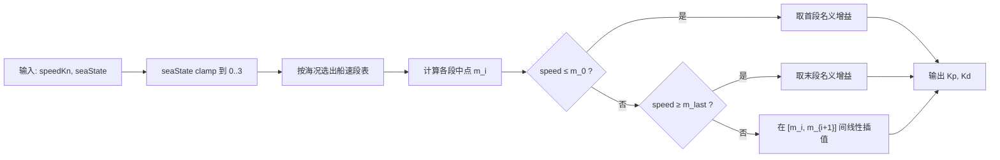

默认调度表（`GainPoint{speedMin, speedMax, seaState, Kp, Kd}`）：

| 船速段 (kn) | sea 0 | sea 1 | sea 2 | sea 3 |
|-------------|-------|-------|-------|-------|
| < 4 | 2.0 / 0.8 | 2.0 / 0.8 | — | — |
| 4~10 | 1.5 / 0.6 | 1.5 / 0.6 | 1.0 / 0.4 | 1.0 / 0.4 |
| 10~18 | 1.2 / 0.5 | 1.2 / 0.5 | 0.9 / 0.4 | 0.9 / 0.4 |
| 18~25 | 1.0 / 0.4 | 1.0 / 0.4 | 0.7 / 0.3 | 0.7 / 0.3 |

（"Kp / Kd"，"—" 表示默认表无此组合：查询不做跨海况回退，低于本海况首段中点时取本海况首段名义值——如 sea 2/3、<4 kn 时得本海况 4~10 kn 段的 Kp=1.0/Kd=0.4；仅当整表无任何该海况行（`setTable()` 自定义表）时才固定兜底 Kp=1.0/Kd=0.5）支持 `setTable()` 整表替换，供标定结果或仿真场景注入。

注意：查询侧用定长数组收集，每种海况最多 8 个速度段，超出部分静默忽略——`setTable()` 注入自定义表时需受此约束。

### 3.5 在线辨识（nomoto_identifier）

对 Nomoto 一阶模型做带遗忘因子的 RLS 在线辨识：

$$T\dot r + r = K\delta \;\Rightarrow\; \phi_k = \left[\tfrac{\delta_k}{d_{scale}},\; -\tfrac{r_k-r_{k-1}}{\Delta t \cdot dr_{scale}}\right]^T,\quad \theta=[K,\ T]^T$$

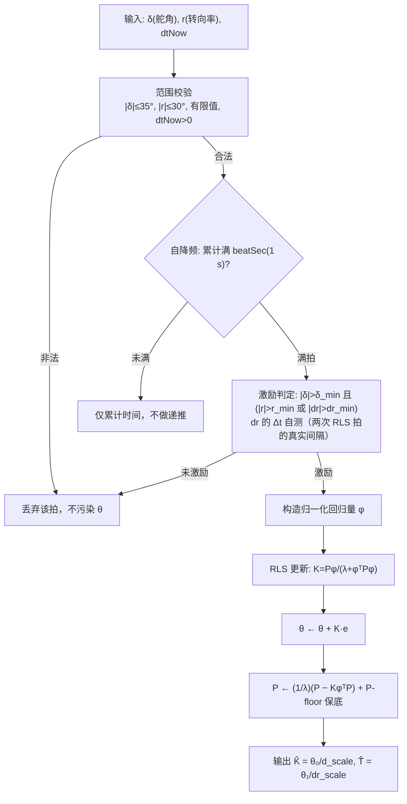

设计要点：

- **默认参数**：遗忘因子 λ=0.98；激励阈值 `deltaMin=3°`、`rMin=0.5°/s`、`drMin=0.2°/s²`；归一化尺度 `dScale=50°`、`drScale=1.0`；协方差初值 `p0=1.0`（归一化后回归量 O(1)）（nomoto_identifier.hpp）。
- **激励条件**：保留转向率过零附近的高 $dr$ 瞬态，否则 $T$ 欠定。
- **回归量归一化**：消除 δ 与 dr 量级差导致的协方差矩阵病态。
- **P-floor**：协方差对角元保底，防止协方差塌陷导致丧失长期自适应能力。
- **`valid()` 物理校验**：$K \in (0,2]$、$T \in [1,60]$s，越界视为无效结果。
- **坏数据防御（P11）**：范围校验被拒的拍不写差分锚点 `prevR_`——否则 NaN/毛刺会成为下一拍差分锚点，污染 dr 并永久毒化 θ/P；未激励但合法的拍仍正常更新锚点。
- **自降频（R1 深化）**：`update(δ, r, dtNow)` 可任意频率调用，内部累计满 `beatSec`（默认 1 s）才做一次 RLS 拍（点采样取拍时刻样本）；差分 Δt 由模块自测（两次 RLS 拍的真实间隔），与调用频率无关。旧设计把"50 Hz × 1 s"的降频约定放在调用方（计数器 + 改写 `Params.dt`），调用频率一变差分即静默出错——该语义陷阱已随 `Params.dt` 字段一并删除；P3 的降频目的（降低 ECU 负担、保证差分信噪比）由 `beatSec` 继承。

### 3.6 自动优化（auto_tuner）

两层在线优化结构：

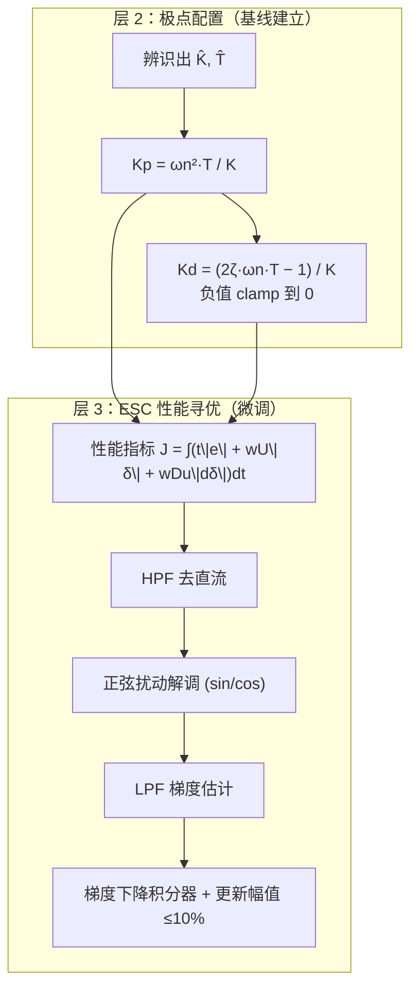

对外接口（R1 深化：节拍计数、ESC 窗口、速度门控、增益所有权、漂移重基线、振荡门控等编排权从 `AutopilotCore` 收回本模块，公有动作仅 3 个）：

| 接口 | 说明 |
|------|------|
| `tick(const TunerInput&) → GainCommand` | 每拍单入口。内部依次：速度门控（`enabled_ = speedKn ≤ highSpeedDeactivateKn`）→ 无基线时跟随调度值 → 周期辨识评估（P12 漂移检查）→ 参考稳定门控 + 性能样本累积（含因果解调）→ ESC 窗口结算（稳定门 + 回退）→ 扰动注入 → 返回本拍增益（已含 ESC 载波） |
| `establishBaseline(const IdSnapshot&) → bool` | 一次性评估并建基线（P14 试验收官/人工标定注入）；不做漂移检查、振荡条件以 0 把关、恒重锚 ESC；与 `tick` 共享私有 `applyEstimate_()`；入口要求 `snap.excited && snap.valid`，否则直接返回 false |
| `suspend()` | 唯一模式生命周期钩子：停用 + 清测量状态（窗口/解调/HPF/梯度），保留基线 |

只读查询：`enabled()`、`baselineEstablished()`、`currentGains()`（去载波投影）、`computeJ()`、`oscDetector()`；`polePlacement` 为公有静态（公式全仓库唯一出处），`stabilityCheck` 为公有纯函数。`TunerInput`/`GainCommand`/`IdSnapshot` 为 `namespace ar` 下的公有结构体：

```cpp
struct TunerInput { double headingRefDeg, headingDeg, rudderDeg, speedKn, dt,
                    schedKp, schedKd; IdSnapshot id; };
struct GainCommand { double Kp, Kd; };                    // 已含 ESC 载波
struct IdSnapshot { bool excited, valid; double K, T; };  // 辨识器只读投影
```

下表安全机制 R1 起内收为模块私有实现，经 `tick`/`establishBaseline` 驱动：

| 安全机制 | 说明 |
|----------|------|
| `stabilityCheck` | 全部满足才接受：K/T 有限且非退化、Kp>0、ζ≥ζ_min（默认 0.6）、ωn≤ωn,max（默认 0.5 rad/s）、振荡幅值 ≤ oscMax（默认 5°）；ζ/ωn 由 (K,T,Kp,Kd) 反算 |
| `OscillationDetector` | 基于航向误差过零的峰-峰幅值实测，代替理论估计 |
| `clampUpdate` | 单次增益更新幅值 ≤ max(当前值×10%, absMinUpdate=1e-3)（P11：旧值为 0 时防锁死） |
| `revert` | 校验失败回退到基线增益 |
| 高速去激活 | 船速 > 15 kn 自动禁用（高速下辨识信噪比差） |
| 无堆分配 | `RingBuffer` 固定环形数组替代 `std::deque`（60 s × 50 Hz = 3000 点） |

ESC 默认参数（`AutoTuner::Params`）：

| 参数 | 默认值 | 含义 |
|------|--------|------|
| `escAmp` | 0.05 | 扰动载波幅值（占增益比例；Kp 叠 sin、Kd 叠 cos，正交载波支持双参数同时解调） |
| `escFreq` | 0.05 rad/s | 载波频率，相位按控制拍 dt 推进 |
| `escStep` | 0.02 | 梯度下降积分步长 |
| `escHPFtau` | 5 s | 成本增量高通时间常数，按 dt 离散 |
| `escLPFtau` | 10 s | 窗末梯度低通，系数按 windowSec 折算 |
| `windowSec` | 60 s | 评估窗口（3000 拍 @50 Hz，非重叠窗） |
| `wU` / `wDu` | 0.01 / 0.005 | J 中舵角能耗 / 舵角变动权重 |
| `maxUpdateFrac` / `absMinUpdate` | 0.10 / 1e-3 | 单次更新相对上限 / 绝对下限 |

机制补充说明：

- **漂移重基线（P12）**：tick 的周期辨识评估仅当 K/T 估计相对建基线时的估计漂移超 `kReBaselineTol=25%`（分母带下限 K 侧 0.05、T 侧 1.0）才显式重基线；阈值内交给 ESC 自治微调，不动基线。
- **重锚（rebase）**：显式重基线（含 establishBaseline 的恒重锚）触发 `rebaseEsc()`——ESC 积分/解调累积/HPF/窗口样本清零、窗口节拍重对齐；载波相位保留，避免重锚拍载波突跳。
- **振荡门控（P12）**：航向参考变化后满 `kOscRefSettleSec=30 s` 才向振荡检测器喂入误差；参考机动期间的误差摆动是指令响应而非闭环振荡，不参与稳定门。

### 3.7 机动序列（maneuver_sequencer）

通用航段框架，每段为一个 `Leg`：

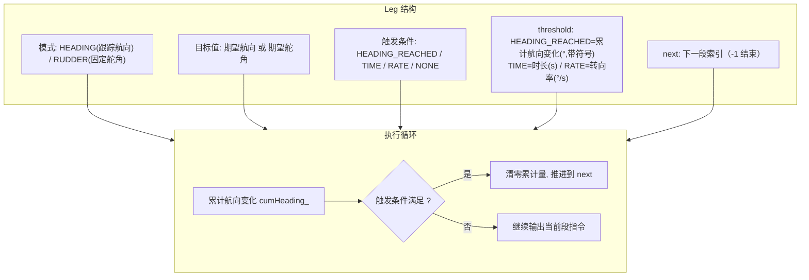

**触发判定（P12 方向敏感）**：`HEADING_REACHED` 要求累计航向变化沿 threshold 的符号方向达到其幅值才切段（`cum·thr ≥ thr²`）。旧逻辑 `|cum|≥|thr|` 无方向：反舵后船舶因惯性仍沿旧转向顺漂，会在真正反向前把航段"预触发"。因此所有预置机动的 HEADING_REACHED 阈值均带符号且与本段舵向一致。

预置六种机动形态：

| 机动 | 段模式 | 说明 |
|------|--------|------|
| Circles | RUDDER 恒舵角 | 累计转向达 360° |
| Williamson | RUDDER→RUDDER→HEADING | 满舵转 60° → 反向满舵转 180° → 保持 ψ₀+180° |
| U-Turn | RUDDER→HEADING | 恒舵角转满 180° 后保持目标航向 |
| Zigzag | RUDDER×2N | ±δ_z 交替，每次航向变化 ±φ_z |
| Cloverleaf | RUDDER×4 + HEADING×4 | 4 次 270° 转向 + 直航 |
| Search | HEADING + RUDDER 交替 | 边长递增的扩张方形搜索 |

工厂函数缺省参数：

| 工厂函数 | 缺省参数 | 备注 |
|----------|----------|------|
| `circles` | dCmd=15°, totalDeg=360° | 单段 RUDDER 恒舵角 |
| `williamson` | psi0, dMax=25° | 三段 +60°/−180°/保持 ψ0+180° |
| `uTurn` | psi0, right=true, dMax=25° | 恒舵角转满 180° 后保持 |
| `zigzag` | psi0, dz=10°, phiz=10°, N=5, returnToStart=false | 2N 段，可追加保持段 |
| `cloverleaf` | psi0, tLeg=30 s, dMax=20° | 四转向段同向，几何闭合 |
| `search` | psi0, t0=30 s, dt=10 s, cycles=6, dMax=20° | 边长递增方搜 |

完成末段（或 next 越界）后 sequencer 置 `done`，由 `AutopilotCore` 在完成拍自动切回 `AUTO_HEADING`：以当前航向为保持目标、当拍即闭环运行（P11：不再输出 0 造成舵令瞬时跳变），见 §3.9/§4.4。

### 3.8 参数存储（param_store）

参数持久化格式（纯算法层，EEPROM 读写由注入函数完成）：

```
[区块 A: 舵角标定 4×f64][区块 B: 模型 K/T 2×f64][区块 C: PD 增益 2×f64]
[version u32][timestamp u32][schedCount u32][增益调度表 schedCount×(...)]
[CRC32 u32（IEEE 802.3，覆盖上述全部字节）]
```

区块 A 含 rudderZero/rudderLeft/rudderRight 三个标定角与舵速限幅 `ddotMax`（默认 10°/s）。

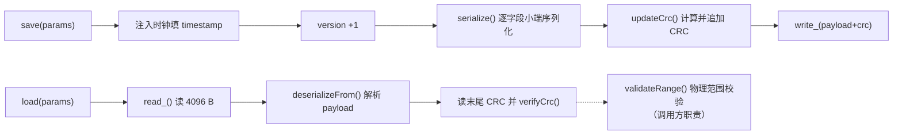

### 3.9 核心集成（autopilot_core）

`AutopilotCore` 是唯一对外入口，持有全部算法模块；`SensorInput` 定义最小传感器接口。

R1 深化后本类回归本职——**模式状态机 + 机动编排 + 每拍转发**，不再承担自动优化编排：

- `headingControlStep`（约 15 行）：首拍基准（`pendingBaseline` → `pd_.initBaseline`）→ 调度查询 → `identifier_.update(δ, r, dt)`（自降频）→ `tuner_.tick({...})` → `pd_.setDt` → `pd_.setGains` → `pd_.update`；
- 节拍计数、ESC 窗口、速度门控、增益所有权、漂移重基线、振荡门控全部内收 `AutoTuner`（§3.6），core 不再维护任何调参计数器/增益副本；
- 调参器参数注入收窄为 `setTunerParams(const AutoTuner::Params&)` 整组设置（替代暴露 mutable 引用的旧后门）；
- P14 辨识试验启动：`startIdentifyTrial(dz=20°, phiz=20°, cycles=4)` 重置辨识器、装载 `zigzag(0, dz, phiz, cycles, false)` 并进入 `AUTO_MANEUVER`；试验期间在机动分支内每拍喂辨识器（自降频，不受调参器速度门控影响）。试验状态 `IdentTrialState{NONE, RUNNING, OK, FAILED}` 经 `identTrialState()` 查询；`setMode`/`startManeuver` 会将进行中的试验取消（置 NONE）。
- P14 辨识试验收官 `finalizeIdentTrial` 缩为一行 `tuner_.establishBaseline(idSnapshot())`，映射 OK/FAILED。

---

## 4. 核心流程设计

### 4.1 主控制循环（50 Hz 单拍时序）

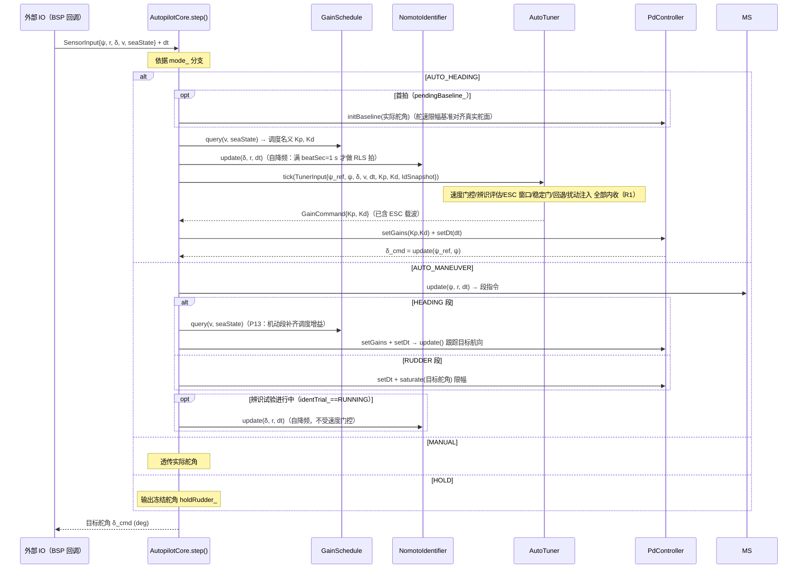

### 4.2 模式状态机

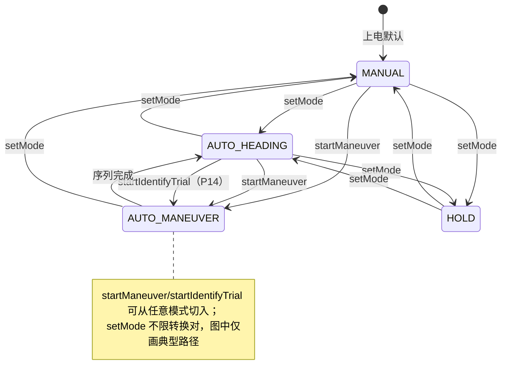

`setMode()` 的**状态清理**策略（P9 整改）：

- 切入新模式前：`pd_.reset()`、取消进行中的辨识试验
- 切出到 MANUAL/HOLD：`tuner_.suspend()`（R1 深化：清测量状态——窗口样本/解调累积/HPF/梯度，保留基线增益与基线估计），防止残留优化状态
- 切入 HOLD：冻结当前舵角指令 `holdRudder_`（非输出 0，避免舵机瞬间回中）
- 切入 AUTO_HEADING：置 `pendingBaseline_`，首拍以实际舵角 `pd_.initBaseline()` 初始化舵速限幅基准（P11），避免舵令从 0° 爬升

### 4.3 AUTO_HEADING 完整流程

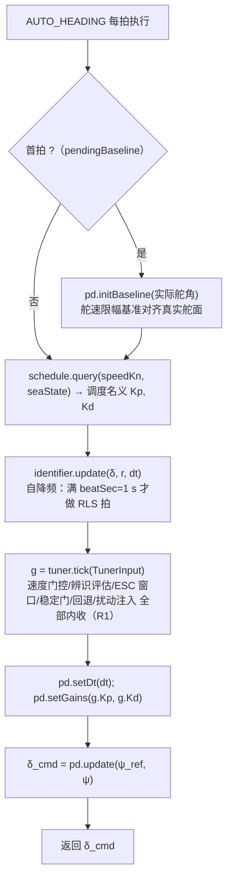

### 4.4 机动序列执行流程

`startManeuver(legs)` 装载航段并切换模式（并抢占进行中的辨识试验，P14）。HEADING 段补齐增益调度查询（P13：`schedule_.query` → `pd_.setGains` → `pd_.update` 跟踪段目标航向），RUDDER 段经 `pd_.saturate()` 施加舵角/舵速限幅（P7），保证指令物理可行。序列完成拍不再输出 0（P11：那是绕过舵速限幅的瞬时跳变），立即转 AUTO_HEADING、以当前航向为保持目标（`headingRef_ = s.headingDeg`）并本拍即闭环运行 `headingControlStep()`。辨识试验（`startIdentifyTrial`）期间每拍喂辨识器（自降频，不受调参器速度门控）；机动收官由 `finalizeIdentTrial` 一行 `tuner_.establishBaseline(idSnapshot())` 评估并建基线，映射 OK/FAILED，失败保持原增益。

---

## 5. 接口设计

### 5.1 对外算法接口

```cpp
struct SensorInput {
    double headingDeg;   // AHRS 艏向 (°)
    double rateDegS;     // AHRS 转向率 (°/s)
    double rudderDeg;    // 舵角反馈 (°)
    double speedKn;      // 船速 (kn)
    int    seaState;     // 海况 0..3
};

double AutopilotCore::step(const SensorInput& s, double dt);  // 返回目标舵角
```

其余公开接口（`AutopilotCore`）：

```cpp
void setMode(Mode m);                 // 模式切换（含状态清理，见 §4.2）
void setHeadingRef(double ref);       // 航向保持目标
void startManeuver(const std::vector<Leg>& legs);        // 机动序列
void startIdentifyTrial(double dz = 20.0, double phiz = 20.0, int cycles = 4);  // P14 自动 Z 形辨识试验
IdentTrialState identTrialState() const;                 // NONE/RUNNING/OK/FAILED
void setTunerParams(const AutoTuner::Params& p);         // R1：调参参数整组注入
const AutoTuner& tuner() const;       // 只读观测（baselineEstablished()/currentGains() 等）
```

调用约定：

- 控制周期固定 50 Hz（`dt = 0.02 s`），由调用方（BSP 定时回调）保证
- 单拍计算量极小（实测峰值 < 5 ms，见 §7.5）

### 5.2 数据流图

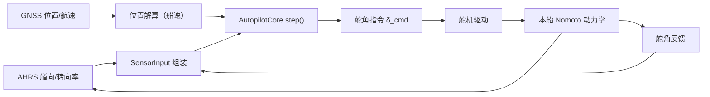

### 5.3 调试界面 WebSocket 接口

`debug_ui.html` 与真实 ECU 之间通过 WebSocket 交互：

| 消息方向 | type | 内容 |
|----------|------|------|
| UI → ECU | `cmd` | 舵角 / 模式 / 目标航向 |
| UI → ECU | `set_params` | `scope`：pd / sched / id / tuner / store / mode |
| ECU → UI | `sensor` | 5 路传感器数据（与 `SensorInput` 对应） |
| ECU → UI | `params_ack` | 参数确认（含 version） |
| ECU → UI | `status` | 故障码上报 |

默认地址 `ws://localhost:8080`（UI 顶栏可改），协议字段详见 `control/ui/README.md`。

---

## 6. 数据与参数设计

### 6.1 参数模型

全部可调参数集中在 3 个 `Params` 结构体（PdController / NomotoIdentifier / AutoTuner），通过 `setParams()` 整组设置（附带重置内部状态）；增益调度为一张 `GainPoint` 表，经 `setTable()` 整表替换：

| 结构体 | 主要参数 |
|--------|----------|
| `PdController::Params` | Kp, Kd, dMax, ddMax, deadzone, tau, quant, dt |
| `GainSchedule`（表） | 船速段 × 海况 × {Kp, Kd} |
| `NomotoIdentifier::Params` | λ=0.98, beatSec=1.0, 激励阈值, p0, 归一化尺度 |
| `AutoTuner::Params` | ζ=0.85, ωn=0.2, ESC 参数, 性能权重, 安全约束 |

持久化参数模型 `ControlParams`（param_store 的存储对象）：

| 区块 | 内容 | 默认值 |
|------|------|--------|
| A 舵角标定 | rudderZero / rudderLeft / rudderRight / ddotMax | 0 / 0 / 0 / 10°/s |
| B 模型参数 | K / T | 0 / 0（须辨识或标定写入后才通过范围校验） |
| C PD 增益 | Kp / Kd | 1.0 / 0.5 |
| D 增益调度表 | schedTable 变长 GainPoint 数组 | 空 |
| 元信息 | version / timestamp / crc | — |

序列化布局：`[8×f64 区块A/B/C][version u32][timestamp u32][schedCount u32][sched 表逐项]`。

### 6.2 参数持久化安全

- **CRC32**（IEEE 802.3，多项式 0xEDB88320）覆盖全部 payload 字节，CRC 字段自身排除
- **逐字段显式小端序列化**：不依赖结构体内存布局/填充字节，跨平台可移植
- **加载校验**：`load()` 内做格式完整 → CRC 校验两步，任一失败即拒绝；物理范围校验由 `validateRange()` 提供（K∈(0,2]、T∈[1,60]s、Kp>0、Kd≥0、舵速限幅 1~30°/s），由上层在 `load()` 成功后调用
- **保存流程**：`save()` 自动填 timestamp（注入时钟函数）→ `version` 单调 +1 → 计算 CRC → 写入 `[payload][crc u32 小端]`；`load()` 读取缓冲上限 4096 字节

### 6.3 默认控制参数（节选）

| 参数 | 值 | 依据 |
|------|-----|------|
| 控制周期 | 0.02 s（50 Hz） | §1.3 设计指标 |
| 增益调度默认表 | §3.4 表 | 船速/海况分段 |
| 极点配置目标 | ζ=0.85, ωn=0.20 rad/s | 典型船超调 ≤10% |
| ESC 窗口 | 60 s | 性能指标统计周期 |
| 辨识自降频 | beatSec=1 s（RLS 拍间隔） | R1 深化 |
| 振荡稳定门阈值 | 5°（超限拒绝增益配置并回退基线） | auto_tuner.hpp |
| PD 默认增益/限幅 | Kp=1.0, Kd=0.5；dMax=35°, ddMax=10°/s, deadzone=0.3°, tau=0.2 s, quant=0.1° | pd_controller.hpp |
| 辨识激励阈值与归一化 | λ=0.98；δ>3° 且（r>0.5°/s 或 dr>0.2°/s²）；p0=1.0, dScale=50°, drScale=1.0 | nomoto_identifier.hpp |
| ESC 载波与积分 | 幅值 5%（占增益比例）、频率 0.05 rad/s、步长 0.02；单次更新 ≤10%（下限 1e-3） | auto_tuner.hpp |
| 高速去激活 | 船速 > 15 kn 停用自动调参 | auto_tuner.hpp |

---

## 7. 仿真与验证设计

### 7.1 仿真架构

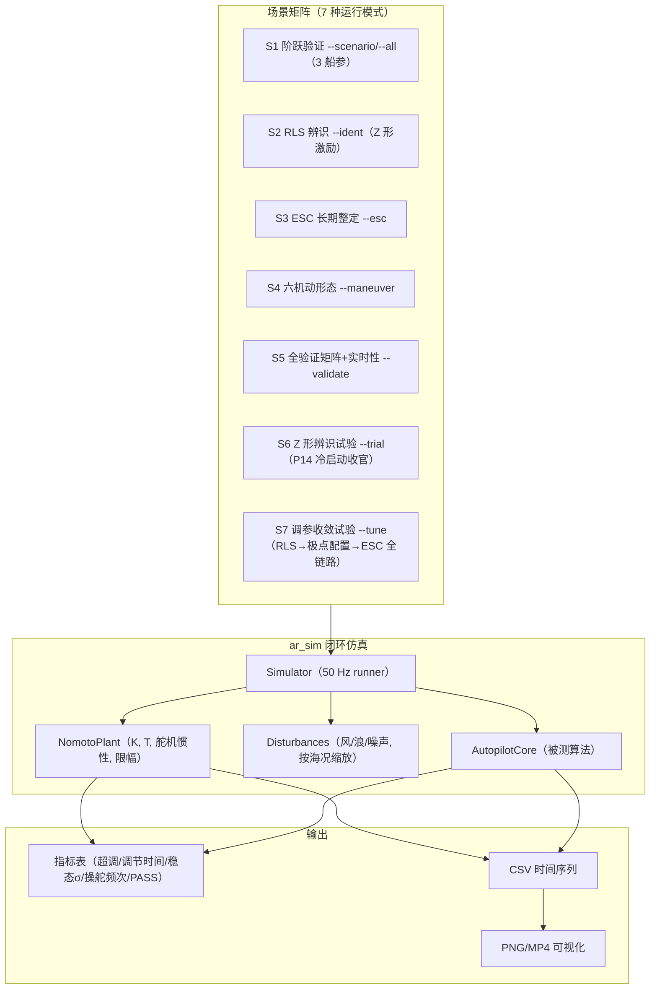

`ar_sim` 命令行：模式标志 `--list/--all/--scenario <name>/--ident/--trial/--esc/--tune/--maneuver <name>/--validate`；覆盖参数 `--K/--T/--speed/--sea(0-3)/--seconds/--leg/--dist/--out`；任一 FAIL 则非零退出。`--leg` 为 Z 形参考翻转周期（默认 15 s，仅 --tune 生效，慢船建议 ≥2T）。各模式 PASS 判据：

- 阶跃/--all/--validate 指标：超调≤10%、调节(5%)≤30 s、ess1σ≤1°、偏置≤1°、操舵频次≤6 次/min（--validate 另加单拍 <5000 μs）
- `--ident`：valid 且 |K̂−K|<0.05、|T̂−T|<2.0
- `--trial`：收官 applied 且 K̂/T̂ 误差 ≤25%
- `--esc`：辨识 valid + 基线建立 + 增益移动 >1% + 数值有界
- `--tune`：基线建立 + ≥4 个 ESC 窗口末 3 窗 J 散布 ≤10% + 末窗 J ≤ 首窗×1.02 + K̂/T̂ 偏差 ≤25%
- `--maneuver`：序列真实执行完毕且 maxRudder ≤36°

### 7.2 被控对象与扰动模型

- **被控对象**：Nomoto 一阶模型 $T\dot r + r = K(\delta_{act}+d)$，舵机一阶惯性 + 舵速/舵角物理限幅
- **对象参数**：默认 K=0.2 (1/s)、T=8.0 s；舵机一阶惯性 τS=0.3 s，舵速限幅 10°/s、舵角限幅 ±35°
- **扰动注入**：恒值风致等效舵角 2° + 0.1 Hz 波浪（幅值 1° 等效舵角）+ ψ/r 量测噪声（σ 分别 0.2°/0.1°/s，海况 1 基准幅值），强度按海况因子缩放：sea 0→×0、1→×1、2→×2、≥3→×3
- **扰动确定性**：自带 LCG 伪随机（seed 固定 12345），跨平台完全可复现；无论海况因子如何都推进 LCG 序列，保证随机序列确定

### 7.3 仿真验证结果（真实运行数据）

下表为 `ar_sim` 实际运行输出（K=0.2, T=8.0, 10 kn, 海况 0，30° 阶跃）：

| 指标 | 数值 | 设计要求 |
|------|------|----------|
| 超调量 | 1.30% | ≤ 10% |
| 调节时间（5%） | 17.44 s | ≤ 30 s |
| 稳态误差 1σ | 0.000° | ≤ 1° |
| 稳态偏置 \|mean\| | 0.053° | ≤ 1° |
| 操舵频次 | 0.00 次/min | ≤ 6 次/min |

注：以上为 `ar_sim` 内置 computeMetrics 口径；`tools/plot_sim.py --metrics` 按独立算法重算的调节时间为 27.44 s，两者算法口径不同。

全验证矩阵 `--validate`（含扰动与快慢船）当前实测为 2/4 PASS：typical_nodist（1.30%/17.44 s）与 fast_nodist（1.24%/14.80 s）通过；typical_dist 因操舵频次 12 次/min 超 ≤6 限值 FAIL（海况 1 基准扰动下 PD 无积分项，舵令修正偏频），slow_nodist 因调节时间 35.72 s 超 ≤30 s 限值 FAIL（慢船 T=20 s，30 s 判据相对其时间常数偏紧）。两项 FAIL 的判据/扰动模型合理性待复核（已列入待办）。

阶跃响应曲线（航向 / 舵角 / 转首率 / 误差 / 增益五子图）：


RLS 在线辨识场景（Z 形激励，辨识结果 K̂=0.229 / T̂=9.07，真值 K=0.20 / T=8.0，`valid=1`）：


Williamson 机动（max 航向 180°，max 舵角 35°，序列安全执行完毕）：


Williamson 机动极坐标轨迹（零度朝北、顺时针，航海习惯）：


### 7.4 单元测试体系

测试分层与算法模块一一对应（9 个测试文件，103 个用例）：

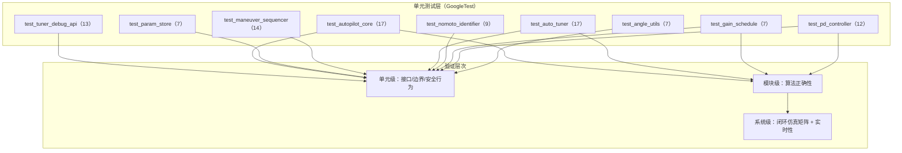

关键测试点（节选）：

| 测试 | 验证内容 |
|------|----------|
| `CrossZeroError` | 359°→1° 跨零角差 |
| `DeadzoneOutputsZero` | 死区内输出 0 |
| `RateLimit` | 舵速限幅生效 |
| `InterpolationContinuityAtBoundary` | 增益插值连续性 |
| `ConvergesOnNomotoData` | RLS 收敛到真值 |
| `OscillationDetectorMeasuresAmplitude` | 振荡幅值实测 |
| `RingBufferNoHeap` | 无堆分配保证 |
| `CrcDetectsCorruption` | CRC 检错 |
| `SetModeResetsState` | 模式切换状态清理 |
| `HoldFreezesLastRudder` | HOLD 冻结舵角 |
| `HighSpeedDisablesTuner` | 高速去激活 |
| `SelfDecimatesAtAnyCallRate` | 辨识器自降频：任意调用频率下 RLS 拍间隔与差分 Δt 正确（R1） |
| `NoBaselinePassesScheduleGainsThrough` | 基线未建立时增益跟随调度名义值直通（R1） |
| `SettleRevertsToBaselineWhenEstimateInvalid` | ESC 窗口结算遇无效估计回退基线（R1） |
| `RebaselineClearsIntegratorState` | 显式重基线清零 ESC 积分/解调状态（R1） |
| `TickThroughApiMatchesDirectTick` | 经调试接口的 tick 与直接调用逐位一致（§8.3） |
| `ForceGainsBypassesGate_DebugOnly` | force 系列确属旁路稳定门且不污染基线（§8.3） |

仿真冒烟测试随 CTest 注册 6 项（`sim_all / sim_validate / sim_ident / sim_esc / sim_trial / sim_maneuver_zigzag`，超时 120 s），覆盖系统级回归；GoogleTest v1.14.0 由 CMake FetchContent 自动拉取。注意：`sim_validate` 当前随 §7.3 的矩阵现状 FAIL。

### 7.5 实时性设计

- 控制周期 50 Hz（20 ms），算法单拍实测峰值耗时 < 5 ms，留有 4 倍余量
- 核心算法**零堆分配**：ESC 窗口缓冲用固定容量 `RingBuffer<3000>`，无运行时 `new/delete`
- 参数存储序列化为小体量 `std::vector` 对象，仅在保存/加载事件时分配，不在 50 Hz 控制热路径上

---

## 8. 工具链与调试设计

### 8.1 仿真可视化工具链

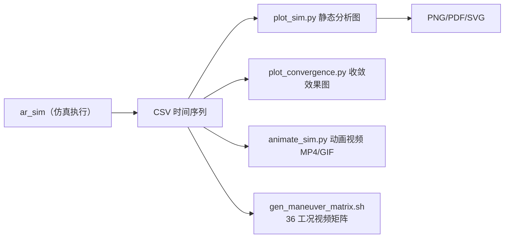

| 工具 | 功能 |
|------|------|
| `plot_sim.py` | 多子图分析（航向/舵角/转首率/误差/增益）、极坐标轨迹、多文件对比、指标表 |
| `plot_convergence.py` | `--tune` 收敛轨迹可视化：K̂/T̂ 收敛、ESC 增益/J 收敛、全链路概览三图 |
| `animate_sim.py` | 时间演化动画（左多子图 + 右极坐标） |
| `gen_all_videos.sh` | 一键生成全部场景视频 |
| `gen_maneuver_matrix.sh` | 3 船参 × 6 机动 × 2 干扰 = 36 个工况视频 |

工具依赖 `python3-matplotlib`/`python3-numpy`（视频需 `ffmpeg`）；无 GUI 环境用 `PLOT_SIM_AGG=1`/`ANIM_SIM_AGG=1` 强制 Agg 后端。

### 8.2 Web 调试界面

`debug_ui.html` 为单文件 Web 应用（HTML+CSS+JS，无第三方依赖）：

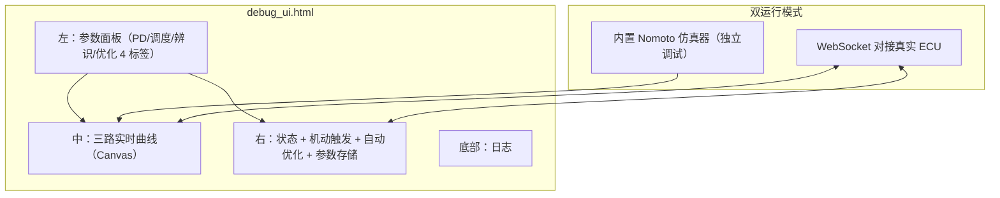

界面参数与 C++ 头文件一一对应（映射表见 `ui/README.md`）；JS 侧算法为调试用等价实现，自动优化交互语义尚为 R1 之前形态（启用/禁用/ESC 一步/回退基线），与 R1 后 `AutoTuner` 仅 `tick()/establishBaseline()/suspend()` 的对外接口存在差异，仅供离线调试参考。实船控制必须使用 C++ ECU。

### 8.3 实船调试接口（TunerDebugApi 工具链）

实船调试需要绕开 `tick()` 的固定编排，对单一环节做激励-观测——只验极点配置数值、只打一拍载波看执行器响应、只喂误差看振荡检测读数、只把当前窗口的 J 读出来。为此算法层旁挂一个 header-only 调试门面 `TunerDebugApi`（`include/tuner_debug_api.hpp`）：`AutoTuner` 经 `friend class TunerDebugApi` 向其开放私有机制，门面把公有动作与私有机制摊平为**一方法一功能**的独立调用，互不影响、可任意顺序组合；除 `force*` 系列外，每个方法与 `tick()` 内部走**同一私有函数、同一参数**，观测结果可代表在线行为。

**架构位置与控制主链路的关系**：调试链路是与控制闭环完全分离的旁路。控制主链路仍是 `AutopilotCore → AutoTuner → PD`（§2.1/§4.1）；`TunerDebugApi` 不被 `AutopilotCore` 持有、不进 `step()` 数据面，仅经 friend 关系挂接在 `AutoTuner` 上，由调试工具独占驱动（`ar_tuner_debug` 进程内自持一个 `AutoTuner` 实例）：

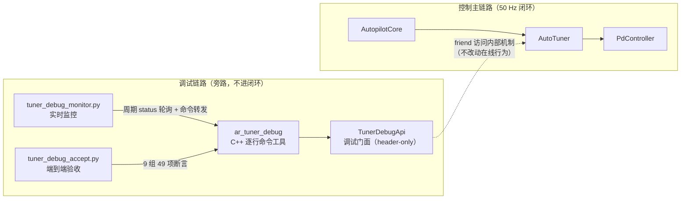

**工具链分层**：

| 层 | 组件 | 形态 | 职责 |
|----|------|------|------|
| 接口层 | `include/tuner_debug_api.hpp` | header-only 门面 | 逐函数暴露 AutoTuner 机制；无堆分配、无 IO，可在 ECU 上经串行/以太网命令通道驱动 |
| 命令层 | `tools/tuner_debug_cli.cpp` → `ar_tuner_debug` | C++ 可执行 | 每行一条命令、每条命令恰好一个功能；输出 `OK key=value` / `ERR 原因`，交互（isatty 检测，带横幅与提示符）与脚本（管道，输出纯净可解析）双模式 |
| 监控层 | `tools/tuner_debug_monitor.py` | Python + matplotlib | 按周期下发 `status` 并解析 key=value，4 子图滚动显示增益（当前/基线）、ESC 梯度、窗口代价 J、实测振荡与载波相位；监控期间终端命令原样转发；`--demo` 内置激励、`--log` 落盘 CSV、`--duration` 无 GUI 冒烟 |
| 验收层 | `tools/tuner_debug_accept.py` | Python | 驱动 CLI 对 9 个功能组逐项断言（49 项，数值经手工核算），任一 FAIL 退出码非零，可接 CI |

**命令分组**（与 §3.6 的机制一一对应，`help` 可查全表）：

| 组 | 命令 | 对应 AutoTuner 机制 |
|----|------|---------------------|
| 观测 | `status` / `j` / `osc` / `params` / `setparam` | 全量快照 / 当前窗口 ITAE / 实测振荡 / 参数表读 / 单参数改写（`setParams` 语义：复位调参器状态） |
| 层 2 | `pole` / `check` / `baseline` / `eval` | 极点配置（默认 ζ=0.85、ωn=0.2） / 稳定门四条件 / 建基线（试验收官语义） / `applyEstimate_` 辨识评估原语 |
| ESC | `dither` / `accum` / `step` / `settle` / `clamp` | 载波注入 / 样本累积+因果解调 / 窗末梯度结算 / 窗末裁决（结算+稳定门+接受或回退） / 更新限幅 |
| 振荡 | `oscfeed` / `oscreset` | 只喂 / 清零振荡检测器 |
| 生命周期 | `revert` / `rebase` / `suspend` / `reset` | 回退基线 / ESC 重锚 / 挂起 / 全复位 |
| 主流程 | `tick` | 与在线路径同一函数的一拍完整编排 |
| 强制注入 | `forcegains` / `forcebase` / `forcephase` / `forcegrad` / `forceenabled` | 旁路稳定门直接写状态，仅受控调试 |

**安全约束**：本接口只用于调试/标定，不得接入正常航行控制回路——`force*` 系列旁路稳定门与极点配置，正常路径的安全保证全部失效（`forcebase` 亦不记录 `baseK_/baseT_`，此后带漂移门控的评估恒重基线，属保守方向，但调用方须知情）；`setparam` 走 `setParams` 语义会复位调参器（基线清空），CLI 输出中显式提示。

**验证**：`tests/test_tuner_debug_api.cpp`（13 用例）在 API 层保证"每个功能可单独调用、行为与在线路径一致、force 确属旁路"（含 `TickThroughApiMatchesDirectTick` 逐位一致性回归）；`tuner_debug_accept.py` 在 CLI 端到端层（含解析与输出协议）互补验证。逐命令语义与字段定义见 `docs/实船调试接口调用文档.md`，工具用法见 `control/tools/README.md`。

---

## 9. 非功能设计

### 9.1 实时性

- 50 Hz 硬实时驱动，单拍预算 20 ms，算法实测峰值 < 5 ms
- 辨识/ESC 等重任务在模块内降频执行（1 s 自降频 / 60 s 窗口自结算），避免峰值冲击

### 9.2 可移植性

- **header-only**：无编译期依赖顺序问题，单文件即可嵌入任意工程
- **C++17**、无平台相关 API、无动态内存；浮点序列化显式小端，跨架构一致
- 算法层与 IO 完全解耦，通过注入函数（`std::function`）对接真实硬件

### 9.3 可靠性

| 机制 | 位置 |
|------|------|
| 输入范围校验（非法数据丢弃） | `NomotoIdentifier::update` |
| 物理合理性校验（K/T/Kp/Kd 范围） | `identifier.valid()`、`param_store.validateRange()` |
| 增益更新限幅（≤10%）与负 Kd clamp | `AutoTuner`（R1：私有机制，经 `tick` 驱动） |
| 稳定性监控 + 振荡实测 + 基线回退 | `AutoTuner::stabilityCheck`（经 `tick`/`establishBaseline` 驱动） |
| 模式切换状态清理 | `AutopilotCore::setMode` + `AutoTuner::suspend` |
| 参数 CRC32 完整性校验 | `ParamStore` |

### 9.4 可测试性

- 纯函数式算法核心，便于单元测试与性质验证
- 确定性仿真（固定 seed），CI 中可重复回归
- 全部模块通过 `ar_sim --validate` 与 CTest 单元测试套件（9 个 `test_*` 可执行文件，共 103 用例）双向验证
- 支持 ASan/UBSan 构建（`cmake -S control -B control/build-asan -DCMAKE_BUILD_TYPE=Debug -DCMAKE_CXX_FLAGS="-fsanitize=address,undefined -fno-sanitize-recover=all -g"`），单测注册已内置 ASAN_OPTIONS

---

## 10. 构建与部署

### 10.1 构建结构

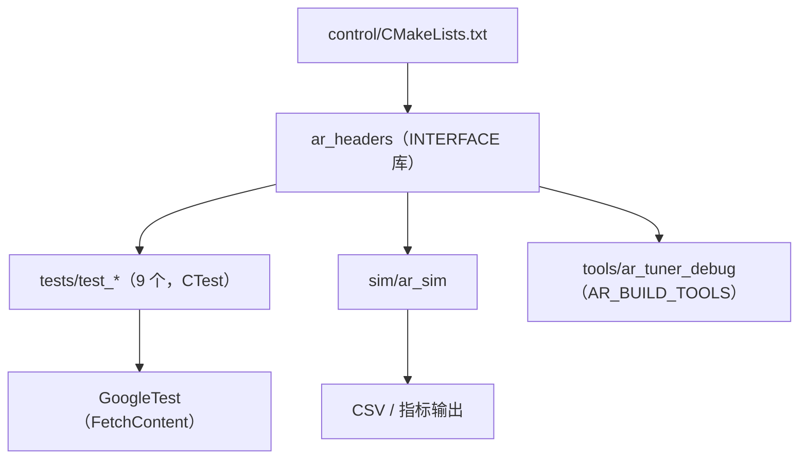

```bash
# 构建（Release 默认）
cmake -S control -B control/build
cmake --build control/build -j

# 运行单元测试与仿真冒烟（9 个 test_* + 6 个 sim_* 冒烟，经 CTest 统一调度）
ctest --test-dir control/build

# 运行仿真验证矩阵
control/build/sim/ar_sim --all
control/build/sim/ar_sim --validate
```

GoogleTest v1.14.0 经 FetchContent 拉取；`ctest` 同时覆盖单元测试与 ar_sim 冒烟测试。构建选项 `AR_BUILD_TESTS`/`AR_BUILD_SIM`/`AR_BUILD_TOOLS` 均默认 ON，其中 `AR_BUILD_TOOLS` 控制调试命令行目标 `ar_tuner_debug`（产物位于 `control/build/tools/`）。

### 10.2 运行入口

| 入口 | 用途 |
|------|------|
| `ar_sim --scenario step_typical` | 阶跃验证 |
| `ar_sim --ident` | RLS 在线辨识 |
| `ar_sim --esc` | ESC 长期整定 |
| `ar_sim --maneuver williamson` | 机动形态仿真（6 选 1） |
| `ar_sim --validate` | 全验证矩阵 + 实时性 |
| `ar_sim --tune` | 自动调参全链路收敛试验（RLS→极点配置基线→ESC 窗口寻优，导出 K̂/T̂/J/增益轨迹） |
| `ar_sim --trial` | 自动 Z 形辨识试验（冷启动，收官自动应用辨识 K/T 与极点配置增益） |
| `ctest --test-dir control/build`（或单独运行 `control/build/tests/test_*`） | 103 个单元测试（9 个测试可执行文件） |
| `control/build/tools/ar_tuner_debug` | 实船调试命令行（交互/脚本双模式，见 §8.3） |
| `python3 control/tools/tuner_debug_monitor.py [--demo]` | 调试参数实时监控（§8.3） |
| `python3 control/tools/tuner_debug_accept.py` | 调试接口端到端验收（9 组 49 项断言，§8.3） |
| `debug_ui.html` | Web 调试界面（浏览器打开） |

### 10.3 文档映射关系

| 本文档章节 | 对应设计文档 |
|------------|-------------|
| 需求与算法依据 | `自动舵定位与控制设计文档.md` |
| 系统可行性 | `自动舵设计技术可行性分析文档.md` |
| 控制方案总体说明 | `自动舵控制方案说明文档.md` |
| 模块级实现细节 | `control/控制算法开发文档.md`、`control/控制算法代码说明文档.md` |
| 自动调参与辨识流程 | `docs/auto_tuning/辨识流程原理推导与工作流程.md`、`docs/auto_tuning/自动调参流程图文详解.md` |
| ESC 方案原理 | `docs/工程总体分析与ESC方案原理.md` |
| 仿真可视化与实船调试工具 | `control/tools/README.md` |
| 实船调试接口调用 | `docs/实船调试接口调用文档.md` |
| Web 调试界面 | `control/ui/README.md` |

本文档及方案说明文档的配图统一存放于 `assets/`（架构图、阶跃/辨识/ESC 收敛曲线、机动轨迹等 PNG）。

---

— 文档结束 —
